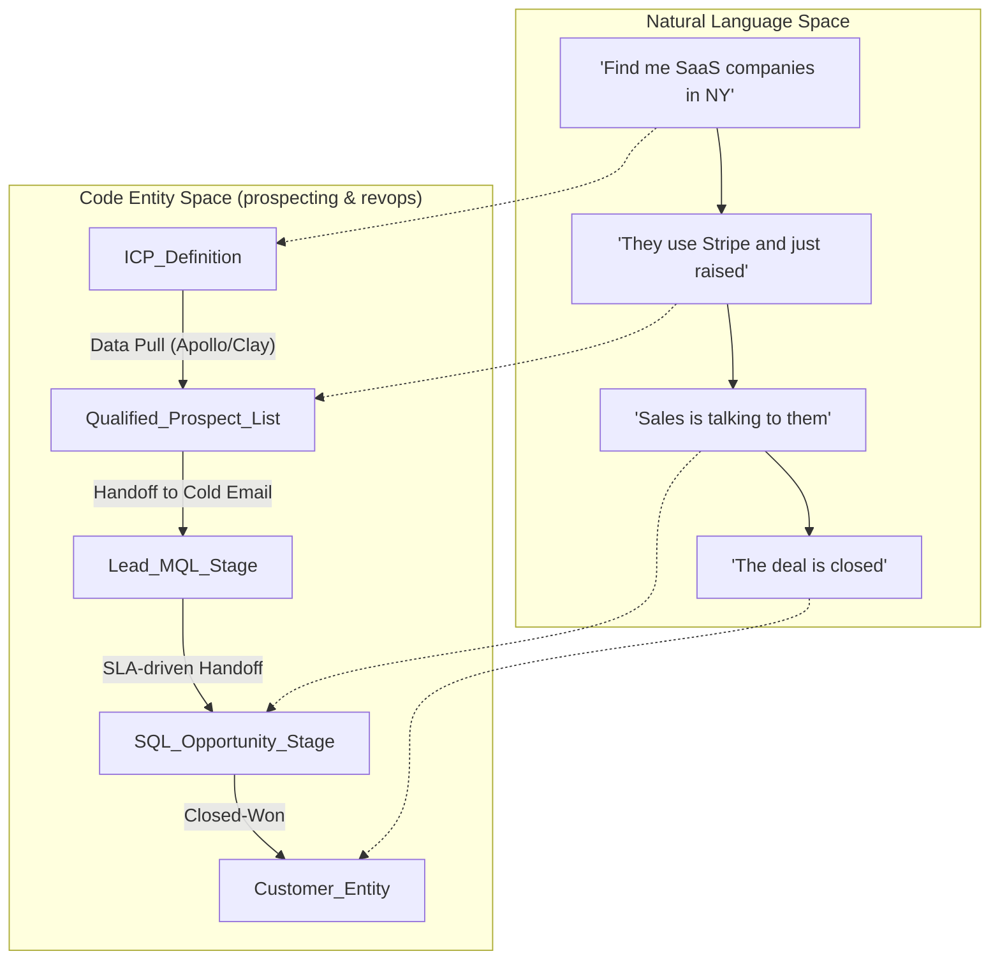
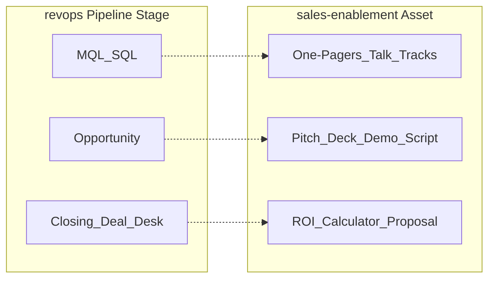

<!-- source: DeepWiki mcp.deepwiki.com · repo coreyhaines31/marketingskills · page 4.9 Sales & Revenue Operations · fetched 2026-10-27 -->

# Sales & Revenue Operations

Relevant source files

The following files were used as context for generating this wiki page:

- [skills/churn-prevention/SKILL.md](skills/churn-prevention/SKILL.md)
- [skills/cold-email/SKILL.md](skills/cold-email/SKILL.md)
- [skills/copywriting/SKILL.md](skills/copywriting/SKILL.md)
- [skills/launch/SKILL.md](skills/launch/SKILL.md)
- [skills/pricing/SKILL.md](skills/pricing/SKILL.md)
- [skills/revops/SKILL.md](skills/revops/SKILL.md)
- [skills/sales-enablement/SKILL.md](skills/sales-enablement/SKILL.md)

The **Sales & Revenue Operations** category provides the framework and assets necessary to bridge the gap between marketing-generated interest and closed-won revenue. This section covers three primary disciplines: **Sales Enablement**, which focuses on collateral and training; **Revenue Operations (RevOps)**, which manages the systems and data; and **Prospecting**, which focuses on the systematic identification and qualification of potential buyers.

## Overview of GTM Execution

Successful B2B execution requires a tight coupling between the narrative (Enablement), the mechanics (RevOps), and the hunt (Prospecting). While marketing focuses on top-of-funnel awareness, these skills ensure that once a lead is identified or a prospect is targeted, they are scored, routed, and nurtured through a professional sales process.

### Relationship to Other Skills
- **Lead Generation**: Feeds into RevOps lifecycle stages. [skills/revops/SKILL.md:50-58]()
- **Copywriting**: Informs the messaging used in pitch decks and one-pagers. [skills/copywriting/SKILL.md:136-143]()
- **Cold Email**: The primary outreach mechanism for lists generated by the prospecting skill. [skills/cold-email/SKILL.md:154-154]()
- **Pricing**: Informs the "Pricing Overview" slide in pitch decks and the "ROI / Value" calculations. [skills/pricing/SKILL.md:43-56]()

## System Data Flow: Prospect to Revenue

The following diagram illustrates how data moves through the system from initial identification to revenue realization, mapping natural language actions to the technical entities defined in the codebase.

**GTM Data Flow & Entity Mapping**

Sources: [skills/revops/SKILL.md:50-58](), [skills/cold-email/SKILL.md:154-154]()

---

## [Sales Enablement](#4.9.1)

Sales Enablement is the process of providing the sales organization with the information, content, and tools that help them sell more effectively. The `sales-enablement` skill focuses on creating high-trust collateral that reps actually use to overcome friction in the buyer journey.

### Key Components
*   **Pitch Decks**: A 10-12 slide framework focused on a "Story Arc" (Problem, Cost, Shift, Approach) rather than a feature tour. [skills/sales-enablement/SKILL.md:59-72]()
*   **Objection Handling**: A structured "Acknowledge-Reframe-Evidence-Bridge-Follow-up" framework to handle price, timing, and competition concerns. [skills/sales-enablement/SKILL.md:131-140]()
*   **One-Pagers**: Scannable "leave-behind" documents designed for internal champion selling or post-meeting recaps. [skills/sales-enablement/SKILL.md:99-105]()
*   **ROI Calculators**: Tools to translate product features into business outcomes like revenue impact or cost reduction. [skills/sales-enablement/SKILL.md:152-166]()

For details, see [Sales Enablement](#4.9.1).

---

## [Revenue Operations (RevOps)](#4.9.2)

Revenue Operations (RevOps) is the strategic integration of sales, marketing, and customer success to drive efficiency. The `revops` skill focuses on the "plumbing" of the GTM motion—ensuring data hygiene and defining clear handoff points.

### Key Components
*   **Lead Lifecycle**: Standardized stages from `Subscriber` to `Evangelist` with explicit entry and exit criteria. [skills/revops/SKILL.md:50-58]()
*   **Lead Scoring**: A dual-axis model measuring **Fit** (ICP attributes like company size/tech stack) and **Engagement** (intent signals like pricing page visits). [skills/revops/SKILL.md:83-101]()
*   **Routing Rules**: Logic for distributing leads via round-robin, territory, or account-based assignments. [skills/revops/SKILL.md:124-132]()
*   **Pipeline Management**: Defining required fields and exit criteria for each stage of the sales funnel. [skills/revops/SKILL.md:155-158]()

For details, see [Revenue Operations (RevOps)](#4.9.2).

---

## [Prospecting](#4.9.3)

Prospecting is the systematic process of identifying and qualifying potential customers. The `prospecting` skill provides frameworks for building high-quality lead lists across B2B SaaS, general B2B, local SMB, and Demand-signal discovery motions.

### Key Components
*   **Five-Phase Framework**: A structured workflow covering ICP definition, source selection, data pull, qualification scoring, and list hygiene.
*   **Demand-Signal Discovery**: Finding first customers or design partners from public pain and timing signals (added in v1.1.0).
*   **Trigger Events**: Identification of growth signals (funding, hiring, tech stack changes) to prioritize outreach. [skills/cold-email/SKILL.md:23-23]()
*   **Compliance Posture**: Strict adherence to data privacy, avoiding data brokers or leaked datasets.

For details, see [Prospecting](#4.9.3).

---

## Bridging Content to Operations

This diagram shows how Sales Enablement assets are mapped to the RevOps pipeline stages to ensure the right content is delivered at the right time.

**Content-to-Pipeline Mapping**

Sources: [skills/revops/SKILL.md:50-58](), [skills/revops/SKILL.md:155-158]()

## Technical Requirements
These skills heavily rely on the `product-marketing-context.md` file to ensure that generated collateral and process definitions align with the company's specific value proposition and target personas.
- **Context Check (Sales Enablement)**: [skills/sales-enablement/SKILL.md:14-15]()
- **Context Check (RevOps)**: [skills/revops/SKILL.md:14-15]()
- **Context Check (Cold Email)**: [skills/cold-email/SKILL.md:14-15]()
- **Context Check (Churn Prevention)**: [skills/churn-prevention/SKILL.md:14-15]()

Sources: [skills/sales-enablement/SKILL.md:1-166](), [skills/revops/SKILL.md:1-158](), [skills/cold-email/SKILL.md:1-158](), [skills/churn-prevention/SKILL.md:1-172]()

---

