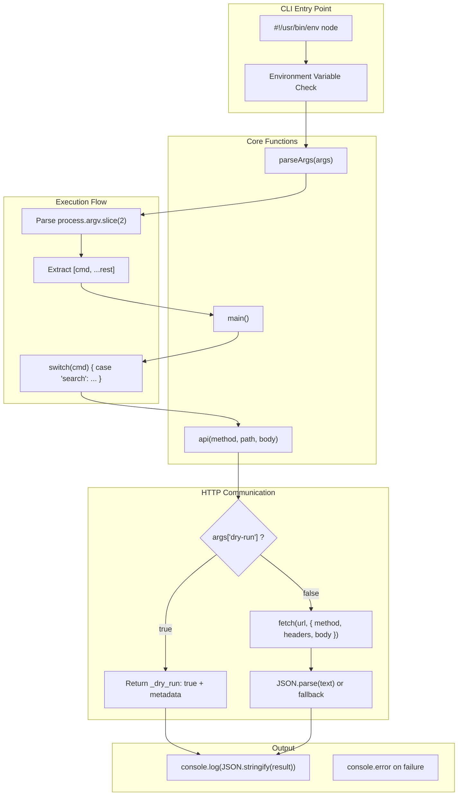
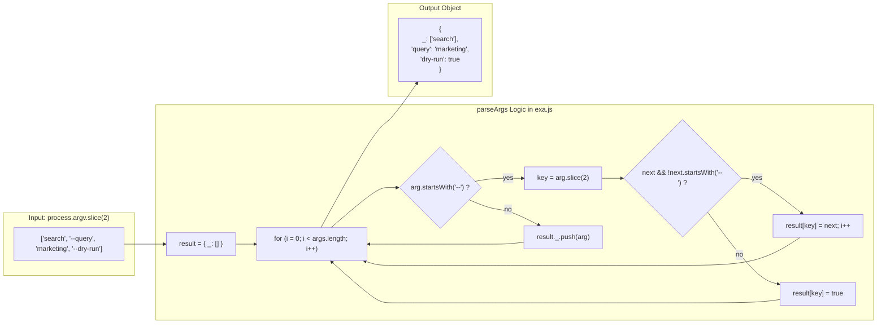
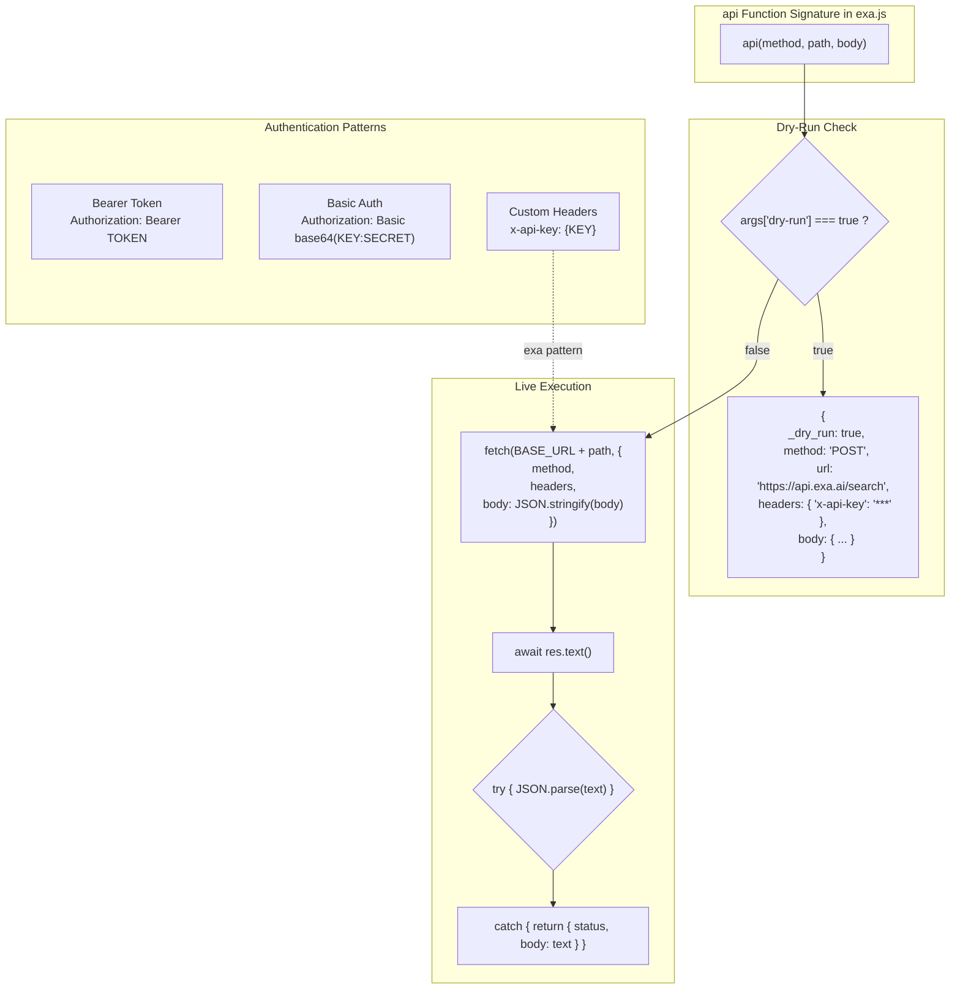

<!-- source: DeepWiki mcp.deepwiki.com · repo coreyhaines31/marketingskills · page 5.1 CLI Tools Overview · fetched 2026-10-27 -->

# CLI Tools Overview

<details>
<summary>Relevant source files</summary>

The following files were used as context for generating this wiki page:

- [tools/clis/README.md](tools/clis/README.md)
- [tools/clis/exa.js](tools/clis/exa.js)
- [tools/integrations/exa.md](tools/integrations/exa.md)

</details>


This document describes the shared architectural pattern implemented across all 60+ CLI tools in the repository. Each CLI provides a zero-dependency, single-file Node.js wrapper for external marketing APIs.

## Purpose and Scope

CLI tools provide executable command-line interfaces to external marketing platforms. Unlike skills (which provide knowledge to AI agents), CLIs handle actual API communication and execution. The tools layer implements a consistent architectural pattern that prioritizes:

- **Zero dependencies**: No `npm install` required; CLIs run directly with Node.js 18+ [tools/clis/README.md:1-6]().
- **Single-file portability**: Each tool is self-contained in one `.js` file [tools/clis/README.md:1-6]().
- **Consistent interface**: All CLIs follow the same command structure and parsing logic [tools/clis/README.md:101-117]().
- **Safe testing**: `--dry-run` mode previews requests without execution [tools/clis/README.md:92-99]().
- **Environment-based authentication**: Credentials read exclusively from environment variables [tools/clis/README.md:33-90]().

Sources: [tools/clis/README.md:1-188]()

## Shared Architectural Pattern

All 60+ CLIs implement the same internal structure, duplicated across files rather than abstracted into a shared library. This duplication is intentional to maintain CLI independence and portability.

### Architecture Flow Diagram


**Architecture Flow**: Every CLI follows this execution path: environment validation → argument parsing → command routing via `main()` → API call (or dry-run mock) → JSON output.

Sources: [tools/clis/exa.js:1-148](), [tools/clis/README.md:101-118]()

## Core Functions

### parseArgs Function

The `parseArgs` function converts command-line arguments into a structured object. This function is duplicated identically across all CLIs to handle flags (e.g., `--query`) and positional arguments.

### parseArgs Logic Diagram


**Implementation**: [tools/clis/exa.js:32-50]()

### api Function

The `api` function handles HTTP communication using the native `fetch` API. It implements authentication headers, dry-run interception, and response serialization.

### api Function Execution Diagram


**Implementation Examples**:
- **Custom Header (Exa)**: [tools/clis/exa.js:11-30]() (`x-api-key`)
- **Bearer token**: `ga4`, `resend` [tools/clis/README.md:55,75]()
- **Basic auth**: `lemlist` [tools/clis/README.md:87]()

Sources: [tools/clis/exa.js:11-30](), [tools/clis/README.md:33-90]()

### main Function Dispatcher

The `main` function implements command routing using a `switch` statement on the first positional argument (`cmd`). It handles argument validation and payload construction.

**Routing Pattern**:
1. `cmd` maps to an endpoint or resource (e.g., `search`, `find-similar`, `contents`).
2. Logic constructs a `body` object from the `args` parsed by `parseArgs`.
3. The `api()` function is called with the appropriate method and path.

**Implementation Example (exa.js)**:
- Routes `search`: Calls `POST /search` [tools/clis/exa.js:79-98]()
- Routes `find-similar`: Calls `POST /findSimilar` [tools/clis/exa.js:101-116]()
- Routes `contents`: Calls `POST /contents` [tools/clis/exa.js:118-127]()

Sources: [tools/clis/exa.js:75-142]()

## Authentication Patterns

All CLIs read credentials exclusively from environment variables to ensure security and prevent hardcoding.

| Pattern | Header/Auth Logic | Example CLI | Environment Variable |
|---------|---------------|--------------|----------------|
| **API Key Header** | `x-api-key: {KEY}` | exa.js | `EXA_API_KEY` [tools/clis/exa.js:3]() |
| **Bearer Token** | `Authorization: Bearer {TOKEN}` | resend.js | `RESEND_API_KEY` [tools/clis/README.md:75]() |
| **Basic Auth** | `Authorization: Basic {base64}` | lemlist.js | `LEMLIST_API_KEY` [tools/clis/README.md:87]() |
| **Custom Pair** | `Client-Id` + `Client-Secret` | snov.js | `SNOV_CLIENT_ID` + `SNOV_CLIENT_SECRET` [tools/clis/README.md:88]() |

Sources: [tools/clis/README.md:33-90](), [tools/clis/exa.js:3-9](), [tools/integrations/exa.md:14-18]()

## --dry-run Mode

Every CLI implements `--dry-run` mode to allow agents and users to preview the exact API request without executing it.

1. **Interception**: The `api` function checks `args['dry-run']` before any network activity [tools/clis/exa.js:12]().
2. **Credential Masking**: Sensitive keys are replaced with `***` in the output [tools/clis/exa.js:13]().
3. **Metadata Return**: Returns an object containing the `method`, `url`, `headers`, and `body` that *would* have been sent [tools/clis/exa.js:13]().

**Usage Example**:
```bash
node tools/clis/exa.js search --query "SaaS trends" --dry-run
```

Sources: [tools/clis/README.md:92-99](), [tools/clis/exa.js:12-14]()

## Zero-Dependency Design

All CLIs are implemented as standalone Node.js scripts, ensuring high reliability and ease of use for AI agents.

**Rationale for Code Duplication**:
- **Portability**: A single `.js` file can be copied anywhere and run [tools/clis/README.md:3-6]().
- **Independence**: Updating one tool's `parseArgs` logic does not risk breaking others.
- **No Install**: AI agents can execute tools via direct `node` calls without environment setup [tools/clis/README.md:9-13]().

**Node.js 18+ Built-ins Used**:
- `fetch()`: Native HTTP client for API requests [tools/clis/exa.js:15]().
- `process.env`: For credential retrieval [tools/clis/exa.js:3]().
- `JSON.stringify/parse`: For standard output and input processing [tools/clis/exa.js:141]().

Sources: [tools/clis/README.md:1-31](), [tools/clis/exa.js:1-30]()

---

