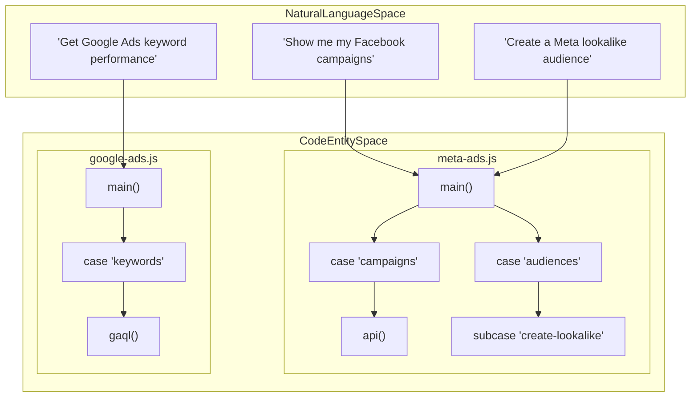
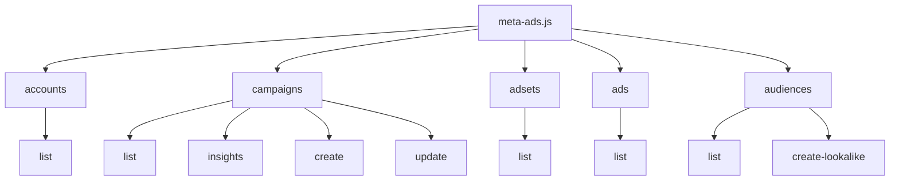
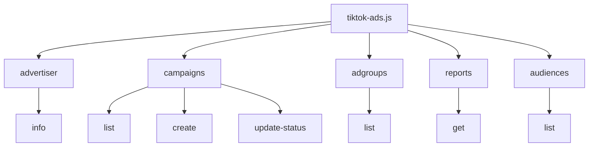
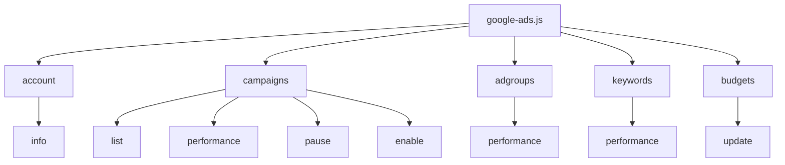
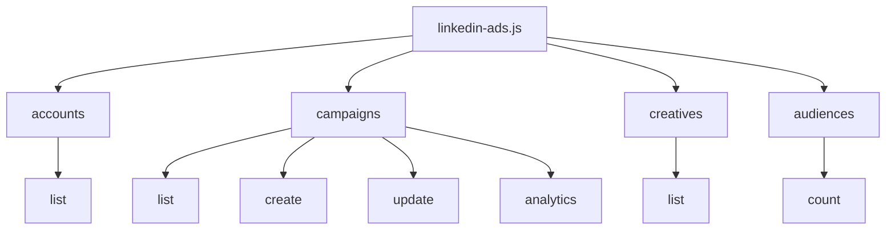
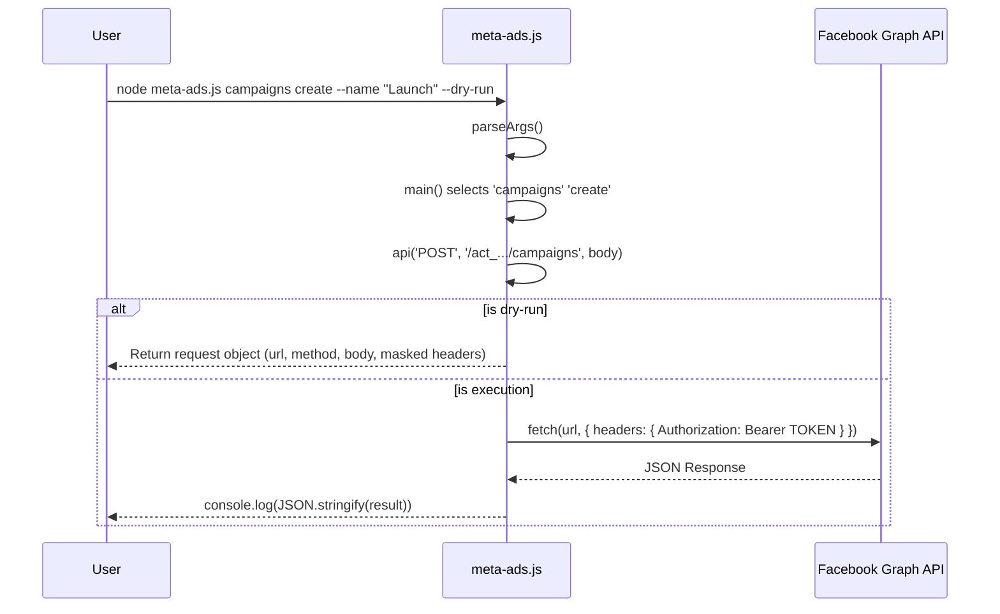

<!-- source: DeepWiki mcp.deepwiki.com · repo coreyhaines31/marketingskills · page 5.4 Advertising Tools · fetched 2026-10-27 -->

# Advertising Tools

<details>
<summary>Relevant source files</summary>

The following files were used as context for generating this wiki page:

- [tools/clis/activecampaign.js](tools/clis/activecampaign.js)
- [tools/clis/ahrefs.js](tools/clis/ahrefs.js)
- [tools/clis/customer-io.js](tools/clis/customer-io.js)
- [tools/clis/google-ads.js](tools/clis/google-ads.js)
- [tools/clis/linkedin-ads.js](tools/clis/linkedin-ads.js)
- [tools/clis/mention-me.js](tools/clis/mention-me.js)
- [tools/clis/meta-ads.js](tools/clis/meta-ads.js)
- [tools/clis/tiktok-ads.js](tools/clis/tiktok-ads.js)
- [tools/clis/tolt.js](tools/clis/tolt.js)
- [tools/clis/wistia.js](tools/clis/wistia.js)

</details>


## Purpose and Scope

This page documents the CLI tools for advertising platform integrations in the `marketingskills` repository. These tools provide command-line interfaces to manage paid advertising campaigns, creative assets, audiences, and reporting across multiple advertising platforms. The advertising CLIs enable campaign creation, performance tracking, audience management, and budget control through programmatic API access.

For SEO and organic discovery tools, see [5.5 SEO & Research Tools](). For email marketing tools, see [5.3 Email & Communication Tools](). For analytics and conversion tracking, see [5.2 Analytics Tools](). For strategic guidance on paid advertising and creative production, see [4.6 Paid Advertising]().

---

## Advertising CLI Overview

The advertising tools layer consists of four platform-specific CLI integrations designed with a zero-dependency architecture:

| CLI Tool | Platform | Primary Use Cases |
|----------|----------|-------------------|
| `meta-ads.js` | Facebook & Instagram Ads | Campaign management, audience targeting, insights |
| `tiktok-ads.js` | TikTok Ads | Video ad campaigns, advertiser info, integrated reports |
| `google-ads.js` | Google Ads | Search/Display campaigns, keyword performance, budget updates |
| `linkedin-ads.js` | LinkedIn Ads | B2B campaigns, creative listing, audience counts |

All advertising CLIs implement the standard architectural pattern: `parseArgs()` for argument parsing [tools/clis/meta-ads.js:34-52](), `api()` function for HTTP requests with authentication [tools/clis/meta-ads.js:12-32](), a `main()` command dispatcher [tools/clis/meta-ads.js:61-176](), and a `--dry-run` mode for safe testing [tools/clis/meta-ads.js:22-24]().

**Sources:** [tools/clis/meta-ads.js:1-182](), [tools/clis/tiktok-ads.js:1-191](), [tools/clis/google-ads.js:1-190](), [tools/clis/linkedin-ads.js:1-186]()

---

## Common Architecture Pattern

### Authentication Methods

Advertising CLIs use platform-specific authentication patterns and environment variables:

| Platform | Auth Method | Environment Variables |
|----------|-------------|----------------------|
| **Meta Ads** | Bearer token | `META_ACCESS_TOKEN`, `META_AD_ACCOUNT_ID` [tools/clis/meta-ads.js:3-5]() |
| **TikTok Ads** | Custom header (`Access-Token`) | `TIKTOK_ACCESS_TOKEN`, `TIKTOK_ADVERTISER_ID` [tools/clis/tiktok-ads.js:3-5]() |
| **Google Ads** | Bearer + Developer Token | `GOOGLE_ADS_TOKEN`, `GOOGLE_ADS_DEVELOPER_TOKEN`, `GOOGLE_ADS_CUSTOMER_ID` [tools/clis/google-ads.js:3-6]() |
| **LinkedIn Ads** | Bearer token | `LINKEDIN_ACCESS_TOKEN` [tools/clis/linkedin-ads.js:3-4]() |

### Natural Language to Code Entity Space

This diagram bridges how natural language intent maps to specific code entities within the advertising toolset.



**Sources:** [tools/clis/meta-ads.js:61-173](), [tools/clis/google-ads.js:70-181]()

---

## Meta Ads CLI

The `meta-ads.js` CLI provides comprehensive management for Meta (Facebook and Instagram) advertising accounts, campaigns, ad sets, ads, and audiences. It interacts with the Facebook Graph API.

### Meta Ads Command Structure



**Sources:** [tools/clis/meta-ads.js:61-173]()

### Key Commands

*   **Accounts List:** Retrieves a list of ad accounts associated with the authenticated user, including their ID, name, and status. Implemented by calling `GET /me/adaccounts?fields=id,name,account_status` [tools/clis/meta-ads.js:68]().
*   **Campaigns List:** Lists campaigns for a specified ad account. Requires `--account-id`. Calls `GET /act_{accountId}/campaigns?fields=id,name,status,objective,daily_budget` [tools/clis/meta-ads.js:80]().
*   **Campaign Insights:** Fetches performance data for a specific campaign. Requires `--id` (campaign ID) and supports `--date-preset` (default `last_30d`). Calls `GET /{id}/insights?fields=impressions,clicks,spend,actions,cost_per_action_type&date_preset={preset}` [tools/clis/meta-ads.js:86]().
*   **Campaign Create:** Creates a new campaign. Requires `--account-id`, `--name`, and `--objective`. Supports `--status` (default `PAUSED`). Calls `POST /act_{accountId}/campaigns` [tools/clis/meta-ads.js:99]().
*   **Campaign Update:** Updates the status of an existing campaign. Requires `--id` and `--status`. Calls `POST /${args.id}` with `{ status: args.status }` [tools/clis/meta-ads.js:104]().
*   **Adsets List:** Lists ad sets for a specified ad account. Requires `--account-id`. Calls `GET /act_{accountId}/adsets?fields=id,name,status,targeting,daily_budget,bid_amount` [tools/clis/meta-ads.js:117]().
*   **Ads List:** Lists ads within a specific ad set. Requires `--adset-id`. Calls `GET /${args['adset-id']}/ads?fields=id,name,status,creative` [tools/clis/meta-ads.js:129]().
*   **Audiences List:** Lists custom audiences for a specified ad account. Requires `--account-id`. Calls `GET /act_{accountId}/customaudiences?fields=id,name,approximate_count` [tools/clis/meta-ads.js:142]().
*   **Audiences Create Lookalike:** Creates a lookalike audience from a source audience. Requires `--account-id`, `--source-id`, and `--country`. Calls `POST /act_{accountId}/customaudiences` with `subtype: 'LOOKALIKE'` [tools/clis/meta-ads.js:149-154]().

**Sources:** [tools/clis/meta-ads.js:61-173]()

---

## TikTok Ads CLI

The `tiktok-ads.js` CLI provides functionality to interact with the TikTok Business API, focusing on advertiser information, campaign management, ad group listing, and integrated reporting.

### TikTok Ads Command Structure



**Sources:** [tools/clis/tiktok-ads.js:62-182]()

### Key Commands

*   **Advertiser Info:** Retrieves information about the specified advertiser. Requires `TIKTOK_ADVERTISER_ID` environment variable or `--advertiser-id`. Calls `GET /advertiser/info/` [tools/clis/tiktok-ads.js:72]().
*   **Campaigns List:** Lists campaigns for the advertiser. Requires `TIKTOK_ADVERTISER_ID` or `--advertiser-id`. Calls `GET /campaign/get/` [tools/clis/tiktok-ads.js:86]().
*   **Campaigns Create:** Creates a new campaign. Requires `--name` and `--objective`. Supports `--budget-mode` (default `BUDGET_MODE_DAY`) and `--budget`. Calls `POST /campaign/create/` [tools/clis/tiktok-ads.js:100]().
*   **Campaigns Update Status:** Updates the status of one or more campaigns. Requires `--ids` (comma-separated campaign IDs) and `--status` (`ENABLE` or `DISABLE`). Calls `POST /campaign/status/update/` [tools/clis/tiktok-ads.js:107-112]().
*   **Adgroups List:** Lists ad groups, optionally filtered by `--campaign-id`. Requires `TIKTOK_ADVERTISER_ID` or `--advertiser-id`. Calls `GET /adgroup/get/` [tools/clis/tiktok-ads.js:126]().
*   **Reports Get:** Fetches integrated reports. Requires `--start-date` and `--end-date` (YYYY-MM-DD format). Supports `--dimensions`, `--metrics`, and `--data-level`. Calls `POST /report/integrated/get/` [tools/clis/tiktok-ads.js:149]().
    *   **Default Dimensions:** `campaign_id` [tools/clis/tiktok-ads.js:143]()
    *   **Default Metrics:** `spend`, `impressions`, `clicks`, `conversion` [tools/clis/tiktok-ads.js:144]()
    *   **Default Data Level:** `AUCTION_CAMPAIGN` [tools/clis/tiktok-ads.js:145]()
*   **Audiences List:** Lists custom audiences for the advertiser. Requires `TIKTOK_ADVERTISER_ID` or `--advertiser-id`. Calls `GET /dmp/custom_audience/list/` [tools/clis/tiktok-ads.js:163]().

**Sources:** [tools/clis/tiktok-ads.js:62-182]()

---

## Google Ads CLI

The `google-ads.js` CLI interacts with the Google Ads API, primarily using GAQL (Google Ads Query Language) for reporting and standard REST API calls for mutations.

### Google Ads Command Structure



**Sources:** [tools/clis/google-ads.js:73-181]()

### Key Commands

*   **Account Info:** Retrieves basic information about the Google Ads customer account. Calls `gaql('SELECT customer.id, customer.descriptive_name FROM customer')` [tools/clis/google-ads.js:78]().
*   **Campaigns List:** Lists all campaigns, including their ID, name, status, and budget. Calls `gaql('SELECT campaign.id, campaign.name, campaign.status, campaign_budget.amount_micros FROM campaign ORDER BY campaign.id')` [tools/clis/google-ads.js:85]().
*   **Campaigns Performance:** Fetches performance metrics for campaigns over a specified date range. Supports `--days` (default 30). Calls `gaql('SELECT campaign.name, metrics.impressions, metrics.clicks, metrics.cost_micros, metrics.conversions FROM campaign WHERE segments.date DURING {dateRange}')` [tools/clis/google-ads.js:89]().
*   **Campaigns Pause/Enable:** Changes the status of a campaign to `PAUSED` or `ENABLED`. Requires `--id`. Calls `POST /customers/${CUSTOMER_ID}/campaigns:mutate` [tools/clis/google-ads.js:94-115]().
*   **Adgroups Performance:** Retrieves performance metrics for ad groups. Supports `--days` and `--limit`. Calls `gaql('SELECT ad_group.name, metrics.impressions, metrics.clicks, metrics.conversions FROM ad_group WHERE segments.date DURING {dateRange}{limit}')` [tools/clis/google-ads.js:128]().
*   **Keywords Performance:** Fetches performance data for keywords. Supports `--days` and `--limit` (default 50). Calls `gaql('SELECT ad_group_criterion.keyword.text, metrics.impressions, metrics.clicks, metrics.average_cpc FROM keyword_view WHERE segments.date DURING {dateRange} ORDER BY metrics.clicks DESC LIMIT {limit}')` [tools/clis/google-ads.js:141]().
*   **Budgets Update:** Modifies the budget amount for a campaign budget. Requires `--id` (budget ID) and `--amount` (in dollars). Calls `POST /customers/${CUSTOMER_ID}/campaignBudgets:mutate` [tools/clis/google-ads.js:154]().

### GAQL Implementation
The `gaql(query)` function [tools/clis/google-ads.js:34-36]() is a helper that wraps the `api()` call to the `googleAds:searchStream` endpoint, simplifying GAQL queries. The `daysToDateRange(days)` function [tools/clis/google-ads.js:61-68]() converts a number of days into a Google Ads API date preset string.

**Sources:** [tools/clis/google-ads.js:73-181]()

---

## LinkedIn Ads CLI

The `linkedin-ads.js` CLI provides an interface to manage LinkedIn advertising accounts, campaigns, creatives, and audiences. It interacts with the LinkedIn Marketing API.

### LinkedIn Ads Command Structure



**Sources:** [tools/clis/linkedin-ads.js:60-177]()

### Key Commands

*   **Accounts List:** Retrieves a list of ad accounts. Calls `GET /adAccountsV2?q=search` [tools/clis/linkedin-ads.js:63]().
*   **Campaigns List:** Lists campaigns for a specific ad account. Requires `--account-id`. Calls `GET /adCampaignsV2?q=search&search.account.values[0]=urn:li:sponsoredAccount:${args['account-id']}` [tools/clis/linkedin-ads.js:74]().
*   **Campaigns Create:** Creates a new campaign. Requires `--account-id`, `--name`, and `--campaign-group-id`. Supports `--type` (default `SPONSORED_UPDATES`), `--cost-type` (default `CPC`), `--unit-cost`, and `--daily-budget`. Calls `POST /adCampaignsV2` [tools/clis/linkedin-ads.js:96]().
*   **Campaigns Update:** Updates the status of a campaign. Requires `--id` and `--status`. Calls `POST /adCampaignsV2/${args.id}` with a patch object [tools/clis/linkedin-ads.js:101-107]().
*   **Campaigns Analytics:** Fetches analytics for a specific campaign. Requires `--id` and detailed date parameters (`--start-year`, `--start-month`, `--start-day`, `--end-year`, `--end-month`, `--end-day`). Calls `GET /adAnalyticsV2` with `pivot: 'CAMPAIGN'` [tools/clis/linkedin-ads.js:110-128]().
*   **Creatives List:** Lists ad creatives for a specific campaign. Requires `--campaign-id`. Calls `GET /adCreativesV2?q=search&search.campaign.values[0]=urn:li:sponsoredCampaign:${args['campaign-id']}` [tools/clis/linkedin-ads.js:140]().
*   **Audiences Count:** Estimates the audience size for a given targeting criteria. Requires `--targeting` (JSON string). Calls `POST /audienceCountsV2` [tools/clis/linkedin-ads.js:150-160]().

**Sources:** [tools/clis/linkedin-ads.js:60-177]()

---

## Data Flow: Request to Response

The following diagram illustrates the data flow for an advertising CLI request, specifically showing the `--dry-run` logic and authentication handling.



**Sources:** [tools/clis/meta-ads.js:12-32](), [tools/clis/meta-ads.js:89-101]()

---

## Common Usage Patterns

### Campaign Management (Meta)
```bash
# Update campaign status
node meta-ads.js campaigns update --id 2385123456789 --status ACTIVE
```
**Implementation:** Calls `api('POST', '/${args.id}', { status: args.status })` [tools/clis/meta-ads.js:104]() within the `main` function's `campaigns` switch case [tools/clis/meta-ads.js:102-106]().

### Performance Auditing (Google)
```bash
# Check keyword performance for the last 30 days
node google-ads.js keywords performance --days 30 --limit 10
```
**Implementation:** Executes GAQL `SELECT ad_group_criterion.keyword.text, metrics.impressions, metrics.clicks, metrics.average_cpc FROM keyword_view...` via `gaql()` [tools/clis/google-ads.js:141]() within the `main` function's `keywords` switch case [tools/clis/google-ads.js:136-147]().

### B2B Creative Review (LinkedIn)
```bash
# List creatives for a specific campaign
node linkedin-ads.js creatives list --campaign-id 123456789
```
**Implementation:** Calls `api('GET', '/adCreativesV2?q=search&search.campaign.values[0]=urn:li:sponsoredCampaign:${args['campaign-id']}')` [tools/clis/linkedin-ads.js:140]() within the `main` function's `creatives` switch case [tools/clis/linkedin-ads.js:136-146]().

**Sources:** [tools/clis/meta-ads.js:102-106](), [tools/clis/google-ads.js:136-147](), [tools/clis/linkedin-ads.js:136-146]()

---

