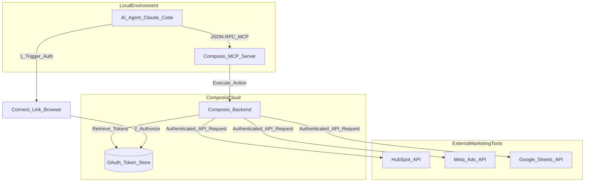
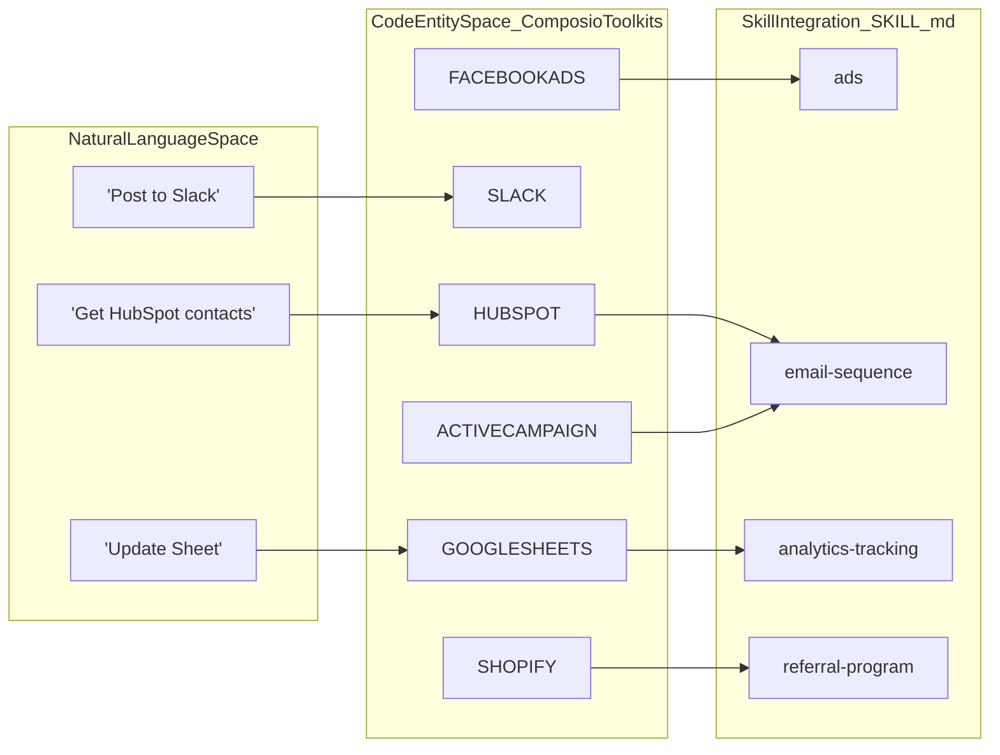

<!-- source: DeepWiki mcp.deepwiki.com · repo coreyhaines31/marketingskills · page 5.6 Composio MCP Integration · fetched 2026-10-27 -->

# Composio MCP Integration

Relevant source files

The following files were used as context for generating this wiki page:

- [tools/composio/README.md](tools/composio/README.md)
- [tools/composio/marketing-tools.md](tools/composio/marketing-tools.md)
- [tools/integrations/cogny.md](tools/integrations/cogny.md)
- [tools/integrations/composio.md](tools/integrations/composio.md)

The Composio integration layer, introduced in v1.2.0, provides Model Context Protocol (MCP) access to over 500 marketing and productivity tools through a single managed integration [tools/integrations/composio.md:1-3](). While the `marketingskills` repository provides many zero-dependency CLI tools, Composio serves as a bridge for tools that lack native MCP servers or require complex OAuth management [tools/integrations/composio.md:22-33]().

## System Overview

Composio acts as a managed middleware that handles OAuth 2.0 token negotiation, refresh cycles, and storage [tools/integrations/composio.md:16-20](). It exposes these connections to AI agents (like Claude Code) via a unified MCP server, allowing natural language execution of complex API actions across disparate platforms [tools/integrations/composio.md:10-12]().

### Data Flow and Architecture

The following diagram illustrates how an agent request flows through the Composio integration to interact with external marketing APIs.

**Composio Integration Data Flow**

Sources: [tools/integrations/composio.md:7-20](), [tools/composio/README.md:18-27]()

## Installation and Setup

The integration is initialized using the Composio MCP setup utility, which configures the server within the agent's environment [tools/composio/README.md:10-14]().

1.  **Install**: Run `npx @composio/mcp@latest setup` [tools/integrations/composio.md:39-41]().
2.  **Verify**: Execute `/mcp` in the agent interface to confirm `composio` is listed [tools/composio/README.md:16-17]().
3.  **Connect**: When a tool is first requested, the agent provides a `Connect Link`. Completing the browser-based OAuth flow persists the connection across sessions [tools/composio/README.md:18-20]().

### Connection Management
| Task | Command |
| :--- | :--- |
| List Available Apps | `npx composio apps list` [tools/integrations/composio.md:106]() |
| Check Connections | `npx composio connections list` [tools/integrations/composio.md:112]() |
| Remove Connection | `npx composio connections remove {id}` [tools/integrations/composio.md:131]() |
| Search Actions | `npx composio actions list --app {APP_NAME}` [tools/composio/marketing-tools.md:85]() |

Sources: [tools/composio/README.md:72-88](), [tools/integrations/composio.md:102-133]()

## Available Marketing Toolkits

Composio categorizes integrations into "Toolkits," each mapping to specific marketing use cases. Coverage depth is categorized as **Deep** (20+ actions), **Medium** (5-20 actions), or **Shallow** (under 5 actions) [tools/composio/marketing-tools.md:50-54]().

### CRM and Lead Management
| Toolkit | Auth | Marketing Actions | Depth |
| :--- | :--- | :--- | :--- |
| `HUBSPOT` | OAuth 2.0 | Manage contacts, deals, company info, and lists [tools/composio/marketing-tools.md:9]() | Deep |
| `SALESFORCE` | OAuth 2.0 | SOQL queries, lead/opportunity management [tools/composio/marketing-tools.md:10]() | Deep |

### Advertising and Analytics
| Toolkit | Auth | Marketing Actions | Depth |
| :--- | :--- | :--- | :--- |
| `FACEBOOKADS` | OAuth 2.0 | Campaign insights, ad set performance [tools/composio/marketing-tools.md:25]() | Medium |
| `LINKEDIN` | OAuth 2.0 | Campaign analytics, company page stats [tools/composio/marketing-tools.md:26]() | Medium |
| `GOOGLEADS` | OAuth 2.0 | Keyword stats, ad group performance [tools/composio/marketing-tools.md:27]() | Medium |
| `GOOGLEANALYTICS`| OAuth 2.0 | GA4 reports and real-time data [tools/composio/marketing-tools.md:48]() | Medium |

### Email and Productivity
| Toolkit | Auth | Marketing Actions | Depth |
| :--- | :--- | :--- | :--- |
| `GOOGLESHEETS` | OAuth 2.0 | Read/write cells, append rows, create sheets [tools/composio/marketing-tools.md:33]() | Deep |
| `SLACK` | OAuth 2.0 | Channel messaging, file uploads [tools/composio/marketing-tools.md:34]() | Deep |
| `NOTION` | OAuth 2.0 | Database queries, page creation [tools/composio/marketing-tools.md:35]() | Deep |
| `KLAVIYO` | API Key | Profile management, campaign metrics [tools/composio/marketing-tools.md:17]() | Medium |
| `ACTIVECAMPAIGN` | API Key | Get contacts, list automations [tools/composio/marketing-tools.md:16]() | Medium |

Sources: [tools/composio/marketing-tools.md:5-49](), [tools/integrations/composio.md:70-88]()

## Implementation Mapping

The following diagram bridges natural language requests to the underlying Composio toolkit identifiers and the specific marketing skills they support.

**Natural Language to Code Entity Mapping**

Sources: [tools/integrations/composio.md:134-156](), [tools/integrations/composio.md:185-191]()

## Composio vs. Native CLI Tools

Composio is recommended when MCP access is required for tools that only have CLI implementations in this repo, or for OAuth-heavy tools like Google Sheets [tools/integrations/composio.md:22-33]().

| Tool | Use Native CLI/MCP | Use Composio MCP |
| :--- | :--- | :--- |
| **HubSpot** | For high-volume scripts | For agent-led CRM lookups |
| **Meta Ads** | For local reporting | For interactive ad management |
| **GA4** | **Recommended** (Deeper coverage) [tools/composio/marketing-tools.md:74]() | Alternative if native fails |
| **Slack/Notion** | N/A (No native CLI) | **Recommended** [tools/composio/marketing-tools.md:67-68]() |
| **Stripe** | **Recommended** (Deeper coverage) [tools/composio/marketing-tools.md:75]() | Alternative if native fails |

Sources: [tools/composio/marketing-tools.md:58-78](), [tools/integrations/composio.md:89-99]()

## Troubleshooting and Limits

### Common Issues
*   **"Tool not found"**: Ensure the app is connected via `npx composio apps list`. If missing, trigger a request in the agent to get a Connect Link [tools/composio/README.md:72-78]().
*   **Expired Auth**: Use `npx composio connections list` to find the ID, then `npx composio connections remove {id}` and re-authenticate [tools/composio/README.md:80-88]().
*   **Server Missing**: Re-run the setup command `npx @composio/mcp@latest setup` and restart the agent [tools/composio/README.md:97-105]().

### Usage Limits
Composio enforces rate limits based on the account tier. High-volume operations should use native CLI tools to bypass these middleware constraints [tools/composio/README.md:90-95]().

| Tier | API Calls / Month | Rate Limit |
| :--- | :--- | :--- |
| **Free** | 20,000 | 10 req/sec |
| **Growth** | 200,000 | 50 req/sec |
| **Business** | 2,000,000 | 100 req/sec |

Sources: [tools/integrations/composio.md:166-179](), [tools/composio/README.md:90-95]()

---

