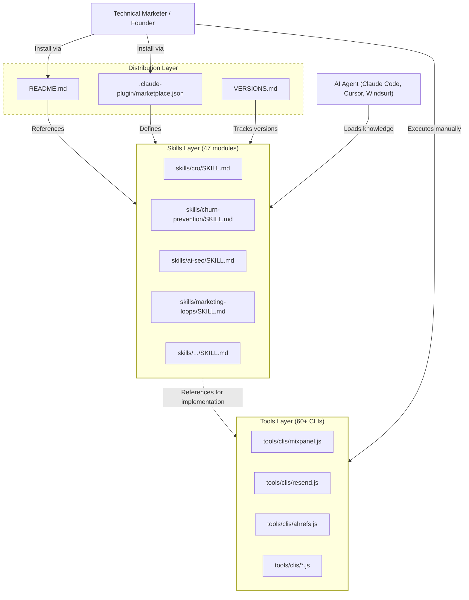
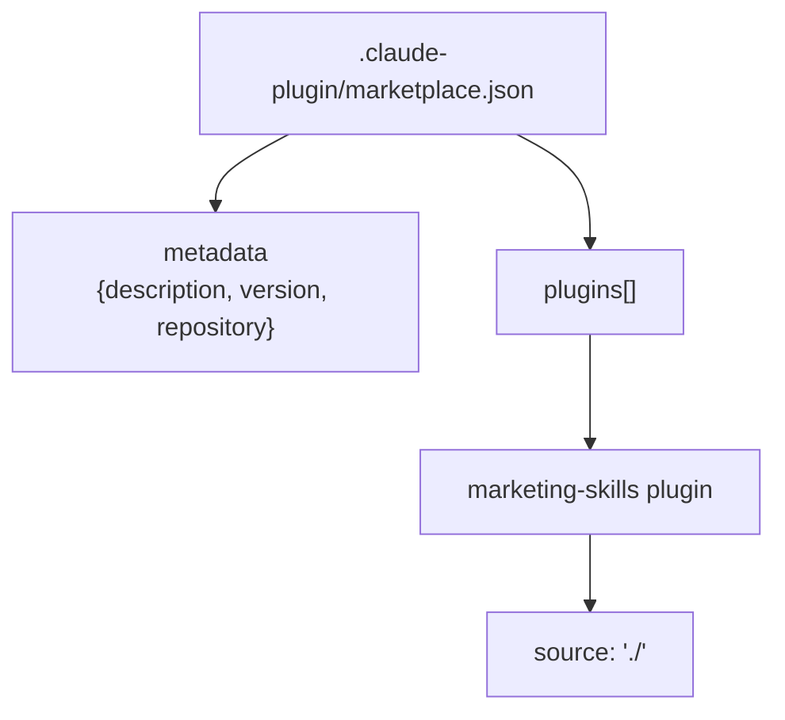
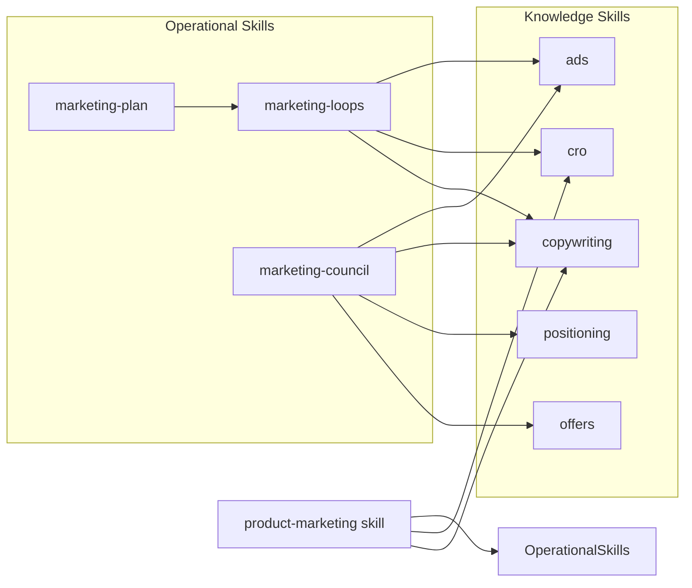
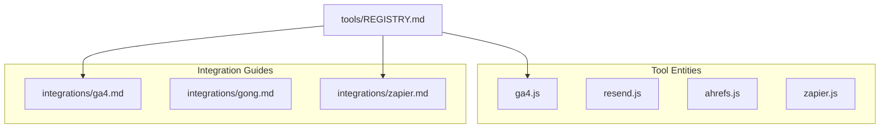

<!-- source: DeepWiki mcp.deepwiki.com · repo coreyhaines31/marketingskills · page 6.1 Three-Tier Architecture · fetched 2026-10-27 -->

# Three-Tier Architecture

<details>
<summary>Relevant source files</summary>

The following files were used as context for generating this wiki page:

- [.claude-plugin/marketplace.json](.claude-plugin/marketplace.json)
- [.claude-plugin/plugin.json](.claude-plugin/plugin.json)
- [.github/scripts/sync-skills.js](.github/scripts/sync-skills.js)
- [.github/workflows/sync-skills.yml](.github/workflows/sync-skills.yml)
- [README.md](README.md)
- [VERSIONS.md](VERSIONS.md)

</details>


## Purpose and Scope

This document explains the three-tier architecture of the `marketingskills` repository, showing how the distribution, skills, and tools layers compose to deliver marketing knowledge and API integrations to AI agents. This page focuses on the structural organization and separation of concerns between layers. As of version 2.8.11, the system encompasses 47 skills and 60+ CLI tools [VERSIONS.md:5-53](), [.claude-plugin/marketplace.json:9-15]().

## Architecture Overview

The repository implements a three-tier architecture optimized for AI agent consumption, with clear separation between distribution mechanisms, knowledge modules, and API execution.



**Sources:** [README.md:1-5](), [README.md:13-15](), [VERSIONS.md:5-53](), [.claude-plugin/marketplace.json:1-19]()

The architecture implements strict separation of concerns:
- **Distribution Layer**: Installation methods and version tracking.
- **Skills Layer**: Marketing knowledge and best practices (reasoning-based guidance).
- **Tools Layer**: API integrations and command execution (zero-dependency CLIs).

## Distribution Layer

The distribution layer provides multiple installation mechanisms to reach different user workflows and AI agent environments.

### Core Distribution Files

| File | Purpose | Content |
|------|---------|---------|
| `README.md` | Primary documentation and skill catalog | High-level overview, installation methods, and full skill list [README.md:1-56](). |
| `.claude-plugin/marketplace.json` | Claude Code plugin definition | JSON manifest listing the `marketing-skills` plugin for the `/plugin` system [.claude-plugin/marketplace.json:1-19](). |
| `VERSIONS.md` | Version tracking for updates | Table of skill versions and recent changelog [VERSIONS.md:1-75](). |

**Sources:** [README.md:1-77](), [.claude-plugin/marketplace.json:1-19](), [VERSIONS.md:1-75]()

### Plugin Manifest Structure

The `.claude-plugin/marketplace.json` file defines the plugin structure for Claude Code. The `source` property points to the root directory where the skills are located [.claude-plugin/marketplace.json:16]().



**Sources:** [.claude-plugin/marketplace.json:7-18]()

The manifest includes:
- **metadata** ([.claude-plugin/marketplace.json:7-11]()): Description, version (2.8.11), and repository URL.
- **plugins array** ([.claude-plugin/marketplace.json:12-18]()): Defines the `marketing-skills` plugin name and source.

### Version Tracking

The `VERSIONS.md` file provides version metadata for update detection. Recent updates include the addition of `marketing-council` (v1.0.0) and significant updates to `video` (v2.1.0) and `ad-creative` (v2.8.0) [VERSIONS.md:29-30](), [VERSIONS.md:52-53](), [VERSIONS.md:8-9]().

| Skill | Version | Last Updated |
|-------|---------|--------------|
| marketing-council | 1.0.0 | 2026-07-06 |
| video | 2.1.0 | 2026-07-14 |
| ad-creative | 2.8.0 | 2026-07-14 |
| prospecting | 1.1.0 | 2026-07-13 |

**Sources:** [VERSIONS.md:8-9](), [VERSIONS.md:29](), [VERSIONS.md:42](), [VERSIONS.md:52-53]()

## Skills Layer

The skills layer contains 47 markdown-based knowledge modules. These are specialized instructions that give AI agents workflows for specific marketing tasks [README.md:13-15]().

### Directory Structure

Skills are organized into a dedicated `skills/` directory as specified in the plugin configuration [.claude-plugin/plugin.json:11]().

```
skills/
├── skill-name/
│   ├── SKILL.md        # Core instructions and triggers
│   ├── references/     # Deep-dive frameworks (e.g., loop-catalog.md)
│   └── evals/          # Assertion suites for agent behavior
```

**Sources:** [.claude-plugin/plugin.json:11](), [VERSIONS.md:58]()

### Skill Composition Pattern

Skills reference each other and build on shared context. The `product-marketing` skill is the foundation — every other skill checks it first to understand product, audience, and positioning [README.md:17-25](). The new `marketing-loops` skill serves as an operational layer, orchestrating existing skills into recurring workflows [VERSIONS.md:31](). The `marketing-council` skill provides conflicting expert perspectives, which then hand off to relevant execution skills [VERSIONS.md:29]().



**Sources:** [README.md:21-50](), [VERSIONS.md:29](), [VERSIONS.md:31]()

## Tools Layer

The tools layer provides 60+ zero-dependency CLI tools and an integration layer via Composio for OAuth-heavy services.

### CLI Architecture Pattern

The system uses a `tools/REGISTRY.md` to help agents discover tool capabilities, integration methods (API, MCP, CLI, SDK), and detailed integration guides [tools/REGISTRY.md:1-15]().



**Sources:** [tools/REGISTRY.md:13-87](), [tools/integrations/gong.md:1-5](), [tools/integrations/zapier.md:1-13]()

### CLI Tool Categories

The tools are indexed and categorized by domain in the registry [tools/REGISTRY.md:15-87]().

| Category | Example Tools | CLI File |
|----------|---------------|----------|
| Analytics | `ga4`, `mixpanel`, `amplitude` | `tools/clis/ga4.js` |
| SEO | `semrush`, `ahrefs`, `dataforseo` | `tools/clis/ahrefs.js` |
| Email | `resend`, `customer-io`, `mailchimp` | `tools/clis/resend.js` |
| Sales | `gong`, `rb2b`, `outreach` | `tools/integrations/gong.md` |

**Sources:** [tools/REGISTRY.md:17-82]()

### Zapier SDK Integration

For tools without direct CLIs, the `zapier-sdk` provides access to 8,000+ apps. This allows agents to execute actions like `slack.sendChannelMessage` or `hubspot.createContact` programmatically using the `createZapierSdk` function [tools/integrations/zapier.md:40-72]().

**Sources:** [tools/integrations/zapier.md:48-72]()

## Tier Interactions

The three tiers interact through defined boundaries:
1.  **Distribution to Skills**: `marketplace.json` and `plugin.json` define the metadata and directory source for the agent to load skills [.claude-plugin/marketplace.json:12-18](), [.claude-plugin/plugin.json:1-12](). The `sync-skills.js` script ensures consistency between `marketplace.json`, `plugin.json`, and `README.md` by updating skill counts and versions [sync-skills.js:186-208]().
2.  **Skills to Tools**: Skills provide the reasoning and strategy (e.g., `churn-prevention`), while the tools layer (indexed in `REGISTRY.md`) provides the execution capability like `stripe` or `customer-io` [tools/REGISTRY.md:1-10]().
3.  **Cross-Skill Orchestration**: High-level skills like `marketing-plan`, `marketing-loops`, and `marketing-council` orchestrate other skills to produce comprehensive outcomes, repeatable workflows, or conflicting expert perspectives [README.md:45-50](), [VERSIONS.md:29](), [VERSIONS.md:31]().

**Sources:** [README.md:17-52](), [tools/REGISTRY.md:1-10](), [.claude-plugin/marketplace.json:12-18](), [VERSIONS.md:29](), [VERSIONS.md:31](), [.github/scripts/sync-skills.js:186-208]()

---

