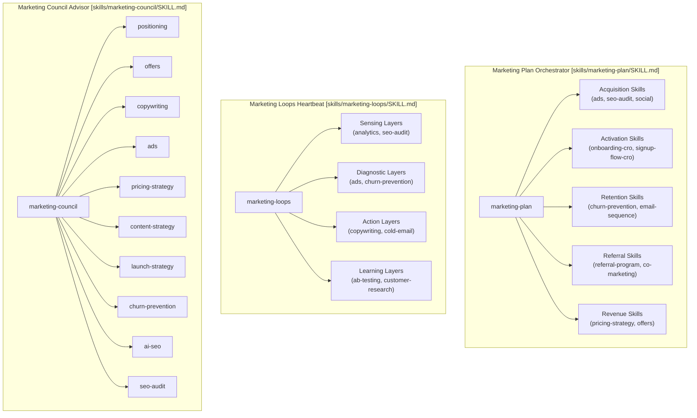
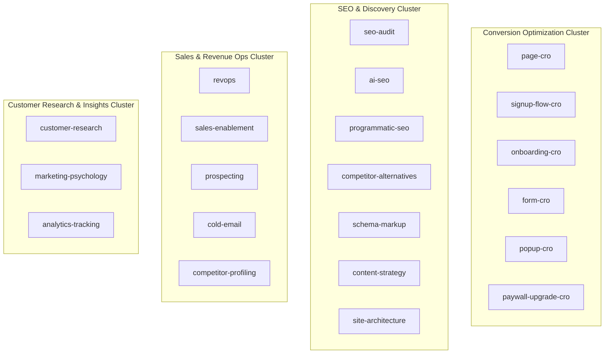
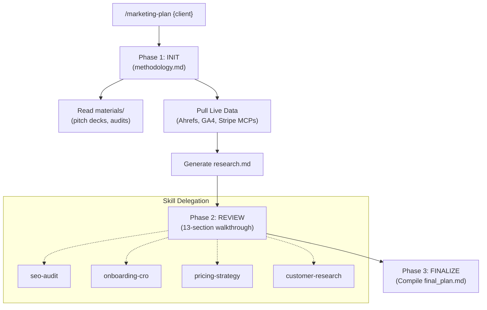
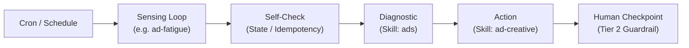
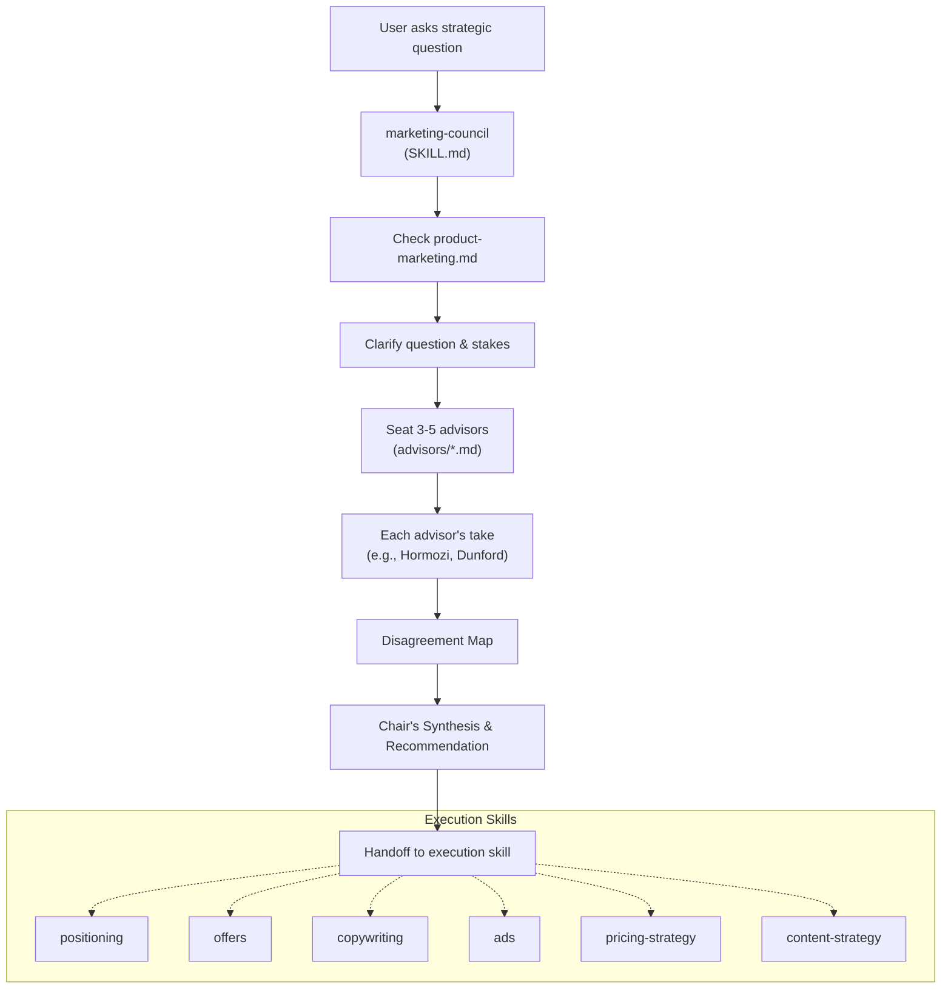

<!-- source: DeepWiki mcp.deepwiki.com · repo coreyhaines31/marketingskills · page 6.3 Skill Interdependencies · fetched 2026-10-27 -->

# Skill Interdependencies

Relevant source files

The following files were used as context for generating this wiki page:

- [skills/customer-research/SKILL.md](skills/customer-research/SKILL.md)
- [skills/customer-research/evals/evals.json](skills/customer-research/evals/evals.json)
- [skills/customer-research/references/source-guides.md](skills/customer-research/references/source-guides.md)
- [skills/marketing-council/SKILL.md](skills/marketing-council/SKILL.md)
- [skills/marketing-council/evals/evals.json](skills/marketing-council/evals/evals.json)
- [skills/marketing-council/references/advisor-template.md](skills/marketing-council/references/advisor-template.md)
- [skills/marketing-council/references/advisors/alex-hormozi.md](skills/marketing-council/references/advisors/alex-hormozi.md)
- [skills/marketing-council/references/advisors/ann-handley.md](skills/marketing-council/references/advisors/ann-handley.md)
- [skills/marketing-council/references/advisors/april-dunford.md](skills/marketing-council/references/advisors/april-dunford.md)
- [skills/marketing-council/references/advisors/byron-sharp.md](skills/marketing-council/references/advisors/byron-sharp.md)
- [skills/marketing-council/references/advisors/claude-hopkins.md](skills/marketing-council/references/advisors/claude-hopkins.md)
- [skills/marketing-plan/SKILL.md](skills/marketing-plan/SKILL.md)
- [skills/marketing-plan/references/methodology.md](skills/marketing-plan/references/methodology.md)
- [skills/marketing-plan/references/plan-template.md](skills/marketing-plan/references/plan-template.md)
- [tools/integrations/sparktoro.md](tools/integrations/sparktoro.md)

This document describes how the 47 marketing skills in the repository connect to and compose with each other. It identifies hub skills with the most connections, common skill clusters, and patterns for multi-skill workflows. For the overall system architecture, see [6.1 Three-Tier Architecture](). For how skills map to customer lifecycle stages, see [6.2 Customer Lifecycle Coverage]().

---

## Hub Skills: Highly Connected Nodes

Seven skills emerge as hub nodes with the highest number of cross-references to other skills. These skills serve as integration points for complex marketing workflows, with `marketing-plan` acting as the primary orchestrator for the entire system and `marketing-loops` acting as the operational heartbeat. `marketing-council` is a new hub skill that provides expert perspectives, often leading to the invocation of other execution skills.

### Hub Skill Overview

| Skill | Connections | Primary Role |
|-------|:----------:|--------------|
| `marketing-plan` | 13+ | **System Orchestrator** — Coordinates all AARRR stages and specialized skills |
| `marketing-loops` | 43+ | **Operational Hub** — Orchestrates recurring workflows across all 47 skills |
| `marketing-council` | 10+ | **Strategic Advisor** — Provides expert perspectives, hands off to execution skills |
| `churn-prevention` | 7 | **Retention Hub** — connects activation, monetization, and measurement |
| `ai-seo` | 6 | **Discovery Hub** — coordinates the comprehensive modern SEO stack |
| `content-strategy` | 6 | **Gateway Hub** — connects content creation across various formats |
| `seo-audit` | 5 | **Technical Foundation** — supports multiple SEO and CRO optimization skills |

Sources: [README.md:30-50](), [skills/marketing-plan/SKILL.md:65-79](), [skills/marketing-loops/SKILL.md:58](), [skills/ai-seo/SKILL.md:2-3](), [skills/churn-prevention/SKILL.md:417-425](), [skills/seo-audit/SKILL.md:405-412](), [skills/marketing-council/SKILL.md:1-5]()

---

## Hub Skill Connection Patterns

**Diagram: Hub Skills and Their Direct Connections**

Sources: [skills/marketing-plan/SKILL.md:70-74](), [skills/marketing-loops/references/loop-orchestration.md:9-23](), [skills/churn-prevention/SKILL.md:417-425](), [skills/marketing-council/SKILL.md:82]()

---

## Hub Skill Roles

### marketing-plan: The System Orchestrator

Located at [skills/marketing-plan/SKILL.md:1-10](), this skill acts as the "Master Controller" for the repository. It uses a three-phase state machine to build an exhaustive strategy.

- **Orchestration Layer** — It maps specific skills to the AARRR framework (Acquisition, Activation, Retention, Referral, Revenue) [skills/marketing-plan/SKILL.md:81-91]().
- **State Management** — Uses `progress.md` to track completion across 13 sections [skills/marketing-plan/references/methodology.md:26-58]().
- **Data Integration** — Pulls from CLI tools (Ahrefs, GA4, Stripe) to inform the plan [skills/marketing-plan/references/methodology.md:88-102]().
- **Tactical Mapping** — Cross-references the 140+ ideas in `marketing-ideas` to the client's specific roadmap [skills/marketing-plan/SKILL.md:78]().

Sources: [skills/marketing-plan/SKILL.md:37-61](), [skills/marketing-plan/references/methodology.md:5-24]()

### marketing-loops: The Operational Heartbeat

Located at [skills/marketing-loops/SKILL.md:58](), this skill transforms static strategy into recurring workflows. It serves as the operational cousin to `marketing-ideas`.

- **Orchestration Model** — Organizes 43 loops into a four-layer system: Sensing → Diagnostic → Action → Learning [skills/marketing-loops/references/loop-orchestration.md:9-23]().
- **Skill Composition** — Every loop in the catalog explicitly lists the `Skills used` to execute the loop body (e.g., the `keyword-gap` loop uses `seo-audit`, `programmatic-seo`, and `content-strategy`) [skills/marketing-loops/references/loop-catalog.md:17-21]().
- **State Persistence** — Manages idempotency via `.agents/loops/<loop>.json`, tracking watermarks and cooldowns to prevent double-acting [skills/marketing-loops/references/loop-state.md:7-12]().

Sources: [VERSIONS.md:58](), [skills/marketing-loops/references/loop-orchestration.md:1-23](), [skills/marketing-loops/references/loop-catalog.md:1-12]()

### marketing-council: The Strategic Advisor

Located at [skills/marketing-council/SKILL.md:1-10](), this skill provides expert perspectives on marketing questions by simulating a board of legendary marketing advisors.

- **Persona Simulation** — Convenes 3-5 advisors (or the full bench of 12) whose documented frameworks and positions are applied to the user's problem [skills/marketing-council/SKILL.md:32-50]().
- **Disagreement Mapping** — Identifies genuine conflicts between advisor takes and names the underlying trade-offs, which is the core value proposition [skills/marketing-council/SKILL.md:80-81]().
- **Skill Handoffs** — Synthesizes a recommendation and suggests concrete next steps, often involving other execution skills like `positioning`, `offers`, `copywriting`, or `ads` [skills/marketing-council/SKILL.md:82]().
- **Grounding Rules** — Ensures takes are grounded in documented frameworks and positions, explicitly labeling output as simulation and never fabricating quotes [skills/marketing-council/SKILL.md:12-13](), [skills/marketing-council/evals/evals.json:9-15]().

Sources: [skills/marketing-council/SKILL.md:1-10](), [skills/marketing-council/SKILL.md:32-50](), [skills/marketing-council/SKILL.md:80-82](), [skills/marketing-council/evals/evals.json:9-15]()

### churn-prevention: Lifecycle Integration Hub

Located at [skills/churn-prevention/SKILL.md:1-10](), this skill integrates retention across multiple lifecycle stages:

- **Email integration** — Coordinates with `email-sequence` for win-back campaigns post-cancellation [skills/churn-prevention/SKILL.md:419]().
- **Monetization integration** — References `paywall-upgrade-cro` for in-app upgrade moments and `pricing-strategy` for discount strategy [skills/churn-prevention/SKILL.md:421-422]().
- **Activation integration** — Connects to `onboarding-cro` for fixing activation issues that lead to early churn [skills/churn-prevention/SKILL.md:422]().

Sources: [skills/churn-prevention/SKILL.md:417-425]()

---

## Skill Clusters

Skills naturally group into functional clusters based on shared purpose and frequent cross-references.

**Diagram: Skill Clusters by Function**

Sources: [README.md:29-41](), [skills/marketing-plan/SKILL.md:65-79](), [skills/prospecting/SKILL.md:1-10](), [skills/customer-research/SKILL.md:1-3](), [skills/competitor-profiling/SKILL.md:1-3]()

---

## Multi-Skill Workflow Patterns

### Pattern 1: The "Fractional CMO" Strategy Workflow

This workflow represents the highest level of system composition, where the `marketing-plan` skill orchestrates a deep research and planning phase.

**Diagram: Marketing Plan Execution Workflow**

Sources: [skills/marketing-plan/SKILL.md:37-57](), [skills/marketing-plan/references/methodology.md:5-69](), [skills/marketing-plan/references/methodology.md:76-79]()

### Pattern 2: The Recurring Operational Loop

This pattern shows how `marketing-loops` transitions from detection to action using other skills.

**Diagram: Operational Loop Execution Pattern**

Sources: [skills/marketing-loops/references/loop-catalog.md:121-131](), [skills/marketing-loops/references/loop-guardrails.md:5-16](), [skills/marketing-loops/references/loop-state.md:42-48]()

### Pattern 3: The Strategic Advisory Workflow

This workflow demonstrates how `marketing-council` provides expert guidance, often leading to the invocation of other skills for execution.

**Diagram: Marketing Council Workflow**

Sources: [skills/marketing-council/SKILL.md:1-10](), [skills/marketing-council/SKILL.md:15-22](), [skills/marketing-council/SKILL.md:51-58](), [skills/marketing-council/SKILL.md:73-82](), [skills/marketing-council/references/advisors/alex-hormozi.md:1-5](), [skills/marketing-council/references/advisors/april-dunford.md:1-5]()

---

## Dependency Resolution Strategy

When an AI agent invokes a skill that reference other skills, it follows this resolution pattern:

1.  **Primary Skill Invocation**: User request → Agent matches to skill (e.g., "Analyze our churn" → `churn-prevention`).
2.  **Context Gathering**: Skill reads `.agents/product-marketing.md` to avoid repetitive questions [skills/ads/SKILL.md:15]().
3.  **Task Execution**: Skill provides specialized frameworks (e.g., The AARRR framework in `marketing-plan` [skills/marketing-plan/SKILL.md:81-91](), or the Value Equation in `marketing-council` via Alex Hormozi's lens [skills/marketing-council/references/advisors/alex-hormozi.md:7-8]()).
4.  **Related Skills Check**: At decision points, the skill references related skills (e.g., `ai-seo` referencing `seo-audit` for technical foundations [skills/ai-seo/SKILL.md:3](), or `marketing-council` handing off to `pricing-strategy` [skills/marketing-council/SKILL.md:82]()).
5.  **Tool Integration**: If a plan requires data, the skill instructs the agent to use the relevant CLI tool (e.g., `Ahrefs` for domain rating [skills/marketing-plan/references/methodology.md:92](), or `SparkToro` for audience research within `customer-research` [skills/customer-research/SKILL.md:125](), [tools/integrations/sparktoro.md:122-123]()).

Sources: [README.md:17-19](), [skills/marketing-plan/SKILL.md:35](), [skills/ai-seo/SKILL.md:12-16](), [skills/marketing-plan/references/methodology.md:88-102](), [skills/marketing-council/SKILL.md:82](), [skills/marketing-council/references/advisors/alex-hormozi.md:7-8](), [skills/customer-research/SKILL.md:125](), [tools/integrations/sparktoro.md:122-123]()

---

