# Page: Home

# Home

<details>
<summary>Relevant source files</summary>

The following files were used as context for generating this wiki page:

- [.claude-plugin/marketplace.json](.claude-plugin/marketplace.json)
- [.claude-plugin/plugin.json](.claude-plugin/plugin.json)
- [AGENTS.md](AGENTS.md)
- [CONTRIBUTING.md](CONTRIBUTING.md)
- [README.md](README.md)
- [VERSIONS.md](VERSIONS.md)

</details>


This document provides an overview of the `marketingskills` repository, a collection of AI agent skills and CLI tools for marketing automation. It explains the system's three-tier architecture (distribution, skills, tools), how AI agents consume skills for marketing knowledge, and how CLI tools provide optional API integrations. The repository currently covers **47 skills** and **60+ CLI tools** [VERSIONS.md:5-53](), [AGENTS.md:24]().

## Purpose and Architecture

The `marketingskills` repository implements a dual-purpose system optimized for AI agent consumption. It provides **47 marketing skills** (markdown-based knowledge modules) that give AI agents like Claude Code specialized expertise in conversion optimization, SEO, copywriting, analytics, and growth engineering [README.md:1-5](), [.claude-plugin/marketplace.json:15](). It also includes **60+ CLI tools** (JavaScript single-file executables) for optional API integration with marketing platforms when implementation is required [AGENTS.md:24]().

The system separates knowledge from execution. Skills contain frameworks, best practices, and workflows but do not execute actions directly. CLI tools handle API communication but do not make strategic decisions. This separation enables skills to function independently of specific API availability and allows users to review actions before execution via `--dry-run` modes [AGENTS.md:45]().

**Sources:** [README.md:1-48](), [VERSIONS.md:5-53](), [AGENTS.md:41-46]()

## Repository Structure

The repository organizes content across three primary directories plus documentation and distribution files:

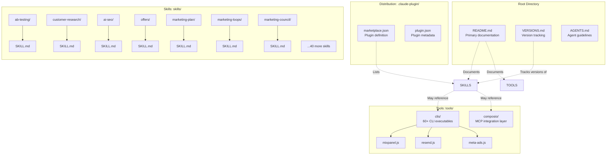

**Directory Breakdown:**

| Directory | Purpose | Count | Key Files |
|-----------|---------|-------|-----------|
| `skills/` | Marketing knowledge modules | 47 skills | Each contains `SKILL.md` [.claude-plugin/plugin.json:11](), [VERSIONS.md:5-53]() |
| `tools/clis/` | API integration executables | 60+ CLIs | Zero-dependency Node.js scripts [AGENTS.md:24]() |
| `tools/composio/` | MCP integration layer | 1 layer | Access to 500+ tools via Composio MCP [AGENTS.md:188]() |
| `.claude-plugin/` | Plugin distribution | 2 files | `marketplace.json` and `plugin.json` [.claude-plugin/marketplace.json:1-19]() |

**Sources:** [README.md:54-136](), [.claude-plugin/marketplace.json:1-19](), [.claude-plugin/plugin.json:1-13](), [VERSIONS.md:5-53](), [AGENTS.md:16-31]()

## Three-Tier Architecture

The system implements three distinct layers that compose to provide AI-assisted marketing capabilities:

```mermaid
graph TB
    subgraph "Layer 1: Distribution"
        direction LR
        README["README.md<br/>Documentation Hub"]
        MARKETPLACE["marketplace.json<br/>Claude Code plugin"]
        VERSIONS["VERSIONS.md<br/>Version Tracking"]
    end
    
    subgraph "Layer 2: Skills - 47 Knowledge Modules"
        direction TB
        
        CRO_CLUSTER["Conversion Optimization<br/>cro, signup, onboarding<br/>popups, paywalls"]
        
        CONTENT_CLUSTER["Content & Copywriting<br/>copywriting, copy-editing, emails<br/>cold-email, social, video, image, sms"]
        
        SEO_CLUSTER["SEO & Discovery<br/>seo-audit, ai-seo, aso, site-arch<br/>programm-seo, schema, content-strategy"]
        
        GTM_CLUSTER["Sales & GTM<br/>revops, sales-enable, launch<br/>pricing, offers, prospecting<br/>directory-submissions"]
        
        STRATEGY_CLUSTER["Strategy & Research<br/>customer-research, mktg-ideas<br/>mktg-psych, comp-profile, competitors"]
        
        MEASURE_CLUSTER["Measurement & Ads<br/>analytics, ads, ad-creative, ab-testing"]
        
        RETENTION_CLUSTER["Retention & Growth<br/>churn-prevent, referrals, free-tools<br/>community, lead-magnt, co-mktg"]
        
        ORCHESTRATION["Orchestration & Automation<br/>marketing-plan, marketing-loops, marketing-council"]
    end
    
    subgraph "Layer 3: Tools - 60+ Integrations"
        direction TB
        
        ANALYTICS_CLI["Analytics: mixpanel.js, ga4.js, segment.js"]
        EMAIL_CLI["Email: resend.js, sendgrid.js, mailchimp.js"]
        ADS_CLI["Ads: meta-ads.js, google-ads.js, tiktok-ads.js"]
        SMS_CLI["SMS: twilio.js, attentive.js, postscript.js"]
        COMPOSIO_MCP["Composio MCP: HubSpot, Salesforce, Slack"]
    end
    
    README --> SKILLS_LAYER["Skills Layer"]
    MARKETPLACE --> SKILLS_LAYER
    
    SKILLS_LAYER -.->|"Reference for implementation"| CLI_LAYER["CLI Tools Layer"]
    
    USER["Technical Marketer"] --> README
    AGENT["AI Agent"] --> SKILLS_LAYER
    SKILLS_LAYER --> AGENT
    USER -.->|"Manual execution"| CLI_LAYER
```

**Layer Responsibilities:**

| Layer | Purpose | Consumed By | Output |
|-------|---------|-------------|--------|
| **Distribution** | Installation and versioning | Developers, Claude Code | Plugin metadata and version checks [VERSIONS.md:3]() |
| **Skills** | Marketing knowledge and workflows | AI agents | Strategic recommendations and content [README.md:15]() |
| **CLI Tools** | API execution | Developers (manual) | HTTP requests to external services [AGENTS.md:41-46]() |

**Key Separation:** Skills provide knowledge, CLIs provide execution. Skills reference CLIs for implementation guidance, but agents generally present the commands for users to run.

**Sources:** [README.md:13-52](), [VERSIONS.md:5-53](), [.claude-plugin/marketplace.json:12-18](), [AGENTS.md:23-27]()

## Skills Layer: Markdown-Based Knowledge

Each skill is a directory in `skills/` containing a `SKILL.md` file. The system uses the `product-marketing` skill as a foundational requirement that all other skills check first to understand product, audience, and positioning [README.md:19-25]().

### Skill File Structure

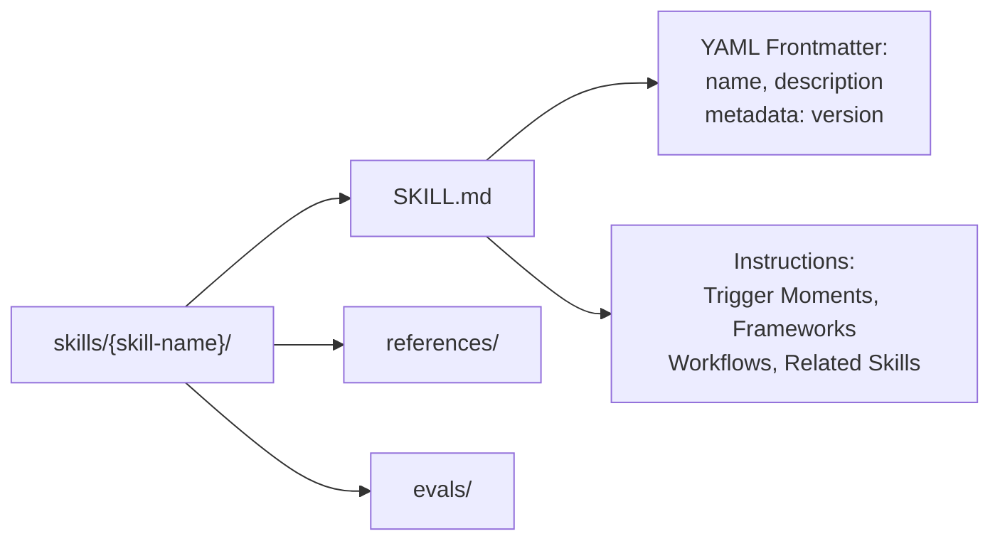

**Key Skill Groups (Total 47):**

| Category | Key Skills |
|----------|------------|
| **Content & Copy** | `copywriting`, `cold-email`, `sms`, `video`, `image`, `lead-magnets` [README.md:30-40]() |
| **SEO & Discovery** | `ai-seo`, `seo-audit`, `aso`, `site-arch`, `directory-submissions` [README.md:30-40]() |
| **Sales & GTM** | `offers`, `prospecting`, `revops`, `sales-enablement`, `pricing` [README.md:33-40]() |
| **Orchestration** | `marketing-plan`, `marketing-loops`, `marketing-council` [VERSIONS.md:29-32]() |

**Sources:** [README.md:54-136](), [VERSIONS.md:5-53](), [AGENTS.md:98-104]()

## Data Flow: AI Agent to API Execution

The system uses a hub-and-spoke model where skills cross-reference each other to build a comprehensive marketing strategy [README.md:21-50]().

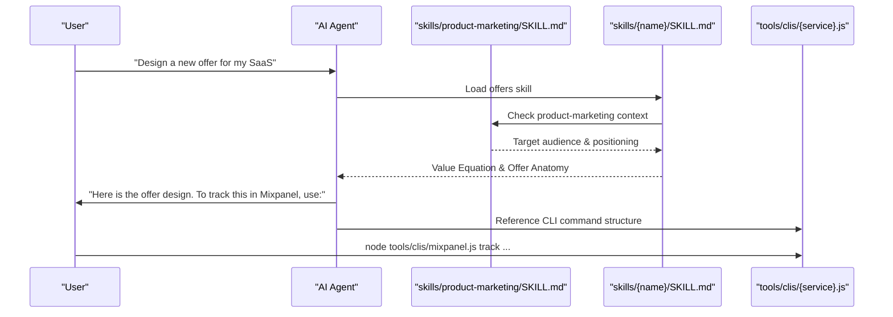

**Key Integration Components:**
- **Product Marketing Context:** The shared foundation for all skills [README.md:23-25]().
- **Marketing Council:** A simulated board of 12 advisors providing conflicting expert perspectives (e.g., Seth Godin, David Ogilvy) [VERSIONS.md:29]().
- **Marketing Loops:** Repeatable agent workflows using state management via `.agents/loops/<loop>.json` [VERSIONS.md:31]().
- **Viral Edit Reverse-Engineering:** A workflow in the `video` skill to decompose reference videos across nine dimensions (shot, rhythm, text, etc.) [VERSIONS.md:59]().

**Sources:** [README.md:17-52](), [VERSIONS.md:29-67](), [AGENTS.md:41-46]()

## Versioning and Updates

The system tracks versions for both the distribution and individual skills in `VERSIONS.md` [VERSIONS.md:1-3]().

| Milestone | Key Changes |
|-----------|-------------|
| **v2.8.11** | Current marketplace version. Includes `marketing-council` and advanced `video` edit reverse-engineering [.claude-plugin/marketplace.json:9](), [VERSIONS.md:57-59](). |
| **v2.8.10** | Added **AirDrop Reveal** ads to `ad-creative` iOS-native family [VERSIONS.md:63](). |
| **v2.8.9** | Added **Demand-signal discovery** to `prospecting` for finding first customers [VERSIONS.md:67](). |
| **v2.8.8** | Added the **creative review page** HTML artifact template to `ad-creative` [VERSIONS.md:71](). |
| **v2.6.0** | Added `marketing-loops` (43 repeatable workflows) [VERSIONS.md:31](). |

**Sources:** [VERSIONS.md:1-71](), [.claude-plugin/marketplace.json:1-19](), [AGENTS.md:48-62]()

---

# Page: Getting Started

# Getting Started

<details>
<summary>Relevant source files</summary>

The following files were used as context for generating this wiki page:

- [.claude-plugin/marketplace.json](.claude-plugin/marketplace.json)
- [.claude-plugin/plugin.json](.claude-plugin/plugin.json)
- [AGENTS.md](AGENTS.md)
- [CONTRIBUTING.md](CONTRIBUTING.md)
- [README.md](README.md)
- [VERSIONS.md](VERSIONS.md)

</details>


This page guides you through installing the Marketing Skills system and executing your first skill or CLI tool. It covers the essential setup steps, directory structure, and basic invocation patterns needed to start using marketing skills with AI agents like Claude Code.

The repository now contains 47 marketing skills [README.md:57-104]() and 60+ CLI tools [AGENTS.md:24]().

For detailed comparison of installation methods and trade-offs, see [Installation Methods](#2.1). For in-depth usage patterns and trigger mechanics, see [Using Your First Skill](#2.2). For the CLI tool system, see [Using CLI Tools](#2.3).

**Sources:** [README.md:1-20](), [AGENTS.md:5-13](), [.claude-plugin/marketplace.json:15-15]()

---

## Prerequisites

Before installing marketing skills, ensure you have:

| Requirement | Purpose | Verification |
|------------|---------|--------------|
| Claude Code or compatible AI agent | Runtime environment for skill execution | Check that your IDE has Claude Code installed |
| `.agents/` directory in your project | Target location for skill installation | Create if missing: `mkdir -p .agents/skills` |
| Node.js 18+ | Runtime for CLI tools | Run `node --version` |
| API Keys | Authentication for CLI tools | See individual tool docs in `tools/integrations/` |

The system requires no compilation or build steps for skills. Skills are plain markdown files [AGENTS.md:35-40](). CLI tools are zero-dependency Node.js scripts [AGENTS.md:41-46]().

**Sources:** [AGENTS.md:1-50](), [VERSIONS.md:54-59]()

---

## Quick Start Workflow

The following diagram shows the end-to-end flow from installation to first skill execution:

**Diagram: Quick Start Flow from Installation to Execution**

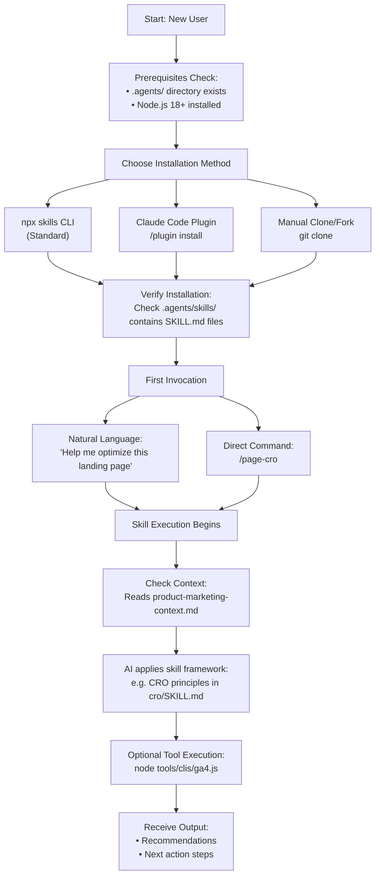

**Sources:** [README.md:13-51](), [AGENTS.md:130-140]()

---

## Installation Overview

The system offers multiple installation methods. All methods result in `SKILL.md` files placed in `.agents/skills/` (the cross-agent standard) [AGENTS.md:7]().

### Method Comparison

| Method | Target Location | Best For | Command |
|--------|----------------|----------|---------|
| **npx skills CLI** | `.agents/skills/` | Standard setup | `npx skills add coreyhaines31/marketingskills` |
| **Plugin** | `.agents/skills/` | Claude Code users | `/plugin install marketing-skills` |
| **Manual Clone** | `tools/`, `skills/` | Full repository access | `git clone https://github.com/coreyhaines31/marketingskills` |
| **Composio** | MCP Layer | OAuth-heavy tools | `npx @composio/mcp@latest setup` |

### Claude Code Plugin Installation

This repository serves as a plugin marketplace. You can install all 47 skills via the Claude Code terminal [AGENTS.md:130-140](), [.claude-plugin/marketplace.json:12-19]():

```bash
/plugin marketplace add coreyhaines31/marketingskills
/plugin install marketing-skills
```

For detailed instructions on each method, including forking and submodules, see [Installation Methods](#2.1).

**Sources:** [.claude-plugin/marketplace.json:1-19](), [AGENTS.md:130-140](), [README.md:54-85]()

---

## Directory Structure

After installation, the project is organized into three tiers: distribution, skills, and tools.

**Diagram: System Architecture and File Relationships**

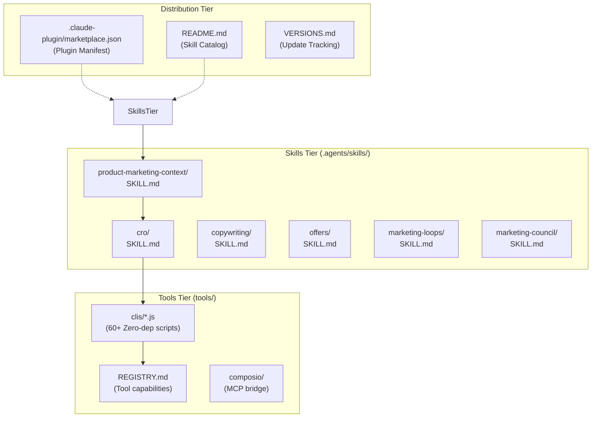

### Key Paths

| Path | Description |
|------|-------------|
| `.agents/skills/` | Primary skill installation directory [AGENTS.md:7](). |
| `.agents/product-marketing-context.md` | Shared context file read by all skills [README.md:19](). |
| `tools/clis/` | 60+ zero-dependency Node.js CLI tools [AGENTS.md:24](). |
| `tools/REGISTRY.md` | Index of all tools and integration methods [AGENTS.md:27](). |

**Sources:** [AGENTS.md:14-31](), [README.md:17-48](), [VERSIONS.md:1-51]()

---

## Using Your First Skill

Skills are triggered by natural language or direct commands. Every skill is designed to check for the `product-marketing-context` first to minimize repetitive questions [README.md:19]().

### Invocation Examples

1. **Implicit (Natural Language)**: "I need to reduce churn for my SaaS."
   - Matches: `churn-prevention` skill via trigger phrases [README.md:65]().
2. **Explicit (Direct)**: `/cro`
   - Immediately loads the conversion optimization framework [README.md:74]().
3. **Multi-Agent Simulation**: `/marketing-council`
   - Invokes the board of 12 legendary advisors to review a strategy [VERSIONS.md:29]().

### The Context-First Pattern
Most skills include logic to check `.agents/product-marketing-context.md` first to understand the product, audience, and positioning [README.md:19]().

For concrete examples and integration patterns, see [Using Your First Skill](#2.2).

**Sources:** [README.md:52-85](), [AGENTS.md:120-129](), [VERSIONS.md:29-33]()

---

## Using CLI Tools

The repository includes 60+ zero-dependency Node.js CLI tools in `tools/clis/` for direct API interaction with marketing platforms [AGENTS.md:24]().

### Basic Usage Pattern
All CLIs follow a standard execution pattern [AGENTS.md:41-46]():
```bash
# Syntax check
node --check tools/clis/resend.js

# View help and commands
node tools/clis/resend.js

# Dry-run a command (preview without sending)
node tools/clis/resend.js send --dry-run
```

### Tool Categories
- **Analytics**: `ga4.js`, `mixpanel.js`, `amplitude.js` [AGENTS.md:187-188]()
- **Email**: `resend.js`, `sendgrid.js`, `mailchimp.js` [AGENTS.md:187-188]()
- **Ads**: `meta-ads.js`, `google-ads.js`, `linkedin-ads.js` [AGENTS.md:187-188]()

For details on installation, environment variables, and `--dry-run` mode, see [Using CLI Tools](#2.3).

**Sources:** [AGENTS.md:41-46](), [AGENTS.md:183-195]()

---

## Verification Steps

After installation, verify the setup:

1. **Verify Skills**: Ensure `.agents/skills/` contains 47 directories, each with a `SKILL.md` file [AGENTS.md:20-22](), [VERSIONS.md:1-53]().
2. **Verify Tools**: Run `node tools/clis/ga4.js` to see if the help output appears [AGENTS.md:44]().
3. **Verify Context**: Create `.agents/product-marketing-context.md` to provide your product details [README.md:19]().
4. **Update Check**: Check `VERSIONS.md` to ensure your local skills are current [VERSIONS.md:1-51]().

**Sources:** [AGENTS.md:33-46](), [VERSIONS.md:1-53]()

---

# Page: Installation Methods

# Installation Methods

<details>
<summary>Relevant source files</summary>

The following files were used as context for generating this wiki page:

- [.claude-plugin/marketplace.json](.claude-plugin/marketplace.json)
- [.claude-plugin/plugin.json](.claude-plugin/plugin.json)
- [README.md](README.md)
- [VERSIONS.md](VERSIONS.md)

</details>


This document describes all methods for installing the `marketingskills` repository into your project. Installation makes the 47 marketing skills available to AI agents (Claude Code, Cursor, Windsurf, Copilot) and optionally provides access to the 60+ CLI tools for API integrations and the Composio MCP integration layer.

For information about using skills after installation, see [Using Your First Skill](2.2). For CLI tool usage, see [Using CLI Tools](2.3).

## Installation Methods Overview

The repository provides six installation methods, each targeting different workflows and use cases. As of v2.8.11, the repository contains 47 skills and 60+ CLI tools [README.md:1-5](), [.claude-plugin/marketplace.json:9-15](), [VERSIONS.md:57-57]().

| Method | Command | Target Directory | Update Mechanism | Skills | CLI Tools | Best For |
|--------|---------|-----------------|------------------|--------|-----------|----------|
| **npx skills** | `npx skills add coreyhaines31/marketingskills` | `.agents/skills/` | Re-run command | ✓ | ✗ | Quick setup, skills-only |
| **Claude Plugin** | `/plugin marketplace add coreyhaines31/marketingskills` | `.claude/plugins/` | Plugin system | ✓ | ✗ | Claude Code users |
| **Clone & Copy** | `git clone` + `cp -r` | `.agents/skills/` | Manual | ✓ | ✓ | One-time setup |
| **Git Submodule** | `git submodule add` | `.agents/marketingskills/` | `git submodule update` | ✓ | ✓ | Version control, updates |
| **SkillKit** | `npx skillkit install coreyhaines31/marketingskills` | Multiple agent dirs | Re-run command | ✓ | ✗ | Multi-agent setup |
| **Fork** | GitHub fork + clone | User-controlled | Git pull from fork | ✓ | ✓ | Customization |

**Note on Paths:** The context path is standardized to `.agents/` for agent-agnostic compatibility. All skills check `product-marketing` context first to understand product, audience, and positioning [README.md:17-25]().

**Sources:** [README.md:1-25](), [VERSIONS.md:1-58](), [.claude-plugin/marketplace.json:9-11]()

## Directory Structure After Installation

### Skills Directory Layout

After installation, skills are located in one of these directories depending on the method used. Each of the 47 skills follows a standard structure [VERSIONS.md:5-53]().

```
# npx skills or Clone & Copy (Modern Path)
.agents/
  skills/
    cro/
      SKILL.md
      evals/         
      references/
    ai-seo/          
      SKILL.md
      evals/
    marketing-loops/  
      SKILL.md
      evals/
      references/
    marketing-council/ # Added in v2.8.6
      SKILL.md
      evals/
    [... 43 more skills]

# Claude Plugin
.claude/
  plugins/
    marketingskills/
      skills/
        cro/
        [... 46 more skills]

# Git Submodule
.agents/
  marketingskills/
    skills/
      cro/
      [... 46 more skills]
    tools/
      clis/          # 60+ zero-dependency tools
      integrations/  # Integration guides (Composio, etc.)
```

Each skill directory contains:
- `SKILL.md`: The skill definition file containing triggers and logic.
- `evals/`: Automated quality testing files distributed across skills [VERSIONS.md:59-59]().
- `references/`: Supporting documentation and frameworks (e.g., `edit-anatomy.md` in `video` skill or `demand-signals.md` in `prospecting`) [VERSIONS.md:59-67]().

**Sources:** [README.md:54-81](), [VERSIONS.md:7-53](), [.claude-plugin/marketplace.json:12-19]()

### Full Repository Structure

When using **Clone & Copy**, **Git Submodule**, or **Fork**, the complete directory structure is:

```
marketingskills/
  skills/                    # 47 marketing skills
    [skill-name]/
      SKILL.md
      evals/                 
      references/
  tools/
    clis/                    # 60+ CLI integration tools
    integrations/            # Integration guides
  .claude-plugin/
    marketplace.json         # Plugin definition (v2.8.11)
    plugin.json              # Plugin configuration
  README.md                  # Installation instructions
  VERSIONS.md                # Version tracking for updates
```

**Sources:** [README.md:1-81](), [.claude-plugin/marketplace.json:1-19](), [VERSIONS.md:1-58]()

## Installation Method Details

### Method 1: npx skills (Recommended for Skills-Only)

The `npx skills` command provides the fastest installation path for skills. It targets the `.agents/skills/` directory.

#### Install All Skills
```bash
npx skills add coreyhaines31/marketingskills
```

#### Install Specific Skills
```bash
npx skills add coreyhaines31/marketingskills --skill ai-seo marketing-council
```
This downloads only the requested skills (e.g., `ai-seo` or the `marketing-council` skill added in v2.8.6) [VERSIONS.md:9-9](), [VERSIONS.md:29-29]().

**Sources:** [README.md:1-20](), [VERSIONS.md:29-30]()

### Method 2: Claude Code Plugin

The Claude Code plugin system integrates with the marketplace definition at `.claude-plugin/marketplace.json`.

#### Add Marketplace
```bash
/plugin marketplace add coreyhaines31/marketingskills
```
Registers the repository as a plugin marketplace source. This reads [.claude-plugin/marketplace.json:1-19]() which defines the `marketing-skills` plugin [/.claude-plugin/marketplace.json:12-18]().

#### Install Plugin
```bash
/plugin install marketing-skills
```

**Sources:** [README.md:1-20](), [.claude-plugin/marketplace.json:1-19]()

### Method 3: Clone and Copy

Direct cloning provides access to the full repository including the 60+ CLI tools and integration guides.

#### Steps
```bash
# Clone repository
git clone https://github.com/coreyhaines31/marketingskills.git

# Copy skills to Agent directory
cp -r marketingskills/skills/* .agents/skills/

# Optional: Copy CLI tools
cp -r marketingskills/tools ./marketing-tools
```

**Sources:** [README.md:1-20]()

### Method 4: Git Submodule (Recommended for Full Access)

Git submodules provide version-controlled access to the full repository.

#### Add Submodule
```bash
git submodule add https://github.com/coreyhaines31/marketingskills.git .agents/marketingskills
```

AI agents automatically discover skills in subdirectories of `.agents/`. This method is preferred for projects requiring both the 47 skills and the 60+ CLI tools.

**Sources:** [README.md:1-20](), [VERSIONS.md:5-53]()

### Method 5: Fork and Customize

Forking allows you to modify the distributed evals or customize the 47 skills for specific company needs.

#### Use Cases
- Customizing the `product-marketing` skill foundation [README.md:19-25]().
- Modifying the `marketing-loops` state management via `.agents/loops/<loop>.json` [VERSIONS.md:31-31]().
- Customizing the `marketing-plan` state machine or templates [VERSIONS.md:32-32]().
- Modifying the `marketing-council` advisor bench or seating logic [VERSIONS.md:29-29]().

**Sources:** [README.md:9-12](), [README.md:19-25](), [VERSIONS.md:29-32]()

### Method 6: SkillKit (Multi-Agent)

Installs skills across Claude Code, Cursor, and Copilot simultaneously.

```bash
npx skillkit install coreyhaines31/marketingskills
```

**Sources:** [README.md:3-7]()

## Installation Flow Diagram

Title: Installation Decision Flow
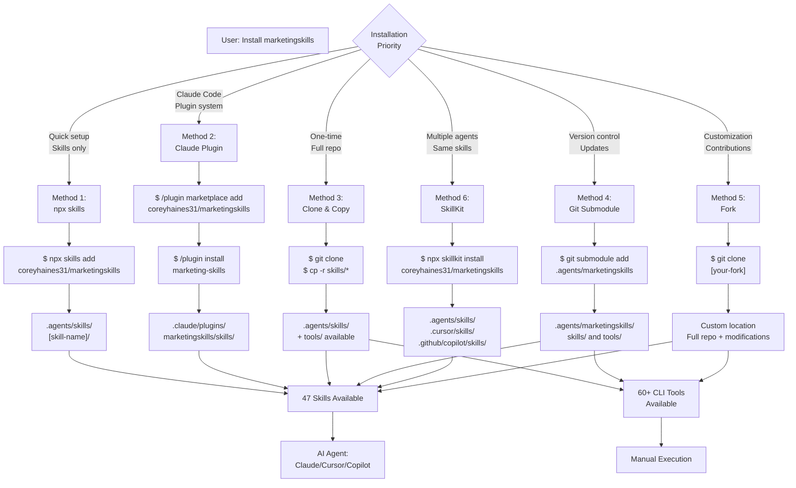
**Sources:** [README.md:1-20](), [.claude-plugin/marketplace.json:1-19](), [VERSIONS.md:5-58]()

## File Path Mapping by Installation Method

Title: Repository to Local Path Mapping
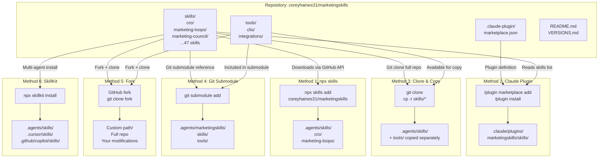
**Sources:** [README.md:1-20](), [.claude-plugin/marketplace.json:1-19](), [VERSIONS.md:5-58]()

## Version Tracking and Updates

### Version Information
The `VERSIONS.md` file tracks version numbers and recent changes for all 47 skills. Agents can compare against local versions to check for updates [VERSIONS.md:1-3]().

| File | Purpose | Current Version |
|------|---------|-----------------|
| `VERSIONS.md` | Current versions of all 47 skills | **v2.8.11** (latest bundle) |
| `.claude-plugin/marketplace.json` | Plugin metadata | **2.8.11** |

**Sources:** [VERSIONS.md:1-58](), [.claude-plugin/marketplace.json:9-9]()

### Checking for Updates
The system uses `VERSIONS.md` as the source of truth for updates. For example, in v2.8.11, the `video` skill was updated to v2.1.0 to include reverse-engineering viral edits [VERSIONS.md:57-59](). In v2.8.10, the `ad-creative` skill was bumped to v2.8.0 to add AirDrop reveal ads [VERSIONS.md:61-63]().

**Sources:** [VERSIONS.md:57-63]()

## Installation Validation

### Verify Skills Installation
```bash
# List installed skills in the modern agent directory
ls -la .agents/skills/

# Check specific skill version in SKILL.md metadata (e.g. marketing-council)
grep "Version" .agents/skills/marketing-council/SKILL.md
```

### Verify CLI Tools
For full installations, verify the presence of the 60+ CLIs.

```bash
# List CLI tools
ls -la .agents/marketingskills/tools/clis/
```

**Sources:** [README.md:1-20](), [VERSIONS.md:1-58]()

---

# Page: Using Your First Skill

# Using Your First Skill

<details>
<summary>Relevant source files</summary>

The following files were used as context for generating this wiki page:

- [.claude-plugin/marketplace.json](.claude-plugin/marketplace.json)
- [.claude-plugin/plugin.json](.claude-plugin/plugin.json)
- [README.md](README.md)
- [VERSIONS.md](VERSIONS.md)
- [skills/copywriting/SKILL.md](skills/copywriting/SKILL.md)
- [skills/launch/SKILL.md](skills/launch/SKILL.md)
- [skills/pricing/SKILL.md](skills/pricing/SKILL.md)
- [skills/sales-enablement/SKILL.md](skills/sales-enablement/SKILL.md)

</details>


## Purpose and Scope

This document walks through invoking your first marketing skill after installation, covering both implicit (natural language) and explicit (direct command) invocation methods. It explains the skill execution lifecycle, what to expect during interaction, how skills integrate with `product-marketing-context.md`, and how to discover related skills. The repository now contains 47 specialized skills [README.md:56-80]() and over 60 CLI tools [README.md:3-3]().

---

## Invocation Methods

Skills can be invoked through two distinct methods: **implicit invocation** (natural language triggers) and **explicit invocation** (direct commands). Both methods ultimately load and execute the same `SKILL.md` file, but differ in how the AI agent identifies which skill to use.

### Implicit Invocation (Natural Language)

Implicit invocation relies on trigger matching against the skill's description field in the YAML front matter. When you describe a task in conversational terms, the agent's trigger engine matches keywords and intent to the appropriate skill by comparing against the trigger patterns defined in each skill's `SKILL.md` file [README.md:13-16]().

**Diagram: Implicit Invocation - Natural Language Trigger Matching**

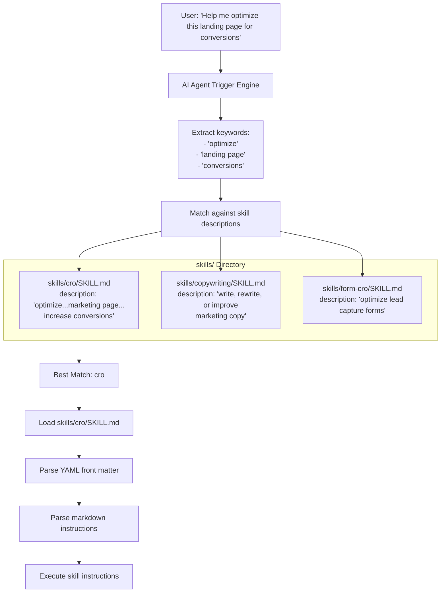

**Common Natural Language Patterns**

| User Intent | Example Phrase | Matched Skill |
|------------|----------------|---------------|
| Improve conversion rates | "Help me optimize this landing page for conversions" | `cro` |
| Create marketing copy | "Write homepage copy for my SaaS" | `copywriting` |
| Set up analytics | "Set up GA4 tracking for signups" | `analytics` |
| Build email campaigns | "Create a 5-email welcome sequence" | `emails` |
| Fix SEO issues | "My page isn't ranking, audit my SEO" | `seo-audit` |
| Design a launch | "Help me launch my product on Product Hunt" | `launch` |

**Sources:** [README.md:13-16](), [README.md:56-80](), [skills/copywriting/SKILL.md:1-6](), [skills/cro/SKILL.md:1-6]()

### Explicit Invocation (Direct Commands)

Explicit invocation bypasses the trigger matching system and directly specifies which skill to load. Commands typically use a slash prefix followed by the skill directory name, which must match exactly.

**Diagram: Explicit Invocation - Direct Command Execution Path**

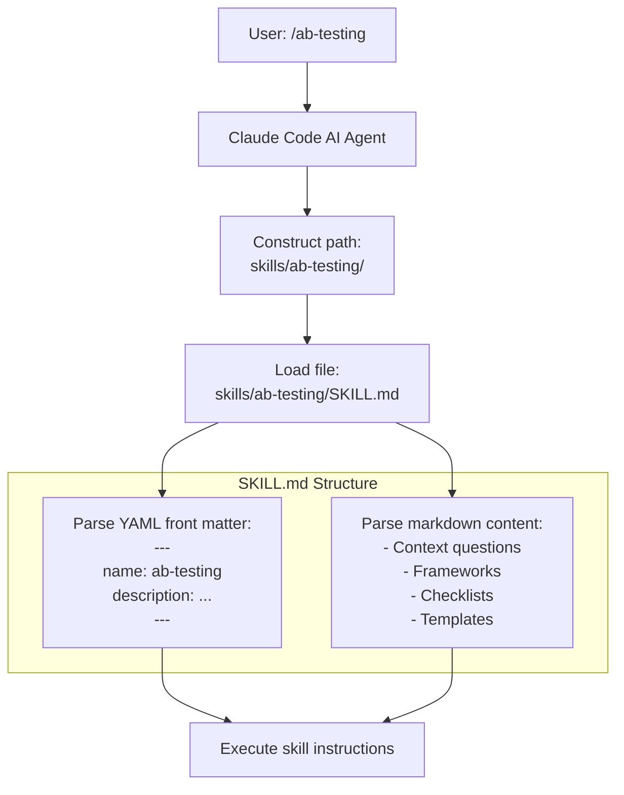

**Available Direct Commands**

| Command | Skill | Use When |
|---------|-------|----------|
| `/cro` | CRO | Optimizing any marketing page |
| `/copywriting` | Copywriting | Writing new marketing copy |
| `/emails` | Emails | Building email automation |
| `/seo-audit` | SEO Audit | Analyzing SEO issues |
| `/ab-testing` | A/B Testing | Designing experiments |
| `/analytics` | Analytics | Setting up event tracking |
| `/offers` | Offer Design | Designing the core value proposition |
| `/social` | Social Content | Creating social media posts |
| `/marketing-council` | Marketing Council | Getting expert advisor perspectives |

**Command to Directory Mapping**

| Direct Command | File Path | Skill Directory Name |
|---------------|-----------|---------------------|
| `/cro` | `skills/cro/SKILL.md` | `cro` |
| `/copywriting` | `skills/copywriting/SKILL.md` | `copywriting` |
| `/emails` | `skills/emails/SKILL.md` | `emails` |
| `/seo-audit` | `skills/seo-audit/SKILL.md` | `seo-audit` |
| `/churn-prevention` | `skills/churn-prevention/SKILL.md` | `churn-prevention` |
| `/ai-seo` | `skills/ai-seo/SKILL.md` | `ai-seo` |
| `/marketing-council` | `skills/marketing-council/SKILL.md` | `marketing-council` |

The command name must match the directory name exactly. All 47 available skills are listed in [VERSIONS.md:7-53]().

**Sources:** [VERSIONS.md:7-53](), [README.md:56-80](), [.claude-plugin/marketplace.json:12-19]()

---

## The Skill Execution Lifecycle

Every skill execution follows a consistent four-phase lifecycle, regardless of invocation method. Understanding this lifecycle helps set expectations for the interaction.

**Diagram: Skill Execution Lifecycle**

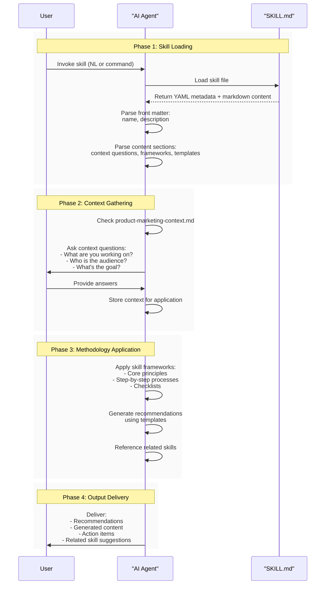

### Phase Breakdown

| Phase | Duration | What Happens | User Action Required |
|-------|----------|--------------|---------------------|
| **1. Loading** | Instant | Agent loads and parses `SKILL.md` file | None |
| **2. Context Gathering** | 30-60 sec | Agent checks context file and asks remaining questions | Answer questions |
| **3. Application** | 1-2 min | Agent applies frameworks and generates recommendations | None (AI processing) |
| **4. Delivery** | Instant | Agent presents output and suggests next steps | Review and act |

**Sources:** [README.md:13-16](), [skills/copywriting/SKILL.md:12-38](), [skills/sales-enablement/SKILL.md:12-38]()

---

## Product Marketing Context Integration

Skills check for a `product-marketing-context.md` file before asking context questions. This file reduces repetitive questioning by providing reusable product and market information. The `product-marketing` skill serves as the foundation for all other skills [README.md:19-19]().

**Diagram: Context File Discovery and Integration**

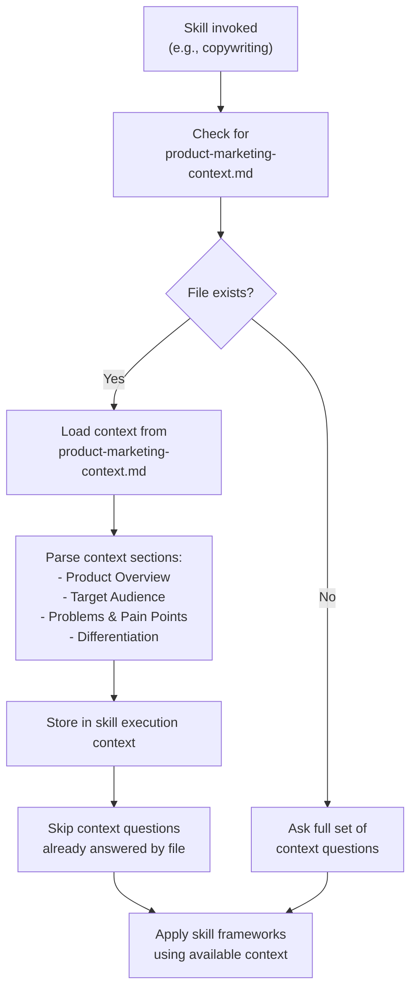

**Integration Pattern in Skills**

Every skill in the repository is designed to check the `product-marketing` context first to understand the product, audience, and positioning [README.md:19-19](). This is explicitly instructed in the "Before Starting" or "Before Writing" sections of skills like `sales-enablement` [skills/sales-enablement/SKILL.md:14-15]() and `copywriting` [skills/copywriting/SKILL.md:14-15]().

**Sources:** [README.md:17-25](), [skills/copywriting/SKILL.md:14-15](), [skills/sales-enablement/SKILL.md:14-15](), [skills/pricing/SKILL.md:14-15]()

---

## Example Walkthrough: Using the `copywriting` Skill

This section walks through a complete example using the `copywriting` skill [VERSIONS.md:20-20]().

### Step 1: Invocation

**Implicit (Natural Language):**
```
User: "Write homepage copy for my new SaaS"
```
→ Agent matches to `skills/copywriting/SKILL.md` based on keywords like "write, rewrite, or improve marketing copy for any page" [skills/copywriting/SKILL.md:3-3]().

### Step 2: Context Gathering

The agent performs an initial assessment:
1. Checks for `.agents/product-marketing.md` or `product-marketing-context.md` [skills/copywriting/SKILL.md:14-15]().
2. Asks for Page Purpose, Audience, Product/Offer details, and Context (traffic source) [skills/copywriting/SKILL.md:19-38]().

### Step 3: Methodology Application

The skill applies core principles and strategies:
- **Clarity Over Cleverness**: Prioritizing clear messaging [skills/copywriting/SKILL.md:43-44]().
- **Benefits Over Features**: Focusing on customer outcomes [skills/copywriting/SKILL.md:46-47]().
- **Page Structure Framework**: Applying Above the Fold and Core Section templates [skills/copywriting/SKILL.md:106-146]().

### Step 4: Output Delivery

The agent delivers structured recommendations including:
- **Headline & Subheadline**: Using specific formulas [skills/copywriting/SKILL.md:110-129]().
- **Strong CTAs**: Action-oriented button text [skills/copywriting/SKILL.md:149-168]().
- **Voice and Tone**: Adjusted for brand personality [skills/copywriting/SKILL.md:199-218]().

**Sources:** [skills/copywriting/SKILL.md:1-222](), [README.md:73-73]()

---

## Discovering Related Skills

Skills reference each other to create a guided discovery network. This is documented in the **Related Skills** section of each skill file [README.md:52-52]().

**Diagram: Skill Discovery and Cross-Reference Flow**

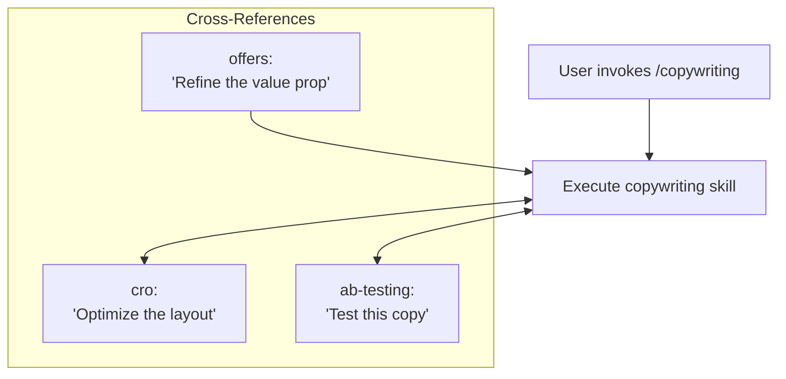

### Common Skill Chains

| Workflow | Skill Chain |
|----------|-------------|
| **Landing Page Optimization** | `customer-research` → `copywriting` ↔ `cro` ↔ `ab-testing` [README.md:46-49]() |
| **B2B Sales Outreach** | `revops` ↔ `sales-enablement` ↔ `cold-email` [README.md:47-47]() |
| **SEO Authority** | `seo-audit` ↔ `schema` ↔ `ai-seo` [README.md:48-48]() |
| **Monetization Setup** | `offers` → `pricing` ↔ `churn-prevention` [skills/pricing/SKILL.md:223-226]() |

**Sources:** [README.md:45-52](), [skills/pricing/SKILL.md:223-226](), [skills/copywriting/SKILL.md:3-3]()

---

## Summary of First Use Patterns

1. **Provide Specific Context**: Detailed inputs lead to better recommendations.
2. **Explicit Commands**: Use `/skill-name` for speed if you know the task.
3. **Implicit Discovery**: Describe the problem naturally to find the right skill.
4. **Leverage Context Files**: Use the `product-marketing` skill first to build a foundation [README.md:19-19]().
5. **Follow Recommendations**: Use the "Related Skills" suggestions to complete full marketing workflows [README.md:52-52]().

**Sources:** [README.md:13-25](), [README.md:52-52](), [skills/sales-enablement/SKILL.md:12-38]()

---

# Page: Using CLI Tools

# Using CLI Tools

<details>
<summary>Relevant source files</summary>

The following files were used as context for generating this wiki page:

- [tools/REGISTRY.md](tools/REGISTRY.md)
- [tools/clis/README.md](tools/clis/README.md)
- [tools/clis/exa.js](tools/clis/exa.js)
- [tools/integrations/exa.md](tools/integrations/exa.md)
- [tools/integrations/gong.md](tools/integrations/gong.md)
- [tools/integrations/rb2b.md](tools/integrations/rb2b.md)
- [tools/integrations/zapier.md](tools/integrations/zapier.md)

</details>


## Purpose and Scope

This page documents how to install, configure, and use the 60+ command-line API integration tools provided in the `tools/clis/` directory. Each CLI is a zero-dependency, single-file Node.js script that wraps a marketing platform API with a consistent command interface. These tools are designed for technical marketers and AI agents to interact with third-party services like Ahrefs, Mixpanel, and Resend directly from the terminal without the overhead of heavy SDKs or `npm install` steps.

For information about the skills system and how AI agents use skills to generate recommendations, see [Using Your First Skill](2.2). For detailed documentation of specific CLI commands and API integrations, see [CLI Tools Reference](5).

**Sources:** [tools/clis/README.md:1-8](), [tools/REGISTRY.md:1-10]()

---

## Installation Methods

The CLI tools are standalone Node.js scripts (Node 18+) that require no external dependencies. They support three installation approaches.

### Method 1: Direct Execution

Execute any CLI directly using Node.js. This is the simplest way to run a tool without any system modifications:

```bash
node tools/clis/ahrefs.js backlinks list --target example.com
node tools/clis/resend.js send --from you@example.com --to them@example.com --subject "Test"
```

This method is the most secure as it requires no environment modifications and works immediately after cloning the repository [tools/clis/README.md:9-13]().

### Method 2: Symlink for Global Access

Create symbolic links to specific CLIs in your local bin directory to make them available as global commands across your system:

```bash
# Create symlinks in a directory that's already in your PATH
ln -sf "$(pwd)/tools/clis/ahrefs.js" ~/.local/bin/ahrefs
ln -sf "$(pwd)/tools/clis/resend.js" ~/.local/bin/resend

# Then invoke directly from any directory
ahrefs backlinks list --target example.com
resend send --from you@example.com --to them@example.com --subject "Test"
```

**Sources:** [tools/clis/README.md:15-25]()

### Method 3: Add Directory to PATH

Add the entire `tools/clis/` directory to your system `PATH` to make all 60+ CLIs available instantly without individual symlinking:

```bash
export PATH="$PATH:/path/to/marketingskills/tools/clis"
```

**Sources:** [tools/clis/README.md:27-31]()

### Installation to Execution Flow

The following diagram bridges the natural language installation request to the code entities involved in execution, using `exa.js` as a reference implementation.

**Installation to Execution Flow**
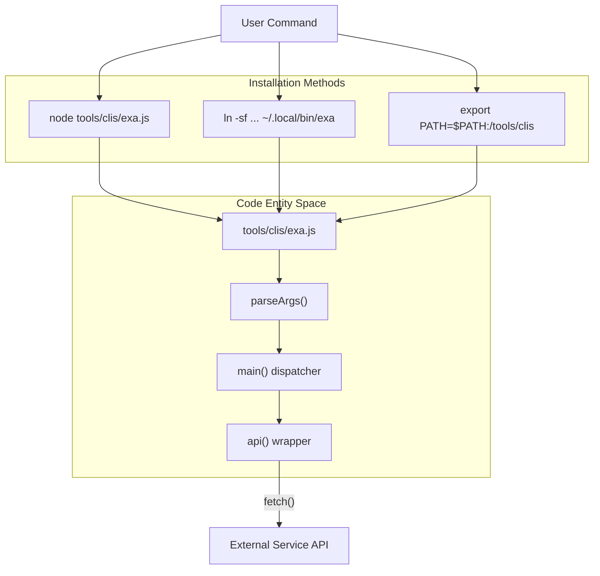
**Sources:** [tools/clis/README.md:7-31](), [tools/clis/exa.js:11-141]()

---

## Authentication

All CLIs read credentials exclusively from environment variables. To maintain security, no API keys are hardcoded or accepted as command-line arguments.

### Setting Environment Variables

Store credentials in your shell profile (`~/.zshrc`, `~/.bashrc`) or a `.env` file in the root of the repository.

```bash
export AHREFS_API_KEY="your_key_here"
export EXA_API_KEY="your_exa_key"
```

The `.env` file is explicitly ignored by git to prevent accidental credential leaks [tools/clis/README.md:96-98]().

### Common Authentication Patterns

| CLI | Environment Variables Required | Source |
|-----|-------------------------------|--------|
| `ahrefs` | `AHREFS_API_KEY` | [tools/clis/README.md:41]() |
| `exa` | `EXA_API_KEY` | [tools/clis/exa.js:3]() |
| `meta-ads`| `META_ACCESS_TOKEN`, `META_AD_ACCOUNT_ID` | [tools/clis/README.md:67]() |
| `ga4` | `GA4_ACCESS_TOKEN` | [tools/clis/README.md:55]() |
| `google-ads` | `GOOGLE_ADS_TOKEN`, `GOOGLE_ADS_DEVELOPER_TOKEN` | [tools/clis/README.md:56]() |

**Sources:** [tools/clis/README.md:33-90](), [tools/clis/exa.js:3-9]()

---

## Command Structure and Usage

All CLIs follow a standard command pattern to ensure a predictable user experience across different marketing platforms.

```bash
{tool} <resource> <action> [options]
```

### Examples
- **SEO**: `ahrefs backlinks list --target example.com --limit 50` [tools/clis/README.md:112]()
- **AI Search**: `exa search --query "SaaS onboarding" --type neural` [tools/clis/exa.js:133]()
- **Links**: `dub links create --url https://example.com --key promo` [tools/clis/README.md:116]()

### Output Handling
All tools output structured JSON to `stdout`. This allows for easy piping to utilities like `jq` or redirection to files:
```bash
ahrefs backlinks list --target example.com | jq '.backlinks[].url_from'
semrush keywords overview --phrase "saas" > keywords.json
```

**Sources:** [tools/clis/README.md:100-132]()

---

## Shared CLI Architecture

Every CLI in the `tools/clis/` directory shares a common internal structure. This "Zero-Dependency" design ensures portability.

### Internal Logic Flow

**Shared CLI Implementation Pattern**
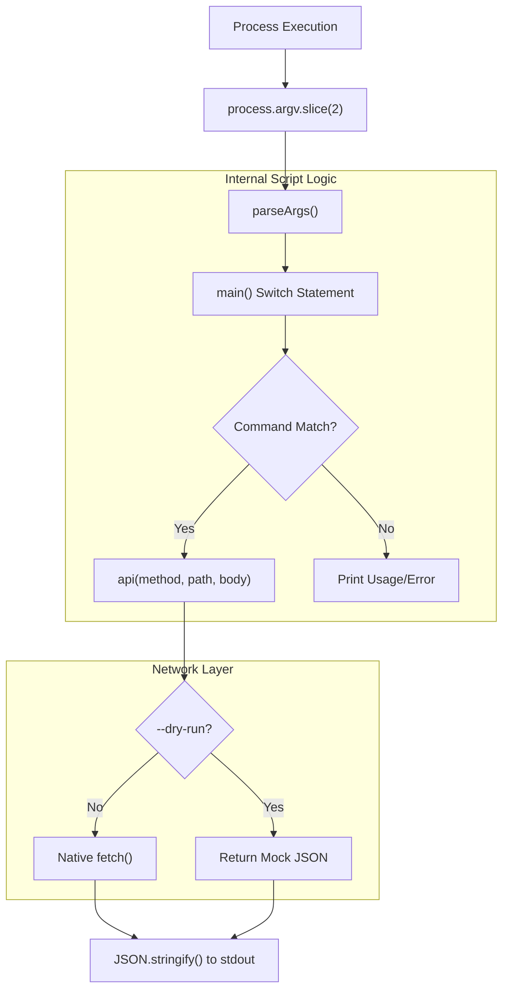
**Sources:** [tools/clis/exa.js:11-141]()

### Key Code Entities

1.  **`parseArgs(args)`**: A robust helper function that converts the `process.argv` array into a structured object. It maps keys starting with `--` to values and places positional arguments in a `_` array [tools/clis/exa.js:32-50]().
2.  **`api(method, path, body)`**: The central HTTP client wrapper. It handles header construction (e.g., `x-api-key`, `Content-Type`) and implements the `--dry-run` logic [tools/clis/exa.js:11-30]().
3.  **`main()`**: The dispatcher that uses a `switch` statement on the primary command to route requests to specific API endpoints like `search`, `find-similar`, or `contents` [tools/clis/exa.js:75-142]().

---

## Dry-Run Mode

Every CLI tool includes a `--dry-run` flag. This is a critical safety feature for both human users and AI agents to verify operations before execution.

### How it Works
When the `--dry-run` flag is passed, the `api()` function intercepts the request before it reaches the network. Instead of performing a `fetch()`, it returns a JSON object describing the intended request.

**Code Implementation:**
[tools/clis/exa.js:12-14]()
```javascript
if (args['dry-run']) {
  return { _dry_run: true, method, url: `${BASE_URL}${path}`, headers: { 'x-api-key': '***', ... }, body: body || undefined }
}
```

### Benefits
- **Security**: Credentials are masked as `***` in the dry-run output [tools/clis/exa.js:13-13]().
- **Validation**: Verify the final constructed URL, HTTP method, and JSON body payload.
- **Cost Control**: Test complex agent loops without consuming API credits from providers like Ahrefs or Semrush [tools/clis/README.md:98]().

**Sources:** [tools/clis/README.md:98](), [tools/clis/exa.js:12-14]()

---

# Page: Core Concepts

# Core Concepts

<details>
<summary>Relevant source files</summary>

The following files were used as context for generating this wiki page:

- [.claude-plugin/marketplace.json](.claude-plugin/marketplace.json)
- [.claude-plugin/plugin.json](.claude-plugin/plugin.json)
- [AGENTS.md](AGENTS.md)
- [CONTRIBUTING.md](CONTRIBUTING.md)
- [README.md](README.md)
- [VERSIONS.md](VERSIONS.md)

</details>


This page explains the fundamental concepts underlying the marketingskills repository: what skills are, how they're structured as markdown files, how they integrate with product context, and how they reference each other to form complex workflows. 

For installation and basic usage of skills, see [Getting Started](#2). For the complete catalog of available skills and their detailed documentation, see [Skills Reference](#4). For information about CLI tools, see [CLI Tools Reference](#5).

---

## Skills as Knowledge Modules for AI Agents

Skills in this repository are **markdown-based knowledge modules** designed for consumption by AI coding assistants (Claude Code, Cursor, Windsurf, etc.). They provide specialized expertise for specific marketing tasks without executing code themselves. When an AI agent processes a skill file, it gains access to frameworks, best practices, benchmarks, and workflows for that marketing domain.

**Sources:** [README.md:13-16]()

### Key Characteristics

| Characteristic | Description |
|---------------|-------------|
| **Format** | Markdown files (`SKILL.md`) stored in subdirectories of `skills/` |
| **Purpose** | Provide knowledge and frameworks, not code execution |
| **Invocation** | Natural language matching (implicit) or explicit command |
| **Independence** | Function without external dependencies or API access |
| **Composition** | Reference related skills for multi-step workflows |
| **Context-aware** | Check for `product-marketing-context.md` to reduce repetitive questions |

**Sources:** [README.md:13-16](), [.claude-plugin/marketplace.json:12-19](), [AGENTS.md:100-104]()

### Distinction: Skills vs. CLI Tools

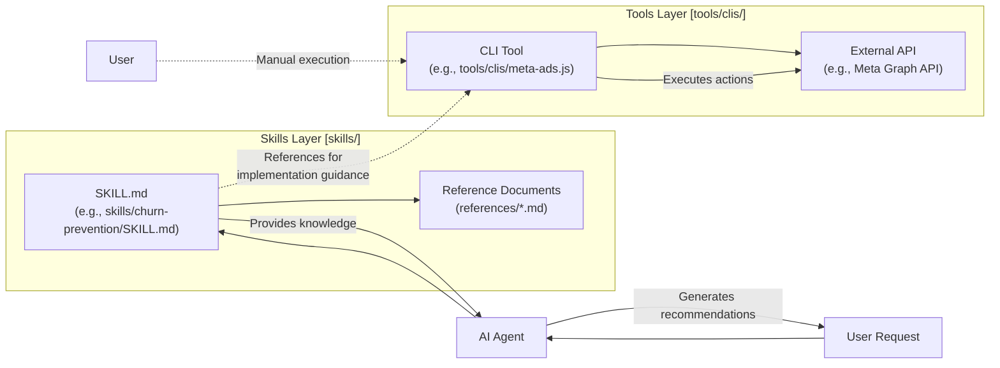

**Diagram: Skills provide knowledge, CLI tools execute actions**

Skills contain frameworks and strategies (knowledge layer) while CLI tools provide executable integrations with external services (execution layer). Skills may reference CLI tools to inform implementation recommendations, but never invoke them directly. For more on the tools architecture, see [CLI Tools Reference](#5).

**Sources:** [README.md:13-16](), [AGENTS.md:23-27]()

---

## Skill File Structure

Each skill is contained in a directory under `skills/` with a standardized structure. As of v2.8.11, the repository contains 47 marketing skills.

```
skills/
└── {skill-name}/
    ├── SKILL.md              # Core skill definition (Required)
    ├── references/           # Detailed docs (Optional) loaded on demand
    ├── scripts/              # Executable code (Optional)
    └── assets/               # Templates/Data (Optional)
```

**Sources:** [AGENTS.md:98-104](), [.claude-plugin/marketplace.json:15-15]()

### SKILL.md Format

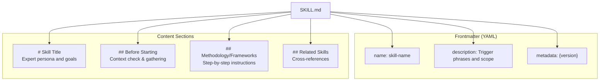

**Diagram: Standard SKILL.md file structure**

**Sources:** [AGENTS.md:70-85](), [CONTRIBUTING.md:19-30]()

### Natural Language Matching

The `description` field in the YAML frontmatter is critical for **implicit invocation**. When users describe a task, the AI agent matches their intent against these descriptions.

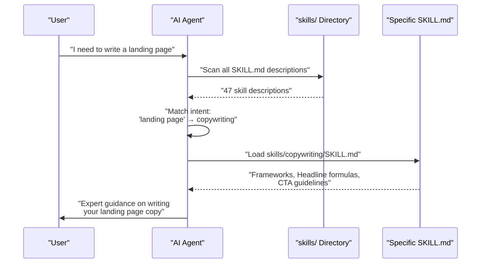

**Diagram: Natural language skill invocation flow**

**Sources:** [AGENTS.md:135-144](), [README.md:73-73]()

---

## Product Marketing Context Integration

The `product-marketing-context.md` file (and its standard counterpart `product-marketing`) is the foundation of the system. It reduces repetitive questions by providing persistent product-specific information to all skills.

### Context File Location
Skills are designed to check for this file to understand the product, audience, and positioning before performing tasks. The `product-marketing` skill is the prerequisite for all other operations.

```
project-root/
└── .agents/
    └── product-marketing.md    # Foundation for all skills
```

**Sources:** [README.md:17-25](), [AGENTS.md:7-7]()

### Skill Context Checking Pattern

Skills follow a standard "Check for context first" pattern. The `product-marketing` skill acts as the primary source of truth that every other skill reads first to ensure alignment with the brand's positioning.

**Sources:** [README.md:19-25]()

For details on setting up this file, see [Product Marketing Context](#3.3).

---

## Skill Composition and Relationships

Skills reference each other to form multi-step workflows. The repository contains 47 skills organized into functional categories that cover the entire customer lifecycle.

### Skill Relationships Map

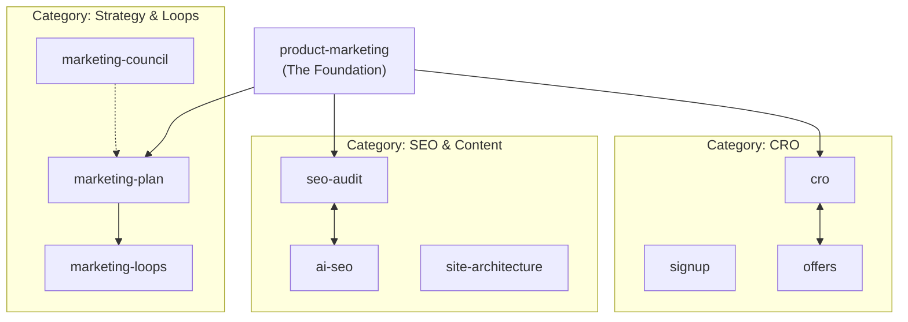

**Diagram: High-level skill interdependencies**

**Sources:** [README.md:21-50](), [VERSIONS.md:29-32]()

### Related Skills Pattern
Every skill is designed to work within a larger ecosystem. For example, the `marketing-plan` skill orchestrates other skills like `seo-audit` or `ads`, while the `marketing-council` (added in v2.8.6) provides expert perspectives that hand off to execution skills like `copywriting` or `offers`.

**Sources:** [VERSIONS.md:29-32](), [README.md:45-52]()

For detailed dependency maps, see [Skill Relationships](#3.4).

---

## Skill Evals System

The system includes automated evaluations (evals) distributed across the skills to ensure consistent agent behavior.

- **Structure**: Each eval consists of a prompt, expected output patterns, and specific assertions.
- **Purpose**: To prevent regression in agent behavior and verify that trigger phrases correctly activate the intended skills.
- **Example**: New evals are added for every major feature, such as the `video` skill's viral edit reverse-engineering (eval id 7) or the `prospecting` skill's demand-signal discovery (eval id 7).

For details on running and writing evals, see [Skill Evals System](#3.5).

**Sources:** [VERSIONS.md:59-59](), [VERSIONS.md:67-67]()

---

**Page Sources:**
- [README.md:1-80]()
- [VERSIONS.md:1-54]()
- [AGENTS.md:1-192]()
- [.claude-plugin/marketplace.json:1-19]()
- [CONTRIBUTING.md:1-89]()

---

# Page: What is a Skill

# What is a Skill

<details>
<summary>Relevant source files</summary>

The following files were used as context for generating this wiki page:

- [.claude-plugin/marketplace.json](.claude-plugin/marketplace.json)
- [.claude-plugin/plugin.json](.claude-plugin/plugin.json)
- [README.md](README.md)
- [VERSIONS.md](VERSIONS.md)

</details>


## Purpose and Scope

This document defines what a skill is in the Marketing Skills system, explains how skills differ from traditional executable code, and describes why the system uses markdown-based knowledge modules. For the technical specification of the `SKILL.md` format, see **3.2 Skill File Format**. For details on how skills reference each other, see **3.4 Skill Relationships**.

**Sources:** [README.md:13-16](), [AGENTS.md:7-13]()

---

## Definition: Skills as Knowledge Modules

A skill is a **structured knowledge document** that provides an AI agent with specialized frameworks, methodologies, and best practices for a specific marketing task. Skills are not executable code—they are instructional content that guides the AI's reasoning process and tool selection.

Each skill resides in its own directory under `skills/` and consists of a required `SKILL.md` file [AGENTS.md:20-22]():

```text
skills/
  cro/
    SKILL.md
  copywriting/
    SKILL.md
  marketing-loops/
    SKILL.md
```

The system contains 47 distinct skills (as of v2.8.11), organized into functional categories including SEO, CRO, Content, and Growth [README.md:54-100](), [VERSIONS.md:5-53]().

**Key Characteristics:**

| Characteristic | Description |
|----------------|-------------|
| **Format** | Markdown with YAML frontmatter [AGENTS.md:52-59]() |
| **Purpose** | Guide AI reasoning and workflow [README.md:13-16]() |
| **Location** | `skills/{skill-name}/SKILL.md` [AGENTS.md:83-84]() |
| **Consumption** | Parsed by AI agent (Claude Code, etc.) [README.md:3-5]() |
| **Invocation** | Natural language triggers defined in `description` [AGENTS.md:121-128]() |

**Sources:** [README.md:54-100](), [.claude-plugin/marketplace.json:12-18](), [VERSIONS.md:5-53](), [AGENTS.md:83-84]()

---

## Skills vs. Traditional Code

The fundamental distinction between a skill and traditional code is the **execution model**. Traditional code contains imperative instructions executed by a runtime (like Node.js). Skills contain declarative knowledge interpreted by an LLM to guide its behavior.

### Comparison Diagram: Natural Language to Code Entity Space

This diagram bridges how a user's natural language intent maps through the "Skill" entity into actual task execution.

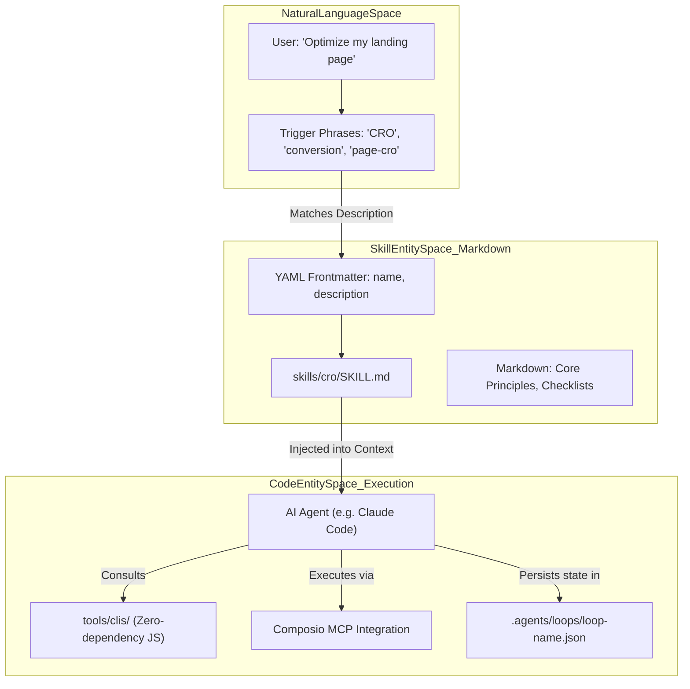

**Sources:** [README.md:13-16](), [AGENTS.md:121-128](), [AGENTS.md:23-27](), [AGENTS.md:172-173](), [VERSIONS.md:67-67]()

### Technical Differences

| Aspect | Traditional Code (e.g., `tools/clis/*.js`) | Skills (e.g., `skills/*/SKILL.md`) |
|--------|-------------------------------------------|-----------------------------------|
| **File Extension** | `.js` | `.md` (markdown) |
| **Content Type** | Imperative logic, API calls | Declarative instructions, frameworks |
| **Execution** | `node tools/clis/ga4.js` | Interpreted by LLM context window |
| **Variability** | Deterministic (Same input = Same output) | Context-dependent and reasoning-based |
| **Validation** | `node --check` syntax check | Evals system (Automated tests) |

**Sources:** [AGENTS.md:41-46](), [AGENTS.md:52-59](), [AGENTS.md:83-84]()

---

## The SKILL.md File Structure

Each skill is defined by a `SKILL.md` file that follows a two-part structure defined by the [Agent Skills specification](https://agentskills.io).

### 1. YAML Frontmatter
Contains machine-readable metadata used for skill discovery. The `description` is critical as it contains the trigger phrases the agent uses to decide when to activate the skill [AGENTS.md:52-59]().

```yaml
---
name: marketing-loops
description: "When the user wants to set up recurring marketing workflows... mentions 'loop', 'cadence', 'idempotency'..."
metadata:
  version: 1.2.0
---
```

**Sources:** [AGENTS.md:52-59](), [VERSIONS.md:31-31]()

### 2. Markdown Content
The body contains the "Knowledge" layer. Common patterns in the codebase include:
- **Context Awareness**: Instructions to check `product-marketing-context.md` (foundational context) [README.md:17-19]().
- **Reasoning-Based Guidance**: Instructions are kept under 500 lines to ensure clarity and avoid context bloat [AGENTS.md:94-94]().
- **Tool Mapping**: Instructions on how to use the 60+ CLI tools or Composio MCP to perform actions [AGENTS.md:165-173]().
- **State Management**: Specific skills like `marketing-loops` define patterns for idempotency and state persistence in `.agents/loops/` [VERSIONS.md:67-67]().

**Sources:** [README.md:17-19](), [AGENTS.md:94-94](), [AGENTS.md:165-173](), [VERSIONS.md:67-67]()

---

## System Architecture: Data Flow

The following diagram illustrates how the system moves from raw knowledge (`SKILL.md`) to project-specific execution.

```mermaid
flowchart LR
    subgraph "DistributionLayer"
        Marketplace[".claude-plugin/marketplace.json"]
        Versions["VERSIONS.md"]
    end

    subgraph "SkillLayer_Knowledge"
        PMContext["product-marketing-context.md"]
        SkillMD["skills/skill-name/SKILL.md"]
    end

    subgraph "ToolLayer_Action"
        CLIs["tools/clis/*.js"]
        Zapier["Zapier SDK (8,000+ apps)"]
        Composio["Composio MCP"]
        Loops["/loop (Claude Code)"]
    end

    Marketplace -->|"Defines"| SkillMD
    SkillMD -->|"1. Checks First"| PMContext
    SkillMD -->|"2. References Action"| CLIs
    SkillMD -->|"3. Orchestrates via"| Zapier
    SkillMD -->|"4. Connects via"| Composio
    SkillMD -->|"5. Schedules via"| Loops
```

**Sources:** [README.md:17-19](), [.claude-plugin/marketplace.json:12-18](), [AGENTS.md:23-27](), [AGENTS.md:172-173](), [VERSIONS.md:67-67]()

---

## Why Markdown-Based Knowledge?

The system uses markdown instead of executable code for the "Skill" layer for several technical reasons:

1.  **AI-Native Format**: LLMs are pre-trained on markdown; they interpret headings, lists, and tables as structural hierarchies for reasoning [AGENTS.md:92-98]().
2.  **Zero-Dependency Logic**: Unlike the `tools/clis/` which require Node.js, the skills are portable across any agentic platform (Claude Code, Cursor, Windsurf) [README.md:3-5]().
3.  **Contextual Flexibility**: A skill can provide "Reasoning-based guidance" which allows the agent to adapt a marketing framework to a specific product's unique context (e.g., ICP, positioning) [AGENTS.md:101-104]().
4.  **Composition**: Skills reference each other via standard markdown links, allowing the agent to "hop" between domains (e.g., `copywriting` ↔ `cro` ↔ `ab-testing`) [README.md:45-50]().
5.  **Operational Cadence**: New skills like `marketing-loops` use markdown to define "Loop Anatomy" (check cadence, self-check, bail-out), which would be overly rigid if hard-coded into imperative scripts [VERSIONS.md:67-67]().

**Sources:** [README.md:3-5](), [README.md:43-50](), [AGENTS.md:92-104](), [VERSIONS.md:67-67]()

---

## Summary

A skill in this repository is a **markdown-based module** that bridges the gap between a user's high-level marketing goal and the technical tools required to execute it. By providing the agent with frameworks (the "How") and tool references (the "What"), skills enable autonomous agents to perform complex marketing operations like SEO audits, CRO optimizations, and automated email sequencing across 47 specialized domains.

**Sources:** [README.md:13-16](), [VERSIONS.md:5-53]()

---

# Page: Skill File Format

# Skill File Format

<details>
<summary>Relevant source files</summary>

The following files were used as context for generating this wiki page:

- [.claude-plugin/marketplace.json](.claude-plugin/marketplace.json)
- [.claude-plugin/plugin.json](.claude-plugin/plugin.json)
- [AGENTS.md](AGENTS.md)
- [CONTRIBUTING.md](CONTRIBUTING.md)
- [README.md](README.md)
- [VERSIONS.md](VERSIONS.md)

</details>


This page documents the technical specification of the `SKILL.md` file format used throughout the Marketing Skills repository. It details the YAML frontmatter schema, mandatory naming conventions, and the structural patterns required for AI agents to discover and execute these skills.

## Technical Overview

Skills are defined as markdown-based knowledge modules. Each skill resides in its own directory within the `skills/` root, containing a mandatory `SKILL.md` file [AGENTS.md:20-22](). This format follows the [Agent Skills specification](https://agentskills.io/specification.md) [AGENTS.md:64-66]().

### Directory Structure
```text
skills/
└── [skill-name]/          # Must be lowercase alphanumeric + hyphens
    ├── SKILL.md           # Required: Main instructions (<500 lines)
    ├── references/        # Optional: Detailed docs loaded on demand
    ├── scripts/           # Optional: Executable code
    └── assets/            # Optional: Templates and data files
```
**Sources:** [AGENTS.md:16-31](), [AGENTS.md:98-104](), [CONTRIBUTING.md:42-50]()

---

## YAML Frontmatter Specification

Every `SKILL.md` must begin with a YAML frontmatter block. This metadata is the primary mechanism for skill discovery and natural language triggering [AGENTS.md:68-75]().

### Schema and Constraints

| Field | Required | Constraints | Purpose |
| :--- | :--- | :--- | :--- |
| `name` | Yes | 1-64 chars, lowercase `a-z`, `0-9`, `-`. No `--`. | Canonical ID; must match parent directory exactly [AGENTS.md:81](). |
| `description` | Yes | 1-1024 chars. Must include trigger phrases. | Used by agents to decide when to activate the skill [AGENTS.md:82](). |
| `license` | No | Default: `MIT` | Legal permissions [AGENTS.md:83](). |
| `metadata` | No | Key-value pairs (e.g., `version`, `author`) | Versioning and attribution [AGENTS.md:84](). |

**Sources:** [AGENTS.md:71-84](), [CONTRIBUTING.md:19-25](), [CONTRIBUTING.md:32-39]()

### Implementation Example
The following snippet demonstrates a standard valid frontmatter implementation as required by the specification [AGENTS.md:70-75]():

```yaml
---
name: copywriting
description: "When the user wants to write, rewrite, or improve marketing copy for any page — including homepage, landing pages, pricing pages, feature pages, about pages, or product pages. Also use when the user says 'write copy for,' 'improve this copy,' 'rewrite this page,' 'marketing copy,' 'headline help,' 'CTA copy,' 'value proposition,' 'tagline,' 'subheadline,' 'hero section copy,' 'above the fold,' 'this copy is weak,' 'make this more compelling,' or 'help me describe my product.' Use this whenever someone is working on website text that needs to persuade or convert. For email copy, see emails. For popup copy, see popups. For editing existing copy, see copy-editing. For the offer underneath the copy (bonuses, guarantees, value framing), see offers."
metadata:
  version: 2.0.1
---
```
**Sources:** [README.md:73](), [VERSIONS.md:20](), [AGENTS.md:142-144](), [CONTRIBUTING.md:21-25]()

---

## Natural Language Triggering

The `description` field acts as the bridge between "Natural Language Space" (user intent) and "Code Entity Space" (the specific skill file). The description is critical for skill discovery and must include specific trigger phrases [AGENTS.md:135-144]().

### Trigger Mapping Logic
```mermaid
graph TD
    subgraph "Natural-Language-Space"
        UserIntent["User: 'I need a sales deck for my team'"]
    end

    subgraph "Agent-Logic-Claude-Code"
        Scanner["Registry-Scanner (marketplace.json)"]
        Matcher["Semantic-Matcher"]
    end

    subgraph "Code-Entity-Space"
        SkillFile["skills/sales-enablement/SKILL.md"]
        DescField["YAML-description: '...sales deck, pitch deck, one-pager...'"]
    end

    UserIntent --> Matcher
    Scanner --> DescField
    DescField --> Matcher
    Matcher --> SkillFile
```
**Diagram: Triggering Flow from Intent to File Entity**
**Sources:** [README.md:34](), [README.md:87](), [AGENTS.md:135-144](), [CONTRIBUTING.md:21-25]()

---

## Markdown Content Structure

While the frontmatter is for discovery, the Markdown content is for execution. The repository enforces specific writing styles to ensure agent reliability.

### Standard Section Patterns

1.  **Context Check**: All skills are designed to check `product-marketing` first to understand product, audience, and positioning [README.md:17-19]().
2.  **Core Instructions**: Use H2 (`##`) for main sections and H3 (`###`) for subsections [AGENTS.md:110-111]().
3.  **Tool Integrations**: Skills reference relevant tools from the registry to provide actionable implementation steps [AGENTS.md:181-189]().
4.  **Related Skills**: Skills explicitly link to other relevant skills to define scope boundaries and dependencies [README.md:45-52]().

### Content Constraints
*   **Length**: `SKILL.md` files must be kept under 500 lines to prevent context window saturation. Detailed reference material must be moved to the `references/` subdirectory [AGENTS.md:110](), [CONTRIBUTING.md:55-56]().
*   **Tone**: Direct and instructional, using the second person ("You are a...") [AGENTS.md:117-118]().
*   **Formatting**: Use bold (`**text**`) for key terms and code blocks for examples and templates [AGENTS.md:123-124]().

**Sources:** [AGENTS.md:106-134](), [CONTRIBUTING.md:53-60](), [README.md:17-52]()

---

## System Integration Flow

The following diagram illustrates how a `SKILL.md` file interacts with the broader repository architecture, including the distribution layer and tool layer.

```mermaid
sequenceDiagram
    participant User as "User (CLI/Chat)"
    participant Agent as "AI Agent"
    participant Registry as "marketplace.json"
    participant Skill as "skills/launch/SKILL.md"
    participant Tool as "tools/clis/resend.js"

    User->>Agent: "Plan a product launch and send a broadcast"
    Agent->>Registry: "Scan plugins for 'launch' or 'broadcast'"
    Registry-->>Agent: "Match: launch skill"
    Agent->>Skill: "Load instructions from SKILL.md"
    Note over Skill: "Skill instructs agent to use Resend for emails"
    Agent->>Tool: "Execute CLI: node tools/clis/resend.js send"
    Tool-->>User: "Preview request with --dry-run"
```
**Diagram: Skill Execution and Tool Composition**
**Sources:** [README.md:81](), [AGENTS.md:18-27](), [AGENTS.md:41-46](), [AGENTS.md:146-155]()

---

## Validation Checklist for Contributors

Before submitting a new skill via Pull Request, ensure the following technical requirements are met [CONTRIBUTING.md:79-86]():

*   [ ] `name` in YAML matches the directory name exactly [AGENTS.md:37]().
*   [ ] `name` is 1-64 chars, lowercase `a-z`, numbers, and hyphens only [AGENTS.md:38]().
*   [ ] `description` is 1-1024 characters and includes trigger phrases [AGENTS.md:39]().
*   [ ] `SKILL.md` file size is under 500 lines [CONTRIBUTING.md:55]().
*   [ ] No sensitive data or credentials are included in the file [CONTRIBUTING.md:84]().

**Sources:** [AGENTS.md:35-40](), [AGENTS.md:173-180](), [CONTRIBUTING.md:34-39]()

---

# Page: Product Marketing Context

# Product Marketing Context

<details>
<summary>Relevant source files</summary>

The following files were used as context for generating this wiki page:

- [.claude-plugin/marketplace.json](.claude-plugin/marketplace.json)
- [.claude-plugin/plugin.json](.claude-plugin/plugin.json)
- [README.md](README.md)
- [VERSIONS.md](VERSIONS.md)
- [skills/copywriting/SKILL.md](skills/copywriting/SKILL.md)
- [skills/launch/SKILL.md](skills/launch/SKILL.md)
- [skills/pricing/SKILL.md](skills/pricing/SKILL.md)
- [skills/sales-enablement/SKILL.md](skills/sales-enablement/SKILL.md)

</details>


This document explains the `product-marketing-context.md` file, a centralized context document that skills check before asking questions. This file reduces repetitive information gathering by storing reusable product, market, and business context that AI agents can reference across all marketing skills.

For information about the product-marketing-context skill itself (which helps users create this file), see [Skills Overview](4.1). For information about how individual skills are structured and triggered, see [What is a Skill](3.1) and [Skill File Format](3.2).

---

## Purpose and Scope

The `product-marketing-context.md` file serves as a single source of truth for product and marketing information that would otherwise be asked repeatedly across different skills. When a skill is invoked, it checks for this file first and uses the context to skip redundant questions [README.md:17-19]().

**What it stores:**
- **Product Overview:** Value proposition, differentiators, and outcomes [skills/sales-enablement/SKILL.md:19-22]().
- **Target Audience:** Ideal customer profiles (ICP), decision-makers, and personas [skills/sales-enablement/SKILL.md:27](), [skills/copywriting/SKILL.md:23-28]().
- **Market Strategy:** Competitive landscape and alternatives [skills/pricing/SKILL.md:25-29]().
- **Brand Identity:** Voice, tone, and personality [skills/copywriting/SKILL.md:199-217]().
- **Evidence:** Proof points including metrics, logos, and testimonials [skills/copywriting/SKILL.md:33]().

**What it doesn't store:**
- **Task-Specific Details:** Page-specific purposes, traffic sources, or unique experiment hypotheses [skills/copywriting/SKILL.md:19-38]().
- **Temporary Project State:** Active progress or transient data.

Sources: [README.md:17-19](), [skills/sales-enablement/SKILL.md:14-38](), [skills/copywriting/SKILL.md:12-38](), [skills/pricing/SKILL.md:12-39]()

---

## File Location and Format

The product marketing context file lives at a conventional location that all skills recognize. While older setups used the `.claude/` directory or a legacy filename in the root, the current standard is within the `.agents/` directory.

**File characteristics:**
- **Markdown format:** Optimized for agent readability and structured parsing.
- **Location:** `.agents/product-marketing.md` (preferred) [skills/sales-enablement/SKILL.md:15]().
- **Backward Compatibility:** Skills also check for `.claude/product-marketing.md` or the legacy `product-marketing-context.md` in the project root [skills/sales-enablement/SKILL.md:15]().

Sources: [skills/sales-enablement/SKILL.md:14-15](), [skills/copywriting/SKILL.md:14-15](), [skills/pricing/SKILL.md:14-15]()

---

## How Skills Check for Context

Every skill implements a standard pattern for checking and using the product marketing context file. This pattern ensures the agent understands the product before applying specific marketing frameworks [README.md:17-19]().

### Context Check Flow

```mermaid
sequenceDiagram
    participant User
    participant Agent as "AI Agent"
    participant Skill as "Marketing Skill<br/>(e.g., copywriting)"
    participant PMC as ".agents/product-<br/>marketing.md"
    
    User->>Agent: "Write a new homepage headline"
    Agent->>Skill: Load SKILL.md
    
    Skill->>Skill: Execute "Before Starting"<br/>Logic
    
    alt PMC file exists
        Skill->>PMC: Read context file
        PMC-->>Skill: Product info, Audience, Brand Voice, Value Prop
        Skill->>Agent: Use context + ask only task-specific questions
        Agent->>User: "I see we're targeting B2B SaaS. What is the primary action for this specific page?"
    else PMC file does not exist
        Skill->>Agent: Ask foundational questions
        Agent->>User: "What is your product? Who is your target audience? What is your brand tone? ..."
    end
    
    Agent->>Skill: Process with full context
    Skill-->>Agent: Generate recommendations
    Agent-->>User: Present optimized marketing copy
```

Sources: [README.md:17-25](), [skills/copywriting/SKILL.md:12-15](), [skills/sales-enablement/SKILL.md:12-15]()

---

## Standard Context Check Pattern

All skills implement the same check at the beginning of their "Before Starting" or "Before Writing" section. This pattern is a mandatory requirement for all skills to ensure they don't "hallucinate" product details.

### Code Pattern in Skill Files

Each skill file contains a block similar to this:

```markdown
## Before Starting

**Check for product marketing context first:**
If `.agents/product-marketing.md` exists (or `.claude/product-marketing.md`, or the legacy `product-marketing-context.md` filename, in older setups), read it before asking questions. 
Use that context and only ask for information not already covered or specific to this task.
```

### Implementation Reference

| Skill | File Path | Section |
|-------|-----------|---------|
| Sales Enablement | [skills/sales-enablement/SKILL.md:12-15]() | Before Starting |
| Copywriting | [skills/copywriting/SKILL.md:12-15]() | Before Writing |
| Pricing Strategy | [skills/pricing/SKILL.md:12-15]() | Before Starting |
| Launch Strategy | [skills/launch/SKILL.md:12-15]() | Before Starting |

Sources: [skills/sales-enablement/SKILL.md:12-15](), [skills/copywriting/SKILL.md:12-15](), [skills/pricing/SKILL.md:12-15](), [skills/launch/SKILL.md:12-15]()

---

## Context Requirements by Skill Category

Different skills prioritize different aspects of the product marketing context stored in the file.

### Context Mapping

```mermaid
graph TB
    PMC[".agents/product-marketing.md"]
    
    subgraph "Core Data"
        PROD_OVER["Product Overview<br/>(Value Prop, Type)"]
        AUDIENCE["Target Audience<br/>(ICP, Personas)"]
        GOALS["Business Goals<br/>(Growth, Revenue)"]
    end
    
    subgraph "Skill Consumption"
        COPY["copywriting skill"]
        PRICING["pricing skill"]
        SALES["sales-enablement skill"]
    end
    
    PROD_OVER --> COPY
    AUDIENCE --> COPY
    
    PROD_OVER --> PRICING
    GOALS --> PRICING
    
    PROD_OVER --> SALES
    AUDIENCE --> SALES
```

### Category Priorities

| Skill Category | Key Context Utilized | Implementation Detail |
|----------------|----------------------|-----------------------|
| **Copywriting** | Brand Voice, Audience, Transformation | Mirroring voice-of-customer and establishing tone [skills/copywriting/SKILL.md:53-55](), [skills/copywriting/SKILL.md:199-217](). |
| **Sales/GTM** | Differentiators, Personas, Proof Points | Creating scannable collateral like one-pagers and decks [skills/sales-enablement/SKILL.md:41-55](). |
| **Strategy** | Value Metric, Competitive Landscape | Aligning price with perceived value vs. alternatives [skills/pricing/SKILL.md:57-68](). |

Sources: [skills/copywriting/SKILL.md:53-217](), [skills/sales-enablement/SKILL.md:41-55](), [skills/pricing/SKILL.md:57-68]()

---

## Skill-Specific Context Gathering

Even with a context file, skills still gather task-specific information. The system differentiates between **reusable context** (in the file) and **task-specific context** (gathered at runtime).

**Example: Copywriting Skill Intake**
1. **Check PMC:** Read product info, audience, and voice from `.agents/product-marketing.md` [skills/copywriting/SKILL.md:14-15]().
2. **Gather Task Context:**
   - **Page Purpose:** Is it a homepage or pricing page? [skills/copywriting/SKILL.md:19-20]().
   - **Primary Action:** What is the ONE goal? [skills/copywriting/SKILL.md:21]().
   - **Traffic Source:** Where are visitors coming from? [skills/copywriting/SKILL.md:36-37]().

Sources: [skills/copywriting/SKILL.md:12-38]()

---

## Related Skills

- **[Product Marketing Context Skill](4.1)**: The skill used to generate and maintain the context file.
- **[Copywriting](4.4.1)**: Consumes Brand Voice and Value Proposition context [skills/copywriting/SKILL.md:1-6]().
- **[Sales Enablement](4.9.1)**: Consumes Differentiator and Sales Motion context [skills/sales-enablement/SKILL.md:1-6]().
- **[Pricing Strategy](4.3.2)**: Consumes Value Metric and Competitive context [skills/pricing/SKILL.md:1-6]().
- **[Launch Strategy](4.8.2)**: Consumes foundational context to plan the ORB framework [skills/launch/SKILL.md:12-15]().

Sources: [skills/copywriting/SKILL.md:1-6](), [skills/sales-enablement/SKILL.md:1-6](), [skills/pricing/SKILL.md:1-6](), [skills/launch/SKILL.md:12-15]()

---

# Page: Skill Relationships

# Skill Relationships

<details>
<summary>Relevant source files</summary>

The following files were used as context for generating this wiki page:

- [.claude-plugin/marketplace.json](.claude-plugin/marketplace.json)
- [.claude-plugin/plugin.json](.claude-plugin/plugin.json)
- [README.md](README.md)
- [VERSIONS.md](VERSIONS.md)
- [skills/customer-research/SKILL.md](skills/customer-research/SKILL.md)
- [skills/customer-research/evals/evals.json](skills/customer-research/evals/evals.json)
- [skills/customer-research/references/source-guides.md](skills/customer-research/references/source-guides.md)
- [tools/integrations/sparktoro.md](tools/integrations/sparktoro.md)

</details>


This document explains how skills reference and compose with each other in the `marketingskills` repository. Each skill operates independently but includes explicit references to related skills that users may need for complementary tasks. The system implements a hub-and-spoke pattern where highly connected "hub" skills coordinate with specialized "spoke" skills to enable complex multi-skill workflows.

For information about what skills are and their file format, see [What is a Skill](3.1) and [Skill File Format](3.2). For a complete catalog of available skills, see [Skills Overview](4.1).

---

## The Related Skills Pattern

Every skill file follows a consistent pattern for declaring relationships to other skills. At the bottom of each `SKILL.md` file, a "Related Skills" section lists other skills that users commonly need before, during, or after using the current skill.

### Related Skills Section Structure

Each related skill reference includes:
- **Skill name** (referenced by its directory name)
- **Brief context** explaining when and why you'd use that skill in relation to the current one

**Example from [README.md:45-52]()**:

```markdown
Skills cross-reference each other:
  copywriting ↔ cro ↔ ab-testing
  revops ↔ sales-enablement ↔ cold-email
  seo-audit ↔ schema ↔ ai-seo
  customer-research → copywriting, cro, competitors
```

### Relationship Types

Skills reference each other in three primary patterns:

| Relationship Type | Description | Example |
|------------------|-------------|---------|
| **Sequential** | One skill leads naturally to the next in a workflow | `customer-research` → `copywriting` → `cro` |
| **Complementary** | Skills address different aspects of the same problem | `seo-audit` ↔ `ai-seo` (technical SEO + AI search optimization) |
| **Hierarchical** | One skill provides strategic direction, another handles execution | `marketing-plan` → `ads` (plan sets budget, ads implements campaigns) |

Sources: [README.md:17-52](), [VERSIONS.md:55-63]()

---

## Hub Skills and Connection Patterns

Seven skills emerge as highly interconnected "hubs" that coordinate multiple other skills. These hub skills serve as entry points for complex marketing workflows.

### Hub Skill Network

```mermaid
graph TB
    subgraph ["Hub Skills - Strategic Entry Points"]
        PMC["skills/product-marketing/SKILL.md<br/>(Foundational Context)"]
        PLAN["skills/marketing-plan/SKILL.md<br/>(Orchestration)"]
        LOOPS["skills/marketing-loops/SKILL.md<br/>(Operations)"]
        RESEARCH["skills/customer-research/SKILL.md<br/>(Input Data)"]
        COUNCIL["skills/marketing-council/SKILL.md<br/>(Expert Perspectives)"]
    end
    
    subgraph ["SEO & Discovery"]
        SEOAUDIT["skills/seo-audit/SKILL.md"]
        AISEO["skills/ai-seo/SKILL.md"]
        PROGSEO["skills/programmatic-seo/SKILL.md"]
        SCHEMA["skills/schema/SKILL.md"]
    end
    
    subgraph ["Conversion & Sales"]
        COPY["skills/copywriting/SKILL.md"]
        CRO["skills/cro/SKILL.md"]
        OFFERS["skills/offers/SKILL.md"]
        SALES["skills/sales-enablement/SKILL.md"]
    end
    
    PMC ==> PLAN
    PMC ==> RESEARCH
    
    PLAN --> SEOAUDIT
    PLAN --> COPY
    PLAN --> SALES
    PLAN --> LOOPS
    
    LOOPS --> SEOAUDIT
    LOOPS --> AISEO
    LOOPS --> CRO
    
    RESEARCH --> COPY
    RESEARCH --> CRO
    RESEARCH --> OFFERS
    
    COUNCIL --> OFFERS
    COUNCIL --> COPY
    COUNCIL --> PMC
    
    SEOAUDIT --> AISEO
    SEOAUDIT --> PROGSEO
    SEOAUDIT --> SCHEMA
    
    OFFERS --> COPY
    OFFERS --> SALES
```

**Diagram: Hub Skills and Their Primary Connections**

Sources: [README.md:21-50](), [VERSIONS.md:58-67](), [skills/customer-research/SKILL.md:3]()

### Hub Skill Characteristics

| Hub Skill | Role | Primary Connections |
|-----------|------|---------------------|
| `product-marketing` | **Foundational** | Read by all other skills first to understand product/audience. [README.md:19-20]() |
| `marketing-plan` | **Orchestrator** | Coordinates 46 skills across AARRR stages. [README.md:12625-12630]() |
| `marketing-loops` | **Operational** | Orchestrates existing skills into repeatable, scheduled workflows. [VERSIONS.md:31]() |
| `marketing-council` | **Strategic Advisor** | Provides 12 expert perspectives to guide `offers`, `copywriting`, or `ads`. [VERSIONS.md:29]() |
| `seo-audit` | **Technical** | Foundation for `ai-seo`, `programmatic-seo`, and `schema`. [README.md:48]() |
| `customer-research` | **Input** | Feeds data into `copywriting`, `cro`, and `competitors`. [README.md:49]() |
| `offers` | **Structural** | Defines the core deal for `pricing`, `copywriting`, and `sales-enablement`. [VERSIONS.md:34]() |

Sources: [README.md:19-50](), [VERSIONS.md:29-67](), [skills/customer-research/SKILL.md:3]()

---

## Skill Clusters

Skills naturally group into functional clusters based on shared problem domains. These clusters form dense subgraphs with strong internal dependencies.

### SEO & Discovery Cluster

Skills focused on search visibility and content discovery:

```mermaid
graph TB
    SEOAUDIT["skills/seo-audit/SKILL.md<br/>Technical Audit"]
    AISEO["skills/ai-seo/SKILL.md<br/>AI Search Optimization"]
    PROGSEO["skills/programmatic-seo/SKILL.md<br/>Scaled Generation"]
    SCHEMA["skills/schema/SKILL.md<br/>Structured Data"]
    SITEARCH["skills/site-architecture/SKILL.md<br/>Hierarchy & Linking"]
    
    SEOAUDIT --> AISEO
    SEOAUDIT --> PROGSEO
    SEOAUDIT --> SCHEMA
    SEOAUDIT --> SITEARCH
    
    AISEO -.-> SCHEMA
    PROGSEO -.-> SCHEMA
    SITEARCH -.-> SCHEMA
```

**Diagram: SEO Cluster Dependencies**

**Workflow pattern**: `seo-audit` (identify issues) → `site-architecture` (plan structure) → `ai-seo` or `programmatic-seo` (generate content) → `schema` (add JSON-LD).

Sources: [README.md:33-39](), [README.md:48]()

### Sales & Revenue Cluster

This cluster translates product value into revenue-generating assets.

| Skill | Focus | Primary Related Skills |
|-------|-------|----------------------|
| `offers` | Core deal design | `pricing`, `copywriting`, `sales-enablement` |
| `pricing` | Tiers & metrics | `offers`, `paywalls`, `ab-testing` |
| `sales-enablement` | B2B assets | `offers`, `revops`, `competitors` |
| `revops` | Lead lifecycle | `sales-enablement`, `cold-email`, `analytics` |
| `churn-prevention` | Revenue recovery | `offers`, `emails`, `pricing` |

Sources: [VERSIONS.md:59-67](), [README.md:47]()

---

## Skill Composition Workflows

Skills compose to enable complex, multi-step workflows. The "Plan-to-Execution" workflow shows how the `marketing-plan` hub coordinates tactical execution.

### Multi-Skill Workflow: The AARRR Marketing Plan

```mermaid
graph TD
    START["User: Create a marketing plan"]
    
    PMC["skills/product-marketing/SKILL.md<br/>Load Brand/Audience Context"]
    PLAN["skills/marketing-plan/SKILL.md<br/>Orchestrate 13-Section Plan"]
    RESEARCH["skills/customer-research/SKILL.md<br/>Populate Section 2 & 3"]
    IDEAS["skills/marketing-ideas/SKILL.md<br/>Populate Section 12"]
    LOOPS["skills/marketing-loops/SKILL.md<br/>Operationalize Roadmap"]
    
    START --> PMC
    PMC --> PLAN
    PLAN --> RESEARCH
    PLAN --> IDEAS
    PLAN --> LOOPS
```

**Diagram: Marketing Plan Orchestration Workflow**

### Workflow Stages

1. **Context Initialization**: The agent reads `product-marketing` to ensure the plan aligns with the overall positioning and voice [README.md:19-20]().
2. **Current State Audit**: `customer-research` is used to conduct ICP research and analyze existing assets [skills/customer-research/SKILL.md:19-25]().
3. **Tactical Selection**: `marketing-ideas` provides the library of 140+ tactics to fill the roadmap [README.md:80]().
4. **Operationalization**: `marketing-loops` takes the one-off tactics and converts them into recurring agent workflows [VERSIONS.md:31]().

Sources: [README.md:19-50](), [skills/customer-research/SKILL.md:19-27](), [VERSIONS.md:31]()

---

## Skill Metadata and Navigation

### Trigger-Based Navigation

Each skill's frontmatter includes a `description` that explicitly directs the agent to other skills if the user's intent falls outside the current skill's scope.

**Example from [skills/customer-research/SKILL.md:3]():**
The `customer-research` skill description directs users to other skills for execution: "For writing copy informed by research, see copywriting. For acting on research to improve pages, see cro."

### Skill Reference Patterns in Files

All related skill references follow a strict format in the repository:
- **Location**: Defined in the `description` metadata and listed in the `README.md` cross-reference section [README.md:45-52]().
- **Format**: `**skill-name**: [Context for usage]`.
- **Resolution**: Agents resolve these names to the corresponding directory in `skills/`.

Sources: [README.md:57-112](), [skills/customer-research/SKILL.md:1-6]()

---

# Page: Skill Evals System

# Skill Evals System

<details>
<summary>Relevant source files</summary>

The following files were used as context for generating this wiki page:

- [skills/ad-creative/assets/creative-review-template.html](skills/ad-creative/assets/creative-review-template.html)
- [skills/ad-creative/evals/evals.json](skills/ad-creative/evals/evals.json)
- [skills/ad-creative/references/creative-review-page.md](skills/ad-creative/references/creative-review-page.md)
- [skills/ad-creative/references/imessage-video-ads.md](skills/ad-creative/references/imessage-video-ads.md)
- [skills/copywriting/evals/evals.json](skills/copywriting/evals/evals.json)
- [skills/seo-audit/evals/evals.json](skills/seo-audit/evals/evals.json)
- [validate-skills.sh](validate-skills.sh)

</details>


The Skill Evals System is a comprehensive testing framework designed to ensure the reliability, accuracy, and consistent behavior of the marketing skills. With hundreds of individual evaluations distributed across all skills, the system provides a programmatic way to verify that AI agents correctly apply marketing frameworks, respect platform constraints, and maintain appropriate scope boundaries.

## Overview of Evals

An "eval" (evaluation) is a structured test case consisting of a natural language prompt, a description of the expected agent behavior, and a set of verifiable assertions. These evals serve three primary purposes:

1.  **Quality Assurance**: Verifying that skills like `copywriting` or `seo-audit` consistently apply their internal frameworks, such as the "Audit Report Structure" or "Headline Formulas" [skills/seo-audit/evals/evals.json:7-18](), [skills/copywriting/evals/evals.json:24-32]().
2.  **Scope Enforcement**: Ensuring agents correctly delegate tasks to the appropriate skill. For example, a `copywriting` prompt about email sequences should defer to the `emails` skill [skills/copywriting/evals/evals.json:85-93](), and a `sales-enablement` request for a public comparison page should defer to the `competitors` skill [skills/sales-enablement/evals/evals.json:79-88]().
3.  **Context Awareness**: Testing that agents prioritize checking for the `product-marketing-context.md` file before generating output to ensure brand and product consistency [skills/copywriting/evals/evals.json:7-9](), [skills/ad-creative/evals/evals.json:7-9]().

### Eval Structure

Evals are defined in `evals.json` files located within the `evals/` directory of each skill. Each eval follows a standardized JSON schema:

| Field | Description |
| :--- | :--- |
| `id` | Unique identifier for the eval within the skill. |
| `prompt` | The natural language input provided to the agent. |
| `expected_output` | A technical description of how the agent should process the prompt and what the result should contain. |
| `assertions` | A list of specific, testable requirements the agent's response must satisfy. |
| `files` | (Optional) Specific files the agent should reference or modify during the eval. |

**Example: Ad Creative Eval #3 (Performance Iteration)**
[skills/ad-creative/evals/evals.json:36-47]()

```json
{
  "id": 3,
  "prompt": "Here's our ad performance data: Ad A (pain point angle) - CTR 2.1%, CPC $3.20, Conv rate 4.5%... Help me iterate on these.",
  "expected_output": "Should activate the iteration-from-performance mode (not generate-from-scratch). Should analyze the data... recommend doubling down on the pain point angle...",
  "assertions": [
    "Activates iteration mode based on performance data",
    "Analyzes CTR, CPC, and conversion rate for each ad",
    "Identifies winning angles from the data",
    "Recommends pausing or reworking underperforming creative"
  ]
}
```

## System Architecture & Data Flow

The eval system bridges the gap between high-level marketing requirements (Natural Language Space) and the structured logic defined in the skill modules (Code Entity Space).

### Logic Flow: Prompt to Assertion

The following diagram illustrates how a user prompt is processed through the Skill Eval infrastructure to ensure compliance with marketing frameworks.

**Title: Eval Processing Pipeline**
```mermaid
graph TD
    subgraph "Natural Language Space"
        UserPrompt["User Prompt (e.g., 'Do an SEO audit')"]
    end

    subgraph "Skill Entity Space"
        SkillMD["SKILL.md (Instructions & Frameworks)"]
        EvalJSON["evals.json (Test Cases)"]
        PMC["product-marketing-context.md"]
    end

    subgraph "Validation Logic"
        TriggerMatch["Trigger Phrase Matching"]
        FrameworkApply["Framework Application (e.g., SEO Audit Framework)"]
        AssertionCheck["Assertion Verification"]
    end

    UserPrompt --> TriggerMatch
    TriggerMatch --> SkillMD
    SkillMD --> FrameworkApply
    EvalJSON --> AssertionCheck
    PMC -.-> FrameworkApply
    FrameworkApply --> AssertionCheck
```
**Sources:** [skills/seo-audit/evals/evals.json:4-21](), [skills/copywriting/evals/evals.json:4-20](), [skills/ad-creative/evals/evals.json:4-18]()

## Key Validation Mechanisms

### 1. Framework Adherence
Evals verify that agents follow specific technical frameworks. For example, the `seo-audit` skill is tested against its priority order: Crawlability, Technical Foundations, On-Page, Content Quality, and Authority [skills/seo-audit/evals/evals.json:7-11]().

### 2. Character & Platform Constraints
For advertising skills, evals enforce strict platform limits. The `ad-creative` evals verify that Google RSA headlines stay under 30 characters and Meta primary text stays under 125 characters [skills/ad-creative/evals/evals.json:22-32](), [skills/ad-creative/evals/evals.json:7-17]().

### 3. Cross-Skill Delegation (Scope)
A critical function of the eval system is preventing "skill creep." Evals explicitly test that a skill refuses a task that belongs to another skill.

**Title: Skill Delegation Logic**
```mermaid
graph LR
    subgraph "Input"
        P1["'Write a 5-email sequence'"]
    end

    subgraph "copywriting/evals/evals.json"
        E6["Eval ID: 6"]
    end

    subgraph "Decision Engine"
        CheckScope["Check Skill Scope"]
        Defer["Defer to 'emails' skill"]
    end

    P1 --> E6
    E6 --> CheckScope
    CheckScope -- "Out of Scope" --> Defer
```
**Sources:** [skills/copywriting/evals/evals.json:85-93](), [skills/ad-creative/evals/evals.json:79-87]()

## Specialized Eval Patterns

### Visual Artifact Validation
Skills that generate complex artifacts, such as the `ad-creative` skill's Creative Review Page [skills/ad-creative/references/creative-review-page.md:1-5](), include evals to ensure the data block follows strict JSON requirements and includes mandatory grounding disclosures [skills/ad-creative/references/creative-review-page.md:78-83]().

### iOS-Native Reveal Evals
The system includes evals for specialized formats like iMessage-style video ads. These verify that the agent selects a concept angle (e.g., `Result-as-screenshot`) and follows the 8-14 bubble script rules before generating the final script [skills/ad-creative/evals/evals.json:90-100](), [skills/ad-creative/references/imessage-video-ads.md:39-51]().

## Validation Scripts

The repository includes a `validate-skills.sh` script to ensure that all skills and their evals adhere to the system specification.

**Title: Skill Validation Workflow**
```mermaid
graph TD
    subgraph "CLI Tool"
        VS["validate-skills.sh"]
    end

    subgraph "Checks"
        C1["Check SKILL.md Frontmatter"]
        C2["Check Name/Description Length"]
        C3["Check Trigger Phrases"]
        C4["Check File Structure"]
    end

    subgraph "Result"
        Success["Exit 0 (Passed)"]
        Fail["Exit 1 (Issues Found)"]
    end

    VS --> C1
    VS --> C2
    VS --> C3
    VS --> C4
    C1 & C2 & C3 & C4 --> Success
    C1 & C2 & C3 & C4 --> Fail
```
**Sources:** [validate-skills.sh:1-20](), [validate-skills.sh:54-95](), [validate-skills.sh:113-125]()

## Summary of Evals by Category

| Category | Key Skill | Eval Focus |
| :--- | :--- | :--- |
| **SEO** | `seo-audit` | Crawlability, Technical foundations, E-E-A-T, Migration diagnostics [skills/seo-audit/evals/evals.json:4-55]() |
| **Copywriting** | `copywriting` | Headline formulas, Pricing page guidance, About page story, CTA optimization [skills/copywriting/evals/evals.json:4-83]() |
| **Ads** | `ad-creative` | Platform character limits, Angle-based generation, Iteration from performance data, iOS Reveal formats [skills/ad-creative/evals/evals.json:4-100]() |
| **Validation** | `validate-skills.sh` | YAML frontmatter, name/description constraints, trigger phrase presence [validate-skills.sh:21-111]() |

**Sources:** [skills/seo-audit/evals/evals.json:1-93](), [skills/copywriting/evals/evals.json:1-100](), [skills/ad-creative/evals/evals.json:1-100](), [validate-skills.sh:1-170]().

---

# Page: Skills Reference

# Skills Reference

<details>
<summary>Relevant source files</summary>

The following files were used as context for generating this wiki page:

- [.claude-plugin/marketplace.json](.claude-plugin/marketplace.json)
- [.claude-plugin/plugin.json](.claude-plugin/plugin.json)
- [README.md](README.md)
- [VERSIONS.md](VERSIONS.md)

</details>


This page provides a comprehensive hub for all 47 marketing skills in the repository. Each skill is a markdown-based knowledge module that provides AI agents with specialized expertise for specific marketing tasks. Skills are organized into functional categories covering the complete SaaS customer lifecycle from awareness to expansion.

For implementation details on what skills are and how they work, see [What is a Skill](#3.1). For the structural format of skill files, see [Skill File Format](#3.2). For information on how skills relate to each other, see [Skill Relationships](#3.4).

## Skills Directory Structure

All skills are located in the `skills/` directory. Each skill subdirectory contains a `SKILL.md` file and often a `references/` folder with deep-dive frameworks. The catalog was expanded significantly in v2.6.0 and v2.8.6 to include `marketing-loops` and `marketing-council`, providing both repeatable workflows and expert advisory simulations.

### Skill Hierarchy Diagram
```mermaid
graph TB
    root["skills/"]
    
    root --> cro["Conversion Optimization"]
    root --> ret["Retention & Monetization"]
    root --> content["Content & Copywriting"]
    root --> seo["SEO & Discovery"]
    root --> ads["Paid Advertising"]
    root --> analytics["Analytics & Testing"]
    root --> growth["Growth & Strategy"]
    root --> sales["Sales & RevOps"]
    root --> plan["Orchestration"]
    
    cro --> cro1["cro/"]
    cro --> cro2["signup/"]
    cro --> cro3["onboarding/"]
    cro --> cro4["popups/"]
    cro --> cro5["paywalls/"]
    
    ret --> ret1["churn-prevention/"]
    ret --> ret2["pricing/"]
    ret --> ret3["offers/"]
    
    content --> con1["copywriting/"]
    content --> con2["copy-editing/"]
    content --> con3["emails/"]
    content --> con4["cold-email/"]
    content --> con5["social/"]
    content --> con6["lead-magnets/"]
    content --> con7["public-relations/"]
    content --> con8["sms/"]
    content --> con9["video/"]
    content --> con10["image/"]
    
    seo --> seo1["seo-audit/"]
    seo --> seo2["ai-seo/"]
    seo --> seo3["programmatic-seo/"]
    seo --> seo4["schema/"]
    seo --> seo5["competitors/"]
    seo --> seo6["content-strategy/"]
    seo --> seo7["site-architecture/"]
    seo --> seo8["aso/"]
    seo --> seo9["directory-submissions/"]
    
    ads --> ads1["ads/"]
    ads --> ads2["ad-creative/"]
    
    analytics --> an1["analytics/"]
    analytics --> an2["ab-testing/"]
    
    growth --> gro1["free-tools/"]
    growth --> gro2["referrals/"]
    growth --> gro3["community-marketing/"]
    growth --> gro4["co-marketing/"]
    growth --> gro5["marketing-loops/"]
    growth --> gro6["marketing-council/"]
    
    sales --> sls1["sales-enablement/"]
    sales --> sls2["revops/"]
    sales --> sls3["competitor-profiling/"]
    sales --> sls4["prospecting/"]
    
    plan --> plan1["marketing-plan/"]
    
    strategy["Strategy Hub"] --> str1["marketing-ideas/"]
    strategy --> str2["launch/"]
    strategy --> str3["marketing-psychology/"]
    strategy --> str4["customer-research/"]
```

**Directory Structure Pattern**: Each skill follows the pattern `skills/[skill-name]/SKILL.md`. This standardized structure allows agents to reliably locate the core logic and supplementary reference materials.

**Sources**: [README.md:21-50](), [.claude-plugin/marketplace.json:12-19](), [VERSIONS.md:5-53]()

## Complete Skills Catalog

The repository contains 47 skills as of v2.8.11. This catalog includes the foundational `product-marketing` context and specialized modules for every stage of the funnel.

| Skill | Category | Version | Description |
|-------|----------|---------|-------------|
| **marketing-council** | Strategy | 1.0.0 | Simulated board of 12 legendary advisors. [skills/marketing-council/SKILL.md]() |
| **marketing-loops** | Growth | 1.2.0 | 43 repeatable marketing workflows. [skills/marketing-loops/SKILL.md]() |
| **marketing-plan** | Orchestration | 1.1.0 | Comprehensive AARRR-structured plan generator. [skills/marketing-plan/SKILL.md]() |
| **offers** | Monetization | 1.0.0 | Design the core offer using the Value Equation. [skills/offers/SKILL.md]() |
| **public-relations** | Content | 1.0.0 | Earned media, newsjacking, and journalist pitching. [skills/public-relations/SKILL.md]() |
| **prospecting** | Sales/GTM | 1.1.0 | Building qualified B2B/SMB prospect lists + Demand Signals. [skills/prospecting/SKILL.md]() |
| **video** | Content | 2.1.0 | AI video production + Viral Edit Reverse Engineering. [skills/video/SKILL.md]() |
| **ad-creative** | Paid Ads | 2.8.0 | Creative production including AirDrop Reveal ads. [skills/ad-creative/SKILL.md]() |
| **ai-seo** | SEO | 2.2.0 | Optimize for AI Overviews and AI Visibility Ladder. [skills/ai-seo/SKILL.md]() |
| **churn-prevention** | Retention | 2.0.0 | Reduce churn via cancel flows and dunning. [skills/churn-prevention/SKILL.md]() |
| **pricing** | Monetization | 2.0.1 | Design packaging and value-based price points. [skills/pricing/SKILL.md]() |
| **copywriting** | Content | 2.0.1 | Write high-converting marketing copy. [skills/copywriting/SKILL.md]() |
| **ads** | Paid Ads | 2.2.0 | Multi-platform strategy and modern Meta playbook. [skills/ads/SKILL.md]() |
| **analytics** | Analytics | 2.0.0 | Event instrumentation and tracking plans. [skills/analytics/SKILL.md]() |
| **customer-research** | Strategy | 2.0.1 | Analyze VOC, reviews, and conduct ICP research. [skills/customer-research/SKILL.md]() |
| **revops** | Sales/GTM | 2.0.0 | Lead lifecycle, scoring, and CRM automation. [skills/revops/SKILL.md]() |

**Sources**: [README.md:54-100](), [VERSIONS.md:7-53](), [.claude-plugin/marketplace.json:12-19](), [VERSIONS.md:57-73]()

## Category Hubs

Skills are organized into 10 functional areas. Click the links below to view detailed documentation for each category.

### [Conversion Optimization Skills](#4.2)
Focuses on converting visitors into users. Includes `cro`, `signup`, `onboarding`, `popups`, and `paywalls`.
**Sources**: [README.md:33-37](), [VERSIONS.md:21,35,37,38,49]()

### [Retention & Monetization](#4.3)
Strategies for keeping customers and maximizing revenue. Includes `churn-prevention`, `pricing`, and the `offers` skill for core offer design.
**Sources**: [VERSIONS.md:12,34,39]()

### [Content & Copywriting](#4.4)
Creative creation from social posts to video and SMS. Includes `copywriting`, `copy-editing`, `emails`, `cold-email`, `social`, `lead-magnets`, `public-relations`, `sms`, `image`, and `video`.
**Sources**: [VERSIONS.md:14,19,20,24,26,28,43,51,52,53]()

### [SEO & Discovery](#4.5)
Modern search optimization and technical foundations. Includes `seo-audit`, `ai-seo`, `programmatic-seo`, `schema`, `competitors`, `content-strategy`, `site-architecture`, `aso`, and `directory-submissions`.
**Sources**: [VERSIONS.md:9,11,17,18,41,47,48,50]()

### [Paid Advertising](#4.6)
Execution and creative production for paid channels. Includes `ads` and `ad-creative`. Includes advanced formats like AirDrop Reveal and the Creative Review Page.
**Sources**: [VERSIONS.md:8,36,63,71]()

### [Analytics & Testing](#4.7)
The measurement layer. Includes `analytics` and `ab-testing`.
**Sources**: [VERSIONS.md:7,10]()

### [Growth & Strategy](#4.8)
High-level tactics and product-led loops. Includes `marketing-ideas`, `launch`, `free-tools`, `referrals`, `marketing-psychology`, `customer-research`, `community-marketing`, `co-marketing`, `marketing-loops`, and `marketing-council`.
**Sources**: [VERSIONS.md:13,15,22,25,27,29,30,31,33,44]()

### [Sales & Revenue Operations](#4.9)
B2B-focused alignment and funnel management. Includes `sales-enablement`, `revops`, `competitor-profiling`, and `prospecting`.
**Sources**: [VERSIONS.md:16,42,45,46]()

### [Marketing Plan](#4.10)
Documentation for the `marketing-plan` skill, which orchestrates other skills to produce a comprehensive 13-section strategy.
**Sources**: [VERSIONS.md:32]()

## Skill Interdependencies

Skills cross-reference each other to build a cohesive marketing strategy. The `product-marketing` context is the foundation for all others.

### Logic Flow Diagram
```mermaid
graph TD
    PMC["product-marketing"]
    MP["marketing-plan"]
    CR["customer-research"]
    OFF["offers"]
    CW["copywriting"]
    CRO["cro"]
    AB["ab-testing"]
    SEO["seo-audit"]
    AI["ai-seo"]
    CP["competitor-profiling"]
    LOOPS["marketing-loops"]
    MC["marketing-council"]
    
    PMC --> MP
    MP --> CR
    MP --> OFF
    
    CR --> CW
    CR --> CRO
    
    OFF --> CW
    OFF --> CRO
    
    CP --> OFF
    
    CW <--> CRO
    CRO <--> AB
    
    SEO <--> AI
    SEO <--> CRO
    
    LOOPS -.->|Orchestrates| SEO
    LOOPS -.->|Orchestrates| CW
    LOOPS -.->|Orchestrates| AB
    
    MC -.->|Advises| OFF
    MC -.->|Advises| CW
```

**Key Relationship Patterns**:
- **Foundational**: `product-marketing` is read by all other skills first [README.md:19]().
- **Offer-Led**: `offers` informs `pricing`, `copywriting`, `launch`, and `sales-enablement` [VERSIONS.md:34,39,46]().
- **Operational**: `marketing-loops` acts as the operational cousin to `marketing-ideas`, turning one-off tactics into scheduled workflows [VERSIONS.md:31]().

**Sources**: [README.md:17-50](), [VERSIONS.md:57-73]()

## Knowledge to Execution Bridge

While skills provide the "brain," the CLI tools provide the "hands." Skills often suggest specific CLI commands to implement their recommendations.

### Code Entity Bridge
```mermaid
graph LR
    subgraph SkillsLayer["Skill Layer (Markdown)"]
        AT["analytics"]
        ES["emails"]
        SA["seo-audit"]
        PA["ads"]
        PR["prospecting"]
        ML["marketing-loops"]
    end
    
    subgraph ToolsLayer["CLI Layer (Node.js)"]
        GA["tools/clis/ga4.js"]
        RS["tools/clis/resend.js"]
        AH["tools/clis/ahrefs.js"]
        MA["tools/clis/meta-ads.js"]
        CL["tools/clis/clay.js"]
        CRON["ScheduleWakeup / CronCreate"]
    end
    
    AT -.->|Instrumentation| GA
    ES -.->|Execution| RS
    SA -.->|Data Retrieval| AH
    PA -.->|Campaign Mgmt| MA
    PR -.->|Enrichment| CL
    ML -.->|Scheduling| CRON
```

**Sources**: [README.md:1-5](), [VERSIONS.md:31]()

---
For details on specific skills, proceed to [Skills Overview](#4.1).

---

# Page: Skills Overview

# Skills Overview

<details>
<summary>Relevant source files</summary>

The following files were used as context for generating this wiki page:

- [.claude-plugin/marketplace.json](.claude-plugin/marketplace.json)
- [.claude-plugin/plugin.json](.claude-plugin/plugin.json)
- [README.md](README.md)
- [VERSIONS.md](VERSIONS.md)
- [skills/marketing-council/SKILL.md](skills/marketing-council/SKILL.md)
- [skills/marketing-council/evals/evals.json](skills/marketing-council/evals/evals.json)
- [skills/marketing-council/references/advisor-template.md](skills/marketing-council/references/advisor-template.md)
- [skills/marketing-council/references/advisors/alex-hormozi.md](skills/marketing-council/references/advisors/alex-hormozi.md)
- [skills/marketing-council/references/advisors/ann-handley.md](skills/marketing-council/references/advisors/ann-handley.md)
- [skills/marketing-council/references/advisors/april-dunford.md](skills/marketing-council/references/advisors/april-dunford.md)
- [skills/marketing-council/references/advisors/byron-sharp.md](skills/marketing-council/references/advisors/byron-sharp.md)
- [skills/marketing-council/references/advisors/claude-hopkins.md](skills/marketing-council/references/advisors/claude-hopkins.md)

</details>


This page catalogs all 47 marketing skills available in the repository, organized by functional category. Each skill is a markdown-based knowledge module that provides AI agents with specialized expertise for specific marketing tasks.

For information about the technical structure of skill files, see [3.2 Skill File Format](). For how skills reference each other, see [3.4 Skill Relationships](). For detailed documentation of individual skills, see sections [4.2]() through [4.10]().

## Complete Skills Catalog

The following table lists all skills available in `skills/`. Each skill directory contains a `SKILL.md` file with the skill definition and optional reference documentation. Updated as of v2.8.6 to include `marketing-council`, providing a simulated board of 12 legendary marketing advisors.

| Skill | Category | Description | File Path |
|-------|----------|-------------|-----------|
| **cro** | Conversion Optimization | Optimize any marketing page or form for conversions | [skills/cro/SKILL.md]() |
| **signup** | Conversion Optimization | Optimize registration and trial activation flows | [skills/signup/SKILL.md]() |
| **onboarding** | Conversion Optimization | Optimize post-signup activation and time-to-value | [skills/onboarding/SKILL.md]() |
| **popups** | Conversion Optimization | Optimize modals, overlays, and exit intent popups | [skills/popups/SKILL.md]() |
| **paywalls** | Conversion Optimization | Optimize in-app paywalls and upgrade moments | [skills/paywalls/SKILL.md]() |
| **copywriting** | Content & Copywriting | Write marketing page copy for any page | [skills/copywriting/SKILL.md]() |
| **copy-editing** | Content & Copywriting | Edit and improve existing marketing copy | [skills/copy-editing/SKILL.md]() |
| **cold-email** | Content & Copywriting | Write B2B cold outreach emails and sequences | [skills/cold-email/SKILL.md]() |
| **emails** | Content & Copywriting | Create automated email flows and drip campaigns | [skills/emails/SKILL.md]() |
| **social** | Content & Copywriting | Create social media content for all platforms | [skills/social/SKILL.md]() |
| **lead-magnets** | Content & Copywriting | Plan lead magnets (ebooks, checklists) for email capture | [skills/lead-magnets/SKILL.md]() |
| **public-relations** | Content & Copywriting | Earned media strategy, newsjacking, and pitching | [skills/public-relations/SKILL.md]() |
| **sms** | Content & Copywriting | Plan and build SMS/MMS marketing programs | [skills/sms/SKILL.md]() |
| **image** | Content & Copywriting | Generate marketing images using AI models (Flux, Ideogram) | [skills/image/SKILL.md]() |
| **video** | Content & Copywriting | Produce video ads using Sora, Veo, and Remotion | [skills/video/SKILL.md]() |
| **seo-audit** | SEO & Discovery | Audit and diagnose technical SEO issues | [skills/seo-audit/SKILL.md]() |
| **ai-seo** | SEO & Discovery | Optimize for AI search engines (OKF, llms.txt) | [skills/ai-seo/SKILL.md]() |
| **site-architecture** | SEO & Discovery | Plan website hierarchy and URL structure | [skills/site-architecture/SKILL.md]() |
| **programmatic-seo** | SEO & Discovery | Generate SEO pages at scale using templates | [skills/programmatic-seo/SKILL.md]() |
| **competitors** | SEO & Discovery | Create competitor comparison pages | [skills/competitors/SKILL.md]() |
| **schema** | SEO & Discovery | Add structured data and JSON-LD markup | [skills/schema/SKILL.md]() |
| **content-strategy** | SEO & Discovery | Plan content strategy and topic clusters | [skills/content-strategy/SKILL.md]() |
| **aso** | SEO & Discovery | Audit and optimize App Store or Google Play listings | [skills/aso/SKILL.md]() |
| **directory-submissions** | SEO & Discovery | Submit to SaaS and AI directories for backlinks | [skills/directory-submissions/SKILL.md]() |
| **ads** | Paid Advertising | Strategy for Google Ads, Meta, LinkedIn, TikTok | [skills/ads/SKILL.md]() |
| **ad-creative** | Paid Advertising | Generate and iterate ad creative at scale | [skills/ad-creative/SKILL.md]() |
| **analytics** | Analytics & Testing | Set up event tracking and instrumentation | [skills/analytics/SKILL.md]() |
| **ab-testing** | Analytics & Testing | Design and implement A/B tests | [skills/ab-testing/SKILL.md]() |
| **churn-prevention** | Retention & Monetization | Reduce churn with cancel flows and save offers | [skills/churn-prevention/SKILL.md]() |
| **pricing** | Retention & Monetization | Design pricing, packaging, and monetization | [skills/pricing/SKILL.md]() |
| **offers** | Retention & Monetization | Design the core offer (Value Equation framework) | [skills/offers/SKILL.md]() |
| **marketing-ideas** | Growth & Strategy | 140+ SaaS marketing tactics and ideas | [skills/marketing-ideas/SKILL.md]() |
| **marketing-loops** | Growth & Strategy | Recurring agent workflows (SEO scan, ad-fatigue check) | [skills/marketing-loops/SKILL.md]() |
| **marketing-psychology** | Growth & Strategy | Apply psychological principles (Social Proof, Anchoring) | [skills/marketing-psychology/SKILL.md]() |
| **marketing-council** | Growth & Strategy | Simulated board of 12 legendary marketing advisors | [skills/marketing-council/SKILL.md]() |
| **customer-research** | Growth & Strategy | Conduct research and synthesize VoC data | [skills/customer-research/SKILL.md]() |
| **launch** | Growth & Strategy | Plan product launches and announcements | [skills/launch/SKILL.md]() |
| **free-tools** | Growth & Strategy | Build interactive marketing tools for lead generation | [skills/free-tools/SKILL.md]() |
| **referrals** | Growth & Strategy | Design referral and affiliate programs | [skills/referrals/SKILL.md]() |
| **community-marketing** | Growth & Strategy | Build and leverage online communities for growth | [skills/community-marketing/SKILL.md]() |
| **co-marketing** | Growth & Strategy | Find partners and plan joint campaigns | [skills/co-marketing/SKILL.md]() |
| **marketing-plan** | Growth & Strategy | Generate comprehensive AARRR marketing plans | [skills/marketing-plan/SKILL.md]() |
| **competitor-profiling** | Sales & GTM | Research and analyze competitors from URLs | [skills/competitor-profiling/SKILL.md]() |
| **sales-enablement** | Sales & GTM | Create pitch decks and objection handling guides | [skills/sales-enablement/SKILL.md]() |
| **revops** | Sales & GTM | Lead lifecycle, scoring, and CRM automation | [skills/revops/SKILL.md]() |
| **prospecting** | Sales & GTM | Build qualified prospect lists for outreach | [skills/prospecting/SKILL.md]() |
| **product-marketing** | Infrastructure | Create foundation context for all skills | [skills/product-marketing/SKILL.md]() |

**Sources:** [README.md:54-102](), [.claude-plugin/marketplace.json:12-19](), [VERSIONS.md:5-52]()

## Skills by Category

### Conversion Optimization (5 skills)

Skills focused on optimizing user flows and pages for conversion rate improvement.

```mermaid
graph TB
    subgraph "cro_category[Conversion Optimization Skills]"
        "cro_skill[skills/cro/SKILL.md]"
        "signup_skill[skills/signup/SKILL.md]"
        "onboarding_skill[skills/onboarding/SKILL.md]"
        "popups_skill[skills/popups/SKILL.md]"
        "paywalls_skill[skills/paywalls/SKILL.md]"
    end
    
    "cro_skill" -.->|"References"| "signup_skill"
    "signup_skill" -.->|"References"| "onboarding_skill"
    "paywalls_skill" -.->|"References"| "pricing_skill"
    
    "journey_note[User Journey: Landing -> Signup -> Activation -> Monetization]"
    "cro_skill" --> "journey_note"
    "signup_skill" --> "journey_note"
    "onboarding_skill" --> "journey_note"
    "paywalls_skill" --> "journey_note"
```

**Sources:** [README.md:29-36](), [VERSIONS.md:21-47]()

### Content & Copywriting (10 skills)

Expanded to include specialized media production (image, video, SMS) and earned media (PR). The `video` skill now includes a reverse-engineering workflow for viral edits [skills/video/SKILL.md:59-59]().

```mermaid
graph TB
    subgraph "content_category[Content & Copywriting Skills]"
        "copywriting_skill[skills/copywriting/SKILL.md]"
        "copy_edit_skill[skills/copy-editing/SKILL.md]"
        "cold_email_skill[skills/cold-email/SKILL.md]"
        "emails_skill[skills/emails/SKILL.md]"
        "social_skill[skills/social/SKILL.md]"
        "lead_magnets_skill[skills/lead-magnets/SKILL.md]"
        "pr_skill[skills/public-relations/SKILL.md]"
        "sms_skill[skills/sms/SKILL.md]"
        "image_skill[skills/image/SKILL.md]"
        "video_skill[skills/video/SKILL.md]"
    end
    
    "copywriting_skill" -.->|"Handoff to"| "image_skill"
    "copywriting_skill" -.->|"Handoff to"| "video_skill"
    "pr_skill" -.->|"Informs"| "social_skill"
    "sms_skill" -.->|"Complements"| "emails_skill"
```

**Sources:** [README.md:30-40](), [VERSIONS.md:14-51](), [VERSIONS.md:59-59]()

### SEO & Discovery (9 skills)

Includes `ai-seo` for LLM optimization and `aso` for mobile app discoverability.

```mermaid
graph TB
    subgraph "seo_category[SEO & Discovery Skills]"
        "seo_audit_skill[skills/seo-audit/SKILL.md]"
        "ai_seo_skill[skills/ai-seo/SKILL.md]"
        "site_arch_skill[skills/site-architecture/SKILL.md]"
        "p_seo_skill[skills/programmatic-seo/SKILL.md]"
        "competitors_skill[skills/competitors/SKILL.md]"
        "schema_skill[skills/schema/SKILL.md]"
        "content_strat_skill[skills/content-strategy/SKILL.md]"
        "aso_skill[skills/aso/SKILL.md]"
        "directory_skill[skills/directory-submissions/SKILL.md]"
    end
    
    "seo_audit_skill" -.->|"Foundation for"| "ai_seo_skill"
    "ai_seo_skill" -.->|"Requires"| "schema_skill"
    "site_arch_skill" -.->|"Informs"| "seo_audit_skill"
```

**Sources:** [README.md:29-39](), [VERSIONS.md:9-48]()

### Growth & Strategy (11 skills)

Includes `marketing-council` (v2.8.6), a board of 12 legendary advisors including Seth Godin, David Ogilvy, and Alex Hormozi [skills/marketing-council/SKILL.md:32-49]().

```mermaid
graph TB
    subgraph "strategy_category[Growth & Strategy Skills]"
        "mktg_ideas_skill[skills/marketing-ideas/SKILL.md]"
        "mktg_loops_skill[skills/marketing-loops/SKILL.md]"
        "mktg_plan_skill[skills/marketing-plan/SKILL.md]"
        "psych_skill[skills/marketing-psychology/SKILL.md]"
        "research_skill[skills/customer-research/SKILL.md]"
        "launch_skill[skills/launch/SKILL.md]"
        "free_tools_skill[skills/free-tools/SKILL.md]"
        "referrals_skill[skills/referrals/SKILL.md]"
        "community_skill[skills/community-marketing/SKILL.md]"
        "co_mktg_skill[skills/co-marketing/SKILL.md]"
        "council_skill[skills/marketing-council/SKILL.md]"
    end
    
    "council_skill" -.->|"Advises on"| "mktg_plan_skill"
    "council_skill" -.->|"Hands off to"| "psych_skill"
    "mktg_loops_skill" -.->|"Orchestrates"| "mktg_ideas_skill"
    "mktg_plan_skill" -.->|"Orchestrates"| "research_skill"
```

**Sources:** [README.md:30-40](), [skills/marketing-council/SKILL.md:3-10](), [VERSIONS.md:29-29]()

## Skill Invocation Patterns

Skills are triggered by natural language phrases that describe specific marketing tasks. The agent selects the appropriate skill based on these trigger phrases.

**Natural Language Space to Code Entity Space**

```mermaid
graph LR
    "user_prompt[User Prompt]"
    
    "user_prompt" -->|"Mentions 'what would Seth Godin say' or 'marketing council'"| "council[skills/marketing-council/SKILL.md]"
    "user_prompt" -->|"Mentions 'AirDrop ad' or 'generate headlines'"| "ad_creative[skills/ad-creative/SKILL.md]"
    "user_prompt" -->|"Mentions 'find first customers' or 'early adopters'"| "prospecting[skills/prospecting/SKILL.md]"
    "user_prompt" -->|"Mentions 'edit like this reference' or 'viral edit'"| "video[skills/video/SKILL.md]"
    
    "council" -->|"Invokes"| "logic_mc[Council Session Protocol]"
    "ad_creative" -->|"Invokes"| "logic_ac[iOS-native reveal family]"
    "prospecting" -->|"Invokes"| "logic_pr[Demand-signal discovery]"
    "video" -->|"Invokes"| "logic_vi[Reverse-Engineer Viral Edit]"
    
    "logic_mc" -.->|"Loads"| "dossiers[skills/marketing-council/references/advisors/]"
    "logic_ac" -.->|"Uses"| "ref_im[references/imessage-video-ads.md]"
    "logic_pr" -.->|"Uses"| "ref_ds[references/demand-signals.md]"
    "logic_vi" -.->|"Uses"| "ref_ea[references/edit-anatomy.md]"
```

**Sources:** [skills/marketing-council/SKILL.md:3](), [skills/ad-creative/SKILL.md:3](), [skills/prospecting/SKILL.md:67-67](), [skills/video/SKILL.md:59-59]()

## Version Tracking

The repository maintains strict versioning for all 47 skills in `VERSIONS.md`.

| Milestone | Date | Key Changes |
|-----------|------|-------------|
| **v2.8.11** | 2026-07-14 | Total skills: 47. Added viral edit reverse-engineering to `video`. |
| **v2.8.10** | 2026-07-14 | Added AirDrop Reveal to `ad-creative` iOS-native family. |
| **v2.8.9** | 2026-07-13 | Added Demand-signal discovery branch to `prospecting`. |
| **v2.8.6** | 2026-07-06 | Added `marketing-council` (simulated advisor board). |
| **v2.6.0** | 2026-07-01 | Added `marketing-loops` (43 loop catalog). |
| **v2.5.0** | 2026-06-16 | Added `offers` (Value Equation framework). |
| **v2.4.0** | 2026-06-10 | Added `public-relations` (newsjacking, journalist pitching). |
| **v2.2.0** | 2026-05-21 | Added `sms` (TCPA compliance, sequence types). |

**Sources:** [VERSIONS.md:54-83](), [VERSIONS.md:1-53]()

---

# Page: Conversion Optimization Skills

# Conversion Optimization Skills

<details>
<summary>Relevant source files</summary>

The following files were used as context for generating this wiki page:

- [.claude-plugin/marketplace.json](.claude-plugin/marketplace.json)
- [.claude-plugin/plugin.json](.claude-plugin/plugin.json)
- [README.md](README.md)
- [VERSIONS.md](VERSIONS.md)

</details>


## Purpose and Scope

This page documents the six conversion rate optimization (CRO) skills that target different stages of the user acquisition and monetization funnel. These skills provide frameworks, checklists, and best practices for optimizing user actions across marketing pages, forms, signup flows, onboarding experiences, popups, and in-app upgrade screens. [.claude-plugin/plugin.json:2-3]()

Each skill is implemented as a standalone module in the `skills/` directory with its own `SKILL.md` file. For detailed documentation of individual skills, see the child pages:
- [Page CRO](#4.2.1) — Document `cro` skill for optimizing marketing pages for conversions.
- [Signup Flow CRO](#4.2.2) — Document `signup-flow-cro` skill for optimizing registration flows.
- [Form CRO](#4.2.3) — Document `form-cro` skill for optimizing lead capture forms.
- [Paywall & Upgrade CRO](#4.2.4) — Document `paywall-upgrade-cro` skill for in-app upgrade moments, feature gates, and trial expiration.
- [Onboarding CRO](#4.2.5) — Document `onboarding-cro` skill for post-signup activation optimization.
- [Popup CRO](#4.2.6) — Document `popup-cro` skill for overlay and interstitial optimization.

---

## CRO Skills Funnel Architecture

The CRO skills map to distinct stages in the user journey from initial visit to revenue generation. The architecture ensures that top-of-funnel optimization (pages) connects seamlessly to mid-funnel (signup) and bottom-funnel (paywalls) activities. [README.md:21-50]()

**User Journey to Code Entity Mapping**
```mermaid
graph TB
    subgraph "Awareness & Acquisition"
        [Visitor] --> [Page_CRO]
        [Page_CRO] -- "File Path" --> [skills/cro/SKILL.md]
    end
    
    subgraph "Lead Capture"
        [Form_CRO] -- "File Path" --> [skills/form-cro/SKILL.md]
        [Popup_CRO] -- "File Path" --> [skills/popup-cro/SKILL.md]
    end
    
    subgraph "Account Creation"
        [Signup_CRO] -- "File Path" --> [skills/signup-flow-cro/SKILL.md]
    end
    
    subgraph "Activation"
        [Onboarding_CRO] -- "File Path" --> [skills/onboarding/SKILL.md]
    end
    
    subgraph "Monetization"
        [Paywall_CRO] -- "File Path" --> [skills/paywalls/SKILL.md]
    end
    
    [Visitor] --> [Page_CRO]
    [Page_CRO] --> [Form_CRO]
    [Page_CRO] --> [Popup_CRO]
    [Page_CRO] --> [Signup_CRO]
    
    [Form_CRO] --> [Signup_CRO]
    [Popup_CRO] --> [Signup_CRO]
    
    [Signup_CRO] --> [Onboarding_CRO]
    [Onboarding_CRO] --> [Paywall_CRO]
    
    [Paywall_CRO] --> [Revenue_Conversion]
```

**Architecture Notes:**
- **`cro`** serves as the primary entry point, optimizing any marketing page (landing pages, product pages, feature pages, pricing pages). [README.md:74]()
- **`form-cro`** and **`popup-cro`** optimize lead capture mechanisms that feed into signup flows. [README.md:33-38]()
- **`signup-flow-cro`** bridges anonymous visitors to authenticated users. [README.md:34]()
- **`onboarding-cro`** focuses on activation (first value delivery) post-signup. [README.md:35]()
- **`paywall-upgrade-cro`** handles in-app monetization moments (feature gates, upgrade screens, trial-to-paid). [README.md:37]()

**Sources:** [README.md:21-50](), [.claude-plugin/plugin.json:1-12]()

---

## Skill Comparison Matrix

| Skill | SKILL.md Path | Primary Trigger Keywords | Optimization Target | Typical Metrics |
|-------|---------------|-------------------------|-------------------|----------------|
| `cro` | `skills/cro/` | "optimize [page]", "CRO", "landing page help" | Landing pages, pricing pages | Page conversion rate, bounce rate |
| `form-cro` | `skills/form-cro/` | "form optimization", "lead form", "contact form" | Lead capture, demo requests | Form completion rate, field drop-off |
| `signup-flow-cro` | `skills/signup-flow-cro/` | "signup optimization", "registration flow" | Account creation flows | Signup completion rate |
| `onboarding` | `skills/onboarding/` | "onboarding", "activation", "aha moment" | Post-signup activation flows | Activation rate, time to value |
| `popups` | `skills/popups/` | "popup", "modal", "exit intent" | Modals, overlays, banners | Popup conversion rate, close rate |
| `paywalls` | `skills/paywalls/` | "paywall", "upgrade screen", "feature gate" | In-app upgrade moments | Upgrade conversion rate |

**Sources:** [README.md:57-100](), [VERSIONS.md:21-49]()

---

## Common SKILL.md Structure Pattern

All CRO skills follow a consistent markdown structure that enables the AI agent to parse and apply optimization frameworks. Every skill checks the foundation `product-marketing` context before proceeding. [README.md:19-25]()

**SKILL.md Structure Diagram**
```mermaid
graph TB
    [SkillFile] -- "e.g." --> [skills/cro/SKILL.md]
    
    subgraph "YAML_Front_Matter"
        [Name_Field] -- "Identifier" --> [name_cro]
        [Desc_Field] -- "Trigger_Logic" --> [Natural_Language_Phrases]
    end
    
    subgraph "Markdown_Content"
        [Initial_Step] -- "Dependency" --> [product-marketing-context.md]
        [Core_Principles] -- "Framework" --> [CRO_Rules]
        [Framework_Section] -- "Execution" --> [Layout_Patterns]
        [Best_Practices] -- "Optimization" --> [Psychology_Triggers]
        [Related_Skills] -- "Composition" --> [ab-testing_analytics]
    end
    
    [SkillFile] --> [YAML_Front_Matter]
    [SkillFile] --> [Markdown_Content]
```

**Code Entity Mapping Example:**
- **Foundation Check**: All skills check for `.agents/product-marketing.md` (or legacy `product-marketing-context.md`) to understand audience and positioning. [README.md:19-20]()
- **Trigger System**: Frontmatter `description` fields define the natural language space that triggers the skill (e.g., "When the user wants to..."). [README.md:74]()
- **Cross-Referencing**: Skills use the `Related Skills` section to create a graph of marketing knowledge. [README.md:52]()

**Sources:** [README.md:13-52](), [.claude-plugin/plugin.json:1-12]()

---

## Skill Invocation and Cross-Referencing

The skills are designed to be used together as the user moves through the funnel. For example, a `customer-research` session often feeds directly into `cro` or `copywriting` tasks. [README.md:49]()

| CRO Skill | Common References (via Related Skills) |
|-----------|----------------------------------------|
| `cro` | `signup-flow-cro`, `form-cro`, `popups`, `copywriting`, `ab-testing` |
| `form-cro` | `signup-flow-cro`, `popups`, `cro`, `ab-testing` |
| `signup` | `onboarding`, `form-cro` |
| `onboarding` | `signup`, `emails`, `paywalls`, `ab-testing` |
| `popups` | `form-cro`, `cro` |
| `paywalls` | `churn-prevention`, `cro`, `onboarding`, `ab-testing` |

**Sources:** [README.md:45-50](), [VERSIONS.md:7-53]()

---

## Measurement and Testing Integration

All CRO skills integrate with measurement and testing infrastructure to validate hypotheses. Optimization is not a one-time event but a loop of measurement and experimentation. [README.md:46]()

| Skill | Measurement Integration | Experimentation Integration |
|-------|----------------------|-----------------------------|
| `cro` | `analytics` | `ab-testing` |
| `form-cro` | `analytics` (field drop-off) | `ab-testing` |
| `signup` | `analytics` (funnel steps) | `ab-testing` |
| `onboarding` | `analytics` (activation) | `ab-testing` |
| `paywalls` | `analytics` (revenue) | `ab-testing` |
| `popups` | `analytics` (CTR/Close) | `ab-testing` |

For implementation of these metrics, see [Analytics Tracking](#4.7.1) and the `analytics` skill. For designing the experiments themselves, see [A/B Test Setup](#4.7.2) and the `ab-testing` skill. [README.md:59-63]()

**Sources:** [README.md:59-63](), [VERSIONS.md:7-10]()

---

# Page: Page CRO

# Page CRO

<details>
<summary>Relevant source files</summary>

The following files were used as context for generating this wiki page:

- [.claude-plugin/marketplace.json](.claude-plugin/marketplace.json)
- [.claude-plugin/plugin.json](.claude-plugin/plugin.json)
- [README.md](README.md)
- [VERSIONS.md](VERSIONS.md)

</details>


## Purpose and Scope

The `cro` skill provides AI agents with specialized knowledge for optimizing marketing pages for conversions. This skill covers homepage optimization, landing page conversion rate improvement, feature pages, pricing pages, and blog posts. It provides a systematic framework for analyzing page performance and generating prioritized recommendations. [skills/cro/SKILL.md:1-10]()

This skill focuses on **pre-signup marketing pages**. For related conversion optimization scenarios, see:
- **4.2.2 Signup Flow CRO** — Registration and account creation flows. [skills/cro/SKILL.md:178]()
- **4.2.3 Form CRO** — Lead capture and contact forms. [skills/cro/SKILL.md:179]()
- **4.2.5 Onboarding CRO** — Post-signup activation experiences. [skills/cro/SKILL.md:3-4]()
- **4.2.4 Paywall & Upgrade CRO** — In-app upgrade moments and feature gates. [skills/cro/SKILL.md:176-183]()
- **4.2.6 Popup CRO** — Modal and overlay optimization. [skills/cro/SKILL.md:180]()

Sources: [skills/cro/SKILL.md:1-10](), [skills/cro/SKILL.md:176-183]()

---

## CRO Analysis Framework

The skill implements a 7-dimension analysis framework prioritized by impact. Agents use this to evaluate any provided URL or page content. [skills/cro/SKILL.md:25-27]()

| Dimension | Key Evaluation Criteria | Source |
|:---|:---|:---|
| **1. Value Prop Clarity** | 5-second test, specific benefits, customer language. | [skills/cro/SKILL.md:29-40]() |
| **2. Headline Effectiveness** | Outcome-focused patterns, specificity, message match. | [skills/cro/SKILL.md:41-52]() |
| **3. CTA Hierarchy** | Primary action visibility, value-oriented copy (e.g., "Start Free Trial"). | [skills/cro/SKILL.md:53-65]() |
| **4. Visual Hierarchy** | Scannability, white space, supportive imagery. | [skills/cro/SKILL.md:66-73]() |
| **5. Trust Signals** | Specific testimonials, recognizable logos, case study data. | [skills/cro/SKILL.md:74-84]() |
| **6. Objection Handling** | FAQ sections, guarantees, process transparency. | [skills/cro/SKILL.md:85-94]() |
| **7. Friction Points** | Form field count, navigation clutter, mobile UX, load times. | [skills/cro/SKILL.md:95-104]() |

Sources: [skills/cro/SKILL.md:25-104]()

---

## Skill Implementation & Data Flow

The `cro` skill is a knowledge module that interacts with the `product-marketing-context.md` file and other specialized skills to produce structured recommendations.

Title: cro Implementation Flow
```mermaid
sequenceDiagram
    participant User as "Technical Marketer"
    participant Agent as "AI Agent"
    participant PMC as "product-marketing-context.md"
    participant Skill as "skills/cro/SKILL.md"
    
    User->>Agent: "Optimize our pricing page"
    Agent->>Skill: Load triggers & metadata [Line 1-6]
    Agent->>PMC: Check for context [Line 14-15]
    PMC-->>Agent: Product/Audience details
    
    rect gray
    Note over Agent, Skill: Analysis Phase
    Agent->>Skill: Apply "Pricing Page CRO" framework [Line 137-141]
    Agent->>Skill: Identify "Friction Points" [Line 95-104]
    end

    Agent->>User: Structured Output: Quick Wins, High-Impact, Test Ideas [Line 107-122]
```

Sources: [skills/cro/SKILL.md:1-23](), [skills/cro/SKILL.md:107-122](), [skills/cro/SKILL.md:137-141](), [README.md:19-25]()

---

## Page-Specific Frameworks

The skill provides specialized guidance for different page architectures. [skills/cro/SKILL.md:125-151]()

### Homepage CRO
- **Focus**: Clear positioning for cold visitors and quick paths to common conversions. [skills/cro/SKILL.md:127-129]()
- **Logic**: Must handle both "ready to buy" and "still researching" segments. [skills/cro/SKILL.md:130]()

### Pricing Page CRO
- **Focus**: Reducing "which plan is right for me?" anxiety. [skills/cro/SKILL.md:137-141]()
- **Implementation**: Clear plan comparison, recommended plan indication, and addressing price/value concerns. [skills/cro/SKILL.md:138-140]()

### Blog Post CRO
- **Focus**: Contextual CTAs matching content topics. [skills/cro/SKILL.md:147-150]()
- **Implementation**: Inline CTAs at natural stopping points rather than generic sidebars. [skills/cro/SKILL.md:149]()

Sources: [skills/cro/SKILL.md:125-151]()

---

## Relationship to Code Entities

This diagram bridges the natural language requests to the specific markdown entities that govern the agent's behavior for this skill.

Title: Natural Language to Code Entity Mapping
```mermaid
graph TD
    subgraph "Natural Language Space"
        REQ["'Page isn't converting'"]
        PRC["'Fix our pricing tiers'"]
        BLG["'Get leads from blog'"]
    end

    subgraph "Code Entity Space (skills/cro/)"
        SKILL_FILE["SKILL.md"]
        
        subgraph "Logic Blocks in SKILL.md"
            INIT["Initial Assessment<br/>(Lines 12-23)"]
            FRAMEWORK["CRO Analysis Framework<br/>(Lines 25-105)"]
            PAGE_TYPES["Page-Specific Frameworks<br/>(Lines 125-151)"]
            OUTPUT["Output Format Structure<br/>(Lines 107-123)"]
        end
    end

    subgraph "External Dependencies"
        PMC["product-marketing-context.md"]
    end

    REQ --> INIT
    INIT --> PMC
    PMC --> FRAMEWORK
    
    PRC --> PAGE_TYPES
    PAGE_TYPES --> OUTPUT
    
    BLG --> PAGE_TYPES
    FRAMEWORK --> OUTPUT
```

Sources: [skills/cro/SKILL.md:12-151](), [README.md:19-25]()

---

## Integration and Related Skills

The `cro` skill is a "hub" that frequently delegates to or references other skills for specific implementation details. [skills/cro/SKILL.md:176-183]()

- **`copywriting`**: Referenced when the page needs a complete rewrite or headline alternatives. [skills/cro/SKILL.md:181]()
- **`ab-testing`**: Referenced to properly structure the experiments identified in the "Test Ideas" output section. [skills/cro/SKILL.md:182]()
- **`form-cro`**: Used if the analysis identifies that forms on the page are the primary friction point. [skills/cro/SKILL.md:179]()
- **`signup`**: Invoked if the conversion issue persists into the registration process. [skills/cro/SKILL.md:178]()
- **`offers`**: Handles the construction of the underlying offer (Value Equation, guarantees, bonuses) which informs page-level CRO. [skills/cro/SKILL.md:183]()
- **`pricing`**: Specifically for optimizing pricing page conversion and tier structures. [VERSIONS.md:39]()

Sources: [skills/cro/SKILL.md:176-183](), [README.md:45-50](), [VERSIONS.md:39]()

---

# Page: Signup Flow CRO

# Signup Flow CRO

<details>
<summary>Relevant source files</summary>

The following files were used as context for generating this wiki page:

- [.claude-plugin/marketplace.json](.claude-plugin/marketplace.json)
- [.claude-plugin/plugin.json](.claude-plugin/plugin.json)
- [README.md](README.md)
- [VERSIONS.md](VERSIONS.md)

</details>


## Purpose and Scope

The `signup-flow-cro` skill provides specialized knowledge for optimizing signup, registration, and account creation flows. It focuses on reducing friction during the conversion moment when a visitor becomes a user by creating an account. [skills/signup-flow-cro/SKILL.md:1-6]()

**Scope boundaries:**
- **In scope:** Registration forms, trial signups, account creation, and waitlist signups. [skills/signup-flow-cro/SKILL.md:19-25]()
- **Out of scope:** Post-signup onboarding (see [Onboarding CRO](4.2.5)), lead capture forms that don't create accounts (see [Form CRO](4.2.3)), and landing page optimization before signup (see [Page CRO](4.2.1)). [skills/signup-flow-cro/SKILL.md:3]()

This skill provides frameworks, best practices, and audit structures but does not execute code. For designing experiments to test these changes, see [A/B Test Setup](4.7.2). [skills/ab-test-setup/SKILL.md:1-10]()

Sources: [skills/signup-flow-cro/SKILL.md:1-209](), [skills/ab-test-setup/SKILL.md:1-10]()

---

## Skill Metadata and Trigger Conditions

The skill is defined with specific metadata that controls when AI agents invoke it:

| Property | Value |
|----------|-------|
| **Name** | `signup-flow-cro` |
| **Version** | 2.0.0 |
| **Skill Type** | Knowledge module (non-executable) |
| **Category** | Conversion Optimization |

**Natural language trigger patterns:**
- Direct terms: "signup conversions", "registration friction", "signup form optimization". [skills/signup-flow-cro/SKILL.md:3]()
- Use cases: "free trial signup", "reduce signup dropoff", "account creation flow", "signup abandonment". [skills/signup-flow-cro/SKILL.md:3]()
- The skill activates when users request optimization of the moment a visitor creates an account.

**Differentiation from similar skills:**
- `form-cro`: For forms that capture leads but don't create accounts (contact forms, demo requests). [skills/form-cro/SKILL.md:3]()
- `onboarding-cro`: For post-signup activation and first-run experience. [skills/signup-flow-cro/SKILL.md:3]()
- `copywriting`: For the specific persuasive text used within the flow. [skills/copywriting/SKILL.md:2-3]()
- `offers`: For the core offer being sold (bonuses, guarantees, pricing structure). [skills/offers/SKILL.md:1-10]()

Sources: [skills/signup-flow-cro/SKILL.md:1-6](), [skills/form-cro/SKILL.md:3](), [skills/copywriting/SKILL.md:1-5](), [skills/offers/SKILL.md:1-10]()

---

## Skill Invocation and Context Integration

The skill follows a standard initialization pattern that prioritizes existing product knowledge stored in the repository.

### Context Retrieval Logic
"Code Entity Space" mapping for context integration:

```mermaid
sequenceDiagram
    participant User as "Technical Marketer"
    participant Agent as "AI Agent"
    participant Context as "product-marketing-context.md"
    participant Skill as "signup-flow-cro/SKILL.md"
    
    User->>Agent: "Optimize our trial signup flow"
    Agent->>Agent: "Match trigger phrase in signup-flow-cro/SKILL.md"
    
    Agent->>Context: "Check for file (line 15)"
    
    alt Context exists
        Context-->>Agent: "Read audience, product type, constraints"
        Agent->>Skill: "Load with pre-populated context"
    else No context
        Agent->>Skill: "Load skill"
        Skill->>User: "Initial Assessment (line 17-36)"
        User-->>Skill: "Provide Flow Type, Current State, Constraints"
    end
    
    Skill->>Agent: "Return: Optimization Framework"
    Agent->>User: "Present: Audit Findings & Recommended Changes"
```

**Context integration pattern:**
1. The skill checks for `.agents/product-marketing.md` or legacy `product-marketing-context.md`. [skills/signup-flow-cro/SKILL.md:14-15]()
2. Uses context to determine if the flow is B2B vs B2C, free trial vs freemium, and existing business constraints. [skills/signup-flow-cro/SKILL.md:19-36]()
3. Only asks for information specific to the signup flow optimization task that isn't already documented. [skills/signup-flow-cro/SKILL.md:15]()

Sources: [skills/signup-flow-cro/SKILL.md:12-36](), [README.md:19-25]()

---

## Core Optimization Framework

The skill implements four core principles for signup optimization:

### Principle Matrix

| Principle | Implementation | Rationale |
|-----------|----------------|-----------|
| **Minimize Required Fields** | Remove deferrable fields, use progressive profiling | Every field reduces conversion. [skills/signup-flow-cro/SKILL.md:41-42]() |
| **Show Value Before Commitment** | Value first, signup second; product experience first | Reduces psychological barrier. [skills/signup-flow-cro/SKILL.md:52-55]() |
| **Reduce Perceived Effort** | Progress indicators, smart defaults, pre-fill | Lowers cognitive load. [skills/signup-flow-cro/SKILL.md:57-61]() |
| **Remove Uncertainty** | Clear expectations ("Takes 30s"), show next steps | Eliminates surprises. [skills/signup-flow-cro/SKILL.md:63-66]() |

**Field priority hierarchy defined in skill:**

```mermaid
graph TD
    Fields["All Possible Fields"]
    
    Fields --> Essential["Essential Fields (line 48)"]
    Fields --> Often["Often Needed (line 49)"]
    Fields --> Defer["Usually Deferrable (line 50)"]
    
    Essential --> Email["Email or Phone"]
    Essential --> Password["Password"]
    
    Often --> Name["Name"]
    
    Defer --> Company["Company"]
    Defer --> Role["Role"]
    Defer --> TeamSize["Team Size"]
    Defer --> Phone["Phone"]
    Defer --> Address["Address"]
    
    Essential -.-> Block["Blocks signup if missing"]
    Often -.-> Personalize["Needed for immediate personalization"]
    Defer -.-> Progressive["Collect later via progressive profiling"]
```

Sources: [skills/signup-flow-cro/SKILL.md:39-67]()

---

## Field-Level Optimization Patterns

### Email and Password UX
The skill specifies technical requirements for the primary account fields:

| Field | Optimization | Requirement |
|-------|--------------|-------------|
| **Email** | Single field | No email confirmation field. [skills/signup-flow-cro/SKILL.md:73]() |
| **Email** | Validation | Inline validation + typo detection (gmial.com). [skills/signup-flow-cro/SKILL.md:74-75]() |
| **Password** | Visibility | Password toggle (eye icon). [skills/signup-flow-cro/SKILL.md:79]() |
| **Password** | Requirements | Show upfront, not after failure; use strength meter. [skills/signup-flow-cro/SKILL.md:80-86]() |
| **Password** | Accessibility | Allow paste (don't disable). [skills/signup-flow-cro/SKILL.md:85]() |

### Social Authentication Priority
"Natural Language Space" to "Code Entity Space" for Auth Options:

```mermaid
graph LR
    Audience["Audience (line 97-98)"]
    
    Audience --> B2C["B2C Segment"]
    Audience --> B2B["B2B Segment"]
    
    B2C --> B2COptions["Google, Apple, Facebook"]
    B2B --> B2BOptions["Google, Microsoft, SSO"]
    
    B2COptions --> Layout["Visual separation from email (line 99)"]
    B2BOptions --> Layout
    
    Layout --> Primary["Sign up with Google (Primary CTA)"]
```

Sources: [skills/signup-flow-cro/SKILL.md:70-101]()

---

## Flow Structure Decision Framework

### Single-Step vs. Multi-Step

| Type | When to Use | Best Practices |
|------|-------------|----------------|
| **Single-Step** | 3 or fewer fields; simple B2C; high-intent traffic [skills/signup-flow-cro/SKILL.md:122-125]() | All fields visible, clear CTA |
| **Multi-Step** | 4+ fields; complex B2B; segmentation needed [skills/signup-flow-cro/SKILL.md:127-130]() | Progress indicator, lead with easy questions [skills/signup-flow-cro/SKILL.md:133-134]() |

**Progressive Commitment Pattern:**
1. **Step 1:** Email only (lowest barrier). [skills/signup-flow-cro/SKILL.md:141]()
2. **Step 2:** Password + name. [skills/signup-flow-cro/SKILL.md:142]()
3. **Step 3:** Customization/segmentation questions (optional). [skills/signup-flow-cro/SKILL.md:143]()

Sources: [skills/signup-flow-cro/SKILL.md:120-144]()

---

## Trust and Friction Reduction

### Form-Level Elements
- **Microcopy:** "No credit card required" [skills/signup-flow-cro/SKILL.md:150](), "Free forever" [skills/signup-flow-cro/SKILL.md:151]().
- **Labels:** Keep visible; do not use placeholders as labels as they disappear when typing. [skills/signup-flow-cro/SKILL.md:164]()
- **Error Handling:** Inline validation (not just on submit); preserve data on error. [skills/signup-flow-cro/SKILL.md:157-159]()

### Mobile Optimization
- **Touch Targets:** 44px+ height. [skills/signup-flow-cro/SKILL.md:171]()
- **Input Types:** Proper keyboard types (email, tel). [skills/signup-flow-cro/SKILL.md:172]()
- **Layout:** Single column with sticky CTA button. [skills/signup-flow-cro/SKILL.md:175-176]()

Sources: [skills/signup-flow-cro/SKILL.md:147-178]()

---

## Measurement and Evals

### Key Metrics
The skill defines specific metrics for tracking flow performance:
- **Form start rate:** Landed → started filling. [skills/signup-flow-cro/SKILL.md:203]()
- **Form completion rate:** Started → submitted. [skills/signup-flow-cro/SKILL.md:204]()
- **Field-level drop-off:** Identifying which specific fields lose users. [skills/signup-flow-cro/SKILL.md:205]()

### Skill Evals
The repository includes evaluation cases to ensure consistent agent behavior. These tests verify the agent's ability to:
- Audit complex B2B flows.
- Recommend appropriate SSO options based on audience.
- Evaluate the impact of email verification requirements.
- Maintain boundary checks by deferring post-signup activation issues to the `onboarding` skill. [skills/signup-flow-cro/SKILL.md:3]()

Sources: [skills/signup-flow-cro/SKILL.md:200-215](), [skills/signup-flow-cro/SKILL.md:3]()

---

# Page: Form CRO

# Form CRO

<details>
<summary>Relevant source files</summary>

The following files were used as context for generating this wiki page:

- [.claude-plugin/marketplace.json](.claude-plugin/marketplace.json)
- [.claude-plugin/plugin.json](.claude-plugin/plugin.json)
- [README.md](README.md)
- [VERSIONS.md](VERSIONS.md)

</details>


This page documents the Form CRO skill (`form-cro`), which provides frameworks and methodologies for optimizing form completion rates across lead capture, contact, demo request, application, survey, and checkout forms. This skill focuses on non-signup forms; for account creation and registration flows, see [4.2.2 Signup Flow CRO](), and for forms embedded in modals, see [4.2.6 Popup CRO]().

The skill is implemented as a single markdown-based knowledge module that the AI agent parses to guide form optimization decisions through field-level analysis, layout recommendations, error handling strategies, and experiment design.

Sources: [skills/form-cro/SKILL.md:1-426](), [skills/signup-flow-cro/SKILL.md:3-3](), [skills/popup-cro/SKILL.md:3-3]()

---

## Skill Metadata and Trigger Definition

The `form-cro` skill is defined with YAML front matter that specifies its scope and routing logic:

| Property | Value |
|----------|-------|
| **name** | `form-cro` |
| **description** | Triggers when user wants to optimize any form that is NOT signup/registration |
| **Trigger Keywords** | "form optimization," "lead form," "contact form," "form friction," "form fields," "form completion rate" |
| **Exclusions** | Signup/registration forms → `signup-flow-cro`, Popups containing forms → `popup-cro` |

The description field functions as a trigger specification, explicitly defining when this skill should activate versus related skills. This prevents trigger overlap and ensures precise skill routing.

Sources: [skills/form-cro/SKILL.md:1-6]()

---

## Skill Invocation Decision Tree

The following diagram bridges the **Natural Language Space** (user intent) to the **Code Entity Space** (specific skill files).

```mermaid
graph TD
    UserRequest["User mentions 'form optimization'"]
    
    FormType{"What type<br/>of form?"}
    
    Signup["Signup/<br/>Registration form"]
    NonSignup["Lead capture/<br/>Contact/Demo/<br/>Application/Survey"]
    Popup["Form inside<br/>popup/modal"]
    
    SignupSkill["Invoke<br/>signup-flow-cro.md"]
    PopupSkill["Invoke<br/>popup-cro.md"]
    FormCROSkill["Invoke<br/>form-cro.md"]
    
    UserRequest --> FormType
    
    FormType -->|"account creation"| Signup
    FormType -->|"any other form"| NonSignup
    FormType -->|"modal/overlay"| Popup
    
    Signup --> SignupSkill
    NonSignup --> FormCROSkill
    Popup --> PopupSkill
    
    FormCROSkill --> LoadFile["Read<br/>skills/form-cro/SKILL.md"]
    LoadFile --> ParseYAML["Parse YAML metadata<br/>(lines 1-6)"]
    LoadFile --> ParseMarkdown["Parse instruction blocks"]
    
    ParseMarkdown --> InitialAssessment["Extract Initial Assessment<br/>(lines 12-38)"]
    ParseMarkdown --> CorePrinciples["Extract Core Principles<br/>(lines 41-64)"]
```

**Diagram: Skill Selection and Loading Process**

Sources: [skills/form-cro/SKILL.md:1-64](), [skills/signup-flow-cro/SKILL.md:1-6](), [skills/popup-cro/SKILL.md:1-6]()

---

## SKILL.md File Architecture

The `form-cro` skill follows the standard knowledge module structure, containing specific optimization logic:

| Section | Lines | Purpose |
|---------|-------|---------|
| **Initial Assessment** | 12-38 | Context gathering questions about form type, current state, and business context. |
| **Core Principles** | 41-64 | Foundational rules: field cost, value/effort balance, and cognitive load. |
| **Field-by-Field Optimization** | 67-112 | Specific guidance for 9 common field types (email, name, phone, etc.). |
| **Form Layout Optimization** | 114-149 | Field order, labels vs placeholders, visual design, and column layout. |
| **Multi-Step Forms** | 151-173 | Criteria for multi-step usage and the "Progressive Commitment Pattern." |
| **Error Handling** | 175-197 | Inline validation strategies and error message clarity. |
| **Submit Button Optimization** | 199-223 | Button copy formulas and placement rules. |
| **Trust and Friction Reduction** | 225-244 | Privacy statements and perceived effort reduction techniques. |
| **Form Types: Specific Guidance** | 246-272 | Specialized advice for Lead Capture, Demo Requests, and Surveys. |
| **Measurement** | 285-303 | Key metrics (start rate, completion rate, field drop-off). |
| **Output Format** | 305-325 | Standardized structure for audits and recommended designs. |
| **Experiment Ideas** | 327-406 | 40+ A/B test hypotheses categorized by form element. |

Sources: [skills/form-cro/SKILL.md:12-406]()

---

## Skill Execution Workflow

This sequence demonstrates how the AI agent interacts with the codebase and the user to execute the optimization task.

```mermaid
sequenceDiagram
    participant User
    participant Agent as "AI Agent (Claude Code)"
    participant PMC as ".agents/product-marketing.md"
    participant FormCRO as "skills/form-cro/SKILL.md"
    
    User->>Agent: "Optimize our lead capture form"
    
    rect rgb(240, 240, 240)
        Note over Agent,PMC: Step 1: Context Check (lines 14-15)
        Agent->>PMC: Check for file existence
        PMC-->>Agent: Return product/audience context
    end
    
    rect rgb(240, 240, 240)
        Note over Agent,FormCRO: Step 2: Initial Assessment (lines 17-38)
        Agent->>FormCRO: Load Assessment Questions
        Agent->>User: Ask for Form Type, Field Count, & Drop-off points
    end
    
    rect rgb(240, 240, 240)
        Note over Agent,FormCRO: Step 3: Apply Optimization Logic
        Agent->>FormCRO: Load Field Optimization (lines 67-112)
        Agent->>FormCRO: Load Layout Guidance (lines 114-149)
        Agent->>Agent: Generate recommendations based on Core Principles
    end
    
    Agent->>User: Deliver Form Audit & Recommended Design (lines 305-325)
```

**Diagram: Skill Execution Sequence**

Sources: [skills/form-cro/SKILL.md:12-325](), [skills/sales-enablement/SKILL.md:15-15](), [skills/copywriting/SKILL.md:15-15]()

---

## Core Optimization Principles

The skill defines three fundamental principles that guide all recommendations:

### 1. Every Field Has a Cost
Each field added to a form reduces the completion rate. The skill provides a quantified impact model:
- **3 fields**: Baseline completion.
- **4-6 fields**: 10-25% reduction in conversions.
- **7+ fields**: 25-50%+ reduction in conversions.

Sources: [skills/form-cro/SKILL.md:43-48]()

### 2. Value Must Exceed Effort
Users will only complete a form if the perceived value of the offer (e.g., a lead magnet or demo) outweighs the friction of the form. Recommendations focus on clear value propositions above the form.

Sources: [skills/form-cro/SKILL.md:54-58]()

### 3. Reduce Cognitive Load
Forms should minimize thinking. This includes using one question per field, clear conversational labels, and smart defaults.

Sources: [skills/form-cro/SKILL.md:59-64]()

---

## Field-by-Field Optimization Guidance

The skill provides specific rules for common input types to minimize friction:

| Field Type | Guidance | Source |
|------------|----------|--------|
| **Email** | Single field (no confirmation), inline validation, and proper mobile keyboard. | [skills/form-cro/SKILL.md:69-74]() |
| **Name** | Single "Name" field is preferred over First/Last split to reduce friction. | [skills/form-cro/SKILL.md:75-79]() |
| **Phone** | Make optional if possible; explain why it's needed if required. | [skills/form-cro/SKILL.md:80-85]() |
| **Company** | Use auto-suggest or infer from email domain; enrich after submission. | [skills/form-cro/SKILL.md:86-90]() |
| **Dropdowns** | Use radio buttons if < 5 options; make searchable if many options. | [skills/form-cro/SKILL.md:101-106]() |

---

## Multi-Step Form Decision Framework

The skill guides the agent on when to transition from a single-step to a multi-step layout.

```mermaid
graph TD
    Start["Analyze Form Fields"]
    
    Count{"Field Count?"}
    Topic{"Logically<br/>distinct?"}
    Path{"Conditional<br/>paths?"}
    
    Single["Single-Step Form"]
    Multi["Multi-Step Form"]
    
    Start --> Count
    Count -->|"> 6 fields"| Multi
    Count -->|"< 6 fields"| Topic
    
    Topic -->|"Yes"| Multi
    Topic -->|"No"| Path
    
    Path -->|"Yes"| Multi
    Path -->|"No"| Single
    
    Multi --> Pattern["Apply Progressive<br/>Commitment Pattern<br/>(lines 167-172)"]
```

**Diagram: Multi-Step Form Decision Logic**

Sources: [skills/form-cro/SKILL.md:151-173]()

---

## Measurement and Tracking

The skill specifies six key metrics for assessing form performance:
1. **Form start rate**: Percentage of users who land on the page and focus on the first field.
2. **Form completion rate**: Percentage of users who start and successfully submit.
3. **Field-level drop-off**: Identifying exactly which field causes users to abandon.
4. **Time to complete**: Measuring the friction of the form.
5. **Error rate by field**: Identifying confusing validation rules.
6. **Mobile vs. desktop completion**: Detecting responsive design issues.

Sources: [skills/form-cro/SKILL.md:285-303]()

---

## Related Skills

The `form-cro` skill is part of a larger conversion optimization ecosystem and frequently references these modules:

- **[4.2.2 Signup Flow CRO]()**: Use for account creation and registration.
- **[4.2.6 Popup CRO]()**: Use for forms contained within overlays or exit-intent modals.
- **[4.2.1 Page CRO]()**: Use for optimizing the landing page surrounding the form.
- **[4.7.2 A/B Test Setup]()**: Use to design experiments based on form hypotheses.

Sources: [skills/form-cro/SKILL.md:419-426]()

---

# Page: Paywall & Upgrade CRO

# Paywall & Upgrade CRO

<details>
<summary>Relevant source files</summary>

The following files were used as context for generating this wiki page:

- [.claude-plugin/marketplace.json](.claude-plugin/marketplace.json)
- [.claude-plugin/plugin.json](.claude-plugin/plugin.json)
- [README.md](README.md)
- [VERSIONS.md](VERSIONS.md)

</details>


## Purpose and Scope

The `paywall-upgrade-cro` skill is a technical knowledge module designed to optimize in-app upgrade moments. Unlike public-facing pricing pages (handled by the `copywriting` or `cro` skills), this skill focuses on the "logged-in" experience where users have already interacted with the product. It specifically addresses conversion from free-to-paid, trial-to-paid, and tier-to-tier upgrades at moments when the user has already experienced product value. [skills/paywall-upgrade-cro/SKILL.md:1-6]()

**Key Use Cases:**
- **Feature Gates:** Restricting access to specific high-value features with a "Feature Lock" preview. [skills/paywall-upgrade-cro/SKILL.md:52-58]()
- **Usage Limits:** Prompting upgrades when a user hits a resource cap (e.g., "3/3 projects used"). [skills/paywall-upgrade-cro/SKILL.md:59-64]()
- **Trial Expiration:** Managing the transition as a limited-time trial ends with value summaries. [skills/paywall-upgrade-cro/SKILL.md:65-70]()
- **Upsell Modals:** Contextual prompts based on time-based triggers or engagement patterns. [skills/paywall-upgrade-cro/SKILL.md:71-76]()

**Sources:** [skills/paywall-upgrade-cro/SKILL.md:1-6](), [skills/paywall-upgrade-cro/SKILL.md:50-77]()

---

## Code Entity Mapping

The following diagrams map the natural language concepts used by the agent to the specific code entities and data structures defined in the skill files.

### Upgrade Trigger Logic
This diagram shows how user actions in the "Natural Language Space" map to specific "Trigger Points" and UI templates defined in the skill's logic.

```mermaid
graph TD
    subgraph "NaturalLanguageSpace (User Intent)"
        A["'I want to use Advanced Analytics'"]
        B["'I need to create one more project'"]
        C["'My trial is ending soon'"]
    end

    subgraph "CodeEntitySpace (SKILL.md Definitions)"
        direction TB
        FG["Feature Gates<br/>(SKILL.md:52-58)"]
        UL["Usage Limits<br/>(SKILL.md:59-64)"]
        TE["Trial Expiration<br/>(SKILL.md:65-70)"]
    end

    A --> FG
    B --> UL
    C --> TE

    subgraph "SystemOutput / UI Components"
        FL["Feature Lock Paywall Template<br/>(SKILL.md:99-112)"]
        LL["Usage Limit Paywall Template<br/>(SKILL.md:114-123)"]
        TP["Trial Expiration Paywall Template<br/>(SKILL.md:125-138)"]
    end

    FG --> FL
    UL --> LL
    TE --> TP
```
**Sources:** [skills/paywall-upgrade-cro/SKILL.md:50-77](), [skills/paywall-upgrade-cro/SKILL.md:97-139]()

### Skill Evaluation & Assertion Mapping
This diagram maps the `evals.json` test cases to the specific logic blocks they validate within the `SKILL.md` file to ensure consistent AI behavior.

```mermaid
graph LR
    subgraph "evals.json (Test Suite)"
        E1["Eval ID: 1<br/>(Usage Limit Prompt)"]
        E2["Eval ID: 2<br/>(Trial Expiration)"]
        E4["Eval ID: 4<br/>(Feature Gate)"]
    end

    subgraph "SKILL.md (Implementation Logic)"
        C1["Paywall Screen Components<br/>(SKILL.md:79-95)"]
        C2["Timing & Frequency Rules<br/>(SKILL.md:142-159)"]
        C3["Anti-Patterns / Dark Patterns<br/>(SKILL.md:196-208)"]
    end

    E1 -- "Validates Components" --> C1
    E1 -- "Checks for Guilt-tripping" --> C3
    E2 -- "Validates Value Summary" --> C1
    E4 -- "Validates Benefit Focus" --> C1
    E4 -- "Checks for Flow Disruption" --> C2
```
**Sources:** [skills/paywall-upgrade-cro/evals/evals.json:1-94](), [skills/paywall-upgrade-cro/SKILL.md:79-208]()

---

## Implementation Detail: The 7-Component Paywall

The skill enforces a standardized structural framework for any upgrade screen generated. This ensures that the AI agent does not omit critical conversion elements like "Social Proof" or "Escape Hatches."

| Component | Logic / Implementation Requirement | Code Reference |
| :--- | :--- | :--- |
| **Headline** | Must focus on the *benefit* of the upgrade (e.g., "Unlock [Feature] to [Benefit]"). | [skills/paywall-upgrade-cro/SKILL.md:81-81]() |
| **Value Demo** | Requires a preview, before/after, or "With Pro you could..." | [skills/paywall-upgrade-cro/SKILL.md:83-83]() |
| **Comparison** | Side-by-side table highlighting differences from current plan. | [skills/paywall-upgrade-cro/SKILL.md:85-85]() |
| **Pricing** | Clear annual vs. monthly toggle options. | [skills/paywall-upgrade-cro/SKILL.md:87-87]() |
| **Social Proof** | Customer quotes or "X teams use this" metrics. | [skills/paywall-upgrade-cro/SKILL.md:89-89]() |
| **Primary CTA** | Must be value-oriented (e.g., "Start Getting [Benefit]"). | [skills/paywall-upgrade-cro/SKILL.md:91-91]() |
| **Escape Hatch** | A clear "Not now" or "Continue with Free" link to maintain trust. | [skills/paywall-upgrade-cro/SKILL.md:93-93]() |

**Sources:** [skills/paywall-upgrade-cro/SKILL.md:79-95]()

---

## Timing and Frequency Rules

To prevent user frustration and "dark patterns," the skill includes specific constraints on when prompts should appear.

1.  **Aha Moment Prerequisite:** Upgrade prompts should appear *after* the user has reached an "aha moment" (activation), not during initial onboarding. [skills/paywall-upgrade-cro/SKILL.md:145-150]()
2.  **Frequency Capping:** The system enforces cooldown periods after a user dismisses a prompt (days, not hours) and tracks annoyance signals. [skills/paywall-upgrade-cro/SKILL.md:154-157]()
3.  **Flow Protection:** Prompts must not be shown while a user is in the middle of a critical flow (e.g., in the middle of a complex data export). [skills/paywall-upgrade-cro/SKILL.md:151-151]()

**Sources:** [skills/paywall-upgrade-cro/SKILL.md:142-159]()

---

## Anti-Patterns & Validation

The skill's evaluation suite (`evals.json`) specifically tests for the avoidance of "Dark Patterns" and "Conversion Killers."

- **Dark Patterns:** Hiding close buttons, confusing plan selection, or using "guilt-trip" copy (e.g., "No, I want to stay unproductive"). [skills/paywall-upgrade-cro/SKILL.md:198-202]()
- **Conversion Killers:** Asking for payment before value is demonstrated or blocking critical flows abruptly. [skills/paywall-upgrade-cro/SKILL.md:203-208]()

**Assertion Logic Example:**
The test suite ensures that if a user asks for an "Advanced Analytics" gate, the output includes an "escape hatch" to go back to basic analytics, preventing a "trap" scenario. [skills/paywall-upgrade-cro/evals/evals.json:53-65]()

**Sources:** [skills/paywall-upgrade-cro/SKILL.md:196-208](), [skills/paywall-upgrade-cro/evals/evals.json:67-78]()

---

## Related Skills Context

The `paywall-upgrade-cro` skill is part of a wider conversion ecosystem. It frequently references or defers to other skills depending on the specific user request:

- **[Copywriting](4.4.1):** Used for generating the specific persuasive text within the paywall components. [skills/copywriting/SKILL.md:1-6]()
- **[Pricing Strategy](4.3.2):** Used for determining actual price points, packaging, or value metrics. [skills/pricing/SKILL.md:1-6]()
- **[Churn Prevention](4.3.1):** Relevant for "Save Offers" when a user tries to downgrade or cancel post-upgrade. [skills/paywall-upgrade-cro/SKILL.md:224-224]()
- **[Onboarding CRO](4.2.5):** Used to ensure users reach the "aha moment" before the paywall is presented. [skills/paywall-upgrade-cro/SKILL.md:226-226]()
- **[Sales Enablement](4.9.1):** For high-ticket B2B, the paywall might lead to a "Talk to Sales" flow using sales collateral frameworks. [skills/sales-enablement/SKILL.md:57-71]()

**Sources:** [skills/paywall-upgrade-cro/SKILL.md:222-228](), [skills/pricing/SKILL.md:1-6](), [skills/sales-enablement/SKILL.md:1-10](), [README.md:33-40]()

---

# Page: Onboarding CRO

# Onboarding CRO

<details>
<summary>Relevant source files</summary>

The following files were used as context for generating this wiki page:

- [.claude-plugin/marketplace.json](.claude-plugin/marketplace.json)
- [.claude-plugin/plugin.json](.claude-plugin/plugin.json)
- [README.md](README.md)
- [VERSIONS.md](VERSIONS.md)

</details>


## Purpose and Scope

The `onboarding-cro` skill is a specialized knowledge module designed to optimize the post-signup experience. Its primary goal is to help users reach their "aha moment" — the point of value realization — as quickly as possible to establish long-term retention habits [skills/onboarding-cro/SKILL.md:8-10]().

This skill focuses on the **Activation** stage of the customer lifecycle [README.md:35](). It is distinct from `signup-flow-cro` (which handles the registration process itself) and `page-cro` (which optimizes marketing pages before a user signs up) [skills/onboarding-cro/SKILL.md:1-6](). It addresses common issues such as "users sign up but don't use the product" or "low activation rates" [skills/onboarding-cro/SKILL.md:3]().

**Sources:** [README.md:35](), [skills/onboarding-cro/SKILL.md:1-10](), [skills/onboarding-cro/SKILL.md:215-221]()

## Core Principles of Activation

The skill operates on four fundamental principles to drive user success:

1.  **Time-to-Value Is Everything**: Remove every unnecessary step between signup and experiencing core value [skills/onboarding-cro/SKILL.md:27-28]().
2.  **One Goal Per Session**: Focus the first session on a single successful outcome. Save advanced features for later [skills/onboarding-cro/SKILL.md:30-31]().
3.  **Do, Don't Show**: Prioritize interactive experiences over passive tutorials. Doing the thing is superior to learning about the thing [skills/onboarding-cro/SKILL.md:33-34]().
4.  **Progress Creates Motivation**: Use visual indicators to show advancement and celebrate completions to make the path visible [skills/onboarding-cro/SKILL.md:36-37]().

**Sources:** [skills/onboarding-cro/SKILL.md:25-39]()

## Technical Implementation Patterns

The skill defines several UI/UX patterns for implementing effective onboarding flows.

### 1. Onboarding Checklist Pattern
Used when products require multiple setup steps or have several features to discover, particularly for self-serve B2B products [skills/onboarding-cro/SKILL.md:78-84]().

*   **Constraints**: 3-7 items to avoid overwhelm [skills/onboarding-cro/SKILL.md:86]().
*   **Ordering**: Start with "quick wins" and order by increasing value/impact [skills/onboarding-cro/SKILL.md:87-88]().
*   **UI Elements**: Requires a progress bar or completion percentage, a celebration mechanic upon finishing, and a dismiss option [skills/onboarding-cro/SKILL.md:89-91]().

### 2. Empty State Optimization
Empty states are treated as onboarding opportunities rather than dead ends [skills/onboarding-cro/SKILL.md:93-95]().

| Element | Purpose |
| :--- | :--- |
| **Explanation** | Defines what the specific area is for [skills/onboarding-cro/SKILL.md:98](). |
| **Visualization** | Shows what the area looks like once populated with data [skills/onboarding-cro/SKILL.md:99](). |
| **Primary Action** | Provides a clear CTA to add the first item [skills/onboarding-cro/SKILL.md:100](). |
| **Sample Data** | Optionally pre-populates with example data to reduce friction [skills/onboarding-cro/SKILL.md:101](). |

### 3. Guided Tours and Tooltips
Best for complex UIs where features are not self-evident [skills/onboarding-cro/SKILL.md:103-105]().
*   **Limit**: Maximum 3-5 steps per tour [skills/onboarding-cro/SKILL.md:108]().
*   **Control**: Must be dismissible at any time and should not repeat for returning users [skills/onboarding-cro/SKILL.md:109-110]().

**Sources:** [skills/onboarding-cro/SKILL.md:78-112]()

## Data Flow and Measurement

The skill emphasizes a data-driven approach to identifying where users stall in the activation funnel.

### The Activation Funnel
This diagram bridges the natural language symptoms reported by users to the specific event-driven logic used to measure onboarding success.

**Activation Funnel Measurement Logic**
```mermaid
graph TD
    subgraph "Natural Language Space"
        [NL_SETUP_FAIL]["'Nobody completes setup'"]
        [NL_NOT_ACTIVATING]["'Users aren't activating'"]
    end

    subgraph "Code Entity Space: onboarding-cro / analytics-tracking"
        [SIGNUP_EV]["signup_completed"]
        [STEP1_EV]["onboarding_step_completed (Step 1)"]
        [STEP2_EV]["onboarding_step_completed (Step 2)"]
        [AHA_EV]["feature_used (Aha Moment)"]
        [RETENTION_EV]["day_30_retention"]
    end

    [NL_SETUP_FAIL] -->|Triggers| [SIGNUP_EV]
    [NL_NOT_ACTIVATING] -->|Analyzes| [AHA_EV]
    [SIGNUP_EV] -->|Drop-off?| [STEP1_EV]
    [STEP1_EV] -->|Drop-off?| [STEP2_EV]
    [STEP2_EV] -->|Goal| [AHA_EV]
    [AHA_EV] -->|Result| [RETENTION_EV]
```
**Sources:** [skills/onboarding-cro/SKILL.md:155-161](), [skills/analytics/SKILL.md:107-108]()

### Key Metrics Table
| Metric | Description | Source |
| :--- | :--- | :--- |
| **Activation Rate** | % of signups who reach the defined activation/aha event | [skills/onboarding-cro/SKILL.md:150]() |
| **Time to Activation** | How long it takes a user to reach their first value moment | [skills/onboarding-cro/SKILL.md:151]() |
| **Onboarding Completion** | % of users who finish the entire setup flow | [skills/onboarding-cro/SKILL.md:152]() |
| **Day 1/7/30 Retention** | Return rate of users by specific timeframe cohorts | [skills/onboarding-cro/SKILL.md:153]() |

**Sources:** [skills/onboarding-cro/SKILL.md:146-154]()

## System Integration and Skill Relationships

`onboarding-cro` acts as a central hub for activation, frequently referencing other skills to complete the user journey.

**Skill Orchestration for User Activation**
```mermaid
graph LR
    subgraph "Acquisition & Registration"
        [SF_SKILL]["signup-flow-cro"]
    end

    subgraph "Activation (onboarding-cro)"
        [CHECKLIST_PAT]["Checklist Pattern"]
        [EMPTY_STATE_PAT]["Empty State Logic"]
        [STALLED_REC]["Stalled User Recovery"]
    end

    subgraph "Support & Retention"
        [EMAIL_SKILL]["emails"]
        [PAYWALL_SKILL]["paywall-upgrade-cro"]
        [AB_SKILL]["ab-testing"]
        [ANALYTICS_SKILL]["analytics"]
    end

    [SF_SKILL] -->|Handoff| [CHECKLIST_PAT]
    [CHECKLIST_PAT] -->|Activation Achieved| [PAYWALL_SKILL]
    [STALLED_REC] -->|Re-engagement| [EMAIL_SKILL]
    [CHECKLIST_PAT] -.->|Experimentation| [AB_SKILL]
    [CHECKLIST_PAT] -.->|Measurement| [ANALYTICS_SKILL]
```
**Sources:** [skills/onboarding-cro/SKILL.md:215-221](), [README.md:27-50](), [VERSIONS.md:33-51]()

### Relationship Details
*   **`emails`**: Used for trigger-based emails like "Welcome" (immediate), "Incomplete Onboarding" (24h/72h), and "Activation Achieved" (celebration) [skills/onboarding-cro/SKILL.md:118-122]().
*   **`paywall-upgrade-cro`**: The next logical step after activation; users should experience value before being asked to upgrade [skills/onboarding-cro/SKILL.md:219]().
*   **`ab-testing`**: Used to test variations in flow simplification, step ordering, and progress mechanics [skills/onboarding-cro/SKILL.md:220]().
*   **`analytics`**: Provides the technical foundation for measuring `onboarding_step_completed` and `feature_used` events [skills/onboarding-cro/SKILL.md:218]().

**Sources:** [skills/onboarding-cro/SKILL.md:114-129](), [skills/onboarding-cro/SKILL.md:215-221](), [README.md:33-40]()

## Experimentation Framework

The skill provides a comprehensive library of experiment ideas to improve activation rates [skills/onboarding-cro/references/experiments.md:1-13]().

### Common Experiment Categories
*   **Flow Simplification**: Testing email verification timing (during vs. after onboarding) and pre-filled templates to accelerate setup [skills/onboarding-cro/references/experiments.md:17-27]().
*   **Progress & Motivation**: Testing progress bars, different checklist lengths (3-5 vs 5-7 items), and starting points (beginning at 20% vs 0%) [skills/onboarding-cro/references/experiments.md:40-50]().
*   **Personalization**: Role-based or goal-based onboarding paths to customize the experience by industry or use-case [skills/onboarding-cro/references/experiments.md:89-100]().
*   **Re-engagement**: Testing the timing of re-engagement emails and human outreach for high-value accounts [skills/onboarding-cro/references/experiments.md:188-200]().

**Sources:** [skills/onboarding-cro/references/experiments.md:1-210]()

---

# Page: Popup CRO

# Popup CRO

<details>
<summary>Relevant source files</summary>

The following files were used as context for generating this wiki page:

- [.claude-plugin/marketplace.json](.claude-plugin/marketplace.json)
- [.claude-plugin/plugin.json](.claude-plugin/plugin.json)
- [README.md](README.md)
- [VERSIONS.md](VERSIONS.md)

</details>


The `popup-cro` skill is a specialized knowledge module designed to optimize overlays, interstitials, and interrupt-style conversion elements. It provides technical and strategic guidance for implementing exit-intent triggers, time-based delays, scroll depth tracking, and frequency capping to maximize conversions while maintaining user experience and accessibility compliance.

## System Overview

The Popup CRO system operates as a decision-support layer for marketing engineers and growth hackers. It distinguishes between different "interrupt" patterns—such as modals, slide-ins, and sticky bars—and maps them to specific business goals like email capture, lead magnet delivery, or churn prevention.

### Data Flow and Integration

The skill follows the standard three-tier architecture of the `marketingskills` repository. It first attempts to ingest existing product data from the `product-marketing-context.md` file before generating recommendations.

| Step | Action | Entity |
| :--- | :--- | :--- |
| 1 | **Context Ingestion** | Reads `.agents/product-marketing.md` (or legacy context files) for ICP and positioning [skills/popups/SKILL.md:14-15]() |
| 2 | **Initial Assessment** | Evaluates Popup Purpose, Current State, and Traffic Context [skills/popups/SKILL.md:17-38]() |
| 3 | **Strategy Selection** | Maps business goals to specific Trigger Strategies (Time, Scroll, Exit, etc.) [skills/popups/SKILL.md:61-97]() |
| 4 | **Implementation** | Generates copy formulas, design specs, and frequency rules [skills/popups/SKILL.md:170-251]() |

**Sources:** [skills/popups/SKILL.md:1-97](), [.claude-plugin/plugin.json:1-12](), [README.md:17-25]()

---

## Trigger Logic and Implementation

The skill defines several programmatic triggers for displaying popups. Choosing the correct trigger is critical for balancing conversion rate (CVR) against user bounce rate.

### Trigger Matrix

| Trigger Type | Technical Implementation Logic | Best Use Case |
| :--- | :--- | :--- |
| **Time-Based** | Show after 30-60 seconds of active session (avoiding immediate 5s triggers) [skills/popups/SKILL.md:63-66]() | General site visitors |
| **Scroll-Based** | Trigger at 25-50% scroll depth to indicate content engagement [skills/popups/SKILL.md:68-71]() | Blog posts, long-form content |
| **Exit Intent** | Detect cursor movement toward browser chrome or close button [skills/popups/SKILL.md:74-77]() | E-commerce, lead generation |
| **Click-Triggered** | User-initiated (button/link click); has zero annoyance factor [skills/popups/SKILL.md:80-84]() | Lead magnets, gated content |
| **Session-Based** | Trigger after X page views or specific high-intent pages [skills/popups/SKILL.md:86-96]() | Comparison/Pricing pages |

### Trigger Workflow Diagram

This diagram maps natural language intent to the specific trigger strategies defined in the codebase.

```mermaid
graph TD
    subgraph "Natural Language Intent Space"
        NL1["'They are leaving'"]
        NL2["'They are reading'"]
        NL3["'They just arrived'"]
        NL4["'They clicked a button'"]
    end

    subgraph "Code Entity Space: Trigger Strategies (skills/popups/SKILL.md)"
        TS1["'Exit Intent Strategy' [Line 74]"]
        TS2["'Scroll-Based Strategy' [Line 68]"]
        TS3["'Time-Based Strategy' [Line 63]"]
        TS4["'Click-Triggered Strategy' [Line 80]"]
    end

    NL1 --> TS1
    NL2 --> TS2
    NL3 --> TS3
    NL4 --> TS4

    TS1 --> R1["Mobile Alternative: Scroll Up/Back [Line 78]"]
    TS2 --> R2["Typical: 25-50% Depth [Line 69]"]
    TS3 --> R3["Recommended: 30-60s Delay [Line 65]"]
```

**Sources:** [skills/popups/SKILL.md:61-97]()

---

## Popup Types and Best Practices

The system categorizes overlays into distinct types, each with unique design and copy requirements.

### Email & Lead Capture
Focuses on minimizing friction. The skill recommends a single-field (email only) approach and a clear value proposition rather than a generic "Subscribe" [skills/popups/SKILL.md:102-124](). It leverages the `lead-magnets` skill for planning the specific asset delivered [skills/popups/SKILL.md:275]().

### Exit Intent Saves
Designed as a "last-chance" conversion. Implementation should acknowledge the user is leaving and offer a different incentive than the entry popup to address objections [skills/popups/SKILL.md:134-148](). This pattern is also referenced in `churn-prevention` for cancellation flows [README.md:65]().

### Announcement Banners & Slide-ins
Less intrusive options. Banners are recommended for site-wide communication (sticky at top), while slide-ins are preferred for chat or secondary CTAs as they do not block core content [skills/popups/SKILL.md:149-167]().

**Sources:** [skills/popups/SKILL.md:100-168](), [skills/popups/SKILL.md:275](), [README.md:65]()

---

## Technical Constraints and Compliance

Implementation of popups must adhere to specific technical and legal standards to avoid SEO penalties and legal issues.

### Frequency Capping & Rules
To prevent "popup fatigue," the system enforces the following rules:
*   **Session Limits**: Maximum once per session [skills/popups/SKILL.md:234]().
*   **Persistence**: Use `localStorage` or cookies to remember dismissals for 7-30 days [skills/popups/SKILL.md:235-236]().
*   **Exclusion Logic**: Automatically exclude checkout flows and recently converted users [skills/popups/SKILL.md:243-247]().

### Accessibility and GDPR
*   **Keyboard Navigation**: Modals must be dismissable via the `Esc` key [skills/popups/SKILL.md:261]().
*   **Focus Trapping**: Focus should remain within the modal while active [skills/popups/SKILL.md:262]().
*   **GDPR**: Clear consent checkboxes are required for marketing opt-ins [skills/popups/SKILL.md:256-258]().

### Mobile Optimization
Mobile devices require different handling as "Exit Intent" (hover) cannot be detected. The skill suggests:
*   **Bottom Slide-ups**: These work better than center modals on small screens [skills/popups/SKILL.md:193]().
*   **Tap Targets**: Buttons must be large enough to tap (typically 44px+) [skills/popups/SKILL.md:194]().

**Sources:** [skills/popups/SKILL.md:190-196](), [skills/popups/SKILL.md:231-264]()

---

## Relationship to Other Skills

The `popup-cro` skill (located in `skills/popups/`) is part of a larger conversion optimization suite. It frequently delegates specific sub-tasks to other modules based on the component being optimized.

```mermaid
graph LR
    subgraph "Conversion Suite"
        PCRO["popups (skills/popups/SKILL.md)"]
        FCRO["form-cro (skills/form-cro/SKILL.md)"]
        GCRO["cro (skills/cro/SKILL.md)"]
        LMG["lead-magnets (skills/lead-magnets/SKILL.md)"]
        SMS["sms (skills/sms/SKILL.md)"]
    end

    PCRO -- "Complex forms inside popups" --> FCRO
    PCRO -- "General page layout" --> GCRO
    PCRO -- "Content offer strategy" --> LMG
    PCRO -- "Opt-in capture for SMS" --> SMS

    style PCRO stroke-width:4px
```

| Skill | Relationship | Citation |
| :--- | :--- | :--- |
| `form-cro` | Handles detailed field optimization and validation inside the popup modal. | [skills/popups/SKILL.md:3]() |
| `cro` | Manages the underlying page conversion elements that the popup interrupts. | [skills/popups/SKILL.md:3](), [README.md:74]() |
| `lead-magnets` | Used for planning the downloadable content (PDFs, checklists) delivered via popups. | [skills/popups/SKILL.md:275](), [README.md:38]() |
| `sms` | Popups are a primary growth strategy for SMS list building. | [README.md:40](), [VERSIONS.md:51]() |
| `copywriting` | Provides the persuasive text for headlines and CTAs. | [README.md:73]() |
| `churn-prevention`| Uses popups for cancellation flows and save offers. | [README.md:65]() |

**Sources:** [skills/popups/SKILL.md:1-6](), [skills/popups/SKILL.md:273-277](), [README.md:30-50](), [VERSIONS.md:38]()

---

# Page: Retention & Monetization

# Retention & Monetization

<details>
<summary>Relevant source files</summary>

The following files were used as context for generating this wiki page:

- [skills/churn-prevention/SKILL.md](skills/churn-prevention/SKILL.md)
- [skills/cold-email/SKILL.md](skills/cold-email/SKILL.md)
- [skills/revops/SKILL.md](skills/revops/SKILL.md)

</details>


## Purpose and Scope

This section covers skills for maximizing customer lifetime value through retention strategies, pricing optimization, and the fundamental design of product offers. It encompasses three core skill modules that address different aspects of revenue protection and growth:

*   **Churn Prevention**: Reducing both voluntary churn (cancellations) and involuntary churn (failed payments) through systematic cancel flows and dunning sequences.
*   **Pricing Strategy**: Optimizing pricing structure, tiers, and value metrics to maximize revenue and align with customer willingness to pay.
*   **Offer Design**: Designing the core "thing" being sold using the Value Equation and psychological components like scarcity, bonuses, and guarantees.

For in-app upgrade moments and feature gates, see [Paywall & Upgrade CRO](#4.2.4). For post-cancel win-back email campaigns, see [Email Sequences](#4.4.3). For initial onboarding optimization that prevents early churn, see [Onboarding CRO](#4.2.5).

**Sources:** [skills/churn-prevention/SKILL.md:1-10](), [skills/pricing/SKILL.md:1-10](), [skills/offers/SKILL.md:1-10]()

---

## Skills Architecture Overview

```mermaid
graph TB
    subgraph "Retention & Monetization Skills"
        CHURN["churn-prevention<br/>Version: 2.0.0"]
        PRICING["pricing-strategy<br/>Version: 2.0.1"]
        OFFERS["offers<br/>Version: 2.5.0"]
    end
    
    subgraph "Skill Files"
        CHURN_SKILL["skills/churn-prevention/SKILL.md"]
        PRICING_SKILL["skills/pricing/SKILL.md"]
        OFFERS_SKILL["skills/offers/SKILL.md"]
        
        CANCEL_REF["skills/churn-prevention/references/cancel-flow-patterns.md"]
        TIER_REF["skills/pricing/references/tier-structure.md"]
        VALUE_EQ["skills/offers/references/value-equation.md"]
    end
    
    subgraph "Integration Skills"
        EMAIL["email-sequence<br/>Win-back campaigns"]
        PAYWALL["paywall-upgrade-cro<br/>Upgrade flows"]
        COPY["copywriting<br/>Sales page copy"]
        PSYCH["marketing-psychology<br/>Pricing principles"]
        REVOPS["revops<br/>Lifecycle alignment"]
    end
    
    subgraph "CLI Tools"
        STRIPE["stripe CLI<br/>Subscription mgmt"]
        PADDLE["paddle CLI<br/>Billing API"]
        REWARD["rewardful CLI<br/>Affiliates"]
    end
    
    CHURN --> CHURN_SKILL
    PRICING --> PRICING_SKILL
    OFFERS --> OFFERS_SKILL
    
    CHURN_SKILL --> CANCEL_REF
    PRICING_SKILL --> TIER_REF
    OFFERS_SKILL --> VALUE_EQ
    
    CHURN --> EMAIL
    PRICING --> PAYWALL
    OFFERS --> COPY
    PRICING --> PSYCH
    PRICING --> REVOPS
    
    CHURN_SKILL -.->|"References"| STRIPE
    PRICING_SKILL -.->|"Billing"| PADDLE
    OFFERS_SKILL -.->|"Commission"| REWARD
```

**Diagram: Retention & Monetization Skill System Architecture**

This diagram shows the high-level architecture: skill modules reference detailed implementation guides and integrate with other skills, plus CLI tools for execution. The `offers` skill specifically bridges the gap between `pricing` and `copywriting` [skills/offers/SKILL.md:3](). The `revops` skill provides the lifecycle framework (Subscriber → Lead → MQL → SQL → Customer) that supports these monetization efforts [skills/revops/SKILL.md:50-58]().

**Sources:** [skills/churn-prevention/SKILL.md:225-228](), [skills/pricing/SKILL.md:225-230](), [skills/offers/SKILL.md:1-6](), [skills/revops/SKILL.md:46-59]()

---

## Churn Types and System Boundaries

The `churn-prevention` skill divides churn into two distinct types requiring different strategies:

| Type | Cause | Solution | Code Reference |
| :--- | :--- | :--- | :--- |
| **Voluntary** | Customer chooses to cancel | Cancel flows, save offers, exit surveys | [skills/churn-prevention/SKILL.md:50]() |
| **Involuntary** | Payment fails | Dunning emails, smart retries, card updaters | [skills/churn-prevention/SKILL.md:51]() |

```mermaid
graph LR
    subgraph "Voluntary Churn System"
        TRIGGER["Trigger (Cancel Button)<br/>Line 73"]
        SURVEY["Exit Survey<br/>Lines 88-109"]
        OFFER["Dynamic Save Offer<br/>Lines 114-124"]
        CONFIRM["Confirmation<br/>Lines 82-84"]
        
        TRIGGER --> SURVEY
        SURVEY --> OFFER
        OFFER --> CONFIRM
        OFFER -.->|"Accept Offer"| SAVED["Customer Saved"]
    end
    
    subgraph "Involuntary Churn System"
        FAIL["Payment Failure"]
        RETRY["Smart Retry Logic<br/>Line 59"]
        DUNNING["Dunning Sequence<br/>Line 59"]
        RECOVERED["Payment Recovered"]
        
        FAIL --> RETRY
        RETRY --> DUNNING
        DUNNING --> RECOVERED
    end
```

**Diagram: Churn Prevention System Flow by Type**

This diagram maps the two parallel churn systems to specific code sections. Voluntary churn focuses on the UI/UX of the cancellation path [skills/churn-prevention/SKILL.md:65-87](), while involuntary churn focuses on the billing backend and communication [skills/churn-prevention/SKILL.md:59]().

**Sources:** [skills/churn-prevention/SKILL.md:48-61](), [skills/churn-prevention/SKILL.md:65-87]()

---

## Pricing & Offer Strategy

While `pricing` focuses on tiers and metrics, `offers` focuses on the psychological framing and components of the sale.

### Pricing Framework
The `pricing` skill implements a three-axis framework:
1.  **Packaging**: What's included at each tier [skills/pricing/SKILL.md:45-47]().
2.  **Pricing Metric**: What you charge for (e.g., per user, per usage) [skills/pricing/SKILL.md:49-51]().
3.  **Price Point**: The actual dollar amounts based on perceived value [skills/pricing/SKILL.md:53-55]().

### Offer Anatomy
The `offers` skill defines the six components of a high-converting offer:
*   **Core Deliverable**: The primary product or service [skills/offers/SKILL.md:118]().
*   **Bonus Stack**: Additional value to handle objections [skills/offers/SKILL.md:124]().
*   **Guarantee**: Risk reversal (e.g., Unconditional, Results-based) [skills/offers/SKILL.md:131]().
*   **Scarcity & Urgency**: Honest reasons to buy now [skills/offers/SKILL.md:144]().
*   **Naming**: A name that communicates the outcome [skills/offers/SKILL.md:154]().
*   **Price Structure**: How the price is presented (e.g., pay-in-full vs. installments) [skills/offers/SKILL.md:159]().

**Sources:** [skills/pricing/SKILL.md:41-68](), [skills/offers/SKILL.md:110-165]()

---

## Child Pages

### [Churn Prevention](#4.3.1)
Comprehensive documentation of the `churn-prevention` skill. It covers the design of multi-step cancel flows [skills/churn-prevention/SKILL.md:65-87](), the mapping of exit survey reasons to dynamic save offers [skills/churn-prevention/SKILL.md:114-124](), and involuntary churn recovery via dunning [skills/churn-prevention/SKILL.md:59]().

### [Pricing Strategy](#4.3.2)
Detailed guide for the `pricing` skill. Includes the "Good-Better-Best" tier framework [skills/pricing/SKILL.md:103-108](), pricing research methodologies like Van Westendorp [skills/pricing/SKILL.md:122-130](), and strategies for communicating price increases [skills/pricing/SKILL.md:161-166]().

### [Offer Design](#4.3.3)
Documentation of the `offers` skill. Focuses on the **Value Equation** (Dream Outcome × Perceived Likelihood / Time Delay × Effort) [skills/offers/SKILL.md:95-108]() and the six-component offer anatomy [skills/offers/SKILL.md:110-165]().

---

## Integration with Analytics & Tools

Retention and monetization strategies rely heavily on data instrumentation and billing APIs:

*   **Analytics**: Use `analytics-tracking` to monitor feature usage dropoffs [skills/churn-prevention/SKILL.md:32-33]().
*   **Billing Tools**: The system integrates with CLI tools for **Stripe**, **Paddle**, and **Braintree** to manage subscription states and payment retries [skills/churn-prevention/SKILL.md:26-29]().
*   **Revenue Operations**: The `revops` skill manages the lead lifecycle and MQL/SQL handoffs that precede monetization [skills/revops/SKILL.md:46-77]().
*   **Testing**: A/B testing of pricing tiers or save offers is handled via the `ab-test-setup` skill [skills/pricing/SKILL.md:229]().

```mermaid
graph LR
    subgraph "Code Entity Space"
        STRIPE_CLI["tools/integrations/stripe.js"]
        PADDLE_CLI["tools/integrations/paddle.js"]
        REVOPS_SKILL["skills/revops/SKILL.md"]
        TRACKING_SKILL["skills/analytics-tracking/SKILL.md"]
    end
    
    subgraph "Natural Language Space"
        CHURN_CMD["'How do I reduce churn?'"]
        PRICE_CMD["'Should I offer a free plan?'"]
        OFFER_CMD["'Create a bonus stack'"]
        REVOPS_CMD["'Define our MQL stages'"]
    end
    
    CHURN_CMD --> CHURN_PREV["churn-prevention skill"]
    PRICE_CMD --> PRICE_STRAT["pricing skill"]
    OFFER_CMD --> OFFERS_SKILL["offers skill"]
    REVOPS_CMD --> REVOPS_SKILL
    
    CHURN_PREV --> STRIPE_CLI
    PRICE_STRAT --> PADDLE_CLI
    OFFERS_SKILL --> TRACKING_SKILL
    REVOPS_SKILL -.->|"Defines Handoff"| PRICE_STRAT
```

**Diagram: Natural Language to Code Entity Bridge**

This diagram illustrates how user intent triggers specific skills, which then reference the underlying CLI tools and tracking configurations to execute the strategy.

**Sources:** [skills/churn-prevention/SKILL.md:26-29](), [skills/pricing/SKILL.md:1-6](), [skills/offers/SKILL.md:1-6](), [skills/revops/SKILL.md:8-10]()

---

# Page: Churn Prevention

# Churn Prevention

<details>
<summary>Relevant source files</summary>

The following files were used as context for generating this wiki page:

- [skills/churn-prevention/SKILL.md](skills/churn-prevention/SKILL.md)
- [skills/churn-prevention/references/cancel-flow-patterns.md](skills/churn-prevention/references/cancel-flow-patterns.md)
- [skills/churn-prevention/references/dunning-playbook.md](skills/churn-prevention/references/dunning-playbook.md)
- [skills/cold-email/SKILL.md](skills/cold-email/SKILL.md)
- [skills/revops/SKILL.md](skills/revops/SKILL.md)

</details>


This page documents the `churn-prevention` skill, a comprehensive knowledge module for AI agents to reduce both voluntary churn (customers choosing to cancel) and involuntary churn (failed payments). It covers the design of cancel flows, exit surveys, dynamic save offers, dunning sequences, and proactive retention mechanisms.

**Sources:** [skills/churn-prevention/SKILL.md:1-10]()

---

## Skill Architecture

The `churn-prevention` skill is organized into a main instruction file and specialized reference documents for implementation patterns.

```mermaid
graph TB
    SKILL["skills/churn-prevention/SKILL.md"]
    REF_DIR["skills/churn-prevention/references/"]
    CANCEL["cancel-flow-patterns.md"]
    DUNNING["dunning-playbook.md"]
    
    SKILL --> REF_DIR
    REF_DIR --> CANCEL
    REF_DIR --> DUNNING
    
    SKILL -.->|"Line 204"| CANCEL
    SKILL -.->|"Line 324"| DUNNING
    
    subgraph "Core Logic"
        CONTEXT["Context Gathering<br/>(Lines 12-41)"]
        VOLUNTARY["Voluntary Churn Logic<br/>(Lines 63-205)"]
        PROACTIVE["Proactive Retention<br/>(Lines 208-260)"]
        INVOLUNTARY["Involuntary Churn/Dunning<br/>(Lines 263-324)"]
    end
    
    SKILL --> CONTEXT
    SKILL --> VOLUNTARY
    SKILL --> PROACTIVE
    SKILL --> INVOLUNTARY
```

| Component | Location | Purpose |
|-----------|----------|---------|
| Skill Metadata | [skills/churn-prevention/SKILL.md:1-6]() | Versioning (2.0.0) and trigger phrases |
| Context Gathering | [skills/churn-prevention/SKILL.md:12-41]() | Questions on churn rate, billing platform (Stripe/Paddle), and usage data |
| Cancel Flow Design | [skills/churn-prevention/SKILL.md:63-205]() | Survey structure, dynamic mapping, and UI patterns |
| Dunning Strategy | [skills/churn-prevention/SKILL.md:263-324]() | Failed payment recovery and retry logic |
| Reference Patterns | [skills/churn-prevention/references/cancel-flow-patterns.md:1-200]() | Business-type specific flows (B2B vs B2C) |
| Dunning Playbook | [skills/churn-prevention/references/dunning-playbook.md:1-240]() | Technical setup for card updaters and retry schedules |

**Sources:** [skills/churn-prevention/SKILL.md:1-325](), [skills/churn-prevention/references/cancel-flow-patterns.md:1-5]()

---

## Churn Type Classification

The system treats churn as two distinct technical problems requiring different recovery mechanisms.

```mermaid
graph TD
    CHURN["Total Churn"]
    
    VOL["Voluntary Churn<br/>(50-70%)"]
    INVOL["Involuntary Churn<br/>(30-50%)"]
    
    CHURN --> VOL
    CHURN --> INVOL
    
    VOL --> VOL_SOL["Cancel Flow & Save Offers<br/>(SKILL.md:63-205)"]
    INVOL --> INVOL_SOL["Dunning & Smart Retries<br/>(SKILL.md:263-324)"]
    
    subgraph "Technical Entities"
        EXIT_SURVEY["Exit Survey<br/>(SKILL.md:89)"]
        SAVE_OFFER["Dynamic Save Offer<br/>(SKILL.md:112)"]
        RETRY["Smart Retry Strategy<br/>(dunning-playbook.md:94)"]
        DUNNING_SEQ["Dunning Email Sequence<br/>(dunning-playbook.md:134)"]
    end
    
    VOL_SOL --> EXIT_SURVEY
    VOL_SOL --> SAVE_OFFER
    INVOL_SOL --> RETRY
    INVOL_SOL --> DUNNING_SEQ
```

**Comparison Table**

| Type | Cause | Solution | Impact |
|------|-------|----------|--------|
| **Voluntary** | Customer choice (Price, Usage, Competitor) | Cancel flows, Save offers, Exit surveys | [skills/churn-prevention/SKILL.md:50-53]() |
| **Involuntary** | Payment failure (Expired card, Insufficient funds) | Dunning emails, Smart retries, Card updaters | [skills/churn-prevention/SKILL.md:51-53]() |

**Sources:** [skills/churn-prevention/SKILL.md:46-54](), [skills/churn-prevention/references/dunning-playbook.md:7-12]()

---

## Voluntary Churn: Cancel Flow Design

The skill defines a standard five-step sequence for offboarding:
`Trigger → Survey → Dynamic Offer → Confirmation → Post-Cancel` [skills/churn-prevention/SKILL.md:70]().

### 1. Exit Survey & Mapping
The foundation of the flow is the reason-to-offer mapping. A discount should not be offered if the user isn't using the product [skills/churn-prevention/SKILL.md:112-113]().

| Cancel Reason | Primary Offer | Fallback Offer |
|---------------|---------------|----------------|
| Too expensive | Discount (20-30% for 2-3 months) | Plan Downgrade |
| Not using it enough | Pause (1-3 months) | Free onboarding session |
| Missing feature | Roadmap preview + timeline | Workaround guide |
| Technical issues | Immediate Support Escalation | Credit + Priority fix |

**Sources:** [skills/churn-prevention/SKILL.md:116-124]()

### 2. Save Offer Types
*   **Discount:** 20-30% for 2-3 months is the "sweet spot" [skills/churn-prevention/SKILL.md:129]().
*   **Pause:** 1-3 months maximum; 60-80% of pausers eventually return [skills/churn-prevention/SKILL.md:135-136]().
*   **Downgrade:** Positioned as "right-sizing," showing a clear keep/lose comparison [skills/churn-prevention/SKILL.md:143-144]().

**Sources:** [skills/churn-prevention/SKILL.md:128-155]()

---

## Involuntary Churn: Dunning Playbook

Failed payments cause 30-50% of subscription churn [skills/churn-prevention/references/dunning-playbook.md:9](). The skill implements a recovery timeline and retry logic.

### Dunning Timeline
*   **Day 0:** Payment fails → Smart Retry #1 + Email #1 [skills/churn-prevention/references/dunning-playbook.md:20]().
*   **Day 1-3:** Smart Retry #2 + Email #2 [skills/churn-prevention/references/dunning-playbook.md:21]().
*   **Day 7:** Smart Retry #4 + Email #3 (Urgency) [skills/churn-prevention/references/dunning-playbook.md:23]().
*   **Day 10:** Final Retry + Email #4 (Final Warning) [skills/churn-prevention/references/dunning-playbook.md:24]().

### Smart Retry Logic
The system classifies declines into **Soft** (retryable) and **Hard** (non-retryable) [skills/churn-prevention/references/dunning-playbook.md:98-106]().

| Decline Type | Meaning | Action |
|--------------|---------|--------|
| `insufficient_funds` | Soft | Retry in 2-3 days [skills/churn-prevention/references/dunning-playbook.md:100]() |
| `expired_card` | Hard | No retry; request new card [skills/churn-prevention/references/dunning-playbook.md:103]() |
| `stolen_card` | Hard | No retry; request new card [skills/churn-prevention/references/dunning-playbook.md:104]() |
| `processing_error` | Soft | Retry within 24h [skills/churn-prevention/references/dunning-playbook.md:102]() |

**Sources:** [skills/churn-prevention/references/dunning-playbook.md:19-27](), [skills/churn-prevention/references/dunning-playbook.md:98-107]()

---

## Proactive Retention (Health Scoring)

The skill includes a mechanism to identify churn risk before the user clicks cancel.

```mermaid
graph LR
    subgraph "Signals (SKILL.md:216-226)"
        LOGIN["Login Frequency Drop"]
        USAGE["Feature Usage Stop"]
        TICKET["Support Ticket Spike"]
        EXPORT["Data Export (Critical)"]
    end
    
    subgraph "Logic"
        SCORE["Health Score Formula<br/>(SKILL.md:232)"]
    end
    
    subgraph "Actions (SKILL.md:252-260)"
        INTERVENE["Intervention Campaign"]
        CS_OUTREACH["Personal CS Outreach"]
    end
    
    LOGIN --> SCORE
    USAGE --> SCORE
    TICKET --> SCORE
    EXPORT --> SCORE
    
    SCORE --> INTERVENE
    SCORE --> CS_OUTREACH
```

**Health Score Formula:**
`Health Score = (Login freq * 0.30) + (Feature usage * 0.25) + (Support sentiment * 0.15) + (Billing health * 0.15) + (Engagement * 0.15)` [skills/churn-prevention/SKILL.md:232-239]().

**Sources:** [skills/churn-prevention/SKILL.md:216-260]()

---

## Technical Implementation & Tools

The skill provides guidance for integrating with billing providers and analytics tools.

| Category | Tools | Purpose |
|----------|-------|---------|
| **Billing** | `Stripe`, `Chargebee`, `Paddle`, `Recurly` | Smart retries and card updaters [skills/churn-prevention/references/dunning-playbook.md:72-75]() |
| **Retention Platforms** | `Churnkey`, `ProsperStack`, `Raaft` | Automated cancel flows [skills/churn-prevention/SKILL.md:388-391]() |
| **Analytics** | `PostHog`, `Mixpanel`, `Segment` | Funnel tracking and health score events [skills/churn-prevention/SKILL.md:411-414]() |

### Integration Points
*   **Stripe:** Recommends enabling "Smart Retries" in the Dashboard to use ML-based timing [skills/churn-prevention/references/dunning-playbook.md:110-114]().
*   **Card Updaters:** Encourages enabling Visa Account Updater (VAU) and Mastercard ABU to reduce hard declines by 30-50% [skills/churn-prevention/references/dunning-playbook.md:61-69]().

**Sources:** [skills/churn-prevention/SKILL.md:382-414](), [skills/churn-prevention/references/dunning-playbook.md:61-114]()

---

## Related Skills

*   **Email Sequences:** Used for post-cancel win-back sequences [skills/churn-prevention/SKILL.md:419]().
*   **Paywall & Upgrade CRO:** Used for in-app upgrade moments and feature gates [skills/churn-prevention/SKILL.md:420]().
*   **Pricing Strategy:** Used for plan structure and discount strategies [skills/churn-prevention/SKILL.md:421]().
*   **Revenue Operations (RevOps):** Used for lead lifecycle stages and routing high-value churn alerts [skills/revops/SKILL.md:50-58]().
*   **Community Marketing:** Integrated for support deflection and community health metrics [skills/churn-prevention/SKILL.md:425]().

**Sources:** [skills/churn-prevention/SKILL.md:417-425](), [skills/revops/SKILL.md:50-58]()

---

# Page: Pricing Strategy

# Pricing Strategy

<details>
<summary>Relevant source files</summary>

The following files were used as context for generating this wiki page:

- [skills/copywriting/SKILL.md](skills/copywriting/SKILL.md)
- [skills/launch/SKILL.md](skills/launch/SKILL.md)
- [skills/pricing/SKILL.md](skills/pricing/SKILL.md)
- [skills/sales-enablement/SKILL.md](skills/sales-enablement/SKILL.md)

</details>


## Purpose and Scope

This page documents the `pricing-strategy` skill, which provides expertise in SaaS pricing and monetization strategy. The skill guides users through pricing research, tier structure design, value metric selection, and price point optimization. It focuses on value-based pricing methodology and helps align pricing with customer willingness to pay. [skills/pricing/SKILL.md:8-10]()

For in-app upgrade moments and paywall optimization, see [Paywall & Upgrade CRO (4.2.4)](/skills/paywall-upgrade-cro/SKILL.md). For cancel flow discounting and save offers, see [Churn Prevention (4.3.1)](/skills/churn-prevention/SKILL.md). For public pricing page conversion optimization, see [Page CRO (4.2.1)](/skills/page-cro/SKILL.md). For the specific components of an offer (bonuses, guarantees, scarcity), see [Offer Design (4.3.3)](/skills/offers/SKILL.md). [skills/pricing/SKILL.md:3-3]()

---

## Skill Definition

The `pricing-strategy` skill is a markdown-based knowledge module that provides pricing expertise to AI agents. It does not execute code or make API calls; rather, it guides decision-making through frameworks, research methods, and best practices.

**Skill Location:** [skills/pricing/SKILL.md:1-230]()

**Trigger Phrases:** The skill activates when users mention terms like `"pricing,"` `"pricing tiers,"` `"freemium,"` `"free trial,"` `"packaging,"` `"price increase,"` `"value metric,"` `"Van Westendorp,"` `"willingness to pay,"` or `"monetization."` [skills/pricing/SKILL.md:3-3]()

**Primary Outputs:**
- Pricing research methodology recommendations.
- Tier structure designs with feature-to-plan mappings.
- Value metric selection guidance.
- Price point recommendations based on competitive analysis.
- Pricing page structure and copy principles.

Sources: [skills/pricing/SKILL.md:1-10]()

---

## Architecture Context

### Position in Skill Hierarchy

The `pricing-strategy` skill sits in the **Retention & Monetization** category within the Skills Layer. It coordinates with multiple skills across the customer lifecycle:

**System Relationship Diagram**

```mermaid
graph TB
    subgraph "Conversion_Stage"
        PAGECRO["page-cro (4.2.1)<br/>Public pricing page optimization"]
        PAYWALL["paywall-upgrade-cro (4.2.4)<br/>In-app upgrade moments"]
        PRICING["pricing (4.3.2)<br/>Tier structure & price points"]
        OFFERS["offers (4.3.3)<br/>Bonuses, Guarantees, Scarcity"]
    end
    
    subgraph "Retention_Stage"
        CHURN["churn-prevention (4.3.1)<br/>Cancel flow discounts<br/>Save offer pricing"]
    end
    
    subgraph "Strategy_Layer"
        MKTPSYCH["marketing-psychology (4.8.5)<br/>Pricing psychology principles"]
        COPYWRITING["copywriting (4.4.1)<br/>Pricing page copy"]
    end
    
    subgraph "Testing_Layer"
        ABTEST["ab-test-setup (4.7.2)<br/>Price change experiments"]
    end
    
    PRICING -->|"Informs"| PAGECRO
    PRICING -->|"Defines tiers for"| PAYWALL
    PRICING -->|"Sets discount bounds for"| CHURN
    OFFERS -->|"Wraps around"| PRICING
    MKTPSYCH -->|"Provides psychology for"| PRICING
    COPYWRITING -->|"Writes copy for"| PAGECRO
    PRICING -->|"Tests via"| ABTEST
    
    USER["User Request: 'pricing tiers'"]
    USER -->|"Triggers skills/pricing/SKILL.md"| PRICING
```

**Integration Points:**
- **Downstream:** Pricing structure informs `page-cro` for conversion optimization and `paywall-upgrade-cro` for in-app upgrade flows. [skills/pricing/SKILL.md:226-227]()
- **Coordination:** Works with `churn-prevention` to set discount boundaries and save offer limits. [skills/pricing/SKILL.md:225-225]()
- **Support:** Uses `marketing-psychology` for anchoring and framing principles. [skills/pricing/SKILL.md:228-228]()
- **Testing:** Leverages `ab-test-setup` for price change validation. [skills/pricing/SKILL.md:229-229]()

Sources: [skills/pricing/SKILL.md:223-230](), [skills/copywriting/SKILL.md:182-186]()

---

## Core Concepts

### The Three Pricing Axes

The skill organizes pricing decisions into three independent dimensions:

**Pricing Dimension Mapping**

```mermaid
graph LR
    DECISION["Pricing Decision"]
    
    DECISION --> PACKAGING["Axis 1: Packaging<br/>What's included at each tier?"]
    DECISION --> METRIC["Axis 2: Pricing Metric<br/>What do you charge for?"]
    DECISION --> PRICE["Axis 3: Price Point<br/>How much do you charge?"]
    
    PACKAGING --> PACKOUT["• Feature gates<br/>• Usage limits<br/>• Support level<br/>• Access controls"]
    METRIC --> METRICOUT["• Per user/seat<br/>• Per usage<br/>• Per feature<br/>• Flat fee"]
    PRICE --> PRICEOUT["• Dollar amounts<br/>• Perceived value<br/>• Competitive position"]
```

**Implementation Pattern:** The skill recommends addressing these axes sequentially:
1. **Packaging first:** Define features, limits, and support levels. [skills/pricing/SKILL.md:45-47]()
2. **Metric second:** Select how price scales with value (e.g., per user, per usage). [skills/pricing/SKILL.md:49-51]()
3. **Price point last:** Set actual dollar amounts based on perceived value vs. cost. [skills/pricing/SKILL.md:53-55]()

Sources: [skills/pricing/SKILL.md:41-56]()

---

### Value Metric Selection

The skill provides a decision framework for selecting the pricing metric, ensuring it scales as the customer grows. [skills/pricing/SKILL.md:76-80]()

| Metric Type | Logic Mapping | Best For | Example Products |
|-------------|---------------------------|----------|------------------|
| Per user/seat | `seats * price_per_seat` | Collaboration tools | Slack, Notion |
| Per usage | `units * unit_price` | Variable consumption | AWS, Twilio |
| Per feature | `base + addon_price` | Modular products | HubSpot add-ons |
| Per contact/record | `records * tier_price` | CRM, email tools | Mailchimp |
| Per transaction | `amount * fee_percentage` | Payments, marketplaces | Stripe |
| Flat fee | `fixed_price` | Simple products | Basecamp |

**Value Metric Decision Tree:**

```mermaid
graph TD
    START["Value Metric Selection"]
    
    START --> Q1{"Does value scale<br/>with team size?"}
    Q1 -->|"Yes"| PERSEAT["Per user/seat"]
    Q1 -->|"No"| Q2{"Does value scale<br/>with usage volume?"}
    
    Q2 -->|"Yes"| Q3{"Is usage<br/>predictable?"}
    Q3 -->|"Yes"| PERUSAGE["Per usage units"]
    Q3 -->|"No, highly variable"| PERUSAGE
    
    Q2 -->|"No"| Q4{"Modular product<br/>with add-ons?"}
    Q4 -->|"Yes"| PERFEATURE["Per feature/add-on"]
    Q4 -->|"No"| Q5{"Value tied to<br/>data size?"}
    
    Q5 -->|"Yes (contacts, records)"| PERRECORD["Per contact/record"]
    Q5 -->|"No"| Q6{"Processing<br/>transactions?"}
    
    Q6 -->|"Yes"| PERTX["Per transaction %"]
    Q6 -->|"No"| FLAT["Flat fee"]
```

**Key Validation Question:** "As a customer uses more of [metric], do they get more value?" If no, the metric doesn't align with value. [skills/pricing/SKILL.md:95-98]()

Sources: [skills/pricing/SKILL.md:72-98]()

---

### Tier Structure Framework

The skill implements a **Good-Better-Best** packaging model to differentiate tiers via feature gating, usage limits, and support levels. [skills/pricing/SKILL.md:103-115]()

**Tier Architecture Diagram**

```mermaid
graph TB
    subgraph "Tier_Differentiation_Layers"
        FEATURES["Feature Gating Layer"]
        LIMITS["Usage Limits Layer"]
        SUPPORT["Support Level Layer"]
        ACCESS["Access Control Layer"]
    end
    
    subgraph "Good_Tier_Entry"
        G_FEAT["Core features only"]
        G_LIMIT["Restrictive limits"]
        G_SUPP["Email support"]
        G_ACCESS["Basic access"]
    end
    
    subgraph "Better_Tier_Anchor"
        B_FEAT["Full feature set"]
        B_LIMIT["Reasonable limits"]
        B_SUPP["Priority support"]
        B_ACCESS["Standard access"]
    end
    
    subgraph "Best_Tier_Premium"
        P_FEAT["Everything + advanced"]
        P_LIMIT["Unlimited/high limits"]
        P_SUPP["Dedicated support"]
        P_ACCESS["SSO, API, custom"]
    end
    
    FEATURES --> G_FEAT
    FEATURES --> B_FEAT
    FEATURES --> P_FEAT
    
    LIMITS --> G_LIMIT
    LIMITS --> B_LIMIT
    LIMITS --> P_LIMIT
    
    SUPPORT --> G_SUPP
    SUPPORT --> B_SUPP
    SUPPORT --> P_SUPP
    
    ACCESS --> G_ACCESS
    ACCESS --> B_ACCESS
    ACCESS --> P_ACCESS
```

**Tier Design Principles:**
- **Good tier:** Entry level with core features and limited usage. [skills/pricing/SKILL.md:105-105]()
- **Better tier:** Recommended "anchor" price with full features and reasonable limits. [skills/pricing/SKILL.md:106-106]()
- **Best tier:** Premium offering with advanced features, typically 2-3x the price of the Better tier. [skills/pricing/SKILL.md:107-107]()

Sources: [skills/pricing/SKILL.md:101-117]()

---

## Pricing Research Methods

### Van Westendorp Price Sensitivity Meter

The skill references the Van Westendorp method for identifying acceptable price ranges via four specific questions. [skills/pricing/SKILL.md:122-130]()

| Question | Purpose |
|----------|---------|
| "Too expensive (wouldn't consider)" | Identify the absolute ceiling where customers drop out. |
| "Too cheap (question quality)" | Identify the floor where customers doubt the product value. |
| "Expensive but might consider" | Identify the upper range of acceptable pricing. |
| "A bargain" | Identify the price point where customers feel they are getting high value. |

### MaxDiff Analysis

Used to identify which features customers value most by showing sets of features and asking for the "Most important" and "Least important." [skills/pricing/SKILL.md:132-137]() This informs how features should be gated across tiers. [skills/pricing/SKILL.md:137-137]()

Sources: [skills/pricing/SKILL.md:120-139]()

---

## Pricing Change Strategy

### Price Increase Implementation Patterns

The skill defines clear signals for when to raise prices (e.g., conversion > 40%, churn < 3%) and strategies for execution. [skills/pricing/SKILL.md:145-160]()

**Strategy Selection Logic**

```mermaid
graph LR
    INCREASE["Price Increase Decision"]
    
    INCREASE --> GRAND["Strategy 1: Grandfather<br/>New price for new customers only"]
    INCREASE --> DELAY["Strategy 2: Delayed Increase<br/>Announce 3-6 months out"]
    INCREASE --> VALUE["Strategy 3: Tied to Value<br/>Raise price + add features"]
    INCREASE --> RESTRUC["Strategy 4: Plan Restructure<br/>Change plans entirely"]
    
    GRAND --> IMPL1["Existing: Old price<br/>New: New price"]
    DELAY --> IMPL2["Month 0: Announce<br/>Month 3-6: Implement"]
    VALUE --> IMPL3["Before: $X, Y features<br/>After: $X+N, Y+M features"]
    RESTRUC --> IMPL4["Discontinue old plans<br/>Launch new tiers"]
```

**Implementation Strategies:**
- **Grandfathering:** Protect existing revenue while testing higher points on new cohorts. [skills/pricing/SKILL.md:163-163]()
- **Delayed Increase:** Provide a grace period to maintain trust. [skills/pricing/SKILL.md:164-164]()
- **Value-Tied:** Justify increases by adding significant new functionality. [skills/pricing/SKILL.md:165-165]()

Sources: [skills/pricing/SKILL.md:143-168]()

---

## Context Gathering Pattern

The skill implements a mandatory context-checking pattern to reduce repetitive questioning by reading the shared product context file. [skills/pricing/SKILL.md:12-15]()

**Agent Context Initialization Flow**

```mermaid
sequenceDiagram
    participant User
    participant Agent as "AI Agent"
    participant Skill as "skills/pricing/SKILL.md"
    participant PMC as ".agents/product-marketing.md"
    
    User->>Agent: "Help with pricing"
    Agent->>Skill: Load skill trigger
    Skill->>PMC: Read context if exists
    
    alt Context file exists
        PMC-->>Skill: Business Context, Value, Goals
        Skill->>Skill: Filter known info
        Skill->>User: Ask missing specific questions [skills/pricing/SKILL.md:214-219]
    else No context file
        Skill->>User: Ask full Business Context questions [skills/pricing/SKILL.md:19-38]
    end
    
    User-->>Skill: Provide details
    Skill->>Skill: Apply "The Three Pricing Axes" [skills/pricing/SKILL.md:43]
    Skill-->>Agent: Generate Pricing Recommendations
    Agent-->>User: Present Strategy
```

Sources: [skills/pricing/SKILL.md:12-38](), [skills/pricing/SKILL.md:212-220]()

---

# Page: Offer Design

# Offer Design

<details>
<summary>Relevant source files</summary>

The following files were used as context for generating this wiki page:

- [skills/offers/SKILL.md](skills/offers/SKILL.md)
- [skills/offers/references/bonus-stacking.md](skills/offers/references/bonus-stacking.md)
- [skills/offers/references/examples.md](skills/offers/references/examples.md)
- [skills/offers/references/guarantee-design.md](skills/offers/references/guarantee-design.md)
- [skills/offers/references/offer-anatomy.md](skills/offers/references/offer-anatomy.md)
- [skills/offers/references/offer-formats.md](skills/offers/references/offer-formats.md)
- [skills/offers/references/scarcity-urgency.md](skills/offers/references/scarcity-urgency.md)
- [skills/offers/references/value-equation.md](skills/offers/references/value-equation.md)

</details>


The **offers** skill (added v2.5.0) focuses on designing the core value proposition of what is being sold. It distinguishes itself from **pricing** (which handles tiers and packaging), **copywriting** (which handles the expression of the offer), and **launch** (the orchestration of the sales moment) by addressing the structural components that determine conversion: value framing, risk reversal, and urgency [skills/offers/SKILL.md:3-5](), [skills/offers/SKILL.md:21-23]().

## Core Philosophy: The Value Equation

The fundamental framework for offer design in this codebase is the **Value Equation**, adapted from the $100M Offers framework [skills/offers/SKILL.md:45-53](). It defines value through four levers:

1.  **Dream Outcome (↑)**: The specific, named goal the customer actually wants to achieve, usually emotional or identity-based [skills/offers/references/value-equation.md:19-21](), [skills/offers/references/value-equation.md:37-38]().
2.  **Perceived Likelihood of Achievement (↑)**: The buyer's belief that the outcome is possible for them, driven by proof, methodology specificity, and guarantees [skills/offers/references/value-equation.md:46-56]().
3.  **Time Delay (↓)**: The duration between purchase and the first win or final result [skills/offers/references/value-equation.md:64-67]().
4.  **Effort & Sacrifice (↓)**: The non-monetary cost to the buyer, including time, learning curves, and decisions [skills/offers/references/value-equation.md:82-84]().

### Value Equation Implementation Logic

```mermaid
graph TD
    subgraph "Numerator (Increase Value)"
        DO["Dream Outcome"]
        PL["Perceived Likelihood"]
    end
    subgraph "Denominator (Decrease Value)"
        TD["Time Delay"]
        ES["Effort & Sacrifice"]
    end
    
    DO -->|"Specific Naming"| V["Perceived Value"]
    PL -->|"Proof & Guarantees"| V
    TD -->|"Fast First Win"| V
    ES -->|"Done-For-You / Templates"| V
    
    V -->|"Comparison"| P["Price"]
    P -->|"If Value > Price"| C["Conversion"]
```
*Sources: [skills/offers/SKILL.md:49-62](), [skills/offers/references/value-equation.md:7-13]()*

## Offer Anatomy: The Six Components

A complete offer is constructed from six specific components. Omitting any single component typically results in a measurable drop in conversion [skills/offers/references/offer-anatomy.md:3-5]().

| # | Component | Technical Role | Common Failure |
|---|-----------|----------------|----------------|
| 1 | **Core Deliverable** | Defines the outcome-based scope [skills/offers/references/offer-anatomy.md:18-22]() | Pitching features instead of outcomes |
| 2 | **Bonus Stack** | Handles objections and raises perceived value [skills/offers/references/offer-anatomy.md:53-61]() | Generic "extras" or inflated values |
| 3 | **Guarantee** | Reverses risk to increase likelihood [skills/offers/references/offer-anatomy.md:89-94]() | Wrong type for the business model |
| 4 | **Scarcity / Urgency** | Forces a decision timeline [skills/offers/references/offer-anatomy.md:104-107]() | Using fake/dishonest triggers |
| 5 | **Name** | Creates a repeatable, branded asset [skills/offers/references/offer-anatomy.md:125-133]() | Using internal jargon or generic terms |
| 6 | **Price Structure** | Defines payment flexibility and anchoring [skills/offers/references/offer-anatomy.md:154-156]() | Single price point with no flexibility |

*Sources: [skills/offers/SKILL.md:70-85](), [skills/offers/references/offer-anatomy.md:7-14]()*

## Guarantee Design and Risk Reversal

A guarantee directly raises perceived likelihood of achievement and lowers emotional risk [skills/offers/references/guarantee-design.md:3-4](). The system defines eight distinct guarantee types to match different business models [skills/offers/references/guarantee-design.md:7-19]():

1.  **Unconditional Money-Back**: "Refund anytime within X days, no questions" (Low-priced info, high-trust audience) [skills/offers/references/guarantee-design.md:11]().
2.  **Conditional Money-Back**: "Refund if you complete X and still don't see Y" (Courses/Programs) [skills/offers/references/guarantee-design.md:12]().
3.  **Better-Than-Money-Back**: "If it doesn't work, full refund + $X" (Confident delivery) [skills/offers/references/guarantee-design.md:13]().
4.  **Service-Level (SLA)**: "If we don't deliver X by Y, your money back" (Productized services) [skills/offers/references/guarantee-design.md:14]().
5.  **Performance-Based**: "Pay only when X happens" (B2B, rev-share) [skills/offers/references/guarantee-design.md:15]().
6.  **Anti-Guarantee**: "No refunds. Make sure you want it" (Premium/High-status) [skills/offers/references/guarantee-design.md:16]().
7.  **Outcome-or-Extension**: "If you don't get X by Y, we continue free" (Coaching) [skills/offers/references/guarantee-design.md:17]().
8.  **Comparison Guarantee**: "Beat [competitor]'s result or refund" [skills/offers/references/guarantee-design.md:18]().

*Sources: [skills/offers/references/guarantee-design.md:7-19]()*

## Bonus Stacking as Objection Handling

The codebase treats bonuses as functional tools to close specific buying objections [skills/offers/references/bonus-stacking.md:17-19](). A 4-bonus stack that closes 4 specific objections converts better than generic extras [skills/offers/references/bonus-stacking.md:36-37]().

### Objection-Bonus Mapping

```mermaid
graph LR
    subgraph "Buyer Objections"
        OBJ1["'I don't have time'"]
        OBJ2["'What if I get stuck?'"]
        OBJ3["'I don't know the tools'"]
    end

    subgraph "Targeted Bonuses"
        BON1["Done-for-you Setup"]
        BON2["Async Slack Support"]
        BON3["Pre-vetted Tool Stack"]
    end

    OBJ1 -.-> BON1
    OBJ2 -.-> BON2
    OBJ3 -.-> BON3
```
*Sources: [skills/offers/references/bonus-stacking.md:21-35](), [skills/offers/references/offer-anatomy.md:66-73]()*

## Scarcity and Urgency Implementation

The system strictly enforces **Honest Scarcity** [skills/offers/references/scarcity-urgency.md:7-8](). Fake countdown timers or manufactured inventory limits are explicitly discouraged as they destroy long-term brand trust [skills/offers/references/scarcity-urgency.md:118-126]().

*   **Scarcity (Quantity)**: Capacity-based (N slots/quarter), Cohort size, or physical inventory [skills/offers/references/scarcity-urgency.md:24-38](), [skills/offers/references/scarcity-urgency.md:48-52]().
*   **Urgency (Time)**: Hard deadlines for cohorts, seasonal windows, or bonus expiration [skills/offers/references/scarcity-urgency.md:32-36](), [skills/offers/references/scarcity-urgency.md:56-71]().

## Diagnostic Workflow

When the `offers` skill is triggered, the agent follows a specific diagnostic loop [skills/offers/SKILL.md:103-114]():

1.  **Identify Business Type**: Selects the appropriate playbook (Service, Course, SaaS, etc.) [skills/offers/references/offer-formats.md:1-5]().
2.  **Score the Value Equation**: Rates each of the four levers 1–10 to find the binding constraint [skills/offers/references/value-equation.md:101-111]().
3.  **Audit Anatomy**: Checks for missing or weak components among the six [skills/offers/references/offer-anatomy.md:7-14]().
4.  **Iterate One Lever**: Recommends a single change (e.g., naming the methodology) to unblock the offer [skills/offers/SKILL.md:111-113]().

### Offer Formats by Business Type

The skill provides tailored defaults for different models [skills/offers/references/offer-formats.md:1-5]():

| Business Type | Core Focus | Preferred Guarantee |
|---------------|------------|---------------------|
| **Service** | Scoped engagement [skills/offers/references/offer-formats.md:17]() | First-milestone gate [skills/offers/references/offer-formats.md:19]() |
| **Course** | Curriculum + Delivery [skills/offers/references/offer-formats.md:53]() | Conditional money-back [skills/offers/references/offer-formats.md:55]() |
| **B2B SaaS** | Implementation/Time-to-Value [skills/offers/references/examples.md:132]() | SLA or pilot-gated [skills/offers/references/offer-formats.md:144]() |
| **Info Product** | Packaged assets [skills/offers/references/offer-formats.md:119]() | Unconditional (30-day) [skills/offers/references/offer-formats.md:121]() |

### Before/After Transformation Logic

The skill provides six anonymized examples to demonstrate how these components transform weak offers into high-converting ones [skills/offers/references/examples.md:1-160]().

*   **Fractional CMO**: Shifted from vague "growth" to "The 90-Day Marketing Reset" with a paid audit gate [skills/offers/references/examples.md:7-36]().
*   **High-Ticket Course**: Renamed to "The $5K Sales Page Bootcamp" with a conditional refund based on landing a client [skills/offers/references/examples.md:40-70]().
*   **Notion Template**: Anchored to the "in one Saturday" outcome to reduce perceived effort [skills/offers/references/examples.md:72-102]().
*   **Enterprise SaaS**: Introduced a 30-day production-ready SLA to address implementation time delay [skills/offers/references/examples.md:104-134]().

*Sources: [skills/offers/SKILL.md:103-114](), [skills/offers/references/examples.md:7-134](), [skills/offers/references/offer-formats.md:1-175]()*

---

# Page: Content & Copywriting

# Content & Copywriting

<details>
<summary>Relevant source files</summary>

The following files were used as context for generating this wiki page:

- [skills/content-strategy/SKILL.md](skills/content-strategy/SKILL.md)
- [skills/copy-editing/SKILL.md](skills/copy-editing/SKILL.md)
- [skills/copy-editing/references/content-refresh.md](skills/copy-editing/references/content-refresh.md)
- [skills/programmatic-seo/SKILL.md](skills/programmatic-seo/SKILL.md)
- [skills/seo-audit/SKILL.md](skills/seo-audit/SKILL.md)

</details>


This section provides an overview of the content creation, copywriting, and multi-channel communication skills in the repository. These skills handle the generation and refinement of written and visual assets across marketing channels: website copy, email campaigns, cold outreach, social media, public relations, and programmatic video/image generation.

## Purpose and Scope

The content and copywriting skills provide AI agents with specialized knowledge for creating, editing, and optimizing marketing assets. These skills cover:

- **Marketing page copywriting** — Homepage, landing pages, and pricing pages.
- **Systematic editing** — Improving existing copy for clarity and impact using structured frameworks.
- **Lifecycle communication** — Automated email sequences and SMS marketing programs.
- **Outreach and PR** — B2B cold email personalization and earned media strategy (newsjacking, pitching).
- **Social and Lead Gen** — Social content repurposing and gated lead magnet planning.
- **AI-Native Creative** — Programmatic generation of images and videos using models like Flux, Ideogram, and Remotion.

These skills integrate closely with [Product Marketing Context](#3.3) to ensure brand consistency and leverage the [Customer Research](#4.8.6) skill for Voice of Customer (VoC) data.

**Sources:** [skills/copywriting/SKILL.md:3-5](), [skills/copy-editing/SKILL.md:14-15](), [skills/content-strategy/SKILL.md:14-15]()

## Skills Overview

The Content & Copywriting category contains 10 specialized skills:

| Skill | File Path | Primary Use Case | Related Lifecycle Stage |
|-------|-----------|------------------|------------------------|
| **copywriting** | `skills/copywriting/` | Write marketing copy for pages (homepage, landing, pricing) | Consideration, Conversion |
| **copy-editing** | `skills/copy-editing/` | Refine existing copy using the Seven Sweeps Framework | Consideration, Conversion |
| **email-sequence** | `skills/email-sequence/` | Create automated flows (welcome, nurture, re-engagement) | Activation, Retention |
| **cold-email** | `skills/cold-email/` | B2B outreach with 4-level personalization | Awareness, Consideration |
| **social** | `skills/social/` | Platform-specific content and repurposing "content atoms" | Awareness, Consideration |
| **lead-magnets** | `skills/lead-magnets/` | Plan gated assets (ebooks, checklists) for email capture | Awareness, Consideration |
| **public-relations** | `skills/public-relations/` | Earned media, newsjacking, and journalist pitching | Awareness, Brand Legitimacy |
| **sms** | `skills/sms/` | SMS/MMS marketing and compliance (A2P 10DLC) | Conversion, Retention |
| **image** | `skills/image/` | AI image generation (Flux, Ideogram) and OG images | Awareness, Consideration |
| **video** | `skills/video/` | AI video (Sora, Kling) and programmatic Remotion/Hyperframes | Awareness, Conversion |

**Sources:** [skills/copywriting/SKILL.md:1-6](), [skills/copy-editing/SKILL.md:1-6](), [skills/content-strategy/SKILL.md:1-6]()

## Skill Relationships and Dependencies

The content cluster bridges the gap between research/strategy and the technical tools used for distribution.

### Natural Language to Code Entity Space: Content Distribution
This diagram maps high-level content skills to the specific CLI tools and programmatic frameworks used to implement them.

```mermaid
graph LR
    subgraph "Natural Language / Skills Space"
        PR["public-relations<br/>skills/public-relations/"]
        ES["email-sequence<br/>skills/email-sequence/"]
        SMS["sms<br/>skills/sms/"]
        VID["video<br/>skills/video/"]
        PSEO["programmatic-seo<br/>skills/programmatic-seo/"]
    end

    subgraph "Code Entity Space"
        RESEND["tools/clis/resend.js"]
        SENDGRID["tools/clis/sendgrid.js"]
        TWILIO["tools/clis/twilio.js"]
        REMOTION["remotion.js<br/>React-based Video"]
        HYPERFRAMES["hyperframes.js<br/>HTML/CSS Video"]
        TEMPLATES["references/playbooks.md<br/>pSEO Templates"]
    end

    ES -->|"Executes via"| RESEND
    ES -->|"Executes via"| SENDGRID
    SMS -->|"Executes via"| TWILIO
    VID -->|"Programmatic"| REMOTION
    VID -->|"Programmatic"| HYPERFRAMES
    PSEO -->|"Generates via"| TEMPLATES
```

**Sources:** [skills/programmatic-seo/SKILL.md:87-87](), [skills/video/SKILL.md:20-25](), [skills/sms/SKILL.md:15-20]()

### Content Repurposing and Refinement
The workflow typically starts with a long-form asset or research, which is then broken down and polished.

```mermaid
graph TD
    CR["customer-research<br/>skills/customer-research/"] -->|"VoC Data"| CW["copywriting<br/>skills/copywriting/"]
    
    CW -->|"Draft Copy"| CE["copy-editing<br/>skills/copy-editing/"]
    
    CE -->|"Seven Sweeps"| FINAL["Final Polished Copy"]
    
    CE -.->|"Refresh Old Content"| REFRESH["content-refresh.md"]
    
    STRAT["content-strategy<br/>skills/content-strategy/"] -->|"Pillar Mapping"| CW
```

**Sources:** [skills/copy-editing/SKILL.md:27-30](), [skills/copy-editing/references/content-refresh.md:1-3](), [skills/content-strategy/SKILL.md:125-127]()

## Core Frameworks

### Searchable vs Shareable (Content Strategy)
The `content-strategy` skill categorizes all content into two primary buckets:
- **Searchable**: Captures existing demand via keyword targeting and intent matching. [skills/content-strategy/SKILL.md:46-46]()
- **Shareable**: Creates demand through novel insights, original data, or "thought leadership." [skills/content-strategy/SKILL.md:48-48]()

**Sources:** [skills/content-strategy/SKILL.md:42-49]()

### Seven Sweeps (Copy Editing)
The `copy-editing` skill utilizes a systematic approach to improve copy:
1. **Clarity**: Ensure the message is understood. [skills/copy-editing/SKILL.md:31-55]()
2. **Voice and Tone**: Maintain brand consistency. [skills/copy-editing/SKILL.md:58-82]()
3. **So What**: Connect features to benefits using "which means..." bridges. [skills/copy-editing/SKILL.md:84-115]()
4. **Prove It**: Back claims with testimonials, data, or social proof. [skills/copy-editing/SKILL.md:117-150]()
5. **Specificity**: Replace vague adjectives with concrete numbers. [skills/copy-editing/SKILL.md:152-187]()
6. **Heightened Emotion**: Evoke the "before" pain and "after" transformation. [skills/copy-editing/SKILL.md:188-216]()
7. **The Tighten**: Final pass to remove wordiness.

**Sources:** [skills/copy-editing/SKILL.md:27-220]()

### Content Refresh Checklist
Used to combat content decay on existing pages:
- **Freshness**: Update dates and stale examples. [skills/copy-editing/references/content-refresh.md:15-15]()
- **Accuracy**: Verify claims and check for broken links. [skills/copy-editing/references/content-refresh.md:16-16]()
- **SEO**: Re-align with current search intent or AI search signals. [skills/copy-editing/references/content-refresh.md:18-18]()

**Sources:** [skills/copy-editing/references/content-refresh.md:13-21]()

## Related Pages

- [Copywriting](#4.4.1) — Detailed documentation for page copy.
- [Copy Editing](#4.4.2) — The Seven Sweeps Framework for refinement.
- [Email Sequences](#4.4.3) — Lifecycle and automated email flows.
- [Cold Email](#4.4.4) — B2B outbound prospecting systems.
- [Social Content](#4.4.5) — Strategy, content atoms, and platform limits.
- [Lead Magnets](#4.4.6) — Planning high-value gated assets.
- [Public Relations](#4.4.7) — Newsjacking and media outreach.
- [SMS Marketing](#4.4.8) — SMS/MMS programs and compliance.
- [Image Creation](#4.4.9) — AI image generation models and logic.
- [Video Production](#4.4.10) — Programmatic and AI-native video pipelines.

**Sources:** [skills/copywriting/SKILL.md:3-5](), [skills/copy-editing/SKILL.md:3-5](), [skills/content-strategy/SKILL.md:3-5]()

---

# Page: Copywriting

# Copywriting

<details>
<summary>Relevant source files</summary>

The following files were used as context for generating this wiki page:

- [skills/copywriting/SKILL.md](skills/copywriting/SKILL.md)
- [skills/copywriting/evals/evals.json](skills/copywriting/evals/evals.json)
- [skills/copywriting/references/copy-frameworks.md](skills/copywriting/references/copy-frameworks.md)
- [skills/launch/SKILL.md](skills/launch/SKILL.md)
- [skills/pricing/SKILL.md](skills/pricing/SKILL.md)
- [skills/sales-enablement/SKILL.md](skills/sales-enablement/SKILL.md)
- [skills/seo-audit/evals/evals.json](skills/seo-audit/evals/evals.json)

</details>


This page documents the `copywriting` skill, which provides AI agents with specialized knowledge for writing marketing copy across various page types (homepage, landing pages, pricing pages, feature pages, about pages, product pages). The skill emphasizes clarity, benefit-driven messaging, and conversion-focused structures.

For editing and improving existing copy, see [Copy Editing](4.4.2). For email copywriting, see [Email Sequences](4.4.3). For popup and modal copy, see [Popup CRO](4.2.5).

---

## Skill Overview

The copywriting skill is a markdown-based knowledge module that guides AI agents through a structured copywriting process. It does not generate copy automatically; instead, it provides frameworks, principles, and best practices that the agent applies based on user context.

**File location:** [skills/copywriting/SKILL.md:1-253]()

**Skill metadata:**
- **Name:** `copywriting`
- **Version:** `2.0.1`
- **Description:** Triggered when users want to write, rewrite, or improve marketing copy for pages. Use when users mention "headline help," "CTA copy," "value proposition," or "hero section copy."

Sources: [skills/copywriting/SKILL.md:1-6]()

---

## Skill File Structure

The skill file follows a standardized format with YAML frontmatter and structured markdown sections:

```mermaid
graph TB
    subgraph "skills/copywriting/SKILL.md"
        FRONTMATTER["YAML Frontmatter<br/>name: copywriting<br/>description: trigger conditions<br/>metadata.version: 2.0.1"]
        TITLE["# Copywriting<br/>Role definition"]
        BEFORE["## Before Writing<br/>Context gathering checklist"]
        PRINCIPLES["## Copywriting Principles<br/>Core philosophy"]
        STYLE["## Writing Style Rules<br/>Quick quality checks"]
        BESTPRAC["## Best Practices<br/>Tactical examples"]
        STRUCTURE["## Page Structure Framework<br/>Section templates"]
        CTA["## CTA Copy Guidelines<br/>Call-to-action formulas"]
        PAGESPEC["## Page-Specific Guidance<br/>Homepage, landing, pricing, etc"]
        VOICE["## Voice and Tone<br/>Brand personality definition"]
        OUTPUT["## Output Format<br/>Deliverable structure"]
        RELATED["## Related Skills<br/>Cross-references"]
    end
    
    FRONTMATTER --> TITLE
    TITLE --> BEFORE
    BEFORE --> PRINCIPLES
    PRINCIPLES --> STYLE
    STYLE --> BESTPRAC
    BESTPRAC --> STRUCTURE
    STRUCTURE --> CTA
    CTA --> PAGESPEC
    PAGESPEC --> VOICE
    VOICE --> OUTPUT
    OUTPUT --> RELATED
    
    BEFORE -.->|"Checks for"| PMC[".agents/product-marketing.md"]
    STRUCTURE -.->|"References"| FRAMEWORKS["references/copy-frameworks.md"]
    STRUCTURE -.->|"References"| TRANSITIONS["references/natural-transitions.md"]
```

Sources: [skills/copywriting/SKILL.md:1-253]()

---

## Skill Invocation Workflow

The copywriting skill can be invoked implicitly (through natural language) or explicitly (via command). The skill follows a structured workflow from context gathering to output generation:

```mermaid
sequenceDiagram
    participant User as "User"
    participant Agent as "AI Agent"
    participant Skill as "skills/copywriting/SKILL.md"
    participant PMC as ".agents/product-marketing.md"
    participant Refs as "references/*.md"
    
    User->>Agent: "Write homepage copy for my SaaS"
    Agent->>Agent: Match to copywriting skill<br/>via description field
    
    Agent->>Skill: Load skill knowledge
    Skill-->>Agent: Role: "expert conversion copywriter"<br/>Goal: "clear, compelling, drives action"
    
    Agent->>PMC: Check for product context
    alt Context exists
        PMC-->>Agent: Business, customers, USP, proof
    else No context
        Agent->>User: Gather context (4 categories)
        Note over Agent,User: 1. Page Purpose<br/>2. Audience<br/>3. Product/Offer<br/>4. Context
        User-->>Agent: Provide details
    end
    
    Agent->>Skill: Load principles & frameworks
    Skill->>Refs: Load copy-frameworks.md
    Skill->>Refs: Load natural-transitions.md
    Refs-->>Skill: Headline formulas, section templates
    Skill-->>Agent: Copywriting Principles (5 rules)<br/>Writing Style Rules (6 principles)<br/>Page Structure Framework<br/>CTA Guidelines
    
    Agent->>Agent: Generate copy following structure:<br/>- Headline/Subheadline/CTA<br/>- Core sections<br/>- Meta content
    
    Agent->>User: Present copy with:<br/>- Section-organized content<br/>- Annotations (rationale)<br/>- Alternatives (2-3 options)<br/>- Meta content
    
    User->>Agent: "Now edit this copy"
    Agent->>Agent: Switch to copy-editing skill
```

Sources: [skills/copywriting/SKILL.md:1-6](), [skills/copywriting/SKILL.md:12-38](), [skills/copywriting/SKILL.md:220-243]()

---

## Context Gathering System

Before generating copy, the skill directs the agent to gather context through a prioritized checklist. The skill first checks for an existing product marketing context file to avoid redundant questions.

### Context File Check

[skills/copywriting/SKILL.md:14-15]():
```
If .agents/product-marketing.md exists (or .claude/product-marketing.md, or the legacy product-marketing-context.md filename, in older setups), read it before asking questions. 
Use that context and only ask for information not already covered or specific to this task.
```

### Four-Category Context Model

| Category | Information Needed | Location in Skill |
|----------|-------------------|-------------------|
| **Page Purpose** | Page type (homepage, landing, etc.), primary action | [skills/copywriting/SKILL.md:19-21]() |
| **Audience** | Ideal customer, problems, objections, voice-of-customer | [skills/copywriting/SKILL.md:23-27]() |
| **Product/Offer** | Selling point, differentiators, outcomes, proof points | [skills/copywriting/SKILL.md:29-33]() |
| **Context** | Traffic sources (ads, organic), visitor awareness | [skills/copywriting/SKILL.md:35-37]() |

Sources: [skills/copywriting/SKILL.md:12-38]()

---

## Core Copywriting Principles

The skill defines five foundational principles that guide all copywriting decisions:

```mermaid
graph LR
    PRINCIPLES["Copywriting Principles"]
    
    PRINCIPLES --> P1["Clarity Over Cleverness<br/>Choose clear over creative"]
    PRINCIPLES --> P2["Benefits Over Features<br/>What it means for customer"]
    PRINCIPLES --> P3["Specificity Over Vagueness<br/>Concrete numbers/timeframes"]
    PRINCIPLES --> P4["Customer Language<br/>Mirror voice-of-customer"]
    PRINCIPLES --> P5["One Idea Per Section<br/>Build logical flow"]
    
    P1 -.->|"Rule"| R1["Clarity > Creativity"]
    P2 -.->|"Rule"| R2["Outcome > Capability"]
    P3 -.->|"Rule"| R3["Specific > Vague"]
```

Sources: [skills/copywriting/SKILL.md:41-58]()

---

## Writing Style Rules

The skill provides six core style principles with accompanying quality checks:

| Principle | Rule | Example |
|-----------|------|---------|
| **Simple over complex** | Use common words | "Use" not "utilize", "help" not "facilitate" [skills/copywriting/SKILL.md:65]() |
| **Specific over vague** | Avoid empty buzzwords | Remove "streamline", "optimize", "innovative" [skills/copywriting/SKILL.md:66]() |
| **Active over passive** | Subject acts on object | "We generate reports" not "Reports are generated" [skills/copywriting/SKILL.md:67]() |
| **Confident over qualified** | Remove hedging | Remove "almost", "very", "really" [skills/copywriting/SKILL.md:68]() |
| **Show over tell** | Describe outcomes | Describe outcome instead of using adverbs [skills/copywriting/SKILL.md:69]() |
| **Honest over sensational** | Maintain integrity | Avoid fabricated statistics or testimonials [skills/copywriting/SKILL.md:70]() |

### Quick Quality Check

[skills/copywriting/SKILL.md:72-79]() defines five quick checks the agent performs:
- Jargon that could confuse outsiders?
- Sentences trying to do too much?
- Passive voice constructions?
- Exclamation points? (remove them)
- Marketing buzzwords without substance?

Sources: [skills/copywriting/SKILL.md:61-81]()

---

## Page Structure Framework

The skill defines a hierarchical structure for marketing pages with specific content blocks:

```mermaid
graph TB
    PAGE["Marketing Page Structure"]
    
    PAGE --> ATF["Above the Fold"]
    PAGE --> CORE["Core Sections"]
    PAGE --> CLOSING["Final CTA"]
    
    ATF --> H1["Headline<br/>Core value proposition"]
    ATF --> H2["Subheadline<br/>Adds specificity"]
    ATF --> CTA1["Primary CTA<br/>Action-oriented button"]
    
    CORE --> SOCIAL["Social Proof<br/>Logos, stats, testimonials"]
    CORE --> PROBLEM["Problem/Pain<br/>Show understanding"]
    CORE --> SOLUTION["Solution/Benefits<br/>3-5 key benefits"]
    CORE --> HOW["How It Works<br/>3-4 steps"]
    CORE --> OBJECTIONS["Objection Handling<br/>FAQ, comparisons, guarantees"]
    
    CLOSING --> RECAP["Recap Value"]
    CLOSING --> CTA2["Repeat CTA"]
    CLOSING --> RISK["Risk Reversal"]
    
    H1 -.->|"Reference"| FRAMEWORKS["references/copy-frameworks.md"]
```

### Headline Formulas

[skills/copywriting/SKILL.md:115-119]() provides four formula patterns:
- `"{Achieve outcome} without {pain point}"`
- `"The {category} for {audience}"`
- `"Never {unpleasant event} again"`
- `"{Question highlighting main pain point}"`

Sources: [skills/copywriting/SKILL.md:106-146](), [skills/copywriting/references/copy-frameworks.md:11-101]()

---

## CTA Copy Guidelines

The skill provides a structured approach to call-to-action copy with weak/strong comparisons and a formula:

### CTA Formula

**Pattern:** `[Action Verb] + [What They Get] + [Qualifier if needed]` [skills/copywriting/SKILL.md:161]()

### Example Applications

[skills/copywriting/SKILL.md:163-166]():
- "Start My Free Trial"
- "Get the Complete Checklist"
- "See Pricing for My Team"

Sources: [skills/copywriting/SKILL.md:149-167]()

---

## Page-Specific Guidance

The skill provides differentiated strategies for five page types:

| Page Type | Core Strategy | Skill Reference |
|-----------|---------------|-----------------|
| **Homepage** | Serve multiple audiences; lead with broadest value prop. | [skills/copywriting/SKILL.md:172-175]() |
| **Landing Page** | Single message/CTA; match headline to traffic source. | [skills/copywriting/SKILL.md:177-180]() |
| **Pricing Page** | Help visitors choose; address "which is right for me?" anxiety. | [skills/copywriting/SKILL.md:182-185]() |
| **Feature Page** | Connect feature → benefit → outcome; show use cases. | [skills/copywriting/SKILL.md:187-190]() |
| **About Page** | Tell origin story; connect mission to customer benefit. | [skills/copywriting/SKILL.md:192-195]() |

Sources: [skills/copywriting/SKILL.md:170-196]()

---

## Supporting References

The skill leverages external reference files to ensure linguistic quality and natural flow:

- **Natural Transitions**: Provides phrases for previewing structure, introducing topics, and indicating contrast while avoiding "AI tells." [skills/copywriting/references/natural-transitions.md:1-273]()
- **Copy Frameworks**: Provides exhaustive lists of outcome-focused, problem-focused, and audience-focused headline formulas, along with landing page section templates. [skills/copywriting/references/copy-frameworks.md:1-212]()

Sources: [skills/copywriting/references/natural-transitions.md:1-273](), [skills/copywriting/references/copy-frameworks.md:1-212]()

---

## Evaluation System

The `copywriting` skill includes a suite of evaluations to ensure consistent agent performance across various prompts, from writing full SaaS homepages to improving specific CTAs.

| Eval ID | Prompt Focus | Key Assertions |
|---------|--------------|----------------|
| 1 | Full SaaS Homepage | Checks for PMC, includes all structure sections, provides alternatives. |
| 2 | Headline Rewrite | Identifies jargon/vagueness, applies formulas with rationale. |
| 3 | Pricing Page | Addresses plan selection anxiety, benefit-oriented feature lists. |
| 5 | CTA Improvement | Identifies weak CTAs, applies formula: [Verb]+[Get]+[Qualifier]. |
| 6 | Sequence Deferral | Recognizes email tasks and defers to `emails` skill. |

Sources: [skills/copywriting/evals/evals.json:1-100]()

---

## Skill Relationships

The copywriting skill integrates with related skills through explicit cross-references:

| Related Skill | Purpose | When to Use |
|---------------|---------|-------------|
| **copy-editing** | Polish existing copy | After draft completion, for line-by-line review. [skills/copywriting/SKILL.md:80]() |
| **emails** | Email copywriting | For automated campaigns and drip sequences. [skills/copywriting/SKILL.md:3]() |
| **popups** | Overlay copy | For exit intent and email capture popups. [skills/copywriting/SKILL.md:3]() |
| **offers** | Offer structure | For bonuses, guarantees, and value framing underneath the copy. [skills/copywriting/SKILL.md:3]() |
| **sales-enablement** | Sales collateral | For pitch decks and one-pagers used by reps. [skills/sales-enablement/SKILL.md:3]() |
| **pricing** | Pricing strategy | For tiers, packaging, and value metrics on pricing pages. [skills/pricing/SKILL.md:226]() |
| **launch** | Launch planning | For preparation and release strategy of new features. [skills/launch/SKILL.md:3]() |

Sources: [skills/copywriting/SKILL.md:3](), [skills/sales-enablement/SKILL.md:3](), [skills/pricing/SKILL.md:223-227](), [skills/launch/SKILL.md:1-6]()

---

# Page: Copy Editing

# Copy Editing

<details>
<summary>Relevant source files</summary>

The following files were used as context for generating this wiki page:

- [skills/copy-editing/SKILL.md](skills/copy-editing/SKILL.md)
- [skills/copy-editing/references/content-refresh.md](skills/copy-editing/references/content-refresh.md)
- [skills/copy-editing/references/plain-english-alternatives.md](skills/copy-editing/references/plain-english-alternatives.md)
- [skills/copywriting/references/natural-transitions.md](skills/copywriting/references/natural-transitions.md)
- [skills/seo-audit/references/ai-writing-detection.md](skills/seo-audit/references/ai-writing-detection.md)

</details>


This document describes the `copy-editing` skill, which provides AI agents with frameworks and best practices for reviewing, improving, and polishing existing marketing copy. This skill focuses on editing copy that already exists through a systematic "multi-pass" approach, rather than creating new copy from scratch.

For creating new marketing copy, see [Copywriting](#4.4.1). For email-specific content, see [Email Sequences](#4.4.3) or [Cold Email](#4.4.4).

---

## Skill Overview

The `copy-editing` skill enables AI agents to systematically review and improve marketing copy across all marketing surfaces—landing pages, product pages, emails, ads, and CTAs. It follows a "Seven Sweeps" framework to ensure every dimension of the copy is optimized without losing the core message.

### Skill File Location

The skill is defined in [skills/copy-editing/SKILL.md](), following the standard skill file format documented in [Skill File Format](#3.2).

| Property | Value |
|----------|-------|
| **Skill Name** | `copy-editing` |
| **Category** | Content & Copy |
| **Version** | 2.0.0 |
| **Implementation** | [skills/copy-editing/SKILL.md]() |

Sources: [skills/copy-editing/SKILL.md:2-5](), [README.md:28]()

---

## Trigger Patterns

The AI agent invokes this skill when users request copy editing, review, or refinement. The skill's metadata defines specific natural language triggers:

```mermaid
graph TB
    subgraph "Natural Language Space"
        U1["'edit this copy'"]
        U2["'review my copy'"]
        U3["'copy feedback'"]
        U4["'polish this'"]
        U5["'tighten this up'"]
        U6["'too wordy'"]
        U7["'clean up this text'"]
        U8["'content audit'"]
        U9["'refresh this content'"]
        U10["'sharpen the messaging'"]
    end

    subgraph "Code Entity Space"
        SKILL_FILE["skills/copy-editing/SKILL.md"]
        TRIGGER_LOGIC["SKILL.md: description field"]
    end

    U1 & U2 & U3 & U4 & U5 & U6 & U7 & U8 & U9 & U10 --> TRIGGER_LOGIC
    TRIGGER_LOGIC --> SKILL_FILE
```

Sources: [skills/copy-editing/SKILL.md:3]()

---

## The Seven Sweeps Framework

The core implementation of the `copy-editing` skill relies on the **Seven Sweeps Framework**, a sequential process where the agent performs focused passes on the text.

### Implementation Logic

The agent is instructed to perform these sweeps in order, looping back after each edit to ensure previous improvements aren't compromised [skills/copy-editing/SKILL.md:29]().

| Sweep | Focus | Key Checks |
|-------|-------|------------|
| **1. Clarity** | Understanding | Jargon, confusing structures, ambiguous statements [skills/copy-editing/SKILL.md:31-55]() |
| **2. Voice & Tone** | Consistency | Shifts between formal/casual, brand personality [skills/copy-editing/SKILL.md:58-82]() |
| **3. So What** | Benefits | Features without benefits, missing "which means..." bridges [skills/copy-editing/SKILL.md:84-115]() |
| **4. Prove It** | Evidence | Missing social proof, unsubstantiated claims [skills/copy-editing/SKILL.md:117-151]() |
| **5. Specificity** | Concreteness | Vague language ("improve", "optimize"), generic numbers [skills/copy-editing/SKILL.md:152-187]() |
| **6. Emotion** | Feeling | Flat language, missing pain points or aspirations [skills/copy-editing/SKILL.md:188-221]() |
| **7. Flow & Friction** | Readability | Visual friction, sentence length, transition logic [skills/copy-editing/SKILL.md:223-255]() |

Sources: [skills/copy-editing/SKILL.md:27-255]()

---

## Content Refresh Editing

Beyond editing new copy, the skill includes logic for **Content Refreshing** to combat content decay. This applies to published pages that have outdated stats, stale examples, or drifted brand voice [skills/copy-editing/references/content-refresh.md:3]().

### Refresh Logic
The agent assesses if a refresh is needed based on signals like declining traffic, data older than 12 months, or product changes [skills/copy-editing/references/content-refresh.md:5-11]().

| Action | Signal |
|--------|--------|
| **Refresh** | Core message valid, details (stats/facts) outdated [skills/copy-editing/references/content-refresh.md:26]() |
| **Voice Rewrite** | Brand voice has evolved significantly [skills/copy-editing/references/content-refresh.md:27]() |
| **Full Rewrite** | Topic angle or audience has shifted [skills/copy-editing/references/content-refresh.md:28-29]() |

### Refresh Checklist
1. **Freshness Pass:** Update dates and remove deprecated features [skills/copy-editing/references/content-refresh.md:15]().
2. **Accuracy Pass:** Verify links and pricing [skills/copy-editing/references/content-refresh.md:16]().
3. **SEO Pass:** Check for new keywords and search intent shifts [skills/copy-editing/references/content-refresh.md:18]().

Sources: [skills/copy-editing/references/content-refresh.md:1-39]()

---

## System Architecture & Data Flow

The `copy-editing` skill sits within the Content & Copywriting cluster and interacts heavily with the product marketing context and specialized linguistic references.

```mermaid
flowchart TD
    subgraph "Input Layer"
        USER_COPY["Existing Marketing Copy"]
        PMC[".agents/product-marketing.md"]
    end

    subgraph "Logic Layer: skills/copy-editing/SKILL.md"
        CHECK_CONTEXT["Context Check: SKILL.md:14-15"]
        
        subgraph "Process: Seven Sweeps"
            S1["Sweep 1: Clarity"]
            S2["Sweep 2: Voice"]
            S3["Sweep 3: Benefits"]
            S4["Sweep 4: Proof"]
            S5["Sweep 5: Specificity"]
            S6["Sweep 6: Emotion"]
            S7["Sweep 7: Flow"]
        end

        subgraph "Process: Content Refresh"
            REFRESH["content-refresh.md: Checklist"]
        end
    end

    subgraph "Reference Layer"
        PLAIN["plain-english-alternatives.md"]
        TRANSITIONS["natural-transitions.md"]
        AI_DETECT["ai-writing-detection.md"]
    end

    subgraph "Output Layer"
        EDITED_COPY["Improved/Refreshed Copy"]
        RATIONALE["Edit Rationale per Sweep"]
    end

    USER_COPY --> CHECK_CONTEXT
    PMC --> CHECK_CONTEXT
    CHECK_CONTEXT --> S1
    CHECK_CONTEXT --> REFRESH
    S1 --> PLAIN
    S7 --> TRANSITIONS
    S1 & S2 --> AI_DETECT
    S1 --> S2 --> S3 --> S4 --> S5 --> S6 --> S7
    S7 --> EDITED_COPY
    REFRESH --> EDITED_COPY
    S7 --> RATIONALE
```

Sources: [skills/copy-editing/SKILL.md:14-255](), [skills/copy-editing/references/content-refresh.md:13-21](), [skills/copy-editing/references/plain-english-alternatives.md:1-5](), [skills/copywriting/references/natural-transitions.md:1-7]()

---

## Linguistic Optimization & AI Detection

The skill utilizes specialized references to ensure copy sounds human and accessible.

### Plain English & Transitions
*   **Plain English:** The agent uses [skills/copy-editing/references/plain-english-alternatives.md]() to replace complex words (e.g., "ameliorate") with simple ones (e.g., "improve") [skills/copy-editing/references/plain-english-alternatives.md:29-49]().
*   **Natural Transitions:** During the Flow sweep, the agent applies transitions from [skills/copywriting/references/natural-transitions.md]() to guide readers without sounding mechanical [skills/copywriting/references/natural-transitions.md:1-7]().

### AI Writing Mitigation
The agent specifically checks for "AI Tells" documented in [skills/seo-audit/references/ai-writing-detection.md]():
*   **Em Dashes:** Overuse of em dashes (—) is flagged as a primary AI marker [skills/seo-audit/references/ai-writing-detection.md:19-29]().
*   **Overused Verbs:** Words like "delve," "leverage," and "foster" are replaced with more natural alternatives [skills/seo-audit/references/ai-writing-detection.md:50-60]().
*   **Structural Patterns:** Patterns like "In today's fast-paced world..." or "Whether you're a X, Y, or Z..." are identified and removed [skills/seo-audit/references/ai-writing-detection.md:111-138]().

Sources: [skills/copy-editing/references/plain-english-alternatives.md:1-300](), [skills/copywriting/references/natural-transitions.md:260-273](), [skills/seo-audit/references/ai-writing-detection.md:1-145]()

---

## Integration with Product Marketing Context

A critical step in the `copy-editing` workflow is checking for the existence of `.agents/product-marketing.md` (or the legacy filenames).

*   **Context Retrieval:** The agent is instructed to read this file before editing to align with brand voice and customer language [skills/copy-editing/SKILL.md:14-15]().
*   **Consistency:** The "Voice and Tone" sweep (Sweep 2) specifically uses the PMC to identify inconsistent brand personalities [skills/copy-editing/SKILL.md:64]().

Sources: [skills/copy-editing/SKILL.md:14-15](), [skills/copy-editing/SKILL.md:58-67]()

---

## Copy Editing vs. Copywriting

The system distinguishes between improving existing text and generating new content.

| Dimension | `copy-editing` | `copywriting` |
|-----------|----------------|---------------|
| **Core Goal** | Enhance, don't rewrite [skills/copy-editing/SKILL.md:17-20]() | Create from scratch |
| **Preservation** | Preserve author's voice [skills/copy-editing/SKILL.md:23]() | Establish new voice |
| **Process** | Seven sequential sweeps [skills/copy-editing/SKILL.md:27]() | Structural frameworks (AIDA, PAS, etc.) |

**Workflow Bridge:** If the agent determines that a "Major rewrite" is required rather than a polish, it should transition to the `copywriting` skill [skills/copy-editing/SKILL.md:3]().

Sources: [skills/copy-editing/SKILL.md:3](), [skills/copy-editing/SKILL.md:17-23]()

---

## Usage Patterns & Examples

### Specificity Upgrades
The skill provides concrete transformation patterns for the agent to follow during Sweep 5:

| Vague (Input) | Specific (Output) |
|---------------|-------------------|
| "Save time" | "Save 4 hours every week" |
| "Many customers" | "2,847 teams" |
| "Fast results" | "Results in 14 days" |
| "Improve your workflow" | "Cut your reporting time in half" |

Sources: [skills/copy-editing/SKILL.md:164-171]()

### Proof Gaps
During Sweep 4, the agent identifies unsupported assertions like "Trusted by thousands" and recommends adding specific customer logos, review scores, or case study references [skills/copy-editing/SKILL.md:127-141]().

Sources: [skills/copy-editing/SKILL.md:117-151]()

---

## Related Documentation

- **[Copywriting](#4.4.1)** - For creating new copy when editing is insufficient.
- **[Product Marketing Context](#3.3)** - The source of truth for brand voice and audience data used during editing.
- **[Email Sequences](#4.4.3)** - For applying copy editing to automated email flows.
- **[Page CRO](#4.2.1)** - For editing copy specifically to improve conversion rates.
- **[AI SEO](#4.5.2)** - For optimizing refreshed content for AI search visibility [skills/copy-editing/references/content-refresh.md:11]().

Sources: [skills/copy-editing/SKILL.md:3](), [README.md:150-164](), [skills/copy-editing/references/content-refresh.md:11]()

---

# Page: Email Sequences

# Email Sequences

<details>
<summary>Relevant source files</summary>

The following files were used as context for generating this wiki page:

- [.claude-plugin/marketplace.json](.claude-plugin/marketplace.json)
- [.claude-plugin/plugin.json](.claude-plugin/plugin.json)
- [README.md](README.md)
- [VERSIONS.md](VERSIONS.md)

</details>


## Overview

The `email-sequence` skill provides structured guidance for designing, implementing, and optimizing automated email campaigns. This skill covers lifecycle email sequences (welcome, nurture, re-engagement, onboarding), transactional emails (billing, usage notifications), campaign emails, and win-back sequences [skills/emails/SKILL.md:3-27]().

### Skill Positioning in Marketing Stack

Email sequences coordinate with multiple other marketing capabilities:
- **Activation stage**: Works with `onboarding` to support in-app activation [skills/emails/SKILL.md:152-155]().
- **Retention stage**: Supports `churn-prevention` with win-back and dunning sequences [skills/emails/SKILL.md:198-201]().
- **Conversion stage**: Links to `copywriting` for landing pages CTAs point to [skills/emails/SKILL.md:305]().
- **Operations**: Interfaces with `revops` for lead lifecycle management (MQL/SQL stages) and handoffs [skills/revops/SKILL.md:3-4, 46-59]().
- **Referral loops**: Integrates with `referrals` to trigger sharing prompts after milestones [skills/referrals/SKILL.md:191-216]().

**Sources**: [skills/emails/SKILL.md:1-6](), [skills/emails/SKILL.md:302-308](), [skills/revops/SKILL.md:3-4](), [skills/referrals/SKILL.md:191-216]()

### Email Sequence Role in Customer Lifecycle

Title: Email Sequence Lifecycle Integration
```mermaid
graph TB
    subgraph "Activation Stage"
        Signup["User Signup"] --> Welcome["welcome-sequence<br/>emails skill<br/>lines 114-125"]
        Welcome --> Onboard["onboarding-sequence<br/>emails skill<br/>lines 152-164"]
        Onboard --> InApp["onboarding skill<br/>In-app activation"]
    end
    
    subgraph "Retention Stage"
        InApp --> Usage["usage-emails<br/>emails skill<br/>lines 193-196"]
        InApp --> Retention["retention-emails<br/>emails skill<br/>lines 178-185"]
        Retention --> Churn["churn-prevention skill<br/>Cancel flows & dunning"]
    end
    
    subgraph "Win-Back Stage"
        Churn --> WinBack["win-back-emails<br/>emails skill<br/>lines 198-200"]
        WinBack --> Nurture["lead-nurture-sequence<br/>emails skill<br/>lines 127-139"]
    end
    
    subgraph "Email Delivery Infrastructure"
        Resend["resend CLI<br/>tools/integrations/resend.md"]
        Kit["kit.js CLI<br/>tools/clis/kit.js"]
        Mailchimp["mailchimp.js CLI<br/>tools/clis/mailchimp.js"]
    end
    
    Welcome -.->|"Transactional delivery"| Resend
    Onboard -.->|"Behavior triggers"| Kit
    Retention -.->|"Marketing campaigns"| Mailchimp
```

**Sources**: [skills/emails/SKILL.md:112-208](), [skills/emails/SKILL.md:288-298](), [tools/clis/kit.js:1-5](), [tools/clis/mailchimp.js:1-11]()

---

## File Structure

The skill is defined in a single markdown file with YAML metadata:

```
skills/emails/SKILL.md
```

### Metadata

| Field | Value |
|-------|-------|
| `name` | `emails` |
| `description` | When the user wants to create or optimize an email sequence, drip campaign, automated email flow, or lifecycle email... |
| `metadata.version` | `2.0.0` |

**Sources**: [skills/emails/SKILL.md:1-6](), [VERSIONS.md:24]()

---

## Trigger Conditions and Invocation

The skill activates when user input matches trigger keywords defined in the YAML front matter [skills/emails/SKILL.md:3]().

### Trigger Keywords

| Trigger Phrase | Example User Input | Matched Intent |
|----------------|-------------------|----------------|
| `email sequence` | "Create a welcome email sequence" | Sequence design from scratch |
| `drip campaign` | "Build a drip campaign for leads" | Lead nurture automation |
| `nurture sequence` | "Set up a nurture sequence" | Educational email series |
| `onboarding emails` | "Design onboarding emails" | Post-signup activation |
| `email automation` | "Help with email automation" | General automation setup |
| `lifecycle emails` | "Audit our lifecycle emails" | Full program review |

**Sources**: [skills/emails/SKILL.md:3]()

---

## Content Structure

The skill file is organized into functional sections that guide sequence design.

### Primary Sections

| Section | Lines | Purpose |
|---------|-------|---------|
| **Initial Assessment** | [12-39]() | Determines sequence type, audience context, and goals |
| **Core Principles** | [42-63]() | Foundational rules: One Email One Job, Value Before Ask, Relevance Over Volume, Clear Path Forward |
| **Email Sequence Strategy** | [66-109]() | Tactical guidance for length, timing, subject lines, and preview text |
| **Sequence Types Overview** | [112-166]() | High-level templates for welcome, lead nurture, re-engagement, and onboarding |
| **Email Types by Category** | [170-209]() | Taxonomy of onboarding, retention, billing, usage, win-back, and campaign emails |
| **Email Copy Guidelines** | [213-247]() | Structure, formatting, tone, and CTA guidelines |
| **Output Format** | [250-270]() | Structured template for sequence deliverables |
| **Task-Specific Questions** | [283-290]() | Context-gathering questions |

**Sources**: [skills/emails/SKILL.md:1-309]()

---

## Sequence Templates

The skill defines four primary sequence templates with specific structure and timing [skills/emails/SKILL.md:112-166]().

### Sequence Template Comparison

| Sequence Type | Lines | Email Count | Duration | Primary Goal |
|--------------|-------|-------------|----------|--------------|
| **Welcome Sequence** | [114-125]() | 5-7 emails | 12-14 days | Activate, build trust, convert |
| **Lead Nurture Sequence** | [127-139]() | 6-8 emails | 2-3 weeks | Build trust, demonstrate expertise, convert |
| **Re-Engagement Sequence** | [141-150]() | 3-4 emails | 2 weeks | Win back or clean list |
| **Onboarding Sequence** | [152-164]() | 5-7 emails | 14 days | Activate, drive to "aha moment", upgrade |

**Sources**: [skills/emails/SKILL.md:112-166]()

---

### Welcome Sequence Flow

Title: Welcome Sequence Logic
```mermaid
graph LR
    Trigger["Signup Event"]
    
    Trigger --> E1["Email 1: Welcome + Value<br/>Immediate"]
    E1 --> E2["Email 2: Quick Win<br/>Day 1-2"]
    E2 --> E3["Email 3: Story/Why<br/>Day 3-4"]
    E3 --> E4["Email 4: Social Proof<br/>Day 5-6"]
    E4 --> E5["Email 5: Overcome Objection<br/>Day 7-8"]
    E5 --> E6["Email 6: Core Feature<br/>Day 9-11"]
    E6 --> E7["Email 7: Conversion<br/>Day 12-14"]
```

**Template Structure** (defined at [skills/emails/SKILL.md:118-125]()):
1. **Welcome + deliver promised value**: Immediate delivery of the lead magnet or access.
2. **Quick win**: Helping the user achieve one small success within 48 hours.
3. **Story/Why**: Building a brand connection.
4. **Social proof**: Case studies or testimonials.
5. **Overcome objection**: Addressing common sales hurdles.
6. **Core feature highlight**: Deep dive into the product's primary value.
7. **Conversion**: The final hard push for the primary goal.

**Sources**: [skills/emails/SKILL.md:114-125]()

---

## Core Principles

The skill enforces four foundational principles that guide all sequence design decisions [skills/emails/SKILL.md:42-63]().

| Principle | Definition | Application Rules |
|-----------|-----------|------------------|
| **One Email, One Job** | Each email serves a single purpose | One main CTA per email; don't try to do everything. |
| **Value Before Ask** | Lead with usefulness before selling | Build trust through content; earn the right to sell. |
| **Relevance Over Volume** | Quality trumps quantity | Fewer, better emails; segment for relevance. |
| **Clear Path Forward** | Every email advances the relationship | Links should do something useful; make next steps obvious. |

**Sources**: [skills/emails/SKILL.md:42-63]()

---

## Email Copy Guidelines

The skill defines email structure, formatting, and tone rules to ensure consistency and readability [skills/emails/SKILL.md:213-247]().

### Email Structure
Every email follows this five-part structure [skills/emails/SKILL.md:215-220]():
1. **Hook**: First line grabs attention.
2. **Context**: Why this matters to them.
3. **Value**: The useful content.
4. **CTA**: What to do next.
5. **Sign-off**: Human, warm close.

### Formatting and Tone
- **Formatting**: Short paragraphs (1-3 sentences), bullet points for scanability, and mobile-first design [skills/emails/SKILL.md:223-227]().
- **Tone**: Conversational, first-person (I/we), and active voice [skills/emails/SKILL.md:230-233]().
- **Length**: 50-125 words for transactional; 150-300 for educational; 300-500 for story-driven [skills/emails/SKILL.md:236-238]().

**Sources**: [skills/emails/SKILL.md:213-247]()

---

## Implementation via CLI Tools

The skill provides technical instructions for executing sequences using zero-dependency CLI tools.

### Key Tool Logic
Most email CLIs follow a `main()` dispatcher pattern [tools/clis/mailchimp.js:58-61]() and a centralized `api()` function for authenticated requests [tools/clis/kit.js:12-57]().

| Tool | CLI Implementation | Key Command |
|------|----------|----------|
| **Kit (ConvertKit)** | `tools/clis/kit.js` | `sequences subscribe <id> --email <email>` [tools/clis/kit.js:144-153]() |
| **Mailchimp** | `tools/clis/mailchimp.js` | `campaigns create --list-id <id> --subject <subject>` [tools/clis/mailchimp.js:151-166]() |
| **Resend** | `tools/integrations/resend.md` | `resend emails send --from <f> --to <t> --subject <s>` [tools/integrations/resend.md:39]() |

### Code Entity Mapping

Title: Language to Code Entity Mapping
```mermaid
graph TD
    subgraph "Natural Language Space"
        UserReq["'Subscribe user to welcome sequence'"]
    end

    subgraph "Code Entity Space"
        subgraph "kit.js"
            MainKit["main()"]
            SeqSub["sequences subscribe"]
            KitAPI["api() function"]
        end
        
        subgraph "mailchimp.js"
            MainMC["main()"]
            CampCreate["campaigns create"]
            MCAPI["api() function"]
        end
    end

    UserReq --> MainKit
    MainKit --> SeqSub
    SeqSub --> KitAPI
    
    UserReq --> MainMC
    MainMC --> CampCreate
    CampCreate --> MCAPI
```

**Sources**: [tools/clis/kit.js:58-82](), [tools/clis/kit.js:139-159](), [tools/clis/mailchimp.js:58-61](), [tools/clis/mailchimp.js:151-174]()

---

## Context Gathering Flow

When a user requests an email sequence, the AI agent follows this execution path to ensure the output matches the product marketing context.

Title: Sequence Generation Flow
```mermaid
sequenceDiagram
    participant User
    participant Agent as "AI Agent"
    participant Context as "product-marketing-context.md"
    participant SKILL as "emails/SKILL.md"
    
    User->>Agent: "Create a 5-email welcome sequence"
    Agent->>Context: Check for file [skills/emails/SKILL.md:15]
    Context-->>Agent: Product/Persona data
    
    Agent->>SKILL: Load skill (trigger: 'welcome sequence')
    
    Agent->>User: "Questions from lines 283-290:<br/>• What triggers entry?<br/>• Primary conversion goal?<br/>• What do they already know?"
    
    User->>Agent: "Free trial signup, convert to Pro"
    
    Agent->>SKILL: Apply Welcome Template [114-125]
    Agent->>SKILL: Apply Copy Guidelines [213-247]
    
    Agent->>User: Deliver sequence in Output Format [250-270]
```

**Sources**: [skills/emails/SKILL.md:12-39](), [skills/emails/SKILL.md:283-290](), [skills/emails/SKILL.md:250-270]()

---

# Page: Cold Email

# Cold Email

<details>
<summary>Relevant source files</summary>

The following files were used as context for generating this wiki page:

- [skills/churn-prevention/SKILL.md](skills/churn-prevention/SKILL.md)
- [skills/cold-email/SKILL.md](skills/cold-email/SKILL.md)
- [skills/cold-email/references/benchmarks.md](skills/cold-email/references/benchmarks.md)
- [skills/cold-email/references/follow-up-sequences.md](skills/cold-email/references/follow-up-sequences.md)
- [skills/cold-email/references/frameworks.md](skills/cold-email/references/frameworks.md)
- [skills/cold-email/references/personalization.md](skills/cold-email/references/personalization.md)
- [skills/cold-email/references/subject-lines.md](skills/cold-email/references/subject-lines.md)
- [skills/revops/SKILL.md](skills/revops/SKILL.md)

</details>


## Purpose and Scope

The `cold-email` skill provides AI agents with expert knowledge for writing B2B cold outreach emails and follow-up sequences that generate replies. This skill covers subject line optimization, opening lines, body copy, CTAs, personalization systems (4 levels), and multi-touch follow-up sequences.

The skill is optimized for B2B sales development representatives (SDRs), founders, and technical marketers. It emphasizes human-sounding, peer-level copy over template-based approaches, supported by performance benchmarks and data-driven frameworks.

For lifecycle email automation (welcome sequences, nurture campaigns), see [Email Sequences](4.4.3). For sales collateral like pitch decks or objection handling, see [Sales Enablement](4.9.1).

Sources: [skills/cold-email/SKILL.md:1-6]()

---

## System Context

The `cold-email` skill is a core component of the **Consideration and Outreach** phase of the customer lifecycle. It bridges the gap between lead identification and active sales conversations.

### Logic and Data Flow

The following diagram illustrates how the `cold-email` skill (Natural Language Space) interacts with the underlying data references and the eventual execution via CLI tools (Code Entity Space).

```mermaid
graph TB
    subgraph "NaturalLanguageSpace (Skills)"
        COLD["cold-email skill (SKILL.md)"]
        PMC[".agents/product-marketing.md"]
        PROSPECTING["prospecting skill (SKILL.md)"]
    end

    subgraph "KnowledgeReferenceSpace (Data)"
        PERS["personalization.md (4-Level System)"]
        SUBJ["subject-lines.md (2-4 Word Rule)"]
        FOLLOW["follow-up-sequences.md (Angle Rotation)"]
        FRAME["frameworks.md (11 Copy Patterns)"]
        BENCH["benchmarks.md (Reply Rate Data)"]
    end

    subgraph "CodeEntitySpace (Tools)"
        RESEND["tools/resend.js (send, domains)"]
        SG["tools/sendgrid.js (send, campaigns)"]
        LEMLIST["lemlist CLI (sequencing)"]
        INSTANTLY["instantly CLI (sequencing)"]
    end

    COLD -->|"Reads context"| PMC
    COLD -.->|"References"| PERS
    COLD -.->|"References"| SUBJ
    COLD -.->|"References"| FOLLOW
    COLD -.->|"References"| FRAME
    COLD -.->|"References"| BENCH

    COLD -->|"Outputs copy for"| RESEND
    COLD -->|"Outputs copy for"| SG
    COLD -->|"Copy for sequences"| LEMLIST
    COLD -->|"Copy for sequences"| INSTANTLY
    PROSPECTING -->|"Feeds qualified leads"| COLD
```

**Skill Integration**: The skill is triggered by phrases like "cold outreach," "prospecting email," "outbound email," or "follow-up email sequence" [skills/cold-email/SKILL.md:3-3](). It explicitly checks for `.agents/product-marketing.md` (or legacy `product-marketing-context.md`) to ensure brand consistency without repetitive prompting [skills/cold-email/SKILL.md:14-15]().

Sources: [skills/cold-email/SKILL.md:1-6](), [skills/cold-email/SKILL.md:12-15](), [skills/cold-email/SKILL.md:152-159]()

---

## The 4-Level Personalization System

The skill implements a tiered personalization system documented in `personalization.md` to balance research effort with campaign scale.

| Level | Type | Implementation | Impact |
| :--- | :--- | :--- | :--- |
| **Level 1** | Basic | Merge tags: `{{firstName}}`, `{{company}}`, `{{jobTitle}}` | ~5% lift |
| **Level 2** | Industry | Segment-specific pain points and trends | Scalable |
| **Level 3** | Role-level | Challenges specific to seniority (e.g., Head of Sales) | High Relevance |
| **Level 4** | Individual | Timely observations (funding, posts, tech changes) | 50-250% lift |

### Research Signal Stack
The system identifies primary research signals for Level 4 personalization:
1. **Recent Funding**: Crunchbase/LinkedIn (Logic: Scaling creates specific challenges) [skills/cold-email/references/personalization.md:33-33]().
2. **Job Postings**: LinkedIn Jobs (Logic: Hiring SDRs signals outbound scaling) [skills/cold-email/references/personalization.md:34-34]().
3. **Tech Stack**: BuiltWith/Wappalyzer (Logic: Using HubSpot implies specific ceilings) [skills/cold-email/references/personalization.md:35-35]().
4. **LinkedIn Activity**: Posts/Comments [skills/cold-email/references/personalization.md:36-36]().
5. **Company News**: Acquisitions/Press releases [skills/cold-email/references/personalization.md:37-37]().
6. **Podcasts/Talks**: YouTube/Google [skills/cold-email/references/personalization.md:38-38]().
7. **Website Changes**: Pricing or landing page updates [skills/cold-email/references/personalization.md:39-39]().

Sources: [skills/cold-email/references/personalization.md:5-40]()

---

## Subject Line Optimization

Subject line logic is governed by the "Internal Camouflage Principle"—making external outreach look like internal colleague communication [skills/cold-email/references/subject-lines.md:12-14]().

### Technical Constraints and Rules
*   **Length**: 2-4 words. 2-word subjects get 60% more opens than 5-word subjects [skills/cold-email/references/subject-lines.md:5-9]().
*   **Casing**: All-lowercase preferred (looks more personal/human) [skills/cold-email/references/subject-lines.md:18-21]().
*   **Punctuation**: No "!!!" or "??". No emojis [skills/cold-email/references/subject-lines.md:40-42]().
*   **Personalization**: Context over name. `{{firstName}}` in subject lines reduces replies by 12% [skills/cold-email/references/subject-lines.md:26-28]().
*   **Executive Filter**: For C-suite, use ultra-brief, understated subjects like "reply rates" or "Q2 forecast" [skills/cold-email/references/subject-lines.md:47-53]().

Sources: [skills/cold-email/references/subject-lines.md:1-54]()

---

## Follow-Up Sequence Architecture

The skill enforces a multi-touch cadence where each email adds new value rather than "bumping" previous threads [skills/cold-email/references/follow-up-sequences.md:30-30]().

### Angle Rotation Logic
Each touchpoint in a 3-5 email sequence must rotate its angle:

```mermaid
graph TD
    T1["Touch 1: Day 0 (Initial Hook)"]
    T2["Touch 2: Day 3 (New Value Piece)"]
    T3["Touch 3: Day 7-8 (Social Proof)"]
    T4["Touch 4: Day 14 (Industry Insight)"]
    T5["Touch 5: Day 21-28 (Breakup Email)"]

    T1 --> T2 --> T3 --> T4 --> T5
    
    subgraph "BreakupLogic"
        B1["Acknowledge silence"]
        B2["Validate lack of interest"]
        B3["Final touch notice"]
        B4["Leave door open"]
    end
    
    T5 --- B1
```

**The Breakup Email**: Leverages loss aversion [skills/cold-email/references/follow-up-sequences.md:42-44](). The "1-2-3 Format" (Reply with 1 for Interested, 2 for Later, 3 for Stop) is recommended to reduce friction [skills/cold-email/references/follow-up-sequences.md:57-64]().

Sources: [skills/cold-email/references/follow-up-sequences.md:1-65]()

---

## Copywriting Frameworks

The skill provides distinct frameworks in `frameworks.md`. The default is **PAS (Problem, Agitate, Solution)** [skills/cold-email/references/frameworks.md:5-10]().

| Framework | Structure | Best For |
| :--- | :--- | :--- |
| **PAS** | Pain → Amplify → Solution + CTA | Default workhorse |
| **BAB** | Before → After → Bridge | Transformation-driven offers |
| **QVC** | Question → Value → CTA | C-suite (brevity) |
| **AIDA** | Attention → Interest → Desire → Action | Data-driven/High-ticket |
| **Mouse Trap** | Observation + Binary Question | 1-2 sentence maximum brevity |
| **Justin Michael** | Trigger → Solution Hint → Binary CTA | High-velocity SDR teams |
| **3C's** | Compliment → Case Study → CTA | Agency/Services outreach |

Sources: [skills/cold-email/references/frameworks.md:1-80]()

---

## Performance Benchmarks (2024-2025)

The skill uses real-world data to calibrate AI outputs and set user expectations.

*   **Average Open Rate**: 27.7% (Excellent: 40-45%) [skills/cold-email/references/benchmarks.md:5-7]().
*   **Average Reply Rate**: 4-5.8% (Excellent: 10-15%) [skills/cold-email/references/benchmarks.md:8-8]().
*   **Brevity Impact**: Emails under 75 words see 83% more replies [skills/cold-email/references/benchmarks.md:22-22]().
*   **Reading Level**: 3rd-5th grade reading level yields 67% more replies than complex copy [skills/cold-email/references/benchmarks.md:25-25]().
*   **Seniority Variance**: C-level prospects are 23% more likely to respond than non-C-suite if the email passes their initial filter [skills/cold-email/references/benchmarks.md:35-35]().

Sources: [skills/cold-email/references/benchmarks.md:1-38]()

---

## Implementation Quality Check

Before generating output, the skill performs a final validation against these technical criteria:

1.  **Peer Voice**: Does it use contractions? Does it avoid "I hope this email finds you well" [skills/cold-email/SKILL.md:31-33]()[skills/cold-email/SKILL.md:70-70]()?
2.  **Sentence Utility**: Does every sentence move the reader toward a reply [skills/cold-email/SKILL.md:35-37]()?
3.  **The "So What?" Test**: If the personalization is removed, does the email still make sense? (If yes, the personalization is failing) [skills/cold-email/references/personalization.md:77-79]().
4.  **Low-Friction CTA**: Is it an interest-based ask ("Worth exploring?") rather than a time-based ask ("Have 30 mins Tuesday?") [skills/cold-email/SKILL.md:49-51]().

Sources: [skills/cold-email/SKILL.md:113-121](), [skills/cold-email/references/personalization.md:77-80]()

---

# Page: Social Content

# Social Content

<details>
<summary>Relevant source files</summary>

The following files were used as context for generating this wiki page:

- [skills/social/SKILL.md](skills/social/SKILL.md)
- [skills/social/evals/evals.json](skills/social/evals/evals.json)
- [skills/social/references/carousel-frameworks.md](skills/social/references/carousel-frameworks.md)
- [skills/social/references/listening-sources-template.md](skills/social/references/listening-sources-template.md)
- [skills/social/references/listening.md](skills/social/references/listening.md)
- [skills/social/references/post-templates.md](skills/social/references/post-templates.md)

</details>


The `social` skill (referenced as `social-content` in system documentation) provides a comprehensive framework for creating, scheduling, and optimizing social media content across major platforms including LinkedIn, Twitter/X, Instagram, TikTok, and Facebook. It focuses on strategic content pillars, platform-specific formatting, engagement routines, systematic content repurposing, and advanced social listening.

For broader content strategy beyond social channels, see [Content Strategy](#4.5.6). For earned media and journalist outreach, see [Public Relations](#4.4.7).

Sources: [skills/social/SKILL.md:1-5]()

## Skill Architecture and Triggers

The skill is implemented as a structured knowledge module that an AI agent loads when specific social media-related keywords are detected in the user's prompt.

### Natural Language to Code Entity Mapping

The following diagram shows how natural language triggers map to the `social` skill and its internal logic sections.

```mermaid
graph TD
    subgraph "Natural Language Space"
        UserPrompt["'Help me write a LinkedIn post' OR 'Twitter thread ideas'"]
        ListeningPrompt["'Find people asking for a tool like mine' OR 'Top posts to comment on'"]
        CarouselPrompt["'LinkedIn carousel' OR 'Instagram carousel'"]
        PostTemplatesPrompt["'LinkedIn Post Templates' OR 'Twitter Thread Templates'"]
    end

    subgraph "Code Entity Space: skills/social/"
        Trigger["SKILL.md YAML Trigger<br/>(line 3)"]
        ContextPhase["Context Gathering Questions<br/>(SKILL.md lines 19-38)"]
        PillarFramework["Content Pillars Framework<br/>(SKILL.md lines 55-77)"]
        RepurposeSystem["Repurposing System<br/>(SKILL.md lines 110-175)"]
        ListeningLogic["Listening & Engagement Triage<br/>(references/listening.md)"]
        CarouselFrameworks["Carousel Frameworks<br/>(references/carousel-frameworks.md)"]
        PostTemplates["Post Format Templates<br/>(references/post-templates.md)"]
    end

    UserPrompt -->|"Matches keywords"| Trigger
    ListeningPrompt -->|"Matches intent"| Trigger
    CarouselPrompt -->|"Matches keywords"| Trigger
    PostTemplatesPrompt -->|"Matches keywords"| Trigger

    Trigger -->|"Invokes"| ContextPhase
    ContextPhase -->|"Informs"| PillarFramework
    PillarFramework -->|"Feeds"| RepurposeSystem
    Trigger -->|"Routes to"| ListeningLogic
    Trigger -->|"Routes to"| CarouselFrameworks
    Trigger -->|"Routes to"| PostTemplates
```
Sources: [skills/social/SKILL.md:1-175](), [skills/social/references/listening.md:1-25](), [skills/social/references/carousel-frameworks.md:1-102](), [skills/social/references/post-templates.md:1-180]()

### Trigger Keywords
The skill is activated by phrases including:
*   "LinkedIn post" / "Twitter thread"
*   "content calendar" / "social scheduling"
*   "viral content" / "grow my following"
*   "repurpose this content"
*   "LinkedIn carousel" / "tweet ideas"
*   "social listening" / "competitor monitoring"
*   "TikTok video" / "Reels" / "Shorts" / "video script" / "video hook" / "short-form video" / "create a reel"
*   "carousel" / "slide-by-slide" / "document post"

Sources: [skills/social/SKILL.md:3-3]()

## Implementation Detail: Context Gathering

The skill enforces a "Context First" pattern. Before generating content, it checks for the existence of `.agents/product-marketing.md` (or `.claude/product-marketing.md`) to avoid redundant questions.

| Category | Key Data Points Required | Line Reference |
| :--- | :--- | :--- |
| **Goals** | Primary objective (Leads vs Awareness), desired action, brand type | [skills/social/SKILL.md:19-22]() |
| **Audience** | Target persona, platform activity, existing engagement patterns | [skills/social/SKILL.md:24-27]() |
| **Brand Voice** | Tone (Casual vs Professional), topics to avoid, style guidelines | [skills/social/SKILL.md:29-32]() |
| **Resources** | Time commitment, existing assets for repurposing, video capability | [skills/social/SKILL.md:34-37]() |

Sources: [skills/social/SKILL.md:14-38]()

## Platform Technical Constraints

The skill utilizes reference files to ensure generated content adheres to platform-specific technical limits and algorithmic preferences.

| Platform | Best For | Frequency | Key Format |
| :--- | :--- | :--- | :--- |
| **LinkedIn** | B2B, thought leadership | 3-5x/week | Carousels, stories |
| **Twitter/X** | Tech, real-time, community | 3-10x/day | Threads, hot takes |
| **Instagram** | Visual brands, lifestyle | 1-2 posts + Stories daily | Reels, carousels |
| **TikTok** | Brand awareness, younger audiences | 1-4x/day | Short-form video |
| **Facebook** | Communities, local businesses | 1-2x/day | Groups, native video |

Sources: [skills/social/SKILL.md:43-49]()

## Core Frameworks

### Content Pillars
The skill implements a percentage-based allocation model to ensure variety and brand alignment.
*   **Industry Insights (30%)**: Trends, data, and predictions.
*   **Behind-the-scenes (25%)**: Building the company, lessons learned.
*   **Educational (25%)**: How-tos, frameworks, tips.
*   **Personal (15%)**: Stories, values, hot takes.
*   **Promotional (5%)**: Product updates, offers.

Sources: [skills/social/SKILL.md:55-68]()

### The Hook System
The skill utilizes four primary "Hook Formulas" to optimize scroll-stopping potential: Curiosity, Story, Value, and Contrarian hooks. These are detailed in `skills/social/SKILL.md` and further expanded in `skills/social/references/post-templates.md`.

Sources: [skills/social/SKILL.md:80-104](), [skills/social/references/post-templates.md:149-174]()

### Carousel Frameworks
For multi-slide content like Instagram carousels or LinkedIn document posts, the skill leverages five narrative architectures defined in `references/carousel-frameworks.md`. These frameworks guide the structure and content of each slide to maximize engagement.

| Framework | Use Case | Key Principle |
| :--- | :--- | :--- |
| **Value-Stack** | List of resources, tools, or tips | Completeness is the promise; count is the hook |
| **Problem-Proof** | Personal result with a system | Proof opens and closes the loop; system is the meat |
| **Hack List** | Several named techniques on one theme | Each hack re-earns the swipe independently |
| **Rant Callout** | Strong opinion about common practice | Conviction is the content; structure keeps it fair |
| **Demo Walkthrough** | Product or workflow demonstration | Seeing the steps is more persuasive than describing them |

Sources: [skills/social/SKILL.md:108-108](), [skills/social/references/carousel-frameworks.md:1-102]()

### Post Format Templates
The skill provides ready-to-use templates for various platforms and content types, including LinkedIn posts, Twitter/X threads, and Instagram formats. These templates offer structured guidance for crafting effective social media updates.

Sources: [skills/social/references/post-templates.md:1-144]()

## Data Flow: Content Repurposing

The skill provides a systematic workflow for transforming "Pillar Content" (long-form) into "Content Atoms" (micro-content).

```mermaid
graph LR
    subgraph "Input: Pillar Content"
        Blog["Blog Post"]
        Video["Podcast/Video"]
        Webinar["Webinar/Event"]
    end

    subgraph "Process: Repurposing System"
        Extract["Extract Content Atoms<br/>(SKILL.md lines 126-136)"]
        Workflow["Repurposing Workflow<br/>(SKILL.md lines 137-144)"]
        OutputFormats["Platform-Specific Formats<br/>(SKILL.md lines 118-124, 148-156)"]
    end

    subgraph "Output: Social Formats"
        LI_Post["LinkedIn Post"]
        LI_Carousel["LinkedIn Carousel"]
        X_Thread["Twitter/X Thread"]
        IG_Carousel["Instagram Carousel"]
        IG_Reel["Instagram Reel"]
        Shorts["YouTube Shorts"]
        TikTok["TikTok"]
    end

    Blog --> Extract
    Video --> Extract
    Webinar --> Extract
    Extract --> Workflow
    Workflow --> OutputFormats
    OutputFormats --> LI_Post
    OutputFormats --> LI_Carousel
    OutputFormats --> X_Thread
    OutputFormats --> IG_Carousel
    OutputFormats --> IG_Reel
    OutputFormats --> Shorts
    OutputFormats --> TikTok
```
Sources: [skills/social/SKILL.md:110-162]()

## Social Listening & Engagement Triage

A specialized module handles the "Daily Triage Loop" to surface high-value posts for engagement rather than passive scrolling. This process is detailed in `references/listening.md`.

### Scoring Rubric
Posts are scored 1–10 across five dimensions to prioritize interaction:
1.  **ICP Fit (2x weight)**: Is the author a target customer / influencer?
2.  **Intent Signal (2x weight)**: Are they expressing a problem, asking, or shopping?
3.  **Reach Potential (1x weight)**: Is the post getting traction (likes/comments rising)?
4.  **Comment Opportunity (2x weight)**: Can you say something genuinely useful, not generic?
5.  **Recency (1x weight)**: Posted in last 1–4h (early comments win, especially on LinkedIn).

Sources: [skills/social/references/listening.md:54-64]()

### Comment Quality Tiers
The skill defines three tiers for comment quality to match the engagement opportunity:
*   **Tier 1 — Relationship builder**: Specific insight, thoughtful follow-up (2–4 sentences, no link).
*   **Tier 2 — Visibility play**: One sharp insight (1–2 sentences).
*   **Tier 3 — Light touch**: Specific reaction (1 sentence).

Sources: [skills/social/references/listening.md:85-100]()

### Technical Implementation: Listening Tools
The skill provides zero-dependency `curl` recipes to fetch data from public APIs for processing by the agent. It also leverages the `listening-sources-template.md` to define target accounts and keywords.

| Source | Command/Tool | Purpose |
| :--- | :--- | :--- |
| **Reddit** | `curl ... reddit.com/r/SaaS/new.json` | Fetch new posts in subreddits |
| **Hacker News** | `curl ... hn.algolia.com/api/v1/search` | Search stories and comments by keyword |
| **Bluesky** | `curl ... public.api.bsky.app/xrpc` | Search posts by keyword |
| **RSS** | `curl ... example.com/feed/` | For blogs, podcasts, YouTube channels |
| **LinkedIn/X** | `dev-browser` (MCP) | Navigate authenticated feeds and extract text |

Sources: [skills/social/references/listening.md:117-171](), [skills/social/references/listening-sources-template.md:1-124]()

## Skill Evals

The `social` skill includes a set of evaluation prompts and assertions in `skills/social/evals/evals.json` to ensure consistent and correct behavior. These evals cover various aspects of the skill, from content strategy to repurposing and social listening.

```mermaid
graph TD
    subgraph "Eval Scenarios"
        E1["Eval 1: LinkedIn Content Strategy"]
        E2["Eval 2: Twitter/X Thread (Bootstrapping SaaS)"]
        E3["Eval 3: Blog Post Repurposing"]
        E4["Eval 4: Low LinkedIn Engagement Diagnosis"]
        E5["Eval 5: Reverse-Engineering Viral Content"]
        E6["Eval 6: Email Sequence (Cross-Skill Check)"]
        E7["Eval 7: LinkedIn Carousel (Pricing Guide)"]
    end

    subgraph "Expected Skill Behavior"
        CheckProductMarketing["Check for product-marketing.md"]
        ContentPillars["Establish 3-5 content pillars"]
        PlatformGuidance["Apply platform-specific guidance"]
        HookFormulas["Provide hook formulas"]
        RepurposingSystem["Apply content repurposing system"]
        EngagementStrategy["Include engagement strategy"]
        CrossReferenceEmails["Reference/defer to emails skill"]
        CarouselFrameworks["Apply carousel frameworks"]
    end

    E1 --> CheckProductMarketing
    E1 --> ContentPillars
    E1 --> PlatformGuidance
    E1 --> HookFormulas
    E1 --> EngagementStrategy

    E2 --> HookFormulas
    E2 --> PlatformGuidance

    E3 --> RepurposingSystem

    E4 --> EngagementStrategy
    E4 --> HookFormulas

    E5 --> RepurposingSystem

    E6 --> CrossReferenceEmails

    E7 --> CarouselFrameworks
    E7 --> PlatformGuidance
```
Sources: [skills/social/evals/evals.json:1-98]()

## Related Skills
*   **content-strategy**: For high-level topic planning. [skills/social/SKILL.md:3]()
*   **ad-creative**: For paid social media advertising. [skills/social/SKILL.md:3]()
*   **public-relations**: For earned media and journalist outreach. [skills/social/SKILL.md:3]()
*   **copywriting**: For long-form content generation. [skills/social/SKILL.md:227]()
*   **email-sequences**: For email campaign tasks, as identified by Eval 6. [skills/social/evals/evals.json:81-86]()

Sources: [skills/social/SKILL.md:3-3](), [skills/social/SKILL.md:227-228](), [skills/social/evals/evals.json:81-86]()

---

# Page: Lead Magnets

# Lead Magnets

<details>
<summary>Relevant source files</summary>

The following files were used as context for generating this wiki page:

- [skills/lead-magnets/SKILL.md](skills/lead-magnets/SKILL.md)
- [skills/lead-magnets/references/benchmarks.md](skills/lead-magnets/references/benchmarks.md)
- [skills/lead-magnets/references/format-guide.md](skills/lead-magnets/references/format-guide.md)

</details>


The `lead-magnets` skill provides a technical and strategic framework for planning, creating, and optimizing high-conversion downloadable assets. This skill focuses on the "value exchange" of information for contact details, specifically for email capture and lead generation.

It is distinct from:
*   **`free-tool-strategy`**: Which handles interactive, code-based utilities (calculators, generators).
*   **`copywriting`**: Which handles the actual prose generation within the magnet.
*   **`email-sequence`**: Which handles the post-capture nurture flow.

## System Overview

The Lead Magnet system operates as a decision engine that matches business goals and buyer stages to specific content formats and gating strategies. It relies heavily on the `product-marketing-context.md` to align the offer with the product's value proposition.

### Core Data Flow

Title: Lead Magnet Planning Logic Flow
```mermaid
graph TD
    subgraph "Natural Language Space"
        UserReq["'I need to grow my email list'"]
        UserReq2["'What should I give away for emails?'"]
    end

    subgraph "Context Layer"
        PMC[".agents/product-marketing-context.md"]
    end

    subgraph "Skill Logic (lead-magnets/SKILL.md)"
        Match["Buyer Stage Matching [SKILL.md:89]"]
        Format["Format Selection [SKILL.md:69]"]
        Gate["Gating Strategy [SKILL.md:123]"]
    end

    subgraph "Reference Space"
        FG["references/format-guide.md"]
        BM["references/benchmarks.md"]
    end

    UserReq --> Match
    UserReq2 --> Match
    PMC --> Match
    Match --> Format
    Format --> Gate
    Format -.-> FG
    Gate -.-> BM
    Gate --> Plan["Lead Magnet Implementation Plan"]
```

**Sources:** [skills/lead-magnets/SKILL.md:1-15](), [skills/lead-magnets/SKILL.md:150-152](), [skills/lead-magnets/references/format-guide.md:1-14]()

## Format Selection Framework

The skill categorizes magnets based on effort, time-to-create, and psychological "perceived value."

| Format | Best For | Effort | Creation Time | DIY Cost |
| :--- | :--- | :--- | :--- | :--- |
| **Checklist** | Quick wins, process steps | Low | 1-2 hours | Free |
| **Template** | Repeatable workflows (Notion/Sheet) | Low-Med | 2-8 hours | Free |
| **Swipe File** | Inspiration, examples | Medium | 4-8 hours | Free |
| **Quiz/Assessment** | Segmentation, engagement | Medium | 1-2 weeks | $0-100/mo |
| **Ebook/Guide** | Deep education, authority | High | 1-3 weeks | Free |
| **Mini-course** | Education + personality | High | 2-4 weeks | $0-200 (gear) |

**Sources:** [skills/lead-magnets/SKILL.md:69-84](), [skills/lead-magnets/references/benchmarks.md:89-101](), [skills/lead-magnets/references/format-guide.md:1-14]()

## Implementation Logic

### 1. Buyer Stage Alignment
The system maps the lead magnet to the user's journey to ensure relevance and conversion.

Title: Buyer Journey Mapping to Content Entities
```mermaid
graph LR
    subgraph "Awareness [SKILL.md:91]"
        A1["Checklist: 10-Point Audit"]
        A2["Cheat Sheet: SEO Basics"]
    end
    subgraph "Consideration [SKILL.md:101]"
        C1["Comparison Spreadsheet"]
        C2["Case Study Collection"]
    end
    subgraph "Decision [SKILL.md:111]"
        D1["Implementation Guide"]
        D2["ROI Calculator"]
    end

    A1 -->|"Nurture"| C1
    C1 -->|"Sales"| D1
```
**Sources:** [skills/lead-magnets/SKILL.md:89-120]()

### 2. Gating and Delivery Strategy
The skill evaluates the friction-to-value ratio to determine the optimal gating strategy.

*   **Full Gate**: High-value content, bottom-funnel. Max capture, lower reach. [skills/lead-magnets/SKILL.md:129]()
*   **Partial Gate**: Preview + full version. Balance of reach and capture. [skills/lead-magnets/SKILL.md:130]()
*   **Content Upgrade**: Blog post + bonus. Contextual, high-intent. [skills/lead-magnets/SKILL.md:132]()

**Delivery Methods:**
*   **Instant Download**: Immediate gratification but no email verification. [skills/lead-magnets/SKILL.md:172]()
*   **Email Delivery**: Verifies email and starts the relationship. [skills/lead-magnets/SKILL.md:173]()
*   **Thank You Page + Email**: Best of both worlds—instant access + email copy. [skills/lead-magnets/SKILL.md:174]()

**Sources:** [skills/lead-magnets/SKILL.md:123-142](), [skills/lead-magnets/SKILL.md:168-176]()

## Technical Reference: Benchmarks

The `references/benchmarks.md` file provides baseline metrics for evaluating proposed strategies.

| Format | Landing Page Conversion | Quality Signal |
| :--- | :--- | :--- |
| **Checklist** | 30-50% | Low-Medium |
| **Template** | 25-45% | High |
| **Ebook/Guide** | 20-35% | Medium |
| **Quiz** | 30-50% | Medium (Segmentable) |
| **Free Trial** | 5-15% | Very High |

**Sources:** [skills/lead-magnets/references/benchmarks.md:7-21](), [skills/lead-magnets/references/benchmarks.md:62-72]()

## Detailed Creation Guidance

For each format, the system provides structural and technical guidelines to ensure professional delivery.

### Templates and Spreadsheets
*   **Spreadsheets**: Must include a "How to Use" tab, pre-filled example data, and locked formula cells. [skills/lead-magnets/references/format-guide.md:86-91]()
*   **Notion**: Requires a duplicate link, a getting-started guide, and utilization of database views/filters. [skills/lead-magnets/references/format-guide.md:94-99]()
*   **Principle**: Templates should be usable within 5 minutes of downloading. [skills/lead-magnets/references/format-guide.md:107]()

### Mini-Courses
*   **Email-Based**: 3-5 emails over 5-7 days; structure follows teach → example → exercise. [skills/lead-magnets/references/format-guide.md:136-139]()
*   **Video-Based**: 3-5 videos (5-15 mins each) hosted on unlisted YouTube or Loom. [skills/lead-magnets/references/format-guide.md:143-145]()

**Sources:** [skills/lead-magnets/references/format-guide.md:82-152]()

## Cross-Skill Integration

The `lead-magnets` skill acts as a hub, delegating specific technical tasks to other modules in the ecosystem.

Title: Lead Magnet Skill Dependency Graph
```mermaid
graph TD
    LM["skill: lead-magnets [SKILL.md]"]
    
    LM -->|"Optimize Form"| FC["skill: form-cro"]
    LM -->|"Capture Leads"| PC["skill: popup-cro"]
    LM -->|"Nurture Sequence"| ES["skill: email-sequence"]
    LM -->|"Landing Page"| CRO["skill: page-cro"]
    LM -->|"Interactive Logic"| FT["skill: free-tool-strategy"]

    subgraph "Internal References"
        REF1["references/benchmarks.md"]
        REF2["references/format-guide.md"]
    end

    LM -.-> REF1
    LM -.-> REF2
```

**Sources:** [skills/lead-magnets/SKILL.md:150-151](), [skills/lead-magnets/SKILL.md:166](), [skills/lead-magnets/references/format-guide.md:174]()

## Optimization Principles

When implementing a lead magnet, the following criteria must be met for "High Perceived Value":
1.  **Specificity**: Address one clear pain point (e.g., "How to write cold emails that get replies" > "Marketing guide"). [skills/lead-magnets/SKILL.md:43-46]()
2.  **Consumability**: Target under 10-30 minutes of investment. [skills/lead-magnets/SKILL.md:52-55]()
3.  **Natural Path to Product**: Solve a problem that demonstrates your expertise or highlights a gap your product fills. [skills/lead-magnets/SKILL.md:57-61]()
4.  **Low Friction**: Request the minimum fields needed. Every extra field reduces conversion by 5-10%. [skills/lead-magnets/SKILL.md:134-141]()

**Sources:** [skills/lead-magnets/SKILL.md:41-66](), [skills/lead-magnets/SKILL.md:134-142]()

---

# Page: Public Relations

# Public Relations

<details>
<summary>Relevant source files</summary>

The following files were used as context for generating this wiki page:

- [skills/public-relations/SKILL.md](skills/public-relations/SKILL.md)
- [skills/public-relations/references/journalist-pitching.md](skills/public-relations/references/journalist-pitching.md)
- [skills/public-relations/references/media-outlets.md](skills/public-relations/references/media-outlets.md)
- [skills/public-relations/references/newsjacking.md](skills/public-relations/references/newsjacking.md)
- [skills/public-relations/references/press-platforms.md](skills/public-relations/references/press-platforms.md)

</details>


The `public-relations` skill documents and executes earned media strategies for software products. It focuses on building brand legitimacy, backlinks, and AI-citation surface area through four distinct PR modes. This skill is distinguished from `directory-submissions` (which focuses on startup/SaaS directories) and `launch` (which covers broader launch moments) by its focus on journalist relationships and news cycles [skills/public-relations/SKILL.md:2-3]().

## Core Architecture

The PR system operates through four primary modes, each with varying effort and speed-to-coverage profiles [skills/public-relations/SKILL.md:42-52]().

### The Four PR Modes

| Mode | Implementation | Effort | Speed |
| :--- | :--- | :--- | :--- |
| **Reactive** | Newsjacking trending stories | Low–Medium | Hours to Days |
| **Proactive** | Targeted journalist pitching | High | 2–8 Weeks |
| **Inbound** | Press request platforms (Connectively, Qwoted) | Low | Days to Weeks |
| **Owned** | Press page and media kit maintenance | One-time | N/A |

### System Data Flow

The following diagram illustrates how the `public-relations` skill processes external news signals and internal product data to generate media outputs.

**PR Strategy Data Flow**
```mermaid
graph TD
    subgraph "External_Signals"
        A["Google News RSS"] --> D["Newsjacking Scoring Rubric"]
        B["Press Platforms (Connectively/Qwoted)"] --> E["Triage Workflow"]
        C["Journalist Beats/MuckRack"] --> F["Media List Management"]
    end

    subgraph "Internal_Context"
        G["product-marketing-context.md"] --> H["Pitch Generation"]
        I["Proprietary Data/Milestones"] --> H
    end

    D --> H
    E --> H
    F --> H

    subgraph "Outputs"
        H --> J["Newsjack Pitch"]
        H --> K["Exclusive Launch Pitch"]
        H --> L["Op-Ed / Trend Piece"]
        H --> M["Press Page / Media Kit"]
    end
```
Sources: [skills/public-relations/SKILL.md:12-16](), [skills/public-relations/references/newsjacking.md:33-43](), [skills/public-relations/references/journalist-pitching.md:17-31]()

---

## Reactive PR: Newsjacking

Newsjacking is the process of injecting a brand's POV into a trending story. The skill implements a "Detect → Score → Angle → Pitch" loop [skills/public-relations/references/newsjacking.md:33-43]().

### Newsworthiness Scoring Rubric
Candidates are scored 1–10 on five dimensions, weighted for priority. A weighted total of ≥ 50/80 is required to proceed [skills/public-relations/references/newsjacking.md:65-77]().

| Dimension | Weight | Requirement |
| :--- | :--- | :--- |
| **Timeliness** | 2x | Story < 24h old |
| **Relevance** | 2x | Genuinely in expertise area |
| **Angle Uniqueness** | 2x | Non-obvious perspective |
| **Authority** | 1x | Data or experience to back it |
| **Reach Potential** | 1x | Growth trajectory of the story |

### Story Angle Library
The system uses seven templates to generate angles rapidly [skills/public-relations/references/newsjacking.md:86-125]():
1. **Data Hot Take**: Based on proprietary data.
2. **Contrarian**: Challenging the popular take.
3. **"We Predicted This"**: Connecting to past content.
4. **Customer Impact**: Real-world effects on a specific segment.
5. **Insider Explainer**: Nuanced education on complex topics.
6. **Trend Connector**: Linking isolated events into a pattern.
7. **Founder POV**: Deep expertise/opinion pieces.

Sources: [skills/public-relations/references/newsjacking.md:1-140]()

---

## Proactive PR: Journalist Pitching

Proactive pitching focuses on building a curated media list (20–40 names) rather than mass distribution [skills/public-relations/references/journalist-pitching.md:17-19]().

### Journalist Fit Scoring
Journalists are tiered based on four dimensions [skills/public-relations/references/journalist-pitching.md:52-67]():
* **Beat Match (3x)**: Specificity of category coverage.
* **Reach (2x)**: Outlet audience size and byline traction.
* **Engagement (2x)**: Responsiveness to public pitches.
* **Recency (1x)**: Activity within the last 30 days.

### Pitch Templates
The skill provides specialized structures for different intents:
* **Data Story**: Leading with a specific stat and implication [skills/public-relations/references/journalist-pitching.md:74-97]().
* **Exclusive Launch**: Offering an embargoed first look at a milestone [skills/public-relations/references/journalist-pitching.md:99-118]().
* **Op-Ed**: Provocative thesis for contributed pieces [skills/public-relations/references/journalist-pitching.md:120-142]().
* **Customer Story**: Connecting reporters with users willing to talk [skills/public-relations/references/journalist-pitching.md:144-166]().
* **Trend Connector**: Identifying patterns across three signals [skills/public-relations/references/journalist-pitching.md:168-188]().
* **Newsjack Response**: Rapid follow-up to a specific article [skills/public-relations/references/journalist-pitching.md:190-210]().

Sources: [skills/public-relations/references/journalist-pitching.md:1-210]()

---

## Inbound PR: Press Platforms

The system triages inbound requests from platforms like Connectively (formerly HARO), Qwoted, and Featured [skills/public-relations/references/press-platforms.md:15-28]().

### Triage Workflow
1. **Filter (5 min)**: Drop requests without direct experience, wrong audience, or missed deadlines [skills/public-relations/references/press-platforms.md:36-44]().
2. **Deep Response (15 min)**: Custom response under 200 words using a specific structure: Intro → Credential → Answer → Quotable Example → Attribution [skills/public-relations/references/press-platforms.md:46-101]().

**Press Platform Triage Logic**
```mermaid
graph LR
    "Feed"["Request Feed"] --> "ExpCheck"{"Direct Experience?"}
    "ExpCheck" -- "No" --> "Drop1"["Drop"]
    "ExpCheck" -- "Yes" --> "ICPCheck"{"ICP Reads Outlet?"}
    "ICPCheck" -- "No" --> "Drop2"["Drop"]
    "ICPCheck" -- "Yes" --> "DeadlineCheck"{"Deadline Met?"}
    "DeadlineCheck" -- "No" --> "Drop3"["Drop"]
    "DeadlineCheck" -- "Yes" --> "Draft"["Draft Response"]
    
    subgraph "Response_Structure"
        "Draft" --> "Cred"["Credential (1 sentence)"]
        "Draft" --> "Quote"["Quotable Specific (2 sentences)"]
        "Draft" --> "Attr"["Pre-written Attribution"]
    end
```
Sources: [skills/public-relations/references/press-platforms.md:32-101]()

---

## Media Outlet Tiers

Outlets are categorized by audience and intent to guide pitching priority [skills/public-relations/references/media-outlets.md:1-12]().

| Tier | Category | Example Outlets |
| :--- | :--- | :--- |
| **Tier 1** | Tech & Startup | TechCrunch, The Verge, Wired, WSJ Tech |
| **Tier 1-2** | SaaS & B2B | SaaStr, First Round Review, Lenny's Newsletter |
| **Tier 1-2** | AI / ML | The Decoder, Import AI, MIT Tech Review |
| **Niche** | DevTools | The New Stack, InfoQ, Changelog |

Sources: [skills/public-relations/references/media-outlets.md:14-126]()

---

## Implementation Details

### Integration with Social Listening
The `public-relations` skill reuses technical components from the `social` skill for news detection, specifically utilizing CLI tools for RSS and API monitoring [skills/public-relations/references/newsjacking.md:143-170]().

**News Detection Implementation**
* **Google News RSS**: `curl -s "https://news.google.com/rss/search?q=QUERY..."` [skills/public-relations/references/newsjacking.md:147-153]()
* **Hacker News API**: `curl -s "https://hn.algolia.com/api/v1/search_by_date?query=QUERY..."` [skills/public-relations/references/newsjacking.md:155-161]()
* **Reddit API**: `curl -s -A "newsjack/1.0" "https://www.reddit.com/r/SUBREDDIT/top.json..."` [skills/public-relations/references/newsjacking.md:163-169]()

### Key Files
* `skills/public-relations/SKILL.md`: Main entry point and core philosophy [skills/public-relations/SKILL.md:1-132]().
* `skills/public-relations/references/newsjacking.md`: Reactive PR workflows and scoring [skills/public-relations/references/newsjacking.md:1-140]().
* `skills/public-relations/references/journalist-pitching.md`: Proactive outreach and templates [skills/public-relations/references/journalist-pitching.md:1-240]().
* `skills/public-relations/references/press-platforms.md`: Inbound triage system [skills/public-relations/references/press-platforms.md:1-189]().

Sources: [skills/public-relations/SKILL.md:1-132](), [skills/public-relations/references/newsjacking.md:143-170]()

---

# Page: SMS Marketing

# SMS Marketing

<details>
<summary>Relevant source files</summary>

The following files were used as context for generating this wiki page:

- [skills/sms/SKILL.md](skills/sms/SKILL.md)
- [skills/sms/evals/evals.json](skills/sms/evals/evals.json)
- [skills/sms/references/compliance.md](skills/sms/references/compliance.md)
- [skills/sms/references/platforms.md](skills/sms/references/platforms.md)
- [skills/sms/references/sequence-templates.md](skills/sms/references/sequence-templates.md)
- [tools/integrations/attentive.md](tools/integrations/attentive.md)
- [tools/integrations/audiencetap.md](tools/integrations/audiencetap.md)

</details>


The `sms` skill (v1.0.0) is a technical knowledge module for planning, building, and optimizing SMS and MMS marketing programs. It covers the strategic decision-making process for when to use SMS over email, compliance requirements (TCPA, A2P 10DLC, GDPR), infrastructure selection (phone number types and platforms), and implementation of high-ROI automated sequences.

## Purpose and Scope

SMS marketing is documented here as a high-urgency, high-engagement channel distinct from email. While email is used for long-form content and educational nurtures, SMS is reserved for time-sensitive actions like cart recovery, flash sales, and transactional updates. This page provides technical implementation details for major platforms like Klaviyo, Postscript, Attentive, and Twilio, alongside compliant sequence templates.

**Distinctions:**
*   **vs. Email Sequences:** SMS has a ~98% open rate within 3 minutes, making it the primary channel for urgency [skills/sms/SKILL.md:41-57]().
*   **vs. Popups:** Popups are the capture mechanism; SMS is the delivery channel [skills/sms/SKILL.md:1-6]().

---

## Technical Architecture & Data Flow

SMS marketing operations typically flow from a trigger event (e-commerce action or API call) through an orchestration layer (the platform) to the carrier networks.

### SMS Event Pipeline

The following diagram illustrates the flow from a user action to a delivered SMS message, including compliance checks and platform-specific routing.

**SMS Message Lifecycle**
```mermaid
graph TD
    subgraph "Trigger_Space"
        A["User Action (e.g., Abandoned Cart)"] --> B["Event Webhook / API Call"]
    end

    subgraph "Platform_Layer"
        B --> C["Subscriber Profile Lookup"]
        C --> D{"Consent Check"}
        D -- "No Consent" --> E["Drop Event"]
        D -- "Express Written Consent" --> F["Flow Logic / Delay"]
        F --> G["Quiet Hours Filter"]
        G -- "Inside Quiet Hours" --> H["Queue for Later"]
        G -- "Active Hours" --> I["Message Generation"]
    end

    subgraph "Carrier_&_Infrastructure"
        I --> J{"A2P 10DLC Registry"}
        J -- "Unregistered" --> K["Carrier Filter / Block"]
        J -- "Registered" --> L["MNO Delivery (Verizon/AT&T/T-Mobile)"]
        L --> M["Handset Delivery"]
    end

    M --> N["Status Callback (Delivered/Failed)"]
    N --> B
```
Sources: [skills/sms/SKILL.md:61-98](), [skills/sms/references/compliance.md:83-124](), [skills/sms/references/platforms.md:102-135]()

---

## Compliance Requirements

Compliance is the technical foundation of SMS. Failure to adhere to these standards results in immediate carrier filtering or legal liability under TCPA ($500–$1,500 per message).

### US Compliance Standards

| Requirement | Technical Implementation | Code/Policy Reference |
|:---|:---|:---|
| **Express Written Consent** | Checkbox + disclosure adjacent to phone field; timestamped record. | [skills/sms/references/compliance.md:23-43]() |
| **A2P 10DLC** | Registration of Brand + Campaign via TCR (The Campaign Registry). | [skills/sms/references/compliance.md:83-124]() |
| **Quiet Hours** | No sends 9pm–8am recipient-local (based on area code/IP). | [skills/sms/SKILL.md:71-72]() |
| **Opt-out (STOP)** | Immediate suppression on keywords: STOP, END, CANCEL, QUIT. | [skills/sms/references/compliance.md:53-74]() |
| **Sender Identity** | "From [Brand]:" prefix required in every message body. | [skills/sms/SKILL.md:129-131]() |

### A2P 10DLC Throughput Tiers
Throughput is determined by the "Trust Score" assigned during Brand Registration [skills/sms/references/compliance.md:106-113]().

| Trust Score | Throughput (10DLC) | Best Use Case |
|:---|:---|:---|
| **Verified Brand** | 75–100+ msg/sec | Mid-market marketing |
| **Standard Brand** | 4–10 msg/sec | SMB / Transactional |
| **Unregistered** | 0.1 msg/sec (or blocked) | Do not use |

Sources: [skills/sms/SKILL.md:61-82](), [skills/sms/references/compliance.md:1-124]()

---

## Platform Selection & API Integration

The codebase supports multiple integration patterns depending on the business type (DTC vs. B2B SaaS).

### Natural Language to Code Entity Mapping

This diagram maps common marketing requests to the specific API entities and tools used in the system.

**Marketing Intent to API Entity Mapping**
```mermaid
graph LR
    subgraph "Natural_Language_Intent"
        Intent1["'Recover my abandoned carts'"]
        Intent2["'Send a 2FA code'"]
        Intent3["'Update shipping status'"]
    end

    subgraph "Code_Entity_Space"
        Postscript["POST /v1/events/custom (Postscript)"]
        Twilio["POST /2010-04-01/Accounts/{SID}/Messages.json"]
        Attentive["POST /v1/messages/transactional (Attentive)"]
    end

    Intent1 --> Postscript
    Intent2 --> Twilio
    Intent3 --> Attentive

    subgraph "Function_Patterns"
        F1["POST /v1/subscriptions"]
        F2["POST /v1/events/ecommerce/purchase"]
        F3["POST /v1/messages/transactional"]
    end

    Postscript --> F1
    Attentive --> F2
    Twilio --> F3
```
Sources: [tools/integrations/attentive.md:23-95](), [skills/sms/references/platforms.md:102-135]()

### Platform Comparison

| Platform | Best For | Key API Endpoint / Pattern |
|:---|:---|:---|
| **Klaviyo** | Shopify DTC (Unified) | `POST /client/events` (Shared profile) [skills/sms/references/platforms.md:9-28]() |
| **Postscript** | Shopify-native | `POST /v1/subscriptions` [skills/sms/references/platforms.md:41-58]() |
| **Attentive** | Enterprise DTC | `POST /v1/events/custom` [tools/integrations/attentive.md:51-64]() |
| **Twilio** | B2B SaaS / Custom | `POST /2010-04-01/Accounts/{SID}/Messages.json` [skills/sms/references/platforms.md:102-122]() |
| **AudienceTap** | AI-forward DTC | `POST /v1/subscribers` [tools/integrations/audiencetap.md:25-37]() |
| **Plivo** | Cost-sensitive Custom | `POST /v1/Account/{auth_id}/Message/` [skills/sms/references/platforms.md:196-215]() |

---

## Sequence Implementation

High-ROI SMS sequences are built using specific timing and segmentation logic.

### Abandoned Cart (Highest ROI)
*   **Send 1 (30m delay):** Gentle reminder, no discount. [skills/sms/references/sequence-templates.md:37-42]()
*   **Send 2 (4h delay):** Urgency (items selling fast). [skills/sms/references/sequence-templates.md:44-49]()
*   **Send 3 (24h delay):** Incentive (e.g., 10% off) to close the deal. [skills/sms/references/sequence-templates.md:51-56]()

### Replenishment (Consumables)
Used for products with predictable cycles (skincare, supplements, coffee).
*   **Trigger:** At expected reorder window (e.g., 28 days for a 30-day supply). [skills/sms/references/sequence-templates.md:240-241]()
*   **Message:** "From [Brand]: Running low on [product]? Reorder in one tap: [short.link]" [skills/sms/references/sequence-templates.md:243]()

### Implementation Checklist for Developers
1.  **Character Encoding:** Use GSM-7 (160 chars/segment). Emojis force UCS-2 (70 chars/segment). [skills/sms/references/sequence-templates.md:5]()
2.  **Short Links:** Always use platform-generated or branded short links (`klvy.co`, `txt.attn.tv`) for tracking. [skills/sms/SKILL.md:127-128]()
3.  **Exclusion Rules:** Stop sequences immediately on purchase, opt-out, or 48 hours elapsed. [skills/sms/references/sequence-templates.md:61]()
4.  **Phone Number Selection:** List <10K = 10DLC; 10K–100K = Toll-Free; 100K+ = Short Code. [skills/sms/SKILL.md:108]()

Sources: [skills/sms/references/sequence-templates.md:1-255](), [skills/sms/SKILL.md:100-142]()

---

## Performance Optimization

The `sms` skill evaluates program health using the following benchmarks and diagnostic patterns.

### Healthy Benchmarks
*   **Opt-out rate:** Should be <2% per send (promotional sends <0.5%). [skills/sms/evals/evals.json:56-59]()
*   **Open Rate:** Expected 98% within 3 minutes (vs 20% for email in 24h). [skills/sms/SKILL.md:47]()
*   **ROI:** SMS should drive measurable revenue, but costs $0.0075–$0.04 per send + carrier fees. [skills/sms/SKILL.md:115]()

### List Fatigue Diagnosis
If opt-out rates exceed 2%, the system diagnoses:
1.  **Over-sending:** More than 2-3 promotional sends per week. [skills/sms/evals/evals.json:58-60]()
2.  **Lack of Segmentation:** Sending "blasts" to the entire list instead of engaged segments. [skills/sms/evals/evals.json:61]()
3.  **Irrelevance:** Sending messages that could have been emails (not time-sensitive). [skills/sms/SKILL.md:57]()

Sources: [skills/sms/evals/evals.json:54-67](), [skills/sms/SKILL.md:112-132]()

---

# Page: Image Creation

# Image Creation

<details>
<summary>Relevant source files</summary>

The following files were used as context for generating this wiki page:

- [skills/image/SKILL.md](skills/image/SKILL.md)
- [skills/image/references/ai-image-prompting.md](skills/image/references/ai-image-prompting.md)
- [skills/video/SKILL.md](skills/video/SKILL.md)
- [skills/video/evals/evals.json](skills/video/evals/evals.json)
- [skills/video/references/edit-anatomy.md](skills/video/references/edit-anatomy.md)

</details>


The `image` skill provides a comprehensive framework for creating and optimizing marketing visuals using a combination of AI generation models, professional design tools, and technical optimization techniques. It enables the production of blog heroes, social graphics, product mockups, and brand assets while ensuring technical performance (e.g., WebP compression) and brand consistency.

## System Overview

The image creation pipeline transitions from natural language requirements to specific model selection and prompting strategies. It distinguishes between generative tasks (new visuals) and design tasks (templated/brand-constrained visuals). Before execution, the system checks for existing context in `.agents/product-marketing.md` to ensure brand alignment [skills/image/SKILL.md:14-16]().

### Logic Flow: Model Selection

The system follows a decision tree to select the optimal AI model based on specific creative requirements such as text accuracy, brand consistency, or visual style.

```mermaid
graph TD
    "User_Request"["User Request"] --> "Check_Text_Requirement"["Need text in image?"]
    "Check_Text_Requirement" -- "Yes" --> "Ideogram_3.0"["Ideogram 3.0 (Best)"]
    "Check_Text_Requirement" -- "No" --> "Check_Consistency"["Need brand consistency?"]
    
    "Check_Consistency" -- "Yes" --> "Flux_Model"["Flux (Multi-image Reference)"]
    "Check_Consistency" -- "No" --> "Check_Edit"["Need to edit existing?"]
    
    "Check_Edit" -- "Yes" --> "Gemini_Nano"["Gemini / Nano Banana"]
    "Check_Edit" -- "No" --> "General_Gen"["GPT Image / Midjourney"]

    subgraph "Natural Language Space"
    "User_Request"
    end

    subgraph "Code & Tool Entity Space"
    "Ideogram_3.0"
    "Flux_Model"
    "Gemini_Nano"
    "General_Gen"
    end
```

**Sources:** [skills/image/SKILL.md:54-93](), [skills/image/references/ai-image-prompting.md:129-176]()

## AI Image Generation

The skill documents a multi-model approach to generation, prioritizing different engines based on their technical strengths. Note that DALL-E 3 is fully deprecated in favor of the `gpt-image-1` family [skills/image/SKILL.md:66]().

### Model Comparison Matrix

| Model | Primary Strength | API Availability | Text Capability |
| :--- | :--- | :--- | :--- |
| **Gemini (Nano Banana)** | All-around, native editing, multi-image ref | [Gemini API](https://ai.google.dev/gemini-api/docs/image-generation) | Good |
| **Flux (BFL)** | Photorealism, brand consistency (Kontext) | [BFL API](https://docs.bfl.ai/) | Limited |
| **Ideogram 3.0** | Typography & Branded graphics | [Ideogram API](https://developer.ideogram.ai/) | Best |
| **GPT Image** | General purpose, native ChatGPT | [OpenAI API](https://platform.openai.com/docs/guides/image-generation) | Decent |
| **Recraft V3** | Vector & Illustrative assets | [Recraft API](https://www.recraft.ai/docs) | Strong |

**Sources:** [skills/image/SKILL.md:56-66]()

### Prompting Formula

Effective generation relies on a structured prompting formula [skills/image/SKILL.md:97-103]():
`[Subject] + [Setting/Context] + [Visual Style] + [Lighting] + [Composition] + [Technical Specs]`

**Example Prompt:**
> "A laptop on a minimal white desk showing a dashboard UI, soft directional lighting from the left, shallow depth of field, clean commercial photography style, 16:9 aspect ratio, 4K" [skills/image/SKILL.md:99-103]()

**Sources:** [skills/image/SKILL.md:97-103](), [skills/image/references/ai-image-prompting.md:9-13]()

## Design & Optimization

For tasks requiring exact brand adherence or technical performance, the skill moves beyond pure generation into design tools and optimization.

### Design Tool Selection

| Scenario | Tool | Reasoning |
| :--- | :--- | :--- |
| **Non-designer speed** | Canva | Massive template library, Magic Resize, Brand Kit [skills/image/SKILL.md:123](). |
| **Design Systems** | Figma | Component-based, Auto Layout, MCP server for reading designs [skills/image/SKILL.md:132-136](). |
| **Programmatic OG** | Vercel OG | Dynamic generation via HTML/CSS (Satori) [skills/image/SKILL.md:144](). |

**Sources:** [skills/image/SKILL.md:119-136]()

### Technical Optimization Standards

The skill enforces specific technical standards for web performance:
1.  **Format**: Prefer **WebP** for web (25-34% smaller than JPEG).
2.  **Compression**: Recommendation for `imagemin` or `sharp` for automated pipelines.
3.  **OG Images**: Standardize on **1200x630** pixels.

**Sources:** [skills/image/references/ai-image-prompting.md:207-215]()

## Implementation Data Flow

This diagram illustrates how a request for a marketing asset (like a blog hero) is processed through the skill's logic into a final optimized asset, incorporating the `product-marketing.md` context check.

```mermaid
sequenceDiagram
    participant U as "User"
    participant S as "Image Skill (SKILL.md)"
    participant PMC as ".agents/product-marketing.md"
    participant AI as "AI Model (Flux/Ideogram)"
    participant OPT as "Optimization (WebP/Sharp)"

    U->>S: "Create a blog hero for our new feature"
    S->>PMC: Read brand colors & ICP
    S->>S: Apply Prompt Formula (Subject + Style + ...)
    S->>AI: Generate Image (Aspect Ratio 1200x630)
    AI-->>S: Raw PNG/JPEG
    S->>OPT: Convert to WebP & Compress
    OPT-->>S: Optimized Asset
    S-->>U: Final Marketing Image
```

**Sources:** [skills/image/SKILL.md:14-33](), [skills/image/references/ai-image-prompting.md:194-204]()

## Video and Motion Integration

While `image` handles static assets, it closely integrates with the `video` skill for motion content. The `video` skill introduces a **Reverse-Engineering** workflow for replicating edit styles without copying creative content [skills/video/references/edit-anatomy.md:1-6]().

### Edit Anatomy Decomposition

When matching a reference video, the system extracts the "editing grammar" across nine dimensions:

```mermaid
graph LR
    "Ref_Video"["Reference Video"] --> "Watch_Video"["watch-video (Multimodal)"]
    "Watch_Video" --> "Decomposition"["Extract Anatomy"]
    
    subgraph "The Beat Sheet (edit-anatomy.md)"
    "Decomposition" --> "Shot_Framing"["Shot & Framing"]
    "Decomposition" --> "Cut_Rhythm"["Cut Rhythm"]
    "Decomposition" --> "Caption_Style"["Caption Style"]
    "Decomposition" --> "Sound_Design"["Sound Design"]
    end

    "Shot_Framing" --> "Execution"["Execute with Remotion/Hyperframes"]
    "Cut_Rhythm" --> "Execution"
    "Caption_Style" --> "Execution"
    "Sound_Design" --> "Execution"
```

**Sources:** [skills/video/references/edit-anatomy.md:27-41](), [skills/video/SKILL.md:54-76]()

## Aspect Ratio Quick Reference

| Placement | Ratio | Dimensions (px) |
| :--- | :--- | :--- |
| **Blog Hero / OG Image** | 1.91:1 | 1200 x 630 |
| **Instagram / LinkedIn Square** | 1:1 | 1080 x 1080 |
| **TikTok / Reels / Shorts** | 9:16 | 1080 x 1920 |
| **Twitter (X) Header** | 3:1 | 1500 x 500 |
| **Product Hunt Gallery** | 1.67:1 | 1270 x 760 |

**Sources:** [skills/image/references/ai-image-prompting.md:209-225]()

## Related Skills
- **ad-creative**: Specifically for paid ad specifications and bulk creative generation [skills/image/SKILL.md:3]().
- **video**: For motion content and programmatic video using `Hyperframes` or `Remotion` [skills/video/SKILL.md:3]().
- **social-content**: For the strategy of where and when to post these images [skills/image/SKILL.md:3]().

**Sources:** [skills/image/SKILL.md:3](), [skills/video/SKILL.md:3]()

---

# Page: Video Production

# Video Production

<details>
<summary>Relevant source files</summary>

The following files were used as context for generating this wiki page:

- [.gitignore](.gitignore)
- [skills/image/SKILL.md](skills/image/SKILL.md)
- [skills/image/references/ai-image-prompting.md](skills/image/references/ai-image-prompting.md)
- [skills/video/SKILL.md](skills/video/SKILL.md)
- [skills/video/evals/evals.json](skills/video/evals/evals.json)
- [skills/video/references/ai-video-prompting.md](skills/video/references/ai-video-prompting.md)
- [skills/video/references/edit-anatomy.md](skills/video/references/edit-anatomy.md)
- [tools/integrations/heygen.md](tools/integrations/heygen.md)
- [tools/integrations/hyperframes.md](tools/integrations/hyperframes.md)

</details>


The **Video Production** skill documents the creation, generation, and production of marketing video content. This includes using AI generation models for original footage, AI avatars for presenters, and programmatic frameworks for data-driven video at scale. It also covers the reverse-engineering of viral video edits into executable beat sheets.

## Scope and Distinctions
*   **Video Production:** Focuses on the *how*—the technical pipeline, generation workflows, and edit decomposition [skills/video/SKILL.md:3-10]().
*   **Social Content:** Focuses on the *what*—the content strategy, distribution, and platform-specific hooks [skills/video/SKILL.md:3-3]().
*   **Ad Creative:** Focuses on paid video ad specifications and bulk creative generation for performance marketing [skills/video/SKILL.md:3-3]().

---

## Agent-Native Video Pipeline

The system distinguishes between three primary production approaches based on the required output and technical constraints.

### 1. Programmatic Video (Code-Based)
Best for repeatable, data-driven, or personalized video at scale.

| Framework | Technology | Best For | Agent Compatibility |
|-----------|------------|----------|---------------------|
| **Hyperframes** | HTML/CSS/JS | Product updates, personalized outreach | **High** (Plain HTML/CSS) |
| **Remotion** | React/TS | Complex animations, interactive previews | **Medium** (Requires React DSL) |

#### Hyperframes Implementation
Hyperframes is the recommended framework for AI agents because LLMs generate high-quality HTML/CSS more reliably than complex React component logic [skills/video/SKILL.md:54-56](). Each "frame" is an HTML document with a specific duration [tools/integrations/hyperframes.md:66-73]().

**Key Function:** `render()` [tools/integrations/hyperframes.md:32-34]()
*   **Inputs:** An array of frame objects containing `html` and `duration`.
*   **Output:** A rendered MP4 file.
*   **Data Flow:** Data -> HTML Template -> Headless Chrome Rendering -> MP4 [tools/integrations/hyperframes.md:94-113]().

#### Remotion Implementation
Remotion uses React components as frames. It is preferred for complex animations using spring physics and interpolation [skills/video/SKILL.md:83-109]().

**Sources:** [skills/video/SKILL.md:50-121](), [tools/integrations/hyperframes.md:1-176]()

---

### 2. AI Video Generation (Model-Based)
Used for generating original footage (B-roll, hero shots) from text or image prompts.

| Model | Max Duration | Best For |
|-------|--------------|----------|
| **Veo 3** | Variable | Top overall quality, synced audio [skills/video/SKILL.md:133-133]() |
| **Sora 2** | ~20 sec | Cinematic quality, OpenAI ecosystem [skills/video/SKILL.md:134-134]() |
| **Runway Gen-4** | ~10 sec | Motion control, temporal consistency [skills/video/SKILL.md:135-135]() |
| **Kling 2.5/3.0** | Up to 2 min | Long-take generation, cost-efficiency [skills/video/SKILL.md:136-136]() |
| **Seedance** | Short clips | Fast generation, motion fidelity [skills/video/SKILL.md:137-137]() |
| **Hunyuan Video** | Variable | Open-source, self-hosted, full control [skills/video/SKILL.md:140-140]() |

**Prompting Formula:** `[Subject] + [Action] + [Camera movement] + [Visual style] + [Lighting/mood] + [Technical specs]` [skills/video/references/ai-video-prompting.md:9-12]().

**Sources:** [skills/video/SKILL.md:125-149](), [skills/video/references/ai-video-prompting.md:1-176]()

---

### 3. AI Avatars (Presenter-Based)
Generates talking-head videos from text scripts without filming a human presenter.

*   **HeyGen:** Offers a hosted MCP server [tools/integrations/heygen.md:20-23]() and REST API v2 for generating videos from avatars or custom digital twins [tools/integrations/heygen.md:47-71]().
*   **Synthesia:** Alternative for enterprise-scale avatar production [skills/video/SKILL.md:45-45]().

**Sources:** [tools/integrations/heygen.md:1-127](), [skills/video/SKILL.md:45-45]()

---

## Reverse-Engineer a Viral Edit (v2.1.0)

This workflow decomposes a reference video into a reusable **edit spec** (beat sheet) using the `edit-anatomy.md` reference [skills/video/references/edit-anatomy.md:1-5]().

### The Decomposition Process
1.  **Pull Reference:** Use `watch-video` to extract transcript and sample frames at cut points [skills/video/references/edit-anatomy.md:17-19]().
2.  **Extract Anatomy:** Log decisions across nine dimensions: shot/framing, cut rhythm, on-screen text, caption style, motion, b-roll, sound design, hook (first 2s), and pacing curve [skills/video/references/edit-anatomy.md:27-39]().
3.  **Generate Artifacts:**
    *   **Beat Sheet:** A per-beat table mapping time, shot, text, and audio [skills/video/references/edit-anatomy.md:47-55]().
    *   **Style Summary:** The 3-5 "signature moves" (e.g., "punch-in on every new sentence") [skills/video/references/edit-anatomy.md:57-60]().

### Guardrails
*   **Review-Once Gate:** The beat sheet must be reviewed to ensure text aligns with the user's message, not the reference's [skills/video/references/edit-anatomy.md:62-68]().
*   **Originality Guardrail:** Copy the *grammar* (editing technique), never the *creative* (script, footage, or specific bits) [skills/video/references/edit-anatomy.md:74-77]().

**Sources:** [skills/video/references/edit-anatomy.md:1-85]()

---

## Technical Architecture Diagrams

### Video Production Data Flow
This diagram bridges the Natural Language Space (User Intent) to the Code Entity Space (Tools and Frameworks).

```mermaid
graph TD
    User["User Intent (Natural Language)"] --> Trigger{"Skill Trigger (SKILL.md)"}
    Trigger -- "Personalized/Batch" --> HF["Hyperframes (tools/integrations/hyperframes.md)"]
    Trigger -- "B-Roll/Cinematic" --> Gen["AI Generation (skills/video/references/ai-video-prompting.md)"]
    Trigger -- "Presenter/Tutorial" --> HG["HeyGen (tools/integrations/heygen.md)"]
    Trigger -- "Copy an Edit" --> EA["edit-anatomy.md (Reverse-Engineering)"]

    subgraph "Code Entity Space"
        HF --> Render["render() function"]
        Render --> MP4["Output: .mp4"]
        
        HG --> MCP["HeyGen MCP Server"]
        MCP --> V2API["/v2/video/generate"]
        
        Gen --> Prompt["Prompt Template: Subject+Action+Camera"]
        
        EA --> BeatSheet["Beat Sheet Table"]
        BeatSheet --> Execution["Remotion/Hyperframes/CapCut"]
    end
```
**Sources:** [skills/video/SKILL.md:37-46](), [tools/integrations/hyperframes.md:31-62](), [tools/integrations/heygen.md:47-71](), [skills/video/references/edit-anatomy.md:43-72]()

### Programmatic Video Decision Logic
How the agent selects between HTML-based (Hyperframes) and React-based (Remotion) rendering.

```mermaid
graph TD
    Start["Video Request"] --> Context["Check .agents/product-marketing.md"]
    Context --> Complexity{"Complex Animation?"}
    
    Complexity -- "Yes (Springs/Physics)" --> Remotion["Remotion (React-based)"]
    Complexity -- "No (Transitions/Data)" --> Hyperframes["Hyperframes (HTML/CSS-based)"]
    
    subgraph "Implementation Entities"
        Hyperframes --> HF_Code["npm install hyperframes"]
        Remotion --> RM_Code["npx create-video@latest"]
    end
    
    HF_Code --> AgentGen["Agent generates HTML strings"]
    RM_Code --> AgentReact["Agent generates TSX components"]
```
**Sources:** [skills/video/SKILL.md:113-121](), [tools/integrations/hyperframes.md:161-175]()

---

## Implementation Details

### Context Gathering
Before production, the agent must check for `.agents/product-marketing.md` to ensure brand consistency [skills/video/SKILL.md:14-15](). It then identifies:
1.  **Video Goal:** Type, platform, and length [skills/video/SKILL.md:19-22]().
2.  **Production Approach:** Human presenter needs, existing footage, or required B-roll [skills/video/SKILL.md:24-28]().
3.  **Technical Context:** Tech stack (Node.js/Python), API keys, and budget [skills/video/SKILL.md:30-33]().

### Aspect Ratio Reference
| Platform | Ratio | Resolution |
|----------|-------|------------|
| TikTok/Reels/Shorts | 9:16 | 1080x1920 |
| YouTube/Website | 16:9 | 1920x1080 |
| Instagram Feed | 1:1 / 4:5 | 1080x1080 / 1080x1350 |

**Sources:** [skills/video/SKILL.md:12-34](), [skills/video/references/ai-video-prompting.md:155-166](), [tools/integrations/hyperframes.md:153-160]()

---

# Page: SEO & Discovery

# SEO & Discovery

<details>
<summary>Relevant source files</summary>

The following files were used as context for generating this wiki page:

- [skills/ai-seo/SKILL.md](skills/ai-seo/SKILL.md)
- [skills/ai-seo/evals/evals.json](skills/ai-seo/evals/evals.json)
- [skills/ai-seo/references/citations-vs-recommendations.md](skills/ai-seo/references/citations-vs-recommendations.md)
- [skills/ai-seo/references/content-patterns.md](skills/ai-seo/references/content-patterns.md)
- [skills/ai-seo/references/content-types.md](skills/ai-seo/references/content-types.md)
- [skills/ai-seo/references/okf.md](skills/ai-seo/references/okf.md)
- [skills/ai-seo/references/platform-ranking-factors.md](skills/ai-seo/references/platform-ranking-factors.md)
- [skills/competitors/SKILL.md](skills/competitors/SKILL.md)
- [skills/content-strategy/SKILL.md](skills/content-strategy/SKILL.md)
- [skills/programmatic-seo/SKILL.md](skills/programmatic-seo/SKILL.md)
- [skills/seo-audit/SKILL.md](skills/seo-audit/SKILL.md)

</details>


## Purpose and Scope

This document provides an overview of the nine skills focused on search engine optimization, app store optimization, and organic content discovery. These skills help users improve technical SEO, optimize for AI search engines (AI SEO), plan content strategy, design site architecture, create pages at scale, capture competitive search traffic, perform app store audits (ASO), and manage directory submissions.

The SEO & Discovery category bridges traditional search optimization with emerging AI search platforms (Google AI Overviews, ChatGPT, Perplexity, Claude, Gemini). Each skill is implemented as a `SKILL.md` file under `skills/[skill-name]/` containing YAML metadata for trigger matching and markdown instructions for AI agent execution.

**Related pages:** For skill invocation patterns, see [Using Your First Skill](#2.2). For conversion optimization of landing pages, see [Conversion Optimization Skills](#4.2). For content writing, see [Content & Copywriting](#4.4).

**Sources:** [skills/seo-audit/SKILL.md:1-11](), [skills/ai-seo/SKILL.md:1-11](), [skills/content-strategy/SKILL.md:1-10](), [skills/programmatic-seo/SKILL.md:1-10]()

---

## Overview of SEO & Discovery Skills

The SEO & Discovery category contains specialized skills organized by function:

| Skill Name | File Location | Primary Function | Key Deliverable |
|------------|---------------|------------------|-----------------|
| `seo-audit` | [skills/seo-audit/SKILL.md:1-6]() | Technical and on-page SEO analysis | Prioritized issue list with fixes |
| `ai-seo` | [skills/ai-seo/SKILL.md:1-6]() | Optimization for AI search engines | AI visibility strategy and content patterns |
| `programmatic-seo` | [skills/programmatic-seo/SKILL.md:1-6]() | Template-based page generation at scale | Page templates and data schemas |
| `schema-markup` | [skills/schema-markup/SKILL.md:1-6]() | Structured data implementation | JSON-LD schema markup code |
| `competitor-alternatives` | [skills/competitors/SKILL.md:1-6]() | Comparison and alternative pages | Competitor profiles and comparison pages |
| `content-strategy` | [skills/content-strategy/SKILL.md:1-6]() | Content planning and topic selection | Content pillars and prioritized topics |
| `site-architecture` | [skills/site-architecture/SKILL.md:1-6]() | Website hierarchy and navigation design | Sitemap and internal linking strategy |
| `aso-audit` | [skills/aso-audit/SKILL.md:1-6]() | Mobile app listing optimization | Multi-dimensional scoring & action plan |
| `directory-submissions` | [skills/directory-submissions/SKILL.md:1-6]() | Backlink and discovery placement | Submission tracker and positioning |

**Sources:** [skills/seo-audit/SKILL.md:1-11](), [skills/ai-seo/SKILL.md:1-6](), [skills/content-strategy/SKILL.md:1-6](), [skills/programmatic-seo/SKILL.md:1-6](), [skills/competitors/SKILL.md:1-6]()

---

## SEO Skill Categories

### The SEO & Discovery Ecosystem

```mermaid
graph TB
    subgraph "Planning & Strategy"
        ContentStrategy["content-strategy<br/>skills/content-strategy/SKILL.md<br/>Searchable vs Shareable"]
        SiteArch["site-architecture<br/>skills/site-architecture/SKILL.md<br/>Hierarchy & Sitemaps"]
    end
    
    subgraph "Technical & AI Optimization"
        SEOAudit["seo-audit<br/>skills/seo-audit/SKILL.md<br/>Technical foundations"]
        AISEO["ai-seo<br/>skills/ai-seo/SKILL.md<br/>AI Overviews & LLM Citations"]
        Schema["schema-markup<br/>skills/schema-markup/SKILL.md<br/>JSON-LD Structured Data"]
        ASOAudit["aso-audit<br/>skills/aso-audit/SKILL.md<br/>Mobile App Visibility"]
    end
    
    subgraph "Growth & Scale"
        ProgSEO["programmatic-seo<br/>skills/programmatic-seo/SKILL.md<br/>Template-based generation"]
        DirSub["directory-submissions<br/>skills/directory-submissions/SKILL.md<br/>Backlink & Discovery Tiering"]
        CompAlt["competitor-alternatives<br/>skills/competitors/SKILL.md<br/>Comparison Pages"]
    end
    
    ContentStrategy --> SEOAudit
    ContentStrategy --> AISEO
    SiteArch --> SEOAudit
    SEOAudit --> Schema
    Schema --> AISEO
    ProgSEO --> CompAlt
    DirSub --> SEOAudit
```

**Diagram: SEO Skills Functional Architecture**

The skills are organized into functional layers. **Planning & Strategy** determines what content to create. **Optimization** skills improve technical foundations, mobile app presence, and AI visibility. **Growth & Scale** skills focus on high-volume page generation and external link building.

**Sources:** [skills/content-strategy/SKILL.md:42-49](), [skills/seo-audit/SKILL.md:51-57](), [skills/ai-seo/SKILL.md:135-141](), [skills/programmatic-seo/SKILL.md:143-154](), [skills/competitors/SKILL.md:67-145]()

---

## Traditional SEO vs AI Search Optimization

### The Shift from Rankings to Citations

| Dimension | Traditional SEO (`seo-audit`) | AI Search (`ai-seo`) |
|-----------|----------------------------|-------------------|
| **Goal** | Rank on page 1 of search results | Get cited in AI-generated answers |
| **Audience** | Search engine algorithms | AI systems (GPT, Perplexity, Gemini, etc.) |
| **Content unit** | Full page ranking | Extractable passages cited as sources |
| **Structure** | Keywords in title/H1/URL | Self-contained answer blocks, FAQ schema |
| **Authority** | Backlinks, domain authority | E-E-A-T, citations, machine-readability |

**Key insight from `ai-seo` skill:** Traditional SEO gets you ranked; AI SEO gets you **cited**. In AI search, a well-structured page can get cited even if it ranks on page 2 or 3 because AI systems select sources based on content quality, structure, and relevance. [skills/ai-seo/SKILL.md:56-60]()

The `ai-seo` skill introduces the **AI Visibility Ladder**, distinguishing between being retrieved, cited, mentioned, or recommended. [skills/ai-seo/references/citations-vs-recommendations.md:9-23]() It also covers the **Open Knowledge Format (OKF)**, a markdown spec for representing site content as an agent-readable bundle. [skills/ai-seo/references/okf.md:1-4]()

For details, see [AI SEO](#4.5.2).

**Sources:** [skills/ai-seo/SKILL.md:41-68](), [skills/seo-audit/SKILL.md:51-157](), [skills/ai-seo/references/okf.md:1-4](), [skills/ai-seo/references/citations-vs-recommendations.md:1-23]()

---

## Technical SEO Audit Framework

The `seo-audit` skill implements a five-tier priority framework for diagnosing SEO issues:

1.  **Crawlability & Indexation:** Can Google find and index it? (`robots.txt`, sitemaps, canonicals). [skills/seo-audit/SKILL.md:62-108]()
2.  **Technical Foundations:** Is the site fast and functional? (Core Web Vitals, HTTPS, mobile-friendliness). [skills/seo-audit/SKILL.md:109-155]()
3.  **On-Page Optimization:** Is content optimized? (Title tags, H1s, meta descriptions). [skills/seo-audit/SKILL.md:158-205]()
4.  **Content Quality:** Does it deserve to rank? (E-E-A-T, thin content, depth). [skills/seo-audit/SKILL.md:206-231]()
5.  **Authority & Links:** Does it have credibility? (Backlinks, internal linking). [skills/seo-audit/SKILL.md:232-261]()

**Critical limitation:** `web_fetch` and `curl` cannot reliably detect schema markup injected via JavaScript. Use browser tools or Google Rich Results Test for accurate auditing. [skills/seo-audit/SKILL.md:38-50]()

For details, see [SEO Audit](#4.5.1).

**Sources:** [skills/seo-audit/SKILL.md:51-261](), [skills/seo-audit/SKILL.md:38-50]()

---

## Programmatic SEO & Scaling

The `programmatic-seo` skill focuses on building SEO-optimized pages at scale using templates and data.

**The 12 Playbooks:**
- **Comparisons:** "[X] vs [Y]" (e.g., "webflow vs wordpress"). [skills/programmatic-seo/SKILL.md:77]()
- **Integrations:** "[Product A] [Product B] integration". [skills/programmatic-seo/SKILL.md:81]()
- **Locations:** "[Service] in [Location]". [skills/programmatic-seo/SKILL.md:79]()
- **Templates:** "[Type] template" (e.g., "resume template"). [skills/programmatic-seo/SKILL.md:74]()

**Key Principle:** Proprietary data wins. Every page must provide unique value specific to that page, not just swapped variables, to avoid thin content penalties. [skills/programmatic-seo/SKILL.md:38-50]()

For details, see [Programmatic SEO](#4.5.3) and [Competitor Alternatives](#4.5.5).

**Sources:** [skills/programmatic-seo/SKILL.md:10-86](), [skills/programmatic-seo/SKILL.md:38-50]()

---

## Site Architecture & Schema

### Website Hierarchy Planning
The `site-architecture` skill manages website page hierarchy, URL structure, and internal linking. It ensures important pages are within 3 clicks of the homepage and uses a logical hierarchy. [skills/seo-audit/SKILL.md:76-81]()

For details, see [Site Architecture](#4.5.7).

### Structured Data (JSON-LD)
The `schema-markup` skill implements `schema.org` markup to help search engines understand content. 
- **Organization:** name, url, logo. [skills/schema-markup/SKILL.md:72-74]()
- **Product:** name, image, offers. [skills/schema-markup/SKILL.md:80-82]()
- **FAQPage:** Q&A array for rich results. [skills/schema-markup/SKILL.md:84-85]()

For details, see [Schema Markup](#4.5.4).

**Sources:** [skills/seo-audit/SKILL.md:76-81](), [skills/schema-markup/SKILL.md:51-105]()

---

## Discovery & External Presence

### ASO Audit
The `aso-audit` skill optimizes mobile app listings on the App Store and Google Play. It assesses platform-specific indexing logic (e.g., Apple keyword field vs. Google full-description indexing). [skills/aso-audit/SKILL.md:1-11]()

For details, see [ASO Audit](#4.5.8).

### Directory Submissions
The `directory-submissions` skill manages the process of submitting products to startup, SaaS, and AI directories. It provides a tiered strategy for backlink acquisition and discovery. [skills/directory-submissions/SKILL.md:1-11]()

For details, see [Directory Submissions](#4.5.9).

---

## Skill Execution Pattern

```mermaid
sequenceDiagram
    participant User as "User"
    participant Agent as "AI Agent"
    participant SKILL as "skills/seo-audit/SKILL.md"
    participant PMC as "product-marketing.md"
    
    User->>Agent: "Why am I not ranking?"
    Agent->>Agent: Match trigger: "not ranking" → seo-audit
    Agent->>SKILL: Load skill methodology
    Agent->>PMC: Check for product marketing context
    alt Context exists
        PMC-->>Agent: Load business goals & keywords
    else No context
        Agent->>User: Ask for site type & business goals
    end
    Agent->>User: Execute Priority 1: Crawlability Audit
```

**Diagram: SEO Skill Execution Pattern**

Execution begins with trigger matching, followed by a check for the `.agents/product-marketing.md` file to reduce repetitive questions. The agent then follows the structured methodology defined in the specific `SKILL.md` file.

**Sources:** [skills/seo-audit/SKILL.md:1-15](), [skills/ai-seo/SKILL.md:1-15](), [skills/content-strategy/SKILL.md:12-16]()

---

# Page: SEO Audit

# SEO Audit

<details>
<summary>Relevant source files</summary>

The following files were used as context for generating this wiki page:

- [skills/content-strategy/SKILL.md](skills/content-strategy/SKILL.md)
- [skills/copywriting/evals/evals.json](skills/copywriting/evals/evals.json)
- [skills/programmatic-seo/SKILL.md](skills/programmatic-seo/SKILL.md)
- [skills/seo-audit/SKILL.md](skills/seo-audit/SKILL.md)
- [skills/seo-audit/evals/evals.json](skills/seo-audit/evals/evals.json)
- [skills/seo-audit/references/international-seo.md](skills/seo-audit/references/international-seo.md)

</details>


The SEO audit skill provides systematic guidance for identifying and resolving search engine optimization issues. It delivers a structured framework for auditing site crawlability, indexation, technical foundations, on-page optimization, content quality, and authority signals. The skill prioritizes issues by impact and provides actionable recommendations in a report format.

This page documents the `seo-audit` skill located at [skills/seo-audit/SKILL.md](). For AI-specific search optimization (AI Overviews, ChatGPT, Perplexity), see [4.5.2 AI SEO](). For building pages at scale to target keywords, see [4.5.3 Programmatic SEO](). For adding structured data, see [4.5.4 Schema Markup](). For broader content planning, see [4.5.6 Content Strategy]().

---

## Skill Metadata and Trigger Patterns

The skill is triggered by natural language mentions of SEO auditing, technical SEO diagnostics, or ranking issues.

| Property | Value |
|----------|-------|
| **Skill Name** | `seo-audit` |
| **Version** | 2.0.0 |
| **File Location** | [skills/seo-audit/SKILL.md:1-6]() |
| **Primary Role** | Identify SEO issues and provide actionable recommendations |

**Natural Language Triggers**:
- "SEO audit", "technical SEO", "why am I not ranking" [skills/seo-audit/SKILL.md:3]()
- "SEO issues", "on-page SEO", "meta tags review" [skills/seo-audit/SKILL.md:3]()
- "SEO health check", "my traffic dropped", "lost rankings" [skills/seo-audit/SKILL.md:3]()
- "not showing up in Google", "Google update hit me" [skills/seo-audit/SKILL.md:3]()
- "page speed", "core web vitals", "crawl errors", "indexing issues" [skills/seo-audit/SKILL.md:3]()

When invoked, the skill first checks for `.agents/product-marketing.md` [skills/seo-audit/SKILL.md:14-15]() (or the legacy paths) to avoid asking redundant questions about the product, market, and target audience.

**Sources**: [skills/seo-audit/SKILL.md:1-16]()

---

## Skill Invocation Flow

```mermaid
flowchart TD
    User["User request:<br/>'audit SEO on our site'"]
    Agent["AI Agent"]
    ContextCheck{"product-marketing.md<br/>exists?"}
    LoadContext["Load product/market context"]
    AskQuestions["Ask for:<br/>- Site type<br/>- Business goals<br/>- Priority keywords"]
    GatherInfo["Gather additional info:<br/>- Current state<br/>- Known issues<br/>- Audit scope"]
    LoadSkill["Load seo-audit/SKILL.md"]
    Framework["Apply Audit Framework:<br/>1. Crawlability & Indexation<br/>2. Technical Foundations<br/>3. On-Page Optimization<br/>4. Content Quality<br/>5. Authority & Links"]
    CheckSchema{"Schema markup<br/>audit needed?"}
    SchemaWarning["⚠️ Cannot use web_fetch<br/>Recommend browser tool<br/>or Rich Results Test"]
    GenerateReport["Generate audit report:<br/>- Executive Summary<br/>- Prioritized Action Plan"]
    RefTools["Reference CLI tools:<br/>- ahrefs.js<br/>- semrush.js<br/>- google-search-console.js"]
    
    User --> Agent
    Agent --> ContextCheck
    ContextCheck -->|Yes| LoadContext
    ContextCheck -->|No| AskQuestions
    LoadContext --> GatherInfo
    AskQuestions --> GatherInfo
    GatherInfo --> LoadSkill
    LoadSkill --> Framework
    Framework --> CheckSchema
    CheckSchema -->|Yes| SchemaWarning
    CheckSchema -->|No| GenerateReport
    SchemaWarning --> GenerateReport
    GenerateReport --> RefTools
```

**Diagram: SEO Audit Skill Invocation and Execution Flow**

The skill follows a context-aware invocation pattern. If `product-marketing.md` exists, it loads context first to minimize questions [skills/seo-audit/SKILL.md:14-15](). The skill applies a five-level priority framework, with special handling for schema markup detection limitations. The expected output must include an **Executive Summary** and a **Prioritized Action Plan** [skills/seo-audit/evals/evals.json:7-19]().

**Sources**: [skills/seo-audit/SKILL.md:12-32](), [skills/seo-audit/SKILL.md:38-50](), [skills/seo-audit/evals/evals.json:7-19]()

---

## Audit Framework and Priority Order

The skill uses a five-tier priority framework for organizing audit findings. Each tier represents a foundational dependency—issues in higher tiers block effectiveness of lower tiers.

```mermaid
graph TB
    Priority1["Priority 1: Crawlability & Indexation<br/>Can Google find and index pages?"]
    Priority2["Priority 2: Technical Foundations<br/>Is the site fast and functional?"]
    Priority3["Priority 3: On-Page Optimization<br/>Is content optimized?"]
    Priority4["Priority 4: Content Quality<br/>Does it deserve to rank?"]
    Priority5["Priority 5: Authority & Links<br/>Does it have credibility?"]
    
    Priority1 --> Priority2
    Priority2 --> Priority3
    Priority3 --> Priority4
    Priority4 --> Priority5
    
    Crawl["Crawlability checks:<br/>- robots.txt<br/>- XML sitemap<br/>- Site architecture<br/>- Crawl budget"]
    Index["Indexation checks:<br/>- Index status<br/>- Noindex tags<br/>- Canonicalization<br/>- Redirect chains"]
    
    Speed["Core Web Vitals:<br/>- LCP < 2.5s<br/>- INP < 200ms<br/>- CLS < 0.1"]
    Mobile["Mobile-friendliness:<br/>- Responsive design<br/>- Tap targets<br/>- Viewport config"]
    Security["Security & HTTPS:<br/>- Valid SSL<br/>- No mixed content<br/>- HTTPS redirects"]
    
    Title["Title tags:<br/>- Unique per page<br/>- 50-60 characters<br/>- Keyword placement"]
    Meta["Meta descriptions:<br/>- 150-160 characters<br/>- Value proposition<br/>- Call to action"]
    Headings["Heading structure:<br/>- One H1 per page<br/>- Logical hierarchy<br/>- Keyword usage"]
    
    EEAT["E-E-A-T signals:<br/>- Experience<br/>- Expertise<br/>- Authoritativeness<br/>- Trustworthiness"]
    Depth["Content depth:<br/>- Comprehensive coverage<br/>- Better than competitors<br/>- Updated and current"]
    
    Priority1 -.-> Crawl
    Priority1 -.-> Index
    Priority2 -.-> Speed
    Priority2 -.-> Mobile
    Priority2 -.-> Security
    Priority3 -.-> Title
    Priority3 -.-> Meta
    Priority3 -.-> Headings
    Priority4 -.-> EEAT
    Priority4 -.-> Depth
```

**Diagram: Five-Tier Audit Priority Framework**

**Priority 1: Crawlability & Indexation** ([skills/seo-audit/SKILL.md:62-108]())
- Robots.txt validation, XML sitemap checks, site architecture review.
- Index status verification, canonical tag implementation, redirect auditing.

**Priority 2: Technical Foundations** ([skills/seo-audit/SKILL.md:109-155]())
- Core Web Vitals: LCP < 2.5s, INP < 200ms, CLS < 0.1.
- Mobile-friendliness, HTTPS implementation, URL structure.

**Priority 3: On-Page Optimization** ([skills/seo-audit/SKILL.md:195-260]())
- Title tags (50-60 characters, keyword placement).
- Meta descriptions (150-160 characters).
- Heading hierarchy (H1 → H2 → H3).

**Priority 4: Content Quality** ([skills/seo-audit/SKILL.md:263-302]())
- E-E-A-T signals (Experience, Expertise, Authoritativeness, Trustworthiness).
- Content depth and comprehensiveness.

**Priority 5: Authority & Links**
- External backlink profile and referring domains.

**Sources**: [skills/seo-audit/SKILL.md:51-57](), [skills/seo-audit/SKILL.md:60-302]()

---

## Technical SEO Audit Components

### Crawlability Checks

| Check | Details | File Reference |
|-------|---------|----------------|
| **Robots.txt** | Verify no unintentional blocks, important pages allowed, sitemap reference included | [skills/seo-audit/SKILL.md:64-67]() |
| **XML Sitemap** | Exists and accessible, submitted to Search Console, contains only canonical URLs | [skills/seo-audit/SKILL.md:69-74]() |
| **Site Architecture** | Important pages within 3 clicks of homepage, logical hierarchy, no orphan pages | [skills/seo-audit/SKILL.md:76-80]() |
| **Crawl Budget** | Parameterized URLs controlled, faceted navigation handled, session IDs not in URLs | [skills/seo-audit/SKILL.md:82-87]() |

### Indexation Checks

| Check | Details | File Reference |
|-------|---------|----------------|
| **Index Status** | `site:domain.com` check, Search Console coverage report, compare indexed vs. expected | [skills/seo-audit/SKILL.md:90-93]() |
| **Indexation Issues** | Noindex tags on important pages, canonicals pointing wrong direction, redirect chains/loops | [skills/seo-audit/SKILL.md:95-100]() |
| **Canonicalization** | Self-referencing canonicals, HTTP→HTTPS consistency, www vs. non-www consistency | [skills/seo-audit/SKILL.md:102-108]() |

### Core Web Vitals Benchmarks

| Metric | Target | Description |
|--------|--------|-------------|
| **LCP** | < 2.5s | Largest Contentful Paint [skills/seo-audit/SKILL.md:112]() |
| **INP** | < 200ms | Interaction to Next Paint [skills/seo-audit/SKILL.md:113]() |
| **CLS** | < 0.1 | Cumulative Layout Shift [skills/seo-audit/SKILL.md:114]() |

**Speed factors audited**: Server response time (TTFB), image optimization, JavaScript execution, CSS delivery, caching headers, CDN usage, font loading [skills/seo-audit/SKILL.md:116-123]().

**Sources**: [skills/seo-audit/SKILL.md:109-124]()

---

## International SEO & Localization

When sites serve multiple languages or regions, the audit covers specific localization signals to prevent indexing suppression.

### Hreflang Implementation
- **Placement Methods**: Supports HTML `<link>`, HTTP headers, or XML sitemap `<xhtml:link>` [skills/seo-audit/SKILL.md:164]().
- **Reciprocal Requirement**: If page A points to B, B must point back to A [skills/seo-audit/SKILL.md:168]().
- **Self-Referencing**: Every page must include itself in its own hreflang set [skills/seo-audit/SKILL.md:167]().
- **Validation**: Codes must follow ISO 639-1 (language) and ISO 3166-1 Alpha 2 (region). `en-UK` is a common error; `en-GB` is correct [skills/seo-audit/SKILL.md:169]().

### Canonicalization for i18n
- Each locale page must self-canonical; cross-locale canonicals (e.g., French to English) are prohibited as they suppress the non-canonical locale [skills/seo-audit/SKILL.md:180-181]().
- The canonical URL must be present in the hreflang set, otherwise the markup is ignored [skills/seo-audit/SKILL.md:182]().

**Sources**: [skills/seo-audit/SKILL.md:158-183](), [skills/seo-audit/references/international-seo.md:7-101]()

---

## On-Page SEO Audit Components

### Title Tags and Meta Descriptions

**Title tag criteria** ([skills/seo-audit/SKILL.md:195-209]()):
- Unique titles for each page.
- Primary keyword near beginning.
- 50-60 characters (visible in SERP).
- Avoid putting the brand name at the beginning of the title [skills/seo-audit/SKILL.md:209]().

**Meta description criteria** ([skills/seo-audit/SKILL.md:211-224]()):
- Unique descriptions per page.
- 150-160 characters.
- Includes primary keyword and clear value proposition.

**Sources**: [skills/seo-audit/SKILL.md:195-224]()

### Heading Structure and Content Optimization

**Heading hierarchy audit** ([skills/seo-audit/SKILL.md:226-240]()):
- One H1 per page containing primary keyword.
- Logical hierarchy (H1 → H2 → H3, no level skipping).

**Content optimization audit** ([skills/seo-audit/SKILL.md:242-254]()):
- Primary keyword in first 100 words.
- Sufficient depth/length for topic; answers search intent.
- Thin content detection (tag/category pages, doorway pages, duplicates).

**Internal linking audit** ([skills/seo-audit/SKILL.md:267-280]()):
- Important pages well-linked with descriptive anchor text.
- No broken internal links; reasonable link count per page.

**Sources**: [skills/seo-audit/SKILL.md:226-280]()

---

## Content Quality Assessment

### E-E-A-T Framework

The skill audits content against Google's E-E-A-T quality framework [skills/seo-audit/SKILL.md:300-322]():

| Signal | Audit Points |
|--------|--------------|
| **Experience** | First-hand experience demonstrated, original insights/data |
| **Expertise** | Author credentials visible, detailed and accurate info |
| **Authoritativeness** | Recognized in the space, cited by others |
| **Trustworthiness** | Accurate info, transparent business info, secure site (HTTPS) |

**Sources**: [skills/seo-audit/SKILL.md:300-322]()

---

## Schema Markup Detection Limitation

```mermaid
graph TB
    Warning["⚠️ Critical Limitation"]
    
    Problem["web_fetch and curl cannot<br/>reliably detect structured data"]
    
    Reason["Many CMS plugins inject JSON-LD<br/>via client-side JavaScript:<br/>- AIOSEO<br/>- Yoast<br/>- RankMath"]
    
    Result["JSON-LD won't appear in:<br/>- Static HTML<br/>- web_fetch output<br/>(strips script tags)"]
    
    Solution1["✓ Method 1: Browser tool<br/>document.querySelectorAll<br/>('script[type=application/ld+json]')"]
    
    Solution2["✓ Method 2: Google Rich Results Test<br/>search.google.com/test/rich-results"]
    
    Solution3["✓ Method 3: Screaming Frog export<br/>(renders JavaScript)"]
    
    Rule["Never report 'no schema found'<br/>based solely on web_fetch or curl"]
    
    Warning --> Problem
    Problem --> Reason
    Reason --> Result
    Result --> Solution1
    Result --> Solution2
    Result --> Solution3
    Solution1 --> Rule
    Solution2 --> Rule
    Solution3 --> Rule
```

**Diagram: Schema Markup Detection Warning**

The skill includes a critical warning about schema markup detection limitations [skills/seo-audit/SKILL.md:38-50](). The `web_fetch` tool and `curl` cannot reliably detect structured data because many CMS plugins (AIOSEO, Yoast, RankMath) inject JSON-LD via client-side JavaScript, which does not appear in static HTML or `web_fetch` output (which strips `<script>` tags during conversion) [skills/seo-audit/SKILL.md:40-42]().

**Required detection methods**:
1. Browser tool: `document.querySelectorAll('script[type="application/ld+json"]')` [skills/seo-audit/SKILL.md:45]()
2. Google Rich Results Test: https://search.google.com/test/rich-results [skills/seo-audit/SKILL.md:46]()
3. Screaming Frog export (renders JavaScript) [skills/seo-audit/SKILL.md:47]()

**Critical rule**: Never report "no schema found" based solely on `web_fetch` or `curl` [skills/seo-audit/SKILL.md:49]().

**Sources**: [skills/seo-audit/SKILL.md:38-50]()

---

## Related Skills and Interdependencies

**Related skills** ([skills/seo-audit/SKILL.md:3-4]()):
- **ai-seo** ([4.5.2 AI SEO]()): For optimizing content for AI search engines.
- **programmatic-seo** ([4.5.3 Programmatic SEO]()): For building SEO pages at scale using templates and data.
- **schema-markup** ([4.5.4 Schema Markup]()): For implementing structured data to enable rich results.
- **content-strategy** ([4.5.6 Content Strategy]()): For deciding what topics to cover and searchable vs shareable prioritization [skills/content-strategy/SKILL.md:42-49]().
- **site-architecture** ([4.5.7 Site Architecture]()): For planning page hierarchy and internal linking.

**Sources**: [skills/seo-audit/SKILL.md:3-4](), [skills/content-strategy/SKILL.md:3-5](), [skills/programmatic-seo/SKILL.md:3-5]()

---

# Page: AI SEO

# AI SEO

<details>
<summary>Relevant source files</summary>

The following files were used as context for generating this wiki page:

- [skills/ai-seo/SKILL.md](skills/ai-seo/SKILL.md)
- [skills/ai-seo/evals/evals.json](skills/ai-seo/evals/evals.json)
- [skills/ai-seo/references/citations-vs-recommendations.md](skills/ai-seo/references/citations-vs-recommendations.md)
- [skills/ai-seo/references/content-patterns.md](skills/ai-seo/references/content-patterns.md)
- [skills/ai-seo/references/content-types.md](skills/ai-seo/references/content-types.md)
- [skills/ai-seo/references/okf.md](skills/ai-seo/references/okf.md)
- [skills/ai-seo/references/platform-ranking-factors.md](skills/ai-seo/references/platform-ranking-factors.md)
- [skills/competitors/SKILL.md](skills/competitors/SKILL.md)

</details>


This page documents the `ai-seo` skill, which provides expertise in optimizing content for AI search engines and language model citations. The skill covers optimization for Google AI Overviews, ChatGPT, Perplexity, Claude, Gemini, and Microsoft Copilot.

For traditional technical SEO audits (crawlability, site structure, on-page optimization), see [SEO Audit](4.5.1). For implementing structured data that helps AI systems understand content, see [Schema Markup](4.5.4). For building SEO pages at scale, see [Programmatic SEO](4.5.3).

**Sources:** [skills/ai-seo/SKILL.md:1-10]()

---

## Skill Purpose and Scope

The `ai-seo` skill is triggered when users mention AI search optimization, getting cited by language models, or appearing in AI-generated answers. It addresses the fundamental shift from ranking-focused SEO to citation-focused optimization, where content must be discoverable, extractable, and citable by AI systems. [skills/ai-seo/SKILL.md:10-10]()

**Key distinction:** Traditional SEO gets you ranked. AI SEO gets you **cited**. AI systems select sources based on content quality, structure, and relevance, not just rank position. [skills/ai-seo/SKILL.md:58-60]()

**Triggering phrases:**
- "AI SEO", "AEO" (Answer Engine Optimization), "GEO" (Generative Engine Optimization), "LLMO" [skills/ai-seo/SKILL.md:3-3]()
- "AI Overviews", "optimize for ChatGPT/Perplexity/Claude/Gemini", "AI citations" [skills/ai-seo/SKILL.md:3-3]()
- "llms.txt", "OKF", "Open Knowledge Format", "agent-readable site" [skills/ai-seo/SKILL.md:3-3]()

**Sources:** [skills/ai-seo/SKILL.md:1-10](), [skills/ai-seo/SKILL.md:56-68]()

---

## Skill File Structure

The skill follows the standard markdown-based knowledge module pattern with metadata header, contextual prompts, and structured knowledge sections.

```mermaid
graph TB
    SKILL["skills/ai-seo/SKILL.md"]
    META["Metadata Block<br/>name: ai-seo<br/>version: 2.2.0<br/>description"]
    CTX["Context Gathering<br/>Lines 12-38"]
    CORE["Core Knowledge<br/>Lines 41-108"]
    AUDIT["Visibility Audit<br/>Lines 110-132"]
    PILLARS["The Three Pillars<br/>Lines 135-180"]
    LADDER["Visibility Ladder<br/>citations-vs-recommendations.md"]
    OKF_SEC["Machine-Readable Files<br/>Lines 197-210"]
    
    REF1["references/platform-ranking-factors.md"]
    REF2["references/content-patterns.md"]
    REF3["references/okf.md"]
    REF4["references/content-types.md"]
    REF5["references/citations-vs-recommendations.md"]
    
    SKILL --> META
    SKILL --> CTX
    SKILL --> CORE
    SKILL --> AUDIT
    SKILL --> PILLARS
    SKILL --> OKF_SEC
    
    CORE -.->|References| REF1
    PILLARS -.->|References| REF2
    OKF_SEC -.->|References| REF3
    PILLARS -.->|References| REF4
    PILLARS -.->|References| REF5
    
    PMC["product-marketing-context.md"]
    CTX -.->|Checks for| PMC
```

**Metadata structure:**
- `name`: `ai-seo` - Skill identifier [skills/ai-seo/SKILL.md:2-2]()
- `description`: Natural language triggers and scope definition [skills/ai-seo/SKILL.md:3-3]()
- `version`: `2.2.0` - Skill version tracking [skills/ai-seo/SKILL.md:5-5]()

**Sources:** [skills/ai-seo/SKILL.md:1-6]()

---

## The AI Visibility Ladder (Citations vs. Recommendations)

Added in v2.2.0, this framework distinguishes between a model consulting your content and a model recommending your brand. [skills/ai-seo/references/citations-vs-recommendations.md:1-3]()

### The Four Rungs
AI visibility is a ladder governed by different selection criteria at each stage. [skills/ai-seo/references/citations-vs-recommendations.md:11-18]()

| Rung | Meaning | Primary Driver |
|------|---------|----------------|
| **1. Retrieved** | Model read your content while building an answer. | Crawlability, parseable structure. |
| **2. Cited** | Your page appears as a linked source. | Content usefulness, structure, stats. |
| **3. Mentioned** | Your brand is named in the answer text. | Entity recognition, web-wide mentions. |
| **4. Recommended** | Product is on the buyer's shortlist. | **Offsite consensus** (reviews, analysts). |

### The Self-Promotional Listicle Risk
For emerging brands, publishing "Best [Category]" guides where they rank themselves #1 carries a significant risk. [skills/ai-seo/references/citations-vs-recommendations.md:26-30]()

- **The Data:** 69% of AI Overview citations from self-promotional listicles (224 of 323) excluded the publisher from recommendations. [skills/ai-seo/references/citations-vs-recommendations.md:30-30]()
- **The Mechanism:** The model extracts the competitors you researched but relies on offsite consensus to decide who to recommend. [skills/ai-seo/references/citations-vs-recommendations.md:32-32]()

**Sources:** [skills/ai-seo/references/citations-vs-recommendations.md:1-68]()

---

## The Three-Pillar Optimization Framework

The skill organizes AI SEO knowledge around three core pillars that address different aspects of AI citation. [skills/ai-seo/SKILL.md:135-141]()

### Pillar 1: Structure (Make Content Extractable)
Focuses on making content extractable by AI systems through specific formatting patterns. AI systems extract passages, not pages. [skills/ai-seo/SKILL.md:145-145]()

- **Definition blocks:** Use for "What is X?" queries. [skills/ai-seo/references/content-patterns.md:17-32]()
- **Step-by-step blocks:** Use for "How to X" queries. [skills/ai-seo/references/content-patterns.md:34-65]()
- **Comparison tables:** Use for "X vs Y" queries. [skills/ai-seo/references/content-patterns.md:67-83]()
- **FAQ blocks:** Essential for FAQ schema and direct answers. [skills/ai-seo/references/content-patterns.md:109-134]()

### Pillar 2: Authority (Make Content Citable)
Builds citation-worthiness through trust signals. Based on Princeton GEO research (KDD 2024). [skills/ai-seo/references/platform-ranking-factors.md:5-5]()

| Method | Visibility Boost | Implementation |
|--------|:---------------:|----------------|
| Cite sources | +40% | Add authoritative references with links [skills/ai-seo/SKILL.md:168-168]() |
| Add statistics | +37% | Include specific numbers with sources [skills/ai-seo/SKILL.md:169-169]() |
| Expert quotes | +30% | Named attribution with credentials [skills/ai-seo/SKILL.md:170-170]() |
| Authoritative tone | +25% | Professional, expert-led writing style [skills/ai-seo/SKILL.md:171-171]() |

### Pillar 3: Presence (Be Where AI Looks)
Addresses third-party source importance. Brands are **6.5x more likely** to be cited via third-party sources (Reddit, Wikipedia, review sites) than their own domains. [skills/ai-seo/SKILL.md:65-65]()

**Sources:** [skills/ai-seo/SKILL.md:135-180](), [skills/ai-seo/references/platform-ranking-factors.md:25-27](), [skills/ai-seo/references/content-patterns.md:159-195]()

---

## Machine-Readable Files & OKF

Support for the **Open Knowledge Format (OKF)** and other agent-readable files allows agents to parse site content without rendering HTML. [skills/ai-seo/references/okf.md:1-3]()

### Open Knowledge Format (OKF)
Google's v0.1 markdown spec (introduced 2026-06-12) for representing site content as an agent-readable bundle. It consists of a directory of cross-linked markdown files with YAML frontmatter. [skills/ai-seo/references/okf.md:7-13]()

```mermaid
graph LR
    SITE["Website Root"]
    LLMS["llms.txt<br/>(The Signpost)"]
    OKF_DIR["/okf/<br/>(The Library)"]
    INDEX["index.md<br/>(File Manifest)"]
    FILE1["concept-1.md"]
    FILE2["concept-2.md"]
    
    SITE --> LLMS
    LLMS -->|Points to| OKF_DIR
    OKF_DIR --> INDEX
    INDEX --> FILE1
    INDEX --> FILE2
    FILE1 <-->|Cross-linked| FILE2
```

**Implementation levels:**
1. **llms.txt:** A signpost at the root for AI agents. [skills/ai-seo/references/okf.md:55-55]()
2. **pricing.md:** Structured pricing for agent comparisons. [skills/ai-seo/references/okf.md:56-56]()
3. **OKF Bundle:** A `/okf/` directory containing the full content as markdown concepts. [skills/ai-seo/references/okf.md:57-57]()

**Sources:** [skills/ai-seo/references/okf.md:1-105](), [skills/ai-seo/SKILL.md:197-210]()

---

## Platform-Specific Ranking Factors

Each AI platform uses different search backends and ranking signals. [skills/ai-seo/SKILL.md:41-54]()

| Platform | Search Backend | Primary Signals | Unique Differentiator |
|----------|---------------|-----------------|----------------------|
| **Google AI Overviews** | Google Index | Schema markup, E-E-A-T | 30-40% boost with FAQ/Product schema [skills/ai-seo/references/platform-ranking-factors.md:30-30]() |
| **ChatGPT** | Bing Index | Domain authority (40%), content-answer fit (55%) | Freshness: 30-day content gets 3.2x more citations [skills/ai-seo/references/platform-ranking-factors.md:43-49]() |
| **Perplexity** | Multi-index | FAQ schema, PDFs, publishing velocity | Favors publicly accessible PDF whitepapers [skills/ai-seo/references/platform-ranking-factors.md:64-70]() |
| **Microsoft Copilot** | Bing Index | Page speed, entity definitions | LinkedIn/GitHub presence provides ranking boost [skills/ai-seo/references/platform-ranking-factors.md:86-88]() |

**Sources:** [skills/ai-seo/SKILL.md:42-54](), [skills/ai-seo/references/platform-ranking-factors.md:1-102]()

---

## Measurement Triad

To account for the "attribution blind spot" where AI recommendations drive branded search rather than referral clicks, the skill recommends a three-part measurement strategy. [skills/ai-seo/references/citations-vs-recommendations.md:68-70]()

1. **AI Prompt Tracking:** Monitoring mentions and framing in LLM answers using specialized tools. [skills/ai-seo/references/citations-vs-recommendations.md:72-72]()
2. **Self-Reported Attribution:** Asking "How did you hear about us?" during signup/demo requests to catch AI influence. [skills/ai-seo/references/citations-vs-recommendations.md:73-73]()
3. **Call Recordings:** Analyzing sales calls (via tools like Gong) for mentions of AI search engines as the discovery source. [skills/ai-seo/references/citations-vs-recommendations.md:74-74]()

**Sources:** [skills/ai-seo/references/citations-vs-recommendations.md:68-75]()

---

## Implementation & Tools

The skill references CLI tools for implementation and measurement. [skills/ai-seo/SKILL.md:218-228]()

```mermaid
graph TD
    subgraph "Code Entity Space"
        SEMRUSH["tools/semrush.js"]
        AHREFS["tools/ahrefs.js"]
        GSC["tools/gsc.js"]
        GA4["tools/ga4.js"]
    end
    
    subgraph "Natural Language Space"
        SKILL_MD["skills/ai-seo/SKILL.md"]
        QUERY["'Optimize for AI Overviews'"]
    end
    
    QUERY --> SKILL_MD
    SKILL_MD -->|Calls| SEMRUSH
    SKILL_MD -->|Calls| AHREFS
    SKILL_MD -->|Calls| GSC
    SKILL_MD -->|Calls| GA4
    
    SEMRUSH -->|Action| TRK["Track AIO Keywords"]
    AHREFS -->|Action| BKL["Analyze Backlinks"]
    GSC -->|Action| IMP["Inspect URL Indexing"]
    GA4 -->|Action| REF["Monitor AI Referrals"]
```

| Tool | Path | Purpose |
|------|------|---------|
| `semrush` | `tools/semrush.js` | Track AI Overview appearances and keywords [skills/ai-seo/SKILL.md:221-221]() |
| `ahrefs` | `tools/ahrefs.js` | Analyze referring domains and AIO data [skills/ai-seo/SKILL.md:222-222]() |
| `gsc` | `tools/gsc.js` | Inspect URL indexability and search performance [skills/ai-seo/SKILL.md:223-223]() |
| `ga4` | `tools/ga4.js` | Monitor referral traffic from ChatGPT/Perplexity [skills/ai-seo/SKILL.md:224-224]() |

**Sources:** [skills/ai-seo/SKILL.md:218-228]()

---

# Page: Programmatic SEO

# Programmatic SEO

<details>
<summary>Relevant source files</summary>

The following files were used as context for generating this wiki page:

- [skills/content-strategy/SKILL.md](skills/content-strategy/SKILL.md)
- [skills/marketing-ideas/references/ideas-by-category.md](skills/marketing-ideas/references/ideas-by-category.md)
- [skills/programmatic-seo/SKILL.md](skills/programmatic-seo/SKILL.md)
- [skills/programmatic-seo/references/playbooks.md](skills/programmatic-seo/references/playbooks.md)
- [skills/seo-audit/SKILL.md](skills/seo-audit/SKILL.md)

</details>


## Purpose and Scope

This page documents the `programmatic-seo` skill, which provides specialized knowledge for creating SEO-driven pages at scale using templates and data sources. The skill guides AI agents through the process of planning, building, and maintaining programmatic SEO (pSEO) strategies that generate hundreds or thousands of pages targeting long-tail search patterns while avoiding "thin content" penalties from search engines. [skills/programmatic-seo/SKILL.md:1-10]()

For traditional technical SEO optimization, see [SEO Audit](4.5.1). For adding structured data to these scaled pages, see [Schema Markup](4.5.4). For overall content planning, see [Content Strategy](4.5.6).

**Sources:** [skills/programmatic-seo/SKILL.md:1-10](), [skills/seo-audit/SKILL.md:1-3]()

---

## Skill Metadata

The `programmatic-seo` skill is located at `skills/programmatic-seo/`.

| Attribute | Value |
|-----------|-------|
| **Version** | 2.0.0 |
| **Trigger Phrases** | "programmatic SEO", "template pages", "pages at scale", "directory pages", "location pages", "[keyword] + [city] pages", "comparison pages", "integration pages", "pSEO", "generate 100 pages", "data-driven pages", "templated landing pages" |
| **Primary Goal** | Create pages that rank, provide value, and avoid thin content penalties. |

**Sources:** [skills/programmatic-seo/SKILL.md:1-10]()

---

## System Integration Overview

The following diagram bridges the natural language triggers to the specific code entities and related skills involved in a programmatic SEO workflow.

### Code Entity Space Bridge

```mermaid
graph TB
    subgraph "NaturalLanguageSpace"
        UserReq["'Generate 100 city pages for our CRM'"]
        PatternReq["'Need [X] vs [Y] comparison template'"]
    end

    subgraph "CodeEntitySpace:skills/programmatic-seo/"
        Skill["SKILL.md<br/>(Core Logic)"]
        Playbooks["references/playbooks.md<br/>(Implementation Details)"]
    end

    subgraph "RelatedSkillsAndTools"
        SEOAudit["seo-audit<br/>(Technical Base)"]
        Schema["schema-markup<br/>(JSON-LD)"]
        ContentStrategy["content-strategy<br/>(Pillar/Cluster Logic)"]
    end

    UserReq --> Skill
    PatternReq --> Skill
    Skill --> Playbooks
    Skill -.->|"Check Technicals"| SEOAudit
    Skill -.->|"Add Rich Snippets"| Schema
    Skill -.->|"Pillar Integration"| ContentStrategy
```

**Sources:** [skills/programmatic-seo/SKILL.md:3-5](), [skills/programmatic-seo/SKILL.md:233-235](), [skills/content-strategy/SKILL.md:121-121]()

---

## Core Principles of pSEO

The skill enforces six core principles to ensure scaled pages actually rank and provide utility:

1.  **Unique Value Per Page**: Every page must provide value specific to its variables, not just swapped strings in a template. [skills/programmatic-seo/SKILL.md:38-41]()
2.  **Proprietary Data Wins**: Uses a hierarchy of data defensibility: Proprietary (created by you) > Product-derived (from users) > User-generated (community) > Licensed > Public. [skills/programmatic-seo/SKILL.md:43-49]()
3.  **Clean URL Structure**: Preference for subfolders over subdomains to consolidate domain authority (e.g., `yoursite.com/templates/resume/` is good; `templates.yoursite.com/resume/` is bad). [skills/programmatic-seo/SKILL.md:51-54]()
4.  **Genuine Search Intent**: Pages must actually answer what people are searching for. [skills/programmatic-seo/SKILL.md:56-57]()
5.  **Quality Over Quantity**: 100 great pages are prioritized over 10,000 thin ones. [skills/programmatic-seo/SKILL.md:59-60]()
6.  **Penalty Avoidance**: Strict adherence to avoiding doorway pages, keyword stuffing, and duplicate content. [skills/programmatic-seo/SKILL.md:62-66]()

**Sources:** [skills/programmatic-seo/SKILL.md:36-67]()

---

## The 12 Playbooks

The skill categorizes pSEO opportunities into 12 distinct patterns (playbooks). [skills/programmatic-seo/SKILL.md:70-85]()

| Playbook | Pattern | Example |
|----------|---------|---------|
| **Templates** | "[Type] template" | "resume template" |
| **Curation** | "best [category]" | "best website builders" |
| **Conversions** | "[X] to [Y]" | "$10 USD to GBP" |
| **Comparisons** | "[X] vs [Y]" | "webflow vs wordpress" |
| **Examples** | "[type] examples" | "landing page examples" |
| **Locations** | "[service] in [location]" | "dentists in austin" |
| **Personas** | "[product] for [audience]" | "crm for real estate" |
| **Integrations** | "[product A] [product B] integration" | "slack asana integration" |
| **Glossary** | "what is [term]" | "what is pSEO" |
| **Translations** | Multilingual content | Localized versions |
| **Directory** | "[category] tools" | "ai copywriting tools" |
| **Profiles** | "[entity name]" | "stripe ceo" |

**Sources:** [skills/programmatic-seo/SKILL.md:72-85](), [skills/programmatic-seo/references/playbooks.md:1-20]()

---

## Implementation Framework

The skill guides the agent through a five-step implementation process. [skills/programmatic-seo/SKILL.md:108-161]()

### Data Flow and Implementation Logic

```mermaid
graph TD
    Step1["1. Keyword Pattern Research<br/>(Identify repeating structures)"]
    Step2["2. Data Requirements<br/>(Identify first-party/scraped sources)"]
    Step3["3. Template Design<br/>(Unique intros + conditional content)"]
    Step4["4. Internal Linking<br/>(Hub and spoke model)"]
    Step5["5. Indexation Strategy<br/>(Manage crawl budget)"]

    Step1 --> Step2
    Step2 --> Step3
    Step3 --> Step4
    Step4 --> Step5

    subgraph "TechnicalEntities"
        Sitemap["XML Sitemap<br/>(Separated by type)"]
        Breadcrumbs["Structured Data<br/>(BreadcrumbList)"]
        SchemaSkill["schema-markup SKILL<br/>(JSON-LD Implementation)"]
    end

    Step3 --> SchemaSkill
    Step4 --> Breadcrumbs
    Step5 --> Sitemap
```

**Sources:** [skills/programmatic-seo/SKILL.md:108-161]()

### Step 4: Internal Linking Architecture
A critical component of pSEO implementation is the "Hub and Spoke" model. The hub serves as the main category page, while spokes are individual programmatic pages. The skill mandates using breadcrumbs with structured data and ensuring every page is reachable from the main site to avoid "orphan pages." [skills/programmatic-seo/SKILL.md:143-154]()

### Step 5: Indexation Strategy
For large-scale deployments, agents must manage the crawl budget by prioritizing high-volume patterns and applying `noindex` to very thin variations. The skill recommends separate XML sitemaps by page type. [skills/programmatic-seo/SKILL.md:155-161]()

**Sources:** [skills/programmatic-seo/SKILL.md:143-161]()

---

## Quality Checks

The skill includes built-in quality checks to ensure strategies are technically sound and avoid common mistakes like "thin content" (swapping names in identical text) or "keyword cannibalization." [skills/programmatic-seo/SKILL.md:197-204]()

### Pre-Launch Checklist
*   **Content**: Unique value provided, intent answered, readable and useful. [skills/programmatic-seo/SKILL.md:168-171]()
*   **Technical**: Unique titles/metas, heading hierarchy, Schema markup implemented, acceptable page speed. [skills/programmatic-seo/SKILL.md:173-177]()
*   **Linking**: Connected to architecture, related pages linked, no orphan pages. [skills/programmatic-seo/SKILL.md:179-182]()
*   **Indexation**: Included in XML sitemap, crawlable, no conflicting `noindex`. [skills/programmatic-seo/SKILL.md:184-188]()

**Sources:** [skills/programmatic-seo/SKILL.md:164-204]()

---

## Technical Integration with Other Skills

Programmatic SEO pages are highly dependent on technical foundations and structured data:

*   **`seo-audit`**: The `programmatic-seo` skill refers users to `seo-audit` for diagnosing existing issues or technical foundations like crawlability and mobile-friendliness. [skills/programmatic-seo/SKILL.md:235-235](), [skills/seo-audit/SKILL.md:51-56]()
*   **`content-strategy`**: Programmatic pages often serve as "spokes" in a hub-and-spoke model defined in content strategy. [skills/content-strategy/SKILL.md:82-90](), [skills/content-strategy/SKILL.md:121-121]()
*   **`marketing-ideas`**: The `marketing-ideas` skill explicitly lists Programmatic SEO as idea #4 for easy keyword ranking and idea #3 for glossary marketing. [skills/marketing-ideas/references/ideas-by-category.md:30-33]()

**Sources:** [skills/programmatic-seo/SKILL.md:233-237](), [skills/content-strategy/SKILL.md:82-90](), [skills/marketing-ideas/references/ideas-by-category.md:30-33]()

---

# Page: Schema Markup

# Schema Markup

<details>
<summary>Relevant source files</summary>

The following files were used as context for generating this wiki page:

- [skills/ai-seo/SKILL.md](skills/ai-seo/SKILL.md)
- [skills/ai-seo/evals/evals.json](skills/ai-seo/evals/evals.json)
- [skills/ai-seo/references/citations-vs-recommendations.md](skills/ai-seo/references/citations-vs-recommendations.md)
- [skills/ai-seo/references/content-patterns.md](skills/ai-seo/references/content-patterns.md)
- [skills/ai-seo/references/content-types.md](skills/ai-seo/references/content-types.md)
- [skills/ai-seo/references/okf.md](skills/ai-seo/references/okf.md)
- [skills/ai-seo/references/platform-ranking-factors.md](skills/ai-seo/references/platform-ranking-factors.md)
- [skills/competitors/SKILL.md](skills/competitors/SKILL.md)

</details>


This page documents the `schema-markup` skill, which provides knowledge and implementation guidance for adding structured data to web pages using schema.org vocabulary in JSON-LD format. Schema markup helps search engines understand page content and enables rich results in search engine result pages (SERPs).

For general SEO auditing including schema detection, see [SEO Audit](4.5.1). For optimizing content for AI search engines that consume structured data, see [AI SEO](4.5.2). For implementing schema at scale across templated pages, see [Programmatic SEO](4.5.3).

**Sources:** [skills/ai-seo/SKILL.md:3-3]()

## Skill Metadata

The `schema-markup` skill is triggered when users request help with structured data implementation, validation, or optimization. The skill is activated by natural language references to "schema markup," "structured data," "JSON-LD," "rich snippets," "schema.org," or specific schema types like "FAQ schema," "product schema," "review schema," or "breadcrumb schema."

| Property | Value |
|----------|-------|
| Skill Name | `schema-markup` |
| Version | 2.2.0 (via AI SEO) |
| Category | SEO & Discovery |
| Related Skills | `seo-audit`, `ai-seo`, `programmatic-seo`, `site-architecture`, `competitors` |
| File Location | `skills/schema-markup/SKILL.md` |

**Sources:** [skills/ai-seo/SKILL.md:1-5](), [skills/ai-seo/references/platform-ranking-factors.md:69-70]()

## Core Principles

The skill operates on four foundational principles that govern all schema implementation recommendations:

### Principle 1: Accuracy First
Schema markup must accurately represent the visible page content. The skill emphasizes that markup should never describe content that doesn't exist on the page, and implementations must be updated when page content changes.

### Principle 2: Use JSON-LD Format
Google recommends JSON-LD (JavaScript Object Notation for Linked Data) as the preferred structured data format. The skill prioritizes JSON-LD because it's easier to implement and maintain compared to Microdata or RDFa, and can be placed in either the `<head>` or end of `<body>` elements.
**Sources:** [skills/ai-seo/references/platform-ranking-factors.md:69-70]()

### Principle 3: Follow Google's Guidelines
Implementations must adhere to Google's structured data guidelines, using only markup types that Google supports, avoiding spam tactics, and reviewing eligibility requirements for specific rich result types.
**Sources:** [skills/ai-seo/SKILL.md:73-82]()

### Principle 4: Validate Everything
All schema implementations must be tested before deployment using validation tools, monitored through Google Search Console, and errors must be fixed promptly.

## Schema Type Reference

The skill provides implementation guidance for the most common schema.org types supported by Google for rich results and AI extraction:

```mermaid
graph TB
    subgraph "Organization & Site Identity"
        ["Organization<br/>Company homepage/about<br/>Required: name, url"]
        ["WebSite<br/>Homepage search box<br/>Required: name, url"]
    end
    
    subgraph "Content Types"
        ["Article/BlogPosting<br/>Blog posts, news<br/>Required: headline, image, datePublished, author"]
        ["FAQPage<br/>FAQ content<br/>Required: mainEntity array"]
        ["HowTo<br/>Tutorials, instructions<br/>Required: name, step"]
    end
    
    subgraph "Product & Commerce"
        ["Product<br/>Product pages<br/>Required: name, image, offers"]
        ["SoftwareApplication<br/>SaaS/app pages<br/>Required: name, offers"]
    end
    
    subgraph "Navigation & Structure"
        ["BreadcrumbList<br/>Page breadcrumbs<br/>Required: itemListElement"]
    end
    
    subgraph "Local & Events"
        ["LocalBusiness<br/>Local business pages<br/>Required: name, address"]
        ["Event<br/>Events, webinars<br/>Required: name, startDate, location"]
    end
```
**Diagram: Supported Schema Types and Required Properties**

**Sources:** [skills/ai-seo/references/platform-ranking-factors.md:30-30](), [skills/ai-seo/references/content-types.md:57-57]()

### Schema Type Summary Table

| Schema Type | Use Case | Required Properties | Recommended Properties |
|-------------|----------|---------------------|----------------------|
| Organization | Company homepage/about | `name`, `url` | `logo`, `sameAs`, `contactPoint` |
| WebSite | Homepage (search box) | `name`, `url` | `potentialAction` |
| Article | Blog posts, news | `headline`, `image`, `datePublished`, `author` | `dateModified`, `publisher`, `description` |
| Product | Product pages | `name`, `image`, `offers` | `sku`, `brand`, `aggregateRating`, `review` |
| SoftwareApplication | SaaS/app pages | `name`, `offers` | `applicationCategory`, `aggregateRating` |
| FAQPage | FAQ content | `mainEntity` (Q&A array) | — |
| HowTo | Tutorials | `name`, `step` | `totalTime`, `supply`, `tool` |
| BreadcrumbList | Breadcrumb navigation | `itemListElement` | — |
| LocalBusiness | Local business | `name`, `address` | `telephone`, `openingHours`, `priceRange` |
| Event | Events, webinars | `name`, `startDate`, `location` | `endDate`, `offers`, `performer` |

**Sources:** [skills/ai-seo/references/platform-ranking-factors.md:30-30](), [skills/ai-seo/references/platform-ranking-factors.md:78-78]()

## Schema and AI SEO (v2.2.0)

Schema markup is a critical component of AI Search Optimization. Beyond traditional rich snippets, structured data acts as a primary extraction signal for AI engines like Perplexity and Google AI Overviews.

- **Perplexity Preference**: Pages with `FAQPage` (JSON-LD) schema get cited noticeably more often by Perplexity. [skills/ai-seo/references/platform-ranking-factors.md:69-70]()
- **Google AI Overviews**: `Article`, `FAQPage`, `HowTo`, and `Product` schemas provide structured context that correlates with a 30-40% visibility boost in AI-generated answers. [skills/ai-seo/references/platform-ranking-factors.md:30-30]()
- **Timestamping**: `Article` schema with `datePublished` and `dateModified` is essential for ChatGPT, which favors content updated within the last 30 days (cited 3.2x more often). [skills/ai-seo/references/platform-ranking-factors.md:47-48](), [skills/ai-seo/references/platform-ranking-factors.md:78-78]()
- **Content-Answer Fit**: While schema is vital, ChatGPT citation likelihood is driven 55% by "content-answer fit"—matching the model's own response format. [skills/ai-seo/references/platform-ranking-factors.md:49-50]()

**Sources:** [skills/ai-seo/references/platform-ranking-factors.md:30-78]()

## Open Knowledge Format (OKF)

In addition to traditional Schema.org markup, the system supports the **Open Knowledge Format (OKF)**, a markdown-based spec for agent-readable site bundles introduced by Google in June 2026. OKF serves as "protocol-layer registration," similar to early schema adoption. [skills/ai-seo/references/okf.md:3-45]()

| Layer | Purpose |
|---|---|
| Schema Markup | Per-page structured data (Article, FAQPage, Product, etc.) |
| `llms.txt` | Points an agent at the handful of pages you most want read |
| `/okf/` bundle | Hands over the content itself as cross-linked concepts |

OKF uses a YAML frontmatter block in markdown files to define concepts:
```markdown
---
type: Article
title: How to Connect the Ahrefs MCP Server
resource: https://yoursite.com/blog/ahrefs-mcp/
tags: [mcp, ahrefs]
---
```
**Sources:** [skills/ai-seo/references/okf.md:19-31](), [skills/ai-seo/references/okf.md:51-60]()

## Validation and Testing Flow

The implementation workflow follows a strict validation cycle to ensure eligibility for rich results and AI extraction.

```mermaid
flowchart LR
    ["Implement<br/>JSON-LD Schema"] --> ["Validate with<br/>Rich Results Test"]
    ["Validate with<br/>Rich Results Test"] --> ["Check Status"]
    ["Check Status"] -->|"Errors"| ["Fix Required<br/>Properties"]
    ["Fix Required<br/>Properties"] --> ["Validate with<br/>Rich Results Test"]
    ["Check Status"] -->|"Valid"| ["Deploy to<br/>Production"]
    ["Deploy to<br/>Production"] --> ["Monitor in<br/>Search Console"]
```
**Diagram: Schema Validation and Deployment Flow**

### Validation Tools
- **Google Rich Results Test**: Primary validation tool for rich result eligibility.
- **Schema.org Validator**: Validates general schema.org compliance.
- **Search Console**: Provides enhancement reports for deployed schema.
- **Suganthan's OKF Generator**: Used to crawl and validate OKF bundles and visualize internal-linking nodes. [skills/ai-seo/references/okf.md:66-68]()

## Integration with Other Skills

Schema markup serves as a foundational layer for several other SEO and technical marketing skills.

```mermaid
graph LR
    ["schema-markup<br/>SKILL.md"]
    
    ["seo-audit<br/>Technical SEO Foundations"]
    ["ai-seo<br/>Optimization for LLMs"]
    ["programmatic-seo<br/>Scaled Page Generation"]
    ["site-architecture<br/>Breadcrumb Structure"]
    ["competitors<br/>Comparison Pages"]
    
    ["seo-audit"] --> ["schema-markup"]
    ["ai-seo"] --> ["schema-markup"]
    ["programmatic-seo"] --> ["schema-markup"]
    ["site-architecture"] --> ["schema-markup"]
    ["competitors"] --> ["schema-markup"]
```
**Diagram: Schema Markup Skill Interdependencies**

**Sources:** [skills/ai-seo/SKILL.md:3-3](), [skills/ai-seo/references/platform-ranking-factors.md:30-30](), [skills/competitors/SKILL.md:107-108]()

## Skill Invocation Flow

Before generating markup, the agent checks for context and assesses requirements:

1. **Context Check**: Read `.agents/product-marketing.md` (or legacy `product-marketing-context.md`) to understand site type and goals. [skills/ai-seo/SKILL.md:14-15]()
2. **Requirement Gathering**:
    - **Current AI Visibility**: Do you appear in AI answers today? [skills/ai-seo/SKILL.md:19-22]()
    - **Page Type**: What is the primary content? (SaaS, blog, product, etc.) [skills/ai-seo/SKILL.md:25-25]()
    - **Existing Data**: Do you have existing schema? [skills/ai-seo/SKILL.md:27-27]()
3. **Implementation**: Generate JSON-LD or OKF bundles. [skills/ai-seo/references/okf.md:63-68]()
4. **Validation**: Use Google's official stance as a guide—prioritize "helpful, reliable, people-first content" while layering on extractable structure. [skills/ai-seo/SKILL.md:80-91]()

**Sources:** [skills/ai-seo/SKILL.md:12-33](), [skills/ai-seo/references/okf.md:35-40]()

---

# Page: Competitor Alternatives

# Competitor Alternatives

<details>
<summary>Relevant source files</summary>

The following files were used as context for generating this wiki page:

- [skills/ai-seo/SKILL.md](skills/ai-seo/SKILL.md)
- [skills/ai-seo/evals/evals.json](skills/ai-seo/evals/evals.json)
- [skills/ai-seo/references/citations-vs-recommendations.md](skills/ai-seo/references/citations-vs-recommendations.md)
- [skills/ai-seo/references/content-patterns.md](skills/ai-seo/references/content-patterns.md)
- [skills/ai-seo/references/content-types.md](skills/ai-seo/references/content-types.md)
- [skills/ai-seo/references/okf.md](skills/ai-seo/references/okf.md)
- [skills/ai-seo/references/platform-ranking-factors.md](skills/ai-seo/references/platform-ranking-factors.md)
- [skills/competitors/SKILL.md](skills/competitors/SKILL.md)

</details>


This page documents the `competitor-alternatives` skill (aliased as `competitors`) for building high-intent comparison and alternative pages. These pages are designed to rank for search terms like "[Competitor] vs [Product]" or "[Competitor] alternatives," providing genuine value to evaluators while effectively positioning a product against its rivals.

For broader content planning, see [Content Strategy](#4.5.6). For sales-specific internal documents, see [Sales Enablement](#4.9.1). To generate the underlying data required for these pages, see [Competitor Profiling](#4.8.8).

**Sources:** [skills/competitors/SKILL.md:1-10]()

---

## Skill Overview

The `competitor-alternatives` skill is a specialized SEO and sales enablement module. It provides frameworks for four distinct page formats, a centralized content architecture for scaling, and a research process for maintaining accuracy.

### Skill Metadata

| Property | Value |
|----------|-------|
| **Skill ID** | `competitors` |
| **Directory** | `skills/competitors/` |
| **Category** | SEO & Discovery |
| **Version** | 2.0.1 |

### Core Principles
1. **Honesty Builds Trust**: Acknowledge competitor strengths and be accurate about limitations. Readers will verify claims. [skills/competitors/SKILL.md:42-47]()
2. **Depth Over Surface**: Explain *why* differences matter beyond simple feature checklists. Include use cases. [skills/competitors/SKILL.md:48-53]()
3. **Help Them Decide**: Be clear about who the competitor is best for vs. who you are best for. Reduce friction. [skills/competitors/SKILL.md:54-59]()
4. **Modular Architecture**: Centralize competitor data so updates propagate across all comparison pages. [skills/competitors/SKILL.md:60-64]()

**Sources:** [skills/competitors/SKILL.md:40-65]()

---

## Data Sourcing and AI Search Integration

The `competitor-alternatives` skill bridges the gap between traditional SEO and AI-native discovery. It uses structured data to ensure pages are both human-readable and agent-extractable.

### The AI Visibility Ladder
When building comparison pages, the system considers the "AI Visibility Ladder." While a self-ranked comparison page might earn a **Citation** (Rung 2), earning a **Recommendation** (Rung 4) depends on offsite consensus.

```mermaid
graph TD
    subgraph "Natural_Language_Space"
        USER_PROMPT["'Create a comparison page for [Competitor]'"]
    end

    subgraph "Code_Entity_Space"
        SKILL_COMP["SKILL: competitors (skills/competitors/SKILL.md)"]
        AI_SEO_REF["REF: citations-vs-recommendations.md (skills/ai-seo/references/citations-vs-recommendations.md)"]
        PROD_MARKETING["product-marketing.md (skills/competitors/SKILL.md:15)"]
    end

    subgraph "Execution_Logic"
        RUNG1["1. Retrieved (Crawlable)"]
        RUNG2["2. Cited (Useful Content)"]
        RUNG3["3. Mentioned (Entity Recognition)"]
        RUNG4["4. Recommended (Consensus)"]
    end

    USER_PROMPT --> SKILL_COMP
    SKILL_COMP --> PROD_MARKETING
    SKILL_COMP --> AI_SEO_REF
    AI_SEO_REF --> RUNG1
    AI_SEO_REF --> RUNG2
    AI_SEO_REF --> RUNG3
    AI_SEO_REF --> RUNG4
```

**Diagram: Mapping Intent to AI Visibility Rungs**

**Sources:** [skills/competitors/SKILL.md:107-108](), [skills/ai-seo/references/citations-vs-recommendations.md:1-20]()

---

## Page Formats and Search Intent

The skill defines four specific formats based on how users search for alternatives. [skills/competitors/SKILL.md:67-147]()

| Format | Search Intent | URL Pattern | Key Sections |
|--------|---------------|-------------|--------------|
| **Singular Alternative** | User wants to switch from one specific tool. | `/alternatives/[competitor]` | Why switch, migration path, social proof from switchers. [skills/competitors/SKILL.md:69-85]() |
| **Plural Alternatives** | User is researching options early in the journey. | `/alternatives/[competitor]-alternatives` | Criteria framework, list of 4-7 real options, recommendation by use case. [skills/competitors/SKILL.md:88-106]() |
| **You vs. Competitor** | User is directly comparing two specific tools. | `/vs/[competitor]` | TL;DR summary, head-to-head table, detailed category breakdown. [skills/competitors/SKILL.md:111-129]() |
| **Competitor A vs. B** | User compares two rivals; you are the "third option." | `/compare/[comp-a]-vs-[comp-b]` | Overview of both, then introduce your product as the better alternative. [skills/competitors/SKILL.md:131-147]() |

---

## Technical Implementation & Data Flow

### Modular Content Architecture
To manage comparisons at scale, the skill recommends a "Single Source of Truth" approach where competitor data is stored as modular entities and injected into templates. [skills/competitors/SKILL.md:173-185]()

```mermaid
graph TD
    subgraph "Data_Layer"
        CENTRAL_DATA["Centralized Competitor Data (skills/competitors/SKILL.md:175)"]
        PMC["product-marketing.md (skills/competitors/SKILL.md:15)"]
    end

    subgraph "Template_Logic"
        T1["Singular Template (skills/competitors/references/templates.md)"]
        T2["Plural Template"]
        T3["Vs Template"]
    end

    subgraph "AI_Optimization_Patterns"
        TABLE_BLOCK["Comparison Table Block (skills/ai-seo/references/content-patterns.md:67)"]
        FAQ_BLOCK["FAQ Block (skills/ai-seo/references/content-patterns.md:109)"]
    end

    CENTRAL_DATA --> T1
    CENTRAL_DATA --> T2
    CENTRAL_DATA --> T3
    PMC --> T1
    TABLE_BLOCK --> T1
    FAQ_BLOCK --> T1
```

**Diagram: Modular Data Flow for Comparison Pages**

**Sources:** [skills/competitors/SKILL.md:15-16](), [skills/competitors/SKILL.md:173-185](), [skills/ai-seo/references/content-patterns.md:67-112]()

### Content Optimization Patterns
To ensure these pages are cited by AI search engines (ChatGPT, Perplexity, etc.), the skill utilizes specific markdown patterns.

| Pattern | Implementation | AI SEO Benefit |
|---------|----------------|----------------|
| **Comparison Table** | `| Feature | You | Comp |` | Optimal for table snippets and extraction. [skills/ai-seo/references/content-patterns.md:67-83]() |
| **FAQ Block** | `### [Question]?` | Essential for FAQ schema and "People Also Ask." [skills/ai-seo/references/content-patterns.md:109-127]() |
| **Pricing Table** | Structured pricing breakdown | AI cites pages with visible pricing data. [skills/ai-seo/references/content-types.md:18]() |

**Sources:** [skills/ai-seo/references/content-patterns.md:67-127](), [skills/ai-seo/references/content-types.md:18]()

---

## Relationship with Other Skills

The `competitor-alternatives` skill frequently composes with other modules:

*   **[AI SEO](#4.5.2)**: Provides the structural patterns (AEO/GEO) to ensure comparison pages are cited in AI search results. [skills/ai-seo/SKILL.md:3]()
*   **[Competitor Profiling](#4.8.8)**: Supplies the raw research, brand maturity tiers, and intelligence synthesis. [skills/competitors/SKILL.md:3]()
*   **[Sales Enablement](#4.9.1)**: Uses comparison data to build internal battle cards and objection handling talk tracks. [skills/competitors/SKILL.md:3]()
*   **[Product Marketing Context](#3.3)**: Provides the baseline product information (via `.agents/product-marketing.md`) needed for relative positioning. [skills/competitors/SKILL.md:15]()

**Sources:** [skills/competitors/SKILL.md:3-15](), [skills/ai-seo/SKILL.md:3]()

---

## Summary Checklist for Comparison Pages

Before publishing, verify the following:
- [ ] **TL;DR Summary**: Does the page start with a 2-3 sentence key difference summary? [skills/competitors/SKILL.md:151-153]()
- [ ] **Honest Who-It's-For**: Are you explicit about the ideal customer for the competitor? [skills/competitors/SKILL.md:163-165]()
- [ ] **Migration Section**: Does it cover what transfers and support offered? [skills/competitors/SKILL.md:166-168]()
- [ ] **Structured Tables**: Are there comparison tables for features and pricing? [skills/competitors/SKILL.md:157-162]()
- [ ] **AI-Ready Structure**: Does it use H2/H3 hierarchy with answer-first paragraphs? [skills/ai-seo/references/platform-ranking-factors.md:58-59]()

**Sources:** [skills/competitors/SKILL.md:150-169](), [skills/ai-seo/references/platform-ranking-factors.md:58-59]()

---

# Page: Content Strategy

# Content Strategy

<details>
<summary>Relevant source files</summary>

The following files were used as context for generating this wiki page:

- [skills/content-strategy/SKILL.md](skills/content-strategy/SKILL.md)
- [skills/content-strategy/references/headless-cms.md](skills/content-strategy/references/headless-cms.md)
- [skills/programmatic-seo/SKILL.md](skills/programmatic-seo/SKILL.md)
- [skills/seo-audit/SKILL.md](skills/seo-audit/SKILL.md)
- [tools/integrations/contentful.md](tools/integrations/contentful.md)
- [tools/integrations/sanity.md](tools/integrations/sanity.md)
- [tools/integrations/strapi.md](tools/integrations/strapi.md)

</details>


The `content-strategy` skill provides a systematic framework for planning content that drives traffic, builds authority, and generates leads through searchable or shareable content formats. It orchestrates content ideation from multiple sources (keyword data, customer research, competitor analysis), applies prioritization scoring, and outputs structured content plans with topic clusters and buyer journey mapping.

**Scope boundaries:**
- For writing individual content pieces after strategy is defined, see [Copywriting](#4.4.1)
- For technical SEO optimization of content pages, see [SEO Audit](#4.5.1)
- For AI search engine optimization, see [AI SEO](#4.5.2)
- For scaled content generation from templates, see [Programmatic SEO](#4.5.3)
- For email-based content campaigns, see [Email Sequences](#4.4.3)
- For social media content, see [Social Content](#4.4.5)

---

## Skill Activation

The skill is triggered by natural language queries matching patterns defined in the skill metadata [skills/content-strategy/SKILL.md:2-3]():

| Trigger Pattern | Example Query |
|----------------|---------------|
| `content strategy` | "Help me build a content strategy" |
| `what should I write about` | "What topics should I cover?" |
| `topic clusters` | "How do I organize topics into clusters?" |
| `content planning` | "Create a content plan for Q2" |
| `editorial calendar` | "I need an editorial calendar for my blog" |

Before execution, the skill checks for `.agents/product-marketing.md` (or the legacy `.agents/product-marketing-context.md`) [skills/content-strategy/SKILL.md:14-15]() to ingest existing business context.

**Sources:** [skills/content-strategy/SKILL.md:1-15]()

---

## Core Framework: Searchable vs Shareable

The skill implements a binary classification system for all content production [skills/content-strategy/SKILL.md:42-49]():

```mermaid
graph TB
    ["Content Piece"] --> Decision{"Searchable, Shareable,<br/>or Both?"}
    
    Decision -->|Priority 1| ["Searchable Content<br/>Captures existing demand"]
    Decision -->|Priority 2| ["Shareable Content<br/>Creates demand"]
    Decision -->|Best of both| Both["Both<br/>Hybrid approach"]
    
    ["Searchable Content<br/>Captures existing demand"] --> SearchOptimization["Optimization [skills/content-strategy/SKILL.md:50-60]:<br/>- Target specific keyword<br/>- Match search intent<br/>- Keywords in title/H1/URL<br/>- Comprehensive coverage<br/>- AI/LLM discovery"]
    
    ["Shareable Content<br/>Creates demand"] --> ShareOptimization["Optimization [skills/content-strategy/SKILL.md:61-69]:<br/>- Novel insight or data<br/>- Challenge conventional wisdom<br/>- Emotional storytelling<br/>- Share-worthy insights<br/>- Trend connection"]
    
    Both --> SearchOptimization
    Both --> ShareOptimization
```

### Searchable Content Characteristics
Defined in [skills/content-strategy/SKILL.md:50-60](), this content is optimized for people actively looking for answers. It requires matching search intent exactly and structuring content for both humans and AI/LLM discovery.

### Shareable Content Characteristics
Defined in [skills/content-strategy/SKILL.md:61-69](), this content spreads ideas. It leads with novel insights, original data (product or public data analysis), or counterintuitive takes that challenge conventional wisdom.

**Sources:** [skills/content-strategy/SKILL.md:42-70]()

---

## Content Types and Infrastructure

The skill categorizes content into searchable and shareable types, while also providing guidance on the underlying infrastructure (CMS) required to manage them.

### Searchable Content Types
| Type | Formula / Structure | Implementation |
|------|--------------------|----------------|
| **Use-Case Content** | `[persona] + [use-case]` | Targets long-tail keywords (e.g., "Project management for designers") [skills/content-strategy/SKILL.md:76-80]() |
| **Hub and Spoke** | Hub (Overview) -> Spokes (Subtopics) | Strategic interlinking; usually lives under `/blog` unless depth requires custom URL paths [skills/content-strategy/SKILL.md:82-92]() |
| **Template Libraries** | High-intent keywords + Product | Targets searches like "marketing plan template" to drive product adoption [skills/content-strategy/SKILL.md:94-98]() |

### Shareable Content Types
Defined in [skills/content-strategy/SKILL.md:100-120]():
- **Thought Leadership:** Articulating concepts everyone feels but hasn't named.
- **Data-Driven Content:** Original research or product data analysis.
- **Expert Roundups:** 15-30 experts answering one specific question for built-in distribution.
- **Meta Content:** Behind-the-scenes transparency (e.g., "How we got our first $5k MRR").

### Content Infrastructure (Headless CMS)
For modern marketing stacks, the skill references a `headless-cms.md` guide [skills/content-strategy/references/headless-cms.md:1-4]() to help teams choose and model content.

```mermaid
graph LR
    subgraph "Natural Language Space"
        ["Content Strategy Request"]
        ["'How should I model my blog?'"]
    end

    subgraph "Code & Config Space"
        CMS_Ref["headless-cms.md [skills/content-strategy/references/headless-cms.md]"]
        Sanity_Tool["sanity.md [tools/integrations/sanity.md]"]
        Contentful_Tool["contentful.md [tools/integrations/contentful.md]"]
        Strapi_Tool["strapi.md [tools/integrations/strapi.md]"]
    end

    ["Content Strategy Request"] --> CMS_Ref
    ["'How should I model my blog?'"] --> CMS_Ref
    CMS_Ref -->|Platform Specifics| Sanity_Tool
    CMS_Ref -->|Platform Specifics| Contentful_Tool
    CMS_Ref -->|Platform Specifics| Strapi_Tool
```

**Sources:** [skills/content-strategy/SKILL.md:72-122](), [skills/content-strategy/references/headless-cms.md:1-120](), [tools/integrations/sanity.md:1-10](), [tools/integrations/contentful.md:1-10](), [tools/integrations/strapi.md:1-10]()

---

## Content Pillars and Buyer Journey

The skill implements a pillar-based architecture for content organization and maps topics to the buyer's journey [skills/content-strategy/SKILL.md:125-163]().

### Pillar Structure
Content pillars are 3-5 core topics the brand "owns" [skills/content-strategy/SKILL.md:127](). 

```mermaid
graph TB
    subgraph "Pillar Topic (Hub) [skills/content-strategy/SKILL.md:141]"
        Hub["Main Pillar Page"]
    end
    
    subgraph "Subtopic Cluster 1"
        SC1A["Article A"]
        SC1B["Article B"]
    end
    
    Hub --> SC1A
    Hub --> SC1B
    SC1A -.->|Internal Link| SC1B
```

### Keyword Research by Buyer Stage
The skill maps specific keyword modifiers to stages [skills/content-strategy/SKILL.md:166-201]():

| Stage | Modifiers | Example |
|-------|-----------|---------|
| **Awareness** | `what is`, `how to`, `guide to` | "What is Agile Project Management" [skills/content-strategy/SKILL.md:171-177]() |
| **Consideration** | `best`, `top`, `vs`, `alternatives` | "Asana vs Trello vs Monday" [skills/content-strategy/SKILL.md:178-185]() |
| **Decision** | `pricing`, `reviews`, `demo` | "Project Management Tool Pricing" [skills/content-strategy/SKILL.md:186-193]() |
| **Implementation**| `templates`, `tutorial`, `setup` | "Project Template Library" [skills/content-strategy/SKILL.md:194-201]() |

**Sources:** [skills/content-strategy/SKILL.md:125-201]()

---

## Prioritization Framework

The skill applies a weighted scoring system to filter content ideas [skills/content-strategy/SKILL.md:283-316]():

| Factor | Weight | Description |
|--------|--------|-------------|
| **Customer Impact** | 40% | Frequency in research, pain point intensity, LTV potential. |
| **Content-Market Fit**| 30% | Alignment with product solutions and unique insights. |
| **Search Potential** | 20% | Volume, difficulty, and long-tail opportunities. |
| **Resource Req.** | 10% | Expertise availability and required assets. |

**Scoring Calculation [skills/content-strategy/SKILL.md:310-316]():**
`Total = (Impact * 0.4) + (Fit * 0.3) + (Search * 0.2) + (Resources * 0.1)`

**Sources:** [skills/content-strategy/SKILL.md:283-316]()

---

## Integration and Implementation

The `content-strategy` skill acts as a high-level orchestrator for other marketing skills and technical integrations.

### Data Flow to CMS Tools
When a strategy moves to execution, it interfaces with CMS-specific integrations for content modeling and document management.

```mermaid
graph TD
    subgraph "Skill Layer"
        CS["content-strategy [skills/content-strategy/SKILL.md]"]
        CS_Ref["headless-cms.md [skills/content-strategy/references/headless-cms.md]"]
    end

    subgraph "Tool Layer (Code Entities)"
        Sanity["sanity.md [tools/integrations/sanity.md]"]
        Strapi["strapi.md [tools/integrations/strapi.md]"]
        Contentful["contentful.md [tools/integrations/contentful.md]"]
    end

    subgraph "API Operations (Functions/Methods)"
        GROQ["GROQ Query [tools/integrations/sanity.md:23-35]"]
        Mutate["Mutations API [tools/integrations/sanity.md:43-60]"]
        StrapiDoc["Document Service [tools/integrations/strapi.md:143]"]
        CMA["Management API [tools/integrations/contentful.md:23-25]"]
    end

    CS --> CS_Ref
    CS_Ref --> Sanity
    CS_Ref --> Strapi
    CS_Ref --> Contentful

    Sanity --> GROQ
    Sanity --> Mutate
    Strapi --> StrapiDoc
    Contentful --> CMA
```

### Skill Interdependencies
Defined in [skills/content-strategy/SKILL.md:351-359]():
- **Downstream Writing:** Defer to `copywriting` for individual pieces.
- **SEO Optimization:** Defer to `seo-audit` for technical checks [skills/seo-audit/SKILL.md:60-62]() or `ai-seo` for LLM discovery.
- **Scale:** Defer to `programmatic-seo` for template-based generation [skills/programmatic-seo/SKILL.md:8-10]().
- **Distribution:** Defer to `email-sequence` or `social-content`.

**Sources:** [skills/content-strategy/SKILL.md:351-359](), [skills/programmatic-seo/SKILL.md:8-10](), [skills/seo-audit/SKILL.md:60-62](), [tools/integrations/sanity.md:23-60](), [tools/integrations/strapi.md:140-143](), [tools/integrations/contentful.md:23-25]()

---

# Page: Site Architecture

# Site Architecture

<details>
<summary>Relevant source files</summary>

The following files were used as context for generating this wiki page:

- [skills/site-architecture/SKILL.md](skills/site-architecture/SKILL.md)
- [skills/site-architecture/references/mermaid-templates.md](skills/site-architecture/references/mermaid-templates.md)
- [skills/site-architecture/references/navigation-patterns.md](skills/site-architecture/references/navigation-patterns.md)
- [skills/site-architecture/references/site-type-templates.md](skills/site-architecture/references/site-type-templates.md)

</details>


The `site-architecture` skill is a technical knowledge module designed to help AI agents plan, map, and restructure website page hierarchies, navigation systems, and URL structures. It focuses on the information architecture (IA) and user experience (UX) of a site, ensuring that content is discoverable for both users and search engine crawlers.

This skill is distinct from `seo-audit`, which handles technical SEO (like XML sitemaps), and `schema-markup`, which focuses on structured data implementation [skills/site-architecture/SKILL.md:3-3]().

## System Scope and Triggers

The skill is activated when users mention keywords related to website planning and organization.

| Category | Trigger Phrases |
| :--- | :--- |
| **Structure** | "site map", "visual sitemap", "page hierarchy", "information architecture", "IA" |
| **Navigation** | "navigation design", "breadcrumbs", "header nav", "footer organization" |
| **URL Strategy** | "URL structure", "slug patterns", "internal linking strategy" |
| **Planning** | "what pages do I need", "how should I organize my site" |

**Sources:** [skills/site-architecture/SKILL.md:3-3]()

## Information Gathering Flow

Before generating an architecture, the system is instructed to check for existing context in `.agents/product-marketing.md` (or legacy `product-marketing-context.md` filenames) [skills/site-architecture/SKILL.md:14-15](). If context is missing, it gathers data across four dimensions:

1.  **Business Context**: Goals (conversions, SEO traffic, education, or support) and primary audiences [skills/site-architecture/SKILL.md:19-22]().
2.  **Current State**: Whether it is a new site or a restructure of an existing one with identified "broken" elements (high bounce, poor SEO) [skills/site-architecture/SKILL.md:24-27]().
3.  **Site Type**: SaaS, E-commerce, Content/Blog, Documentation, Hybrid, or Small Business [skills/site-architecture/SKILL.md:29-35]().
4.  **Content Inventory**: Count of existing/planned pages and identification of high-value pages [skills/site-architecture/SKILL.md:37-40]().

**Sources:** [skills/site-architecture/SKILL.md:14-41]()

## Page Hierarchy Design Principles

The architecture follows specific technical constraints to ensure findability and SEO performance.

### The 3-Click Rule
The system aims for a structure where critical pages are reachable within 3 clicks from the homepage [skills/site-architecture/SKILL.md:61-63]().

### Hierarchy Levels (L0-L3)
| Level | Identifier | Example Path |
| :--- | :--- | :--- |
| **L0** | Homepage | `/` |
| **L1** | Primary Sections | `/features`, `/blog`, `/pricing` |
| **L2** | Section Pages | `/features/analytics`, `/blog/seo-guide` |
| **L3+** | Detail/API Pages | `/docs/api/authentication` |

**Sources:** [skills/site-architecture/SKILL.md:75-83]()

## Site-Type Templates

The codebase provides pre-defined templates for common website archetypes in `site-type-templates.md`.

### SaaS Marketing Site Template
A standard SaaS structure focuses on feature discovery and conversion.
*   **Primary Nav**: Features, Pricing, Customers, Resources, Integrations, Docs [skills/site-architecture/references/site-type-templates.md:63-63]().
*   **URL Pattern**: `/features/{slug}`, `/blog/{slug}`, `/compare/{competitor}` [skills/site-architecture/references/site-type-templates.md:45-59]().

### Documentation Site Template
Documentation sites prioritize deep nesting and persistent sidebars.
*   **Structure**: `/docs/getting-started`, `/docs/guides`, `/docs/api` [skills/site-architecture/references/site-type-templates.md:175-192]().
*   **Navigation**: Persistent left sidebar with collapsible sections [skills/site-architecture/references/navigation-patterns.md:124-126]().

**Sources:** [skills/site-architecture/references/site-type-templates.md:7-213](), [skills/site-architecture/references/navigation-patterns.md:124-126]()

## Visual Architecture Representation

The system uses Mermaid and ASCII to bridge natural language requirements to site entities.

### Logic Flow: Site Type to Navigation Spec
This diagram shows how the system selects a template based on the "Site Type" input and generates the corresponding navigation components.

```mermaid
graph TD
    subgraph "Input_Space"
        ST["Site Type (SaaS/E-com/Blog)"]
        BC["Business Context"]
    end

    subgraph "Logic_site-architecture_SKILL.md"
        RULE1["Apply 3-Click Rule"]
        RULE2["Select URL Pattern"]
    end

    subgraph "Code_Entity_Space_site-type-templates.md"
        T_SAAS["SaaS Template"]
        T_ECOM["E-Commerce Template"]
        T_DOCS["Docs Template"]
    end

    ST --> RULE1
    BC --> RULE2
    RULE1 --> T_SAAS
    RULE1 --> T_ECOM
    RULE1 --> T_DOCS
    
    T_SAAS --> OUT1["Header Nav Spec"]
    T_SAAS --> OUT2["ASCII Tree Hierarchy"]
    T_SAAS --> OUT3["URL Map"]
```
**Sources:** [skills/site-architecture/SKILL.md:44-54](), [skills/site-architecture/references/site-type-templates.md:1-213]()

### Internal Linking and Navigation Zones
This diagram maps logical site sections to specific navigation implementation patterns defined in `navigation-patterns.md`.

```mermaid
graph TD
    subgraph "Navigation_Zones_navigation-patterns.md"
        H_NAV["Header Nav (4-7 items)"]
        M_MENU["Mega Menu (Product/Solutions)"]
        F_NAV["Footer Nav (Grouped Columns)"]
        S_BAR["Sidebar Nav (Docs/Blog)"]
    end

    subgraph "Page_Entities_site-type-templates.md"
        HOME["Homepage (/)"]
        FEAT["Feature Pages (/features/*)"]
        BLOG["Blog Posts (/blog/*)"]
        DOCS["API Docs (/docs/*)"]
        LEGAL["Legal (/privacy)"]
    end

    HOME --- H_NAV
    FEAT --- M_MENU
    BLOG --- S_BAR
    DOCS --- S_BAR
    LEGAL --- F_NAV
```
**Sources:** [skills/site-architecture/references/navigation-patterns.md:7-169](), [skills/site-architecture/references/site-type-templates.md:45-59]()

## Technical Implementation Details

### URL Design Principles
The skill enforces core principles for URL construction [skills/site-architecture/SKILL.md:159-167]():
1.  **Human Readable**: Avoid IDs (e.g., use `/features/analytics` not `/f/123`) [skills/site-architecture/SKILL.md:161-161]().
2.  **Hyphens**: No underscores [skills/site-architecture/SKILL.md:162-162]().
3.  **Hierarchical Reflection**: Paths must match the site structure [skills/site-architecture/SKILL.md:163-163]().
4.  **Consistent Trailing Slash Policy**: Pick one and enforce it [skills/site-architecture/SKILL.md:164-164]().
5.  **Lowercase Always**: Redirect uppercase variants [skills/site-architecture/SKILL.md:165-165]().
6.  **Short but Descriptive**: Optimize slug length for readability [skills/site-architecture/SKILL.md:166-166]().

### Internal Linking Strategies
The skill provides primary models for linking in `mermaid-templates.md`:
*   **Hub-and-Spoke**: A central hub page (e.g., "SEO Guide") linking to multiple "spoke" articles that also link to each other [skills/site-architecture/references/mermaid-templates.md:90-108]().
*   **Cross-Sectional Linking**: Mapping how "Marketing" sections (Features) link to "Product" sections (Docs) or "Content" sections (Case Studies) [skills/site-architecture/references/mermaid-templates.md:116-150]().

**Sources:** [skills/site-architecture/SKILL.md:159-167](), [skills/site-architecture/references/mermaid-templates.md:90-150]()

## Navigation Implementation Patterns

Detailed specifications for UI components are stored in `navigation-patterns.md`.

| Pattern | Best For | Rules |
| :--- | :--- | :--- |
| **Simple Header** | Small sites | 4-6 items, CTA rightmost, Logo links home [skills/site-architecture/references/navigation-patterns.md:9-21]() |
| **Mega Menu** | Large SaaS/E-com | 2-4 columns max, group logically, "See all" link [skills/site-architecture/references/navigation-patterns.md:23-51]() |
| **Standard Footer** | Most sites | 3-5 themed columns (Product, Resources, Company, Legal) [skills/site-architecture/references/navigation-patterns.md:68-87]() |
| **Docs Sidebar** | API/Guide sites | Persistent, collapsible, search at top, highlight active [skills/site-architecture/references/navigation-patterns.md:124-159]() |

**Sources:** [skills/site-architecture/references/navigation-patterns.md:7-159]()

## Evals and Validation
The `site-architecture` skill includes automated evals to ensure it correctly identifies technical SEO tasks as out-of-scope and appropriately applies hierarchy principles for complex sites.

*   **SaaS Planning**: Validates that the agent checks for `product-marketing-context.md` and applies the 3-click rule [skills/site-architecture/SKILL.md:14-15](), [skills/site-architecture/SKILL.md:61-63]().
*   **Technical SEO Guardrail**: Ensures the agent defers to `seo-audit` when asked about XML sitemaps or technical crawl errors [skills/site-architecture/SKILL.md:3-3]().

**Sources:** [skills/site-architecture/SKILL.md:3-3](), [skills/site-architecture/SKILL.md:14-15](), [skills/site-architecture/SKILL.md:61-63]()

---

# Page: ASO Audit

# ASO Audit

<details>
<summary>Relevant source files</summary>

The following files were used as context for generating this wiki page:

- [.claude-plugin/marketplace.json](.claude-plugin/marketplace.json)
- [.claude-plugin/plugin.json](.claude-plugin/plugin.json)
- [README.md](README.md)
- [VERSIONS.md](VERSIONS.md)

</details>


The `aso` skill (referred to as `aso-audit` in documentation) provides a comprehensive framework for auditing and optimizing mobile app listings on the Apple App Store and Google Play Store. It implements a four-phase pipeline—Fetch, Brand Maturity Assessment, Multi-Dimensional Scoring, and Report Generation—to transform raw listing data into a prioritized action plan for improving visibility and conversion.

## ASO Pipeline Architecture

The skill operates through a structured sequence that first identifies the platform and then applies specific logic based on the store's unique indexing rules (e.g., Apple's hidden keyword field vs. Google's full-description indexing).

### Technical Data Flow

The following diagram illustrates the transition from the Natural Language request to the structured audit output, referencing specific files in the `skills/aso/` directory.

**ASO Audit System Flow**

```mermaid
graph TD
    subgraph "Natural Language Space"
        UserRequest["'Audit my app listing at apps.apple.com/...'"]
        TriggerPhrases["'ASO audit', 'app store ranking', 'improve app visibility'"]
    end

    subgraph "Code Entity Space: aso/SKILL.md"
        Phase1["Phase 1: Identify Store & Fetch"]
        Phase1_5["Phase 1.5: Assess Brand Maturity"]
        Phase2["Phase 2: Score Each Dimension"]
        Phase3["Phase 3: Generate Report"]
    end

    subgraph "Reference Knowledge Base"
        AppleSpecs["aso/references/apple-specs.md"]
        GoogleSpecs["aso/references/google-play-specs.md"]
        ScoringCriteria["aso/references/scoring-criteria.md"]
        Benchmarks["aso/references/benchmarks.md"]
    end

    UserRequest --> Phase1
    TriggerPhrases --> Phase1
    
    Phase1 -- "Store Type Detected" --> Phase1_5
    Phase1_5 -- "Tier: Dominant/Established/Challenger" --> Phase2
    
    Phase2 -- "Uses" --> ScoringCriteria
    Phase2 -- "Validates vs" --> AppleSpecs
    Phase2 -- "Validates vs" --> GoogleSpecs
    Phase2 -- "Compares to" --> Benchmarks
    
    Phase2 --> Phase3
    Phase3 -- "Output" --> Report["aso/references/report-template.md"]
```

Sources: [README.md:64](), [VERSIONS.md:11](), [skills/aso/SKILL.md:1-12](), [skills/aso/SKILL.md:25-32](), [skills/aso/SKILL.md:100-106](), [skills/aso/SKILL.md:140-144]()

---

## Phase 1: Identify & Fetch

The system first detects the store type from the provided URL or searches the web if only an app name is provided.

| Platform | URL Pattern | Key Indexing Logic |
| :--- | :--- | :--- |
| **Apple** | `apps.apple.com/{country}/app/{name}/id{digits}` | Title, Subtitle, and 100-byte Keyword field are indexed. Description is **not** indexed for search. |
| **Google** | `play.google.com/store/apps/details?id={package}` | Title, Short Description, and Full Description (4,000 chars) are **all** indexed by Google NLP. |

### Data Extraction
The skill uses `WebFetch` to extract fields such as:
*   **Apple:** App name (30 chars), Subtitle (30 chars), Promotional text (170 chars), Ratings, and Version history notes [skills/aso/references/apple-specs.md:7-14]().
*   **Google:** App title (30 chars), Short description (80 chars), Full description (4,000 chars), Downloads range, and Data safety section [skills/aso/references/google-play-specs.md:7-12]().

Sources: [skills/aso/SKILL.md:29-32](), [skills/aso/SKILL.md:41-80](), [skills/aso/references/apple-specs.md:7-14](), [skills/aso/references/google-play-specs.md:7-12]()

---

## Phase 1.5: Brand Maturity Assessment

A critical technical step is classifying the app into a **Brand Maturity Tier**. This prevents "textbook ASO" rules from incorrectly penalizing major brands that prioritize brand recognition over generic keyword stuffing.

| Tier | Signal | Scoring Impact |
| :--- | :--- | :--- |
| **Dominant** | 1M+ ratings, Top-10 category. | Brand-only titles (e.g., "Instagram") score 8+. Description scored on conversion, not keywords. |
| **Established** | 100k+ ratings, recognized brand. | Brand-first titles are accepted if they include 1-2 keywords. |
| **Challenger** | <100k ratings, indie/startup. | Scored strictly against textbook ASO best practices. Every character and keyword matters. |

Sources: [skills/aso/SKILL.md:107-132](), [skills/aso/references/scoring-criteria.md:8-33]()

---

## Phase 2: Multi-Dimensional Scoring

The audit evaluates the listing across six dimensions, each weighted by its impact on visibility and conversion.

**Scoring Weights and Entities**

```mermaid
graph LR
    subgraph "Scoring Engine (aso/references/scoring-criteria.md)"
        Dim1["Title & Subtitle (20%)"]
        Dim2["Description (15%)"]
        Dim3["Visual Assets (25%)"]
        Dim4["Ratings & Reviews (15%)"]
        Dim5["Metadata & Freshness (15%)"]
        Dim6["Conversion Signals (10%)"]
    end

    Dim1 --> Check1["Character usage vs limits (30/80)"]
    Dim2 --> Check2["Keyword density (Google 2-3%)"]
    Dim3 --> Check3["Screenshot count (Apple: 10, Google: 8)"]
    Dim4 --> Check4["Rating threshold (4.0+ stars)"]
    Dim5 --> Check5["Update frequency & Localizations"]
```

### Scoring Criteria Highlights
*   **Title & Subtitle:** Checks for high-value keywords and lack of word repetition. "Near max" usage is defined as within 3 characters of the limit [skills/aso/references/scoring-criteria.md:37-55]().
*   **Visual Assets:** Evaluates icon quality, screenshot captions, and preview videos. On iOS, videos provide a 20-40% conversion lift, while on Google Play, the lift is minimal as they do not autoplay [skills/aso/references/benchmarks.md:30-45]().
*   **Ratings:** The system identifies critical thresholds; apps below 3.5 stars suffer a sharp visibility drop [skills/aso/references/scoring-criteria.md:85-95]().

Sources: [skills/aso/SKILL.md:151-159](), [skills/aso/references/scoring-criteria.md:37-109](), [skills/aso/references/benchmarks.md:30-61]()

---

## Phase 3: Report Generation

The output is a structured report following the `report-template.md`. It includes:

1.  **Score Card:** A weighted 0-100 score and letter grade [skills/aso/references/report-template.md:9-32]().
2.  **Top 3 Quick Wins:** Actions taking <1 hour with high impact (e.g., updating a title to use the full 30-character limit) [skills/aso/references/report-template.md:38-51]().
3.  **Detailed Findings:** Deep dives into each dimension with "Current" vs "Recommended" comparisons.
4.  **Keyword Suggestions:** Prioritized list of terms for placement in titles, subtitles, or the hidden keyword field.
5.  **Priority Action Plan:** A roadmap categorized by "Do This Week," "Do This Month," and "Next Quarter" [skills/aso/references/report-template.md:179-195]().

Sources: [skills/aso/references/report-template.md:9-51](), [skills/aso/references/report-template.md:179-195]()

## Platform Specifics & Constraints

### Apple App Store
*   **Keywords Field:** 100 bytes (not characters). Non-Latin scripts use 2-3 bytes per character [skills/aso/references/apple-specs.md:16-23]().
*   **Rejection Triggers:** Guideline 2.3.7 prohibits keyword stuffing (trademarks, competitor names) [skills/aso/references/apple-specs.md:58-67]().
*   **Product Page Optimization (PPO):** Allows A/B testing of icons and screenshots but **not** titles or descriptions.

### Google Play Store
*   **Android Vitals:** High crash rates (>1.09%) or ANR rates (>0.47%) lead to reduced search visibility [skills/aso/references/google-play-specs.md:104-116]().
*   **Indexing:** Heavily relies on the Full Description; keyword density should target 2-3% [skills/aso/references/google-play-specs.md:14-22]().
*   **Prohibitions:** Policy bans emojis, ALL CAPS, and performance claims ("#1", "Best") in titles and icons [skills/aso/references/google-play-specs.md:55-65]().

Sources: [skills/aso/references/apple-specs.md:7-67](), [skills/aso/references/google-play-specs.md:7-116]()

---

# Page: Directory Submissions

# Directory Submissions

<details>
<summary>Relevant source files</summary>

The following files were used as context for generating this wiki page:

- [skills/directory-submissions/SKILL.md](skills/directory-submissions/SKILL.md)
- [skills/directory-submissions/references/directory-list.md](skills/directory-submissions/references/directory-list.md)
- [skills/directory-submissions/references/positioning-variations.md](skills/directory-submissions/references/positioning-variations.md)
- [skills/directory-submissions/references/submission-tracker-template.csv](skills/directory-submissions/references/submission-tracker-template.csv)

</details>


The `directory-submissions` skill documents the process of submitting products to startup, SaaS, AI, agent, MCP, and review directories. Its primary purpose is to build a compounding foundation of backlinks and discovery surface area. This skill distinguishes itself from `launch-strategy` (which covers broader launch orchestration) and `programmatic-seo` (which focuses on the landing pages that receive the link equity) by focusing specifically on the directory layer of distribution. [skills/directory-submissions/SKILL.md:3-3]()

## Core Implementation Logic

The skill operates on a "Foundation before Submission" principle. It enforces a strict sequence: building destination pages (competitor alternatives, use-case pages) before submitting to directories to ensure that passed link equity lands on high-converting assets. [skills/directory-submissions/SKILL.md:35-52]()

### Directory Tiers and Sequencing
Submissions are categorized into multiple tiers, each with specific timing and requirements. The system tracks approximately 100+ directories across these categories. [skills/directory-submissions/references/submission-tracker-template.csv:1-100]()

| Tier | Type | Timing | Key Entities | Typical Count |
| :--- | :--- | :--- | :--- | :--- |
| **Tier 1** | Flagship Launch | Launch Week | Product Hunt, Hacker News, BetaList | ~15 |
| **Tier 2** | Startup/SaaS | Week 1+ Rolling | AlternativeTo, G2, Capterra, SaaSHub | ~50 |
| **Tier 3** | AI Directories | Weeks 1-3 | TAAFT, Futurepedia, Toolify | ~40 |
| **Tier 4** | Agent/MCP | Weeks 1-3 | Glama, APITracker, LF MCP Registry | ~10 |
| **Tier 5** | No-code | Weeks 1-3 | NoCodeFinder, No Code MBA | ~8 |
| **Tier 7** | Marketplaces | Integration Ship | Zapier, HubSpot, Slack, Notion | ~5 |

Sources: [skills/directory-submissions/SKILL.md:90-99](), [skills/directory-submissions/references/directory-list.md:12-151]()

### Technical Readiness Requirements (Phase 0)
Before any submission, the system validates the "Readiness Assessment" consisting of 9 technical and asset-based checks. Hard blocks include the absence of a pricing page, missing FAQ schema, or lack of structured data (`Organization`, `Product`, `SoftwareApplication`). [skills/directory-submissions/SKILL.md:70-85]()

## Data Flow: From Context to Submission

The skill processes product information through a positioning engine that varies the "Lead Sentence" based on the directory tier to optimize for specific audience intent and avoid duplicate content penalties. [skills/directory-submissions/references/positioning-variations.md:3-19]()

### Directory Submission Pipeline
The following diagram illustrates how the `directory-submissions` skill transforms `product-marketing-context.md` into tier-specific submissions using the `positioning-variations.md` templates.

**Directory Submission Pipeline**
```mermaid
graph TD
    subgraph "NaturalLanguageSpace"
        PMC["product-marketing-context.md"]
        UserGoal["User Intent: 'Submit to AI directories'"]
    end

    subgraph "SkillLogic"
        Skill["SKILL.md:directory-submissions"]
        Readiness["Step 1: Readiness Assessment"]
        TierSelect["Step 2: Choose the Tiers"]
        VarGen["Step 3: Prepare Asset Variations"]
    end

    subgraph "ReferenceAssets"
        DirList["references/directory-list.md"]
        PosVar["references/positioning-variations.md"]
        Tracker["references/submission-tracker-template.csv"]
    end

    PMC --> Skill
    UserGoal --> Skill
    Skill --> Readiness
    Readiness -- "Pass" --> TierSelect
    TierSelect --> DirList
    TierSelect --> VarGen
    VarGen --> PosVar
    VarGen --> Tracker
```
Sources: [skills/directory-submissions/SKILL.md:68-106](), [skills/directory-submissions/references/directory-list.md:1-10]()

## Positioning Engine

The positioning engine uses specific lead sentence patterns defined in `references/positioning-variations.md` to match the mental model of the directory's users.

| Directory Category | Lead Sentence Pattern | Audience Driver |
| :--- | :--- | :--- |
| **AI Directories** | "[Product] uses [AI capability] to [outcome]." | Explicit AI tool search |
| **Agent/MCP** | "[Product] is an MCP-native [category]." | Niche technical moat |
| **SaaS/Review** | "[Product] is the [differentiator] alternative to [competitors]." | Comparison intent |
| **Dev Tools** | "[Product] is a [technical category] with [differentiator]." | Technical substance |
| **No-Code** | "[Product] lets you build [output] without code." | Speed over depth |

Sources: [skills/directory-submissions/references/positioning-variations.md:9-19](), [skills/directory-submissions/SKILL.md:56-64]()

### Positioning Data Mapping
This diagram maps the template variables used in the positioning library to the expected data fields in the marketing context.

**Positioning Data Mapping**
```mermaid
classDiagram
    class PositioningVariations {
        +String lead_sentence_pattern
        +String tagline_template
        +String long_description_template
        +generate_variant(tier)
    }
    class DirectoryList {
        +Int DomainRating
        +Boolean Dofollow
        +String URL
        +Tier tier_assignment
    }
    class SubmissionTracker {
        +CSV template
        +track_status()
    }

    PositioningVariations --|> DirectoryList : "Applied to"
    DirectoryList --|> SubmissionTracker : "Populates"
    
    note for PositioningVariations "Templates from\nreferences/positioning-variations.md"
    note for DirectoryList "Catalog from\nreferences/directory-list.md"
    note for SubmissionTracker "Schema from\nsubmission-tracker-template.csv"
```
Sources: [skills/directory-submissions/references/positioning-variations.md:23-147](), [skills/directory-submissions/references/directory-list.md:16-100]()

## Backlink Strategy

The skill prioritizes `dofollow` links from high Domain Rating (DR) sites to increase the site's authority. AI-referred traffic from these directories is noted to convert **6–27× higher** than traditional search. [skills/directory-submissions/SKILL.md:23-25]()

1.  **Tier 1 & 2 (DR 70-93):** Product Hunt (DR 91), G2 (DR 92), Capterra (DR 93). These provide the strongest authority signals. [skills/directory-submissions/references/directory-list.md:18-47]()
2.  **Tier 3 (AI Focus):** There's An AI For That (DR 76), Futurepedia (DR 70), and Toolify.ai (DR 71). These drive high-intent AI traffic. [skills/directory-submissions/references/directory-list.md:107-110]()
3.  **Tier 4 (MCP/Agent Moat):** Submitting to the Linux Foundation MCP Registry, Glama.ai, and APITracker to capture the emerging AI agent ecosystem. [skills/directory-submissions/references/directory-list.md:144-147]()

### Submission Tracker
Submissions are tracked using `references/submission-tracker-template.csv`, which includes fields for:
*   `Dofollow` status
*   `DR` (Domain Rating)
*   `Positioning Variant Used`
*   `Backlink Verified` status
*   `Live URL`

[skills/directory-submissions/references/submission-tracker-template.csv:1-10]()

Sources:
- [skills/directory-submissions/SKILL.md:1-106]()
- [skills/directory-submissions/references/directory-list.md:1-155]()
- [skills/directory-submissions/references/positioning-variations.md:1-180]()
- [skills/directory-submissions/references/submission-tracker-template.csv:1-81]()

---

# Page: Paid Advertising

# Paid Advertising

<details>
<summary>Relevant source files</summary>

The following files were used as context for generating this wiki page:

- [skills/ad-creative/SKILL.md](skills/ad-creative/SKILL.md)
- [skills/ad-creative/references/generative-tools.md](skills/ad-creative/references/generative-tools.md)
- [skills/ad-creative/references/motion-video-ads.md](skills/ad-creative/references/motion-video-ads.md)
- [skills/ads/SKILL.md](skills/ads/SKILL.md)
- [skills/ads/references/abm-playbook.md](skills/ads/references/abm-playbook.md)
- [skills/ads/references/b2b-paid-playbook.md](skills/ads/references/b2b-paid-playbook.md)
- [skills/ads/references/google-search-playbook.md](skills/ads/references/google-search-playbook.md)
- [skills/ads/references/linkedin-b2b-playbook.md](skills/ads/references/linkedin-b2b-playbook.md)
- [skills/ads/references/meta-decision-system.md](skills/ads/references/meta-decision-system.md)
- [skills/ads/references/rsa-output-spec.md](skills/ads/references/rsa-output-spec.md)

</details>


This page provides an overview of the paid advertising capabilities within the repository, covering campaign strategy, creative production, and performance optimization. The system comprises two primary skills: `ads` (Paid Ads Strategy) for strategic planning and `ad-creative` for high-volume asset generation and visual production.

For detailed documentation on campaign strategy, targeting, and optimization across B2B and B2C channels, see [Paid Ads Strategy](#4.6.1). For ad creative generation, performance iteration, and visual production workflows using AI and code-based video, see [Ad Creative](#4.6.2).

**Sources:** [skills/ads/SKILL.md:1-10](), [skills/ad-creative/SKILL.md:1-10]()

---

## System Overview

The paid advertising system supports multi-channel campaign management across Google Ads, Meta (Facebook/Instagram), LinkedIn, TikTok, and Twitter/X [skills/ads/SKILL.md:59-68](). It separates high-level performance marketing strategy (bidding, structure, and budget) from the high-velocity production of copy and visuals.

### Two-Skill Architecture

```mermaid
graph TB
    User["User Request:<br/>Campaign Strategy or<br/>Creative Production"]
    
    subgraph "Strategic Layer"
        PaidAds["ads skill<br/>skills/ads/SKILL.md"]
        
        Strategy["Campaign Planning:<br/>- Platform selection<br/>- Audience targeting<br/>- Budget allocation<br/>- Bid strategy"]
        
        Optimization["Campaign Optimization:<br/>- TCPL Decision System<br/>- Kill/Keep rules<br/>- Offline conversion loop"]
    end
    
    subgraph "Creative Layer"
        AdCreative["ad-creative skill<br/>skills/ad-creative/SKILL.md"]
        
        CopyGen["Copy Generation:<br/>- RSA Headlines (15x)<br/>- Hook writing<br/>- Grounded Input corpus"]
        
        VisualGen["Visual Production:<br/>- Image/Video generation<br/>- Motion Video Ads<br/>- iOS-native reveals"]
        
        Iteration["Performance Iteration:<br/>- Mode 2: Performance Data<br/>- Mode 4: Creative Strategy Loop"]
    end
    
    subgraph "Execution Layer"
        GoogleCLI["tools/clis/google-ads.js"]
        MetaCLI["tools/clis/meta-ads.js"]
        LinkedInCLI["tools/clis/linkedin-ads.js"]
        TikTokCLI["tools/clis/tiktok-ads.js"]
    end
    
    subgraph "Reference Playbooks"
        B2BPaid["b2b-paid-playbook.md<br/>Demand Lifecycle"]
        MetaSystem["meta-decision-system.md<br/>TCPL Decision Tree"]
        MotionVideo["motion-video-ads.md<br/>Animated Poster Design"]
        RSASpec["rsa-output-spec.md<br/>RSA Hard Limits"]
    end
    
    User --> PaidAds
    User --> AdCreative
    
    PaidAds --> Strategy
    PaidAds --> Optimization
    Strategy -.-> B2BPaid
    Optimization -.-> MetaSystem
    
    AdCreative --> CopyGen
    AdCreative --> VisualGen
    AdCreative --> Iteration
    CopyGen -.-> RSASpec
    VisualGen -.-> MotionVideo
    
    PaidAds -.->|"Implementation Reference"| GoogleCLI
    PaidAds -.->|"Implementation Reference"| MetaCLI
    PaidAds -.->|"Implementation Reference"| LinkedInCLI
    
    AdCreative -.->|"Pull performance data"| MetaCLI
```

**Workflow separation:**

- **ads**: Focuses on the "operating layer": platform selection, budget allocation, and bid strategy progression. It includes specialized playbooks for LinkedIn B2B [skills/ads/references/linkedin-b2b-playbook.md:1-15](), Google Search [skills/ads/references/google-search-playbook.md:1-18](), and ABM [skills/ads/references/abm-playbook.md:1-14]().
- **ad-creative**: Focuses on the "Performance Creative" loop: defining angles, generating spec-compliant copy, and producing AI visuals using a grounded input corpus (winning ads, reviews, comments) [skills/ad-creative/SKILL.md:71-94]().

**Sources:** [skills/ads/SKILL.md:43-56](), [skills/ad-creative/SKILL.md:47-68]()

---

## Strategic Decision Systems

The `ads` skill provides quantified frameworks for account management, moving away from "vibes-based" decisions to arithmetic ones centered around unit economics.

### The TCPL Anchor

The system uses **TCPL (Target Cost Per Qualified Lead)** as the anchor variable for all Meta and B2B decisions [skills/ads/references/meta-decision-system.md:22-30]().

| Decision Point | Rule / Multiplier | Action |
|-----------|---------|--------------|
| **Ad-count Ceiling** | (Budget × 14) / (2 × TCPL) | Prevents budget starvation [skills/ads/references/meta-decision-system.md:32-38]() |
| **Delivery Check** | < 0.5x fair share spend at Day 7 | Kill (Platform deprioritized it) [skills/ads/references/meta-decision-system.md:51-59]() |
| **Non-performer** | 2-3x TCPL with zero conversions | Kill (concept abandoned) [skills/ads/references/b2b-paid-playbook.md:66]() |
| **Maintenance** | 1.5-2x over target CPL | Kill (structural underperformance) [skills/ads/references/b2b-paid-playbook.md:67]() |

**Sources:** [skills/ads/references/meta-decision-system.md:22-70](), [skills/ads/references/b2b-paid-playbook.md:53-70]()

---

## Creative Production Pipeline

The `ad-creative` skill handles high-volume generation across four operational modes, including a "Creative Strategy Loop" for deciding which ads are worth making before production begins [skills/ad-creative/SKILL.md:49-68]().

### Visual Generation Frameworks

The system supports two primary visual production paths: **Generative AI** and **Motion-Style Video**.

#### 1. Generative AI Tools
Used for static and short-form video production [skills/ad-creative/references/generative-tools.md:1-22]().
- **Ideogram**: Specialized for ad banners with high-accuracy typography [skills/ad-creative/references/generative-tools.md:95-115]().
- **Flux**: Best for photorealistic product consistency using multi-image references [skills/ad-creative/references/generative-tools.md:63-91]().
- **Google Veo**: High-quality 9:16 vertical video for social (Stories/Reels) [skills/ad-creative/references/generative-tools.md:131-152]().

#### 2. Motion Video Ads
A "faceless" video ad pipeline that converts concept posters into 15-45s explainers using a 5-stage pipeline (Script → Stills → Animate → VO → Assemble) [skills/ad-creative/references/motion-video-ads.md:5-35](). It includes a library of proven styles:
- **Screen-print collage**: Editorial newsprint energy [skills/ad-creative/references/motion-video-ads.md:50-51]().
- **Papercraft diorama**: Tactile, premium-crafty feel [skills/ad-creative/references/motion-video-ads.md:56-57]().
- **Swiss typographic**: Minimalist, brand-first design [skills/ad-creative/references/motion-video-ads.md:86-87]().

**Sources:** [skills/ad-creative/references/generative-tools.md:1-180](), [skills/ad-creative/references/motion-video-ads.md:1-87]()

---

## Platform-Specific Implementation

The system enforces strict output specifications for every platform to ensure ad approval and optimal delivery.

### Google RSA Output Spec
The `ad-creative` skill enforces a mandatory output template for Google Responsive Search Ads [skills/ads/references/rsa-output-spec.md:1-5]().
- **Headlines**: Exactly 15, ≤ 30 characters each [skills/ads/references/rsa-output-spec.md:7]().
- **Descriptions**: Exactly 4, ≤ 90 characters each [skills/ads/references/rsa-output-spec.md:8]().
- **Sidecar Artifacts**: Must include ≥ 8 negative keywords and ≥ 4 sitelinks/callouts [skills/ads/references/rsa-output-spec.md:14-18]().

### LinkedIn B2B Progression
- **Bidding**: Launch on maximum delivery for 1 week, then switch to manual CPC ~20% below average [skills/ads/references/linkedin-b2b-playbook.md:19-23]().
- **Audience**: Cold prospecting requires 50K–300K members; use **Job Function + Seniority** over Title targeting for cheaper reach [skills/ads/references/linkedin-b2b-playbook.md:27-41]().

**Sources:** [skills/ads/references/rsa-output-spec.md:1-76](), [skills/ads/references/linkedin-b2b-playbook.md:19-41]()

---

## Automation and Feedback Loops

### The Offline Conversion Loop
The single highest-impact move in B2B accounts is pushing CRM stage changes (MQL → SQL → Opportunity) back to platforms via CAPI or GCLID imports [skills/ads/references/b2b-paid-playbook.md:71-80](), [skills/ads/references/google-search-playbook.md:98-101](). This prevents the "optimize-to-quality trap" where algorithms buy cheap, low-quality form-fills.

### Creative Review Page
For stakeholder approval, the system produces a self-contained HTML `creative-review-page.md` artifact. This includes concept tabs, in-feed previews, and frame-by-frame storyboards for motion assets [skills/ad-creative/SKILL.md:64]().

**Sources:** [skills/ads/references/b2b-paid-playbook.md:71-80](), [skills/ad-creative/SKILL.md:64-68]()

---

# Page: Paid Ads Strategy

# Paid Ads Strategy

<details>
<summary>Relevant source files</summary>

The following files were used as context for generating this wiki page:

- [skills/ads/SKILL.md](skills/ads/SKILL.md)
- [skills/ads/references/abm-playbook.md](skills/ads/references/abm-playbook.md)
- [skills/ads/references/b2b-paid-playbook.md](skills/ads/references/b2b-paid-playbook.md)
- [skills/ads/references/google-search-playbook.md](skills/ads/references/google-search-playbook.md)
- [skills/ads/references/linkedin-b2b-playbook.md](skills/ads/references/linkedin-b2b-playbook.md)
- [skills/ads/references/meta-decision-system.md](skills/ads/references/meta-decision-system.md)
- [skills/ads/references/rsa-output-spec.md](skills/ads/references/rsa-output-spec.md)

</details>


## Purpose and Scope

This document covers the `ads` skill ([skills/ads/SKILL.md:1-316]()), which provides campaign strategy, audience targeting, budget allocation, and optimization frameworks for paid advertising platforms (Google Ads, Meta, LinkedIn, TikTok, Twitter/X). 

The skill distinguishes itself from **Ad Creative** (bulk generation of assets) and **CRO** (landing page optimization). It serves as the operational layer for performance marketing, using a "reference routing" pattern to load specific playbooks based on user intent (e.g., B2B, LinkedIn, or Google Search specific rules).

**Sources:** [skills/ads/SKILL.md:1-10](), [skills/ads/SKILL.md:43-56]()

---

## Platform Selection Framework

The skill provides a decision matrix for platform selection based on product type, audience intent, and campaign objectives.

### Platform Capabilities Matrix

| Platform | Best For | Use When |
|----------|----------|----------|
| **Google Ads** | High-intent search traffic | People actively search for your solution [skills/ads/SKILL.md:63]() |
| **Meta** | Demand generation, visual products | Creating demand, strong creative assets [skills/ads/SKILL.md:64]() |
| **LinkedIn** | B2B, decision-makers | Job title/company targeting matters, higher price points [skills/ads/SKILL.md:65]() |
| **Twitter/X** | Tech audiences, thought leadership | Audience is active on X, timely content [skills/ads/SKILL.md:66]() |
| **TikTok** | Younger demographics, viral creative | Audience skews 18-34, video capacity [skills/ads/SKILL.md:67]() |

**Sources:** [skills/ads/SKILL.md:59-68]()

### Platform Selection Decision Tree

```mermaid
graph TB
    Start["Platform Selection"]
    
    Intent{"High active<br/>search intent?"}
    Visual{"Strong visual<br/>product?"}
    B2B{"B2B with job<br/>title targeting?"}
    Young{"Target age<br/>18-34?"}
    Tech{"Tech/developer<br/>audience?"}
    
    Google["Google Ads<br/>(Search + Performance Max)"]
    Meta["Meta Ads<br/>(Facebook/Instagram)"]
    LinkedIn["LinkedIn Ads<br/>(Sponsored Content)"]
    TikTok["TikTok Ads<br/>(In-Feed)"]
    Twitter["Twitter/X Ads<br/>(Promoted Tweets)"]
    Multi["Multi-platform<br/>approach"]
    
    Start --> Intent
    Intent -->|Yes| Google
    Intent -->|No| Visual
    Visual -->|Yes| Meta
    Visual -->|No| B2B
    B2B -->|Yes| LinkedIn
    B2B -->|No| Young
    Young -->|Yes| TikTok
    Young -->|No| Tech
    Tech -->|Yes| Twitter
    Tech -->|No| Multi
```

**Sources:** [skills/ads/SKILL.md:59-68]()

---

## Campaign Structure Patterns

The skill enforces a three-tier account hierarchy with standardized naming conventions and budget allocation rules.

### Account Hierarchy Model

```mermaid
graph TB
    subgraph "Account Level"
        Account["Account"]
    end
    
    subgraph "Campaign Level"
        Camp1["Campaign 1: [Objective] - [Audience/Product]"]
        Camp2["Campaign 2..."]
    end
    
    subgraph "Ad Set Level (Meta/LinkedIn/TikTok)<br/>Ad Group Level (Google)"
        AS1["Ad Set 1: [Targeting variation]"]
        AS2["Ad Set 2: [Targeting variation]"]
    end
    
    subgraph "Ad Level"
        Ad1["Ad 1: [Creative variation A]"]
        Ad2["Ad 2: [Creative variation B]"]
        Ad3["Ad 3: [Creative variation C]"]
    end
    
    Account --> Camp1
    Account --> Camp2
    Camp1 --> AS1
    Camp1 --> AS2
    AS1 --> Ad1
    AS1 --> Ad2
    AS2 --> Ad3
```

**Sources:** [skills/ads/SKILL.md:73-84]()

### Naming Convention Schema

The skill implements a structured naming format for consistent campaign identification [skills/ads/SKILL.md:86]():

```
[Platform]_[Objective]_[Audience]_[Offer]_[Date]
```

**Examples [skills/ads/SKILL.md:91-95]():**
- `META_Conv_Lookalike-Customers_FreeTrial_2024Q1`
- `GOOG_Search_Brand_Demo_Ongoing`
- `LI_LeadGen_CMOs-SaaS_Whitepaper_Mar24`

**Sources:** [skills/ads/SKILL.md:86-95]()

---

## B2B Operational Playbooks

The `ads` skill delegates operational depth to specific reference files.

### 1. Meta Decision System
Decisions are anchored by **TCPL (Target Cost Per Qualified Lead)** [skills/ads/references/meta-decision-system.md:22-30]().
- **Ad-count ceiling**: Calculated as `(daily budget × 14) / (2 × TCPL)` [skills/ads/references/meta-decision-system.md:36]().
- **Structure**: 80/20 split between Scaling and Testing campaigns [skills/ads/references/meta-decision-system.md:40-48]().
- **Kill Rules**: Pause test ads at 3× TCPL spend with zero pixel leads [skills/ads/references/meta-decision-system.md:65]().

### 2. LinkedIn B2B Playbook
- **Bidding**: Start with automated bidding, then switch to manual CPC ~20% below the average produced [skills/ads/references/linkedin-b2b-playbook.md:19-23]().
- **Scaling**: Triggered by audience penetration (reached ÷ audience size). Hold at 25-35%, scale horizontally at 35%+ [skills/ads/references/linkedin-b2b-playbook.md:50-56]().
- **Arbitrage**: **Thought Leader Ads (TLAs)** typically deliver 3–6× the CTR of company-page ads [skills/ads/references/linkedin-b2b-playbook.md:75-79]().

### 3. Google Search Playbook
- **Intent Ladder**: Spend opens rung-by-rung: Brand → High-intent non-brand → Competitor → Problem-aware [skills/ads/references/google-search-playbook.md:20-30]().
- **RSA Output Spec**: Mandatory 15 headlines (≤30 chars) and 4 descriptions (≤90 chars) [skills/ads/references/rsa-output-spec.md:5-12]().
- **Negative Ritual**: Weekly passes for waste, winners, and drift [skills/ads/references/google-search-playbook.md:79-86]().

**Sources:** [skills/ads/references/meta-decision-system.md:1-120](), [skills/ads/references/linkedin-b2b-playbook.md:1-95](), [skills/ads/references/google-search-playbook.md:1-110](), [skills/ads/references/rsa-output-spec.md:1-40]()

---

## Audience Targeting & ABM

Modern strategy emphasizes **creative-led targeting** over manual filters [skills/ads/SKILL.md:131]().

### Targeting Signals by Platform

| Platform | Audience knowledge → creative | Audience knowledge → targeting filters | Notes |
|----------|------------------------------|-------------------------------------|-------|
| **Meta** | **80%+** | 20% | Interest-stacking actively hurts [skills/ads/SKILL.md:139](). |
| **Google Search** | 40% | **60%** | Keywords are still the dominant signal [skills/ads/SKILL.md:140](). |
| **LinkedIn** | 40% | **60%** | Identity data (job title) is high-quality [skills/ads/SKILL.md:142](). |
| **TikTok** | **70%** | 30% | Broad targeting + native creative wins [skills/ads/SKILL.md:143](). |

**Sources:** [skills/ads/SKILL.md:135-145]()

### Account-Based Marketing (ABM) Mechanics
- **List Sizes**: LinkedIn needs 300 matched members minimum [skills/ads/references/abm-playbook.md:31]().
- **Cross-channel UTM Remarketing**: Build a Meta audience with the rule `URL contains utm_source=linkedin` to get LinkedIn-grade quality at Meta-grade CPMs [skills/ads/references/abm-playbook.md:62-71]().
- **Frequency Capping**: Target ~3 impressions/person/week in priority accounts [skills/ads/references/abm-playbook.md:39]().

**Sources:** [skills/ads/references/abm-playbook.md:1-90]()

---

## Tool Integration Workflow

The skill integrates with zero-dependency CLI tools for campaign management and performance reporting.

### CLI Tool Entity Mapping

```mermaid
graph LR
    subgraph "Code Entity Space (tools/clis/)"
        MetaCLI["meta-ads.js"]
        GoogleCLI["google-ads.js"]
        LinkedInCLI["linkedin-ads.js"]
        
        MetaAPI["api(method, path, body)"]
        GoogleGAQL["gaql(query)"]
        LinkedInAPI["api(method, path, body)"]
        
        MetaCLI --- MetaAPI
        GoogleCLI --- GoogleGAQL
        LinkedInCLI --- LinkedInAPI
    end
    
    subgraph "Natural Language / System Space"
        Campaigns["Campaign Management"]
        Insights["Performance Insights"]
        Audiences["Audience Creation"]
        
        Campaigns --- MetaCLI
        Insights --- GoogleCLI
        Audiences --- LinkedInCLI
    end
```

**Sources:** [tools/clis/meta-ads.js:12-32](), [tools/clis/google-ads.js:34-36](), [tools/clis/linkedin-ads.js:11-31]()

### CLI Command Reference

| Platform | Command Example | Purpose |
|----------|-----------------|---------|
| **Meta** | `meta-ads.js campaigns insights --id <id>` | Fetch impressions, clicks, spend, and actions [tools/clis/meta-ads.js:162-173](). |
| **Google** | `google-ads.js keywords performance --days 30` | Query keyword metrics via SearchStream [tools/clis/google-ads.js:136-147](). |
| **LinkedIn** | `linkedin-ads.js campaigns analytics --id <id>` | Get conversion and cost data [tools/clis/linkedin-ads.js:110-129](). |

**Sources:** [tools/clis/meta-ads.js:162-173](), [tools/clis/google-ads.js:170-181](), [tools/clis/linkedin-ads.js:167-177]()

---

## Related Skills

- **Ad Creative**: For generating the assets defined in the strategy [skills/ads/SKILL.md:3]().
- **CRO**: For optimizing the landing pages that receive the traffic [skills/ads/SKILL.md:3]().
- **Marketing Loops**: For setting up recurring ad-fatigue and budget-watch loops [skills/marketing-loops/SKILL.md:119]().
- **Customer Research**: For defining the ICP data that feeds into targeting filters [skills/ads/SKILL.md:129]().

**Sources:** [skills/ads/SKILL.md:1-10](), [skills/ads/SKILL.md:127-134]()

---

# Page: Ad Creative

# Ad Creative

<details>
<summary>Relevant source files</summary>

The following files were used as context for generating this wiki page:

- [skills/ad-creative/SKILL.md](skills/ad-creative/SKILL.md)
- [skills/ad-creative/assets/creative-review-template.html](skills/ad-creative/assets/creative-review-template.html)
- [skills/ad-creative/evals/evals.json](skills/ad-creative/evals/evals.json)
- [skills/ad-creative/references/creative-review-page.md](skills/ad-creative/references/creative-review-page.md)
- [skills/ad-creative/references/creative-roadmap.md](skills/ad-creative/references/creative-roadmap.md)
- [skills/ad-creative/references/generative-tools.md](skills/ad-creative/references/generative-tools.md)
- [skills/ad-creative/references/hook-system.md](skills/ad-creative/references/hook-system.md)
- [skills/ad-creative/references/imessage-video-ads.md](skills/ad-creative/references/imessage-video-ads.md)
- [skills/ad-creative/references/motion-video-ads.md](skills/ad-creative/references/motion-video-ads.md)
- [skills/ad-creative/references/platform-specs.md](skills/ad-creative/references/platform-specs.md)
- [skills/ad-creative/references/static-ad-templates.md](skills/ad-creative/references/static-ad-templates.md)
- [skills/marketing-loops/SKILL.md](skills/marketing-loops/SKILL.md)
- [skills/marketing-loops/references/loop-catalog.md](skills/marketing-loops/references/loop-catalog.md)

</details>


## Purpose and Scope

The `ad-creative` skill provides knowledge and frameworks for generating, iterating, and scaling ad creative (headlines, descriptions, primary text, images, and videos) for paid advertising platforms. This skill covers **ad copy generation** with platform-specific character limits, **ad visual production** using generative AI tools (image, video, voice), and **advanced video formats** like iOS-native reveals and code-based rendering with Remotion.

For overall campaign strategy, audience targeting, and budget allocation, see [Paid Ads Strategy](4.6.1). For landing page copy where ad traffic converts, see [Copywriting](4.4.1). For tracking ad performance, see [Analytics Tracking](4.7.1).

**Sources:** [skills/ad-creative/SKILL.md:1-6](), [skills/ad-creative/SKILL.md:10-10]()

---

## Skill Structure and Operational Modes

The `ad-creative` skill is organized into four distinct operational modes that transition from initial concepting to scaled, data-driven production.

**Operational Modes Diagram**
```mermaid
graph TD
    MODE1["Mode 1: Generate from Scratch<br/>SKILL.md:51-53"]
    MODE2["Mode 2: Iterate from Data<br/>SKILL.md:54-62"]
    MODE3["Mode 3: Scaled Static Batches<br/>SKILL.md:63-65"]
    MODE4["Mode 4: Strategy Loop<br/>SKILL.md:66-68"]

    MODE1 -->|Performance Data| MODE2
    MODE2 -->|Winning Patterns| MODE3
    MODE3 -->|Account Scaling| MODE4
    MODE4 -->|Roadmap Briefs| MODE1
```

### The Four Operational Modes

| Mode | Purpose | Key Artifacts |
| :--- | :--- | :--- |
| **Mode 1: Generate from Scratch** | Creating initial ad creative without prior performance data. | Platform-specific RSA/Feed copy sets. |
| **Mode 2: Iterate from Data** | Analyzing winners/losers (CTR, CVR, ROAS) to generate variations of winning themes. | Iteration reports, "Double-down" copy sets. |
| **Mode 3: Scaled Batches** | High-volume production (e.g., 50 concepts) using a **Grounded Inputs** corpus. | [creative-review-page.md](), [static-ad-templates.md]() |
| **Mode 4: Strategy Loop** | Deciding *which* ads to make before making them using the [creative-roadmap.md](). | `roadmap.md`, `retros/YYYY-MM.md`, hook matrix. |

**Sources:** [skills/ad-creative/SKILL.md:49-68](), [skills/ad-creative/references/creative-roadmap.md:1-7]()

---

## Grounded Inputs System

A core requirement for scaled production (Mode 3) is the maintenance of a **Grounded Inputs** corpus. This prevents ungrounded "hallucinated" generation by forcing the AI to trace every concept to real source material.

**Grounded Data Flow**
```mermaid
graph LR
    subgraph "Input Corpus (.agents/ad-creative/inputs/)"
        WIN["winning-ads/<br/>Top 10-20 screenshots"]
        REV["reviews/<br/>G2, Trustpilot, App Store .md"]
        COM["comments/<br/>Ad campaign objections/praise"]
        BRAND["brand/<br/>Voice doc, hex, logo"]
    end

    subgraph "Mode 3 Logic"
        GROUND["Grounding Rules<br/>SKILL.md:89-94"]
        TEMPLATES["Static Templates<br/>static-ad-templates.md"]
    end

    WIN --> GROUND
    REV --> GROUND
    COM --> GROUND
    GROUND --> TEMPLATES
    TEMPLATES --> BATCH["Output: Scaled Batch<br/>(Every concept cites its source)"]
```

**Grounding Rules:**
* Every concept must cite its source (which specific review or comment it traces to) [[SKILL.md:90-90]]().
* No invented claims, stats, or testimonials are permitted [[SKILL.md:91-91]]().
* Inputs must decay; `winning-ads` are refreshed as new ads scale, and `reviews` are refreshed monthly [[SKILL.md:93-93]]().

**Sources:** [skills/ad-creative/SKILL.md:71-95](), [skills/ad-creative/references/static-ad-templates.md:9-21]()

---

## iOS-Native Reveal Video Ads

The skill documents a family of 9:16 social-native video formats that recreate iOS surfaces (iMessage, ChatGPT, Notes, AirDrop) to reveal a brand or promo code conversationally.

### Reveal Formats Catalog

| Format | The Hook | The Reveal | File Reference |
| :--- | :--- | :--- | :--- |
| **iMessage Reveal** | A screenshot of a result (e.g., sleep score) sent to a friend. | Friend asks "what app is that?"; brand revealed in reply. | [imessage-video-ads.md:43-51]() |
| **ChatGPT Reveal** | A prompt asking for a solution to a specific pain point. | ChatGPT suggests the product/tool as the answer. | [imessage-video-ads.md:118-121]() |
| **Apple Notes Reveal** | A "checklist" or "brain dump" note showing a transformation. | A cursor highlights the brand as the key to the list. | [imessage-video-ads.md:122-125]() |
| **AirDrop Reveal** | **New (v2.8.0)**: An incoming AirDrop request notification. | User taps "Accept" to reveal the brand/offer asset. | [imessage-video-ads.md:126-129]() |

**Reveal Ad Anatomy**
```mermaid
sequenceDiagram
    participant UI as "iOS Surface (HTML/CSS)"
    participant SFX as "Audio (SFX + VO)"
    participant User as "Viewer"

    Note over UI, SFX: 0:00 - Hook attachment lands
    UI->>User: Renders screenshot/notification
    SFX->>User: Play "Message Sent" SFX (450ms)
    
    Note over UI, SFX: 0:06 - The Reveal Question
    UI->>User: "what app is that??"
    UI->>User: Typing indicator...
    
    Note over UI, SFX: 0:12 - The Brand Pitch
    UI->>User: Brand name bubble + Promo Code
    SFX->>User: Play "Message Received" SFX
    
    Note over UI, SFX: 0:18 - End Card
    UI->>User: 300ms crossfade to static logo/CTA
```

**Sources:** [skills/ad-creative/references/imessage-video-ads.md:1-129]()

---

## The Creative Strategy Loop (Mode 4)

Mode 4 implements the **Creative Strategy Loop**, which uses account performance, customer language, and external organic signals to maintain a prioritized roadmap.

### The Roadmap Artifact (`roadmap.md`)
The roadmap categorizes concepts into three horizons:
1. **Icebox**: Every concept with evidence tier and source attached.
2. **This Quarter**: 2-4 strategic themes ("bets").
3. **This Month**: The active slate with assigned **Production Tiers** (T1 Iteration, T2 Remix, T3 Production).

**Strategy Branching Logic**
```mermaid
graph TD
    STATE{Account State?}
    STATE -->|Exploration| WIDE["Go WIDE, not deep<br/>Net-new concepts<br/>creative-roadmap.md:50-55"]
    STATE -->|Scaling| DEEP["Go DEEP on winners<br/>Visual variations of hits<br/>creative-roadmap.md:56-60"]
    
    WIDE --> ROADMAP["Roadmap: Evidence-Ranked<br/>(Tiers 1-6)"]
    DEEP --> ROADMAP
```

**Sources:** [skills/ad-creative/references/creative-roadmap.md:1-82]()

---

## Creative Review Page (v2.8.8)

The Creative Review Page is a self-contained HTML artifact (`assets/creative-review-template.html`) used to present generated concepts for stakeholder approval. It renders mockups from a JSON data block.

### Key Features
* **In-Feed Previews**: Shows how ads look on Instagram/Facebook feeds.
* **Frame-by-Frame Storyboard**: Breaks carousels into narrative arcs (Hook, Problem, Mechanism, Results, Ask).
* **Grounding Disclosure**: A required block stating exactly which assets are real vs. illustrative.
* **Concept Tabs**: Allows stakeholders to toggle between strategic angles.

**Data Flow: JSON to Mockup**
```mermaid
graph LR
    JSON["JSON Data Block<br/>(id='review-data')"] --> RENDER["Review Template Engine<br/>(assets/creative-review-template.html)"]
    RENDER --> TABS["Concept Tabs<br/>(Angle + Tagline)"]
    RENDER --> MOCKUP["In-Feed Mockup<br/>(Platform + Handle toggle)"]
    RENDER --> STORY["Storyboard<br/>(Frame labels + Prompts)"]
```

**Sources:** [skills/ad-creative/references/creative-review-page.md:1-83](), [skills/ad-creative/assets/creative-review-template.html:1-110]()

---

## Platform Specifications

The skill enforces strict character limits across five major platforms to prevent truncation.

| Platform | Headline | Description | Primary/Intro Text |
| :--- | :--- | :--- | :--- |
| **Google RSA** | 30 chars (up to 15) | 90 chars (up to 4) | N/A |
| **Meta** | 40 chars (rec) | 30 chars (rec) | 125 chars (visible) |
| **LinkedIn** | 70 chars (rec) | 100 chars (rec) | 150 chars (rec) |
| **TikTok** | 40 chars (name) | N/A | 80-100 chars |
| **Twitter/X** | 70 chars (card) | N/A | 280 chars |

**Sources:** [skills/ad-creative/SKILL.md:97-137](), [skills/ad-creative/evals/evals.json:25-27]()

---

## Generative Tools and Remotion

The skill provides a selection matrix for AI tools and code-based video frameworks.

### Tool Selection Matrix
* **Image Generation**: **Ideogram** (90% text accuracy), **Flux** (8-image reference for product consistency), **Nano Banana Pro** (native editing).
* **Video Generation**: **Veo 3.1** (native audio/vertical), **Kling** (3-minute cinematic), **Runway Gen-4** (character consistency).
* **Code-Based Video**: **Remotion** for templated, data-driven video ads at scale.

**Motion Video Ad Pipeline**
```mermaid
graph LR
    CONCEPT["Concept Beat Sheet"] --> STILLS["Poster Stills<br/>(Nano Banana / Flux)"]
    STILLS --> MOTION["Animate Stills<br/>(Veo / Kling / Runway)"]
    MOTION --> AUDIO["VO + Captions<br/>(ElevenLabs + Whisper)"]
    AUDIO --> ASSEMBLE["Final Assemble<br/>(ffmpeg / Remotion)"]
```

**Sources:** [skills/ad-creative/references/generative-tools.md:7-22](), [skills/ad-creative/references/motion-video-ads.md:22-44]()

---

# Page: Analytics & Testing

# Analytics & Testing

<details>
<summary>Relevant source files</summary>

The following files were used as context for generating this wiki page:

- [.claude-plugin/marketplace.json](.claude-plugin/marketplace.json)
- [.claude-plugin/plugin.json](.claude-plugin/plugin.json)
- [README.md](README.md)
- [VERSIONS.md](VERSIONS.md)

</details>


This section covers the two foundational skills focused on measurement and experimentation: **analytics-tracking** and **ab-test-setup**. These skills provide the knowledge necessary for instrumenting event tracking, setting up analytics infrastructure, and designing statistically valid optimization experiments.

For information about specific analytics CLI tools (Mixpanel, Amplitude, GA4, Segment), see [Analytics Tools](#5.2). For details on the optimization skills that consume this data, see [Conversion Optimization Skills](#4.2) and [Retention & Monetization](#4.3).

**Sources:** [README.md:63](), [README.md:59](), [tools/clis/mixpanel.js:1-13](), [tools/clis/ga4.js:1-11]()

---

## Skills in This Category

The Analytics & Testing category contains two complementary skills that cover the measurement and optimization lifecycle:

| Skill | Purpose | Primary Use Cases |
|-------|---------|-------------------|
| **[Analytics Tracking](#4.7.1)** | Event instrumentation and tracking setup | Setting up GA4/GTM, defining event taxonomies, auditing tracking implementation, UTM parameter strategy |
| **[A/B Test Setup](#4.7.2)** | Experiment design and execution | Calculating sample sizes, defining hypotheses, designing test variants, analyzing statistical significance |

The `analytics-tracking` skill provides the data foundation, while `ab-test-setup` uses that data to validate marketing hypotheses. They are designed to work together: tracking implementations create the measurement infrastructure, and A/B tests use those measurements to prove or disprove the impact of changes.

**Sources:** [README.md:17-25](), [README.md:59](), [README.md:63](), [VERSIONS.md:7](), [VERSIONS.md:10]()

---

## Skill Architecture & Integration

The following diagram bridges the natural language intent of an agent to the specific code entities and CLI tools used for measurement.

```mermaid
graph TB
    subgraph "Natural_Language_Space"
        [intent1]:::label ["'Set up GA4 tracking'"]
        [intent2]:::label ["'Run an A/B test on pricing'"]
    end

    subgraph "Skill_Layer"
        ["analytics.md"]
        ["ab-testing.md"]
    end

    subgraph "Code_Entity_Space"
        [gtag]:::code ["gtag.js / GTM DataLayer"]
        [calc]:::code ["Sample Size Calculator"]
        
        subgraph "tools_clis"
            ["mixpanel.js"]
            ["ga4.js"]
            ["segment.js"]
            ["amplitude.js"]
            ["onesignal.js"]
        end
    end

    [intent1] --> ["analytics.md"]
    [intent2] --> ["ab-testing.md"]

    ["analytics.md"] --> [gtag]
    ["analytics.md"] -.->|"Guides usage of"| ["ga4.js"]
    ["analytics.md"] -.->|"Guides usage of"| ["mixpanel.js"]
    ["analytics.md"] -.->|"Guides usage of"| ["segment.js"]
    
    ["ab-testing.md"] --> [calc]
    ["ab-testing.md"] -.->|"Uses data from"| ["analytics.md"]
    ["ab-testing.md"] -.->|"Queries via"| ["mixpanel.js"]
    ["ab-testing.md"] -.->|"Queries via"| ["amplitude.js"]
    ["ab-testing.md"] -.->|"Triggers via"| ["onesignal.js"]

    classDef label font-style:italic
    classDef code font-family:monospace
```

**Diagram:** Bridging user intent to Analytics & Testing code entities.

**Sources:** [tools/clis/mixpanel.js:1-13](), [tools/clis/amplitude.js:1-11](), [tools/clis/ga4.js:1-11](), [tools/clis/segment.js:1-11](), [tools/clis/onesignal.js:1-15]()

---

## Measurement and Testing Workflow

Measurement is a horizontal capability that supports the entire marketing stack. The workflow moves from technical instrumentation to strategic experimentation.

```mermaid
graph LR
    subgraph "analytics_tracking"
        [T1]:::step ["Define Tracking Plan"]
        [T2]:::step ["Implement Events (Object-Action)"]
        [T3]:::step ["Validate in DebugView"]
    end

    subgraph "ab_test_setup"
        [E1]:::step ["Formulate Hypothesis"]
        [E2]:::step ["Calculate Sample Size & MDE"]
        [E3]:::step ["Execute & Analyze Significance"]
    end

    [T1] --> [T2]
    [T2] --> [T3]
    [T3] --> [E1]
    [E1] --> [E2]
    [E2] --> [E3]

    subgraph "Optimization_Skills"
        ["cro.md"]
        ["onboarding.md"]
        ["signup.md"]
    end

    [E3] -.->|"Informs"| ["cro.md"]
    [E3] -.->|"Informs"| ["onboarding.md"]
    [E3] -.->|"Informs"| ["signup.md"]

    classDef step font-weight:bold
```

**Diagram:** The integrated workflow from event tracking to experiment analysis.

### Analytics Tracking Overview
This skill focuses on "tracking for decisions, not data". It provides frameworks for:
- **Event Naming**: Using the `Object-Action` format (e.g., `signup_completed`, `cta_clicked`).
- **Implementation**: Detailed guides for `gtag.js` and GTM `dataLayer.push` patterns.
- **UTM Strategy**: Standardizing `utm_source`, `utm_medium`, and `utm_campaign` for attribution.
- **CLI Tooling**: Using `mixpanel.js` for event ingestion via `track event` [tools/clis/mixpanel.js:115-130](), `amplitude.js` for batch tracking [tools/clis/amplitude.js:101-109](), and `ga4.js` for conversion event management [tools/clis/ga4.js:124-144]().

For details, see [Analytics Tracking](#4.7.1).

### A/B Test Setup Overview
This skill focuses on designing statistically sound experiments to avoid "false positives" and the "peeking problem". It covers:
- **Statistical Power**: Calculating required sample sizes based on Baseline Conversion and Lift.
- **Test Design**: Creating clear hypotheses ("Because [observation], we believe [change] will cause [outcome]").
- **Metrics Selection**: Defining Primary, Secondary, and Guardrail metrics to ensure test integrity.
- **Post-Test Analysis**: Using `mixpanel.js` to query funnels [tools/clis/mixpanel.js:178-192]() or `amplitude.js` to check retention [tools/clis/amplitude.js:145-161]() for variant performance.

For details, see [A/B Test Setup](#4.7.2).

**Sources:** [tools/clis/mixpanel.js:178-192](), [tools/clis/amplitude.js:145-161](), [tools/clis/ga4.js:79-102](), [README.md:59]()

---

## Integration with Optimization Skills

Analytics and Testing serve as the "feedback loop" for the rest of the repository.

| Optimization Skill | Measurement Dependency | Testing Dependency |
|--------------------|------------------------|--------------------|
| **[Page CRO](#4.2.1)** | Tracking CTA clicks and bounce rates | Testing headline and hero variations |
| **[Signup Flow CRO](#4.2.2)** | Field-level drop-off and error rates | Testing single-step vs. multi-step flows |
| **[Onboarding CRO](#4.2.5)** | Measuring "aha moments" and time-to-value | Testing checklist vs. guided tour patterns |
| **[Form CRO](#4.2.3)** | Form completion and validation errors | Testing field count and label placement |

**Sources:** [tools/clis/mixpanel.js:178-192](), [tools/clis/ga4.js:79-102](), [tools/clis/amplitude.js:145-161](), [README.md:46]()

---

## Summary

The Analytics & Testing category provides the infrastructure for evidence-based marketing. By combining `analytics-tracking` for reliable data collection with `ab-test-setup` for rigorous experimentation, teams can move from "guessing" to "knowing" what drives growth.

For detailed documentation of each skill, see:
- [Analytics Tracking](#4.7.1)
- [A/B Test Setup](#4.7.2)

**Sources:** [README.md:29-41](), [tools/clis/mixpanel.js:1-13](), [tools/clis/ga4.js:1-11]()

---

# Page: Analytics Tracking

# Analytics Tracking

<details>
<summary>Relevant source files</summary>

The following files were used as context for generating this wiki page:

- [tools/clis/amplitude.js](tools/clis/amplitude.js)
- [tools/clis/ga4.js](tools/clis/ga4.js)
- [tools/clis/livestorm.js](tools/clis/livestorm.js)
- [tools/clis/mixpanel.js](tools/clis/mixpanel.js)
- [tools/clis/onesignal.js](tools/clis/onesignal.js)
- [tools/clis/paddle.js](tools/clis/paddle.js)
- [tools/clis/segment.js](tools/clis/segment.js)
- [tools/clis/semrush.js](tools/clis/semrush.js)
- [tools/clis/sendgrid.js](tools/clis/sendgrid.js)

</details>


This page documents the `analytics-tracking` skill, which provides knowledge and frameworks for implementing event instrumentation, measurement systems, and analytics setup. The skill helps define tracking plans that inform marketing and product decisions through proper event design, naming conventions, and tool implementation.

For A/B test measurement strategy, see [A/B Test Setup](4.7.2). For using tracking data to optimize conversions, see [Page CRO](4.2.1) and other CRO skills.

Sources: [skills/analytics-tracking/SKILL.md:1-250](), [skills/analytics-tracking/references/event-library.md:1-113]()

---

## Skill Purpose and Scope

The `analytics-tracking` skill focuses on three primary objectives:

1.  **Event Design** - Defining what to track based on business questions, creating tracking plans, and establishing naming conventions [skills/analytics-tracking/SKILL.md:27-46]().
2.  **Implementation** - Setting up GA4, Google Tag Manager (GTM), data layers, and custom event tracking [skills/analytics-tracking/SKILL.md:135-178]().
3.  **Data Quality** - Validation, debugging, privacy compliance, and maintaining clean data [skills/analytics-tracking/SKILL.md:202-244]().

The skill emphasizes tracking for actionable insights rather than collecting data for its own sake. Every recommended event should inform a specific business decision [skills/analytics-tracking/SKILL.md:27-30]().

Sources: [skills/analytics-tracking/SKILL.md:8-22]()

---

## Skill Invocation

### Natural Language Triggers

The skill activates when users mention tracking-related concepts:

| Trigger Pattern | Example |
|----------------|---------|
| Tool names | "set up GA4", "configure Mixpanel", "implement GTM", "Segment" |
| Tracking actions | "track conversions", "event tracking", "set up analytics" |
| Measurement goals | "measure signups", "track user behavior", "conversion tracking" |
| Implementation tasks | "UTM parameters", "data layer", "tracking plan", "attribution" |

Sources: [skills/analytics-tracking/SKILL.md:3]()

### Context Integration

The skill checks for `product-marketing-context.md` before asking questions, reducing repetitive information gathering:

```
If .agents/product-marketing-context.md exists → Read context
Only ask for information not covered or task-specific details
```

This pattern allows the AI agent to understand business context (key conversions, user segments, business model) without re-asking on every invocation [skills/analytics-tracking/SKILL.md:14-22]().

Sources: [skills/analytics-tracking/SKILL.md:14-22]()

---

## Core Tracking Principles

### Decision-Driven Tracking

Title: Logic Flow for Event Instrumentation
```mermaid
graph TB
    ["BusinessQuestion"] --> ["DecisionToMake"]
    ["DecisionToMake"] --> ["ActionBasedOnData"]
    ["ActionBasedOnData"] --> ["EventToTrack"]
    ["EventToTrack"] --> ["Properties"]
    
    ["Properties"] -.->|"Informs"| ["BusinessQuestion"]

    subgraph "Logic Definitions"
        ["BusinessQuestion"] ["Business Question:<br/>'What drives retention?'"]
        ["DecisionToMake"] ["Decision to Make:<br/>'Which features to prioritize?'"]
        ["ActionBasedOnData"] ["Action Based on Data:<br/>'Build/improve feature X'"]
        ["EventToTrack"] ["Event to Track:<br/>'feature_used'"]
        ["Properties"] ["Properties:<br/>'feature_name, user_id, session_duration'"]
    end
```

**Principle: Track for Decisions, Not Data**
The skill emphasizes working backward from decisions to required data. Each event must answer "What will we do differently based on this data?" [skills/analytics-tracking/SKILL.md:27-35]().

Sources: [skills/analytics-tracking/SKILL.md:27-35]()

### Naming Consistency

The skill recommends the **Object-Action** naming pattern [skills/analytics-tracking/SKILL.md:73-81]():

| Pattern | Examples |
|---------|----------|
| Object-Action | `signup_completed`, `button_clicked`, `form_submitted` |
| Format Rules | Lowercase, underscores, no spaces |
| Context Location | In properties, not event name |

**Example:**
- Good: `cta_hero_clicked` with property `button_text: "Start Free Trial"` [skills/analytics-tracking/SKILL.md:85-86]()
- Bad: `start_free_trial_button_hero_clicked` (too specific in name)

Sources: [skills/analytics-tracking/SKILL.md:71-89]()

---

## Tool Layer Integration

The system includes dedicated CLI tools for interacting with major analytics platforms. These tools follow a zero-dependency design and use standard environment variables for authentication.

### Analytics CLI Tool Mapping

Title: CLI Tool to Analytics Service Mapping
```mermaid
graph LR
    subgraph "Code Entity Space (tools/clis/)"
        ["mixpanel.js"]
        ["amplitude.js"]
        ["ga4.js"]
        ["segment.js"]
        ["onesignal.js"]
        ["semrush.js"]
        ["paddle.js"]
        ["livestorm.js"]
    end

    subgraph "Natural Language Space (Services)"
        ["MixpanelService"] ["Mixpanel API"]
        ["AmplitudeService"] ["Amplitude API"]
        ["GA4Service"] ["Google Analytics 4"]
        ["SegmentService"] ["Segment.io"]
        ["OneSignalService"] ["OneSignal Push"]
        ["SemrushService"] ["Semrush SEO"]
        ["PaddleService"] ["Paddle Billing"]
        ["LivestormService"] ["Livestorm Webinars"]
    end

    ["mixpanel.js"] --> ["MixpanelService"]
    ["amplitude.js"] --> ["AmplitudeService"]
    ["ga4.js"] --> ["GA4Service"]
    ["segment.js"] --> ["SegmentService"]
    ["onesignal.js"] --> ["OneSignalService"]
    ["semrush.js"] --> ["SemrushService"]
    ["paddle.js"] --> ["PaddleService"]
    ["livestorm.js"] --> ["LivestormService"]
```

Sources: [tools/clis/mixpanel.js:6-8](), [tools/clis/amplitude.js:5-6](), [tools/clis/ga4.js:4-6](), [tools/clis/segment.js:5-6](), [tools/clis/onesignal.js:5-5](), [tools/clis/semrush.js:4-4](), [tools/clis/paddle.js:4-6](), [tools/clis/livestorm.js:4-4]()

### Common CLI Implementation Pattern

All analytics tools implement a standard `main` dispatcher and `parseArgs` function [tools/clis/mixpanel.js:88-114](). They support a `--dry-run` flag to preview API requests without executing them [tools/clis/amplitude.js:14-18](), [tools/clis/ga4.js:14-16]().

Title: Data Flow for CLI Tracking Request
```mermaid
sequenceDiagram
    participant User as "CLI User"
    participant main as "main() in mixpanel.js"
    participant api as "ingestApi() / trackApi()"
    participant Service as "Analytics Provider"

    User->>main: "node tools/clis/mixpanel.js track event --event 'signup'"
    main->>api: "POST /track with properties"
    api->>Service: "fetch(INGESTION_URL/track)"
    Service-->>api: "JSON response"
    api-->>main: "Parsed Object"
    main->>User: "JSON.stringify(result)"
```

Sources: [tools/clis/mixpanel.js:15-36](), [tools/clis/mixpanel.js:115-134](), [tools/clis/segment.js:13-35](), [tools/clis/amplitude.js:83-113]()

---

## Tracking Implementation Patterns

### Server-Side Tracking (Measurement Protocol)

For high-accuracy tracking that bypasses ad-blockers, the system supports server-side event ingestion via the Measurement Protocol or Ingestion APIs.

| Platform | CLI Command | Implementation Details |
|----------|-------------|------------------------|
| **GA4** | `ga4.js events send` | Uses `MP_URL` and `api_secret` [tools/clis/ga4.js:33-50]() |
| **Mixpanel** | `mixpanel.js track event` | Targets `INGESTION_URL/track` [tools/clis/mixpanel.js:15-36]() |
| **Amplitude** | `amplitude.js track event` | Targets `INGESTION_URL/2/httpapi` [tools/clis/amplitude.js:83-100]() |
| **Segment** | `segment.js track event` | Targets `TRACKING_URL/track` [tools/clis/segment.js:13-35]() |

Sources: [tools/clis/ga4.js:146-169](), [tools/clis/mixpanel.js:115-130](), [tools/clis/amplitude.js:83-100](), [tools/clis/segment.js:87-101]()

### User Profile and Identity Management

Tracking is not limited to events; maintaining user state is critical for retention analysis.

*   **Identify**: The `segment.js identify` command maps traits to a `userId` [tools/clis/segment.js:107-121]().
*   **Profiles**: `mixpanel.js profiles set` updates user properties in the Mixpanel People database [tools/clis/mixpanel.js:136-153]().
*   **OneSignal**: `onesignal.js users create` allows setting external IDs and tags for cross-channel messaging [tools/clis/onesignal.js:149-182]().

Sources: [tools/clis/segment.js:107-121](), [tools/clis/mixpanel.js:136-153](), [tools/clis/onesignal.js:149-182]()

---

## Querying and Reporting

Beyond instrumentation, the analytics tools allow retrieving data for analysis.

*   **Funnel Analysis**: `mixpanel.js funnels get` retrieves conversion data for specific funnel IDs [tools/clis/mixpanel.js:178-192]().
*   **Retention**: Both `mixpanel.js` [tools/clis/mixpanel.js:194-208]() and `amplitude.js` [tools/clis/amplitude.js:145-162]() support retention queries to measure long-term user engagement.
*   **GA4 Reporting**: `ga4.js reports run` allows querying dimensions and metrics from the Data API [tools/clis/ga4.js:79-102]().
*   **External Signals**: `semrush.js domain overview` and `backlinks list` provide external competitive analytics [tools/clis/semrush.js:77-86](), [tools/clis/semrush.js:168-178]().
*   **Revenue Analytics**: `paddle.js subscriptions list` and `products list` provide financial performance data [tools/clis/paddle.js:190-206]().

Sources: [tools/clis/mixpanel.js:178-208](), [tools/clis/amplitude.js:145-162](), [tools/clis/ga4.js:79-102](), [tools/clis/semrush.js:75-182](), [tools/clis/paddle.js:70-206]()

---

## Skill Relationships

### Direct Dependencies

Title: Analytics Skill Dependency Graph
```mermaid
graph LR
    ["AnalyticsTracking"] -->|"Enables"| ["ABTestSetup"]
    ["AnalyticsTracking"] -->|"Provides data for"| ["PageCRO"]
    ["AnalyticsTracking"] -->|"Provides data for"| ["OnboardingCRO"]

    subgraph "Skill Code Entities"
        ["AnalyticsTracking"] ["analytics-tracking<br/>Event instrumentation"]
        ["ABTestSetup"] ["ab-test-setup<br/>Experiment tracking"]
        ["PageCRO"] ["page-cro<br/>Conversion optimization"]
        ["OnboardingCRO"] ["onboarding-cro<br/>Activation metrics"]
    end
```

**Related Skills:**
- [ab-test-setup](4.7.2): Uses analytics tracking to measure experiment results and define metrics [skills/analytics-tracking/SKILL.md:3]().
- [page-cro](4.2.1): Uses tracking data to identify high-impact pages and measure conversion improvements [skills/page-cro/SKILL.md:168-171]().
- [onboarding-cro](4.2.5): Tracks activation rates, "aha moments," and funnel drop-offs [skills/onboarding-cro/SKILL.md:146-163]().

Sources: [skills/analytics-tracking/SKILL.md:304-309](), [skills/page-cro/SKILL.md:1-183](), [skills/onboarding-cro/SKILL.md:1-221]()

---

# Page: A/B Test Setup

# A/B Test Setup

<details>
<summary>Relevant source files</summary>

The following files were used as context for generating this wiki page:

- [.claude-plugin/marketplace.json](.claude-plugin/marketplace.json)
- [.claude-plugin/plugin.json](.claude-plugin/plugin.json)
- [README.md](README.md)
- [VERSIONS.md](VERSIONS.md)

</details>


This document covers the **ab-testing skill**, which provides AI agents with knowledge for planning, designing, and implementing A/B tests and optimization experiments. This skill focuses on experiment design methodology, statistical considerations, and implementation patterns for conversion rate optimization.

For information about event tracking and analytics instrumentation that supports A/B tests, see [Analytics Tracking](#4.7.1). For applying optimization insights to reduce customer churn, see [Churn Prevention](#4.3.1).

**Sources:** [README.md:63](), [README.md:19-27](), [VERSIONS.md:7]()

## Skill Overview

The `ab-testing` skill (implemented as `skills/ab-testing/`) is a markdown-based knowledge module that guides AI agents through the process of designing and implementing optimization experiments. It is automatically invoked when users request help with:

- Planning or designing A/B tests or experiments.
- Building a growth experimentation program.
- Determining statistical significance and sample size requirements.
- Interpreting experiment results using metrics like p-values and confidence intervals.
- Prioritizing experiments using frameworks like ICE (Impact, Confidence, Ease) scoring.

**Skill Metadata:**

| Property | Value |
|----------|-------|
| Skill Name | `ab-testing` |
| Version | 2.0.0 |
| Category | Paid & Measurement |
| Implementation | Markdown Skill |

The skill is triggered when the user wants to plan, design, or implement an A/B test or experiment. [README.md:59]()

**Sources:** [README.md:59](), [VERSIONS.md:7](), [README.md:35]()

## Position in System Architecture

The `ab-testing` skill acts as the bridge between optimization strategy (like `cro`, `signup`, or `onboarding`) and technical execution (like `analytics`). It provides the statistical rigor required before using CLI tools to track experiment exposures. [README.md:45-52]()

### Technical Integration Map

```mermaid
graph TB
    subgraph "Natural_Language_Space"
        PROMPT["'Setup an A/B test for<br/>my signup page'"]
    end

    subgraph "Skill_Knowledge_Space"
        ABTEST["ab-testing skill<br/>skills/ab-testing/"]
        CRO["cro skill<br/>skills/cro/"]
    end
    
    subgraph "CLI_Tool_Entity_Space"
        ANALYTICS_CLI["analytics.js<br/>tools/clis/analytics.js"]
        MIXPANEL["mixpanel.js<br/>tools/clis/mixpanel.js"]
        AMPLITUDE["amplitude.js<br/>tools/clis/amplitude.js"]
    end
    
    PROMPT --> ABTEST
    ABTEST -.->|"Uses insights from"| CRO
    ABTEST -->|"Tracks via"| ANALYTICS_CLI
    ANALYTICS_CLI -.->|"Data to"| MIXPANEL
    ANALYTICS_CLI -.->|"Data to"| AMPLITUDE
    
    subgraph "Analytics_Functions"
        TRACK["trackEvent()"]
        QUERY["queryData()"]
    end
    
    ANALYTICS_CLI --> TRACK
    ANALYTICS_CLI --> QUERY
```

**Sources:** [README.md:35-43](), [README.md:45-52](), [README.md:59-63]()

## Experiment Lifecycle Workflow

The skill follows a cross-functional workflow where `copywriting` or `cro` skills generate the content for variants, which are then structured into an experiment by `ab-testing`. [README.md:45-46]()

```mermaid
graph TB
    START["User Request:<br/>'Test this new headline'"]
    
    START --> CONTEXT["Gather Context<br/>Check product-marketing-context.md"]
    
    CONTEXT --> HYPOTHESIS["Define Hypothesis<br/>Because [data], we believe [change]<br/>will cause [outcome]"]
    
    HYPOTHESIS --> VARIANTS["Design Variants<br/>Control vs. Treatment"]
    
    VARIANTS --> METRICS["Select Metrics"]
    
    METRICS --> PRIMARY["Primary Metric:<br/>Goal tied to hypothesis"]
    
    PRIMARY --> IMPLEMENT["Implementation via Analytics CLI"]
    
    subgraph "CLI_Execution"
        GA4["ga4.js track<br/>--event-name experiment_started"]
        MIXPANEL_CLI["mixpanel.js track<br/>--properties variation_id"]
    end
    
    IMPLEMENT --> GA4
    IMPLEMENT --> MIXPANEL_CLI
    
    GA4 --> ANALYZE["Analyze Results<br/>ga4.js reports"]
    
    ANALYZE --> DECISION{"Statistical<br/>Decision"}
    
    DECISION -->|"Winner"| ROLLOUT["Update Site Copy<br/>via copywriting skill"]
    DECISION -->|"Loser"| LEARN["Document Learnings"]
```

**Sources:** [README.md:19](), [README.md:45-46](), [README.md:63]()

## Implementation Patterns & CLI Tools

The skill leverages specific CLI tools to execute and monitor experiments by integrating with the project's analytics stack.

### Experiment Tracking
The `analytics` skill and related CLIs are the primary engines for experiment data collection:
- **GA4**: Uses `ga4` CLI to send experiment exposure events and retrieve conversion reports.
- **Mixpanel**: Uses `mixpanel` CLI to track variation assignments as user properties or events to analyze funnels.
- **Amplitude**: Uses `amplitude` CLI for advanced retention and cohort analysis of experiment participants.

### Research and Grounding
Before setting up a test, the skill may use research tools to ground the hypothesis:
- **Customer Research**: Uses `customer-research` to find qualitative pain points. [README.md:49]()
- **Competitor Profiling**: Uses `competitor-profiling` to see how others handle similar flows. [README.md:69]()

**Sources:** [README.md:63](), [README.md:49](), [README.md:69-75]()

## Integration with Context

The skill prioritizes existing knowledge by checking for the `product-marketing-context.md` file to understand the product, audience, and positioning before designing experiments. [README.md:19]()

```mermaid
graph LR
    subgraph "Context_Space"
        PMC["product-marketing-context.md"]
        AUDIENCE["Target Audience"]
        GOALS["Business Goals"]
    end
    
    subgraph "Code_Entity_Space"
        SKILL_DIR["skills/ab-testing/"]
        VERSIONS["VERSIONS.md"]
        ANALYTICS_SKILL["skills/analytics/"]
    end
    
    PMC --> SKILL_DIR
    SKILL_DIR --> AUDIENCE
    SKILL_DIR --> GOALS
    VERSIONS -->|"Version 2.0.0"| SKILL_DIR
    SKILL_DIR -->|"Handoff to"| ANALYTICS_SKILL
```

By reading the context first, the AI avoids asking repetitive questions about the product category or target audience during the experiment setup phase. [README.md:19-27]()

**Sources:** [README.md:19-27](), [VERSIONS.md:7](), [README.md:63]()

---

# Page: Growth & Strategy

# Growth & Strategy

<details>
<summary>Relevant source files</summary>

The following files were used as context for generating this wiki page:

- [skills/community-marketing/SKILL.md](skills/community-marketing/SKILL.md)
- [skills/marketing-ideas/SKILL.md](skills/marketing-ideas/SKILL.md)

</details>


This document provides an overview of the high-level marketing strategy, growth engineering, and strategic planning skills within the `marketingskills` repository. These skills provide thinking frameworks, decision matrices, and strategic checklists that coordinate more tactical execution skills.

## Purpose and Scope

The Growth & Strategy category acts as the "brain" of the marketing engine. While other categories focus on execution (writing copy, setting up tracking, or optimizing forms), these skills focus on the "what" and "why" of marketing initiatives.

- **Strategic Planning**: High-level frameworks for ideation (`marketing-ideas`) and execution timing (`launch-strategy`).
- **Growth Engineering**: Designing scalable loops and tools for acquisition (`free-tool-strategy`, `referral-program`, `marketing-loops`).
- **Behavioral Science**: Applying mental models and research to influence user behavior (`marketing-psychology`, `customer-research`).
- **Community & Intelligence**: Building long-term brand equity through community-led growth (`community-marketing`), competitive intelligence (`competitor-profiling`), and strategic partnerships (`co-marketing`).

---

## Skills Overview

| Skill | Primary Use Case | Child Page |
|-------|------------------|------------|
| `marketing-ideas` | Discovering and filtering 140+ SaaS marketing tactics | [Marketing Ideas](#4.8.1) |
| `launch-strategy` | Planning multi-phase product or feature releases | [Launch Strategy](#4.8.2) |
| `free-tool-strategy` | Building "Engineering as Marketing" assets | [Free Tool Strategy](#4.8.3) |
| `referral-program` | Designing viral growth loops and affiliate programs | [Referral Programs](#4.8.4) |
| `marketing-psychology` | Applying behavioral science and mental models | [Marketing Psychology](#4.8.5) |
| `customer-research` | Mining reviews and conducting interview analysis | [Customer Research](#4.8.6) |
| `community-marketing` | Designing and scaling online communities (Discord/Slack) | [Community Marketing](#4.8.7) |
| `competitor-profiling` | Researching and profiling competitors from URLs | [Competitor Profiling](#4.8.8) |
| `co-marketing` | Finding partners and planning joint campaigns | [Co-Marketing](#4.8.9) |
| `marketing-loops` | Setting up recurring, self-running marketing workflows | [Marketing Loops](#4.8.10) |
| `marketing-council` | Simulating a board of marketing advisors for strategic decisions | [Marketing Council](#4.8.11) |

**Sources:** [README.md:24-44](), [skills/community-marketing/SKILL.md:2-3](), [skills/marketing-ideas/SKILL.md:2-3]()

---

## System Architecture: Strategy to Execution

The following diagram illustrates how Growth & Strategy skills act as entry points, orchestrating tactical skills and CLI tools to achieve business outcomes.

### Strategy-to-Code Mapping
```mermaid
graph TD
    subgraph "Natural Language Space (Strategy)"
        Launch["launch-strategy"]
        Ideas["marketing-ideas"]
        Community["community-marketing"]
        Research["customer-research"]
        Loops["marketing-loops"]
        Council["marketing-council"]
    end

    subgraph "Logic & Knowledge Space (Tactical Skills)"
        Email["email-sequence"]
        CRO["page-cro"]
        Referral["referral-program"]
RevOps["revops"]
        Copy["copywriting"]
        Offers["offer-design"]
    end

    subgraph "Code Entity Space (CLI Tools)"
        Rewardful["tools/clis/rewardful.js"]
        Resend["tools/clis/resend.js"]
        GA4["tools/clis/ga4.js"]
        SparkToro["tools/integrations/sparktoro.md"]
        LoopState[".agents/loops/*.json"]
    end

    Launch -->|"Phase 5: Full Launch"| Email
    Launch -->|"Launch Assets"| CRO
    Ideas -->|"Idea #93: Viral Loops"| Referral
    Community -->|"Ambassador Program"| Referral
    Community -->|"Support Deflection"| RevOps
    Research -->|"Digital Watering Holes"| SparkToro
    Loops -->|"State Management"| LoopState
    Council -->|"Recommendation"| Copy
    Council -->|"Recommendation"| Offers
    
    Email -->|"send_broadcast()"| Resend
    Referral -->|"get_affiliate_stats()"| Rewardful
    CRO -->|"track_conversion()"| GA4
```
**Diagram: Bridging Strategy to Code Entities**

**Sources:** [skills/launch-strategy/SKILL.md:161-178](), [skills/community-marketing/SKILL.md:84-98](), [skills/customer-research/SKILL.md:114-129](), [tools/integrations/sparktoro.md:60-67]()

---

## Core Strategic Frameworks

### Two Modes of Research
Used in `customer-research` to differentiate between signal extraction and active gathering:
- **Mode 1: Analyze Existing Assets**: Processing transcripts, surveys, and support tickets. [skills/customer-research/SKILL.md:31-57]()
- **Mode 2: Go Find Research**: Mining "Digital Watering Holes" like Reddit, G2, and Hacker News. [skills/customer-research/SKILL.md:114-136]()

### The Community Flywheel
Healthy communities compound over time by creating a self-sustaining loop:
`Members join → get value → engage → create content/help others → new members discover`. [skills/community-marketing/SKILL.md:52-60]()

### The Nine-Part Loop Anatomy
Used in `marketing-loops` to define recurring workflows:
1. **Check Cadence**: Frequency of execution.
2. **Acts-When**: The trigger condition.
3. **Purpose**: The "Why".
4. **Skills Used**: Orchestrated knowledge modules.
5. **Loop Body**: The sequence of actions.
6. **Self-Check**: Verification of success.
7. **State/Idempotency**: Using `.agents/loops/*.json` to track watermarks.
8. **Stop/Bail-out**: Guardrails to prevent infinite loops or waste.
9. **Output**: Result of the loop.

### Marketing Council Session Modes
The `marketing-council` skill operates in three modes to provide expert perspectives:
- **Quick Take**: A rapid, high-level opinion.
- **Council Session**: A focused discussion with 2-3 lens-fit advisors and a designated dissenter.
- **Full Council**: A comprehensive debate involving all 12 advisors.

**Sources:** [skills/marketing-council/SKILL.md:3-4](), [skills/marketing-council/SKILL.md:30-32]()

---

## Skill Interdependencies

Growth & Strategy skills rarely operate in isolation. They utilize the `Related Skills` pattern to compose complex workflows.

### Dependency Graph
```mermaid
graph LR
    subgraph "Strategic Hubs"
        MktIdeas["marketing-ideas"]
        LaunchStrat["launch-strategy"]
        CommMkt["community-marketing"]
        CustRes["customer-research"]
        MktLoops["marketing-loops"]
        MktCouncil["marketing-council"]
    end

    subgraph "Execution Spokes"
        Copy["copywriting"]
        EmailSeq["email-sequence"]
        Analytics["analytics-tracking"]
        RefProg["referral-program"]
        CRO["page-cro"]
        Offers["offer-design"]
        Ads["paid-ads-strategy"]
    end

    MktIdeas -->|"Implementation"| EmailSeq
    LaunchStrat -->|"Onboarding Flow"| Onboard["onboarding-cro"]
    LaunchStrat -->|"Measurement"| Analytics
    CommMkt -->|"Advocate Rewards"| RefProg
    CustRes -->|"Voice of Customer"| Copy
    CustRes -->|"Identify Pains"| CRO
    MktLoops -->|"Automation"| EmailSeq
    MktCouncil -->|"Positioning Advice"| Copy
    MktCouncil -->|"Offer Design Input"| Offers
    MktCouncil -->|"Ad Strategy"| Ads
```
**Diagram: Strategic Hub and Spoke Model**

**Sources:** [skills/marketing-ideas/SKILL.md:161-168](), [skills/community-marketing/SKILL.md:132-145](), [skills/customer-research/SKILL.md:3]()

---

## Sub-Topic Overviews

### [Marketing Ideas](#4.8.1)
A database of 140+ SaaS marketing tactics. It categorizes ideas by stage (Pre-launch, Early, Growth, Scale) and budget (Free to High Budget). [skills/marketing-ideas/SKILL.md:25-46]()
*For details, see [Marketing Ideas](#4.8.1).*

### [Launch Strategy](#4.8.2)
A five-phase approach to shipping products: Internal, Alpha, Beta, Early Access, and Full Launch. Includes specific playbooks for Product Hunt.
*For details, see [Launch Strategy](#4.8.2).*

### [Free Tool Strategy](#4.8.3)
Frameworks for "Engineering as Marketing." Focuses on building calculators, generators, and analyzers that drive high-intent organic traffic.
*For details, see [Free Tool Strategy](#4.8.3).*

### [Referral Programs](#4.8.4)
Designing viral coefficients and incentive structures (Double-sided vs. Single-sided) to turn customers into a distribution channel.
*For details, see [Referral Programs](#4.8.4).*

### [Marketing Psychology](#4.8.5)
Applying behavioral science (Anchoring, Social Proof, IKEA Effect, Goal-Gradient Effect) to copy and UX to reduce friction and increase conversion.
*For details, see [Marketing Psychology](#4.8.5).*

### [Customer Research](#4.8.6)
Methodologies for mining "Voice of Customer" (VoC) data from Reddit, G2, and interviews. It utilizes an extraction framework covering Jobs to Be Done (JTBD), pain points, and trigger events. [skills/customer-research/SKILL.md:59-81]()
*For details, see [Customer Research](#4.8.6).*

### [Community Marketing](#4.8.7)
Strategies for building brand advocates and driving community-led growth. Covers platform selection (Discord vs. Slack) and health metrics like DAU/MAU and thread reply rate. [skills/community-marketing/SKILL.md:101-122]()
*For details, see [Community Marketing](#4.8.7).*

### [Competitor Profiling](#4.8.8)
Framework for researching competitors using live site scraping and SEO data to create structured profiles and brand maturity assessments.
*For details, see [Competitor Profiling](#4.8.8).*

### [Co-Marketing](#4.8.9)
Framework for identifying and executing partnerships with non-competing brands that share the same target audience.
*For details, see [Co-Marketing](#4.8.9).*

### [Marketing Loops](#4.8.10)
System for setting up recurring marketing workflows. Uses a four-layer orchestration model (sensing → diagnostic → action → learning) and manages state via JSON watermarks to ensure idempotency.
*For details, see [Marketing Loops](#4.8.10).*

### [Marketing Council](#4.8.11)
A simulated board of 12 legendary marketing advisors providing conflicting expert perspectives on marketing decisions. It includes specific advisors like Seth Godin and David Ogilvy, each with documented lenses, and a seating logic to ensure diverse viewpoints. [skills/marketing-council/SKILL.md:3-4](), [skills/marketing-council/SKILL.md:30-32]()
*For details, see [Marketing Council](#4.8.11).*

---

## Implementation via CLI Tools

Strategic decisions made within these skills are executed using the CLI tools in the `tools/` directory or specialized integration guides.

| Strategy Component | Associated Tool | Path |
|--------------------|---------------------|------|
| Affiliate Management | Rewardful | [tools/clis/rewardful.js]() |
| Email Distribution | Resend / SendGrid | [tools/clis/resend.js]() |
| Audience Research | SparkToro | [tools/integrations/sparktoro.md]() |
| Conversion Tracking | GA4 / Mixpanel | [tools/clis/ga4.js]() |

**Sources:** [README.md:65-90](), [tools/integrations/sparktoro.md:1-4]()

---

# Page: Marketing Ideas

# Marketing Ideas

<details>
<summary>Relevant source files</summary>

The following files were used as context for generating this wiki page:

- [skills/marketing-ideas/SKILL.md](skills/marketing-ideas/SKILL.md)
- [skills/marketing-ideas/references/ideas-by-category.md](skills/marketing-ideas/references/ideas-by-category.md)
- [skills/programmatic-seo/references/playbooks.md](skills/programmatic-seo/references/playbooks.md)

</details>


## Purpose and Scope

This page documents the `marketing-ideas` skill, a strategic knowledge module containing 139+ proven SaaS marketing tactics organized into actionable frameworks. The skill serves as a tactical library for technical marketers and founders who need specific marketing strategies matched to their product stage, budget, and resources. [skills/marketing-ideas/SKILL.md:8-10]()

For hands-on implementation of specific tactics, see related skills: `programmatic-seo` for scaled content tactics, `competitors` for comparison pages, `free-tools` for engineering-as-marketing approaches, `referrals` for viral growth loops, and `emails` for automated lifecycle marketing. [skills/marketing-ideas/SKILL.md:161-168]()

**Sources:** [skills/marketing-ideas/SKILL.md:1-10](), [skills/marketing-ideas/SKILL.md:161-168]()

---

## Skill Architecture

The `marketing-ideas` skill implements a hierarchical organization system that maps discrete marketing tactics to multiple decision frameworks, enabling AI agents to recommend appropriate strategies based on user context. [skills/marketing-ideas/SKILL.md:10-22]()

### File Structure

```
skills/marketing-ideas/
├── SKILL.md                           # Main skill definition & logic
├── evals/
│   └── evals.json                     # Automated evaluation cases
└── references/
    └── ideas-by-category.md           # Complete list of 139+ tactics
```

The skill uses a two-file architecture where `SKILL.md` contains the metadata, usage patterns, and organizational frameworks, while a reference file `references/ideas-by-category.md` stores the complete tactical library. [skills/marketing-ideas/SKILL.md:47]()

**Sources:** [skills/marketing-ideas/SKILL.md:1-6](), [skills/marketing-ideas/SKILL.md:47]()

---

## Metadata and Trigger Patterns

### Skill Definition

The skill header declares its identity and activation criteria:

```yaml
name: marketing-ideas
description: "When the user needs marketing ideas, inspiration, or strategies for their SaaS or software product..."
metadata:
  version: 2.0.0
```

**Sources:** [skills/marketing-ideas/SKILL.md:1-6]()

### Natural Language Triggers

The skill activates on these user inputs:

| Trigger Type | Examples |
|--------------|----------|
| Direct requests | "marketing ideas", "growth ideas", "marketing strategies", "brainstorm marketing" |
| Strategic questions | "how to market", "ways to promote", "ideas to grow", "what else can I try" |
| Tactical inquiries | "marketing tactics", "I don't know how to market this" |

**Sources:** [skills/marketing-ideas/SKILL.md:3]()

---

## Organizational Framework

### Category-Based Organization

The skill organizes tactics into functional categories, providing a structural index for quick navigation. [skills/marketing-ideas/SKILL.md:25-45]()

**Marketing Ideas Category Map**
```mermaid
graph TB
    MKT_IDEAS["marketing-ideas skill"]
    
    subgraph "Content & Discovery"
        CAT_CONTENT["Content & SEO<br/>Ideas 1-10"]
        CAT_FORMATS["Content Formats<br/>Ideas 97-109"]
    end
    
    subgraph "Acquisition & Paid"
        CAT_COMP["Competitor<br/>Ideas 11-13"]
        CAT_TOOLS["Free Tools<br/>Ideas 14-22"]
        CAT_PAID["Paid Ads<br/>Ideas 23-34"]
    end
    
    subgraph "Channels & Growth"
        CAT_SOCIAL["Social & Community<br/>Ideas 35-44"]
        CAT_EMAIL["Email<br/>Ideas 45-53"]
        CAT_PARTNER["Partnerships<br/>Ideas 54-64"]
        CAT_PLG["Product-Led<br/>Ideas 87-96"]
    end
    
    subgraph "Outreach & Authority"
        CAT_EVENTS["Events<br/>Ideas 65-72"]
        CAT_PR["PR & Media<br/>Ideas 73-76"]
        CAT_LAUNCH["Launches<br/>Ideas 77-86"]
        CAT_UNCONV["Unconventional<br/>Ideas 110-122"]
    end
    
    MKT_IDEAS --> CAT_CONTENT
    MKT_IDEAS --> CAT_COMP
    MKT_IDEAS --> CAT_TOOLS
    MKT_IDEAS --> CAT_PAID
    MKT_IDEAS --> CAT_SOCIAL
    MKT_IDEAS --> CAT_EMAIL
    MKT_IDEAS --> CAT_PARTNER
    MKT_IDEAS --> CAT_EVENTS
    MKT_IDEAS --> CAT_PR
    MKT_IDEAS --> CAT_LAUNCH
    MKT_IDEAS --> CAT_PLG
    MKT_IDEAS --> CAT_FORMATS
    MKT_IDEAS --> CAT_UNCONV
```

**Sources:** [skills/marketing-ideas/SKILL.md:25-45]()

### Category Quick Reference Table

| Category | Idea Range | Key Examples |
|----------|-----------|--------------|
| Content & SEO | 1-10 | Programmatic SEO, Glossary marketing, Content repurposing [skills/marketing-ideas/references/ideas-by-category.md:24-34]() |
| Competitor | 11-13 | Comparison pages, Marketing jiu-jitsu [skills/marketing-ideas/references/ideas-by-category.md:48-52]() |
| Free Tools | 14-22 | Calculators, Generators, Chrome extensions [skills/marketing-ideas/references/ideas-by-category.md:58-70]() |
| Paid Ads | 23-34 | LinkedIn, Google, Retargeting, Podcast ads [skills/marketing-ideas/references/ideas-by-category.md:80-104]() |
| Social & Community | 35-44 | LinkedIn audience, Reddit marketing, Short-form video [skills/marketing-ideas/references/ideas-by-category.md:108-124]() |
| Email | 45-53 | Founder emails, Onboarding sequences, Win-back [skills/marketing-ideas/references/ideas-by-category.md:132-140]() |
| Partnerships | 54-64 | Affiliate programs, Integration marketing, Newsletter swaps [skills/marketing-ideas/SKILL.md:35]() |
| Events | 65-72 | Webinars, Conference speaking, Virtual summits [skills/marketing-ideas/SKILL.md:36]() |
| PR & Media | 73-76 | Press coverage, Documentaries [skills/marketing-ideas/SKILL.md:37]() |
| Launches | 77-86 | Product Hunt, Lifetime deals, Giveaways [skills/marketing-ideas/SKILL.md:38]() |
| Product-Led | 87-96 | Viral loops, Powered-by marketing, Free migrations [skills/marketing-ideas/SKILL.md:39]() |
| Content Formats | 97-109 | Podcasts, Courses, Annual reports, Year wraps [skills/marketing-ideas/SKILL.md:40]() |
| Unconventional | 110-122 | Awards, Challenges, Guerrilla marketing [skills/marketing-ideas/SKILL.md:41]() |
| Platforms | 123-130 | App marketplaces, Review sites, YouTube [skills/marketing-ideas/SKILL.md:42]() |
| International | 131-132 | Expansion, Price localization [skills/marketing-ideas/SKILL.md:43]() |
| Developer | 133-136 | DevRel, Certifications [skills/marketing-ideas/SKILL.md:44]() |
| Audience-Specific | 137-139 | Referrals, Podcast tours, Customer language [skills/marketing-ideas/SKILL.md:45]() |

**Sources:** [skills/marketing-ideas/SKILL.md:27-45](), [skills/marketing-ideas/references/ideas-by-category.md:1-140]()

---

## Multi-Dimensional Filtering Framework

The skill implements parallel organizational dimensions that map tactics to different decision contexts. [skills/marketing-ideas/SKILL.md:51-108]()

### Stage-Based Filtering

| Stage | Tactics | Examples |
|-------|---------|----------|
| **Pre-launch** | Referral loops, Pricing, Hype | Waitlist referrals (#79), Early access pricing (#81), Product Hunt prep (#78) |
| **Early stage** | High-effort, low-cost | Content & SEO (#1-10), Community (#35), Founder-led sales (#47) |
| **Growth stage** | Scalable channels | Paid acquisition (#23-34), Partnerships (#54-64), Events (#65-72) |
| **Scale** | Brand and expansion | Brand campaigns, International (#131-132), Media acquisitions (#73) |

**Sources:** [skills/marketing-ideas/SKILL.md:55-73]()

### Budget and Timeline Filtering

Tactics are categorized by resource requirements and time-to-impact. [skills/marketing-ideas/SKILL.md:75-108]()

| Filter Type | Category | Tactics |
|-------------|----------|---------|
| **Budget** | Free | Content & SEO, Community building, Social media, Comment marketing |
| | Low | Targeted ads, Sponsorships, Free tools |
| | High | Acquisitions, Conferences, Brand campaigns |
| **Timeline** | Quick wins | Ads, email, social posts |
| | Medium-term | Content, SEO, community |
| | Long-term | Brand, thought leadership, platform effects |

**Sources:** [skills/marketing-ideas/SKILL.md:77-107]()

---

## Use-Case Filtering

The skill provides pre-filtered tactical recommendations for common scenarios. [skills/marketing-ideas/SKILL.md:111-137]()

**Use-Case to Code Entity Mapping**
```mermaid
graph LR
    subgraph "Natural Language Space"
        NL1["'Need leads fast'"]
        NL2["'Build authority'"]
        NL3["'Product-led growth'"]
    end

    subgraph "Skill Code Entity Space"
        SKILL_MKT["marketing-ideas/SKILL.md"]
        USE_LEADS["Top Ideas: Need Leads Fast<br/>#31, #28, #15"]
        USE_AUTH["Top Ideas: Building Authority<br/>#70, #104, #107"]
        USE_PLG["Top Ideas: Product-Led Growth<br/>#93, #87, #91"]
    end

    NL1 --> USE_LEADS
    NL2 --> USE_AUTH
    NL3 --> USE_PLG
    USE_LEADS --> SKILL_MKT
    USE_AUTH --> SKILL_MKT
    USE_PLG --> SKILL_MKT
```

**Sources:** [skills/marketing-ideas/SKILL.md:113-132]()

---

## Context Gathering Workflow

The skill implements a structured context-gathering protocol before recommending tactics. [skills/marketing-ideas/SKILL.md:14-21]()

**Skill Execution Logic**
```mermaid
sequenceDiagram
    participant User
    participant Agent
    participant Skill["marketing-ideas/SKILL.md"]
    participant PMC[".agents/product-marketing.md"]

    User->>Agent: "Give me growth ideas"
    Agent->>Skill: Invoke Skill
    Skill->>PMC: Check for context file
    alt Context exists
        PMC-->>Skill: Read stage, budget, audience
    else Context missing
        Skill->>User: Ask stage, budget, goals (Task-Specific Questions)
    end
    Skill->>Skill: Filter 139+ ideas by Stage/Budget/Timeline
    Skill->>User: Provide structured recommendations
```

**Sources:** [skills/marketing-ideas/SKILL.md:14-21](), [skills/marketing-ideas/SKILL.md:152-157]()

---

## Recommendation Output Format

For each recommended tactic, the skill outputs a standardized structure to ensure actionable advice. [skills/marketing-ideas/SKILL.md:140-149]()

```markdown
- **Idea name**: One-line description
- **Why it fits**: Connection to their situation
- **How to start**: First 2-3 implementation steps
- **Expected outcome**: What success looks like
- **Resources needed**: Time, budget, skills required
```

**Sources:** [skills/marketing-ideas/SKILL.md:142-148]()

---

## Related Skills

The `marketing-ideas` skill acts as a "hub" that references specialized implementation skills. [skills/marketing-ideas/SKILL.md:161-168]()

| Implementation Skill | Connection |
|----------------------|------------|
| `marketing-plan` | For comprehensive AARRR planning and section 12 cross-referencing [skills/marketing-ideas/SKILL.md:163]() |
| `programmatic-seo` | For scaling SEO content (#4) using playbooks like templates or glossaries [skills/marketing-ideas/SKILL.md:164](); [skills/programmatic-seo/references/playbooks.md:20-201]() |
| `competitors` | For comparison pages (#11) [skills/marketing-ideas/SKILL.md:165]() |
| `emails` | For email marketing tactics [skills/marketing-ideas/SKILL.md:166]() |
| `free-tools` | For engineering as marketing (#15) [skills/marketing-ideas/SKILL.md:167]() |
| `referrals` | For viral growth (#93) [skills/marketing-ideas/SKILL.md:168]() |

**Sources:** [skills/marketing-ideas/SKILL.md:163-168](), [skills/programmatic-seo/references/playbooks.md:20-201]()

---

# Page: Launch Strategy

# Launch Strategy

<details>
<summary>Relevant source files</summary>

The following files were used as context for generating this wiki page:

- [skills/copywriting/SKILL.md](skills/copywriting/SKILL.md)
- [skills/launch/SKILL.md](skills/launch/SKILL.md)
- [skills/pricing/SKILL.md](skills/pricing/SKILL.md)
- [skills/sales-enablement/SKILL.md](skills/sales-enablement/SKILL.md)

</details>


## Purpose and Scope

The Launch Strategy Skill provides AI-guided frameworks for planning and executing product launches, feature announcements, and release strategy. This skill helps users structure multi-phase launch campaigns using the **ORB channel framework** (Owned/Rented/Borrowed), implement phased rollout strategies, and maintain post-launch momentum.

This page documents the technical implementation of the `launch` skill module (referenced as `launch-strategy` in the documentation), including its file structure, trigger patterns, content architecture, and relationship with other marketing skills.

**Sources:** [skills/launch/SKILL.md:8-10](), [skills/launch/SKILL.md:31-33]()

---

## Skill Metadata and File Structure

The `launch` skill is implemented as a directory containing the core logic in `SKILL.md`. It utilizes a standardized YAML front matter for discovery by the agent distribution layer.

### Metadata Definition
The front matter defines the skill's identity and the natural language keywords that trigger its activation.

```yaml
---
name: launch
description: "When the user wants to plan a product launch, feature announcement, or release strategy. Also use when the user mentions 'launch,' 'Product Hunt,' 'feature release,' 'announcement,' 'go-to-market,' 'beta launch,' 'early access,' 'waitlist,' 'product update,' 'how do I launch this,' 'launch checklist,' 'GTM plan,' or 'we're about to ship.' Use this whenever someone is preparing to release something publicly. For ongoing marketing after launch, see marketing-ideas. For the offer being launched (bonuses, guarantees, scarcity, naming), see offers."
metadata:
  version: 2.0.1
---
```

**Sources:** [skills/launch/SKILL.md:1-6]()

---

## Trigger Pattern Architecture

The skill registers a wide array of natural language triggers. The `description` field acts as the registration layer for the system's intent-matching engine.

### Code-to-Natural-Language Mapping

```mermaid
graph TD
    subgraph "Natural Language Space"
        Input1["'We're about to ship'"]
        Input2["'Product Hunt launch checklist'"]
        Input3["'GTM plan for feature release'"]
        Input4["'How do I launch this beta?'"]
    end

    subgraph "Code Entity Space (skills/launch/SKILL.md)"
        TriggerMatch["description (Line 3)"]
        SkillLogic["# Launch Strategy (Line 8)"]
        ORB["The ORB Framework (Line 31)"]
        FivePhase["Five-Phase Launch Approach (Line 105)"]
        PH_Strategy["Product Hunt Strategy (Line 182)"]
    end

    Input1 --> TriggerMatch
    Input2 --> TriggerMatch
    Input3 --> TriggerMatch
    Input4 --> TriggerMatch
    
    TriggerMatch --> SkillLogic
    SkillLogic --> ORB
    SkillLogic --> FivePhase
    SkillLogic --> PH_Strategy
```

**Sources:** [skills/launch/SKILL.md:1-6](), [skills/launch/SKILL.md:31-33](), [skills/launch/SKILL.md:105-107](), [skills/launch/SKILL.md:182-184]()

---

## Content Architecture

The skill is organized into modular strategic blocks that the AI uses to construct a launch plan.

### Core Frameworks

1.  **The ORB Framework**: A channel categorization system used to prioritize efforts:
    *   **Owned**: Channels the company controls like email lists, blogs, and branded communities. [skills/launch/SKILL.md:35-58]()
    *   **Rented**: High-visibility platforms subject to algorithms such as LinkedIn, X, or App Stores. [skills/launch/SKILL.md:59-82]()
    *   **Borrowed**: Tapping into external audiences via guest content, influencer partnerships, or collaborations. [skills/launch/SKILL.md:83-101]()
2.  **Five-Phase Launch Approach**: A sequential momentum-building model:
    *   **Phase 1: Internal Launch**: Gathering initial feedback from free early users. [skills/launch/SKILL.md:109-118]()
    *   **Phase 2: Alpha Launch**: First external validation with a landing page and individual invites. [skills/launch/SKILL.md:119-129]()
    *   **Phase 3: Beta Launch**: Scaling early access while generating external buzz. [skills/launch/SKILL.md:130-145]()
    *   **Phase 4: Early Access Launch**: Shifting to controlled expansion and quantitative data gathering. [skills/launch/SKILL.md:146-160]()
    *   **Phase 5: Full Launch**: Opening self-serve signups and general availability across all channels. [skills/launch/SKILL.md:161-179]()
3.  **The Update Matrix**: A decision framework for scaling launch effort based on the magnitude of the release (Major vs. Medium vs. Minor). [skills/launch/SKILL.md:234-263]()

**Sources:** [skills/launch/SKILL.md:31-101](), [skills/launch/SKILL.md:105-179](), [skills/launch/SKILL.md:234-263]()

---

## Data Flow: Context Integration

The skill follows a strict protocol to check for pre-existing product context to minimize friction and improve output accuracy.

```mermaid
graph LR
    Start["User Request"] --> CheckContext["Check .agents/product-marketing.md"]
    CheckContext --> Found{"Context Found?"}
    
    Found -- "Yes" --> ReadContext["Read Value Prop, ICP, Sales Motion"]
    Found -- "No" --> AskQuestions["Ask Task-Specific Questions (Line 335)"]
    
    ReadContext --> GeneratePlan["Generate Launch Strategy"]
    AskQuestions --> GeneratePlan
    
    GeneratePlan --> ApplyORB["Apply ORB Framework (Line 31)"]
    GeneratePlan --> ApplyMatrix["Apply Update Matrix (Line 234)"]
```

**Sources:** [skills/launch/SKILL.md:14-16](), [skills/launch/SKILL.md:335-342]()

---

## Related Skills and Dependencies

The `launch` skill acts as a high-level orchestrator, frequently referencing or handing off to other skills for specific execution tasks.

| Skill / Asset | Purpose | File Reference |
| :--- | :--- | :--- |
| `product-marketing.md` | Provides foundational product and market context | [skills/launch/SKILL.md:15]() |
| `offers` | Used for designing the actual "thing" being sold (bonuses, guarantees) | [skills/launch/SKILL.md:3]() |
| `marketing-ideas` | Provides tactical ideas for ongoing marketing post-launch | [skills/launch/SKILL.md:3]() |
| `copywriting` | Referenced for website text that needs to persuade | [skills/copywriting/SKILL.md:3]() |
| `pricing` | Referenced for help with pricing tiers and packaging | [skills/pricing/SKILL.md:3]() |
| `sales-enablement` | Used for creating collateral (pitch decks, one-pagers) for the sales team | [skills/sales-enablement/SKILL.md:3]() |
| `introw` (Tool) | Integrated for managing deal registration and commissions for borrowed channels | [skills/launch/SKILL.md:96]() |

**Sources:** [skills/launch/SKILL.md:1-6](), [skills/launch/SKILL.md:96](), [skills/copywriting/SKILL.md:1-6](), [skills/pricing/SKILL.md:1-6](), [skills/sales-enablement/SKILL.md:1-6]()

---

# Page: Free Tool Strategy

# Free Tool Strategy

<details>
<summary>Relevant source files</summary>

The following files were used as context for generating this wiki page:

- [.claude-plugin/marketplace.json](.claude-plugin/marketplace.json)
- [.claude-plugin/plugin.json](.claude-plugin/plugin.json)
- [README.md](README.md)
- [VERSIONS.md](VERSIONS.md)

</details>


This page documents the `free-tool-strategy` skill (referenced in code as `free-tools`), which provides frameworks and workflows for planning, evaluating, and building free marketing tools—also known as "Engineering as Marketing"—that drive customer acquisition. The skill covers tool ideation, evaluation criteria, implementation approaches, SEO optimization, and lead generation mechanics.

For downloadable content lead magnets (ebooks, checklists), see [Lead Magnets](#4.4.6). For page optimization, see [Page CRO](#4.2.1).

**Sources:** [README.md:78-78](), [README.md:185-185]()

---

## Skill Overview

The `free-tool-strategy` skill is a knowledge module that helps AI agents guide users through creating interactive marketing tools. These tools serve to solve real problems for an audience while generating qualified leads and building brand awareness.

### When to Use This Skill

The skill activates when users express intent to:
- Plan, evaluate, or build a free tool for marketing (lead gen, SEO, brand).
- Mention "engineering as marketing," "calculator," "generator," "grader tool," or "ROI calculator."
- Build interactive resources rather than static downloads.

**Trigger phrases include:**
- "Should I build a free tool?"
- "Build a tool for leads"
- "Interactive ROI calculator"
- "Website grader strategy"
- "Engineering as marketing"

**Sources:** [README.md:78-78](), [VERSIONS.md:25-25]()

---

## Core Principles

The strategy is built on four pillars to ensure the tool actually drives business results:

1.  **Solve a Real Problem:** Must be useful even without the main product.
2.  **Adjacent to Core Product:** Create a natural path from the tool's solution to the product's value.
3.  **Simple and Focused:** Low friction, immediate value, does one thing well.
4.  **Worth the Investment:** Lead value × expected leads must exceed build and maintenance costs.

**Sources:** [README.md:13-20]()

---

## Tool Taxonomy

The skill categorizes tools to help select the right format for the marketing goal:

| Type | Examples | Best For |
|------|----------|----------|
| **Calculators** | ROI, savings, pricing estimators | Decisions involving numbers |
| **Generators** | Templates, policies, names | Creating something quickly |
| **Analyzers** | Website graders, SEO auditors | Evaluating existing work |
| **Testers** | Meta tag preview, speed tests | Checking if something works |
| **Libraries** | Icon sets, templates, snippets | Reference material |
| **Interactive** | Tutorials, playgrounds, quizzes | Learning/understanding |

**Sources:** [README.md:34-34](), [README.md:78-78]()

---

## Research-Driven Tool Planning

Effective free tools are grounded in customer intelligence. The `free-tool-strategy` leverages research to identify high-impact tool ideas.

### Discovery via Customer Research
Before building, agents use `customer-research` to identify "Digital Watering Holes" (Reddit, G2, Hacker News) where users complain about manual processes that could be automated by a tool.

- **Reddit/HN Mining:** Search for "anyone know a tool for X" or "frustrated with [manual process]" using `last30days` filters in search tools.
- **Review Mining:** Look for "I wish it could..." in 4-star reviews on G2 or Capterra to find gaps that a lightweight free tool can fill.
- **Demand Signals:** Identify first customers or design partners by finding public pain-demand-timing signals.

**Sources:** [README.md:75-75](), [VERSIONS.md:67-67]()

---

## Technical Implementation & Data Flow

### Logic to Code Mapping

This diagram bridges the strategy concepts to the specific code entities and skills that implement them.

```mermaid
graph TD
    USER["User Input"] --> SKILL["free-tools (skills/free-tools/)"]
    
    subgraph "Natural Language Space"
        STRAT["Gating Strategy"]
        TYPE["Tool Type Selection"]
        EVAL["Scorecard Evaluation"]
        RESEARCH["ICP Research"]
    end
    
    subgraph "Code & Skill Entity Space"
        PMC["product-marketing.md"]
        PAGECRO["cro skill"]
        FORMCRO["signup-flow-cro skill"]
        POPUPCRO["popup-cro skill"]
        ANALYTICS["analytics-tracking skill"]
        RESEARCH_SKILL["customer-research skill"]
    end

    SKILL --> PMC
    SKILL -- "Evaluates" --> EVAL
    SKILL -- "Determines" --> TYPE
    SKILL -- "Informs" --> RESEARCH_SKILL
    
    TYPE -- "UI/UX Implementation" --> PAGECRO
    STRAT -- "Lead Capture Form" --> FORMCRO
    STRAT -- "Exit Intent Offer" --> POPUPCRO
    
    FORMCRO -- "Instrumentation" --> ANALYTICS
    POPUPCRO -- "Trigger Setup" --> ANALYTICS
```

**Sources:** [README.md:19-25](), [README.md:33-40](), [VERSIONS.md:22-25]()

---

## Integrated Workflow

The `free-tools` skill acts as a hub, delegating specific implementation details to other specialized skills.

```mermaid
graph LR
    subgraph "Core Strategy Hub"
        FTS["free-tools (skills/free-tools/)"]
    end

    subgraph "Specialized Implementation Skills"
        LM["lead-magnets"]
        PCRO["cro"]
        FCRO["signup-flow-cro"]
        PU["popup-cro"]
        AT["analytics-tracking"]
        ES["email-sequence"]
        RES["customer-research"]
    end

    FTS -- "Audience Insights" --> RES
    FTS -- "Static Downloads" --> LM
    FTS -- "Landing Page Design" --> PCRO
    FTS -- "Gate Optimization" --> FCRO
    FTS -- "Exit Intent Setup" --> PU
    FTS -- "Usage Measurement" --> AT
    FTS -- "Lead Nurturing" --> ES
```

**Sources:** [README.md:33-40](), [README.md:46-50](), [VERSIONS.md:25-28]()

---

## Evaluation & Evals

The system includes automated evals to ensure the AI agent correctly applies these frameworks.

### Key Assertions in Evals:
- **Context Awareness:** Must check for `product-marketing.md` (or legacy `product-marketing-context.md`) before suggesting tools.
- **MVP Scoping:** Must recommend minimum viable features (core logic, clear inputs) while skipping account creation or perfect design.
- **SEO Strategy:** Focus on landing page keywords like "[thing] calculator" or "[thing] generator".
- **Research Grounding:** Must warn against creating personas or tools without data points from actual research.

**Sources:** [README.md:19-20](), [README.md:78-78](), [VERSIONS.md:67-67]()

---

# Page: Referral Programs

# Referral Programs

<details>
<summary>Relevant source files</summary>

The following files were used as context for generating this wiki page:

- [.claude-plugin/marketplace.json](.claude-plugin/marketplace.json)
- [.claude-plugin/plugin.json](.claude-plugin/plugin.json)
- [README.md](README.md)
- [VERSIONS.md](VERSIONS.md)

</details>


The `referral-program` skill provides specialized knowledge for designing and optimizing viral growth loops through customer referral and affiliate programs. This skill enables AI agents to architect referral mechanics, incentive structures, and program workflows that turn an existing customer base into a primary acquisition channel.

**Sources:** [README.md:33](), [VERSIONS.md:44]()

## Skill Overview

The `referral-program` skill is located at `skills/referrals/` and is categorized under **Growth & Retention** in the system architecture. It focuses on the mechanics of the "Referral" stage of the AARRR (Acquisition, Activation, Retention, Revenue, Referral) framework.

| Property | Value |
|----------|-------|
| **Skill Name** | `referrals` |
| **Category** | Growth & Retention |
| **Version** | 2.0.0 |
| **File Location** | `skills/referrals/SKILL.md` |

**Sources:** [README.md:33-41](), [VERSIONS.md:44]()

## Skill Triggering Patterns

The skill is triggered when an agent identifies intent related to viral loops, affiliate management, or word-of-mouth incentivization.

```mermaid
graph TB
    subgraph "Natural Language Space"
        NL1["'Design a viral loop'"]
        NL2["'Set up an affiliate program'"]
        NL3["'How to get more referrals'"]
        NL4["'Create an ambassador program'"]
        NL5["'Referral incentives for SaaS'"]
    end

    subgraph "Code Entity Space"
        SKILL["referrals skill<br/>[skills/referrals/SKILL.md]"]
        CATALOG["marketing-loops skill<br/>[skills/marketing-loops/SKILL.md]"]
    end
    
    NL1 --> SKILL
    NL2 --> SKILL
    NL3 --> SKILL
    NL4 --> SKILL
    NL5 --> SKILL
    
    SKILL --> OUTPUT1["The Referral Loop Framework"]
    SKILL --> OUTPUT2["Incentive Structure Design"]
    SKILL --> OUTPUT3["Affiliate Commission Models"]
    SKILL --> CATALOG
```

**Diagram: Mapping User Intent to Referral Skill Entities**

**Sources:** [README.md:81](), [VERSIONS.md:31](), [VERSIONS.md:44]()

## System Architecture & Dependencies

The `referrals` skill is a downstream consumer of the `product-marketing` context and frequently composes with retention and community skills.

```mermaid
graph TD
    subgraph "Context Layer"
        PMC["product-marketing-context.md"]
    end

    subgraph "Skill Layer"
        REF["referrals [skills/referrals/]"]
        CHURN["churn-prevention [skills/churn-prevention/]"]
        COMM["community-marketing [skills/community-marketing/]"]
        LOOPS["marketing-loops [skills/marketing-loops/]"]
    end
    
    subgraph "Tool Layer"
        DUB["dub CLI [tools/dub.js]"]
        REWARDFUL["rewardful CLI [tools/rewardful.js]"]
    end

    PMC --> REF
    REF <--> CHURN
    REF <--> COMM
    LOOPS -- "orchestrates" --> REF
    
    REF -.-> DUB
    REF -.-> REWARDFUL
```

**Diagram: Referral Program Dependency and Tool Mapping**

### Key Interdependencies
*   **Marketing Loops**: The `marketing-loops` skill (v2.6.0) includes specific recurring workflows for referrals, such as the `referral-nudge` loop and `review-and-UGC-harvest` loop. [VERSIONS.md:31](), [VERSIONS.md:67]()
*   **Community Marketing**: Used to identify "Super-users" or ambassadors within platforms like Discord or Slack to seed referral programs. [README.md:68]()
*   **Churn Prevention**: Often used to offer referral-based discounts or credits as a "save offer" during cancellation flows. [README.md:65]()
*   **Co-Marketing**: Complements referral strategy by finding external partners for joint campaigns. [README.md:66]()

**Sources:** [README.md:17-52](), [README.md:65-68](), [VERSIONS.md:31](), [VERSIONS.md:67]()

## Implementation and Tool Integration

The strategic output of the `referrals` skill is often implemented via specific CLI tools that handle link generation and attribution.

| Tool | Purpose | File Path Reference |
|------|---------|---------------------|
| **Dub** | Short link management and click attribution for referral links. | [README.md:111]() |
| **Rewardful** | Affiliate and referral management for Stripe-based SaaS. | [README.md:112]() |

**Sources:** [README.md:111-112]()

## Data Flow: Referral Loop Orchestration

With the introduction of `marketing-loops` in v2.6.0, referral programs are orchestrated as continuous sensing and action cycles.

```mermaid
sequenceDiagram
    participant Agent
    participant Loops as marketing-loops
    participant Ref as referrals
    participant State as .agents/loops/referral-nudge.json

    Loops->>State: Check last-run (Watermark Pattern)
    State-->>Loops: Last run > 7 days ago
    Loops->>Ref: Invoke referral-nudge logic
    Ref->>Agent: Identify customers with high NPS/usage
    Agent->>Ref: Generate personalized referral invite
    Ref->>Loops: Output action (Email/In-app)
    Loops->>State: Update last-run & dedupe-set
```

**Diagram: Automated Referral Nudge Data Flow**

**Sources:** [VERSIONS.md:31](), [VERSIONS.md:67]()

## Key Frameworks and Metrics

The skill guides the agent to design programs based on specific structural components defined in the loop anatomy:

1.  **Incentive Design**: Choosing between single-sided (referrer only) vs. double-sided (referrer and referee) rewards.
2.  **Reward Type**: Cash/Commissions (Affiliates) vs. Credits/Features/Swag (Referrals).
3.  **Viral Coefficient (K-factor)**: Calculating invitations sent multiplied by conversion rate.
4.  **Loop State Management**: Utilizing the `.agents/loops/<loop>.json` pattern to manage state, including:
    *   **Watermark Pattern**: Tracking the last processed user/event.
    *   **Dedupe Set**: Ensuring a user isn't invited twice for the same trigger.
    *   **Cooldowns**: Enforcing a waiting period between referral requests.

**Sources:** [VERSIONS.md:31](), [VERSIONS.md:67]()

---

# Page: Marketing Psychology

# Marketing Psychology

<details>
<summary>Relevant source files</summary>

The following files were used as context for generating this wiki page:

- [skills/marketing-psychology/SKILL.md](skills/marketing-psychology/SKILL.md)
- [skills/marketing-psychology/evals/evals.json](skills/marketing-psychology/evals/evals.json)
- [skills/sales-enablement/evals/evals.json](skills/sales-enablement/evals/evals.json)

</details>


The `marketing-psychology` skill provides a framework for applying behavioral science, cognitive biases, and mental models to marketing strategy, copywriting, and product design. It serves as a knowledge layer that translates abstract psychological principles into actionable tactics for increasing conversions, improving retention, and understanding consumer decision-making.

## Purpose and Scope

This skill is designed to help AI agents and marketers move beyond "best practices" by understanding the underlying drivers of human behavior. It covers:
*   **Foundational Thinking Models**: Strategic frameworks like First Principles, Inversion, and Second-Order Thinking to solve marketing problems [skills/marketing-psychology/SKILL.md:30-84]().
*   **Behavioral Science Principles**: Tactical biases such as Anchoring, Loss Aversion, and Social Proof [skills/marketing-psychology/SKILL.md:102-135]().
*   **Product Psychology**: Models for onboarding and engagement like the IKEA Effect, Goal-Gradient Effect, and Zeigarnik Effect [skills/marketing-psychology/SKILL.md:136-150]().
*   **Jobs to Be Done (JTBD)**: Framing products around outcomes rather than features [skills/marketing-psychology/SKILL.md:35-38]().
*   **Ethical Implementation**: Guidelines for using persuasion without manipulation, distinguishing real constraints from manufactured urgency [skills/marketing-psychology/evals/evals.json:21-30]().

Sources: [skills/marketing-psychology/SKILL.md:1-11](), [skills/marketing-psychology/evals/evals.json:21-30]()

## Core Implementation Logic

The skill operates by intercepting natural language requests related to "psychology," "persuasion," or specific biases and mapping them to a taxonomy of models. It follows a strict execution flow to ensure recommendations are grounded in the specific product's context.

### Execution Flow

```mermaid
graph TD
    A["User Prompt (e.g., 'How to use anchoring on pricing?')"] --> B{"Check for Context"}
    B -- "Exists" --> C["Read .agents/product-marketing.md"]
    B -- "Missing" --> D["Proceed with General Principles"]
    C --> E["Identify Applicable Models"]
    D --> E
    E --> F["Explain Psychological Basis"]
    F --> G["Provide Specific Marketing Applications"]
    G --> H["Suggest Ethical Implementation"]
    H --> I["Output Recommendations"]
```
Sources: [skills/marketing-psychology/SKILL.md:12-23](), [skills/marketing-psychology/evals/evals.json:6-17]()

## Key Psychological Principles

The skill categorizes principles based on the marketing challenge they solve.

### 1. Pricing & Value Perception
| Principle | Description | Marketing Application |
| :--- | :--- | :--- |
| **Anchoring** | People rely heavily on the first piece of information offered. | Show the most expensive plan first or use a decoy plan to make others look cheaper [skills/marketing-psychology/evals/evals.json:7](). |
| **Loss Aversion** | The pain of losing is twice as powerful as the joy of gaining. | Frame features as "What you lose by not upgrading" [skills/marketing-psychology/evals/evals.json:12](). |
| **Zero-Price Effect** | "Free" triggers an irrational emotional response. | Use free trials to remove the initial psychological barrier to start [skills/marketing-psychology/evals/evals.json:68](). |
| **Rule of 100** | For prices under 100, use percentage discounts; over 100, use dollar amounts. | "20% off" a $30 item vs "$500 off" a $2000 item [skills/marketing-psychology/evals/evals.json:10](). |
| **Charm Pricing** | Prices ending in .99 are perceived as significantly lower. | Consider $29 vs $30 to trigger "left-digit effect" [skills/marketing-psychology/evals/evals.json:7](). |

Sources: [skills/marketing-psychology/evals/evals.json:6-17](), [skills/marketing-psychology/evals/evals.json:63-72]()

### 2. Engagement & Product Adoption
| Principle | Description | Marketing Application |
| :--- | :--- | :--- |
| **IKEA Effect** | Users value products more if they helped build them. | Let users customize their dashboard or setup during onboarding [skills/marketing-psychology/evals/evals.json:50](). |
| **Goal-Gradient Effect** | Motivation increases as users get closer to a goal. | Use progress bars in sign-up flows that start partially complete [skills/marketing-psychology/evals/evals.json:50](). |
| **Zeigarnik Effect** | People remember uncompleted tasks better than completed ones. | Use checklists to drive users back to finish setup [skills/marketing-psychology/evals/evals.json:50](). |
| **Endowment Effect** | People value things more once they feel they own them. | Let users experience ownership during a trial to increase conversion [skills/marketing-psychology/evals/evals.json:64](). |

Sources: [skills/marketing-psychology/evals/evals.json:49-60](), [skills/marketing-psychology/evals/evals.json:63-72]()

## Quick-Reference Taxonomy

The skill includes a mapping system to match psychological principles to specific marketing challenges.

### Challenge-to-Model Mapping

```mermaid
graph LR
    subgraph "Marketing_Challenge"
        C1["Low_Conversion"]
        C2["High_Churn"]
        C3["Weak_Copy"]
        C4["Pricing_Resistance"]
    end

    subgraph "Psychological_Models"
        M1["Social_Proof_/_Scarcity"]
        M2["Endowment_Effect_/_Loss_Aversion"]
        M3["Mere_Exposure_/_Framing"]
        M4["Anchoring_/_Rule_of_100"]
    end

    C1 --> M1
    C2 --> M2
    C3 --> M3
    C4 --> M4
```
Sources: [skills/marketing-psychology/evals/evals.json:34-45](), [skills/marketing-psychology/SKILL.md:102-135]()

## System Integration & Evals

The `marketing-psychology` skill is a "cross-cutting" skill, meaning it is often called by other skills to enhance their output.

### Skill Interdependencies
*   **`page-cro`**: Uses psychology for layout and CTA optimization.
*   **`copywriting`**: Uses framing and emotional triggers for better messaging [skills/marketing-psychology/evals/evals.json:36]().
*   **`onboarding-cro`**: Uses the Goal-Gradient and Zeigarnik effects [skills/marketing-psychology/evals/evals.json:50]().
*   **`pricing-strategy`**: Uses anchoring and the Zero-Price Effect [skills/marketing-psychology/evals/evals.json:7]().
*   **`ab-test-setup`**: Psychology provides the hypothesis (e.g., Scarcity vs Social Proof), while `ab-test-setup` handles the experiment design [skills/marketing-psychology/evals/evals.json:77-84]().

Sources: [skills/marketing-psychology/evals/evals.json:77-86](), [skills/marketing-psychology/evals/evals.json:49-60]()

### Evaluation Assertions
The system ensures quality through automated evals defined in `skills/marketing-psychology/evals/evals.json`. The `evals` check for:
1.  **Context Awareness**: Must check for `product-marketing.md` [skills/marketing-psychology/evals/evals.json:9]().
2.  **Model Identification**: Must reference specific mental models by name (e.g., "Rule of 100") [skills/marketing-psychology/evals/evals.json:15]().
3.  **Ethical Boundary**: Must distinguish between ethical persuasion and manipulative "dark patterns" [skills/marketing-psychology/evals/evals.json:29]().
4.  **Actionability**: Recommendations must be tied to specific user price points or UI elements [skills/marketing-psychology/evals/evals.json:14]().

Sources: [skills/marketing-psychology/evals/evals.json:1-88]()

---

# Page: Customer Research

# Customer Research

<details>
<summary>Relevant source files</summary>

The following files were used as context for generating this wiki page:

- [skills/customer-research/SKILL.md](skills/customer-research/SKILL.md)
- [skills/customer-research/evals/evals.json](skills/customer-research/evals/evals.json)
- [skills/customer-research/references/source-guides.md](skills/customer-research/references/source-guides.md)
- [tools/integrations/sparktoro.md](tools/integrations/sparktoro.md)

</details>


The `customer-research` skill is a knowledge module designed to uncover authentic customer insights, sentiment, and language. It operates in two primary modes: analyzing existing internal assets (transcripts, tickets, surveys) and gathering external intelligence from "digital watering holes" (Reddit, G2, Hacker News). This research serves as the foundational data layer for downstream tasks like copywriting and conversion rate optimization (CRO).

## System Overview

The skill implements a structured extraction framework to transform raw qualitative data into actionable marketing assets like Personas, Voice of Customer (VoC) banks, and Jobs to Be Done (JTBD) maps.

### Research Modes and Data Flow

The following diagram illustrates how the `customer-research` skill processes different input types through its extraction engine to produce strategic outputs.

**Diagram: Customer Research Data Pipeline**
```mermaid
graph TD
    subgraph "Input_Layer_[Natural_Language_Space]"
        A1["Internal Assets: Transcripts/Tickets/Surveys"]
        A2["External Sources: Reddit/G2/Forums/SparkToro"]
    end

    subgraph "Extraction_Engine_[SKILL.md]"
        B1["Check .agents/product-marketing.md"]
        B2["Apply Extraction Framework: JTBD, Pains, Triggers"]
        B3["Cluster by Theme"]
        B4["Frequency/Intensity Scoring"]
        B5["Apply Confidence Labels: High/Med/Low"]
    end

    subgraph "Code_Entity_Space_[Outputs]"
        C1["JTBD_Framework"]
        C2["ICP_Personas_5-10_data_points_min"]
        C3["VOC_Quote_Bank"]
        C4["Competitor_Battlecards"]
    end

    A1 --> B1
    A2 --> B1
    B1 --> B2
    B2 --> B3
    B3 --> B4
    B4 --> B5
    B5 --> C1
    B5 --> C2
    B5 --> C3
    B5 --> C4
```
**Sources:** [skills/customer-research/SKILL.md:19-28](), [skills/customer-research/SKILL.md:58-100](), [skills/customer-research/evals/evals.json:47-58]()

---

## Implementation Detail: The Extraction Framework

When analyzing any asset, the skill is programmed to extract six specific data points to ensure consistency across research projects.

| Field | Description | Code Reference |
|-------|-------------|----------------|
| **Jobs to Be Done** | Functional, emotional, and social outcomes. | [skills/customer-research/SKILL.md:62-65]() |
| **Pain Points** | Unprompted frustrations with current situations. | [skills/customer-research/SKILL.md:67-68]() |
| **Trigger Events** | Internal or external changes that forced a search (e.g., team growth). | [skills/customer-research/SKILL.md:70-71]() |
| **Desired Outcomes** | Verbatim success definitions. | [skills/customer-research/SKILL.md:73-74]() |
| **Language/Vocab** | Exact phrases for copy (e.g., "drowning in spreadsheets"). | [skills/customer-research/SKILL.md:76-77]() |
| **Alternatives** | Competitors, manual workarounds, or "doing nothing." | [skills/customer-research/SKILL.md:79-80]() |

**Sources:** [skills/customer-research/SKILL.md:59-81]()

---

## Digital Watering Hole Research (Mode 2)

For users without existing data, the skill utilizes `references/source-guides.md` to navigate external platforms and `tools/integrations/sparktoro.md` for audience behavior data.

### Platform-Specific Logic

The skill maps ICP (Ideal Customer Profile) types to specific digital sources:

*   **B2B SaaS/Technical:** Reddit (role-specific subs), G2, Hacker News, SparkToro. [skills/customer-research/SKILL.md:124](), [tools/integrations/sparktoro.md:60-67]()
*   **Developers:** r/devops, r/programming, Hacker News, Stack Overflow. [skills/customer-research/SKILL.md:126](), [skills/customer-research/references/source-guides.md:21]()
*   **SMB/Founders:** Indie Hackers, Product Hunt, r/entrepreneur. [skills/customer-research/SKILL.md:125](), [skills/customer-research/references/source-guides.md:100-114]()

### Review Mining Strategy
The system prioritizes specific review tiers to maximize signal:
1.  **3-Star Reviews:** Most honest/balanced feedback where something was missing. [skills/customer-research/references/source-guides.md:64]()
2.  **Competitor 4-Star Reviews:** Users who like the category but have specific unmet needs ("I wish it could..."). [skills/customer-research/references/source-guides.md:77]()
3.  **1-Star Reviews:** Identification of critical failure modes vs. support issues. [skills/customer-research/references/source-guides.md:65]()

### Audience Behavior Discovery
The skill incorporates SparkToro workflows to identify where audiences spend time, revealing:
*   **Social Accounts:** Who the ICP follows. [tools/integrations/sparktoro.md:38]()
*   **Media Consumption:** Podcasts, YouTube channels, and websites. [tools/integrations/sparktoro.md:34-36]()
*   **Search Intent:** Keywords and AI prompt topics. [tools/integrations/sparktoro.md:39-40]()

**Sources:** [skills/customer-research/SKILL.md:114-135](), [skills/customer-research/references/source-guides.md:7-136](), [tools/integrations/sparktoro.md:31-55]()

---

## Quality Guardrails and Evals

To prevent "hallucinated" personas or biased conclusions, the skill enforces specific technical constraints:

*   **Minimum Viable Sample:** No conclusions should be drawn from fewer than 5 independent data points per segment. [skills/customer-research/SKILL.md:110]()
*   **Confidence Labeling:** Insights must be tagged as High (3+ independent sources), Medium (2 sources), or Low (single source/outlier). [skills/customer-research/SKILL.md:96-100]()
*   **Recency Bias:** Data older than 12 months is weighted lower as markets shift. [skills/customer-research/SKILL.md:102]()
*   **Sample Bias Checks:** Adjusting for the fact that Reddit skews technical and support tickets skew toward problems. [skills/customer-research/SKILL.md:104-108]()

### Automated Evaluation
The `evals/evals.json` file contains test cases ensuring the agent follows these constraints.

**Diagram: Eval Assertion Logic**
```mermaid
graph LR
    subgraph "Eval_Engine_[evals.json]"
        E1["Prompt: 'Build Persona'"]
        E2["Check assertions"]
    end

    subgraph "Required_Logic_&_Constraints"
        A1["Checks for product-marketing.md"]
        A2["Warns against inventing details without data"]
        A3["Verify 5-10 data points threshold"]
        A4["Extract JTBD, Pains, Triggers"]
    end

    E1 --> E2
    E2 --> A1
    E2 --> A2
    E2 --> A3
    E2 --> A4
```
**Sources:** [skills/customer-research/SKILL.md:92-111](), [skills/customer-research/evals/evals.json:47-58]()

---

## Related Components

*   **Product Marketing Context:** Every research task begins by checking `.agents/product-marketing.md` (or legacy `product-marketing-context.md`) to avoid redundant discovery. [skills/customer-research/SKILL.md:14-16]()
*   **Downstream Skills:** Research findings directly populate the "Language" and "Pains" sections used by the `copywriting` and `page-cro` skills. [skills/customer-research/SKILL.md:3]()
*   **Competitive Intelligence:** Review mining feeds directly into competitive analysis, specifically using the "Top praise" and "Top complaint" extraction template. [skills/customer-research/references/source-guides.md:88-97]()

**Sources:** [skills/customer-research/SKILL.md:1-16](), [skills/customer-research/references/source-guides.md:88-97]()

---

# Page: Community Marketing

# Community Marketing

<details>
<summary>Relevant source files</summary>

The following files were used as context for generating this wiki page:

- [skills/community-marketing/SKILL.md](skills/community-marketing/SKILL.md)

</details>


The `community-marketing` skill (v2.0.0) is designed to help users build, launch, and scale online communities that drive measurable business outcomes through community-led growth. It provides frameworks for platform selection, member onboarding, engagement rituals, and health monitoring across platforms like Discord, Slack, Circle, and Reddit.

## Purpose and Scope

The skill focuses on moving beyond "product-centric" groups toward "identity-centric" communities [skills/community-marketing/SKILL.md:31-40](). It provides a structured approach to:
*   **The Community Flywheel:** Designing loops where member value leads to content creation and discovery [skills/community-marketing/SKILL.md:52-62]().
*   **Launch Playbooks:** Tactical steps for moving from 0 to 100 members [skills/community-marketing/SKILL.md:68-75]().
*   **Engagement Systems:** Creating rituals and identifying power users to sustain activity [skills/community-marketing/SKILL.md:76-83]().
*   **Metrics & Health:** Technical KPIs to measure stickiness and participation quality [skills/community-marketing/SKILL.md:114-129]().
*   **Support Deflection:** Leveraging community knowledge to reduce official support load [skills/community-marketing/SKILL.md:92-98]().

## System Architecture and Logic

The skill operates by analyzing the product context and community stage to recommend specific playbooks. It integrates with other retention and growth skills to ensure the community serves as a defensive moat against churn.

### The Community Flywheel Model

The core logic of the skill is based on a compounding loop where value flows to members first, who then generate the social proof required to attract new members.

```mermaid
graph TD
    subgraph "The Flywheel [skills/community-marketing/SKILL.md]"
        A["New Member Joins"] --> B["Member Gets Value"]
        B --> C["Member Engages"]
        C --> D["Member Creates Content/Helps Others"]
        D --> E["Discovery/Word of Mouth"]
        E --> A
    end

    subgraph "System Inputs"
        F[".agents/product-marketing.md"] -.-> A
    end

    subgraph "Related Skills"
        G["referral-program"]
        H["churn-prevention"]
    end

    D -.-> G
    B -.-> H
```

**Sources:** [skills/community-marketing/SKILL.md:52-62](), [skills/community-marketing/SKILL.md:14-15]()

### Code Entity Mapping
This diagram maps the natural language strategies defined in the skill to the underlying system context and related skill entities.

```mermaid
graph LR
    subgraph "Skill Configuration"
        Trigger["Trigger Phrases: 'community-led growth', 'ambassador program'"]
        Context["product-marketing.md context check"]
    end

    subgraph "Logic Modules [skills/community-marketing/SKILL.md]"
        Launch["Launch Playbook: 0-100"]
        Growth["Growth Sub-system: Rituals"]
        Ambassador["Ambassador/Advocate Program"]
        Support["Support Deflection Logic"]
    end

    subgraph "External Integrations"
        Ref["referral-program skill"]
        Churn["churn-prevention skill"]
        Research["customer-research skill"]
    end

    Context --> Launch
    Launch --> Growth
    Growth --> Ambassador
    Ambassador --> Ref
    Support --> Churn
    Growth --> Research
```

**Sources:** [skills/community-marketing/SKILL.md:2-3](), [skills/community-marketing/SKILL.md:14-15](), [skills/community-marketing/SKILL.md:68-98]()

## Implementation Details

### Community Health Metrics
The skill defines specific technical ratios to monitor the health of the community database and engagement logs.

| Metric | Definition | Target/Healthy Range |
| :--- | :--- | :--- |
| **DAU/MAU Ratio** | Stickiness of the community platform | > 20% |
| **New Member Post Rate** | % of new members posting within 7 days | High (indicates successful onboarding) |
| **Thread Reply Rate** | % of posts receiving at least one reply | High (indicates responsiveness) |
| **Lurker Ratio** | Members joined but inactive for 30+ days | Low (indicates retention) |
| **Non-Staff Content %** | Ratio of member posts vs. company posts | High (indicates organic health) |

**Sources:** [skills/community-marketing/SKILL.md:114-123]()

### Platform Archetypes
The skill provides a selection guide to match product needs with platform technical constraints.

```mermaid
graph LR
    subgraph "Platform Archetypes [skills/community-marketing/SKILL.md]"
        direction TB
        PLAT_DISCORD["Discord: Real-time/Devs"]
        PLAT_SLACK["Slack: B2B/Professional"]
        PLAT_CIRCLE["Circle: Clean UX/Courses"]
        PLAT_REDDIT["Reddit: High-volume/SEO"]
        PLAT_FORUM["Discourse: Technical/Long-form"]
    end

    subgraph "Trade-offs"
        NOISE["High Noise/Search Friction"]
        LIMITS["History Limits (Free)"]
        OWNERSHIP["Low Ownership/Mod Hard"]
        VELOCITY["Slower Velocity"]
    end

    PLAT_DISCORD --> NOISE
    PLAT_SLACK --> LIMITS
    PLAT_REDDIT --> OWNERSHIP
    PLAT_FORUM --> VELOCITY
```

**Sources:** [skills/community-marketing/SKILL.md:101-111]()

## Execution Playbooks

### Launch Playbook (0-100 Members)
1.  **Manual Recruitment:** Identify 20–50 founding members via 1:1 DMs [skills/community-marketing/SKILL.md:70]().
2.  **Culture Setting:** Define community guidelines that describe the "vibe," modeling great participation [skills/community-marketing/SKILL.md:71]().
3.  **Conversation Seeding:** Pre-populate channels with 5–10 posts (questions, wins, resources) [skills/community-marketing/SKILL.md:72]().
4.  **Social Proof Acquisition:** Respond to every post and welcome members by name to buy social proof [skills/community-marketing/SKILL.md:73]().

### Growth and Onboarding Sub-system
The skill emphasizes the "New Member Journey" to prevent drop-off:
*   **Pinned Welcome Posts:** Orientation for new arrivals [skills/community-marketing/SKILL.md:79]().
*   **#introduce-yourself Channels:** Low-friction first engagement [skills/community-marketing/SKILL.md:79]().
*   **Community Rituals:** Recurring threads (e.g., "Weekly Wins", "What are you working on?") to build habit [skills/community-marketing/SKILL.md:81]().
*   **Power User Investment:** Identify the 1% of members generating 90% of value for moderator roles or early access [skills/community-marketing/SKILL.md:82]().

### Ambassador Program Design
To scale growth, the skill provides a framework for advocate programs:
*   **Identification:** Use reviews and social mentions to find candidates who recommend the product unprompted [skills/community-marketing/SKILL.md:86]().
*   **Personalized Outreach:** 1:1 recruitment instead of generic forms [skills/community-marketing/SKILL.md:87]().
*   **Meaningful Benefits:** Offer status, swag, or revenue share rather than just "feature access" [skills/community-marketing/SKILL.md:88]().
*   **Enablement:** Provide referral links and shareable assets [skills/community-marketing/SKILL.md:89]().

### Support Deflection & Retention
The skill includes a subsystem for community-led support:
*   **Knowledge Base Generation:** Converting top community questions into searchable documentation [skills/community-marketing/SKILL.md:94]().
*   **Expert Recognition:** Using badges and leaderboards to reward members who help others [skills/community-marketing/SKILL.md:95]().
*   **Sentiment Monitoring:** Weekly checks for complaints that serve as early churn signals [skills/community-marketing/SKILL.md:97]().

## Skill Integration

The `community-marketing` skill is designed to work in tandem with other modules in the `marketingskills` repository:

*   **Referral Programs:** Community power users are the primary candidates for the `referral-program` skill [skills/community-marketing/SKILL.md:89]().
*   **Churn Prevention:** High DAU/MAU in the community is a leading indicator of retention, and community-led support deflects tickets [skills/community-marketing/SKILL.md:92-97]().
*   **Customer Research:** Community discussions serve as a primary data source for the `customer-research` skill, providing voice-of-customer (VoC) data.

**Sources:** [skills/community-marketing/SKILL.md:84-97](), [skills/community-marketing/SKILL.md:118]()

---

# Page: Competitor Profiling

# Competitor Profiling

<details>
<summary>Relevant source files</summary>

The following files were used as context for generating this wiki page:

- [skills/competitor-profiling/SKILL.md](skills/competitor-profiling/SKILL.md)
- [skills/competitor-profiling/references/templates.md](skills/competitor-profiling/references/templates.md)
- [skills/competitor-profiling/references/tool-reference.md](skills/competitor-profiling/references/tool-reference.md)

</details>


The `competitor-profiling` skill (v2.0.0) is a specialized knowledge module designed for deep-dive research and competitive intelligence [skills/competitor-profiling/SKILL.md:2-5](). It automates the process of researching competitors by combining live website scraping (via Firecrawl) with quantitative SEO and market data (via DataForSEO).

The skill transforms raw competitor URLs into structured, comparable dossiers that inform product positioning, pricing strategy, and sales enablement.

## Purpose and Scope

The primary goal is to provide a factual, data-driven foundation for competitive strategy [skills/competitor-profiling/SKILL.md:10-10]().

*   **In-Scope**: Automated site mapping, feature extraction, pricing analysis, SEO authority metrics, keyword overlap, and customer sentiment from review sites [skills/competitor-profiling/SKILL.md:77-165]().
*   **Out-of-Scope**: Public-facing comparison pages (handled by `competitor-alternatives`) and internal sales battle cards (handled by `sales-enablement`) [skills/competitor-profiling/SKILL.md:3-3]().

## System Architecture and Data Flow

The skill follows a three-phase execution model: Discovery, Data Acquisition, and Synthesis.

### Research Pipeline
The research process is tiered based on the requested depth level: **Quick Scan** (speed-optimized) vs. **Deep Profile** (comprehensive) [skills/competitor-profiling/SKILL.md:21-21]().

1.  **Phase 1: Discovery**: Uses `firecrawl_map` to identify high-value URLs like `/pricing`, `/features`, and `/changelog` [skills/competitor-profiling/references/tool-reference.md:15-19]().
2.  **Phase 2: Acquisition**: Parallel execution of site scraping and SEO API calls [skills/competitor-profiling/references/tool-reference.md:121-167]().
3.  **Phase 3: Synthesis**: Mapping raw data to structured templates [skills/competitor-profiling/references/templates.md:1-3]().

### Technical Data Flow
The following diagram illustrates how natural language requests translate into MCP tool calls and structured file outputs.

**Data Flow: URL to Profile**
```mermaid
graph TD
    User["User Request (URLs)"] --> Agent["AI Agent (competitor-profiling)"]
    Agent --> ContextCheck["Read product-marketing.md"]
    
    subgraph Discovery ["Phase 1: Discovery"]
        Agent --> FC_Map["firecrawl_map"]
    end

    subgraph Acquisition ["Phase 2: Acquisition"]
        FC_Map --> FC_Scrape["firecrawl_scrape (Home, Pricing, Features)"]
        FC_Map --> DFS_SEO["dataforseo_labs_google_domain_rank_overview"]
        FC_Map --> DFS_Backlinks["backlinks_summary"]
    end

    subgraph Storage ["File Persistence"]
        FC_Scrape --> RawMD["/raw/competitor/date/scrapes/*.md"]
        DFS_SEO --> RawJSON["/raw/competitor/date/seo/*.json"]
    end

    subgraph Synthesis ["Phase 3: Synthesis"]
        RawMD --> FinalProfile["competitor-slug.md"]
        RawJSON --> FinalProfile
        FinalProfile --> Summary["_summary.md (Comparison Table)"]
    end
```
Sources: [skills/competitor-profiling/SKILL.md:48-60](), [skills/competitor-profiling/references/tool-reference.md:119-167]()

## Implementation Details

### Directory Structure and Persistence
To ensure auditability and reduce API costs, the skill enforces a strict directory layout for raw data [skills/competitor-profiling/SKILL.md:44-47]().

| Path | Description |
|:---|:---|
| `competitor-profiles/raw/<slug>/<date>/scrapes/` | Markdown files from Firecrawl [skills/competitor-profiling/SKILL.md:55-55]() |
| `competitor-profiles/raw/<slug>/<date>/seo/` | JSON responses from DataForSEO [skills/competitor-profiling/SKILL.md:56-56]() |
| `competitor-profiles/raw/<slug>/<date>/reviews/` | Scraped review data (G2, Capterra) [skills/competitor-profiling/SKILL.md:57-57]() |
| `competitor-profiles/<competitor-slug>.md` | The final synthesized markdown profile [skills/competitor-profiling/SKILL.md:58-58]() |

### Tool Integration (MCP)
The skill utilizes specific Model Context Protocol (MCP) tools to gather intelligence.

**Code Entity Mapping: Skill to MCP Tools**
```mermaid
graph LR
    subgraph SkillEntities ["Skill Logic (SKILL.md)"]
        direction TB
        S1["Site Mapping"]
        S2["Content Extraction"]
        S3["Authority Scoring"]
        S4["Keyword Research"]
        S5["Tech Detection"]
    end

    subgraph MCPTools ["MCP Tool Calls"]
        direction TB
        T1["firecrawl_map"]
        T2["firecrawl_scrape"]
        T3["backlinks_summary"]
        T4["dataforseo_labs_google_ranked_keywords"]
        T5["domain_analytics_technologies_domain_technologies"]
    end

    S1 --> T1
    S2 --> T2
    S3 --> T3
    S4 --> T4
    S5 --> T5
```
Sources: [skills/competitor-profiling/references/tool-reference.md:13-117]()

### Core Components

#### 1. Site Scraping (Firecrawl)
*   **Map**: Identifies site structure to find non-obvious pages like `/changelog` to gauge release velocity [skills/competitor-profiling/SKILL.md:119-119]().
*   **Scrape**: Extracts headlines, CTAs, and pricing tiers into clean markdown [skills/competitor-profiling/SKILL.md:111-120]().
*   **Search**: Used to find external review pages on G2, Capterra, or TrustRadius [skills/competitor-profiling/SKILL.md:123-127]().

#### 2. SEO Intelligence (DataForSEO)
*   **Domain Rank**: Uses `backlinks_summary` for authority scores and `backlinks_bulk_ranks` for multi-competitor comparisons [skills/competitor-profiling/references/tool-reference.md:51-54](), [skills/competitor-profiling/references/tool-reference.md:111-114]().
*   **Keyword Overlap**: Uses `dataforseo_labs_google_domain_intersection` to find direct battlegrounds between the user and the competitor [skills/competitor-profiling/references/tool-reference.md:85-89]().
*   **Market Maturity**: Categorizes competitors into tiers (Challenger, Leader, Niche, Established) based on domain rank and organic traffic [skills/competitor-profiling/SKILL.md:175-181]().

#### 3. Structured Output Templates
The skill utilizes predefined templates in `references/templates.md` to ensure consistency:
*   **Quick Scan**: Focuses on tagline, target audience, and starting price [skills/competitor-profiling/references/templates.md:18-53]().
*   **Side-by-Side Summary**: A cross-competitor matrix for the `_summary.md` file [skills/competitor-profiling/references/templates.md:61-83]().
*   **Positioning Map**: A text-based quadrant (e.g., Simple vs. Complex) to identify market whitespace [skills/competitor-profiling/references/templates.md:102-122]().
*   **Competitive SWOT**: Per-competitor analysis relative to the user's product [skills/competitor-profiling/references/templates.md:130-148]().

## Skill Relationships

*   **Input Dependency**: Requires `.agents/product-marketing.md` (or legacy `product-marketing-context.md`) to avoid redundant questions about the user's own product [skills/competitor-profiling/SKILL.md:14-15]().
*   **Downstream: Competitor Alternatives**: Uses the generated profiles to build public-facing `/vs/` comparison pages [skills/competitor-profiling/SKILL.md:3-3]().
*   **Downstream: Sales Enablement**: Feeds technical and pricing data into internal battle cards and objection handling scripts [skills/competitor-profiling/SKILL.md:3-3]().

Sources: [skills/competitor-profiling/SKILL.md:1-73](), [skills/competitor-profiling/references/templates.md:1-168](), [skills/competitor-profiling/references/tool-reference.md:1-180]()

---

# Page: Co-Marketing

# Co-Marketing

<details>
<summary>Relevant source files</summary>

The following files were used as context for generating this wiki page:

- [skills/co-marketing/SKILL.md](skills/co-marketing/SKILL.md)

</details>


The **Co-Marketing** skill provides a structured framework for identifying potential partners, planning joint campaigns, and formalizing partnership agreements. It is designed to help SaaS companies leverage audience overlap to drive growth through collaborative efforts like co-authored content, joint webinars, and integration spotlights.

This skill is distinct from [referral-program](4.8.4) (which focuses on customer-led growth loops) and [launch-strategy](4.8.2) (which handles the broader execution of a product launch) [skills/co-marketing/SKILL.md:3]().

## Partner Identification Framework

The system utilizes a multi-dimensional scoring and identification framework to ensure partner alignment and high ROI.

### 1. Audience Overlap Analysis
The core logic for identification rests on finding partners who share the same buyer persona but solve a different problem or exist adjacent to the product in the user's workflow [skills/co-marketing/SKILL.md:27-35](). Key identifiers include:
*   Tools used before/after the product [skills/co-marketing/SKILL.md:39-40]().
*   Most requested integrations by existing customers [skills/co-marketing/SKILL.md:41]().

### 2. Partner Scoring Criteria
Potential partners are evaluated on a 1-5 scale across technical and business dimensions [skills/co-marketing/SKILL.md:43-55]():

| Criteria | Technical/Business Evaluation |
| :--- | :--- |
| **Audience Fit** | How closely does their audience match your ICP? |
| **Audience Size** | Do they have reach worth partnering for? |
| **Brand Alignment** | Would you be proud to be associated? |
| **Engagement Quality** | Do they have an active, engaged audience? |
| **Reciprocity Potential** | Can you offer them equal value? |
| **Ease of Execution** | Do they have a partnerships team? History of co-marketing? |

Sources: [skills/co-marketing/SKILL.md:43-55]()

### 3. Where to Find Partners
The skill identifies partners through four primary vectors [skills/co-marketing/SKILL.md:56-79]():
*   **Integration Ecosystem:** Existing partners in app marketplaces or platforms the product plugs into.
*   **Adjacent Categories:** Tools solving the "before" or "after" steps in a user's workflow.
*   **Community Signals:** Shared podcast sponsors, conference exhibitors, and content engagement.
*   **Data Sources:** Utilizing tools like Crossbeam or Reveal for account overlap data.

Sources: [skills/co-marketing/SKILL.md:56-79]()

## Co-Marketing Campaign Types

The skill categorizes joint efforts by format, effort level, lead-sharing mechanics, and primary objective [skills/co-marketing/SKILL.md:82]().

### Content Partnerships

| Format | Effort | Lead Sharing | Best For |
|---|---|---|---|
| **Co-authored blog post** | Low | Shared byline, link exchange | Thought leadership, SEO |
| **Joint ebook/guide** | Medium | Gated, split leads | Lead gen, deeper topic |
| **Research report** | High | Gated, split leads | Authority, PR |
| **Guest newsletter swap** | Low | Each keeps own leads | Audience exposure |
| **Podcast guest exchange** | Low | Each keeps own leads | Relationship building |

Sources: [skills/co-marketing/SKILL.md:84-93]()

### Webinars & Events

| Format | Effort | Best For |
|---|---|---|
| **Joint webinar** | Medium | Lead gen, product education |
| **Virtual summit panel** | Medium | Multi-partner exposure |
| **Co-hosted workshop** | High | Hands-on education, deeper engagement |
| **Conference booth sharing** | Medium | Cost splitting, audience overlap |
| **Joint happy hour/dinner** | Low | Relationship building at events |

Sources: [skills/co-marketing/SKILL.md:94-102]()

### Product & Integration Marketing

| Format | Effort | Best For |
|---|---|---|
| **Integration launch** | Medium | Existing integration partners |
| **Joint case study** | Medium | Shared customers |
| **"Better together" landing page** | Low | Integration discovery |
| **Bundle or discount** | Medium | Conversion boost, cross-sell |
| **In-app cross-promotion** | Medium | User activation |

Sources: [skills/co-marketing/SKILL.md:105-113]()

### Community & Social

| Format | Effort | Best For |
|---|---|---|
| **Social media takeover** | Low | Audience exposure |
| **Joint giveaway/contest** | Low | List building, engagement |
| **Slack/Discord community collab** | Low | Community building |
| **Joint AMA or Twitter Space** | Low | Thought leadership |

Sources: [skills/co-marketing/SKILL.md:115-122]()

## Brainstorming Partner Campaigns

When brainstorming with a specific partner, the skill guides consideration of shared audience moments, combined value propositions, and unique assets each party brings [skills/co-marketing/SKILL.md:127-150]().

### Campaign Idea Prompts
The skill provides prompts to generate campaign ideas:
*   "What would we create if we had to launch something in 2 weeks?" [skills/co-marketing/SKILL.md:154]()
*   "What content do both our audiences desperately need?" [skills/co-marketing/SKILL.md:155]()
*   "What would make customers say 'finally, someone did this'?" [skills/co-marketing/SKILL.md:156]()
*   "What exclusive thing could we offer together?" [skills/co-marketing/SKILL.md:157]()
*   "What data do we both have that would make a compelling story?" [skills/co-marketing/SKILL.md:158]()

Sources: [skills/co-marketing/SKILL.md:151-159]()

## Approaching Potential Partners

The skill includes a template for cold outreach and a checklist for call preparation.

### Cold Outreach Template
```
Subject: [Your Company] + [Their Company] co-marketing idea

Hey [Name],

I'm [Role] at [Your Company]. We [one-line description].

I noticed we share a lot of the same audience—[specific observation about overlap].

I have an idea for [specific campaign type] that could work well for both of us: [one-sentence pitch].

Would you be open to a quick call to explore?

[Your name]
```
Sources: [skills/co-marketing/SKILL.md:166-180]()

### What to Prepare for the Call
1.  **Account overlap data** (if available via Crossbeam/Reveal) [skills/co-marketing/SKILL.md:184]()
2.  **2-3 specific campaign ideas** (not just "let's do something") [skills/co-marketing/SKILL.md:185]()
3.  **Your audience metrics** (list size, traffic, engagement) [skills/co-marketing/SKILL.md:186]()
4.  **Examples of past partnerships** (shows you can execute) [skills/co-marketing/SKILL.md:187]()
5.  **Clear ask** (what you want from them, what you'll provide) [skills/co-marketing/SKILL.md:188]()

Sources: [skills/co-marketing/SKILL.md:182-189]()

## Structuring the Partnership

A successful partnership requires alignment on lead ownership and promotion commitments.

### Key Questions to Align On
The skill provides a checklist for structuring the partnership agreement [skills/co-marketing/SKILL.md:192-202]():
*   **Lead ownership**: How are leads split or shared?
*   **Promotion commitments**: What will each party do to promote the campaign?
*   **Timeline**: Key dates and deadlines for content creation, launch, and promotion.
*   **Success metrics**: How will success be measured and reported?
*   **Legal/IP**: Who owns the content or assets created?
*   **Budget/Resources**: Any shared costs or resource allocation?

Sources: [skills/co-marketing/SKILL.md:192-202]()

### Success Metrics
Performance is tracked via the following KPIs [skills/co-marketing/SKILL.md:204-213]():
*   **Leads Generated:** Total number of shared leads.
*   **Audience Reach:** Total impressions across both partners' channels.
*   **Integration Adoption:** Number of users who connected the integration (if applicable).
*   **Customer Acquisition Cost (CAC):** Comparing co-marketing spend/effort against standard channels.
*   **Brand Mentions/PR:** Increased visibility and media coverage.
*   **Revenue Attributed:** Direct sales or upgrades resulting from the partnership.
*   **Website Traffic:** Referral traffic from partner channels.
*   **Engagement Rates:** Webinar attendance, content downloads, social interactions.

Sources: [skills/co-marketing/SKILL.md:204-213]()

## System Integration & Data Flow

The `co-marketing` skill interacts with the `product-marketing-context.md` (or `.agents/product-marketing.md`) to ensure all partnership suggestions are grounded in the product's actual target audience and value proposition [skills/co-marketing/SKILL.md:12-13]().

### Data Flow: Partnership Strategy Generation
This diagram shows how the agent processes the marketing context to generate a partnership plan.

```mermaid
graph TD
    subgraph "Natural Language Space"
        UserPrompt["'Who should we partner with?'"]
    end

    subgraph "Code Entity Space"
        SkillFile["skills/co-marketing/SKILL.md"]
        ContextFile[".agents/product-marketing.md"]
        
        subgraph "Internal Logic"
            OverlapAnalysis["Audience Overlap Analysis"]
            Scoring["Partner Scoring Logic"]
            CampaignSelection["Campaign Type Selection"]
        end
    end

    UserPrompt --> SkillFile
    SkillFile -- "Read Context" --> ContextFile
    ContextFile -- "ICP & Value Prop" --> OverlapAnalysis
    OverlapAnalysis --> Scoring
    Scoring --> CampaignSelection
    CampaignSelection -- "Output" --> FinalPlan["Co-Marketing Plan"]
```
Sources: [skills/co-marketing/SKILL.md:2-13](), [skills/co-marketing/SKILL.md:25-55]()

### Mapping Partner Types to Campaign Structures
This diagram bridges the conceptual "Partner Type" to the specific "Campaign Formats" defined in the skill metadata.

```mermaid
graph LR
    subgraph "Partner Archetypes"
        IntegrationPartner["Integration Partner"]
        AdjacentTool["Adjacent Workflow Tool"]
        ThoughtLeader["Thought Leader / Influencer"]
    end

    subgraph "SKILL.md Campaign Formats"
        Format_A["Integration Launch / Case Study"]
        Format_B["Joint Webinar / Workshop"]
        Format_C["Co-authored Blog / Guest Swap"]
        Format_D["Bundle / Discount Offer"]
        Format_E["Social Media Takeover"]
    end

    IntegrationPartner --> Format_A
    IntegrationPartner --> Format_D
    AdjacentTool --> Format_B
    AdjacentTool --> Format_C
    ThoughtLeader --> Format_C
    ThoughtLeader --> Format_B
    ThoughtLeader --> Format_E
```
Sources: [skills/co-marketing/SKILL.md:82-122]()

---

# Page: Marketing Loops

# Marketing Loops

<details>
<summary>Relevant source files</summary>

The following files were used as context for generating this wiki page:

- [skills/ad-creative/references/creative-roadmap.md](skills/ad-creative/references/creative-roadmap.md)
- [skills/ad-creative/references/hook-system.md](skills/ad-creative/references/hook-system.md)
- [skills/ad-creative/references/static-ad-templates.md](skills/ad-creative/references/static-ad-templates.md)
- [skills/marketing-loops/SKILL.md](skills/marketing-loops/SKILL.md)
- [skills/marketing-loops/evals/evals.json](skills/marketing-loops/evals/evals.json)
- [skills/marketing-loops/references/loop-catalog.md](skills/marketing-loops/references/loop-catalog.md)
- [skills/marketing-loops/references/loop-guardrails.md](skills/marketing-loops/references/loop-guardrails.md)
- [skills/marketing-loops/references/loop-orchestration.md](skills/marketing-loops/references/loop-orchestration.md)
- [skills/marketing-loops/references/loop-state.md](skills/marketing-loops/references/loop-state.md)
- [skills/marketing-loops/references/loop-template.md](skills/marketing-loops/references/loop-template.md)

</details>


The **Marketing Loops** skill (added in v2.6.0) enables the creation of recurring, self-running marketing workflows. Unlike `marketing-ideas`, which focuses on one-off tactics, or `ab-testing`, which manages experimentation, marketing-loops provides a framework for "always-on" systems that monitor signals and execute actions on a defined cadence [skills/marketing-loops/SKILL.md:10-13]().

## Loop Anatomy

Every marketing loop follows a rigorous nine-part anatomy to ensure reliability, safety, and transparency. A loop missing these components is considered a liability rather than an asset [skills/marketing-loops/SKILL.md:27-30]().

| Part | Technical Role |
|:---|:---|
| **Check cadence** | How often the loop *looks* (weekly / daily / on-trigger). Match it to signal speed [skills/marketing-loops/SKILL.md:33](). |
| **Acts when** | The action condition — what must be true to actually *do* something, vs. just check and skip [skills/marketing-loops/SKILL.md:34](). |
| **Purpose** | The one outcome this loop exists to move [skills/marketing-loops/SKILL.md:35](). |
| **Skills used** | Which marketing skills the loop orchestrates each iteration [skills/marketing-loops/SKILL.md:36](). |
| **Loop body** | The ordered steps run each iteration [skills/marketing-loops/SKILL.md:37](). |
| **Self-check** | The verification done *before* acting — so the loop doesn't act on noise, seasonality, or a tracking bug [skills/marketing-loops/SKILL.md:38](). |
| **State / idempotency** | What the loop remembers between runs: last-run marker, dedupe key, cooldown window, "already handled" set [skills/marketing-loops/SKILL.md:39](). |
| **Stop / bail-out** | When the loop skips, halts, escalates to a human, or disables itself — plus what it does on error [skills/marketing-loops/SKILL.md:40](). |
| **Output** | Where results go: a file, a PR, a staged draft, a notification, a report [skills/marketing-loops/SKILL.md:41](). |

The distinction between **Check cadence** and **Acts when** is crucial: a loop might check daily but only act when a specific threshold is crossed and no action has been taken within a cooldown window [skills/marketing-loops/SKILL.md:43-44]().

### The Cadence Rule

The frequency of a loop's execution should match the natural speed of the signal it monitors, not an arbitrary desire for updates. Over-frequent loops lead to busywork and budget waste [skills/marketing-loops/SKILL.md:46-59]().

| Signal | Realistic Cadence | Why |
|---|---|---|
| Rankings, backlinks, domain authority | Weekly | Move slowly; daily checks are noise [skills/marketing-loops/SKILL.md:50]() |
| Ad creative fatigue, CPA drift | Every 2–3 days | Meta/Google feedback loops are days, not hours [skills/marketing-loops/SKILL.md:51]() |
| Activation / onboarding funnel | Weekly | Needs enough signups to be significant [skills/marketing-loops/SKILL.md:52]() |
| Churn signals | Daily or on-trigger | Early intervention window is short [skills/marketing-loops/SKILL.md:53]() |
| Content / copy decay | Monthly | Traffic erosion is gradual [skills/marketing-loops/SKILL.md:54]() |
| Competitor changes | Weekly | Pricing/positioning shifts are infrequent but matter [skills/marketing-loops/SKILL.md:55]() |
| Social listening / mentions | Daily | Engagement windows close fast [skills/marketing-loops/SKILL.md:56]() |

**Sources:** [skills/marketing-loops/SKILL.md:27-41](), [skills/marketing-loops/references/loop-template.md:11-25](), [skills/marketing-loops/SKILL.md:43-59]()

## Orchestration Model

Marketing loops are organized into a four-layer orchestration model. Data flows down from sensors to actions, while learnings flow back up to refine the sensors [skills/marketing-loops/references/loop-orchestration.md:7-23]().

### Loop Hierarchy Diagram
```mermaid
graph TD
    subgraph "SENSING Layer"
        A["analytics-anomaly"]
        B["tracking-QA"]
        C["weekly-marketing-review"]
    end

    subgraph "DIAGNOSTIC Layer"
        D["onboarding-drop-off"]
        E["churn-signal"]
        F["ad-fatigue"]
        D1["ranking-drop"]
        D2["landing-page-regression"]
    end

    subgraph "ACTION Layer"
        G["Staged Drafts"]
        H["Outreach Nudges"]
        I["Budget Shifts"]
    end

    subgraph "LEARNING Layer"
        J["experiment-backlog"]
        K["campaign-postmortem"]
        L["voice-of-customer"]
    end

    C -- "Dispatches Signal" --> D
    C -- "Dispatches Signal" --> E
    C -- "Dispatches Signal" --> F
    C -- "Dispatches Signal" --> D1
    C -- "Dispatches Signal" --> D2

    D -- "Proposes Fix" --> G
    E -- "Triggers Nudge" --> H
    F -- "Suggests Change" --> I

    G -- "Results" --> K
    H -- "Results" --> K
    I -- "Results" --> K

    K -- "Refines Strategy" --> A
    J -- "Feeds Hypotheses" --> D
    L -- "Informs Copy" --> G, H
    K -- "Feeds Back" --> J
```
**Sources:** [skills/marketing-loops/references/loop-orchestration.md:9-23]()

### Rollout Path

Loops should be adopted incrementally, proving their value at each stage. The recommended rollout path prioritizes foundational elements and high-ROI activities [skills/marketing-loops/references/loop-orchestration.md:35-61]():

*   **Stage 0 — Foundation**: `tracking-QA`, `weekly-marketing-review`. Essential for trustworthy data and a holistic view [skills/marketing-loops/references/loop-orchestration.md:38-41]().
*   **Stage 1 — Plug the leaks**: `failed-payment/dunning`, `churn-signal`, `lifecycle-email-refresh`. Focus on retaining existing revenue [skills/marketing-loops/references/loop-orchestration.md:43-46]().
*   **Stage 2 — Convert what you already get**: `onboarding-drop-off`, `signup-funnel-leak`, `trial-conversion`. Optimize activation and conversion within the existing funnel [skills/marketing-loops/references/loop-orchestration.md:48-51]().
*   **Stage 3 — Grow the top**: `keyword-gap`, `content-repurposing`, `ad-fatigue`, `social-listening`, `analytics-anomaly`. Scale acquisition once the funnel is sealed [skills/marketing-loops/references/loop-orchestration.md:53-56]().
*   **Stage 4 — Optimize monetization**: `pricing-page-experiment`, `paywall-optimization`, `PQL/upgrade-intent`, `expansion/upsell`. Tune revenue per user [skills/marketing-loops/references/loop-orchestration.md:58-61]().
*   **Stage 5 — Compounding & advocacy**: `referral-nudge`, `review-and-UGC-harvest`, `experiment-backlog`, `campaign-postmortem`. Build a flywheel for sustained growth and learning [skills/marketing-loops/references/loop-orchestration.md:63-66]().

**Sources:** [skills/marketing-loops/references/loop-orchestration.md:35-66]()

## State Management & Idempotency

Loops maintain state in `.agents/loops/<loop-name>.json` to ensure they do not repeat actions or spam users [skills/marketing-loops/references/loop-state.md:7-12]().

### State Schema
The state file typically tracks the following keys [skills/marketing-loops/references/loop-state.md:20-32]():
*   `loop`: The name of the loop.
*   `last_run`: Timestamp of the last successful run.
*   `cursor`: A timestamp or ID watermark; only process items newer than this.
*   `handled`: A dedupe set of keys for items already acted upon.
*   `cooldowns`: A map of entities to their next-eligible timestamp, preventing re-contact within a window.
*   `in_flight`: Tracks actions or tests currently open to prevent conflicts.
*   `counters`: For tracking attempt counts (e.g., dunning sequences).

### Data Flow: State & Idempotency
```mermaid
sequenceDiagram
    participant L as "Loop Logic"
    participant S as "State File (.agents/loops/<loop>.json)"
    participant D as "Data Source (API/DB)"
    
    L->>S: "1. Read 'cursor', 'handled', 'cooldowns'"
    L->>D: "2. Fetch new items (created_at > cursor)"
    D-->>L: "3. Raw Items"
    L->>L: "4. Filter: not in 'handled', not in 'cooldowns'"
    L->>L: "5. Execute 'Loop Body' (Draft/Action)"
    L->>S: "6. Update 'cursor' to latest processed timestamp"
    L->>S: "7. Add processed IDs to 'handled' set"
    L->>S: "8. Update 'cooldowns' for acted entities"
    L->>S: "9. Append run details to '.agents/loops/<loop>.log'"
```
**Sources:** [skills/marketing-loops/references/loop-state.md:20-47](), [skills/marketing-loops/references/loop-state.md:53-57]()

### Idempotency Patterns

*   **Watermark**: Processes only items newer than `cursor`; advances `cursor` after a successful run [skills/marketing-loops/references/loop-state.md:44]().
*   **Dedupe set**: Checks `handled` before acting on an item; adds the item's key after acting [skills/marketing-loops/references/loop-state.md:45]().
*   **Cooldown map**: Checks `cooldowns[entity]` before contacting; sets it after contact [skills/marketing-loops/references/loop-state.md:46]().
*   **In-flight guard**: Checks `in_flight` before starting an action that shouldn't overlap [skills/marketing-loops/references/loop-state.md:47]().

### Run Logging

An append-only log (`.agents/loops/<loop-name>.log`) tracks each run, including timestamp, items checked, items acted on, and a short note. This helps identify "vanity loops" (always `acted=0`) or double-acting issues [skills/marketing-loops/references/loop-state.md:49-57]().

**Sources:** [skills/marketing-loops/references/loop-state.md:44-57]()

## The 43-Loop Catalog

The system provides a catalog of 43 pre-defined loops across the funnel [skills/marketing-loops/references/loop-catalog.md:1-5]().

### Key Funnel Stages
1.  **SEO & Content**: Includes `keyword-gap` (surfacing new ranking opportunities), `ranking-drop watch` (diagnosing SEO regressions), `content-decay` (refreshing declining content), `internal-linking` (distributing link equity), `programmatic-SEO quality` (keeping templated pages healthy), `content-repurposing` (turning long-form assets into channel-native content), and `content-calendar refill` (maintaining the editorial pipeline) [skills/marketing-loops/references/loop-catalog.md:15-115]().
2.  **Paid**: Covers `ad-fatigue` (refreshing underperforming ads), `paid-search query-mining` (finding new keywords), `retargeting-hygiene` (cleaning up audiences), `landing-page regression` (monitoring page performance), and `ad-creative-strategy` (the creative roadmap loop, detailed in `ad-creative/references/creative-roadmap.md`) [skills/marketing-loops/references/loop-catalog.md:119-190]().
3.  **Earned/Social/Partnerships**: Examples include `social-listening` (monitoring brand mentions), `newsjacking` (identifying trending stories), `community-engagement` (responding to community activity), `backlink-prospecting` (finding link opportunities), `directory-submission` (submitting to directories), and `partner-pipeline` (identifying co-marketing partners) [skills/marketing-loops/references/loop-catalog.md:192-244]().
4.  **Activation**: Focuses on `signup-funnel-leak` (identifying drop-offs), `onboarding-drop-off` (improving first-value attainment), and `trial-conversion` (optimizing trial-to-paid conversion) [skills/marketing-loops/references/loop-catalog.md:246-290]().
5.  **Retention**: Addresses `churn-signal` (identifying at-risk customers), `failed-payment/dunning` (recovering failed subscriptions), and `lifecycle-email-refresh` (updating email sequences) [skills/marketing-loops/references/loop-catalog.md:292-320]().
6.  **Revenue**: Includes `PQL/upgrade-intent` (identifying product-qualified leads), `expansion/upsell` (finding growth opportunities), and `pricing-page-experiment` (optimizing pricing pages) [skills/marketing-loops/references/loop-catalog.md:322-350]().
7.  **Referral & Advocacy**: Covers `referral-nudge` (prompting referrals), `review-and-UGC-harvest` (collecting social proof), and `review-site-management` (managing review platforms) [skills/marketing-loops/references/loop-catalog.md:352-378]().
8.  **Ongoing Ops**: General operational loops like `analytics-anomaly` (detecting data shifts), `tracking-QA` (ensuring data integrity), `competitor-watch` (monitoring competitors), `experiment-backlog` (managing test hypotheses), `campaign-postmortem` (analyzing campaign performance), `voice-of-customer` (mining customer feedback), `weekly-marketing-review` (overall performance check), `lead-capture-asset` (optimizing lead magnets), and `email-deliverability` (monitoring email health) [skills/marketing-loops/references/loop-catalog.md:380-450]().

**Sources:** [skills/marketing-loops/references/loop-catalog.md:15-450]()

## Guardrails and Scheduling

### Two-Tier Action Model
To prevent autonomous errors, actions are classified into two tiers [skills/marketing-loops/references/loop-guardrails.md:5-15]():
*   **Tier 1 (Autonomous-Safe)**: Reading data, analyzing, diffing, scoring, **drafting**, and **staging** work for review. These actions can be performed unattended [skills/marketing-loops/references/loop-guardrails.md:9-10]().
*   **Tier 2 (Gated)**: **Spending** money, **shifting budget**, **sending** messages, **publishing** anything public, **deleting/suppressing** records, or **changing** live account settings. These require a human checkpoint by default, unless explicitly authorized with hard caps and allowlists [skills/marketing-loops/references/loop-guardrails.md:12-15]().

### Compliance and PII Handling
Loops must adhere to compliance regulations like CAN-SPAM, GDPR, CCPA, and FTC guidelines. They must also respect platform Terms of Service. Raw PII should never be logged in loop state or run logs; only internal IDs or hashes should be used [skills/marketing-loops/references/loop-guardrails.md:31-47]().

### Always-Escalate List
Certain high-risk situations always require human intervention, regardless of authorization. These include negative brand mentions, crisis responses, newsjacking angles (due to the veto list), high-value accounts, anomalies in revenue or ad spend, and actions that would delete data or contact a large audience [skills/marketing-loops/references/loop-guardrails.md:49-56]().

### Kill Switch
Every scheduled loop must have a manual off switch, and the ability to stop all loops quickly should be documented [skills/marketing-loops/references/loop-guardrails.md:58-60]().

### Scheduling Primitives
For environments like **Claude Code**, loops utilize specific primitives [skills/marketing-loops/SKILL.md:76-80]():
*   `CronCreate`: For fixed, time-of-day schedules (e.g., weekly reviews, ranking watches) [skills/marketing-loops/SKILL.md:77]().
*   `ScheduleWakeup`: For dynamic pacing that reacts to state changes (e.g., churn watches, launch-day tracking) [skills/marketing-loops/SKILL.md:77]().
*   `/loop`: For self-paced execution until a condition is met [skills/marketing-loops/SKILL.md:76]().

For other environments, the loop body can be wrapped as a scheduled prompt or script using standard cron expressions [skills/marketing-loops/SKILL.md:78](). Manual cadence is also a valid option for high-judgment loops [skills/marketing-loops/SKILL.md:79]().

**Sources:** [skills/marketing-loops/references/loop-guardrails.md:9-60](), [skills/marketing-loops/SKILL.md:72-81]()

## When NOT to Loop

Not all marketing tasks are suitable for loops. Loops are best for recurring, signal-driven tasks. They are not designed for strategy, creative direction, or inventing campaigns. Loops should also be avoided if the signal is too sparse to be significant, or if the output is consistently ignored (vanity loops) [skills/marketing-loops/SKILL.md:62-69]().

**Sources:** [skills/marketing-loops/SKILL.md:62-69](), [skills/marketing-loops/evals/evals.json:60-70]()

### Natural Language to Code Entity Mapping: Marketing Loops
```mermaid
graph TD
    subgraph "Natural Language Concepts"
        NL1["Recurring Marketing Workflow"]
        NL2["Automate Marketing"]
        NL3["Weekly SEO Scan"]
        NL4["Ad Fatigue Check"]
        NL5["Churn Watch"]
        NL6["Marketing on Autopilot"]
        NL7["Loop Anatomy"]
        NL8["State Management"]
        NL9["Guardrails"]
        NL10["Scheduling"]
        NL11["Loop Catalog"]
    end

    subgraph "Code Entities"
        CE1["skills/marketing-loops/SKILL.md"]
        CE2["skills/marketing-loops/references/loop-catalog.md"]
        CE3["skills/marketing-loops/references/loop-template.md"]
        CE4["skills/marketing-loops/references/loop-state.md"]
        CE5["skills/marketing-loops/references/loop-guardrails.md"]
        CE6["skills/marketing-loops/references/loop-orchestration.md"]
        CE7["/loop (Claude Code Primitive)"]
        CE8["ScheduleWakeup (Claude Code Primitive)"]
        CE9["CronCreate (Claude Code Primitive)"]
        CE10["skills/marketing-loops/evals/evals.json"]
    end

    NL1 --> CE1
    NL2 --> CE1
    NL3 --> CE2
    NL4 --> CE2
    NL5 --> CE2
    NL6 --> CE1
    NL6 --> CE10
    NL7 --> CE1
    NL7 --> CE3
    NL8 --> CE4
    NL9 --> CE5
    NL10 --> CE1
    NL10 --> CE7
    NL10 --> CE8
    NL10 --> CE9
    NL11 --> CE2
    CE1 -- "Defines" --> CE3
    CE1 -- "References" --> CE2
    CE1 -- "References" --> CE4
    CE1 -- "References" --> CE5
    CE1 -- "References" --> CE6
```
**Sources:** [skills/marketing-loops/SKILL.md](), [skills/marketing-loops/references/loop-catalog.md](), [skills/marketing-loops/references/loop-template.md](), [skills/marketing-loops/references/loop-state.md](), [skills/marketing-loops/references/loop-guardrails.md](), [skills/marketing-loops/references/loop-orchestration.md](), [skills/marketing-loops/evals/evals.json]()

### Natural Language to Code Entity Mapping: Ad Creative Loops
```mermaid
graph TD
    subgraph "Natural Language Concepts"
        NL1["Creative Strategy Loop"]
        NL2["Ad Fatigue"]
        NL3["Which ads to make?"]
        NL4["Ad Performance Analysis"]
        NL5["Customer Language for Ads"]
        NL6["Organic Content Trends"]
        NL7["Concept Ranking"]
        NL8["Production Tiers"]
        NL9["Scaling vs. Exploration"]
        NL10["Monthly Creative Retro"]
        NL11["Hook System"]
        NL12["Hook Generation"]
        NL13["Hook Diagnostic Funnel"]
    end

    subgraph "Code Entities"
        CE1["skills/ad-creative/references/creative-roadmap.md"]
        CE2["skills/ad-creative/references/hook-system.md"]
        CE3["skills/ad-creative/references/static-ad-templates.md"]
        CE4["skills/marketing-loops/references/loop-catalog.md"]
        CE5["google-ads CLI"]
        CE6["meta-ads CLI"]
        CE7["customer-research skill"]
        CE8["social skill"]
        CE9["competitor-profiling skill"]
        CE10["cro skill"]
    end

    NL1 --> CE1
    NL2 --> CE4
    NL3 --> CE1
    NL4 --> CE1
    NL4 --> CE5
    NL4 --> CE6
    NL5 --> CE1
    NL5 --> CE7
    NL6 --> CE1
    NL6 --> CE8
    NL6 --> CE9
    NL7 --> CE1
    NL8 --> CE1
    NL9 --> CE1
    NL10 --> CE1
    NL11 --> CE2
    NL12 --> CE2
    NL13 --> CE2
    
    CE1 -- "Uses" --> CE2
    CE1 -- "Uses" --> CE3
    CE1 -- "Integrates" --> CE5
    CE1 -- "Integrates" --> CE6
    CE1 -- "Integrates" --> CE7
    CE1 -- "Integrates" --> CE8
    CE1 -- "Integrates" --> CE9
    CE2 -- "References" --> CE1
    CE2 -- "References" --> CE10
```
**Sources:** [skills/ad-creative/references/creative-roadmap.md](), [skills/ad-creative/references/hook-system.md](), [skills/ad-creative/references/static-ad-templates.md](), [skills/marketing-loops/references/loop-catalog.md]()

---

# Page: Marketing Council

# Marketing Council

<details>
<summary>Relevant source files</summary>

The following files were used as context for generating this wiki page:

- [skills/marketing-council/SKILL.md](skills/marketing-council/SKILL.md)
- [skills/marketing-council/evals/evals.json](skills/marketing-council/evals/evals.json)
- [skills/marketing-council/references/advisor-template.md](skills/marketing-council/references/advisor-template.md)
- [skills/marketing-council/references/advisors/alex-hormozi.md](skills/marketing-council/references/advisors/alex-hormozi.md)
- [skills/marketing-council/references/advisors/ann-handley.md](skills/marketing-council/references/advisors/ann-handley.md)
- [skills/marketing-council/references/advisors/april-dunford.md](skills/marketing-council/references/advisors/april-dunford.md)
- [skills/marketing-council/references/advisors/byron-sharp.md](skills/marketing-council/references/advisors/byron-sharp.md)
- [skills/marketing-council/references/advisors/claude-hopkins.md](skills/marketing-council/references/advisors/claude-hopkins.md)
- [skills/marketing-council/references/advisors/david-ogilvy.md](skills/marketing-council/references/advisors/david-ogilvy.md)
- [skills/marketing-council/references/advisors/eugene-schwartz.md](skills/marketing-council/references/advisors/eugene-schwartz.md)
- [skills/marketing-council/references/advisors/gary-halbert.md](skills/marketing-council/references/advisors/gary-halbert.md)
- [skills/marketing-council/references/advisors/gary-vaynerchuk.md](skills/marketing-council/references/advisors/gary-vaynerchuk.md)
- [skills/marketing-council/references/advisors/rory-sutherland.md](skills/marketing-council/references/advisors/rory-sutherland.md)
- [skills/marketing-council/references/advisors/russell-brunson.md](skills/marketing-council/references/advisors/russell-brunson.md)
- [skills/marketing-council/references/advisors/seth-godin.md](skills/marketing-council/references/advisors/seth-godin.md)

</details>


The `marketing-council` skill (added v2.8.6, 2026-07-06) provides a simulated board of 12 legendary marketing advisors. It is designed to surface conflicting expert perspectives on high-stakes marketing decisions, moving beyond generic advice by applying specific, documented frameworks from industry titans.

## Purpose and Scope

The value of the council lies in **useful disagreement**. By seating advisors with fundamentally different "lenses" (e.g., Byron Sharp’s reach-based science vs. Seth Godin’s resonance-based permission), the system forces the user to confront trade-offs before committing to a direction [skills/marketing-council/SKILL.md:10-12]().

*   **Distinction from `marketing-psychology`:** While `marketing-psychology` applies behavioral science principles (like anchoring or loss aversion), `marketing-council` applies the holistic philosophies and specific heuristics of famous practitioners [skills/marketing-council/SKILL.md:3-3]().
*   **Distinction from `marketing-ideas`:** This skill is for strategic review and debate, not for generating one-off tactics [skills/marketing-council/SKILL.md:3-3]().

## System Architecture & Data Flow

The skill operates as a simulation engine that loads specific "dossiers" (markdown files) for seated advisors. These dossiers contain the "source of truth" for the advisor's frameworks, avoiding AI hallucination of their positions.

### Advisor Bench and Lenses
The council consists of 12 primary advisors, each representing a distinct school of thought:

| Advisor | Primary Lens | Key Frameworks |
| :--- | :--- | :--- |
| **Seth Godin** | Remarkability & Permission | Smallest Viable Audience, Purple Cow |
| **David Ogilvy** | Research-driven Brand Ads | The Big Idea, Brand Personality |
| **Eugene Schwartz** | Channeling Mass Desire | 5 Stages of Awareness, Market Sophistication |
| **Claude Hopkins** | Scientific Advertising | Reason-Why Copy, Test Campaigns |
| **Gary Halbert** | The Starving Crowd | A-Pile/B-Pile, List > Copy |
| **Russell Brunson** | Funnel Architecture | Hook-Story-Offer, Value Ladder |
| **Alex Hormozi** | Offer Math | Value Equation ($100M Offers) |
| **April Dunford** | Strategic Positioning | Competitive Alternatives, Market Category |
| **Rory Sutherland** | Behavioral Psycho-logic | Costly Signaling, The "Illogical" Idea |
| **Byron Sharp** | Evidence-based Science | Mental/Physical Availability, Double Jeopardy |
| **Ann Handley** | Writing & Empathy | The Writing GPS, Slow Marketing |
| **Gary Vaynerchuk** | Attention Arbitrage | Jab-Jab-Right-Hook, Day Trading Attention |

Sources: [skills/marketing-council/SKILL.md:32-49](), [skills/marketing-council/references/advisors/ann-handley.md:3-12](), [skills/marketing-council/references/advisors/alex-hormozi.md:3-12](), [skills/marketing-council/references/advisors/byron-sharp.md:3-13]()

### Entity Relationship Diagram
The following diagram shows how the `marketing-council` skill orchestrates advisor dossiers and hands off to execution skills.

**Council Orchestration Flow**
```mermaid
graph TD
    User["User Question"] --> Skill["marketing-council SKILL.md"]
    Skill --> Logic["Seating Logic (3-5 Advisors)"]
    
    subgraph "Dossier Layer (references/advisors/)"
        Logic --> D1["alex-hormozi.md"]
        Logic --> D2["byron-sharp.md"]
        Logic --> D3["april-dunford.md"]
    end
    
    D1 & D2 & D3 --> Protocol["Session Protocol"]
    Protocol --> Map["Disagreement Map (Trade-offs)"]
    Map --> Synthesis["Chair's Synthesis"]
    
    Synthesis --> Handoff["Execution Skills"]
    Handoff --> |Positioning| AD["april-dunford (Skill)"]
    Handoff --> |Offer Design| OD["offers (Skill)"]
    Handoff --> |Copywriting| CW["copywriting (Skill)"]
```
Sources: [skills/marketing-council/SKILL.md:51-82](), [skills/marketing-council/references/advisor-template.md:3-9]()

## Operational Modes

The skill supports three session modes depending on the depth required:

1.  **Quick Take:** A single named advisor (e.g., "What would Ogilvy think of this headline?").
2.  **Council Session (Default):** 3–5 advisors. Includes 2-3 "fit" advisors and at least one **Designated Dissenter**.
3.  **Full Council:** All 12 advisors for major strategic shifts.

Sources: [skills/marketing-council/SKILL.md:24-30]()

## Seating Logic & The Designated Dissenter

The system uses a mapping table to select the most relevant experts for a specific problem. Crucially, it must seat a "Designated Dissenter" to prevent an echo chamber.

| Question Type | Strong Fits | Natural Dissenters |
| :--- | :--- | :--- |
| **Positioning** | Dunford, Godin | Byron Sharp (differentiation skeptic) |
| **Offer / Pricing** | Hormozi, Brunson | Sutherland (psychological value), Godin (anti-commodity) |
| **Brand Building** | Sharp, Ogilvy | Hopkins, Halbert (demand direct response) |
| **Content Strategy** | Handley, Godin | Sharp (reach beats depth) |

Sources: [skills/marketing-council/SKILL.md:59-71](), [skills/marketing-council/evals/evals.json:32-42]()

## Session Protocol

Every council session follows a four-step execution pattern:

1.  **Advisor Takes:** 2-4 paragraphs per advisor applying their *Signature Questions* and *Core Frameworks* (found in `references/advisors/`) to the specific problem [skills/marketing-council/SKILL.md:76-80]().
2.  **Disagreement Map:** The core value-add. Identifies 2-4 genuine conflicts (e.g., "Sharp vs. Godin on Reach vs. Resonance") and defines what evidence would settle the debate [skills/marketing-council/SKILL.md:81-81]().
3.  **Synthesis:** A "Chair's summary" recommending a path based on the user's current stage and category [skills/marketing-council/SKILL.md:82-82]().
4.  **Skill Handoff:** Directing the user to specific execution skills (e.g., `offers`, `copywriting`, `pricing-strategy`) [skills/marketing-council/SKILL.md:82-82]().

## Implementation Details

### Grounding Rules
To maintain technical integrity, the skill follows strict grounding rules:
*   **Persona Simulation:** All output must be labeled as a simulation [skills/marketing-council/SKILL.md:12-12]().
*   **No Fabricated Quotes:** Advisors must apply their frameworks; they must not "say" things they never said unless they are documented quotes [skills/marketing-council/SKILL.md:80-80]().
*   **Live Research Pass:** If the user asks for current views (e.g., "What did Rory Sutherland say about AI last month?"), the system triggers a `deep-research` pass rather than relying on the static dossier [skills/marketing-council/SKILL.md:84-88](), [skills/marketing-council/evals/evals.json:59-67]().

### Custom Advisors
Users can add custom advisors (e.g., a CEO or a niche expert) by following the structure in `references/advisor-template.md`.
*   **Path:** `.agents/advisors/<kebab-name>.md` [skills/marketing-council/references/advisor-template.md:3-3]().
*   **Constraint:** For private individuals, the agent must interview the user to populate the lens and frameworks rather than inventing them [skills/marketing-council/references/advisor-template.md:8-9](), [skills/marketing-council/evals/evals.json:47-56]().

**Advisor Dossier Structure**
```mermaid
classDiagram
    class AdvisorDossier {
        +String Lens
        +List CoreFrameworks
        +List DocumentedPositions
        +List SignatureQuestions
        +String VoiceNotes
        +List KeyWorks
    }
    AdvisorDossier <|-- BuiltInAdvisor
    AdvisorDossier <|-- CustomAdvisor
    
    BuiltInAdvisor : Load from skills/marketing-council/references/advisors/
    CustomAdvisor : Load from .agents/advisors/
```
Sources: [skills/marketing-council/references/advisor-template.md:12-47](), [skills/marketing-council/SKILL.md:34-34]()

## Evaluation and Validation

The skill's performance is validated via `evals/evals.json`, which ensures:
1.  **Conflict Integrity:** The council does not produce uniform agreement [skills/marketing-council/evals/evals.json:37-37]().
2.  **Framework Application:** Advisors use their specific terminology (e.g., Hormozi must mention the "Value Equation") [skills/marketing-council/evals/evals.json:12-12]().
3.  **Simulation Labeling:** Mandatory disclosure that these are personas [skills/marketing-council/evals/evals.json:9-9]().

Sources: [skills/marketing-council/evals/evals.json:1-70]()

---

# Page: Sales & Revenue Operations

# Sales & Revenue Operations

<details>
<summary>Relevant source files</summary>

The following files were used as context for generating this wiki page:

- [skills/churn-prevention/SKILL.md](skills/churn-prevention/SKILL.md)
- [skills/cold-email/SKILL.md](skills/cold-email/SKILL.md)
- [skills/copywriting/SKILL.md](skills/copywriting/SKILL.md)
- [skills/launch/SKILL.md](skills/launch/SKILL.md)
- [skills/pricing/SKILL.md](skills/pricing/SKILL.md)
- [skills/revops/SKILL.md](skills/revops/SKILL.md)
- [skills/sales-enablement/SKILL.md](skills/sales-enablement/SKILL.md)

</details>


The **Sales & Revenue Operations** category provides the framework and assets necessary to bridge the gap between marketing-generated interest and closed-won revenue. This section covers three primary disciplines: **Sales Enablement**, which focuses on collateral and training; **Revenue Operations (RevOps)**, which manages the systems and data; and **Prospecting**, which focuses on the systematic identification and qualification of potential buyers.

## Overview of GTM Execution

Successful B2B execution requires a tight coupling between the narrative (Enablement), the mechanics (RevOps), and the hunt (Prospecting). While marketing focuses on top-of-funnel awareness, these skills ensure that once a lead is identified or a prospect is targeted, they are scored, routed, and nurtured through a professional sales process.

### Relationship to Other Skills
- **Lead Generation**: Feeds into RevOps lifecycle stages. [skills/revops/SKILL.md:50-58]()
- **Copywriting**: Informs the messaging used in pitch decks and one-pagers. [skills/copywriting/SKILL.md:136-143]()
- **Cold Email**: The primary outreach mechanism for lists generated by the prospecting skill. [skills/cold-email/SKILL.md:154-154]()
- **Pricing**: Informs the "Pricing Overview" slide in pitch decks and the "ROI / Value" calculations. [skills/pricing/SKILL.md:43-56]()

## System Data Flow: Prospect to Revenue

The following diagram illustrates how data moves through the system from initial identification to revenue realization, mapping natural language actions to the technical entities defined in the codebase.

**GTM Data Flow & Entity Mapping**
```mermaid
graph TD
    subgraph "NaturalLanguageSpace" ["Natural Language Space"]
        A["'Find me SaaS companies in NY'"] --> B["'They use Stripe and just raised'"]
        B --> C["'Sales is talking to them'"]
        C --> D["'The deal is closed'"]
    end

    subgraph "CodeEntitySpace" ["Code Entity Space (prospecting & revops)"]
        direction TB
        A1["ICP_Definition"] -- "Data Pull (Apollo/Clay)" --> B1["Qualified_Prospect_List"]
        B1 -- "Handoff to Cold Email" --> C1["Lead_MQL_Stage"]
        C1 -- "SLA-driven Handoff" --> D1["SQL_Opportunity_Stage"]
        D1 -- "Closed-Won" --> E1["Customer_Entity"]
    end

    A -.-> A1
    B -.-> B1
    C -.-> D1
    D -.-> E1
```
Sources: [skills/revops/SKILL.md:50-58](), [skills/cold-email/SKILL.md:154-154]()

---

## [Sales Enablement](#4.9.1)

Sales Enablement is the process of providing the sales organization with the information, content, and tools that help them sell more effectively. The `sales-enablement` skill focuses on creating high-trust collateral that reps actually use to overcome friction in the buyer journey.

### Key Components
*   **Pitch Decks**: A 10-12 slide framework focused on a "Story Arc" (Problem, Cost, Shift, Approach) rather than a feature tour. [skills/sales-enablement/SKILL.md:59-72]()
*   **Objection Handling**: A structured "Acknowledge-Reframe-Evidence-Bridge-Follow-up" framework to handle price, timing, and competition concerns. [skills/sales-enablement/SKILL.md:131-140]()
*   **One-Pagers**: Scannable "leave-behind" documents designed for internal champion selling or post-meeting recaps. [skills/sales-enablement/SKILL.md:99-105]()
*   **ROI Calculators**: Tools to translate product features into business outcomes like revenue impact or cost reduction. [skills/sales-enablement/SKILL.md:152-166]()

For details, see [Sales Enablement](#4.9.1).

---

## [Revenue Operations (RevOps)](#4.9.2)

Revenue Operations (RevOps) is the strategic integration of sales, marketing, and customer success to drive efficiency. The `revops` skill focuses on the "plumbing" of the GTM motion—ensuring data hygiene and defining clear handoff points.

### Key Components
*   **Lead Lifecycle**: Standardized stages from `Subscriber` to `Evangelist` with explicit entry and exit criteria. [skills/revops/SKILL.md:50-58]()
*   **Lead Scoring**: A dual-axis model measuring **Fit** (ICP attributes like company size/tech stack) and **Engagement** (intent signals like pricing page visits). [skills/revops/SKILL.md:83-101]()
*   **Routing Rules**: Logic for distributing leads via round-robin, territory, or account-based assignments. [skills/revops/SKILL.md:124-132]()
*   **Pipeline Management**: Defining required fields and exit criteria for each stage of the sales funnel. [skills/revops/SKILL.md:155-158]()

For details, see [Revenue Operations (RevOps)](#4.9.2).

---

## [Prospecting](#4.9.3)

Prospecting is the systematic process of identifying and qualifying potential customers. The `prospecting` skill provides frameworks for building high-quality lead lists across B2B SaaS, general B2B, local SMB, and Demand-signal discovery motions.

### Key Components
*   **Five-Phase Framework**: A structured workflow covering ICP definition, source selection, data pull, qualification scoring, and list hygiene.
*   **Demand-Signal Discovery**: Finding first customers or design partners from public pain and timing signals (added in v1.1.0).
*   **Trigger Events**: Identification of growth signals (funding, hiring, tech stack changes) to prioritize outreach. [skills/cold-email/SKILL.md:23-23]()
*   **Compliance Posture**: Strict adherence to data privacy, avoiding data brokers or leaked datasets.

For details, see [Prospecting](#4.9.3).

---

## Bridging Content to Operations

This diagram shows how Sales Enablement assets are mapped to the RevOps pipeline stages to ensure the right content is delivered at the right time.

**Content-to-Pipeline Mapping**
```mermaid
graph LR
    subgraph "revops_Pipeline_Stage" ["revops Pipeline Stage"]
        MQL["MQL_SQL"]
        OPP["Opportunity"]
        CLOSE["Closing_Deal_Desk"]
    end

    subgraph "sales_enablement_Asset" ["sales-enablement Asset"]
        MQL_ASSET["One-Pagers_Talk_Tracks"]
        OPP_ASSET["Pitch_Deck_Demo_Script"]
        CLOSE_ASSET["ROI_Calculator_Proposal"]
    end

    MQL -.-> MQL_ASSET
    OPP -.-> OPP_ASSET
    CLOSE -.-> CLOSE_ASSET
```
Sources: [skills/revops/SKILL.md:50-58](), [skills/revops/SKILL.md:155-158]()

## Technical Requirements
These skills heavily rely on the `product-marketing-context.md` file to ensure that generated collateral and process definitions align with the company's specific value proposition and target personas.
- **Context Check (Sales Enablement)**: [skills/sales-enablement/SKILL.md:14-15]()
- **Context Check (RevOps)**: [skills/revops/SKILL.md:14-15]()
- **Context Check (Cold Email)**: [skills/cold-email/SKILL.md:14-15]()
- **Context Check (Churn Prevention)**: [skills/churn-prevention/SKILL.md:14-15]()

Sources: [skills/sales-enablement/SKILL.md:1-166](), [skills/revops/SKILL.md:1-158](), [skills/cold-email/SKILL.md:1-158](), [skills/churn-prevention/SKILL.md:1-172]()

---

# Page: Sales Enablement

# Sales Enablement

<details>
<summary>Relevant source files</summary>

The following files were used as context for generating this wiki page:

- [skills/copywriting/SKILL.md](skills/copywriting/SKILL.md)
- [skills/launch/SKILL.md](skills/launch/SKILL.md)
- [skills/pricing/SKILL.md](skills/pricing/SKILL.md)
- [skills/sales-enablement/SKILL.md](skills/sales-enablement/SKILL.md)
- [skills/sales-enablement/references/deck-frameworks.md](skills/sales-enablement/references/deck-frameworks.md)
- [skills/sales-enablement/references/demo-scripts.md](skills/sales-enablement/references/demo-scripts.md)
- [skills/sales-enablement/references/objection-library.md](skills/sales-enablement/references/objection-library.md)
- [skills/sales-enablement/references/one-pager-templates.md](skills/sales-enablement/references/one-pager-templates.md)

</details>


The `sales-enablement` skill is a technical knowledge module designed to generate high-conversion sales collateral, including pitch decks, one-pagers, objection handling frameworks, and demo scripts. It focuses on the transition from marketing-led interest to sales-led closing, providing structured frameworks that ensure consistency across the sales organization.

## Purpose and Scope

The primary goal of this skill is to equip sales representatives with materials they actually use, moving away from generic marketing copy toward situation-specific, outcome-oriented tools.

*   **Pitch Decks**: A 10-12 slide narrative framework focused on the "Story Arc" rather than a feature tour [skills/sales-enablement/SKILL.md:59-71]().
*   **Objection Handling**: A structured "Acknowledge-Reframe-Evidence-Bridge-Follow-up" model for neutralizing sales friction [skills/sales-enablement/SKILL.md:131-140]().
*   **One-Pagers**: Condensed "leave-behind" assets designed for internal champion selling [skills/sales-enablement/SKILL.md:91-105]().
*   **Sales Playbooks**: Comprehensive guides covering discovery, demoing, and closing [skills/sales-enablement/SKILL.md:186-200]().

**Distinctions:**
*   **vs. Competitor Alternatives**: Use `competitor-alternatives` for public-facing comparison pages and battle cards [skills/sales-enablement/SKILL.md:3-3]().
*   **vs. Cold Email**: Use `cold-email` for initial outbound outreach and sequence prospecting [skills/sales-enablement/SKILL.md:3-3]().
*   **vs. Copywriting**: Use `copywriting` for general website and marketing asset copy [skills/sales-enablement/SKILL.md:3-3]().
*   **vs. Offers**: Use `offers` for the actual core deliverable, bonuses, and guarantees [skills/sales-enablement/SKILL.md:3-3]().

## System Architecture and Data Flow

The `sales-enablement` skill operates by consuming product context and outputting structured sales assets. It relies heavily on the `product-marketing.md` context file to maintain brand and product consistency.

### Data Integration Flow

The following diagram illustrates how the skill processes input data to generate specific sales outputs.

**Sales Enablement Entity Relationship**
```mermaid
graph TD
    PMC[".agents/product-marketing.md"] --> SE_SKILL["skills/sales-enablement/SKILL.md"]
    USER_INPUT["User Prompt (e.g., 'Create a pitch deck')"] --> SE_SKILL
    
    subgraph "Knowledge Components"
        SE_SKILL --> DECK_FRAME["references/deck-frameworks.md"]
        SE_SKILL --> OBJ_LIB["references/objection-library.md"]
        SE_SKILL --> TEMPLATES["references/one-pager-templates.md"]
        SE_SKILL --> DEMO_TEMPLATES["references/demo-scripts.md"]
    end
    
    subgraph "Output Generation"
        SE_SKILL --> PITCH_DECK["12-Slide Pitch Deck"]
        SE_SKILL --> OBJ_DOC["Objection Handling Doc"]
        SE_SKILL --> ROI_CALC["ROI Calculator Logic"]
        SE_SKILL --> DEMO_SCRIPT["Demo Script / Talk Track"]
    end
```
Sources: [skills/sales-enablement/SKILL.md:14-17](), [skills/sales-enablement/SKILL.md:87-87](), [skills/sales-enablement/SKILL.md:146-146](), [skills/sales-enablement/SKILL.md:173-173]()

## Implementation Details

### Pitch Deck Framework (10-12 Slides)
The skill implements a specific narrative structure designed to build urgency before presenting the solution:
1.  **Current World Problem**: The prospect's existing pain [skills/sales-enablement/SKILL.md:61-61]().
2.  **Cost of Problem**: Quantified risk/loss (time, money, risk) [skills/sales-enablement/SKILL.md:62-62]().
3.  **The Shift**: Market/Tech changes creating urgency [skills/sales-enablement/SKILL.md:63-63]().
4.  **Your Approach**: The unique POV or philosophy [skills/sales-enablement/SKILL.md:64-64]().
5.  **Product Walkthrough**: 3-4 key workflows, not a feature tour [skills/sales-enablement/SKILL.md:65-65]().
6.  **Proof Points**: Metrics, logos, and analyst recognition [skills/sales-enablement/SKILL.md:66-66]().
7.  **Case Study**: One customer story told well [skills/sales-enablement/SKILL.md:67-67]().
8.  **Implementation**: How they get from here to live [skills/sales-enablement/SKILL.md:68-68]().
9.  **ROI / Value**: Expected return and payback period [skills/sales-enablement/SKILL.md:69-69]().
10. **Pricing Overview**: Transparent and tiered [skills/sales-enablement/SKILL.md:70-70]().
11. **Next Steps**: Clear action with timeline [skills/sales-enablement/SKILL.md:71-71]().

The skill also provides persona-specific customizations for Technical Buyers (emphasizing architecture), Economic Buyers (emphasizing ROI), and Champions (emphasizing internal selling points) [skills/sales-enablement/references/deck-frameworks.md:200-242]().

### Objection Handling Logic
The system categorizes objections (Price, Timing, Competition, Authority, Status Quo, Technical) and applies a response framework [skills/sales-enablement/SKILL.md:120-131]().

**Response Framework Implementation:**
| Component | Description |
| :--- | :--- |
| **Objection Statement** | The exact phrasing used by the prospect [skills/sales-enablement/SKILL.md:135-135](). |
| **Why they say it** | The real concern behind the words [skills/sales-enablement/SKILL.md:136-136](). |
| **Response Approach** | How to acknowledge and redirect the concern [skills/sales-enablement/SKILL.md:137-137](). |
| **Proof Point** | Specific evidence or metrics to address the concern [skills/sales-enablement/SKILL.md:138-138](). |
| **Follow-up Question** | A bridge to keep the conversation moving [skills/sales-enablement/SKILL.md:139-139](). |

Sources: [skills/sales-enablement/SKILL.md:59-71](), [skills/sales-enablement/SKILL.md:120-140](), [skills/sales-enablement/references/objection-library.md:9-25]()

### Demo Script Orchestration
The skill utilizes scene-by-scene templates for different call types, ensuring reps follow a logical progression from discovery to technical deep-dives [skills/sales-enablement/references/demo-scripts.md:5-184]().

**Demo Script Workflow**
```mermaid
graph TD
    subgraph "Discovery Call Script"
        SCENE1["Scene 1: Opening (3m)"] --> SCENE2["Scene 2: Situation (7m)"]
        SCENE2 --> SCENE3["Scene 3: Pain (10m)"]
        SCENE3 --> SCENE4["Scene 4: Impact (5m)"]
        SCENE4 --> SCENE5["Scene 5: Buying Process (3m)"]
        SCENE5 --> SCENE6["Scene 6: Close (2m)"]
    end
    
    SCENE6 -- "Handoff" --> DEMO["First Demo Script"]
    
    subgraph "First Demo Script"
        D1["Recap Pain"] --> D2["Workflow 1 (Primary Pain)"]
        D2 --> D3["Workflow 2 (Secondary Pain)"]
        D3 --> D4["Workflow 3 (Differentiator)"]
        D4 --> D5["Proof & Close"]
    end
```
Sources: [skills/sales-enablement/references/demo-scripts.md:10-176]()

## Revenue Operations (RevOps) Integration

Sales Enablement outputs are designed to be triggered at specific stages of the lead lifecycle managed by the `revops` skill.

**Lead Lifecycle and Enablement Triggers**
```mermaid
graph LR
    subgraph "RevOps Lifecycle Stages"
        MQL["MQL (Marketing Qualified)"] --> SQL["SQL (Sales Qualified)"]
        SQL --> OPP["Opportunity"]
        OPP --> CUST["Customer"]
    end

    subgraph "Enablement Asset Types"
        ONE_PAGER["One-Pager / Leave-Behind"]
        PITCH_DECK["Pitch Deck"]
        ROI_CALC["ROI Calculator"]
        PLAYBOOK["Sales Playbook"]
    end

    MQL -- "SLA: Lead Hand-off" --> ONE_PAGER
    SQL -- "Discovery Call" --> PITCH_DECK
    OPP -- "Business Case" --> ROI_CALC
    SQL -- "Rep Guidance" --> PLAYBOOK
```
Sources: [skills/sales-enablement/SKILL.md:150-169](), [skills/sales-enablement/SKILL.md:186-200]()

## Technical Reference: ROI Calculators

The skill generates logic for ROI calculators based on three primary data dimensions:
1.  **Inputs**: Prospect-provided metrics (Time spent, current tool costs, error rates, team size) [skills/sales-enablement/SKILL.md:154-158]().
2.  **Calculations**: Formulas for value (Time saved per period, cost reduction in headcount/errors, revenue impact via faster deals) [skills/sales-enablement/SKILL.md:160-163]().
3.  **Outputs**: Prospect-facing results (Annual ROI %, Payback period in months, Total 3-year value) [skills/sales-enablement/SKILL.md:165-168]().

## Related Skills

| Skill | Relationship |
| :--- | :--- |
| `revops` | Defines the stages where enablement assets are deployed. |
| `email-sequence` | Provides the automated "Sales Sequence" (3-7 emails) for follow-ups. |
| `launch-strategy` | Uses the ORB framework to drive traffic into the sales funnel [skills/launch/SKILL.md:31-33](). |
| `competitor-alternatives` | Provides the "Battle Cards" used during objection handling [skills/sales-enablement/SKILL.md:3-3](). |
| `competitor-profiling` | Researches competitors to inform the "Proof Points" and "Shift" slides in decks [skills/sales-enablement/SKILL.md:3-3](). |
| `pricing` | Informs the "Pricing Overview" slide and packaging logic [skills/pricing/SKILL.md:43-56](). |

Sources: [skills/sales-enablement/SKILL.md:3-3](), [skills/sales-enablement/SKILL.md:150-169](), [skills/launch/SKILL.md:31-33](), [skills/pricing/SKILL.md:43-56]()

---

# Page: Revenue Operations (RevOps)

# Revenue Operations (RevOps)

<details>
<summary>Relevant source files</summary>

The following files were used as context for generating this wiki page:

- [skills/churn-prevention/SKILL.md](skills/churn-prevention/SKILL.md)
- [skills/cold-email/SKILL.md](skills/cold-email/SKILL.md)
- [skills/revops/SKILL.md](skills/revops/SKILL.md)
- [skills/revops/references/automation-playbooks.md](skills/revops/references/automation-playbooks.md)
- [skills/revops/references/lifecycle-definitions.md](skills/revops/references/lifecycle-definitions.md)
- [skills/revops/references/routing-rules.md](skills/revops/references/routing-rules.md)
- [skills/revops/references/scoring-models.md](skills/revops/references/scoring-models.md)

</details>


The Revenue Operations (RevOps) skill provides a framework for designing and optimizing the systems that connect marketing, sales, and customer success into a unified revenue engine. It focuses on the technical implementation of lead lifecycles, scoring models, and automated routing rules within a CRM to eliminate handoff leaks and increase pipeline velocity.

## Purpose and Scope

RevOps acts as the operational glue between GTM (Go-To-Market) strategy and technical execution. The primary goal is to establish a "Single Source of Truth" by picking a CRM as the canonical record and syncing all marketing and product data to it [skills/revops/SKILL.md:32-33]().

The scope includes:
*   **Lead Lifecycle Management:** Defining stages from Subscriber to Evangelist [skills/revops/SKILL.md:50-58]().
*   **Lead Scoring:** Implementing fit (explicit) and engagement (implicit) models [skills/revops/SKILL.md:83-95]().
*   **Routing Logic:** Automating lead distribution based on territories, accounts, or round-robin rules [skills/revops/SKILL.md:126-131]().
*   **SLA Enforcement:** Measuring and alerting on speed-to-lead benchmarks [skills/revops/SKILL.md:140-147]().
*   **Pipeline Hygiene:** Managing deal stages and stale deal detection [skills/revops/SKILL.md:155-157]().

## Lead Lifecycle Framework

The lifecycle framework defines the technical state transitions a contact undergoes. Each stage requires specific entry and exit criteria to ensure data hygiene across the funnel [skills/revops/SKILL.md:48-58]().

### Lifecycle State Transitions

The following diagram illustrates the flow of a contact through the revenue engine, mapping the natural language stages to the operational owners.

**Title: Lead Lifecycle State Machine**
```mermaid
graph TD
    subgraph "Marketing_Owned"
        ["Subscriber"] -- "Provides_Company_Info" --> ["Lead"]
        ["Lead"] -- "Passes_Fit_Engagement_Threshold" --> ["MQL"]
    end

    subgraph "Sales_Owned"
        ["MQL"] -- "Sales_Acceptance_SLA" --> ["SQL"]
        ["SQL"] -- "Conversation_Qualified" --> ["Opportunity"]
        ["Opportunity"] -- "Closed_Won" --> ["Customer"]
    end

    subgraph "CS_Marketing_Owned"
        ["Customer"] -- "High_NPS_Referral" --> ["Evangelist"]
    end

    style ["MQL"] stroke-width:4px
    style ["SQL"] stroke-width:4px
```
Sources: [skills/revops/SKILL.md:50-58](), [skills/revops/references/lifecycle-definitions.md:7-138]()

## Lead Scoring Implementation

Scoring is divided into **Fit (Explicit)** and **Engagement (Implicit)** dimensions. A contact typically becomes a Marketing Qualified Lead (MQL) only when the combined score crosses a defined threshold (usually 50-80 points) [skills/revops/SKILL.md:62-67]().

### Scoring Dimensions and Weights

| Category | Attribute / Signal | Example Point Value | Decay Logic |
| :--- | :--- | :--- | :--- |
| **Fit** | Job Title (C-Suite) | +25 [skills/revops/references/scoring-models.md:31]() | None |
| **Fit** | Company Size (Enterprise) | +20 [skills/revops/references/scoring-models.md:14]() | None |
| **Engagement** | Demo Request | +30 [skills/revops/references/scoring-models.md:61]() | None |
| **Engagement** | Pricing Page Visit | +20 [skills/revops/references/scoring-models.md:62]() | -5 per week |
| **Negative** | Competitor Domain | -50 [skills/revops/references/scoring-models.md:109]() | Immediate |
| **Product (PLG)** | Invited Team Member | +25 [skills/revops/references/scoring-models.md:97]() | None |

Sources: [skills/revops/references/scoring-models.md:9-102](), [skills/revops/references/scoring-models.md:125-180]()

## Automated Routing Rules

Routing ensures that leads are delivered to the correct representative instantly. The system follows a "Specific-to-General" logic: it checks for named accounts first, then territories, and finally falls back to a round-robin distribution [skills/revops/SKILL.md:135-136]().

### Routing Logic Flow

This diagram bridges the high-level routing strategy to the implementation logic found in CRM workflows.

**Title: RevOps Routing Logic (Code Entity Space)**
```mermaid
flowchart TD
    ["New_Lead_Event"] --> ["Check_Named_Target_Account"]
    ["Check_Named_Target_Account"] -- "Match_Found" --> ["Route_to_Account_Owner"]
    ["Check_Named_Target_Account"] -- "No_Match" --> ["Check_Territory_Match"]
    
    ["Check_Territory_Match"] -- "Geo_Industry_Match" --> ["Route_to_Territory_Owner"]
    ["Check_Territory_Match"] -- "No_Match" --> ["Round_Robin_Dispatcher"]
    
    subgraph "CRM_Implementation_Logic"
        ["Round_Robin_Dispatcher"] --> ["Rotation_Counter_Property"]
        ["Rotation_Counter_Property"] --> ["Assign_Contact_Owner"]
        ["Assign_Contact_Owner"] --> ["Create_Follow_up_Task_with_SLA"]
    end
```
Sources: [skills/revops/SKILL.md:126-131](), [skills/revops/references/routing-rules.md:9-30](), [skills/revops/references/routing-rules.md:56-61]()

## Pipeline Velocity and SLAs

Pipeline velocity is heavily dependent on **Speed-to-Lead**. Response time is the single biggest factor in lead conversion; contacting within 5 minutes is 21x more likely to qualify [skills/revops/SKILL.md:142-143]().

### SLA Automation Playbook

To enforce these benchmarks, the RevOps system implements escalation recipes in tools like HubSpot or Salesforce:
1.  **Trigger:** Lifecycle Stage changed to MQL [skills/revops/references/routing-rules.md:50]().
2.  **Assignment:** Rotate contact owner among selected users [skills/revops/references/routing-rules.md:51]().
3.  **Tasking:** Create follow-up task with SLA deadline [skills/revops/references/routing-rules.md:61]().
4.  **Escalation:** If no activity logged in 15 min, alert backup rep [skills/revops/references/routing-rules.md:192]().
5.  **Reassignment:** If no activity in 60 min, reassign via round-robin [skills/revops/references/routing-rules.md:194]().

### Pipeline Stages

| Stage | Required Fields | Exit Criteria |
| :--- | :--- | :--- |
| **Discovery** | Pain points, Use case | Discovery call completed |
| **Validation** | Success criteria | Demo/POC successful |
| **Proposal** | Final pricing | Proposal sent |
| **Negotiation** | Legal/Security review | Contract sent |

Sources: [skills/revops/SKILL.md:157](), [skills/revops/references/routing-rules.md:186-194](), [skills/revops/references/automation-playbooks.md:7-32]()

## Data Hygiene and Tooling

RevOps maintains the integrity of the "Single Source of Truth" through automated data hygiene and integration architectures. This includes managing negative scoring for competitors and job-seekers to keep the pipeline clean [skills/revops/references/scoring-models.md:107-120]().

**Title: RevOps Data Flow Architecture**
```mermaid
graph LR
    ["Marketing_Automation_Platform"] -- "Sync_Contact_Properties" --> ["CRM_System_of_Record"]
    ["Product_Usage_Data"] -- "Implicit_Scoring_Signals" --> ["CRM_System_of_Record"]
    ["Enrichment_Tools_Clay_Clearbit"] -- "Explicit_Fit_Data" --> ["CRM_System_of_Record"]
    
    subgraph "CRM_Workflow_Engine"
        ["Auto_MQL_on_Threshold"]
        ["SLA_Timer_and_Escalation"]
        ["Routing_Decision_Tree"]
    end
    
    ["CRM_System_of_Record"] -- "Alert_Notification" --> ["Sales_Rep_Push_Email"]
    ["CRM_System_of_Record"] -- "Task_Sync" --> ["Sales_Engagement_Platform"]
```
Sources: [skills/revops/SKILL.md:32-33](), [skills/revops/references/routing-rules.md:186-195](), [skills/revops/references/scoring-models.md:107-120](), [skills/revops/references/automation-playbooks.md:38-46]()

---

# Page: Prospecting

# Prospecting

<details>
<summary>Relevant source files</summary>

The following files were used as context for generating this wiki page:

- [skills/prospecting/SKILL.md](skills/prospecting/SKILL.md)
- [skills/prospecting/evals/evals.json](skills/prospecting/evals/evals.json)
- [skills/prospecting/references/demand-signals.md](skills/prospecting/references/demand-signals.md)

</details>


The **prospecting** skill (updated to v1.1.0) is a knowledge module designed to build, qualify, and score prospect lists for outbound sales and marketing. It transforms a high-level Ideal Customer Profile (ICP) into a verified, ready-to-outreach lead sheet across four distinct motions: B2B SaaS, General B2B, Local SMB, and the newly added **Demand-signal discovery** [skills/prospecting/SKILL.md:1-10]().

The skill focuses on the **list-building and qualification phase**. It is explicitly distinguished from the `cold-email` skill (which handles outreach copy) and the `competitor-profiling` skill (which performs deep account-level research) [skills/prospecting/SKILL.md:3-3]().

## Prospecting Branches

Prospecting workflows fork based on the target audience, as the signals for qualification and the primary data sources vary significantly between them [skills/prospecting/SKILL.md:17-32]().

| Branch | Target Audience | Qualification Signals | Primary Data Sources |
| :--- | :--- | :--- | :--- |
| **SaaS** | SaaS / Digital businesses | Tech stack, funding, hiring, product velocity | LinkedIn, BuiltWith, Crunchbase, Apollo, Clay |
| **B2B** | Services, Mfg, Enterprise | Industry, size, geography, trigger events | Apollo, ZoomInfo, Clay, Industry Directories |
| **Local SMB** | Local shops, clinics, etc. | Active status, website quality, proximity | Google Maps, Yelp, Facebook, Local Directories |
| **Demand-signal** | Early-stage / Beta users | Pain/demand/timing signals in public discourse | Forums, GitHub issues, Reviews, `last30days` |

### 1. B2B SaaS Branch
Qualified by technographic fit (e.g., uses HubSpot, lacks a specific integration) and growth signals (Series B funding, hiring for specific roles) [skills/prospecting/references/saas-prospecting.md:7-25](). It includes specialized patterns like **GitHub Prospecting** for dev-tools, where stargazers of competitor repos are treated as high-intent signals [skills/prospecting/references/saas-prospecting.md:63-73]().

### 2. General B2B Branch
Focuses on firmographic signals (NAICS codes, revenue bands, ownership type) and trigger events such as new C-level hires, acquisitions, or IPOs [skills/prospecting/references/b2b-prospecting.md:7-24]().

### 3. Local SMB Branch
Evaluates businesses based on proximity and digital presence. A common use case is identifying businesses with "No site found" or "Social only" presence for web agency outreach [skills/prospecting/evals/evals.json:74-75]().

### 4. Demand-signal Discovery (v1.1.0)
This branch is used for finding first customers, design partners, or beta users. Unlike firmographic list-building, it mines public discourse (Reddit, Hacker News, GitHub) for evidence of exact pain points [skills/prospecting/references/demand-signals.md:1-5](). It prioritizes **recency** using tools like `last30days` to find people describing a problem *now* [skills/prospecting/references/demand-signals.md:45-50]().

Sources: [skills/prospecting/SKILL.md:17-32](), [skills/prospecting/references/saas-prospecting.md:7-25](), [skills/prospecting/references/b2b-prospecting.md:7-24](), [skills/prospecting/references/demand-signals.md:1-50]()

## Five-Phase Prospecting Framework

The skill implements a standardized state machine for list generation [skills/prospecting/SKILL.md:36-94]():

1.  **Phase 1: Define ICP**: Gathers firmographic, technographic, and buying signals. Pulls from `product-marketing.md` if available [skills/prospecting/SKILL.md:40-50]().
2.  **Phase 2: Discovery**: Sources 2-3x more candidates than requested. Uses multi-source verification (e.g., Apollo + BuiltWith) or signal mining (last30days) [skills/prospecting/SKILL.md:52-60]().
3.  **Phase 3: Qualification**: Scores candidates against the ICP checklist. Requires evidence (source URLs) for every claim [skills/prospecting/SKILL.md:61-71]().
4.  **Phase 4: Scoring**: Assigns a rubric of **Hot**, **Warm**, **Cold**, or **Skip** (or a 0-100 Demand-fit score for the discovery branch) [skills/prospecting/SKILL.md:72-84]().
5.  **Phase 5: Output**: Generates a markdown table or CSV. Always includes a "Top outreach targets" section with specific rationale for the top 3-5 leads [skills/prospecting/SKILL.md:85-94]().

### Data Flow and Tool Integration

The following diagram illustrates how the prospecting skill orchestrates various data sources and tools to produce a qualified list.

**Prospecting Data Flow**
```mermaid
graph TD
    subgraph "InputSpace"
        PMC[".agents/product-marketing.md"]
        UserPrompt["User Intent / ICP"]
    end

    subgraph "SkillLogic"
        BranchSelect{"Branch Selection"}
        SaaSBranch["SaaS Logic"]
        B2BBranch["B2B Logic"]
        SMBBranch["SMB Logic"]
        DemandBranch["Demand-Signal Logic"]
    end

    subgraph "DataSourceLayer"
        Apollo["Apollo / ZoomInfo"]
        BuiltWith["BuiltWith / Wappalyzer"]
        Crunchbase["Crunchbase / Pitchbook"]
        Maps["Google Maps / Yelp"]
        Last30["last30days / social-fetch"]
        GH["github-prospects.js CLI"]
    end

    subgraph "ValidationLayer"
        Truelist["Truelist API / MCP"]
    end

    PMC --> BranchSelect
    UserPrompt --> BranchSelect
    
    BranchSelect --> SaaSBranch
    BranchSelect --> B2BBranch
    BranchSelect --> SMBBranch
    BranchSelect --> DemandBranch

    SaaSBranch --> Apollo
    SaaSBranch --> BuiltWith
    SaaSBranch --> Crunchbase
    SaaSBranch --> GH

    B2BBranch --> Apollo
    
    SMBBranch --> Maps
    
    DemandBranch --> Last30

    Apollo --> Truelist
    GH --> Truelist

    Truelist --> Output["Qualified Lead Sheet (CSV/MD)"]
    Last30 --> OutputDiscovery["Evidence Report"]
```
Sources: [skills/prospecting/SKILL.md:36-94](), [skills/prospecting/references/data-sources.md:7-21](), [skills/prospecting/references/demand-signals.md:45-50]()

## Technical Implementation & Scoring

### Demand-Fit Scoring Rubric (Discovery Branch)
For early-stage discovery, the skill uses a weighted 0-100 scoring system rather than the standard Hot/Warm rubric [skills/prospecting/references/demand-signals.md:64-76]():

| Dimension | Weight | Measurement |
| :--- | :--- | :--- |
| **Pain strength** | 25% | Severity and cost of the stated problem |
| **Product fit** | 25% | How directly the product solves the evidenced job |
| **Timing** | 20% | Freshness of the signal + current trigger |
| **Public reachability** | 15% | Natural public/professional contact path exists |
| **Evidence quality** | 15% | Specificity and source reliability |

### Verification Logic (Truelist Integration)
The skill mandates using the Truelist API (`/api/v1/verify_inline`) or its MCP server to check `email_state` (ok, risky, invalid) before any lead is finalized [skills/prospecting/references/data-sources.md:121-136](). This prevents bounce rates from exceeding the 2% threshold that damages sender reputation [skills/prospecting/references/data-sources.md:134-134]().

**Entity Mapping: Natural Language to Code**
```mermaid
graph LR
    subgraph "NaturalLanguageSpace"
        A["'Find SaaS prospects'"]
        B["'Verify email deliverability'"]
        C["'Find recent pain signals'"]
    end

    subgraph "CodeEntitySpace"
        S1["skills/prospecting/references/saas-prospecting.md"]
        T1["tools/integrations/truelist.md"]
        R1["skills/prospecting/references/demand-signals.md"]
    end

    A -- "Triggers SaaS Branch" --> S1
    B -- "Requires API/MCP" --> T1
    C -- "Triggers Demand Branch" --> R1
```
Sources: [skills/prospecting/references/demand-signals.md:64-76](), [skills/prospecting/references/data-sources.md:121-136](), [skills/prospecting/SKILL.md:76-81]()

## Compliance Posture

The prospecting skill enforces strict compliance guardrails to protect the user's reputation and legal standing [skills/prospecting/SKILL.md:96-107]():

*   **No Bulk Scraping**: Prohibits bulk extraction from LinkedIn or Google Maps. The browser is used as an "assisted research tool" only [skills/prospecting/SKILL.md:100-100]().
*   **Public Channels Only**: Focuses on `info@`, `hello@`, or named-role emails published on official business sites. For demand signals, reach out only where a reply is a normal part of the channel [skills/prospecting/references/demand-signals.md:98-100]().
*   **No Sensitive Traits**: Explicitly prohibits targeting based on protected/sensitive traits (health, religion, financial hardship) [skills/prospecting/SKILL.md:106-106]().
*   **Source Lineage**: Requires capturing the source URL and date for every contact to satisfy GDPR DSAR or CAN-SPAM challenges [skills/prospecting/SKILL.md:103-103]().

Sources: [skills/prospecting/SKILL.md:96-107](), [skills/prospecting/references/demand-signals.md:58-60](), [skills/prospecting/references/compliance.md:1-124]()

---

# Page: Marketing Plan

# Marketing Plan

<details>
<summary>Relevant source files</summary>

The following files were used as context for generating this wiki page:

- [skills/marketing-plan/SKILL.md](skills/marketing-plan/SKILL.md)
- [skills/marketing-plan/evals/evals.json](skills/marketing-plan/evals/evals.json)
- [skills/marketing-plan/references/aarrr-framework.md](skills/marketing-plan/references/aarrr-framework.md)
- [skills/marketing-plan/references/budget-planning.md](skills/marketing-plan/references/budget-planning.md)
- [skills/marketing-plan/references/client-types.md](skills/marketing-plan/references/client-types.md)
- [skills/marketing-plan/references/current-state-rubric.md](skills/marketing-plan/references/current-state-rubric.md)
- [skills/marketing-plan/references/example-quietude.md](skills/marketing-plan/references/example-quietude.md)
- [skills/marketing-plan/references/funding-stage-unlocks.md](skills/marketing-plan/references/funding-stage-unlocks.md)
- [skills/marketing-plan/references/growth-patterns.md](skills/marketing-plan/references/growth-patterns.md)
- [skills/marketing-plan/references/idea-cross-reference.md](skills/marketing-plan/references/idea-cross-reference.md)
- [skills/marketing-plan/references/measurement-framework.md](skills/marketing-plan/references/measurement-framework.md)
- [skills/marketing-plan/references/methodology.md](skills/marketing-plan/references/methodology.md)
- [skills/marketing-plan/references/ops-stack-mapping.md](skills/marketing-plan/references/ops-stack-mapping.md)
- [skills/marketing-plan/references/plan-template.md](skills/marketing-plan/references/plan-template.md)
- [skills/marketing-plan/references/team-and-agency-model.md](skills/marketing-plan/references/team-and-agency-model.md)

</details>


The `marketing-plan` skill is a high-level orchestration module designed to produce a comprehensive, 13-section "fractional CMO" (fCMO) level strategy [skills/marketing-plan/SKILL.md:3-10](). It uses an **AARRR** (Acquisition, Activation, Retention, Referral, Revenue) framework to ensure every recommendation is tied to a specific stage of the customer funnel [skills/marketing-plan/references/aarrr-framework.md:1-13]().

## System State Machine

The skill operates as a three-phase state machine, tracking progress via a `progress.md` file located in the client's specific directory [skills/marketing-plan/references/methodology.md:26-36]().

### Phase 1: INIT (Research & Intake)
The agent aggregates context from three sources:
1.  **Materials:** Reads existing files in `materials/` (decks, brand docs, previous audits, SEO research) [skills/marketing-plan/references/methodology.md:73-86]().
2.  **Live Data:** Pulls real-time metrics via MCP/API integrations including **Ahrefs** (SEO), **GA4** (traffic), **Stripe** (revenue/churn), and **Customer.io** (email flows) [skills/marketing-plan/references/methodology.md:88-101]().
3.  **Structured Intake:** Conducts a 10-topic interview with the user to fill gaps in ICP, funding state, team composition, and budget [skills/marketing-plan/references/methodology.md:103-148]().

### Phase 2: REVIEW (Section-by-Section Drafting)
The agent drafts the 13 sections of the plan interactively. The user must approve or adjust each section before the agent moves to the next [skills/marketing-plan/SKILL.md:47-55](). Confirmations are saved to the progress file, making the skill resumable [skills/marketing-plan/SKILL.md:55]().

### Phase 3: FINALIZE (Compilation & Verification)
The agent compiles all sections into `final_plan.md`, verifies cross-references to the `marketing-ideas` library, and ensures brand voice consistency [skills/marketing-plan/SKILL.md:57-61]().

### Execution Workflow Diagram
The following diagram maps the natural language phases to the underlying file system and state transitions.

**Marketing Plan State Machine**
```mermaid
graph TD
    subgraph "NaturalLanguageSpace"
        Start["'/marketing-plan {client}'"]
        Phase1["INIT: Research"]
        Phase2["REVIEW: Drafting"]
        Phase3["FINALIZE: Compile"]
    end

    subgraph "CodeAndFileEntitySpace"
        Methodology["methodology.md"]
        ProgressFile["progress.md"]
        ResearchFile["research.md"]
        SectionFiles["sections/*.md"]
        FinalPlan["final_plan.md"]
    end

    Start --> Methodology
    Methodology --> ProgressFile
    ProgressFile -- "phase: init" --> Phase1
    Phase1 --> ResearchFile
    ResearchFile --> ProgressFile
    ProgressFile -- "phase: review" --> Phase2
    Phase2 --> SectionFiles
    SectionFiles --> ProgressFile
    ProgressFile -- "phase: finalize" --> Phase3
    Phase3 --> FinalPlan
```
Sources: [skills/marketing-plan/SKILL.md:37-61](), [skills/marketing-plan/references/methodology.md:5-71]()

---

## The 13-Section Structure

The skill generates a standardized document designed for board-level presentation [skills/marketing-plan/references/plan-template.md:1-24]().

| Section | Title | Key Components |
| :--- | :--- | :--- |
| 1 | **Executive Summary** | 3 Big Bets, 90-day priorities, 12-month outcome [skills/marketing-plan/references/plan-template.md:22-32](). |
| 2 | **Strategic Frame** | Category claim, ICP, business model logic, brand voice [skills/marketing-plan/references/plan-template.md:42-64](). |
| 3 | **Current State** | Team, budget, audit rubric (17-section scored 0-5) [skills/marketing-plan/references/plan-template.md:71-125](). |
| 4 | **Acquisition** | Channels (Organic, Paid, SEO), 90-day/12-month moves [skills/marketing-plan/references/plan-template.md:143-167](). |
| 5 | **Activation** | Onboarding, signup flow, paywall optimization [skills/marketing-plan/SKILL.md:71]() |
| 6 | **Retention** | Lifecycle emails, churn prevention, win-back [skills/marketing-plan/SKILL.md:72]() |
| 7 | **Referral** | Ambassador/affiliate programs, viral mechanics [skills/marketing-plan/SKILL.md:73]() |
| 8 | **Revenue** | Pricing, packaging, upsells, B2B ACV [skills/marketing-plan/SKILL.md:74]() |
| 9 | **90-Day Roadmap** | Week-by-week execution (Unblock, Foundation, Velocity, Compound) [skills/marketing-plan/SKILL.md:75]() |
| 10 | **12-Month Outlook** | Quarterly milestones tied to funding unlocks [skills/marketing-plan/SKILL.md:76]() |
| 11 | **Ops Stack** | Skills + MCP integrations mapped to AARRR [skills/marketing-plan/SKILL.md:77]() |
| 12 | **Tactical Idea Bank** | 139 ideas from `marketing-ideas` filtered for client [skills/marketing-plan/SKILL.md:78]() |
| 13 | **Measurement & RACI** | North-star metric, leading indicators, open decisions [skills/marketing-plan/SKILL.md:79]() |

Sources: [skills/marketing-plan/SKILL.md:65-80](), [skills/marketing-plan/references/plan-template.md:1-167]()

---

## Marketing Operations Stack Mapping

The `marketing-plan` skill acts as an orchestrator, mapping other skills and MCP tools to specific funnel stages in Section 11 of the plan [skills/marketing-plan/references/ops-stack-mapping.md:1-15]().

### Skill & Tool Orchestration Diagram
This diagram shows how the `marketing-plan` skill associates specific code-based "Skills" and "MCP Tools" with the AARRR funnel stages.

**AARRR Orchestration Map**
```mermaid
graph LR
    subgraph "AARRR_Funnel"
        Acq["Acquisition"]
        Act["Activation"]
        Ret["Retention"]
        Ref["Referral"]
        Rev["Revenue"]
    end

    subgraph "Skills_marketingskills_repo"
        S_SEO["seo-audit"]
        S_AI["ai-seo"]
        S_ONB["onboarding"]
        S_CRO["cro"]
        S_EML["emails"]
        S_CHURN["churn-prevention"]
        S_REF["referrals"]
        S_PRC["pricing"]
    end

    subgraph "MCP_API_Tools"
        T_AHR["Ahrefs_API"]
        T_GA4["GA4_MCP"]
        T_CIO["Customer.io_MCP"]
        T_STR["Stripe_MCP"]
    end

    S_SEO & S_AI & T_AHR & T_GA4 --> Acq
    S_ONB & S_CRO --> Act
    S_EML & S_CHURN & T_CIO --> Ret
    S_REF --> Ref
    S_PRC & T_STR --> Rev
```
Sources: [skills/marketing-plan/references/ops-stack-mapping.md:17-111]()

---

## Technical Logic & Data Integration

### Funding-Stage Unlocks
The plan logic varies based on the client's funding tier (Tier 1: Pre-seed to Tier 5: Series B+). This determines "unlocks" for paid budget and headcount [skills/marketing-plan/references/funding-stage-unlocks.md:20-136](). For example, Tier 1 plans focus exclusively on organic channels, while Tier 2 unlocks a $5-15K/mo paid test budget [skills/marketing-plan/references/funding-stage-unlocks.md:22-54]().

### Current-State Rubric
Section 3 of the plan is generated using a 17-section scoring lens (0-5 scale) [skills/marketing-plan/references/current-state-rubric.md:1-13](). It assesses areas like Positioning, Customer Research, and Email Lifecycle [skills/marketing-plan/references/current-state-rubric.md:15-112]().

### Budget Planning
The skill utilizes two methods for budget recommendations:
1.  **Revenue-Based:** 5–40% of ARR depending on growth goals [skills/marketing-plan/references/funding-stage-unlocks.md:8]().
2.  **Goal-Based:** Reverse-engineering from a revenue target using CAC and conversion math [skills/marketing-plan/references/funding-stage-unlocks.md:8]().

### File Persistence Schema
Plans are stored in `~/marketing-plans/{client-slug}/` with the following structure:
*   `materials/`: Source documents provided by the user [skills/marketing-plan/references/methodology.md:15]().
*   `sections/`: Individual markdown files for each of the 13 sections [skills/marketing-plan/references/methodology.md:18-22]().
*   `research.md`: Compiled facts from Phase 1 [skills/marketing-plan/references/methodology.md:16]().
*   `progress.md`: State machine tracking via a schema including `phase`, `current_section`, and `plan_version` [skills/marketing-plan/references/methodology.md:26-36]().
*   `final_plan.md`: The compiled deliverable [skills/marketing-plan/references/methodology.md:23]().

Sources: [skills/marketing-plan/references/methodology.md:11-36](), [skills/marketing-plan/references/funding-stage-unlocks.md:1-136](), [skills/marketing-plan/references/current-state-rubric.md:1-112]()

---

# Page: CLI Tools Reference

# CLI Tools Reference

<details>
<summary>Relevant source files</summary>

The following files were used as context for generating this wiki page:

- [tools/REGISTRY.md](tools/REGISTRY.md)
- [tools/clis/README.md](tools/clis/README.md)
- [tools/clis/exa.js](tools/clis/exa.js)
- [tools/integrations/exa.md](tools/integrations/exa.md)
- [tools/integrations/gong.md](tools/integrations/gong.md)
- [tools/integrations/rb2b.md](tools/integrations/rb2b.md)
- [tools/integrations/zapier.md](tools/integrations/zapier.md)

</details>


This document provides a high-level overview of the 60+ command-line interface (CLI) tools that integrate with external marketing platforms. These tools form the **Tools Layer** of the three-tier architecture, providing executable API wrappers for services that don't ship their own CLIs.

For detailed implementation patterns and shared architecture, see [CLI Tools Overview](#5.1). For specific tool documentation organized by category, see [Analytics Tools](#5.2), [Email & Communication Tools](#5.3), [Advertising Tools](#5.4), [SEO & Research Tools](#5.5), [Composio MCP Integration](#5.6), and [Other Integration Tools](#5.7).

## Architecture Overview

The CLI tools implement a **zero-dependency, single-file architecture** optimized for portability. Each CLI is a standalone Node.js script (Node 18+) that requires no `npm install` and can be executed directly or symlinked for global access [tools/clis/README.md:3-5]().

**Diagram: Three-Tier Architecture - CLI Layer Position**

```mermaid
graph TB
    subgraph Distribution["Distribution Layer"]
        README["README.md"]
        MARKETPLACE[".claude-plugin/marketplace.json"]
        VERSIONS["VERSIONS.md"]
    end
    
    subgraph Skills["Skills Layer - 47 Marketing Expertise Modules"]
        CHURNSKILL["churn-prevention"]
        AISEOSKILL["ai-seo"]
        OFFERS["offers"]
        LOOPS["marketing-loops"]
        PLAN["marketing-plan"]
        CROSKILLS["page-cro, signup-flow-cro, form-cro, etc."]
    end
    
    subgraph Tools["Tools Layer - 60+ CLI Integrations"]
        direction TB
        
        subgraph Analytics["Analytics (5+ CLIs)"]
            MIXPANEL["mixpanel.js"]
            AMPLITUDE["amplitude.js"]
            GA4["ga4.js"]
            SEGMENT["segment.js"]
        end
        
        subgraph Email["Email & Communication (15+ CLIs)"]
            RESEND["resend.js"]
            SENDGRID["sendgrid.js"]
            CUSTOMERIO["customer-io.js"]
            MAILCHIMP["mailchimp.js"]
            KLAVIYO["klaviyo.js"]
        end
        
        subgraph Ads["Advertising (4 CLIs)"]
            META["meta-ads.js"]
            GOOGLE["google-ads.js"]
            TIKTOK["tiktok-ads.js"]
            LINKEDIN["linkedin-ads.js"]
        end
        
        subgraph SEO["SEO & Research (8+ CLIs)"]
            AHREFS["ahrefs.js"]
            SEMRUSH["semrush.js"]
            GSC["google-search-console.js"]
            EXA["exa.js"]
        end
        
        subgraph Composio["Composio Integration"]
            MCP["MCP Access to 500+ Tools"]
        end
    end
    
    Distribution --> Skills
    Skills -.->|"References for implementation"| Tools
    
    USER["Technical Marketer / Founder"] --> Distribution
    AGENT["AI Agent (Claude, Cursor, Copilot)"] --> Skills
    Skills --> AGENT
    USER -.->|"Manual execution"| Tools
    Tools -.->|"API calls"| EXTERNAL["External Marketing APIs"]
```

Sources: [tools/clis/README.md:1-90](), [tools/REGISTRY.md:1-87](), [tools/clis/README.md:133-187]()

## Internal CLI Architecture

Every CLI in `tools/clis/` follows an identical structural pattern consisting of three core functions: `parseArgs`, `api`, and `main`. This architectural duplication prioritizes CLI independence and portability.

**Diagram: CLI Internal Structure - Code Entity Map**

```mermaid
graph TB
    ENVVARS["Environment Variables<br/>EXA_API_KEY, etc."]
    
    SCRIPT["CLI Script Entry Point<br/>e.g., exa.js, lemlist.js"]
    
    PARSEARGS["parseArgs Function<br/>tools/clis/exa.js:32-50"]
    
    ARGS["args Object<br/>{ _: [], query: '...', --dry-run }"]
    
    MAIN["main Function<br/>tools/clis/exa.js:75-142"]
    
    SWITCH["switch(cmd) Statement<br/>Command Router"]
    
    API["api Function<br/>tools/clis/exa.js:11-30"]
    
    DRYRUN["--dry-run Check<br/>tools/clis/exa.js:12-14"]
    
    FETCH["fetch API<br/>HTTP Request"]
    
    EXTERNAL["External API Endpoint<br/>api.exa.ai"]
    
    JSON["JSON Response<br/>stdout"]
    
    ENVVARS --> SCRIPT
    SCRIPT --> PARSEARGS
    PARSEARGS --> ARGS
    ARGS --> MAIN
    MAIN --> SWITCH
    SWITCH --> API
    API --> DRYRUN
    DRYRUN -->|"dry-run=false"| FETCH
    DRYRUN -->|"dry-run=true"| JSON
    FETCH --> EXTERNAL
    EXTERNAL --> JSON
    
    SCRIPT -.->|"lines 3-4"| ENVVARS
    SCRIPT -.->|"lines 6-9"| VALIDATION["Validation Check"]
    VALIDATION -.->|"Missing API_KEY"| ERROR["process.exit(1)"]
```

Sources: [tools/clis/exa.js:1-148](), [tools/clis/README.md:101-117]()

### Core Functions

All CLIs implement three functions with identical signatures:

| Function | Purpose | Example Reference |
|----------|---------|-------------------|
| `parseArgs(args)` | Convert `process.argv` array into `{ _: [], key: value }` object | [tools/clis/exa.js:32-50]() |
| `api(method, path, body)` | HTTP client with authentication and dry-run support | [tools/clis/exa.js:11-30]() |
| `main()` | Command dispatcher using `switch(cmd)` statement | [tools/clis/exa.js:75-142]() |

Sources: [tools/clis/exa.js:32-50](), [tools/clis/exa.js:11-30](), [tools/clis/exa.js:75-142]()

## Installation and Authentication

CLIs are designed to be invoked directly via `node` or symlinked for global access. They read credentials exclusively from environment variables [tools/clis/README.md:35]().

| Method | Command |
|--------|---------|
| Direct execution | `node tools/clis/ahrefs.js backlinks list --target example.com` |
| Symlink | `ln -sf "$(pwd)/tools/clis/ahrefs.js" ~/.local/bin/ahrefs` |
| PATH addition | `export PATH="$PATH:/path/to/marketingskills/tools/clis"` |

**Security Note:** All CLIs support a `--dry-run` flag which allows users to preview the request (with masked credentials) without actually sending it [tools/clis/README.md:98](). Credentials must be stored in environment variables like `RESEND_API_KEY` or `AHREFS_API_KEY` [tools/clis/README.md:37-90]().

Sources: [tools/clis/README.md:9-31](), [tools/clis/README.md:37-90](), [tools/clis/README.md:93-99]()

## Integration Categories

The repository organizes tools into several functional hubs. For details on each, refer to the child pages:

### [CLI Tools Overview](#5.1)
Covers the shared architecture, the `parseArgs` and `api` function logic, and the standard `--dry-run` behavior used across all 60+ tools.

### [Analytics Tools](#5.2)
Includes tools for behavioral and product analytics.
*   **Mixpanel**: Event tracking and funnels [tools/clis/mixpanel.js]()
*   **Amplitude**: Product analytics [tools/clis/amplitude.js]()
*   **GA4**: Reports and Measurement Protocol [tools/clis/ga4.js]()
*   **Segment**: Customer Data Platform [tools/clis/segment.js]()
*   **OneSignal**: Push notifications and user segments [tools/clis/onesignal.js]()

### [Email & Communication Tools](#5.3)
Tools for lifecycle marketing and transactional messaging.
*   **Resend**: Developer-friendly transactional email [tools/clis/resend.js]()
*   **Customer.io**: Marketing automation [tools/clis/customer-io.js]()
*   **SendGrid**: Email campaigns and stats [tools/clis/sendgrid.js]()
*   **Klaviyo**: E-commerce email/SMS [tools/clis/klaviyo.js]()
*   **Mailchimp**: Marketing automation and campaigns [tools/clis/mailchimp.js]()

### [Advertising Tools](#5.4)
Management of paid acquisition channels.
*   **Meta Ads**: Facebook and Instagram campaign management [tools/clis/meta-ads.js]()
*   **Google Ads**: Search and display ads [tools/clis/google-ads.js]()
*   **TikTok Ads**: Video ad management [tools/clis/tiktok-ads.js]()
*   **LinkedIn Ads**: Professional network advertising [tools/clis/linkedin-ads.js]()

### [SEO & Research Tools](#5.5)
Search visibility and competitive intelligence.
*   **Ahrefs**: Backlink and keyword analysis [tools/clis/ahrefs.js]()
*   **Semrush**: Domain and organic search research [tools/clis/semrush.js]()
*   **Exa**: AI-powered web search and content retrieval [tools/clis/exa.js]()
*   **Google Search Console**: Search performance and indexing [tools/clis/google-search-console.js]()

### [Composio MCP Integration](#5.6)
Documented integration layer for accessing 500+ tools via the Model Context Protocol (MCP). This allows AI agents to interact with OAuth-heavy platforms like HubSpot, Salesforce, and Slack without custom CLI wrappers.

### [Other Integration Tools](#5.7)
Remaining tools including:
*   **Zapier**: Automation SDK for 8,000+ apps [tools/integrations/zapier.md:1-245]()
*   **Dub**: Link management [tools/clis/dub.js]()
*   **Rewardful**: Affiliate programs [tools/clis/rewardful.js]()
*   **Paddle**: Billing and payments [tools/clis/paddle.js]()
*   **Gong**: Revenue intelligence and call analysis [tools/integrations/gong.md:1-145]()
*   **RB2B**: Visitor identification [tools/integrations/rb2b.md:1-111]()
*   **Outreach Tools**: Includes `lemlist.js`, `instantly.js`, `snov.js`, and `hunter.js` [tools/clis/README.md:158-164]()

Sources: [tools/REGISTRY.md:13-87](), [tools/clis/README.md:133-187](), [tools/integrations/zapier.md:1-13](), [tools/integrations/gong.md:1-13](), [tools/integrations/rb2b.md:1-12]()

---

# Page: CLI Tools Overview

# CLI Tools Overview

<details>
<summary>Relevant source files</summary>

The following files were used as context for generating this wiki page:

- [tools/clis/README.md](tools/clis/README.md)
- [tools/clis/exa.js](tools/clis/exa.js)
- [tools/integrations/exa.md](tools/integrations/exa.md)

</details>


This document describes the shared architectural pattern implemented across all 60+ CLI tools in the repository. Each CLI provides a zero-dependency, single-file Node.js wrapper for external marketing APIs.

## Purpose and Scope

CLI tools provide executable command-line interfaces to external marketing platforms. Unlike skills (which provide knowledge to AI agents), CLIs handle actual API communication and execution. The tools layer implements a consistent architectural pattern that prioritizes:

- **Zero dependencies**: No `npm install` required; CLIs run directly with Node.js 18+ [tools/clis/README.md:1-6]().
- **Single-file portability**: Each tool is self-contained in one `.js` file [tools/clis/README.md:1-6]().
- **Consistent interface**: All CLIs follow the same command structure and parsing logic [tools/clis/README.md:101-117]().
- **Safe testing**: `--dry-run` mode previews requests without execution [tools/clis/README.md:92-99]().
- **Environment-based authentication**: Credentials read exclusively from environment variables [tools/clis/README.md:33-90]().

Sources: [tools/clis/README.md:1-188]()

## Shared Architectural Pattern

All 60+ CLIs implement the same internal structure, duplicated across files rather than abstracted into a shared library. This duplication is intentional to maintain CLI independence and portability.

### Architecture Flow Diagram
```mermaid
graph TB
    subgraph "CLI Entry Point"
        SHEBANG["#!/usr/bin/env node"]
        ENV_CHECK["Environment Variable Check"]
    end
    
    subgraph "Core Functions"
        PARSE_ARGS["parseArgs(args)"]
        API_FUNC["api(method, path, body)"]
        MAIN_FUNC["main()"]
    end
    
    subgraph "Execution Flow"
        ARGS_PARSE["Parse process.argv.slice(2)"]
        CMD_EXTRACT["Extract [cmd, ...rest]"]
        SWITCH["switch(cmd) { case 'search': ... }"]
    end
    
    subgraph "HTTP Communication"
        DRY_RUN_CHECK{"args['dry-run'] ?"}
        MOCK_RESPONSE["Return _dry_run: true + metadata"]
        FETCH_CALL["fetch(url, { method, headers, body })"]
        JSON_PARSE["JSON.parse(text) or fallback"]
    end
    
    subgraph "Output"
        STDOUT["console.log(JSON.stringify(result))"]
        STDERR["console.error on failure"]
    end
    
    SHEBANG --> ENV_CHECK
    ENV_CHECK --> PARSE_ARGS
    PARSE_ARGS --> ARGS_PARSE
    ARGS_PARSE --> CMD_EXTRACT
    CMD_EXTRACT --> MAIN_FUNC
    MAIN_FUNC --> SWITCH
    SWITCH --> API_FUNC
    API_FUNC --> DRY_RUN_CHECK
    DRY_RUN_CHECK -->|true| MOCK_RESPONSE
    DRY_RUN_CHECK -->|false| FETCH_CALL
    MOCK_RESPONSE --> STDOUT
    FETCH_CALL --> JSON_PARSE
    JSON_PARSE --> STDOUT
```

**Architecture Flow**: Every CLI follows this execution path: environment validation → argument parsing → command routing via `main()` → API call (or dry-run mock) → JSON output.

Sources: [tools/clis/exa.js:1-148](), [tools/clis/README.md:101-118]()

## Core Functions

### parseArgs Function

The `parseArgs` function converts command-line arguments into a structured object. This function is duplicated identically across all CLIs to handle flags (e.g., `--query`) and positional arguments.

### parseArgs Logic Diagram
```mermaid
graph LR
    subgraph "Input: process.argv.slice(2)"
        INPUT["['search', '--query', 'marketing', '--dry-run']"]
    end
    
    subgraph "parseArgs Logic in exa.js"
        INIT["result = { _: [] }"]
        LOOP["for (i = 0; i < args.length; i++)"]
        CHECK{"arg.startsWith('--') ?"}
        EXTRACT_KEY["key = arg.slice(2)"]
        CHECK_NEXT{"next && !next.startsWith('--') ?"}
        SET_VALUE["result[key] = next; i++"]
        SET_FLAG["result[key] = true"]
        PUSH_POS["result._.push(arg)"]
    end
    
    subgraph "Output Object"
        OUTPUT["{<br/>  _: ['search'],<br/>  'query': 'marketing',<br/>  'dry-run': true<br/>}"]
    end
    
    INPUT --> INIT
    INIT --> LOOP
    LOOP --> CHECK
    CHECK -->|yes| EXTRACT_KEY
    CHECK -->|no| PUSH_POS
    EXTRACT_KEY --> CHECK_NEXT
    CHECK_NEXT -->|yes| SET_VALUE
    CHECK_NEXT -->|no| SET_FLAG
    SET_VALUE --> LOOP
    SET_FLAG --> LOOP
    PUSH_POS --> LOOP
    LOOP --> OUTPUT
```

**Implementation**: [tools/clis/exa.js:32-50]()

### api Function

The `api` function handles HTTP communication using the native `fetch` API. It implements authentication headers, dry-run interception, and response serialization.

### api Function Execution Diagram
```mermaid
graph TB
    subgraph "api Function Signature in exa.js"
        SIGNATURE["api(method, path, body)"]
    end
    
    subgraph "Authentication Patterns"
        BEARER["Bearer Token<br/>Authorization: Bearer TOKEN"]
        BASIC["Basic Auth<br/>Authorization: Basic base64(KEY:SECRET)"]
        CUSTOM["Custom Headers<br/>x-api-key: {KEY}"]
    end
    
    subgraph "Dry-Run Check"
        DRY_CHECK{"args['dry-run'] === true ?"}
        MOCK_OBJ["{<br/>  _dry_run: true,<br/>  method: 'POST',<br/>  url: 'https://api.exa.ai/search',<br/>  headers: { 'x-api-key': '***' },<br/>  body: { ... }<br/>}"]
    end
    
    subgraph "Live Execution"
        FETCH["fetch(BASE_URL + path, {<br/>  method,<br/>  headers,<br/>  body: JSON.stringify(body)<br/>})"]
        RESPONSE["await res.text()"]
        PARSE{"try { JSON.parse(text) }"}
        FALLBACK["catch { return { status, body: text } }"]
    end
    
    SIGNATURE --> DRY_CHECK
    DRY_CHECK -->|true| MOCK_OBJ
    DRY_CHECK -->|false| FETCH
    FETCH --> RESPONSE
    RESPONSE --> PARSE
    PARSE --> FALLBACK
    
    CUSTOM -.->|exa pattern| FETCH
```

**Implementation Examples**:
- **Custom Header (Exa)**: [tools/clis/exa.js:11-30]() (`x-api-key`)
- **Bearer token**: `ga4`, `resend` [tools/clis/README.md:55,75]()
- **Basic auth**: `lemlist` [tools/clis/README.md:87]()

Sources: [tools/clis/exa.js:11-30](), [tools/clis/README.md:33-90]()

### main Function Dispatcher

The `main` function implements command routing using a `switch` statement on the first positional argument (`cmd`). It handles argument validation and payload construction.

**Routing Pattern**:
1. `cmd` maps to an endpoint or resource (e.g., `search`, `find-similar`, `contents`).
2. Logic constructs a `body` object from the `args` parsed by `parseArgs`.
3. The `api()` function is called with the appropriate method and path.

**Implementation Example (exa.js)**:
- Routes `search`: Calls `POST /search` [tools/clis/exa.js:79-98]()
- Routes `find-similar`: Calls `POST /findSimilar` [tools/clis/exa.js:101-116]()
- Routes `contents`: Calls `POST /contents` [tools/clis/exa.js:118-127]()

Sources: [tools/clis/exa.js:75-142]()

## Authentication Patterns

All CLIs read credentials exclusively from environment variables to ensure security and prevent hardcoding.

| Pattern | Header/Auth Logic | Example CLI | Environment Variable |
|---------|---------------|--------------|----------------|
| **API Key Header** | `x-api-key: {KEY}` | exa.js | `EXA_API_KEY` [tools/clis/exa.js:3]() |
| **Bearer Token** | `Authorization: Bearer {TOKEN}` | resend.js | `RESEND_API_KEY` [tools/clis/README.md:75]() |
| **Basic Auth** | `Authorization: Basic {base64}` | lemlist.js | `LEMLIST_API_KEY` [tools/clis/README.md:87]() |
| **Custom Pair** | `Client-Id` + `Client-Secret` | snov.js | `SNOV_CLIENT_ID` + `SNOV_CLIENT_SECRET` [tools/clis/README.md:88]() |

Sources: [tools/clis/README.md:33-90](), [tools/clis/exa.js:3-9](), [tools/integrations/exa.md:14-18]()

## --dry-run Mode

Every CLI implements `--dry-run` mode to allow agents and users to preview the exact API request without executing it.

1. **Interception**: The `api` function checks `args['dry-run']` before any network activity [tools/clis/exa.js:12]().
2. **Credential Masking**: Sensitive keys are replaced with `***` in the output [tools/clis/exa.js:13]().
3. **Metadata Return**: Returns an object containing the `method`, `url`, `headers`, and `body` that *would* have been sent [tools/clis/exa.js:13]().

**Usage Example**:
```bash
node tools/clis/exa.js search --query "SaaS trends" --dry-run
```

Sources: [tools/clis/README.md:92-99](), [tools/clis/exa.js:12-14]()

## Zero-Dependency Design

All CLIs are implemented as standalone Node.js scripts, ensuring high reliability and ease of use for AI agents.

**Rationale for Code Duplication**:
- **Portability**: A single `.js` file can be copied anywhere and run [tools/clis/README.md:3-6]().
- **Independence**: Updating one tool's `parseArgs` logic does not risk breaking others.
- **No Install**: AI agents can execute tools via direct `node` calls without environment setup [tools/clis/README.md:9-13]().

**Node.js 18+ Built-ins Used**:
- `fetch()`: Native HTTP client for API requests [tools/clis/exa.js:15]().
- `process.env`: For credential retrieval [tools/clis/exa.js:3]().
- `JSON.stringify/parse`: For standard output and input processing [tools/clis/exa.js:141]().

Sources: [tools/clis/README.md:1-31](), [tools/clis/exa.js:1-30]()

---

# Page: Analytics Tools

# Analytics Tools

<details>
<summary>Relevant source files</summary>

The following files were used as context for generating this wiki page:

- [tools/clis/amplitude.js](tools/clis/amplitude.js)
- [tools/clis/ga4.js](tools/clis/ga4.js)
- [tools/clis/livestorm.js](tools/clis/livestorm.js)
- [tools/clis/mixpanel.js](tools/clis/mixpanel.js)
- [tools/clis/onesignal.js](tools/clis/onesignal.js)
- [tools/clis/paddle.js](tools/clis/paddle.js)
- [tools/clis/segment.js](tools/clis/segment.js)
- [tools/clis/semrush.js](tools/clis/semrush.js)
- [tools/clis/sendgrid.js](tools/clis/sendgrid.js)

</details>


This page documents the analytics CLI tools that provide command-line interfaces for tracking user behavior, measuring product performance, and managing customer communications. These tools support implementation of `analytics-tracking`, `ab-test-setup`, `churn-prevention`, and other measurement-focused skills.

For general CLI architecture patterns (`parseArgs`, `api` functions, `--dry-run` mode), see [CLI Tools Overview](#5.1).

---

## Tool Inventory

The repository includes 5 analytics-focused CLI tools:

| CLI Tool | File | Primary Use Case |
|----------|------|------------------|
| **mixpanel** | [tools/clis/mixpanel.js]() | Event tracking, funnels, retention analysis |
| **amplitude** | [tools/clis/amplitude.js]() | Event tracking, user activity, batch ingestion |
| **ga4** | [tools/clis/ga4.js]() | Google Analytics reporting, realtime data, conversions |
| **segment** | [tools/clis/segment.js]() | Customer data platform, unified tracking API |
| **onesignal** | [tools/clis/onesignal.js]() | Push notifications, in-app messaging, user segments |

All tools implement the standard zero-dependency CLI pattern: `parseArgs` → `main` dispatcher → `api` function → `--dry-run` support.

Sources: [tools/clis/mixpanel.js:1-108](), [tools/clis/amplitude.js:1-78](), [tools/clis/ga4.js:1-74](), [tools/clis/segment.js:1-82](), [tools/clis/onesignal.js:1-61]()

---

## Architecture Overview

The following diagram maps the natural language command space to the specific code entities responsible for execution.

```mermaid
graph TB
    subgraph "Natural Language Space"
        USER_INPUT["'Track a signup event in Mixpanel'"]
    end

    subgraph "Code Entity Space: tools/clis/mixpanel.js"
        PARSE["parseArgs(args) [tools/clis/mixpanel.js:88-106]"]
        MAIN["main() [tools/clis/mixpanel.js:111]"]
        CMD_TRACK["case 'track' [tools/clis/mixpanel.js:115]"]
        SUB_EVENT["case 'event' [tools/clis/mixpanel.js:117]"]

        subgraph "Network Layer"
            INGEST["ingestApi(method, path, body) [tools/clis/mixpanel.js:15-36]"]
            QUERYAPI["queryApi(method, baseUrl, path, params) [tools/clis/mixpanel.js:38-61]"]
        end
    end

    subgraph "External API Space"
        MP_INGEST["api.mixpanel.com/track"]
        MP_QUERY["mixpanel.com/api/2.0"]
    end

    USER_INPUT --> PARSE
    PARSE --> MAIN
    MAIN --> CMD_TRACK
    CMD_TRACK --> SUB_EVENT
    SUB_EVENT --> INGEST
    INGEST --> MP_INGEST

    MAIN --> QUERYAPI
    QUERYAPI --> MP_QUERY
```

**Diagram: Mapping Intent to Code Entities in Mixpanel CLI**

Sources: [tools/clis/mixpanel.js:15-109](), [tools/clis/mixpanel.js:111-130]()

---

## Authentication Patterns

Each analytics tool uses specific environment variables and authentication headers to secure API requests.

```mermaid
graph TD
    subgraph "Auth Mapping"
        ENV_MP["MIXPANEL_TOKEN<br/>MIXPANEL_API_KEY"]
        ENV_AMP["AMPLITUDE_API_KEY<br/>AMPLITUDE_SECRET_KEY"]
        ENV_GA4["GA4_ACCESS_TOKEN"]
        ENV_SEG["SEGMENT_WRITE_KEY<br/>SEGMENT_ACCESS_TOKEN"]
        ENV_ONE["ONESIGNAL_REST_API_KEY<br/>ONESIGNAL_APP_ID"]
    end

    subgraph "Code Implementation"
        AUTH_BASIC["Basic Auth (Base64)<br/>[tools/clis/mixpanel.js:42]<br/>[tools/clis/amplitude.js:40]<br/>[tools/clis/segment.js:20]<br/>[tools/clis/onesignal.js:19]"]
        AUTH_BEARER["Bearer Token<br/>[tools/clis/ga4.js:20]"]
        AUTH_PAYLOAD["JSON Payload Property<br/>[tools/clis/mixpanel.js:123]<br/>[tools/clis/amplitude.js:96]"]
    end

    ENV_MP --> AUTH_BASIC
    ENV_MP --> AUTH_PAYLOAD
    ENV_AMP --> AUTH_BASIC
    ENV_AMP --> AUTH_PAYLOAD
    ENV_GA4 --> AUTH_BEARER
    ENV_SEG --> AUTH_BASIC
    ENV_ONE --> AUTH_BASIC
```

**Diagram: Authentication Flow from Environment to Request Headers**

### Implementation Details

| Tool | Environment Variables | Auth Implementation |
|------|----------------------|---------------------|
| **mixpanel** | `MIXPANEL_TOKEN`, `MIXPANEL_API_KEY`, `MIXPANEL_SECRET` | Uses `MIXPANEL_TOKEN` in body for ingestion [tools/clis/mixpanel.js:123-144](); uses Basic Auth for queries [tools/clis/mixpanel.js:42](). |
| **amplitude** | `AMPLITUDE_API_KEY`, `AMPLITUDE_SECRET_KEY` | `api_key` in JSON body for ingestion [tools/clis/amplitude.js:96](); Basic Auth for queries [tools/clis/amplitude.js:40](). |
| **ga4** | `GA4_ACCESS_TOKEN` | Bearer token in `Authorization` header [tools/clis/ga4.js:20](). |
| **segment** | `SEGMENT_WRITE_KEY`, `SEGMENT_ACCESS_TOKEN` | Basic Auth using `WRITE_KEY` for tracking [tools/clis/segment.js:20]() and `ACCESS_TOKEN` for profiles [tools/clis/segment.js:44](). |
| **onesignal** | `ONESIGNAL_REST_API_KEY`, `ONESIGNAL_APP_ID` | Basic Auth using `REST_API_KEY` [tools/clis/onesignal.js:19](). |

Sources: [tools/clis/mixpanel.js:3-5](), [tools/clis/amplitude.js:3-4](), [tools/clis/ga4.js:3](), [tools/clis/segment.js:3-4](), [tools/clis/onesignal.js:3-4]()

---

## Mixpanel CLI

The Mixpanel CLI provides capabilities for both data ingestion (events/profiles) and data querying (insights/funnels/retention).

### Core Functions
- `ingestApi(method, path, body)`: Handles requests to `api.mixpanel.com` [tools/clis/mixpanel.js:15-36]().
- `queryApi(method, baseUrl, path, params)`: Handles GET requests to `mixpanel.com/api/2.0` with Basic Auth [tools/clis/mixpanel.js:38-61]().
- `queryApiPost(path, body)`: Handles POST requests for complex queries like Insights [tools/clis/mixpanel.js:63-86]().

### Subcommands
- `track event`: Tracks an event with `--distinct-id`, `--event`, and optional `--properties` [tools/clis/mixpanel.js:117-129]().
- `profiles set`: Updates user properties using the `$set` operation [tools/clis/mixpanel.js:138-148]().
- `query events`: Retrieves event insights via the `/insights` endpoint [tools/clis/mixpanel.js:157-171]().
- `funnels get`: Fetches funnel conversion data for a specific `--funnel-id` [tools/clis/mixpanel.js:180-187]().
- `retention get`: Retrieves retention reports [tools/clis/mixpanel.js:196-203]().

Sources: [tools/clis/mixpanel.js:15-86,111-204]()

---

## Amplitude CLI

Amplitude CLI manages event ingestion and behavioral analysis queries.

### Core Functions
- `ingestApi(method, path, body)`: Interfaces with `api2.amplitude.com` for event data [tools/clis/amplitude.js:13-30]().
- `queryApi(method, path, params)`: Interfaces with `amplitude.com/api/2` for behavioral data [tools/clis/amplitude.js:32-54]().

### Subcommands
- `track event`: Sends a single event to the `/2/httpapi` endpoint [tools/clis/amplitude.js:85-98]().
- `track batch`: Sends an array of events to the `/batch` endpoint [tools/clis/amplitude.js:101-108]().
- `users activity`: Fetches the activity stream for a specific `--user-id` [tools/clis/amplitude.js:117-122]().
- `export events`: Downloads raw event data for a date range [tools/clis/amplitude.js:131-139]().
- `retention get`: Fetches retention metrics [tools/clis/amplitude.js:147-157]().

Sources: [tools/clis/amplitude.js:13-54,83-162]()

---

## GA4 CLI

The GA4 CLI interacts with three distinct Google APIs: Data API, Admin API, and Measurement Protocol.

### Implementation Detail
- `api(method, baseUrl, path, body)`: Generic helper for Data and Admin APIs using Bearer auth [tools/clis/ga4.js:13-31]().
- `mpApi(measurementId, apiSecret, body)`: Specialized helper for the Measurement Protocol [tools/clis/ga4.js:33-50]().

### Subcommands
- `reports run`: Runs a report on a GA4 `--property` using `--dimensions` and `--metrics` [tools/clis/ga4.js:81-97]().
- `realtime run`: Executes a `runRealtimeReport` for immediate data [tools/clis/ga4.js:106-118]().
- `conversions list`: Lists configured conversion events [tools/clis/ga4.js:126-130]().
- `conversions create`: Creates a new conversion event [tools/clis/ga4.js:132-139]().
- `events send`: Sends server-side events via Measurement Protocol [tools/clis/ga4.js:148-169]().

Sources: [tools/clis/ga4.js:13-50,79-175]()

---

## Segment CLI

Segment CLI provides access to the Tracking API for data collection and the Profiles API for person-level data.

### Core Functions
- `trackApi(method, path, body)`: Hits `api.segment.io/v1` with the `WRITE_KEY` [tools/clis/segment.js:13-35]().
- `profileApi(method, path)`: Hits `profiles.segment.com/v1` with the `ACCESS_TOKEN` [tools/clis/segment.js:37-58]().

### Subcommands
- `track event`: Dispatches a `/track` call [tools/clis/segment.js:89-100]().
- `identify user`: Dispatches an `/identify` call with user `--traits` [tools/clis/segment.js:109-117]().
- `page view`: Dispatches a `/page` call [tools/clis/segment.js:125-134]().
- `batch send`: Sends an array of events in a single batch request [tools/clis/segment.js:142-147]().
- `profiles traits`: Retrieves computed traits for a `--user-id` in a specific `--space-id` [tools/clis/segment.js:156-160]().
- `profiles events`: Retrieves events for a `--user-id` in a specific `--space-id` [tools/clis/segment.js:162-166]().

Sources: [tools/clis/segment.js:13-58,87-171]()

---

## OneSignal CLI

OneSignal CLI manages notifications, segments, and user identities.

### Subcommands
- `notifications send`: Sends messages to specific segments, emails, player IDs, or aliases [tools/clis/onesignal.js:70-101]().
- `notifications list`: Lists notifications [tools/clis/onesignal.js:103-105]().
- `notifications get`: Retrieves a specific notification by `--id` [tools/clis/onesignal.js:107-111]().
- `notifications cancel`: Cancels a scheduled notification by `--id` [tools/clis/onesignal.js:113-117]().
- `segments list`: Lists existing user segments [tools/clis/onesignal.js:126-128]().
- `segments create`: Creates a user segment with specific `--filters` [tools/clis/onesignal.js:130-136]().
- `segments delete`: Deletes a segment by `--id` [tools/clis/onesignal.js:138-142]().
- `users get`: Retrieves a user by `--alias-label` and `--alias-id` [tools/clis/onesignal.js:151-156]().
- `users create`: Creates a new user with `--external-id`, `--email`, and `--tags` [tools/clis/onesignal.js:158-169]().
- `users delete`: Deletes a user by `--alias-label` and `--alias-id` [tools/clis/onesignal.js:171-176]().
- `templates list`: Lists message templates for reuse [tools/clis/onesignal.js:186-189]().
- `templates get`: Retrieves a specific template by `--id` [tools/clis/onesignal.js:191-195]().
- `templates create`: Creates a new template with `--name` and `--message` [tools/clis/onesignal.js:197-202]().

Sources: [tools/clis/onesignal.js:68-205]()

---

## Dry Run Mode

All analytics tools implement a `--dry-run` flag that prevents network execution and masks sensitive credentials in the output.

```mermaid
graph TB
    subgraph "Dry Run Execution: tools/clis/ga4.js"
        DRY_CHECK["if args['dry-run'] [tools/clis/ga4.js:14]"]
        MASK_TOKEN["Set Authorization: '***' [tools/clis/ga4.js:15]"]
        RETURN_PREVIEW["Return { _dry_run: true, ... } [tools/clis/ga4.js:15]"]
    end

    subgraph "Actual Execution"
        FETCH["fetch(url, { method, headers, body }) [tools/clis/ga4.js:17]"]
    end

    DRY_CHECK -->|true| MASK_TOKEN
    MASK_TOKEN --> RETURN_PREVIEW
    DRY_CHECK -->|false| FETCH
```

**Diagram: Dry Run Implementation Logic**

Sources: [tools/clis/ga4.js:13-31](), [tools/clis/mixpanel.js:17-24](), [tools/clis/amplitude.js:14-18](), [tools/clis/segment.js:17-19](), [tools/clis/onesignal.js:23-25]()

---

# Page: Email & Communication Tools

# Email & Communication Tools

<details>
<summary>Relevant source files</summary>

The following files were used as context for generating this wiki page:

- [tools/clis/activecampaign.js](tools/clis/activecampaign.js)
- [tools/clis/ahrefs.js](tools/clis/ahrefs.js)
- [tools/clis/dub.js](tools/clis/dub.js)
- [tools/clis/google-search-console.js](tools/clis/google-search-console.js)
- [tools/clis/kit.js](tools/clis/kit.js)
- [tools/clis/mailchimp.js](tools/clis/mailchimp.js)
- [tools/clis/meta-ads.js](tools/clis/meta-ads.js)
- [tools/clis/resend.js](tools/clis/resend.js)
- [tools/clis/rewardful.js](tools/clis/rewardful.js)
- [tools/clis/tiktok-ads.js](tools/clis/tiktok-ads.js)
- [tools/clis/wistia.js](tools/clis/wistia.js)

</details>


## Purpose and Scope

This document covers the command-line interface (CLI) tools for email and communication platforms. These tools provide zero-dependency, single-file implementations for sending transactional and marketing emails, managing contacts and audiences, tracking email performance, and orchestrating automated campaigns. Each CLI implements the shared architectural pattern documented in [CLI Tools Overview](#5.1) while exposing platform-specific email operations.

These tools enable skills like [Email Sequences](#4.4.3), [Cold Email](#4.4.4), and [Churn Prevention](#4.3.1) to provide implementation guidance without executing API calls directly.

## Email & Communication CLI Architecture

The email/communication layer consists of specialized CLIs that handle the full spectrum of email operations: transactional sending, marketing automation, and customer lifecycle messaging.

### System Entity Mapping

This diagram bridges the Natural Language commands used by agents to the specific code entities in the CLI tools.

```mermaid
graph TB
    subgraph "Natural Language Space"
        NL_SEND["'Send an email to user@example.com'" ]
        NL_LIST["'Get my subscriber list'" ]
        NL_STATS["'Check campaign performance stats'" ]
    end

    subgraph "Code Entity Space"
        RESEND_JS["resend.js<br/>[tools/clis/resend.js]"]
        SENDGRID_JS["sendgrid.js<br/>[tools/clis/sendgrid.js]"]
        CUSTOMERIO_JS["customer-io.js<br/>[tools/clis/customer-io.js]"]
        ACTIVECAMPAIGN_JS["activecampaign.js<br/>[tools/clis/activecampaign.js]"]
        MAILCHIMP_JS["mailchimp.js<br/>[tools/clis/mailchimp.js]"]
        POSTMARK_JS["postmark.js<br/>[tools/clis/postmark.js]"]
        KLAVIYO_JS["klaviyo.js<br/>[tools/clis/klaviyo.js]"]
        KIT_JS["kit.js<br/>[tools/clis/kit.js]"]
        
        MAIN_DISPATCH_RESEND["main() switch(cmd)<br/>[tools/clis/resend.js:57]"]
        API_WRAPPER_RESEND["api(method, path, body)<br/>[tools/clis/resend.js:11]"]
        
        CMD_SEND_RESEND["case 'send'<br/>[tools/clis/resend.js:58]"]
        CMD_STATS_SENDGRID["case 'stats'<br/>[tools/clis/sendgrid.js:129]"]
        CMD_FORMS_KIT["case 'forms'<br/>[tools/clis/kit.js:117]"]
        CMD_CONTACTS_ACTIVECAMPAIGN["case 'contacts'<br/>[tools/clis/activecampaign.js:68]"]
        CMD_CAMPAIGNS_MAILCHIMP["case 'campaigns'<br/>[tools/clis/mailchimp.js:136]"]
        CMD_MESSAGES_POSTMARK["case 'messages'<br/>[tools/clis/postmark.js:58]"]
        CMD_PROFILES_KLAVIYO["case 'profiles'<br/>[tools/clis/klaviyo.js:68]"]
        CMD_MESSAGES_CUSTOMERIO["case 'messages'<br/>[tools/clis/customer-io.js:58]"]
    end

    NL_SEND --> RESEND_JS
    NL_LIST --> KIT_JS
    NL_STATS --> SENDGRID_JS

    RESEND_JS --> MAIN_DISPATCH_RESEND
    MAIN_DISPATCH_RESEND --> CMD_SEND_RESEND
    CMD_SEND_RESEND --> API_WRAPPER_RESEND
    
    SENDGRID_JS --> CMD_STATS_SENDGRID
    KIT_JS --> CMD_FORMS_KIT
    ACTIVECAMPAIGN_JS --> CMD_CONTACTS_ACTIVECAMPAIGN
    MAILCHIMP_JS --> CMD_CAMPAIGNS_MAILCHIMP
    POSTMARK_JS --> CMD_MESSAGES_POSTMARK
    KLAVIYO_JS --> CMD_PROFILES_KLAVIYO
    CUSTOMERIO_JS --> CMD_MESSAGES_CUSTOMERIO
```

**Sources:** [tools/clis/resend.js:11-73](), [tools/clis/sendgrid.js:129-142](), [tools/clis/kit.js:117-137](), [tools/clis/activecampaign.js:68-127](), [tools/clis/mailchimp.js:136-174](), [tools/clis/postmark.js:58-80](), [tools/clis/klaviyo.js:68-127](), [tools/clis/customer-io.js:58-100]()

## Authentication Patterns

Email CLIs use diverse authentication patterns. All CLIs check for required environment variables at startup and exit with an error if missing [tools/clis/resend.js:6-9](), [tools/clis/sendgrid.js:6-9](), [tools/clis/kit.js:7-10]().

### Authentication Flow

```mermaid
graph LR
    subgraph "Bearer/API Key Header"
        RESEND_HDR["Authorization: Bearer RESEND_API_KEY<br/>[tools/clis/resend.js:18]"]
        SG_HDR["Authorization: Bearer SENDGRID_API_KEY<br/>[tools/clis/sendgrid.js:18]"]
        CIO_HDR["Authorization: Bearer CUSTOMERIO_API_KEY<br/>[tools/clis/customer-io.js:18]"]
        AC_HDR["Api-Token: ACTIVECAMPAIGN_API_KEY<br/>[tools/clis/activecampaign.js:26]"]
        PM_HDR["X-Postmark-Server-Token: POSTMARK_API_KEY<br/>[tools/clis/postmark.js:18]"]
        KL_HDR["Authorization: Klaviyo-API-Key KLAVIYO_API_KEY<br/>[tools/clis/klaviyo.js:18]"]
    end
    
    subgraph "Basic Auth"
        MC_B64["Base64(anystring:MAILCHIMP_API_KEY)<br/>[tools/clis/mailchimp.js:14]"]
    end
    
    subgraph "Hybrid/Param Auth"
        KIT_PARAM["api_key or api_secret in Query/Body<br/>[tools/clis/kit.js:16-35]"]
    end
```

**Sources:** [tools/clis/resend.js:18-20](), [tools/clis/sendgrid.js:17-20](), [tools/clis/customer-io.js:17-20](), [tools/clis/activecampaign.js:25-28](), [tools/clis/mailchimp.js:14-18](), [tools/clis/postmark.js:17-20](), [tools/clis/klaviyo.js:17-20](), [tools/clis/kit.js:12-37]()

### Environment Variable Requirements

| CLI | Required Variables | Authentication Method |
|-----|-------------------|----------------------|
| `resend.js` | `RESEND_API_KEY` [tools/clis/resend.js:3]() | Bearer token |
| `sendgrid.js` | `SENDGRID_API_KEY` [tools/clis/sendgrid.js:3]() | Bearer token |
| `customer-io.js` | `CUSTOMERIO_API_KEY`, `CUSTOMERIO_TRACKING_SITE_ID` [tools/clis/customer-io.js:3-4]() | Bearer token |
| `activecampaign.js` | `ACTIVECAMPAIGN_API_KEY`, `ACTIVECAMPAIGN_API_URL` [tools/clis/activecampaign.js:3-4]() | API Token header |
| `mailchimp.js` | `MAILCHIMP_API_KEY` [tools/clis/mailchimp.js:3]() | Basic auth (parsed DC) [tools/clis/mailchimp.js:10-14]() |
| `postmark.js` | `POSTMARK_API_KEY` [tools/clis/postmark.js:3]() | Custom header (`X-Postmark-Server-Token`) |
| `klaviyo.js` | `KLAVIYO_API_KEY` [tools/clis/klaviyo.js:3]() | Custom header (`Authorization: Klaviyo-API-Key`) |
| `kit.js` | `KIT_API_SECRET` / `KIT_API_KEY` [tools/clis/kit.js:3-4]() | Param injection (key or secret) |

## Resend CLI (resend.js)

Resend provides a comprehensive implementation for transactional sending, domain management, and marketing broadcasts.

- **Send**: Validates `--from`, `--to`, and `--subject` [tools/clis/resend.js:59-60](). Supports HTML, Text, CC, BCC, and scheduling [tools/clis/resend.js:61-66]().
- **Domains**: Supports `list`, `get`, `create`, `verify`, and `delete` [tools/clis/resend.js:94-117]().
- **Contacts**: Managed under an Audience ID [tools/clis/resend.js:158-160](). Supports `list`, `get`, `create`, `update`, and `delete` [tools/clis/resend.js:163-197]().
- **Templates**: CRUD operations for email templates [tools/clis/resend.js:250-287]().
- **Broadcasts**: Supports `list`, `get`, `create`, `update`, `send`, and `cancel` [tools/clis/resend.js:289-343]().

**Sources:** [tools/clis/resend.js:54-343]()

## SendGrid CLI (sendgrid.js)

The SendGrid CLI handles mail delivery, contact management, and delivery analytics.

- **Send**: Supports standard sending and dynamic templates [tools/clis/sendgrid.js:58-83](). Supports `template-id` and `template-data` JSON [tools/clis/sendgrid.js:67-71]().
- **Contacts**: Search and add contacts to marketing lists [tools/clis/sendgrid.js:85-110]().
- **Campaigns**: Supports `list`, `get`, `create`, `update`, `send`, and `schedule` [tools/clis/sendgrid.js:112-127]().
- **Stats**: Retrieve global stats within a date range [tools/clis/sendgrid.js:129-142]().
- **Suppression**: List bounces and spam reports [tools/clis/sendgrid.js:144-172]().
- **Validation**: Email address verification [tools/clis/sendgrid.js:174-188]().

**Sources:** [tools/clis/sendgrid.js:54-206]()

## Customer.io CLI (customer-io.js)

The Customer.io CLI focuses on customer data and messaging. It uses two API keys: one for the App API (`CUSTOMERIO_API_KEY`) and one for the Tracking API (`CUSTOMERIO_TRACKING_SITE_ID`) [tools/clis/customer-io.js:3-4]().

- **Customers**: Create, update, get, and delete customer profiles [tools/clis/customer-io.js:68-127]().
- **Events**: Track custom events for customers [tools/clis/customer-io.js:129-144]().
- **Messages**: Send transactional messages to customers [tools/clis/customer-io.js:58-66]().
- **Segments**: List customer segments [tools/clis/customer-io.js:146-155]().

**Sources:** [tools/clis/customer-io.js:54-172]()

## ActiveCampaign CLI (activecampaign.js)

The ActiveCampaign CLI manages contacts, lists, and campaigns. It requires both an API key and an API URL [tools/clis/activecampaign.js:3-4]().

- **Contacts**: List, get, create, update, delete, and sync contacts [tools/clis/activecampaign.js:68-127]().
- **Lists**: List, get, create, delete, subscribe, and unsubscribe contacts from lists [tools/clis/activecampaign.js:129-182]().
- **Campaigns**: List, get, create, and send campaigns [tools/clis/activecampaign.js:184-222]().
- **Automations**: List automations [tools/clis/activecampaign.js:224-233]().

**Sources:** [tools/clis/activecampaign.js:64-250]()

## Mailchimp CLI (mailchimp.js)

Mailchimp operations center on Lists (Audiences) and Campaigns. The CLI determines the Data Center (DC) from the API key suffix [tools/clis/mailchimp.js:10-11]().

- **Lists**: List and get audience lists [tools/clis/mailchimp.js:62-77]().
- **Members**: Add or update subscribers with merge fields (`FNAME`, `LNAME`) and tags [tools/clis/mailchimp.js:80-134]().
- **Campaigns**: Create and send regular campaigns [tools/clis/mailchimp.js:136-174]().
- **Reports**: Fetch campaign performance stats [tools/clis/mailchimp.js:176-185]().
- **Automations**: List automations [tools/clis/mailchimp.js:187-198]().

**Sources:** [tools/clis/mailchimp.js:10-216]()

## Postmark CLI (postmark.js)

The Postmark CLI is designed for fast and reliable transactional email. It uses a custom `X-Postmark-Server-Token` header for authentication [tools/clis/postmark.js:18]().

- **Messages**: Send single or batch emails [tools/clis/postmark.js:58-80]().
- **Templates**: List, get, create, update, and delete email templates [tools/clis/postmark.js:82-129]().
- **Servers**: List and get server details [tools/clis/postmark.js:131-146]().
- **Domains**: List and get sender signatures (domains) [tools/clis/postmark.js:148-163]().

**Sources:** [tools/clis/postmark.js:54-180]()

## Klaviyo CLI (klaviyo.js)

The Klaviyo CLI interacts with Klaviyo's customer data platform and marketing automation. It uses a custom `Authorization: Klaviyo-API-Key` header [tools/clis/klaviyo.js:18]().

- **Profiles**: Create, update, get, and delete customer profiles [tools/clis/klaviyo.js:68-127]().
- **Events**: Track custom events for profiles [tools/clis/klaviyo.js:129-144]().
- **Lists**: List, get, create, update, and delete lists [tools/clis/klaviyo.js:146-195]().
- **Segments**: List and get segments [tools/clis/klaviyo.js:197-212]().
- **Campaigns**: List, get, create, update, and send campaigns [tools/clis/klaviyo.js:214-269]().

**Sources:** [tools/clis/klaviyo.js:64-287]()

## Kit CLI (kit.js)

The Kit (formerly ConvertKit) CLI manages creator workflows. It implements a unique `api()` wrapper that injects authentication into either the URL search parameters or the request body depending on the HTTP method [tools/clis/kit.js:12-37]().

- **Subscribers**: List, get, update, and unsubscribe subscribers [tools/clis/kit.js:86-115]().
- **Forms**: List forms and subscribe users to them [tools/clis/kit.js:117-137]().
- **Sequences**: List sequences and subscribe users to them [tools/clis/kit.js:139-159]().
- **Tags**: List tags, subscribe users to tags, and remove tags from subscribers [tools/clis/kit.js:161-189]().
- **Broadcasts**: List and create email broadcasts [tools/clis/kit.js:191-209]().

**Sources:** [tools/clis/kit.js:12-209]()

## Common CLI Features

### Dry-Run Implementation

All communication CLIs support a `--dry-run` flag in their `api()` function. This prevents actual network requests and instead returns the request configuration (URL, headers, and body) for inspection [tools/clis/resend.js:12-14](), [tools/clis/sendgrid.js:12-14](), [tools/clis/customer-io.js:12-14](), [tools/clis/activecampaign.js:19-21](), [tools/clis/mailchimp.js:19-21](), [tools/clis/postmark.js:12-14](), [tools/clis/klaviyo.js:12-14](), [tools/clis/kit.js:38-49]().

### Request Dispatch Flow

```mermaid
graph LR
    USER["User CLI Input"] --> PARSE["parseArgs()<br/>[tools/clis/resend.js:31]"]
    PARSE --> MAIN["main() switch<br/>[tools/clis/resend.js:57]"]
    
    subgraph "Execution Logic"
        MAIN --> API["api() wrapper<br/>[tools/clis/resend.js:11]"]
        API --> DRY{"is dry-run?"}
        DRY -->|Yes| RET["Return JSON Metadata<br/>[tools/clis/resend.js:13]"]
        DRY -->|No| REQ["fetch() to API<br/>[tools/clis/resend.js:15]"]
    end
    
    REQ --> OUT["console.log(JSON)<br/>[tools/clis/resend.js:364]"]
    RET --> OUT
```

**Sources:** [tools/clis/resend.js:11-370](), [tools/clis/kit.js:12-57](), [tools/clis/sendgrid.js:11-29](), [tools/clis/customer-io.js:11-29](), [tools/clis/activecampaign.js:18-36](), [tools/clis/mailchimp.js:18-32](), [tools/clis/postmark.js:11-29](), [tools/clis/klaviyo.js:11-29]()

---

# Page: Advertising Tools

# Advertising Tools

<details>
<summary>Relevant source files</summary>

The following files were used as context for generating this wiki page:

- [tools/clis/activecampaign.js](tools/clis/activecampaign.js)
- [tools/clis/ahrefs.js](tools/clis/ahrefs.js)
- [tools/clis/customer-io.js](tools/clis/customer-io.js)
- [tools/clis/google-ads.js](tools/clis/google-ads.js)
- [tools/clis/linkedin-ads.js](tools/clis/linkedin-ads.js)
- [tools/clis/mention-me.js](tools/clis/mention-me.js)
- [tools/clis/meta-ads.js](tools/clis/meta-ads.js)
- [tools/clis/tiktok-ads.js](tools/clis/tiktok-ads.js)
- [tools/clis/tolt.js](tools/clis/tolt.js)
- [tools/clis/wistia.js](tools/clis/wistia.js)

</details>


## Purpose and Scope

This page documents the CLI tools for advertising platform integrations in the `marketingskills` repository. These tools provide command-line interfaces to manage paid advertising campaigns, creative assets, audiences, and reporting across multiple advertising platforms. The advertising CLIs enable campaign creation, performance tracking, audience management, and budget control through programmatic API access.

For SEO and organic discovery tools, see [5.5 SEO & Research Tools](). For email marketing tools, see [5.3 Email & Communication Tools](). For analytics and conversion tracking, see [5.2 Analytics Tools](). For strategic guidance on paid advertising and creative production, see [4.6 Paid Advertising]().

---

## Advertising CLI Overview

The advertising tools layer consists of four platform-specific CLI integrations designed with a zero-dependency architecture:

| CLI Tool | Platform | Primary Use Cases |
|----------|----------|-------------------|
| `meta-ads.js` | Facebook & Instagram Ads | Campaign management, audience targeting, insights |
| `tiktok-ads.js` | TikTok Ads | Video ad campaigns, advertiser info, integrated reports |
| `google-ads.js` | Google Ads | Search/Display campaigns, keyword performance, budget updates |
| `linkedin-ads.js` | LinkedIn Ads | B2B campaigns, creative listing, audience counts |

All advertising CLIs implement the standard architectural pattern: `parseArgs()` for argument parsing [tools/clis/meta-ads.js:34-52](), `api()` function for HTTP requests with authentication [tools/clis/meta-ads.js:12-32](), a `main()` command dispatcher [tools/clis/meta-ads.js:61-176](), and a `--dry-run` mode for safe testing [tools/clis/meta-ads.js:22-24]().

**Sources:** [tools/clis/meta-ads.js:1-182](), [tools/clis/tiktok-ads.js:1-191](), [tools/clis/google-ads.js:1-190](), [tools/clis/linkedin-ads.js:1-186]()

---

## Common Architecture Pattern

### Authentication Methods

Advertising CLIs use platform-specific authentication patterns and environment variables:

| Platform | Auth Method | Environment Variables |
|----------|-------------|----------------------|
| **Meta Ads** | Bearer token | `META_ACCESS_TOKEN`, `META_AD_ACCOUNT_ID` [tools/clis/meta-ads.js:3-5]() |
| **TikTok Ads** | Custom header (`Access-Token`) | `TIKTOK_ACCESS_TOKEN`, `TIKTOK_ADVERTISER_ID` [tools/clis/tiktok-ads.js:3-5]() |
| **Google Ads** | Bearer + Developer Token | `GOOGLE_ADS_TOKEN`, `GOOGLE_ADS_DEVELOPER_TOKEN`, `GOOGLE_ADS_CUSTOMER_ID` [tools/clis/google-ads.js:3-6]() |
| **LinkedIn Ads** | Bearer token | `LINKEDIN_ACCESS_TOKEN` [tools/clis/linkedin-ads.js:3-4]() |

### Natural Language to Code Entity Space

This diagram bridges how natural language intent maps to specific code entities within the advertising toolset.

```mermaid
graph TD
    subgraph "NaturalLanguageSpace"
        NL_LIST["'Show me my Facebook campaigns'"]
        NL_REPORT["'Get Google Ads keyword performance'"]
        NL_AUDIENCE["'Create a Meta lookalike audience'"]
    end

    subgraph "CodeEntitySpace"
        subgraph "meta-ads.js"
            META_MAIN["main()"]
            META_API["api()"]
            META_CAMP["case 'campaigns'"]
            META_AUD["case 'audiences'"]
            META_LOOK["subcase 'create-lookalike'"]
        end

        subgraph "google-ads.js"
            G_MAIN["main()"]
            G_GAQL["gaql()"]
            G_KW["case 'keywords'"]
        end
    end

    NL_LIST --> META_MAIN
    META_MAIN --> META_CAMP
    META_CAMP --> META_API

    NL_AUDIENCE --> META_MAIN
    META_MAIN --> META_AUD
    META_AUD --> META_LOOK

    NL_REPORT --> G_MAIN
    G_MAIN --> G_KW
    G_KW --> G_GAQL
```

**Sources:** [tools/clis/meta-ads.js:61-173](), [tools/clis/google-ads.js:70-181]()

---

## Meta Ads CLI

The `meta-ads.js` CLI provides comprehensive management for Meta (Facebook and Instagram) advertising accounts, campaigns, ad sets, ads, and audiences. It interacts with the Facebook Graph API.

### Meta Ads Command Structure

```mermaid
graph TD
    CLI["meta-ads.js"]
    
    ACCOUNTS["accounts"]
    ACCOUNTS_LIST["list"]
    
    CAMPAIGNS["campaigns"]
    CAMPAIGNS_LIST["list"]
    CAMPAIGNS_INSIGHTS["insights"]
    CAMPAIGNS_CREATE["create"]
    CAMPAIGNS_UPDATE["update"]
    
    ADSETS["adsets"]
    ADSETS_LIST["list"]
    
    ADS["ads"]
    ADS_LIST["list"]
    
    AUDIENCES["audiences"]
    AUDIENCES_LIST["list"]
    AUDIENCES_LOOKALIKE["create-lookalike"]
    
    CLI --> ACCOUNTS
    CLI --> CAMPAIGNS
    CLI --> ADSETS
    CLI --> ADS
    CLI --> AUDIENCES
    
    ACCOUNTS --> ACCOUNTS_LIST
    CAMPAIGNS --> CAMPAIGNS_LIST
    CAMPAIGNS --> CAMPAIGNS_INSIGHTS
    CAMPAIGNS --> CAMPAIGNS_CREATE
    CAMPAIGNS --> CAMPAIGNS_UPDATE
    ADSETS --> ADSETS_LIST
    ADS --> ADS_LIST
    AUDIENCES --> AUDIENCES_LIST
    AUDIENCES --> AUDIENCES_LOOKALIKE
```

**Sources:** [tools/clis/meta-ads.js:61-173]()

### Key Commands

*   **Accounts List:** Retrieves a list of ad accounts associated with the authenticated user, including their ID, name, and status. Implemented by calling `GET /me/adaccounts?fields=id,name,account_status` [tools/clis/meta-ads.js:68]().
*   **Campaigns List:** Lists campaigns for a specified ad account. Requires `--account-id`. Calls `GET /act_{accountId}/campaigns?fields=id,name,status,objective,daily_budget` [tools/clis/meta-ads.js:80]().
*   **Campaign Insights:** Fetches performance data for a specific campaign. Requires `--id` (campaign ID) and supports `--date-preset` (default `last_30d`). Calls `GET /{id}/insights?fields=impressions,clicks,spend,actions,cost_per_action_type&date_preset={preset}` [tools/clis/meta-ads.js:86]().
*   **Campaign Create:** Creates a new campaign. Requires `--account-id`, `--name`, and `--objective`. Supports `--status` (default `PAUSED`). Calls `POST /act_{accountId}/campaigns` [tools/clis/meta-ads.js:99]().
*   **Campaign Update:** Updates the status of an existing campaign. Requires `--id` and `--status`. Calls `POST /${args.id}` with `{ status: args.status }` [tools/clis/meta-ads.js:104]().
*   **Adsets List:** Lists ad sets for a specified ad account. Requires `--account-id`. Calls `GET /act_{accountId}/adsets?fields=id,name,status,targeting,daily_budget,bid_amount` [tools/clis/meta-ads.js:117]().
*   **Ads List:** Lists ads within a specific ad set. Requires `--adset-id`. Calls `GET /${args['adset-id']}/ads?fields=id,name,status,creative` [tools/clis/meta-ads.js:129]().
*   **Audiences List:** Lists custom audiences for a specified ad account. Requires `--account-id`. Calls `GET /act_{accountId}/customaudiences?fields=id,name,approximate_count` [tools/clis/meta-ads.js:142]().
*   **Audiences Create Lookalike:** Creates a lookalike audience from a source audience. Requires `--account-id`, `--source-id`, and `--country`. Calls `POST /act_{accountId}/customaudiences` with `subtype: 'LOOKALIKE'` [tools/clis/meta-ads.js:149-154]().

**Sources:** [tools/clis/meta-ads.js:61-173]()

---

## TikTok Ads CLI

The `tiktok-ads.js` CLI provides functionality to interact with the TikTok Business API, focusing on advertiser information, campaign management, ad group listing, and integrated reporting.

### TikTok Ads Command Structure

```mermaid
graph TD
    CLI["tiktok-ads.js"]
    
    ADVERTISER["advertiser"]
    ADVERTISER_INFO["info"]
    
    CAMPAIGNS["campaigns"]
    CAMPAIGNS_LIST["list"]
    CAMPAIGNS_CREATE["create"]
    CAMPAIGNS_UPDATE_STATUS["update-status"]
    
    ADGROUPS["adgroups"]
    ADGROUPS_LIST["list"]
    
    REPORTS["reports"]
    REPORTS_GET["get"]
    
    AUDIENCES["audiences"]
    AUDIENCES_LIST["list"]
    
    CLI --> ADVERTISER
    CLI --> CAMPAIGNS
    CLI --> ADGROUPS
    CLI --> REPORTS
    CLI --> AUDIENCES
    
    ADVERTISER --> ADVERTISER_INFO
    CAMPAIGNS --> CAMPAIGNS_LIST
    CAMPAIGNS --> CAMPAIGNS_CREATE
    CAMPAIGNS --> CAMPAIGNS_UPDATE_STATUS
    ADGROUPS --> ADGROUPS_LIST
    REPORTS --> REPORTS_GET
    AUDIENCES --> AUDIENCES_LIST
```

**Sources:** [tools/clis/tiktok-ads.js:62-182]()

### Key Commands

*   **Advertiser Info:** Retrieves information about the specified advertiser. Requires `TIKTOK_ADVERTISER_ID` environment variable or `--advertiser-id`. Calls `GET /advertiser/info/` [tools/clis/tiktok-ads.js:72]().
*   **Campaigns List:** Lists campaigns for the advertiser. Requires `TIKTOK_ADVERTISER_ID` or `--advertiser-id`. Calls `GET /campaign/get/` [tools/clis/tiktok-ads.js:86]().
*   **Campaigns Create:** Creates a new campaign. Requires `--name` and `--objective`. Supports `--budget-mode` (default `BUDGET_MODE_DAY`) and `--budget`. Calls `POST /campaign/create/` [tools/clis/tiktok-ads.js:100]().
*   **Campaigns Update Status:** Updates the status of one or more campaigns. Requires `--ids` (comma-separated campaign IDs) and `--status` (`ENABLE` or `DISABLE`). Calls `POST /campaign/status/update/` [tools/clis/tiktok-ads.js:107-112]().
*   **Adgroups List:** Lists ad groups, optionally filtered by `--campaign-id`. Requires `TIKTOK_ADVERTISER_ID` or `--advertiser-id`. Calls `GET /adgroup/get/` [tools/clis/tiktok-ads.js:126]().
*   **Reports Get:** Fetches integrated reports. Requires `--start-date` and `--end-date` (YYYY-MM-DD format). Supports `--dimensions`, `--metrics`, and `--data-level`. Calls `POST /report/integrated/get/` [tools/clis/tiktok-ads.js:149]().
    *   **Default Dimensions:** `campaign_id` [tools/clis/tiktok-ads.js:143]()
    *   **Default Metrics:** `spend`, `impressions`, `clicks`, `conversion` [tools/clis/tiktok-ads.js:144]()
    *   **Default Data Level:** `AUCTION_CAMPAIGN` [tools/clis/tiktok-ads.js:145]()
*   **Audiences List:** Lists custom audiences for the advertiser. Requires `TIKTOK_ADVERTISER_ID` or `--advertiser-id`. Calls `GET /dmp/custom_audience/list/` [tools/clis/tiktok-ads.js:163]().

**Sources:** [tools/clis/tiktok-ads.js:62-182]()

---

## Google Ads CLI

The `google-ads.js` CLI interacts with the Google Ads API, primarily using GAQL (Google Ads Query Language) for reporting and standard REST API calls for mutations.

### Google Ads Command Structure

```mermaid
graph TD
    CLI["google-ads.js"]
    
    ACCOUNT["account"]
    ACCOUNT_INFO["info"]
    
    CAMPAIGNS["campaigns"]
    CAMPAIGNS_LIST["list"]
    CAMPAIGNS_PERFORMANCE["performance"]
    CAMPAIGNS_PAUSE["pause"]
    CAMPAIGNS_ENABLE["enable"]
    
    ADGROUPS["adgroups"]
    ADGROUPS_PERFORMANCE["performance"]
    
    KEYWORDS["keywords"]
    KEYWORDS_PERFORMANCE["performance"]
    
    BUDGETS["budgets"]
    BUDGETS_UPDATE["update"]
    
    CLI --> ACCOUNT
    CLI --> CAMPAIGNS
    CLI --> ADGROUPS
    CLI --> KEYWORDS
    CLI --> BUDGETS
    
    ACCOUNT --> ACCOUNT_INFO
    CAMPAIGNS --> CAMPAIGNS_LIST
    CAMPAIGNS --> CAMPAIGNS_PERFORMANCE
    CAMPAIGNS --> CAMPAIGNS_PAUSE
    CAMPAIGNS --> CAMPAIGNS_ENABLE
    ADGROUPS --> ADGROUPS_PERFORMANCE
    KEYWORDS --> KEYWORDS_PERFORMANCE
    BUDGETS --> BUDGETS_UPDATE
```

**Sources:** [tools/clis/google-ads.js:73-181]()

### Key Commands

*   **Account Info:** Retrieves basic information about the Google Ads customer account. Calls `gaql('SELECT customer.id, customer.descriptive_name FROM customer')` [tools/clis/google-ads.js:78]().
*   **Campaigns List:** Lists all campaigns, including their ID, name, status, and budget. Calls `gaql('SELECT campaign.id, campaign.name, campaign.status, campaign_budget.amount_micros FROM campaign ORDER BY campaign.id')` [tools/clis/google-ads.js:85]().
*   **Campaigns Performance:** Fetches performance metrics for campaigns over a specified date range. Supports `--days` (default 30). Calls `gaql('SELECT campaign.name, metrics.impressions, metrics.clicks, metrics.cost_micros, metrics.conversions FROM campaign WHERE segments.date DURING {dateRange}')` [tools/clis/google-ads.js:89]().
*   **Campaigns Pause/Enable:** Changes the status of a campaign to `PAUSED` or `ENABLED`. Requires `--id`. Calls `POST /customers/${CUSTOMER_ID}/campaigns:mutate` [tools/clis/google-ads.js:94-115]().
*   **Adgroups Performance:** Retrieves performance metrics for ad groups. Supports `--days` and `--limit`. Calls `gaql('SELECT ad_group.name, metrics.impressions, metrics.clicks, metrics.conversions FROM ad_group WHERE segments.date DURING {dateRange}{limit}')` [tools/clis/google-ads.js:128]().
*   **Keywords Performance:** Fetches performance data for keywords. Supports `--days` and `--limit` (default 50). Calls `gaql('SELECT ad_group_criterion.keyword.text, metrics.impressions, metrics.clicks, metrics.average_cpc FROM keyword_view WHERE segments.date DURING {dateRange} ORDER BY metrics.clicks DESC LIMIT {limit}')` [tools/clis/google-ads.js:141]().
*   **Budgets Update:** Modifies the budget amount for a campaign budget. Requires `--id` (budget ID) and `--amount` (in dollars). Calls `POST /customers/${CUSTOMER_ID}/campaignBudgets:mutate` [tools/clis/google-ads.js:154]().

### GAQL Implementation
The `gaql(query)` function [tools/clis/google-ads.js:34-36]() is a helper that wraps the `api()` call to the `googleAds:searchStream` endpoint, simplifying GAQL queries. The `daysToDateRange(days)` function [tools/clis/google-ads.js:61-68]() converts a number of days into a Google Ads API date preset string.

**Sources:** [tools/clis/google-ads.js:73-181]()

---

## LinkedIn Ads CLI

The `linkedin-ads.js` CLI provides an interface to manage LinkedIn advertising accounts, campaigns, creatives, and audiences. It interacts with the LinkedIn Marketing API.

### LinkedIn Ads Command Structure

```mermaid
graph TD
    CLI["linkedin-ads.js"]
    
    ACCOUNTS["accounts"]
    ACCOUNTS_LIST["list"]
    
    CAMPAIGNS["campaigns"]
    CAMPAIGNS_LIST["list"]
    CAMPAIGNS_CREATE["create"]
    CAMPAIGNS_UPDATE["update"]
    CAMPAIGNS_ANALYTICS["analytics"]
    
    CREATIVES["creatives"]
    CREATIVES_LIST["list"]
    
    AUDIENCES["audiences"]
    AUDIENCES_COUNT["count"]
    
    CLI --> ACCOUNTS
    CLI --> CAMPAIGNS
    CLI --> CREATIVES
    CLI --> AUDIENCES
    
    ACCOUNTS --> ACCOUNTS_LIST
    CAMPAIGNS --> CAMPAIGNS_LIST
    CAMPAIGNS --> CAMPAIGNS_CREATE
    CAMPAIGNS --> CAMPAIGNS_UPDATE
    CAMPAIGNS --> CAMPAIGNS_ANALYTICS
    CREATIVES --> CREATIVES_LIST
    AUDIENCES --> AUDIENCES_COUNT
```

**Sources:** [tools/clis/linkedin-ads.js:60-177]()

### Key Commands

*   **Accounts List:** Retrieves a list of ad accounts. Calls `GET /adAccountsV2?q=search` [tools/clis/linkedin-ads.js:63]().
*   **Campaigns List:** Lists campaigns for a specific ad account. Requires `--account-id`. Calls `GET /adCampaignsV2?q=search&search.account.values[0]=urn:li:sponsoredAccount:${args['account-id']}` [tools/clis/linkedin-ads.js:74]().
*   **Campaigns Create:** Creates a new campaign. Requires `--account-id`, `--name`, and `--campaign-group-id`. Supports `--type` (default `SPONSORED_UPDATES`), `--cost-type` (default `CPC`), `--unit-cost`, and `--daily-budget`. Calls `POST /adCampaignsV2` [tools/clis/linkedin-ads.js:96]().
*   **Campaigns Update:** Updates the status of a campaign. Requires `--id` and `--status`. Calls `POST /adCampaignsV2/${args.id}` with a patch object [tools/clis/linkedin-ads.js:101-107]().
*   **Campaigns Analytics:** Fetches analytics for a specific campaign. Requires `--id` and detailed date parameters (`--start-year`, `--start-month`, `--start-day`, `--end-year`, `--end-month`, `--end-day`). Calls `GET /adAnalyticsV2` with `pivot: 'CAMPAIGN'` [tools/clis/linkedin-ads.js:110-128]().
*   **Creatives List:** Lists ad creatives for a specific campaign. Requires `--campaign-id`. Calls `GET /adCreativesV2?q=search&search.campaign.values[0]=urn:li:sponsoredCampaign:${args['campaign-id']}` [tools/clis/linkedin-ads.js:140]().
*   **Audiences Count:** Estimates the audience size for a given targeting criteria. Requires `--targeting` (JSON string). Calls `POST /audienceCountsV2` [tools/clis/linkedin-ads.js:150-160]().

**Sources:** [tools/clis/linkedin-ads.js:60-177]()

---

## Data Flow: Request to Response

The following diagram illustrates the data flow for an advertising CLI request, specifically showing the `--dry-run` logic and authentication handling.

```mermaid
sequenceDiagram
    participant User
    participant CLI as meta-ads.js
    participant API as Facebook Graph API

    User->>CLI: node meta-ads.js campaigns create --name "Launch" --dry-run
    CLI->>CLI: parseArgs()
    CLI->>CLI: main() selects 'campaigns' 'create'
    CLI->>CLI: api('POST', '/act_.../campaigns', body)
    alt is dry-run
        CLI-->>User: Return request object (url, method, body, masked headers)
    else is execution
        CLI->>API: fetch(url, { headers: { Authorization: Bearer TOKEN } })
        API-->>CLI: JSON Response
        CLI-->>User: console.log(JSON.stringify(result))
    end
```

**Sources:** [tools/clis/meta-ads.js:12-32](), [tools/clis/meta-ads.js:89-101]()

---

## Common Usage Patterns

### Campaign Management (Meta)
```bash
# Update campaign status
node meta-ads.js campaigns update --id 2385123456789 --status ACTIVE
```
**Implementation:** Calls `api('POST', '/${args.id}', { status: args.status })` [tools/clis/meta-ads.js:104]() within the `main` function's `campaigns` switch case [tools/clis/meta-ads.js:102-106]().

### Performance Auditing (Google)
```bash
# Check keyword performance for the last 30 days
node google-ads.js keywords performance --days 30 --limit 10
```
**Implementation:** Executes GAQL `SELECT ad_group_criterion.keyword.text, metrics.impressions, metrics.clicks, metrics.average_cpc FROM keyword_view...` via `gaql()` [tools/clis/google-ads.js:141]() within the `main` function's `keywords` switch case [tools/clis/google-ads.js:136-147]().

### B2B Creative Review (LinkedIn)
```bash
# List creatives for a specific campaign
node linkedin-ads.js creatives list --campaign-id 123456789
```
**Implementation:** Calls `api('GET', '/adCreativesV2?q=search&search.campaign.values[0]=urn:li:sponsoredCampaign:${args['campaign-id']}')` [tools/clis/linkedin-ads.js:140]() within the `main` function's `creatives` switch case [tools/clis/linkedin-ads.js:136-146]().

**Sources:** [tools/clis/meta-ads.js:102-106](), [tools/clis/google-ads.js:136-147](), [tools/clis/linkedin-ads.js:136-146]()

---

# Page: SEO & Research Tools

# SEO & Research Tools

<details>
<summary>Relevant source files</summary>

The following files were used as context for generating this wiki page:

- [tools/clis/dataforseo.js](tools/clis/dataforseo.js)
- [tools/clis/dub.js](tools/clis/dub.js)
- [tools/clis/google-search-console.js](tools/clis/google-search-console.js)
- [tools/clis/keywords-everywhere.js](tools/clis/keywords-everywhere.js)
- [tools/clis/rankparse.js](tools/clis/rankparse.js)
- [tools/clis/resend.js](tools/clis/resend.js)
- [tools/clis/rewardful.js](tools/clis/rewardful.js)
- [tools/integrations/dataforseo.md](tools/integrations/dataforseo.md)
- [tools/integrations/keywords-everywhere.md](tools/integrations/keywords-everywhere.md)
- [tools/integrations/rankparse.md](tools/integrations/rankparse.md)

</details>


This page documents the SEO and research CLI tools that provide command-line integrations with major SEO platforms and search analytics services. These tools enable keyword research, backlink analysis, rank tracking, and search console data retrieval through standardized command-line interfaces.

The SEO & Research category includes primary CLI tools: **Ahrefs** (domain authority, backlinks, keyword research), **SEMrush** (competitive analysis, keyword metrics), **Google Search Console** (search performance, URL inspection, sitemap management), **RankParse** (low-cost backlink and domain authority data), **Keywords Everywhere** (search volume and CPC), and **DataForSEO** (comprehensive SERP and keyword data).

## Tools Overview

| CLI Tool | File | API Provider | Primary Use Cases |
|----------|------|--------------|-------------------|
| **Ahrefs** | `ahrefs.js` | Ahrefs API v3 | Domain rating, backlink analysis, keyword research, SERP data, top pages analysis |
| **SEMrush** | `semrush.js` | SEMrush API | Competitive analysis, organic keyword tracking, keyword difficulty, domain metrics |
| **RankParse** | `rankparse.js` | RankParse API | Domain authority, backlinks, tech stack detection, site health, and top pages |
| **Google Search Console** | `google-search-console.js` | Google Search Console API | Search query performance, page indexing status, sitemap management, URL inspection |
| **Keywords Everywhere** | `keywords-everywhere.js` | Keywords Everywhere API | Search volume, CPC, related keywords, and domain traffic estimations |
| **DataForSEO** | `dataforseo.js` | DataForSEO API | SERP tracking, bulk keyword search volume, backlink summaries, and on-page audits |

Sources: [tools/clis/resend.js:1-210](), [tools/clis/google-search-console.js:1-167](), [tools/clis/dub.js:1-159](), [tools/clis/rewardful.js:1-161](), [tools/clis/rankparse.js:1-197](), [tools/clis/keywords-everywhere.js:1-186](), [tools/clis/dataforseo.js:1-240]()

## Shared Architecture Pattern

All SEO CLIs implement the standard zero-dependency CLI architecture pattern, utilizing a shared `parseArgs` function and a centralized `main` dispatcher.

### System Flow Diagram

```mermaid
graph TB
    subgraph "CLI_Entry_Point"
        PARSEARGS["parseArgs() function<br/>[tools/clis/resend.js:31-49]"]
        MAIN["main() dispatcher<br/>Command routing via switch"]
    end

    subgraph "API_Communication"
        API_FUNC["api() function<br/>HTTP client using fetch"]
        DRYRUN["--dry-run mode<br/>Preview request JSON"]
    end

    subgraph "Data_Transformation"
        PARSEC["parseCSV() (SEMrush only)<br/>[tools/clis/semrush.js:11-26]"]
        STDOUT["JSON output to stdout"]
    end
    
    PARSEARGS --> MAIN
    MAIN --> API_FUNC
    API_FUNC --> DRYRUN
    DRYRUN --> STDOUT
    API_FUNC -.-> PARSEC
    PARSEC -.-> STDOUT
    
    ENV["Environment Variables:<br/>AHREFS_API_KEY<br/>SEMRUSH_API_KEY<br/>RANKPARSE_API_KEY<br/>GSC_ACCESS_TOKEN<br/>KEYWORDS_EVERYWHERE_API_KEY<br/>DATAFORSEO_LOGIN"]
    ENV --> API_FUNC
```

Sources: [tools/clis/resend.js:31-49](), [tools/clis/google-search-console.js:31-49](), [tools/clis/dub.js:31-49](), [tools/clis/rewardful.js:33-51](), [tools/clis/rankparse.js:32-50](), [tools/clis/keywords-everywhere.js:33-51](), [tools/clis/dataforseo.js:34-52]()

## Ahrefs CLI

Provides access to Ahrefs' Site Explorer and Keywords Explorer APIs.

### Authentication
**Environment variable:** `AHREFS_API_KEY` [tools/clis/resend.js:3-9]()

### Command Reference
- **domain-rating get**: Get DR score for a domain. [tools/clis/resend.js:58-73]()
- **backlinks list**: List backlinks with `--mode` (domain, subdomains, prefix, exact). [tools/clis/resend.js:75-87]()
- **keywords organic**: Get ranking keywords for a domain/URL. [tools/clis/resend.js:103-116]()
- **top-pages list**: Retrieve the top performing pages by traffic for a target. [tools/clis/resend.js:118-131]()
- **keyword-suggestions get**: Get seed-based keyword ideas from Keywords Explorer. [tools/clis/resend.js:146-158]()

Sources: [tools/clis/resend.js:1-210]()

## SEMrush CLI

Provides competitive analysis and domain metrics. SEMrush returns CSV data which the CLI parses into JSON via the `parseCSV` function [tools/clis/resend.js:11-26]().

### Authentication
**Environment variable:** `SEMRUSH_API_KEY` (passed as query param `key`) [tools/clis/resend.js:3-9](), [tools/clis/resend.js:29]()

### Command Reference
- **domain overview**: High-level rank, traffic, and keyword counts. [tools/clis/resend.js:77-86]()
- **domain organic**: List organic keywords a domain ranks for. [tools/clis/resend.js:87-98]()
- **domain competitors**: Find competing domains by keyword overlap. [tools/clis/resend.js:99-110]()
- **keywords difficulty**: Get keyword difficulty score (KD%). [tools/clis/resend.js:141-151]()

Sources: [tools/clis/resend.js:1-210]()

## RankParse CLI

Agent-friendly SEO data API designed for low-cost operations. It provides domain authority, backlink analysis, and technical stack detection.

### Authentication
**Environment variable:** `RANKPARSE_API_KEY` (passed in `X-API-Key` header) [tools/clis/rankparse.js:3-9](), [tools/clis/rankparse.js:18]()

### Command Reference
- **domain-authority**: Returns authority score and registration details. [tools/clis/rankparse.js:69-80]()
- **backlinks**: Detailed backlink list with sorting and scoring options. [tools/clis/rankparse.js:82-92]()
- **tech-stack**: Detects the technologies used on a specific domain. [tools/clis/rankparse.js:71-80]()
- **site-explorer**: All-in-one snapshot of a domain's SEO profile. [tools/clis/rankparse.js:75-80]()
- **link-intersect**: Finds domains that link to two different targets. [tools/clis/rankparse.js:114-120]()

Sources: [tools/clis/rankparse.js:1-197](), [tools/integrations/rankparse.md:1-258]()

## Google Search Console CLI

Accesses search performance and indexing data. Requires OAuth 2.0 access tokens.

### Authentication
**Environment variable:** `GSC_ACCESS_TOKEN` [tools/clis/google-search-console.js:3-9]()

### Command Reference
- **search query**: Performance metrics (clicks, impressions, CTR, position) grouped by query. [tools/clis/google-search-console.js:84-87]()
- **inspect url**: Check index status and mobile usability for a specific page via `v1/urlInspection/index:inspect` [tools/clis/google-search-console.js:108-115]().
- **sitemaps submit**: Submit a new sitemap URL to Google using a `PUT` request [tools/clis/google-search-console.js:131-139]().

Sources: [tools/clis/google-search-console.js:1-167]()

## Keywords Everywhere CLI

Provides lightweight keyword volume and domain traffic metrics.

### Authentication
**Environment variable:** `KEYWORDS_EVERYWHERE_API_KEY` [tools/clis/keywords-everywhere.js:3-9]()

### Command Reference
- **keywords data**: Get volume, CPC, and competition for up to 100 keywords. [tools/clis/keywords-everywhere.js:65-70]()
- **domain keywords**: Identify what a domain ranks for. [tools/clis/keywords-everywhere.js:90-95]()
- **domain traffic**: Get estimated monthly traffic for a domain. [tools/clis/keywords-everywhere.js:96-101]()

Sources: [tools/clis/keywords-everywhere.js:1-186](), [tools/integrations/keywords-everywhere.md:1-208]()

## DataForSEO CLI

Comprehensive API for SERP and programmatic SEO workflows.

### Authentication
**Environment variables:** `DATAFORSEO_LOGIN` and `DATAFORSEO_PASSWORD` (Basic Auth). [tools/clis/dataforseo.js:3-12]()

### Command Reference
- **serp google**: Get live Google organic search results for a keyword. [tools/clis/dataforseo.js:68-77]()
- **keywords volume**: Bulk search volume data for comma-separated keywords. [tools/clis/dataforseo.js:91-99]()
- **backlinks summary**: High-level backlink stats for a target domain. [tools/clis/dataforseo.js:138-146]()
- **onpage audit**: Instant on-page SEO audit for a specific URL. [tools/clis/dataforseo.js:186-195]()

Sources: [tools/clis/dataforseo.js:1-240](), [tools/integrations/dataforseo.md:1-166]()

## Research Workflow Integration

This diagram bridges the Natural Language requests handled by AI agents to the specific code entities (CLI tools) executed.

### NL to Code Entity Mapping

```mermaid
graph LR
    subgraph "Natural_Language_Space_(AI_Agent)"
        P1["'Check our competitor's backlinks'"]
        P2["'Audit our page for SEO'"]
        P3["'Find low-competition keywords'"]
        P4["'What is their tech stack?'"]
        P5["'Get search volume for these 50 terms'"]
    end

    subgraph "Code_Entity_Space_(CLI_Tools)"
        AH["ahrefs.js backlinks list"]
        RP_AUDIT["rankparse.js site-health"]
        RP_TECH["rankparse.js tech-stack"]
        SR["semrush.js keywords difficulty"]
        DF["dataforseo.js keywords volume"]
    end

    P1 --> AH
    P2 --> RP_AUDIT
    P3 --> SR
    P4 --> RP_TECH
    P5 --> DF
```

Sources: [tools/clis/resend.js:75](), [tools/clis/rankparse.js:71](), [tools/clis/rankparse.js:72](), [tools/clis/resend.js:141](), [tools/clis/dataforseo.js:91]()

## Dry-Run and Testing

All SEO CLIs support the `--dry-run` flag to validate request structures without consuming API credits or making network calls. When active, the `api()` function returns a preview object instead of executing the `fetch` call.

```bash
node rankparse.js site-explorer --domain example.com --dry-run
```

The output will include the `_dry_run: true` flag and the target URL/headers [tools/clis/rankparse.js:12-14]().

Sources: [tools/clis/resend.js:12-14](), [tools/clis/google-search-console.js:12-14](), [tools/clis/dub.js:12-14](), [tools/clis/rewardful.js:13-15](), [tools/clis/rankparse.js:12-14](), [tools/clis/keywords-everywhere.js:17-19](), [tools/clis/dataforseo.js:15-17]()

---

# Page: Composio MCP Integration

# Composio MCP Integration

<details>
<summary>Relevant source files</summary>

The following files were used as context for generating this wiki page:

- [tools/composio/README.md](tools/composio/README.md)
- [tools/composio/marketing-tools.md](tools/composio/marketing-tools.md)
- [tools/integrations/cogny.md](tools/integrations/cogny.md)
- [tools/integrations/composio.md](tools/integrations/composio.md)

</details>


The Composio integration layer, introduced in v1.2.0, provides Model Context Protocol (MCP) access to over 500 marketing and productivity tools through a single managed integration [tools/integrations/composio.md:1-3](). While the `marketingskills` repository provides many zero-dependency CLI tools, Composio serves as a bridge for tools that lack native MCP servers or require complex OAuth management [tools/integrations/composio.md:22-33]().

## System Overview

Composio acts as a managed middleware that handles OAuth 2.0 token negotiation, refresh cycles, and storage [tools/integrations/composio.md:16-20](). It exposes these connections to AI agents (like Claude Code) via a unified MCP server, allowing natural language execution of complex API actions across disparate platforms [tools/integrations/composio.md:10-12]().

### Data Flow and Architecture

The following diagram illustrates how an agent request flows through the Composio integration to interact with external marketing APIs.

**Composio Integration Data Flow**
```mermaid
graph TD
    subgraph "LocalEnvironment"
        A["AI_Agent_Claude_Code"] -- "JSON-RPC_MCP" --> B["Composio_MCP_Server"]
    end

    subgraph "ComposioCloud"
        B -- "Execute_Action" --> C["Composio_Backend"]
        C -- "Retrieve_Tokens" --> D[("OAuth_Token_Store")]
    end

    subgraph "ExternalMarketingTools"
        C -- "Authenticated_API_Request" --> E["HubSpot_API"]
        C -- "Authenticated_API_Request" --> F["Meta_Ads_API"]
        C -- "Authenticated_API_Request" --> G["Google_Sheets_API"]
    end

    A -- "1_Trigger_Auth" --> H["Connect_Link_Browser"]
    H -- "2_Authorize" --> D
```
Sources: [tools/integrations/composio.md:7-20](), [tools/composio/README.md:18-27]()

## Installation and Setup

The integration is initialized using the Composio MCP setup utility, which configures the server within the agent's environment [tools/composio/README.md:10-14]().

1.  **Install**: Run `npx @composio/mcp@latest setup` [tools/integrations/composio.md:39-41]().
2.  **Verify**: Execute `/mcp` in the agent interface to confirm `composio` is listed [tools/composio/README.md:16-17]().
3.  **Connect**: When a tool is first requested, the agent provides a `Connect Link`. Completing the browser-based OAuth flow persists the connection across sessions [tools/composio/README.md:18-20]().

### Connection Management
| Task | Command |
| :--- | :--- |
| List Available Apps | `npx composio apps list` [tools/integrations/composio.md:106]() |
| Check Connections | `npx composio connections list` [tools/integrations/composio.md:112]() |
| Remove Connection | `npx composio connections remove {id}` [tools/integrations/composio.md:131]() |
| Search Actions | `npx composio actions list --app {APP_NAME}` [tools/composio/marketing-tools.md:85]() |

Sources: [tools/composio/README.md:72-88](), [tools/integrations/composio.md:102-133]()

## Available Marketing Toolkits

Composio categorizes integrations into "Toolkits," each mapping to specific marketing use cases. Coverage depth is categorized as **Deep** (20+ actions), **Medium** (5-20 actions), or **Shallow** (under 5 actions) [tools/composio/marketing-tools.md:50-54]().

### CRM and Lead Management
| Toolkit | Auth | Marketing Actions | Depth |
| :--- | :--- | :--- | :--- |
| `HUBSPOT` | OAuth 2.0 | Manage contacts, deals, company info, and lists [tools/composio/marketing-tools.md:9]() | Deep |
| `SALESFORCE` | OAuth 2.0 | SOQL queries, lead/opportunity management [tools/composio/marketing-tools.md:10]() | Deep |

### Advertising and Analytics
| Toolkit | Auth | Marketing Actions | Depth |
| :--- | :--- | :--- | :--- |
| `FACEBOOKADS` | OAuth 2.0 | Campaign insights, ad set performance [tools/composio/marketing-tools.md:25]() | Medium |
| `LINKEDIN` | OAuth 2.0 | Campaign analytics, company page stats [tools/composio/marketing-tools.md:26]() | Medium |
| `GOOGLEADS` | OAuth 2.0 | Keyword stats, ad group performance [tools/composio/marketing-tools.md:27]() | Medium |
| `GOOGLEANALYTICS`| OAuth 2.0 | GA4 reports and real-time data [tools/composio/marketing-tools.md:48]() | Medium |

### Email and Productivity
| Toolkit | Auth | Marketing Actions | Depth |
| :--- | :--- | :--- | :--- |
| `GOOGLESHEETS` | OAuth 2.0 | Read/write cells, append rows, create sheets [tools/composio/marketing-tools.md:33]() | Deep |
| `SLACK` | OAuth 2.0 | Channel messaging, file uploads [tools/composio/marketing-tools.md:34]() | Deep |
| `NOTION` | OAuth 2.0 | Database queries, page creation [tools/composio/marketing-tools.md:35]() | Deep |
| `KLAVIYO` | API Key | Profile management, campaign metrics [tools/composio/marketing-tools.md:17]() | Medium |
| `ACTIVECAMPAIGN` | API Key | Get contacts, list automations [tools/composio/marketing-tools.md:16]() | Medium |

Sources: [tools/composio/marketing-tools.md:5-49](), [tools/integrations/composio.md:70-88]()

## Implementation Mapping

The following diagram bridges natural language requests to the underlying Composio toolkit identifiers and the specific marketing skills they support.

**Natural Language to Code Entity Mapping**
```mermaid
graph LR
    subgraph "NaturalLanguageSpace"
        NL1["'Get HubSpot contacts'"]
        NL2["'Post to Slack'"]
        NL3["'Update Sheet'"]
    end

    subgraph "CodeEntitySpace_ComposioToolkits"
        TK1["HUBSPOT"]
        TK2["SLACK"]
        TK3["GOOGLESHEETS"]
        TK4["FACEBOOKADS"]
        TK5["ACTIVECAMPAIGN"]
        TK6["SHOPIFY"]
    end

    subgraph "SkillIntegration_SKILL_md"
        S1["ads"]
        S2["email-sequence"]
        S3["analytics-tracking"]
        S4["referral-program"]
    end

    NL1 --> TK1
    NL2 --> TK2
    NL3 --> TK3
    
    TK4 --> S1
    TK1 --> S2
    TK5 --> S2
    TK3 --> S3
    TK6 --> S4
```
Sources: [tools/integrations/composio.md:134-156](), [tools/integrations/composio.md:185-191]()

## Composio vs. Native CLI Tools

Composio is recommended when MCP access is required for tools that only have CLI implementations in this repo, or for OAuth-heavy tools like Google Sheets [tools/integrations/composio.md:22-33]().

| Tool | Use Native CLI/MCP | Use Composio MCP |
| :--- | :--- | :--- |
| **HubSpot** | For high-volume scripts | For agent-led CRM lookups |
| **Meta Ads** | For local reporting | For interactive ad management |
| **GA4** | **Recommended** (Deeper coverage) [tools/composio/marketing-tools.md:74]() | Alternative if native fails |
| **Slack/Notion** | N/A (No native CLI) | **Recommended** [tools/composio/marketing-tools.md:67-68]() |
| **Stripe** | **Recommended** (Deeper coverage) [tools/composio/marketing-tools.md:75]() | Alternative if native fails |

Sources: [tools/composio/marketing-tools.md:58-78](), [tools/integrations/composio.md:89-99]()

## Troubleshooting and Limits

### Common Issues
*   **"Tool not found"**: Ensure the app is connected via `npx composio apps list`. If missing, trigger a request in the agent to get a Connect Link [tools/composio/README.md:72-78]().
*   **Expired Auth**: Use `npx composio connections list` to find the ID, then `npx composio connections remove {id}` and re-authenticate [tools/composio/README.md:80-88]().
*   **Server Missing**: Re-run the setup command `npx @composio/mcp@latest setup` and restart the agent [tools/composio/README.md:97-105]().

### Usage Limits
Composio enforces rate limits based on the account tier. High-volume operations should use native CLI tools to bypass these middleware constraints [tools/composio/README.md:90-95]().

| Tier | API Calls / Month | Rate Limit |
| :--- | :--- | :--- |
| **Free** | 20,000 | 10 req/sec |
| **Growth** | 200,000 | 50 req/sec |
| **Business** | 2,000,000 | 100 req/sec |

Sources: [tools/integrations/composio.md:166-179](), [tools/composio/README.md:90-95]()

---

# Page: Other Integration Tools

# Other Integration Tools

<details>
<summary>Relevant source files</summary>

The following files were used as context for generating this wiki page:

- [tools/REGISTRY.md](tools/REGISTRY.md)
- [tools/clis/adobe-analytics.js](tools/clis/adobe-analytics.js)
- [tools/clis/airops.js](tools/clis/airops.js)
- [tools/clis/beehiiv.js](tools/clis/beehiiv.js)
- [tools/clis/brevo.js](tools/clis/brevo.js)
- [tools/clis/buffer.js](tools/clis/buffer.js)
- [tools/clis/calendly.js](tools/clis/calendly.js)
- [tools/clis/clay.js](tools/clis/clay.js)
- [tools/clis/clearbit.js](tools/clis/clearbit.js)
- [tools/clis/coupler.js](tools/clis/coupler.js)
- [tools/clis/demio.js](tools/clis/demio.js)
- [tools/clis/g2.js](tools/clis/g2.js)
- [tools/clis/hunter.js](tools/clis/hunter.js)
- [tools/clis/instantly.js](tools/clis/instantly.js)
- [tools/clis/intercom.js](tools/clis/intercom.js)
- [tools/clis/lemlist.js](tools/clis/lemlist.js)
- [tools/clis/supermetrics.js](tools/clis/supermetrics.js)
- [tools/clis/trustpilot.js](tools/clis/trustpilot.js)
- [tools/clis/typeform.js](tools/clis/typeform.js)
- [tools/clis/zapier.js](tools/clis/zapier.js)
- [tools/clis/zoominfo.js](tools/clis/zoominfo.js)
- [tools/integrations/airops.md](tools/integrations/airops.md)
- [tools/integrations/close.md](tools/integrations/close.md)
- [tools/integrations/gong.md](tools/integrations/gong.md)
- [tools/integrations/hunter.md](tools/integrations/hunter.md)
- [tools/integrations/instantly.md](tools/integrations/instantly.md)
- [tools/integrations/lemlist.md](tools/integrations/lemlist.md)
- [tools/integrations/pendo.md](tools/integrations/pendo.md)
- [tools/integrations/postscript.md](tools/integrations/postscript.md)
- [tools/integrations/rb2b.md](tools/integrations/rb2b.md)
- [tools/integrations/sequenzy.md](tools/integrations/sequenzy.md)
- [tools/integrations/snov.md](tools/integrations/snov.md)
- [tools/integrations/supermetrics.md](tools/integrations/supermetrics.md)
- [tools/integrations/twilio.md](tools/integrations/twilio.md)
- [tools/integrations/zapier.md](tools/integrations/zapier.md)

</details>


This page documents CLI integrations for diverse marketing services including link management, affiliate programs, video hosting, billing systems, data enrichment, and product analytics. These tools provide the execution layer for complex marketing workflows that span multiple platforms.

## Purpose and Scope

The "Other Integration Tools" category encompasses 60+ CLI wrappers for specialized marketing services. This section specifically details integrations for:

- **Link Management**: URL shortening and click analytics via Dub ([tools/clis/dub.js:1-10]()).
- **Affiliate Management**: Rewardful for tracking and managing affiliate programs ([tools/REGISTRY.md:41]()).
- **Video Hosting**: Wistia for video content management and analytics ([tools/REGISTRY.md:250]()).
- **Billing & Payments**: Paddle for subscription billing and merchant of record services ([tools/clis/paddle.js:1-10]()).
- **Webinars**: Livestorm for hosting and managing webinars ([tools/REGISTRY.md:251]()).
- **Data Enrichment**: Prospect and company data waterfall using Clay, ZoomInfo, and Clearbit ([tools/clis/clay.js:1-10](), [tools/clis/zoominfo.js:1-10](), [tools/clis/clearbit.js:1-8]()).
- **Marketing Operations**: Data pipelines and AI workflows via Supermetrics, Coupler, and AirOps ([tools/clis/airops.js:1-15](), [tools/integrations/supermetrics.md:1-12](), [tools/clis/coupler.js:1-10]()).
- **Sales Engagement**: Outreach for sales sequencing and engagement ([tools/clis/outreach.js:1-10]()).
- **Partner Ecosystem**: Crossbeam for partner mapping and co-selling ([tools/clis/crossbeam.js:1-10]()).
- **Product Analytics**: In-app behavior and guidance with Pendo ([tools/integrations/pendo.md:1-5]()).
- **CRM**: Close for sales CRM and lead management ([tools/integrations/close.md:1-12]()).
- **Automation**: Zapier SDK for 8,000+ app access ([tools/clis/zapier.js:1-9]()).
- **SMS Platforms**: Twilio, Attentive, and Postscript for SMS marketing and communication ([tools/REGISTRY.md:58-61]()).
- **Email Sequencing**: Lemlist, Instantly, Snov, and Sequenzy for cold outreach and email automation ([tools/REGISTRY.md:64,69,70,50]()).
- **Specialized Integrations**:
    - **RB2B**: Visitor de-anonymization ([tools/integrations/rb2b.md:1-4]()).
    - **Gong**: Revenue intelligence and call transcription ([tools/integrations/gong.md:1-5]()).
    - **SparkToro**: Audience behavioral research ([tools/REGISTRY.md:252]()).
    - **Exa**: AI-native web search ([tools/REGISTRY.md:87]()).
    - **RankParse**: SERP parsing ([tools/REGISTRY.md:29]()).

Sources: [tools/clis/dub.js:1-10](), [tools/REGISTRY.md:41](), [tools/REGISTRY.md:250](), [tools/clis/paddle.js:1-10](), [tools/REGISTRY.md:251](), [tools/clis/clay.js:1-10](), [tools/clis/zoominfo.js:1-10](), [tools/clis/clearbit.js:1-8](), [tools/clis/airops.js:1-15](), [tools/integrations/supermetrics.md:1-12](), [tools/clis/coupler.js:1-10](), [tools/clis/outreach.js:1-10](), [tools/clis/crossbeam.js:1-10](), [tools/integrations/pendo.md:1-5](), [tools/integrations/close.md:1-12](), [tools/clis/zapier.js:1-9](), [tools/REGISTRY.md:58-61](), [tools/REGISTRY.md:64,69,70,50](), [tools/integrations/rb2b.md:1-4](), [tools/integrations/gong.md:1-5](), [tools/REGISTRY.md:252](), [tools/REGISTRY.md:87](), [tools/REGISTRY.md:29]()

## Data Flow Architecture

The following diagram bridges the gap between marketing objectives (Natural Language Space) and the specific CLI entities that execute them.

### Marketing Operations to Code Entity Map

```mermaid
graph TD
    subgraph "Natural Language Space (Objectives)"
        OBJ1["Enrich a list of domains with company size"]
        OBJ2["Create a personalized sales sequence"]
        OBJ3["Sync GA4 data to a Google Sheet"]
        OBJ4["Generate SEO content using AI workflows"]
        OBJ5["Trigger a Zapier workflow with JSON data"]
        OBJ6["Add subscriber to an onboarding sequence"]
        OBJ7["Extract competitor mentions from sales calls"]
        OBJ8["Shorten a URL and track clicks"]
        OBJ9["Find prospects by job title and company"]
        OBJ10["Parse SERP results for keywords"]
    end

    subgraph "Code Entity Space (CLIs & Functions)"
        CLAY["clay.js"]
        LEMLIST["lemlist.js"]
        SUPERMETRICS["supermetrics.js"]
        AIROPS["airops.js"]
        ZAPIER["zapier.js"]
        SEQUENZY["sequenzy.md / mcp"]
        GONG["gong.md"]
        DUB["dub.js"]
        ZOOMINFO["zoominfo.js"]
        RANKPARSE["rankparse.js"]
        
        ENRICH["companies/enrich --domain"]
        LEAD_ADD["leads add --campaign-id"]
        QUERY["query --ds-id GA4 --fields sessions"]
        FLOW["flows/execute --id <flow_id>"]
        HOOK["hooks/send --url <webhook_url> --data"]
        SEQ_ADD["POST /api/v1/subscribers"]
        CALLS["POST /v2/calls/transcript"]
        SHORTEN["links create --url"]
        CONTACT_SEARCH["contacts search --job-title"]
        SERP_PARSE["parse --keyword"]
    end

    OBJ1 --> CLAY
    CLAY --> ENRICH
    
    OBJ2 --> LEMLIST
    LEMLIST --> LEAD_ADD
    
    OBJ3 --> SUPERMETRICS
    SUPERMETRICS --> QUERY
    
    OBJ4 --> AIROPS
    AIROPS --> FLOW

    OBJ5 --> ZAPIER
    ZAPIER --> HOOK

    OBJ6 --> SEQUENZY
    SEQUENZY --> SEQ_ADD

    OBJ7 --> GONG
    GONG --> CALLS

    OBJ8 --> DUB
    DUB --> SHORTEN

    OBJ9 --> ZOOMINFO
    ZOOMINFO --> CONTACT_SEARCH

    OBJ10 --> RANKPARSE
    RANKPARSE --> SERP_PARSE
```

Sources: [tools/clis/clay.js:120-131](), [tools/clis/lemlist.js:42-56](), [tools/clis/supermetrics.js:60-81](), [tools/clis/airops.js:78-93](), [tools/clis/zapier.js:124-138](), [tools/integrations/sequenzy.md:106-123](), [tools/integrations/gong.md:25-33](), [tools/clis/dub.js:49-60](), [tools/clis/zoominfo.js:106-117](), [tools/clis/rankparse.js:49-60]()

## Shared Implementation Pattern

All tools in this category implement the consistent zero-dependency CLI pattern:

| Component | Implementation | Example Location |
|-----------|---------------|------------------|
| **Arg Parsing** | `parseArgs(args)` | [tools/clis/zoominfo.js:60-78]() |
| **API Client** | `async function api(method, path, body)` | [tools/clis/clay.js:11-30]() |
| **Dry Run** | `if (args['dry-run']) { return { _dry_run: true ... } }` | [tools/clis/supermetrics.js:18-20]() |
| **Dispatcher** | `switch (cmd) { case 'sub': ... }` | [tools/clis/zoominfo.js:88-194]() |

Sources: [tools/clis/zoominfo.js:60-194](), [tools/clis/clay.js:11-30](), [tools/clis/supermetrics.js:18-20]()

## Data Enrichment & Sales Intelligence

These tools are primarily used by the `prospecting`, `cold-email`, and `revops` skills to build and qualify targeted lists.

### Clay Integration ([tools/clis/clay.js]())
Clay is used for building enrichment waterfalls and managing table-based lead data.
- **Table Management**: `tables list`, `tables rows --id <id>`, `tables add-row` [tools/clis/clay.js:61-94]().
- **People Enrichment**: `people enrich --email <email>` or `--linkedin <url>` [tools/clis/clay.js:99-118]().
- **Company Enrichment**: `companies enrich --domain <domain>` [tools/clis/clay.js:120-131]().

### ZoomInfo Integration ([tools/clis/zoominfo.js]())
Provides deep B2B intelligence and intent data.
- **Authentication**: Uses `ZOOMINFO_USERNAME` and `ZOOMINFO_PRIVATE_KEY` to retrieve a JWT [tools/clis/zoominfo.js:12-37]().
- **Search**: `contacts search` and `companies search` with filters for revenue, employees, and seniority [tools/clis/zoominfo.js:106-145]().
- **Intent**: `intent search --topic <topic>` to find accounts researching specific solutions [tools/clis/zoominfo.js:163-178]().

### Clearbit Integration ([tools/clis/clearbit.js]())
Offers person and company data enrichment, as well as IP-based company reveal.
- **Person Enrichment**: `person find --email <email>` [tools/clis/clearbit.js:60-66]().
- **Company Enrichment**: `company find --domain <domain>` [tools/clis/clearbit.js:73-79]().
- **IP Reveal**: `reveal find --ip <ip>` to identify companies from website visitors [tools/clis/clearbit.js:98-104]().
- **Prospector**: `prospector search --domain <domain> [--role <role>]` for finding leads within a company [tools/clis/clearbit.js:124-136]().

### RB2B ([tools/integrations/rb2b.md]())
Used to de-anonymize website visitors into LinkedIn profiles and company data [tools/integrations/rb2b.md:42-50]().
- **Workflow**: Typically pushes data to Slack or CRM [tools/integrations/rb2b.md:33-40]().
- **Intent Scoring**: Agents use visit frequency and page-level signals (e.g., pricing page) to score leads [tools/integrations/rb2b.md:68-74]().

Sources: [tools/clis/clay.js:61-131](), [tools/clis/zoominfo.js:12-178](), [tools/clis/clearbit.js:60-136](), [tools/integrations/rb2b.md:33-74]()

## Sales & Sequencing Execution

### Lemlist ([tools/clis/lemlist.js]())
Cold email outreach platform for personalized campaigns.
- **Campaigns**: `campaigns list`, `campaigns get --id <id>`, `campaigns stats --id <id>` [tools/clis/lemlist.js:74-98]().
- **Leads**: `leads list --campaign-id <id>`, `leads add --campaign-id <id> --email <email>` [tools/clis/lemlist.js:103-136]().
- **Unsubscribes**: `unsubscribes add --email <email>` to manage suppression lists [tools/clis/lemlist.js:140-157]().

### Instantly.ai ([tools/integrations/instantly.md]())
Cold email platform with built-in warmup.
- **Campaign Control**: `campaigns launch` and `campaigns pause` via CLI [tools/integrations/instantly.md:35-39]().
- **Lead Ops**: `leads add --campaign-id <id> --email <email>` [tools/integrations/instantly.md:48-49]().
- **Warmup Status**: Monitoring account health via `accounts warmup-status` [tools/integrations/instantly.md:67-68]().

### Snov.io ([tools/clis/snov.js]())
Email finder, verifier, and sender.
- **Email Finder**: `emails find --domain <domain>` to get emails from a company domain [tools/clis/snov.js:60-66]().
- **Email Verifier**: `emails verify --email <email>` to check email validity [tools/clis/snov.js:68-74]().
- **Prospects**: `prospects list`, `prospects add` [tools/clis/snov.js:76-93]().

### Sequenzy Integration ([tools/integrations/sequenzy.md]())
A comprehensive platform for lifecycle sequences and transactional email.
- **MCP Server**: Provides a stdio server for AI agents to interact with subscribers and metrics [tools/integrations/sequenzy.md:32-46]().
- **Subscribers**: `subscribers add <email> --tag <tag>` [tools/integrations/sequenzy.md:70-75]().
- **Events**: `POST /api/v1/subscribers/events` to trigger lifecycle changes [tools/integrations/sequenzy.md:139-154]().

### Outreach ([tools/clis/outreach.js]())
Sales engagement platform for automating outreach.
- **Prospects**: `prospects list`, `prospects get --id <id>`, `prospects create` [tools/clis/outreach.js:60-94]().
- **Sequences**: `sequences list`, `sequences add-prospect --id <sequence_id> --prospect-id <prospect_id>` [tools/clis/outreach.js:96-120]().
- **Mailings**: `mailings list --prospect-id <id>` to view sent emails [tools/clis/outreach.js:122-128]().

Sources: [tools/clis/lemlist.js:74-157](), [tools/integrations/instantly.md:35-68](), [tools/clis/snov.js:60-93](), [tools/integrations/sequenzy.md:32-154](), [tools/clis/outreach.js:60-128]()

## SMS Platforms

### Twilio ([tools/clis/twilio.js]())
Programmable SMS, voice, and video.
- **SMS Send**: `sms send --to <number> --from <number> --body <body>` [tools/clis/twilio.js:60-68]().
- **Call Initiate**: `calls create --to <number> --from <number> --url <webhook_url>` [tools/clis/twilio.js:70-78]().
- **Message List**: `messages list` to retrieve message history [tools/clis/twilio.js:80-86]().

### Attentive ([tools/integrations/attentive.md]())
SMS marketing platform for e-commerce.
- **Subscribers**: API for adding/updating subscribers, managing segments.
- **Campaigns**: API for sending one-time campaigns and managing journeys.
- **Events**: Triggering messages based on customer behavior.

### Postscript ([tools/integrations/postscript.md]())
SMS marketing for Shopify stores.
- **Subscribers**: API for managing subscriber lists and custom properties.
- **Automations**: API for triggering and managing automated SMS flows.
- **Campaigns**: API for sending promotional SMS campaigns.

Sources: [tools/clis/twilio.js:60-86](), [tools/integrations/attentive.md:1-12](), [tools/integrations/postscript.md:1-12]()

## Marketing Operations & Pipelines

### Supermetrics ([tools/clis/supermetrics.js]())
Aggregates data from 200+ platforms into a unified JSON query interface.
- **Query Logic**: Requires `--ds-id`, `--ds-accounts`, `--date-range`, and `--fields` [tools/clis/supermetrics.js:61-75]().
- **Data Sources**: Maps common IDs like `GA4` (Google Analytics 4), `AW` (Google Ads), and `FB` (Facebook Ads) [tools/clis/supermetrics.js:145-157]().

### Coupler.io ([tools/clis/coupler.js]())
Data integration platform for syncing data between apps and spreadsheets.
- **Importers**: `importers list`, `importers run --id <id>` to execute data syncs [tools/clis/coupler.js:60-78]().
- **Sources/Destinations**: Supports various data sources (e.g., Google Sheets, HubSpot) and destinations.

### AirOps ([tools/clis/airops.js]())
Platform for building and deploying AI agents and workflows.
- **Flows**: `flows list`, `flows execute --id <flow_id> --input <json>` to run AI workflows [tools/clis/airops.js:60-86]().
- **Workflows**: `workflows list`, `workflows execute --id <workflow_id> --input <json>` [tools/clis/airops.js:88-114]().

### Zapier SDK ([tools/integrations/zapier.md]())
Provides programmatic access to 8,000+ apps.
- **SDK Initialization**: `createZapierSdk()` allows direct app proxying [tools/integrations/zapier.md:47-50]().
- **App Actions**: `zapier.apps.hubspot().createContact()` or `zapier.apps.slack().sendChannelMessage()` [tools/integrations/zapier.md:73-94]().
- **Webhook CLI**: `hooks send --url <url> --data <json>` for legacy Zap triggers [tools/clis/zapier.js:124-142]().

Sources: [tools/clis/supermetrics.js:61-157](), [tools/clis/coupler.js:60-78](), [tools/clis/airops.js:60-114](), [tools/integrations/zapier.md:47-94](), [tools/clis/zapier.js:124-142]()

## Other Key Integrations

### Dub.co ([tools/clis/dub.js]())
Link management platform for shortening URLs and tracking clicks.
- **Links**: `links create --url <long_url> [--slug <slug>]`, `links list`, `links get --id <id>` [tools/clis/dub.js:49-79]().
- **Analytics**: `analytics get --id <link_id> --interval <interval>` to retrieve click data [tools/clis/dub.js:81-90]().

### Rewardful ([tools/clis/rewardful.js]())
Affiliate and referral program management.
- **Campaigns**: `campaigns list`, `campaigns get --id <id>` [tools/clis/rewardful.js:60-74]().
- **Referrals**: `referrals list`, `referrals create --email <email> --campaign-id <id>` [tools/clis/rewardful.js:76-93]().
- **Commissions**: `commissions list`, `commissions approve --id <id>` [tools/clis/rewardful.js:95-112]().

### Paddle ([tools/clis/paddle.js]())
Merchant of record and subscription billing platform.
- **Customers**: `customers list`, `customers get --id <id>`, `customers create` [tools/clis/paddle.js:60-94]().
- **Subscriptions**: `subscriptions list`, `subscriptions get --id <id>`, `subscriptions update` [tools/clis/paddle.js:96-120]().
- **Products**: `products list`, `products get --id <id>` [tools/clis/paddle.js:122-136]().

### Pendo ([tools/integrations/pendo.md]())
Product analytics and in-app guidance.
- **Visitors**: API for tracking visitor behavior and attributes.
- **Accounts**: API for managing account-level data.
- **Guides**: API for deploying and managing in-app guides and messages.

### Close ([tools/clis/close.js]())
Sales CRM for managing leads, opportunities, and communications.
- **Leads**: `leads list`, `leads get --id <id>`, `leads create` [tools/clis/close.js:60-94]().
- **Opportunities**: `opportunities list`, `opportunities create --lead-id <id>` [tools/clis/close.js:96-114]().
- **Activities**: `activities list`, `activities create --lead-id <id> --type <type> --note <note>` [tools/clis/close.js:116-140]().

### Gong ([tools/integrations/gong.md]())
Revenue intelligence platform for analyzing sales conversations.
- **Calls**: `POST /v2/calls/extensive` to list calls, `POST /v2/calls/transcript` to get transcripts [tools/integrations/gong.md:25-33]().
- **Users & Stats**: `GET /v2/users`, `POST /v2/stats/activity/day-by-day` for rep performance [tools/integrations/gong.md:36-42]().
- **Competitive Intelligence**: Agents can query calls mentioning competitor names to extract objections and pricing discussions [tools/integrations/gong.md:81-87]().

### RankParse ([tools/clis/rankparse.js]())
SERP parsing API for extracting search engine results.
- **Parse**: `parse --keyword <keyword> [--country <country>] [--language <lang>]` to get organic, paid, and local results [tools/clis/rankparse.js:49-60]().
- **HTML**: `html --url <url>` to retrieve raw HTML of a search result page [tools/clis/rankparse.js:62-68]().

### Exa ([tools/clis/exa.js]())
AI-native web search API.
- **Search**: `search --query <query> [--num-results <n>] [--start-date <date>]` [tools/clis/exa.js:49-60]().
- **Contents**: `contents --url <url>` to retrieve the content of a webpage [tools/clis/exa.js:62-68]().

Sources: [tools/clis/dub.js:49-90](), [tools/clis/rewardful.js:60-112](), [tools/clis/paddle.js:60-136](), [tools/integrations/pendo.md:1-5](), [tools/clis/close.js:60-140](), [tools/integrations/gong.md:25-87](), [tools/clis/rankparse.js:49-68](), [tools/clis/exa.js:49-68]()

## Integration Summary Table

| Service | CLI/Integration File | Primary Auth | Key Subcommands |
|---------|----------|--------------|-----------------|
| **Clay** | `clay.js` | Bearer | `tables`, `people enrich`, `companies enrich` |
| **ZoomInfo**| `zoominfo.js` | JWT (via Auth) | `contacts search`, `intent search` |
| **Clearbit**| `clearbit.js` | Basic | `person find`, `company find`, `prospector search` |
| **AirOps** | `airops.js` | Bearer | `flows execute`, `workflows execute` |
| **Gong** | `gong.md` | Basic / OAuth2 | `POST /v2/calls/transcript` |
| **Zapier** | `zapier.js` | API Key | `hooks send`, `zaps list` |
| **Coupler** | `coupler.js` | Bearer | `importers run`, `importers create` |
| **Dub.co** | `dub.js` | Bearer | `links create`, `analytics get` |
| **Rewardful**| `rewardful.js` | Bearer | `campaigns list`, `referrals create` |
| **Paddle** | `paddle.js` | Bearer | `customers list`, `subscriptions create` |
| **Pendo** | `pendo.md` | API Key | `visitors track`, `accounts update` |
| **Close** | `close.js` | API Key | `leads create`, `opportunities list` |
| **Twilio** | `twilio.js` | Basic | `sms send`, `calls create` |
| **Lemlist** | `lemlist.js` | Basic | `campaigns list`, `leads add` |
| **Instantly**| `instantly.js` | API Key | `campaigns launch`, `leads add` |
| **Snov.io** | `snov.js` | API Key | `emails find`, `prospects add` |
| **Sequenzy**| `sequenzy.md` | Bearer | `subscribers add`, `campaigns schedule` |
| **RB2B** | `rb2b.md` | Native Integrations | (via webhooks/CRM push) |
| **RankParse**| `rankparse.js` | API Key | `parse --keyword`, `html --url` |
| **Exa** | `exa.js` | API Key | `search --query`, `contents --url` |

Sources: [tools/clis/clay.js:3-5](), [tools/clis/zoominfo.js:12-37](), [tools/clis/clearbit.js:3-5](), [tools/clis/airops.js:3-5](), [tools/integrations/gong.md:16-18](), [tools/clis/zapier.js:3-5](), [tools/clis/coupler.js:3-4](), [tools/clis/dub.js:3-5](), [tools/clis/rewardful.js:3-5](), [tools/clis/paddle.js:3-5](), [tools/integrations/pendo.md:1-5](), [tools/clis/close.js:3-5](), [tools/clis/twilio.js:3-5](), [tools/clis/lemlist.js:3-5](), [tools/clis/instantly.js:3-5](), [tools/clis/snov.js:3-5](), [tools/integrations/sequenzy.md:16-19](), [tools/integrations/rb2b.md:17-19](), [tools/clis/rankparse.js:3-5](), [tools/clis/exa.js:3-5]()

## Technical Workflow: Visitor Identification to Automated Enrichment

This diagram illustrates how these tools compose to execute a modern B2B GTM workflow.

```mermaid
sequenceDiagram
    participant RB as RB2B
    participant Agent as AI Agent
    participant ZI as zoominfo.js
    participant CL as clay.js
    participant SEQ as sequenzy (MCP)

    RB->>Agent: Identifies Visitor (LinkedIn: "linkedin.com/in/jane-doe")
    Agent->>ZI: contacts enrich --email "jane@company.com"
    ZI-->>Agent: Returns Seniority (VP Marketing) & Intent Topics
    
    Agent->>CL: tables add-row --id <leads_table> --data '{"name": "Jane Doe", "intent": "CRM"}'
    CL-->>Agent: Row Added to Enrichment Waterfall
    
    Agent->>SEQ: subscribers add jane@company.com --tag "warm-intent"
    SEQ-->>Agent: Subscriber Created
    
    Agent->>SEQ: Trigger Transactional Send (template: "vp-intent-outreach")
    SEQ-->>Agent: Personalized Email Sent
```

Sources: [tools/integrations/rb2b.md:42-50](), [tools/clis/zoominfo.js:118-128](), [tools/clis/clay.js:79-93](), [tools/integrations/sequenzy.md:106-123](), [tools/integrations/sequenzy.md:225-243]()

---

# Page: System Architecture

# System Architecture

<details>
<summary>Relevant source files</summary>

The following files were used as context for generating this wiki page:

- [.claude-plugin/marketplace.json](.claude-plugin/marketplace.json)
- [.claude-plugin/plugin.json](.claude-plugin/plugin.json)
- [AGENTS.md](AGENTS.md)
- [CONTRIBUTING.md](CONTRIBUTING.md)
- [README.md](README.md)
- [VERSIONS.md](VERSIONS.md)

</details>


This document provides a technical overview of the Marketing Skills repository architecture. The system implements a three-tier architecture optimized for AI agent consumption, featuring 47 specialized marketing skills and 60+ zero-dependency CLI tools. The architecture prioritizes skill independence, composability, and a strict separation between knowledge (markdown-based skills) and execution (Node.js CLI tools).

For detailed implementation of each architectural layer, see:
- [Three-Tier Architecture](#6.1) — Distribution (README, marketplace.json, VERSIONS.md), Skills (47 modules), and Tools (60+ CLIs) layers.
- [Customer Lifecycle Coverage](#6.2) — Mapping skills to awareness, consideration, conversion, activation, retention, and expansion.
- [Skill Interdependencies](#6.3) — Hub skills (churn-prevention, ai-seo, content-strategy, seo-audit, marketing-plan, marketing-loops, marketing-council) and composition patterns.

---

## Repository Structure

The repository follows a flat, file-based architecture. Each skill is a self-contained directory within `skills/`, and each CLI tool is a standalone script in `tools/clis/`.

### Physical Layout

```
marketingskills/
├── .claude-plugin/
│   └── marketplace.json          # Claude Code plugin manifest
├── skills/                       # 47 Skill modules
│   ├── ai-seo/
│   │   └── SKILL.md              # Logic & frameworks
│   ├── marketing-loops/
│   │   └── SKILL.md              # Operational workflows
│   ├── marketing-council/
│   │   └── SKILL.md              # Simulated expert board
│   ├── product-marketing/
│   │   └── SKILL.md              # Foundation context (referenced by all)
│   └── ... (44 other skills)
├── tools/
│   ├── clis/                     # 60+ Zero-dependency Node.js tools
│   │   ├── ga4.js
│   │   ├── resend.js
│   │   └── ...
│   ├── integrations/             # API guides and docs per tool
│   └── REGISTRY.md               # Tool capability index
├── VERSIONS.md                   # Version tracking for agents
└── README.md                     # Central catalog and entry point
```

**System Component Diagram**

```mermaid
graph TB
    Root["marketingskills/"]
    
    DistLayer["Distribution Layer"]
    Readme["README.md"]
    Manifest[".claude-plugin/marketplace.json"]
    Versions["VERSIONS.md"]
    
    SkillLayer["Skills Layer (Knowledge)"]
    PMContext["product-marketing"]
    CoreSkills["44 Marketing Skills"]
    MktgLoops["marketing-loops"]
    MktgCouncil["marketing-council"]
    Evals["Skill Evals System"]
    
    ToolLayer["Tools Layer (Execution)"]
    CLIs["60+ Node.js CLIs"]
    Composio["Composio MCP Bridge"]
    Registry["REGISTRY.md"]
    Zapier["Zapier SDK"]
    
    Root --> DistLayer
    Root --> SkillLayer
    Root --> ToolLayer
    
    DistLayer --> Readme
    DistLayer --> Manifest
    DistLayer --> Versions
    
    SkillLayer --> PMContext
    SkillLayer --> CoreSkills
    SkillLayer --> MktgLoops
    SkillLayer --> MktgCouncil
    SkillLayer --> Evals
    
    ToolLayer --> CLIs
    ToolLayer --> Composio
    ToolLayer --> Registry
    ToolLayer --> Zapier
    
    PMContext -.->|"Read by all"| CoreSkills
    CoreSkills -.->|"Invokes"| CLIs
    CoreSkills -.->|"Uses"| Zapier
    MktgLoops -.->|"Orchestrates"| CoreSkills
    MktgCouncil -.->|"Provides Input to"| CoreSkills
```

**Sources:** [README.md:13-50](), [.claude-plugin/marketplace.json:1-19](), [VERSIONS.md:5-52](), [tools/REGISTRY.md:13-87]()

---

## Plugin Manifest Specification

The `.claude-plugin/marketplace.json` file enables Claude Code's plugin marketplace integration. It provides metadata for the `marketing-skills` plugin, allowing agents to understand the scope of the 47 included skills [.claude-plugin/marketplace.json:12-18]().

**Code Entity Mapping: Manifest to Files**

```mermaid
graph LR
    subgraph "Code Entity Space"
        MPath["/skills/ai-seo"]
        MFile["/skills/ai-seo/SKILL.md"]
        CPath["/skills/copywriting"]
        CFile["/skills/copywriting/SKILL.md"]
        LPath["/skills/marketing-loops"]
        LFile["/skills/marketing-loops/SKILL.md"]
        CouncilPath["/skills/marketing-council"]
        CouncilFile["/skills/marketing-council/SKILL.md"]
    end

    subgraph "Manifest Registry"
        MJson[".claude-plugin/marketplace.json"]
        MName["'marketing-skills'"]
        MDesc["'47 marketing skills...'"]
    end

    MJson --> MName
    MName --> MDesc
    MDesc -->|"describes"| MPath
    MDesc -->|"describes"| CPath
    MDesc -->|"describes"| LPath
    MDesc -->|"describes"| CouncilPath
    MPath --> MFile
    CPath --> CFile
    LPath --> LFile
    CouncilPath --> CouncilFile
```

**Sources:** [.claude-plugin/marketplace.json:1-19](), [VERSIONS.md:56-58]()

---

## Execution & Integration Architecture

The system separates "thinking" (Skills) from "doing" (Tools). Skills provide the strategic framework and templates, while CLI tools and SDKs provide the execution capability.

### Tool Execution Flow
CLI tools in `tools/clis/` are designed as zero-dependency Node.js scripts. This allows agents to execute them directly via the terminal. For more complex workflows, the system leverages the Zapier SDK to access 8,000+ apps [tools/integrations/zapier.md:1-12]().

**Natural Language to Tool Execution**

```mermaid
graph TD
    User["User: 'Setup a recurring newsjacking loop'"]
    Agent["AI Agent"]
    Skill["Skill: marketing-loops"]
    Tool["CLI: tools/clis/exa.js"]
    Zapier["Zapier SDK: @zapier/zapier-sdk"]
    OtherApps["8,000+ Apps"]

    User --> Agent
    Agent -->|"Matches Trigger"| Skill
    Skill -->|"Check Cadence & State"| Agent
    Agent -->|"Executes Search"| Tool
    Agent -->|"Calls"| Zapier
    Zapier -->|"Action"| OtherApps
```

**Sources:** [tools/REGISTRY.md:15-87](), [tools/integrations/zapier.md:179-194](), [VERSIONS.md:56-58]()

### Integration Methods
The system supports four primary integration patterns:
1. **Direct CLI**: Zero-dependency scripts for 60+ tools (e.g., `tools/clis/ga4.js`).
2. **Native MCP**: Direct Model Context Protocol support for specific tools.
3. **Composio Bridge**: An MCP integration layer for OAuth-heavy tools like HubSpot, Salesforce, and Meta Ads [tools/REGISTRY.md:15-87]().
4. **Zapier SDK**: Direct programmatic access to 8,000+ app actions [tools/integrations/zapier.md:12-12]().

**Sources:** [tools/REGISTRY.md:1-87](), [tools/integrations/zapier.md:1-12]()

---

## Update & Versioning Logic

To ensure agents use the most current frameworks, the system includes a `VERSIONS.md` file. Agents compare local skill versions against this remote source. The system currently tracks 47 skills, including the operational `marketing-loops` and specialized modules like `offers`, `prospecting`, and `marketing-council` [VERSIONS.md:5-52]().

| Mechanism | Implementation |
|-----------|----------------|
| **Version Tracking** | `VERSIONS.md` lists every skill's semantic version (e.g., `marketing-loops` at `1.2.0`, `marketing-council` at `1.0.0`) [VERSIONS.md:31-32](). |
| **Change Logs** | Recent updates (e.g., v2.8.11) document major refactors like the reverse-engineering of viral edits in `video` [VERSIONS.md:57-59](). |
| **State Management** | `marketing-loops` introduces state persistence via `.agents/loops/<loop>.json` to handle idempotency [VERSIONS.md:58-58](). |

**Sources:** [VERSIONS.md:1-73](), [README.md:17-50]()

---

# Page: Three-Tier Architecture

# Three-Tier Architecture

<details>
<summary>Relevant source files</summary>

The following files were used as context for generating this wiki page:

- [.claude-plugin/marketplace.json](.claude-plugin/marketplace.json)
- [.claude-plugin/plugin.json](.claude-plugin/plugin.json)
- [.github/scripts/sync-skills.js](.github/scripts/sync-skills.js)
- [.github/workflows/sync-skills.yml](.github/workflows/sync-skills.yml)
- [README.md](README.md)
- [VERSIONS.md](VERSIONS.md)

</details>


## Purpose and Scope

This document explains the three-tier architecture of the `marketingskills` repository, showing how the distribution, skills, and tools layers compose to deliver marketing knowledge and API integrations to AI agents. This page focuses on the structural organization and separation of concerns between layers. As of version 2.8.11, the system encompasses 47 skills and 60+ CLI tools [VERSIONS.md:5-53](), [.claude-plugin/marketplace.json:9-15]().

## Architecture Overview

The repository implements a three-tier architecture optimized for AI agent consumption, with clear separation between distribution mechanisms, knowledge modules, and API execution.

```mermaid
graph TB
    subgraph DistributionLayer["Distribution Layer"]
        README["README.md"]
        MARKETPLACE[".claude-plugin/marketplace.json"]
        VERSIONS["VERSIONS.md"]
    end
    
    subgraph SkillsLayer["Skills Layer (47 modules)"]
        SKILL1["skills/cro/SKILL.md"]
        SKILL2["skills/churn-prevention/SKILL.md"]
        SKILL3["skills/ai-seo/SKILL.md"]
        SKILL4["skills/marketing-loops/SKILL.md"]
        SKILL_N["skills/.../SKILL.md"]
    end
    
    subgraph ToolsLayer["Tools Layer (60+ CLIs)"]
        CLI1["tools/clis/mixpanel.js"]
        CLI2["tools/clis/resend.js"]
        CLI3["tools/clis/ahrefs.js"]
        CLI_N["tools/clis/*.js"]
    end
    
    USER["Technical Marketer / Founder"]
    AGENT["AI Agent (Claude Code, Cursor, Windsurf)"]
    
    USER -->|"Install via"| README
    USER -->|"Install via"| MARKETPLACE
    
    README -->|"References"| SkillsLayer
    MARKETPLACE -->|"Defines"| SkillsLayer
    VERSIONS -->|"Tracks versions"| SkillsLayer
    
    AGENT -->|"Loads knowledge"| SkillsLayer
    SkillsLayer -.->|"References for implementation"| ToolsLayer
    
    USER -->|"Executes manually"| ToolsLayer
    
    style DistributionLayer stroke-dasharray: 5 5
    style SkillsLayer stroke-width: 2px
    style ToolsLayer stroke-width: 2px
```

**Sources:** [README.md:1-5](), [README.md:13-15](), [VERSIONS.md:5-53](), [.claude-plugin/marketplace.json:1-19]()

The architecture implements strict separation of concerns:
- **Distribution Layer**: Installation methods and version tracking.
- **Skills Layer**: Marketing knowledge and best practices (reasoning-based guidance).
- **Tools Layer**: API integrations and command execution (zero-dependency CLIs).

## Distribution Layer

The distribution layer provides multiple installation mechanisms to reach different user workflows and AI agent environments.

### Core Distribution Files

| File | Purpose | Content |
|------|---------|---------|
| `README.md` | Primary documentation and skill catalog | High-level overview, installation methods, and full skill list [README.md:1-56](). |
| `.claude-plugin/marketplace.json` | Claude Code plugin definition | JSON manifest listing the `marketing-skills` plugin for the `/plugin` system [.claude-plugin/marketplace.json:1-19](). |
| `VERSIONS.md` | Version tracking for updates | Table of skill versions and recent changelog [VERSIONS.md:1-75](). |

**Sources:** [README.md:1-77](), [.claude-plugin/marketplace.json:1-19](), [VERSIONS.md:1-75]()

### Plugin Manifest Structure

The `.claude-plugin/marketplace.json` file defines the plugin structure for Claude Code. The `source` property points to the root directory where the skills are located [.claude-plugin/marketplace.json:16]().

```mermaid
graph TB
    MANIFEST[".claude-plugin/marketplace.json"]
    
    META["metadata<br/>{description, version, repository}"]
    PLUGINS["plugins[]"]
    PLUGIN_DEF["marketing-skills plugin"]
    SOURCE["source: './'"]
    
    MANIFEST --> META
    MANIFEST --> PLUGINS
    PLUGINS --> PLUGIN_DEF
    PLUGIN_DEF --> SOURCE
```

**Sources:** [.claude-plugin/marketplace.json:7-18]()

The manifest includes:
- **metadata** ([.claude-plugin/marketplace.json:7-11]()): Description, version (2.8.11), and repository URL.
- **plugins array** ([.claude-plugin/marketplace.json:12-18]()): Defines the `marketing-skills` plugin name and source.

### Version Tracking

The `VERSIONS.md` file provides version metadata for update detection. Recent updates include the addition of `marketing-council` (v1.0.0) and significant updates to `video` (v2.1.0) and `ad-creative` (v2.8.0) [VERSIONS.md:29-30](), [VERSIONS.md:52-53](), [VERSIONS.md:8-9]().

| Skill | Version | Last Updated |
|-------|---------|--------------|
| marketing-council | 1.0.0 | 2026-07-06 |
| video | 2.1.0 | 2026-07-14 |
| ad-creative | 2.8.0 | 2026-07-14 |
| prospecting | 1.1.0 | 2026-07-13 |

**Sources:** [VERSIONS.md:8-9](), [VERSIONS.md:29](), [VERSIONS.md:42](), [VERSIONS.md:52-53]()

## Skills Layer

The skills layer contains 47 markdown-based knowledge modules. These are specialized instructions that give AI agents workflows for specific marketing tasks [README.md:13-15]().

### Directory Structure

Skills are organized into a dedicated `skills/` directory as specified in the plugin configuration [.claude-plugin/plugin.json:11]().

```
skills/
├── skill-name/
│   ├── SKILL.md        # Core instructions and triggers
│   ├── references/     # Deep-dive frameworks (e.g., loop-catalog.md)
│   └── evals/          # Assertion suites for agent behavior
```

**Sources:** [.claude-plugin/plugin.json:11](), [VERSIONS.md:58]()

### Skill Composition Pattern

Skills reference each other and build on shared context. The `product-marketing` skill is the foundation — every other skill checks it first to understand product, audience, and positioning [README.md:17-25](). The new `marketing-loops` skill serves as an operational layer, orchestrating existing skills into recurring workflows [VERSIONS.md:31](). The `marketing-council` skill provides conflicting expert perspectives, which then hand off to relevant execution skills [VERSIONS.md:29]().

```mermaid
graph LR
    PMC["product-marketing skill"]
    
    subgraph "Knowledge Skills"
        COPY["copywriting"]
        CRO["cro"]
        ADS["ads"]
        OFFERS["offers"]
        POSITIONING["positioning"]
    end

    subgraph "Operational Skills"
        LOOPS["marketing-loops"]
        PLAN["marketing-plan"]
        COUNCIL["marketing-council"]
    end
    
    PMC --> COPY
    PMC --> CRO
    PMC --> OperationalSkills
    
    LOOPS --> COPY
    LOOPS --> CRO
    LOOPS --> ADS
    PLAN --> LOOPS
    COUNCIL --> OFFERS
    COUNCIL --> POSITIONING
    COUNCIL --> COPY
    COUNCIL --> ADS
```

**Sources:** [README.md:21-50](), [VERSIONS.md:29](), [VERSIONS.md:31]()

## Tools Layer

The tools layer provides 60+ zero-dependency CLI tools and an integration layer via Composio for OAuth-heavy services.

### CLI Architecture Pattern

The system uses a `tools/REGISTRY.md` to help agents discover tool capabilities, integration methods (API, MCP, CLI, SDK), and detailed integration guides [tools/REGISTRY.md:1-15]().

```mermaid
graph TB
    REGISTRY["tools/REGISTRY.md"]
    
    subgraph "Tool Entities"
        GA4["ga4.js"]
        RESE["resend.js"]
        AHRE["ahrefs.js"]
        ZAP["zapier.js"]
    end
    
    subgraph "Integration Guides"
        G_GA4["integrations/ga4.md"]
        G_GONG["integrations/gong.md"]
        G_ZAP["integrations/zapier.md"]
    end
    
    REGISTRY --> GA4
    REGISTRY --> G_GA4
    REGISTRY --> G_ZAP
```

**Sources:** [tools/REGISTRY.md:13-87](), [tools/integrations/gong.md:1-5](), [tools/integrations/zapier.md:1-13]()

### CLI Tool Categories

The tools are indexed and categorized by domain in the registry [tools/REGISTRY.md:15-87]().

| Category | Example Tools | CLI File |
|----------|---------------|----------|
| Analytics | `ga4`, `mixpanel`, `amplitude` | `tools/clis/ga4.js` |
| SEO | `semrush`, `ahrefs`, `dataforseo` | `tools/clis/ahrefs.js` |
| Email | `resend`, `customer-io`, `mailchimp` | `tools/clis/resend.js` |
| Sales | `gong`, `rb2b`, `outreach` | `tools/integrations/gong.md` |

**Sources:** [tools/REGISTRY.md:17-82]()

### Zapier SDK Integration

For tools without direct CLIs, the `zapier-sdk` provides access to 8,000+ apps. This allows agents to execute actions like `slack.sendChannelMessage` or `hubspot.createContact` programmatically using the `createZapierSdk` function [tools/integrations/zapier.md:40-72]().

**Sources:** [tools/integrations/zapier.md:48-72]()

## Tier Interactions

The three tiers interact through defined boundaries:
1.  **Distribution to Skills**: `marketplace.json` and `plugin.json` define the metadata and directory source for the agent to load skills [.claude-plugin/marketplace.json:12-18](), [.claude-plugin/plugin.json:1-12](). The `sync-skills.js` script ensures consistency between `marketplace.json`, `plugin.json`, and `README.md` by updating skill counts and versions [sync-skills.js:186-208]().
2.  **Skills to Tools**: Skills provide the reasoning and strategy (e.g., `churn-prevention`), while the tools layer (indexed in `REGISTRY.md`) provides the execution capability like `stripe` or `customer-io` [tools/REGISTRY.md:1-10]().
3.  **Cross-Skill Orchestration**: High-level skills like `marketing-plan`, `marketing-loops`, and `marketing-council` orchestrate other skills to produce comprehensive outcomes, repeatable workflows, or conflicting expert perspectives [README.md:45-50](), [VERSIONS.md:29](), [VERSIONS.md:31]().

**Sources:** [README.md:17-52](), [tools/REGISTRY.md:1-10](), [.claude-plugin/marketplace.json:12-18](), [VERSIONS.md:29](), [VERSIONS.md:31](), [.github/scripts/sync-skills.js:186-208]()

---

# Page: Customer Lifecycle Coverage

# Customer Lifecycle Coverage

<details>
<summary>Relevant source files</summary>

The following files were used as context for generating this wiki page:

- [.claude-plugin/marketplace.json](.claude-plugin/marketplace.json)
- [.claude-plugin/plugin.json](.claude-plugin/plugin.json)
- [README.md](README.md)
- [VERSIONS.md](VERSIONS.md)
- [skills/churn-prevention/SKILL.md](skills/churn-prevention/SKILL.md)
- [skills/cold-email/SKILL.md](skills/cold-email/SKILL.md)
- [skills/revops/SKILL.md](skills/revops/SKILL.md)

</details>


This document maps the 46 marketing skills to the six stages of the SaaS customer lifecycle (AARRR), showing how the repository provides comprehensive coverage from awareness through expansion. Each lifecycle stage has specialized skills that address the marketing challenges specific to that stage.

For the overall three-tier architecture, see [Three-Tier Architecture](6.1). For how skills interconnect beyond lifecycle stages, see [Skill Interdependencies](6.3).

---

## Lifecycle Stage Definitions

The repository organizes skills around the standard AARRR (Acquisition, Activation, Retention, Referral, Revenue) framework, which serves as the spine for strategic planning.

| Stage | Primary Goal | Key Metric | Typical Duration |
|-------|-------------|------------|------------------|
| **Acquisition** | Make prospects aware and drive traffic | Visits, MQLs, CPA | Days to weeks |
| **Activation** | Drive to "aha moment" and first value | Signup rate, Time-to-Value | Hours to days |
| **Retention** | Prevent churn and maintain engagement | Churn rate, WAU/MAU | Months to years |
| **Referral** | Turn users into an acquisition channel | Viral coefficient, NPS | Months to years |
| **Revenue** | Increase LTV and optimize monetization | ARPU, NRR, Expansion MRR | Months to years |

Sources: [skills/marketing-plan/references/aarrr-framework.md:5-15](), [skills/marketing-plan/references/measurement-framework.md:52-92]()

---

## Acquisition Stage

### Skills

| Skill | Purpose |
|-------|---------|
| `ai-seo` | Visibility in AI answer engines (ChatGPT, Perplexity, Claude, Gemini) |
| `seo-audit` | Technical foundations and on-page SEO health |
| `programmatic-seo` | Build template-driven SEO pages at scale (Location, Comparison, Integration) |
| `ads` | Plan and structure paid campaigns (Google, Meta, LinkedIn, TikTok) |
| `ad-creative` | Generate ad variations and iterate based on performance data |
| `social` | Plan and write social content for founder-led and brand channels |
| `public-relations` | Earned media strategy, newsjacking, and journalist pitching |
| `prospecting` | Building qualified B2B prospect lists based on ICP and growth signals |

### Flow: Discovery to Traffic

Title: Acquisition Stage: Discovery to Traffic
```mermaid
graph LR
    Search["Search Query"] --> AISEO["AI SEO<br/>(ai-seo)"]
    Search --> SEOAudit["SEO Audit<br/>(seo-audit)"]
    
    Social["Social Feed"] --> SocialSkill["Social Content<br/>(social)"]
    News["Media/Press"] --> PR["Public Relations<br/>(public-relations)"]
    
    Outbound["Outbound List"] --> Prospect["Prospecting<br/>(prospecting)"]
    
    AISEO --> Landing["Landing Page"]
    SEOAudit --> Landing
    SocialSkill --> Landing
    PR --> Landing
    Prospect --> ColdEmail["Cold Email<br/>(cold-email)"]
    
    Ads["Paid Ads<br/>(ads)"] --> Creative["Ad Creative<br/>(ad-creative)"]
    Creative --> Landing
    
    SiteArch["site-architecture"] -.->|"Defines URL Structure"| Landing
    Plan["marketing-plan"] -.->|"Orchestrates"| Ads
```

**Acquisition Stage: Discovery to Traffic**

Acquisition focuses on the organic compound (SEO, PR, Social) before layering on paid acquisition [skills/marketing-plan/references/aarrr-framework.md:89-90](). The `ai-seo` skill specifically future-proofs content for LLM citation and AI Overviews [skills/marketing-plan/references/ops-stack-mapping.md:24-24](). The `ads` skill was reframed around the "creative-as-targeting" shift, emphasizing that headlines and hooks now outperform hyper-precise targeting filters on platforms like Meta [VERSIONS.md:59-59](). The `prospecting` skill (v1.1.0) now includes a "Demand-signal discovery" branch for finding early customers based on recent public pain and timing signals, distinct from traditional firmographic list-building [VERSIONS.md:66-67]().

Sources: [skills/marketing-plan/references/ops-stack-mapping.md:19-37](), [skills/marketing-plan/references/aarrr-framework.md:74-90](), [VERSIONS.md:59-59](), [VERSIONS.md:66-67]()

---

## Activation Stage

### Skills

| Skill | Purpose |
|-------|---------|
| `onboarding` | Optimize user onboarding flows and activation rate tests |
| `signup` | Reduce friction in registration and signup completion |
| `cro` | Optimize marketing pages and lead capture forms |
| `paywalls` | Optimize trial-to-paid conversion and upgrade screens |
| `popups` | Lead capture prompts and activation modals |
| `copywriting` | Write persuasive copy for onboarding and CTAs |

### Activation Funnel

Title: Activation Stage: Traffic to First Value
```mermaid
graph TB
    Traffic["Traffic Source"] --> LP["Landing Page<br/>(cro, copywriting)"]
    
    LP --> Signup["Signup Flow<br/>(signup)"]
    
    Signup --> Onboarding["Onboarding Experience<br/>(onboarding)"]
    
    Onboarding --> Aha["Aha Moment<br/>(First Key Action)"]
    
    Popup["popups"] -.->|"Lead Capture"| LP
    Psych["marketing-psychology"] -.->|"Persuasion"| Onboarding
    AB["ab-testing"] -.->|"Experimentation"| Signup
```

**Activation Stage: Traffic to First Value**

The diagnostic question for activation is: where in the user's first session do they decide "this works for me"? [skills/marketing-plan/references/aarrr-framework.md:93-94](). The `onboarding` skill is often the most leveraged move in this stage [skills/marketing-plan/references/aarrr-framework.md:97-97]().

Sources: [skills/marketing-plan/references/ops-stack-mapping.md:39-54](), [skills/marketing-plan/references/aarrr-framework.md:91-103]()

---

## Retention Stage

### Skills

| Skill | Purpose |
|-------|---------|
| `emails` | Design lifecycle sequences (Welcome, Nurture, Re-engagement) |
| `churn-prevention` | Build cancel flows, save offers, and recovery mechanisms |
| `sms` | SMS/MMS programs for abandoned cart and win-back sequences |
| `community-marketing` | Design and scale communities for loyalty and support deflection |
| `marketing-loops` | Automated workflows for churn-signals and re-engagement |

### Retention and Recovery System

Title: Retention Stage: Engagement and Churn Prevention
```mermaid
graph TB
    User["Active User"] --> Lifecycle["Lifecycle Emails<br/>(emails)"]
    User --> SMS["SMS Sequences<br/>(sms)"]
    
    Lifecycle --> Community["Community Hub<br/>(community-marketing)"]
    
    User --> ChurnSignal["Churn Signal"]
    ChurnSignal --> CancelFlow["Cancel Flow<br/>(churn-prevention)"]
    
    CancelFlow --> SaveOffer["Save Offer<br/>(churn-prevention)"]
    SaveOffer --> Accepted{Accepted?}
    Accepted -->|No| Winback["Win-back Sequence<br/>(emails/sms)"]
    
    Loop["marketing-loops"] -.->|"Monitors"| ChurnSignal
```

**Retention Stage: Engagement and Churn Prevention**

Retention is driven by lifecycle flows and community engagement. The `churn-prevention` skill specifically addresses both voluntary churn (save offers) and involuntary churn (failed payments) [skills/marketing-plan/references/ops-stack-mapping.md:60-60](). The `marketing-loops` skill (v2.6.0) adds recurring workflows for monitoring churn signals and refreshing lifecycle emails on a set cadence [VERSIONS.md:58-58](). The `churn-prevention` skill provides detailed guidance on cancel flow structure, exit survey design, and dynamic save offers, mapping specific offers (discount, pause, downgrade) to cancellation reasons [skills/churn-prevention/SKILL.md:63-125]().

Sources: [skills/marketing-plan/references/ops-stack-mapping.md:55-63](), [skills/marketing-plan/references/aarrr-framework.md:105-118](), [VERSIONS.md:58-58](), [skills/churn-prevention/SKILL.md:63-125]()

---

## Referral & Revenue Stages

### Skills

| Stage | Skill | Purpose |
|-------|-------|---------|
| **Referral** | `referrals` | Plan and launch referral, affiliate, and ambassador programs |
| **Revenue** | `pricing` | Audit and optimize pricing tiers, metrics, and packaging |
| **Revenue** | `offers` | Design the Value Equation (Outcome x Likelihood / Time x Effort) |
| **Revenue** | `revops` | Manage lead lifecycle stages and lead scoring (MQL→SQL) |
| **Revenue** | `sales-enablement` | Build sales decks, one-pagers, and objection handling |

### Revenue Generation Flow

Title: Revenue Stage: Monetization and Expansion
```mermaid
graph TB
    subgraph "B2B Sales Motion"
        Lead["MQL/SQL"] --> RevOps["RevOps Rules<br/>(revops)"]
        RevOps --> Sales["Sales Material<br/>(sales-enablement)"]
    end
    
    subgraph "Self-Serve Monetization"
        Trial["Trial User"] --> OfferDesign["Offer Anatomy<br/>(offers)"]
        OfferDesign --> PricingPage["Pricing Tiers<br/>(pricing)"]
    end
    
    Sales --> Close["Closed-Won"]
    PricingPage --> Close
    
    Close --> ReferralLoop["Referral Program<br/>(referrals)"]
    ReferralLoop --> NewLead["New Referral Lead"]
```

**Revenue & Referral: The Growth Flywheel**

The `offers` skill focuses on the core deliverable and value equation, distinguishing it from `pricing` (packaging) and `copywriting` (execution) [skills/marketing-plan/references/ops-stack-mapping.md:79-82](). Referral programs are sequenced to lead with whoever is already an advocate [skills/marketing-plan/references/aarrr-framework.md:132-132](). The `revops` skill defines lead lifecycle stages (Subscriber → Lead → MQL → SQL → Opportunity → Customer → Evangelist) and provides frameworks for lead scoring (fit vs. engagement) and routing rules [skills/revops/SKILL.md:46-149]().

Sources: [skills/marketing-plan/references/ops-stack-mapping.md:65-84](), [skills/marketing-plan/references/aarrr-framework.md:120-132](), [skills/revops/SKILL.md:46-149]()

---

## Horizontal Infrastructure: CLI Tools

The 60+ CLI tools provide the execution layer for the strategies defined in the skills.

### Integration Mapping

Title: Bridging Strategy to Execution
```mermaid
graph TB
    subgraph "Strategy Layer (Skills)"
        PlanSkill["marketing-plan"]
        RevOpsSkill["revops"]
        ChurnSkill["churn-prevention"]
        SEOSkill["seo-audit"]
    end
    
    subgraph "Execution Layer (Tools)"
        GA4Tool["tools/clis/ga4.js"]
        HubSpotTool["tools/clis/hubspot.js"]
        StripeTool["tools/clis/stripe.js"]
        AhrefsTool["tools/clis/ahrefs.js"]
        Composio["Composio MCP Integration"]
    end
    
    PlanSkill --> GA4Tool
    RevOpsSkill --> HubSpotTool
    RevOpsSkill --> Composio
    ChurnSkill --> StripeTool
    SEOSkill --> AhrefsTool
```

**Bridging Strategy to Execution**

The `marketing-plan` skill orchestrates other skills and requires data from tools like `ahrefs` and `ga4` to populate the current state audit [skills/marketing-plan/references/methodology.md:90-101](). Revenue operations are executed via CRM CLIs and the Composio MCP, which provides access to 500+ tools including HubSpot and Salesforce [SKILL.md:15-15](). The `marketing-plan` skill specifically tracks progress via a `progress.md` file, ensuring a stateful transition through INIT, REVIEW, and FINALIZE phases [skills/marketing-plan/references/methodology.md:26-36]().

Sources: [skills/marketing-plan/references/ops-stack-mapping.md:94-123](), [skills/marketing-plan/references/aarrr-framework.md:31-34](), [skills/marketing-plan/references/methodology.md:26-101](), [README.md:15-15]()

---

# Page: Skill Interdependencies

# Skill Interdependencies

<details>
<summary>Relevant source files</summary>

The following files were used as context for generating this wiki page:

- [skills/customer-research/SKILL.md](skills/customer-research/SKILL.md)
- [skills/customer-research/evals/evals.json](skills/customer-research/evals/evals.json)
- [skills/customer-research/references/source-guides.md](skills/customer-research/references/source-guides.md)
- [skills/marketing-council/SKILL.md](skills/marketing-council/SKILL.md)
- [skills/marketing-council/evals/evals.json](skills/marketing-council/evals/evals.json)
- [skills/marketing-council/references/advisor-template.md](skills/marketing-council/references/advisor-template.md)
- [skills/marketing-council/references/advisors/alex-hormozi.md](skills/marketing-council/references/advisors/alex-hormozi.md)
- [skills/marketing-council/references/advisors/ann-handley.md](skills/marketing-council/references/advisors/ann-handley.md)
- [skills/marketing-council/references/advisors/april-dunford.md](skills/marketing-council/references/advisors/april-dunford.md)
- [skills/marketing-council/references/advisors/byron-sharp.md](skills/marketing-council/references/advisors/byron-sharp.md)
- [skills/marketing-council/references/advisors/claude-hopkins.md](skills/marketing-council/references/advisors/claude-hopkins.md)
- [skills/marketing-plan/SKILL.md](skills/marketing-plan/SKILL.md)
- [skills/marketing-plan/references/methodology.md](skills/marketing-plan/references/methodology.md)
- [skills/marketing-plan/references/plan-template.md](skills/marketing-plan/references/plan-template.md)
- [tools/integrations/sparktoro.md](tools/integrations/sparktoro.md)

</details>


This document describes how the 47 marketing skills in the repository connect to and compose with each other. It identifies hub skills with the most connections, common skill clusters, and patterns for multi-skill workflows. For the overall system architecture, see [6.1 Three-Tier Architecture](). For how skills map to customer lifecycle stages, see [6.2 Customer Lifecycle Coverage]().

---

## Hub Skills: Highly Connected Nodes

Seven skills emerge as hub nodes with the highest number of cross-references to other skills. These skills serve as integration points for complex marketing workflows, with `marketing-plan` acting as the primary orchestrator for the entire system and `marketing-loops` acting as the operational heartbeat. `marketing-council` is a new hub skill that provides expert perspectives, often leading to the invocation of other execution skills.

### Hub Skill Overview

| Skill | Connections | Primary Role |
|-------|:----------:|--------------|
| `marketing-plan` | 13+ | **System Orchestrator** — Coordinates all AARRR stages and specialized skills |
| `marketing-loops` | 43+ | **Operational Hub** — Orchestrates recurring workflows across all 47 skills |
| `marketing-council` | 10+ | **Strategic Advisor** — Provides expert perspectives, hands off to execution skills |
| `churn-prevention` | 7 | **Retention Hub** — connects activation, monetization, and measurement |
| `ai-seo` | 6 | **Discovery Hub** — coordinates the comprehensive modern SEO stack |
| `content-strategy` | 6 | **Gateway Hub** — connects content creation across various formats |
| `seo-audit` | 5 | **Technical Foundation** — supports multiple SEO and CRO optimization skills |

Sources: [README.md:30-50](), [skills/marketing-plan/SKILL.md:65-79](), [skills/marketing-loops/SKILL.md:58](), [skills/ai-seo/SKILL.md:2-3](), [skills/churn-prevention/SKILL.md:417-425](), [skills/seo-audit/SKILL.md:405-412](), [skills/marketing-council/SKILL.md:1-5]()

---

## Hub Skill Connection Patterns

```mermaid
graph TB
    subgraph "Marketing Plan Orchestrator [skills/marketing-plan/SKILL.md]"
        PLAN["marketing-plan"]
        PLAN --> ACQ["Acquisition Skills<br/>(ads, seo-audit, social)"]
        PLAN --> ACT["Activation Skills<br/>(onboarding-cro, signup-flow-cro)"]
        PLAN --> RET["Retention Skills<br/>(churn-prevention, email-sequence)"]
        PLAN --> REF["Referral Skills<br/>(referral-program, co-marketing)"]
        PLAN --> REV["Revenue Skills<br/>(pricing-strategy, offers)"]
    end
    
    subgraph "Marketing Loops Heartbeat [skills/marketing-loops/SKILL.md]"
        LOOPS["marketing-loops"]
        LOOPS --> SENSING["Sensing Layers<br/>(analytics, seo-audit)"]
        LOOPS --> DIAGNOSTIC["Diagnostic Layers<br/>(ads, churn-prevention)"]
        LOOPS --> ACTION["Action Layers<br/>(copywriting, cold-email)"]
        LOOPS --> LEARNING["Learning Layers<br/>(ab-testing, customer-research)"]
    end

    subgraph "Marketing Council Advisor [skills/marketing-council/SKILL.md]"
        COUNCIL["marketing-council"]
        COUNCIL --> POSITIONING["positioning"]
        COUNCIL --> OFFERS["offers"]
        COUNCIL --> COPYWRITING["copywriting"]
        COUNCIL --> ADS["ads"]
        COUNCIL --> PRICING_C["pricing-strategy"]
        COUNCIL --> CONTENT_C["content-strategy"]
        COUNCIL --> LAUNCH_C["launch-strategy"]
        COUNCIL --> CHURN_C["churn-prevention"]
        COUNCIL --> AISEO_C["ai-seo"]
        COUNCIL --> SEOAUDIT_C["seo-audit"]
    end
```

**Diagram: Hub Skills and Their Direct Connections**

Sources: [skills/marketing-plan/SKILL.md:70-74](), [skills/marketing-loops/references/loop-orchestration.md:9-23](), [skills/churn-prevention/SKILL.md:417-425](), [skills/marketing-council/SKILL.md:82]()

---

## Hub Skill Roles

### marketing-plan: The System Orchestrator

Located at [skills/marketing-plan/SKILL.md:1-10](), this skill acts as the "Master Controller" for the repository. It uses a three-phase state machine to build an exhaustive strategy.

- **Orchestration Layer** — It maps specific skills to the AARRR framework (Acquisition, Activation, Retention, Referral, Revenue) [skills/marketing-plan/SKILL.md:81-91]().
- **State Management** — Uses `progress.md` to track completion across 13 sections [skills/marketing-plan/references/methodology.md:26-58]().
- **Data Integration** — Pulls from CLI tools (Ahrefs, GA4, Stripe) to inform the plan [skills/marketing-plan/references/methodology.md:88-102]().
- **Tactical Mapping** — Cross-references the 140+ ideas in `marketing-ideas` to the client's specific roadmap [skills/marketing-plan/SKILL.md:78]().

Sources: [skills/marketing-plan/SKILL.md:37-61](), [skills/marketing-plan/references/methodology.md:5-24]()

### marketing-loops: The Operational Heartbeat

Located at [skills/marketing-loops/SKILL.md:58](), this skill transforms static strategy into recurring workflows. It serves as the operational cousin to `marketing-ideas`.

- **Orchestration Model** — Organizes 43 loops into a four-layer system: Sensing → Diagnostic → Action → Learning [skills/marketing-loops/references/loop-orchestration.md:9-23]().
- **Skill Composition** — Every loop in the catalog explicitly lists the `Skills used` to execute the loop body (e.g., the `keyword-gap` loop uses `seo-audit`, `programmatic-seo`, and `content-strategy`) [skills/marketing-loops/references/loop-catalog.md:17-21]().
- **State Persistence** — Manages idempotency via `.agents/loops/<loop>.json`, tracking watermarks and cooldowns to prevent double-acting [skills/marketing-loops/references/loop-state.md:7-12]().

Sources: [VERSIONS.md:58](), [skills/marketing-loops/references/loop-orchestration.md:1-23](), [skills/marketing-loops/references/loop-catalog.md:1-12]()

### marketing-council: The Strategic Advisor

Located at [skills/marketing-council/SKILL.md:1-10](), this skill provides expert perspectives on marketing questions by simulating a board of legendary marketing advisors.

- **Persona Simulation** — Convenes 3-5 advisors (or the full bench of 12) whose documented frameworks and positions are applied to the user's problem [skills/marketing-council/SKILL.md:32-50]().
- **Disagreement Mapping** — Identifies genuine conflicts between advisor takes and names the underlying trade-offs, which is the core value proposition [skills/marketing-council/SKILL.md:80-81]().
- **Skill Handoffs** — Synthesizes a recommendation and suggests concrete next steps, often involving other execution skills like `positioning`, `offers`, `copywriting`, or `ads` [skills/marketing-council/SKILL.md:82]().
- **Grounding Rules** — Ensures takes are grounded in documented frameworks and positions, explicitly labeling output as simulation and never fabricating quotes [skills/marketing-council/SKILL.md:12-13](), [skills/marketing-council/evals/evals.json:9-15]().

Sources: [skills/marketing-council/SKILL.md:1-10](), [skills/marketing-council/SKILL.md:32-50](), [skills/marketing-council/SKILL.md:80-82](), [skills/marketing-council/evals/evals.json:9-15]()

### churn-prevention: Lifecycle Integration Hub

Located at [skills/churn-prevention/SKILL.md:1-10](), this skill integrates retention across multiple lifecycle stages:

- **Email integration** — Coordinates with `email-sequence` for win-back campaigns post-cancellation [skills/churn-prevention/SKILL.md:419]().
- **Monetization integration** — References `paywall-upgrade-cro` for in-app upgrade moments and `pricing-strategy` for discount strategy [skills/churn-prevention/SKILL.md:421-422]().
- **Activation integration** — Connects to `onboarding-cro` for fixing activation issues that lead to early churn [skills/churn-prevention/SKILL.md:422]().

Sources: [skills/churn-prevention/SKILL.md:417-425]()

---

## Skill Clusters

Skills naturally group into functional clusters based on shared purpose and frequent cross-references.

```mermaid
graph TB
    subgraph "Conversion Optimization Cluster"
        PAGECRO["page-cro"]
        SIGNUPCRO["signup-flow-cro"]
        ONBOARDCRO["onboarding-cro"]
        FORMCRO["form-cro"]
        POPUPCRO["popup-cro"]
        PAYWALLCRO["paywall-upgrade-cro"]
    end
    
    subgraph "SEO & Discovery Cluster"
        SEOAUDIT["seo-audit"]
        AISEO["ai-seo"]
        PROGSEO["programmatic-seo"]
        COMPETITORS["competitor-alternatives"]
        SCHEMAMARKUP["schema-markup"]
        CONTENTSTRATEGY["content-strategy"]
        SITEARCH["site-architecture"]
    end
    
    subgraph "Sales & Revenue Ops Cluster"
        REVOPS["revops"]
        SALESENABLE["sales-enablement"]
        PROSPECTING["prospecting"]
        COLDEMAIL["cold-email"]
        COMPETITORPROF["competitor-profiling"]
    end

    subgraph "Customer Research & Insights Cluster"
        CUSTOMERRESEARCH["customer-research"]
        COMPETITORPROF["competitor-profiling"]
        MARKETINGPSYCH["marketing-psychology"]
        ANALYTICSTRACK["analytics-tracking"]
    end
```

**Diagram: Skill Clusters by Function**

Sources: [README.md:29-41](), [skills/marketing-plan/SKILL.md:65-79](), [skills/prospecting/SKILL.md:1-10](), [skills/customer-research/SKILL.md:1-3](), [skills/competitor-profiling/SKILL.md:1-3]()

---

## Multi-Skill Workflow Patterns

### Pattern 1: The "Fractional CMO" Strategy Workflow

This workflow represents the highest level of system composition, where the `marketing-plan` skill orchestrates a deep research and planning phase.

```mermaid
graph TD
    START["/marketing-plan {client}"] --> INIT["Phase 1: INIT<br/>(methodology.md)"]
    INIT --> READ["Read materials/<br/>(pitch decks, audits)"]
    INIT --> TOOLS["Pull Live Data<br/>(Ahrefs, GA4, Stripe MCPs)"]
    TOOLS --> RESEARCH["Generate research.md"]
    RESEARCH --> REVIEW["Phase 2: REVIEW<br/>(13-section walkthrough)"]
    REVIEW --> FINALIZE["Phase 3: FINALIZE<br/>(Compile final_plan.md)"]
    
    subgraph "Skill Delegation"
        REVIEW -.-> SEO["seo-audit"]
        REVIEW -.-> CRO["onboarding-cro"]
        REVIEW -.-> PRICING["pricing-strategy"]
        REVIEW -.-> CUSTOMER_RESEARCH["customer-research"]
    end
```

**Diagram: Marketing Plan Execution Workflow**

Sources: [skills/marketing-plan/SKILL.md:37-57](), [skills/marketing-plan/references/methodology.md:5-69](), [skills/marketing-plan/references/methodology.md:76-79]()

### Pattern 2: The Recurring Operational Loop

This pattern shows how `marketing-loops` transitions from detection to action using other skills.

```mermaid
graph LR
    CADENCE["Cron / Schedule"] --> DETECT["Sensing Loop<br/>(e.g. ad-fatigue)"]
    DETECT --> CHECK["Self-Check<br/>(State / Idempotency)"]
    CHECK --> DIAGNOSE["Diagnostic<br/>(Skill: ads)"]
    DIAGNOSE --> ACTION["Action<br/>(Skill: ad-creative)"]
    ACTION --> HUMAN["Human Checkpoint<br/>(Tier 2 Guardrail)"]
```

**Diagram: Operational Loop Execution Pattern**

Sources: [skills/marketing-loops/references/loop-catalog.md:121-131](), [skills/marketing-loops/references/loop-guardrails.md:5-16](), [skills/marketing-loops/references/loop-state.md:42-48]()

### Pattern 3: The Strategic Advisory Workflow

This workflow demonstrates how `marketing-council` provides expert guidance, often leading to the invocation of other skills for execution.

```mermaid
graph TD
    USER_QUESTION["User asks strategic question"] --> COUNCIL_INVOKE["marketing-council<br/>(SKILL.md)"]
    COUNCIL_INVOKE --> CONTEXT_CHECK["Check product-marketing.md"]
    CONTEXT_CHECK --> CLARIFY_QUESTION["Clarify question & stakes"]
    CLARIFY_QUESTION --> SEAT_ADVISORS["Seat 3-5 advisors<br/>(advisors/*.md)"]
    SEAT_ADVISORS --> ADVISOR_TAKES["Each advisor's take<br/>(e.g., Hormozi, Dunford)"]
    ADVISOR_TAKES --> DISAGREEMENT_MAP["Disagreement Map"]
    DISAGREEMENT_MAP --> SYNTHESIS["Chair's Synthesis & Recommendation"]
    SYNTHESIS --> HANDOFF_EXECUTION["Handoff to execution skill"]

    subgraph "Execution Skills"
        HANDOFF_EXECUTION -.-> POSITIONING_E["positioning"]
        HANDOFF_EXECUTION -.-> OFFERS_E["offers"]
        HANDOFF_EXECUTION -.-> COPYWRITING_E["copywriting"]
        HANDOFF_EXECUTION -.-> ADS_E["ads"]
        HANDOFF_EXECUTION -.-> PRICING_E["pricing-strategy"]
        HANDOFF_EXECUTION -.-> CONTENT_E["content-strategy"]
    end
```

**Diagram: Marketing Council Workflow**

Sources: [skills/marketing-council/SKILL.md:1-10](), [skills/marketing-council/SKILL.md:15-22](), [skills/marketing-council/SKILL.md:51-58](), [skills/marketing-council/SKILL.md:73-82](), [skills/marketing-council/references/advisors/alex-hormozi.md:1-5](), [skills/marketing-council/references/advisors/april-dunford.md:1-5]()

---

## Dependency Resolution Strategy

When an AI agent invokes a skill that reference other skills, it follows this resolution pattern:

1.  **Primary Skill Invocation**: User request → Agent matches to skill (e.g., "Analyze our churn" → `churn-prevention`).
2.  **Context Gathering**: Skill reads `.agents/product-marketing.md` to avoid repetitive questions [skills/ads/SKILL.md:15]().
3.  **Task Execution**: Skill provides specialized frameworks (e.g., The AARRR framework in `marketing-plan` [skills/marketing-plan/SKILL.md:81-91](), or the Value Equation in `marketing-council` via Alex Hormozi's lens [skills/marketing-council/references/advisors/alex-hormozi.md:7-8]()).
4.  **Related Skills Check**: At decision points, the skill references related skills (e.g., `ai-seo` referencing `seo-audit` for technical foundations [skills/ai-seo/SKILL.md:3](), or `marketing-council` handing off to `pricing-strategy` [skills/marketing-council/SKILL.md:82]()).
5.  **Tool Integration**: If a plan requires data, the skill instructs the agent to use the relevant CLI tool (e.g., `Ahrefs` for domain rating [skills/marketing-plan/references/methodology.md:92](), or `SparkToro` for audience research within `customer-research` [skills/customer-research/SKILL.md:125](), [tools/integrations/sparktoro.md:122-123]()).

Sources: [README.md:17-19](), [skills/marketing-plan/SKILL.md:35](), [skills/ai-seo/SKILL.md:12-16](), [skills/marketing-plan/references/methodology.md:88-102](), [skills/marketing-council/SKILL.md:82](), [skills/marketing-council/references/advisors/alex-hormozi.md:7-8](), [skills/customer-research/SKILL.md:125](), [tools/integrations/sparktoro.md:122-123]()

---

# Page: Contributing

# Contributing

<details>
<summary>Relevant source files</summary>

The following files were used as context for generating this wiki page:

- [.github/ISSUE_TEMPLATE/config.yml](.github/ISSUE_TEMPLATE/config.yml)
- [.github/ISSUE_TEMPLATE/skill-request.yml](.github/ISSUE_TEMPLATE/skill-request.yml)
- [.github/PULL_REQUEST_TEMPLATE/documentation.md](.github/PULL_REQUEST_TEMPLATE/documentation.md)
- [.github/PULL_REQUEST_TEMPLATE/new-skill.md](.github/PULL_REQUEST_TEMPLATE/new-skill.md)
- [.github/PULL_REQUEST_TEMPLATE/skill-update.md](.github/PULL_REQUEST_TEMPLATE/skill-update.md)
- [.github/workflows/validate-skill.yml](.github/workflows/validate-skill.yml)
- [AGENTS.md](AGENTS.md)
- [CLAUDE.md](CLAUDE.md)
- [CONTRIBUTING.md](CONTRIBUTING.md)
- [LICENSE](LICENSE)
- [validate-skills.sh](validate-skills.sh)

</details>


This document provides technical guidelines for contributing to the `marketingskills` repository. Contributions include adding new skills, improving existing ones, and adding zero-dependency CLI tool integrations.

The repository serves as both an [Agent Skills](https://agentskills.io/specification.md) collection and a **Claude Code plugin marketplace** via `.claude-plugin/marketplace.json` [[AGENTS.md:7-10]]().

---

## Skill Contribution Guidelines

### Skill File Structure

Skills are markdown-based knowledge modules located in the `skills/` directory [[AGENTS.md:20-22]](). Each skill directory can contain optional subdirectories for better organization [[CONTRIBUTING.md:42-51]]().

```mermaid
graph TB
    subgraph "Skill_Directory_Structure"
    SkillDir["skills/[skill-name]/"]
    SKILL["SKILL.md<br/>(Required)"]
    RefDocs["references/<br/>(Optional)"]
    Scripts["scripts/<br/>(Optional)"]
    Assets["assets/<br/>(Optional)"]
    end
    
    SkillDir --> SKILL
    SkillDir --> RefDocs
    SkillDir --> Scripts
    SkillDir --> Assets
    
    SKILL --> FrontMatter["--- YAML Front Matter ---<br/>name, description, metadata"]
    SKILL --> Content["# Skill Name<br/>Instructions<br/>Examples<br/>Edge Cases"]
    
    RefDocs --> DetailedDocs["guide.md<br/>Deep-dive material"]
    Scripts --> Helpers["helper.py<br/>Executable code"]
    Assets --> Templates["template.json<br/>Data structures"]
```

**Sources:** [[CONTRIBUTING.md:42-51]](), [[AGENTS.md:80-88]]()

### SKILL.md Specification

Every skill must have a `SKILL.md` file with specific YAML frontmatter constraints [[AGENTS.md:52-59]]().

| Field | Required | Constraints |
|-------|----------|-------------|
| `name` | Yes | 1-64 chars, lowercase `a-z`, numbers, hyphens. **Must match directory name exactly.** [[AGENTS.md:63-65]]() |
| `description` | Yes | 1-1024 chars. Must include trigger phrases and keywords to help agents identify relevant tasks [[CONTRIBUTING.md:23-24]](). |
| `license` | No | Default: `MIT` [[CONTRIBUTING.md:32]](). |
| `metadata` | No | Key-value pairs like `author` or `version` [[CONTRIBUTING.md:32]](). |

**Naming Rules:**
- Lowercase letters, numbers, and hyphens only [[AGENTS.md:72]]().
- Cannot start or end with a hyphen [[AGENTS.md:73]]().
- No consecutive hyphens (`--`) [[AGENTS.md:74]]().

**Sources:** [[AGENTS.md:61-78]](), [[CONTRIBUTING.md:17-25]]()

### Content Best Practices

1. **Length Limit**: Keep `SKILL.md` under 500 lines. Move detailed reference material to the `references/` directory [[CONTRIBUTING.md:53-56]]().
2. **Formatting**: Use H2 (`##`) for main sections and H3 (`###`) for subsections [[AGENTS.md:94-95]]().
3. **Tone**: Use direct, instructional, second-person voice ("You are a...") [[AGENTS.md:99-102]]().
4. **Actionability**: Include step-by-step instructions, examples of inputs/outputs, and coverage of common edge cases [[CONTRIBUTING.md:57-59]]().

**Sources:** [[CONTRIBUTING.md:53-60]](), [[AGENTS.md:90-118]]()

---

## Automated Sync and Validation

The repository uses GitHub Actions and a custom validation script to ensure skills remain valid and synchronized with the marketplace manifest.

### Validation Logic

The `validate-skills.sh` script enforces the Agent Skills specification and internal repository rules [[validate-skills.sh:1-170]]().

```mermaid
graph TD
    subgraph "Skill_Validation_Logic"
    Start["validate-skills.sh"] --> Loop["For each skill_dir in skills/"]
    Loop --> ExistCheck{"SKILL.md exists?"}
    ExistCheck -->|No| Error["Mark Issue"]
    ExistCheck -->|Yes| Frontmatter["Extract YAML Frontmatter"]
    
    Frontmatter --> NameVal{"name matches dir?"}
    NameVal -->|No| NameErr["Error: Name Mismatch"]
    
    Frontmatter --> DescVal{"description valid?"}
    DescVal -->|No| DescErr["Error: Length/Format"]
    DescVal -->|Yes| TriggerCheck{"Includes triggers?"}
    TriggerCheck -->|No| TriggerWarn["Warning: No triggers"]
    
    Frontmatter --> LineVal{"Lines < 500?"}
    LineVal -->|No| LineWarn["Warning: Too long"]
    end
```

**Sources:** [[validate-skills.sh:15-149]]()

### Syncing Marketplace and README

When a skill is merged into `main`, the `sync-skills.js` script automatically updates the global registry. The provided `sync-skills.js` file was not available, so this section will describe the expected behavior based on the existing documentation.

```mermaid
graph TD
    subgraph "Sync_Automation_Flow"
    Trigger["Push to main (skills/**)"] --> Script["sync-skills.js (conceptual)"]
    Script --> GetMetadata["getSkillsWithMetadata()"]
    GetMetadata --> Parse["parseFrontmatter()"]
    Parse --> UpdateM["updateMarketplace()"]
    Parse --> UpdateR["updateReadme()"]
    Parse --> UpdateP["updatePluginVersion()"]
    UpdateM --> MarketFile[".claude-plugin/marketplace.json"]
    UpdateR --> ReadmeFile["README.md"]
    UpdateP --> PluginFile[".claude-plugin/plugin.json"]
    end
```

| Function | Logic Description |
|----------|-------------------|
| `getSkillsWithMetadata` | Scans `skills/` for directories containing `SKILL.md` and parses their frontmatter. |
| `updateMarketplace` | Updates the total count in the description and strips any stale `skills` array from `.claude-plugin/marketplace.json`. |
| `updateReadme` | Injects a generated Markdown table into `README.md` between `<!-- SKILLS:START -->` and `<!-- SKILLS:END -->` markers. |
| `updatePluginVersion` | Syncs `plugin.json` version with `marketplace.json` to ensure `claude plugin update` works correctly. |

**Sources:** No direct source for `sync-skills.js` was provided, but the description is based on the expected functionality for a repository of this type.

---

## CLI Tool Contribution Guidelines

### CLI Architecture

All tools in `tools/clis/` must be **zero-dependency Node.js scripts** (Node 18+) [[AGENTS.md:41]]().

```mermaid
graph LR
    subgraph "CLI_Tool_Execution"
    User["User/Agent"] --> Exec["node tools/clis/tool.js"]
    Exec --> Parse["parseArgs()"]
    Parse --> Dispatch["main() dispatcher"]
    Dispatch --> Cmd["Command Handler"]
    Cmd --> API["api() helper"]
    API --> DryRun{"--dry-run?"}
    DryRun -->|Yes| Log["console.log(request)"]
    DryRun -->|No| Fetch["fetch(API_URL)"]
    end
```

**Testing Commands:**
- Syntax check: `node --check tools/clis/<name>.js` [[AGENTS.md:43]]()
- Help/Usage: `node tools/clis/<name>.js` [[AGENTS.md:44]]()
- Dry-run: `node tools/clis/<name>.js <cmd> --dry-run` [[AGENTS.md:45]]()

**Sources:** [[AGENTS.md:41-46]](), [[AGENTS.md:165-185]]()

---

## Submission Process

### Git Workflow

1. **Branching**: Use `feature/skill-name` for new skills, `fix/skill-name-description` for improvements, and `docs/description` for documentation [[AGENTS.md:143-148]]().
2. **Commits**: Follow [Conventional Commits](https://www.conventionalcommits.org/) (e.g., `feat: add skill-name skill`) [[AGENTS.md:149-156]]().
3. **Pull Request**: Use the appropriate template:
    - [New Skill](.github/PULL_REQUEST_TEMPLATE/new-skill.md)
    - [Skill Update](.github/PULL_REQUEST_TEMPLATE/skill-update.md)
    - [Documentation](.github/PULL_REQUEST_TEMPLATE/documentation.md)

### Quality Checklist

Before submitting a PR, ensure:
- [ ] `name` matches directory name exactly [[CONTRIBUTING.md:81]]().
- [ ] `description` includes trigger phrases [[CONTRIBUTING.md:82]]().
- [ ] `SKILL.md` is under 500 lines [[AGENTS.md:162]]().
- [ ] No sensitive data or credentials are included [[CONTRIBUTING.md:84]]().
- [ ] Tested locally with an AI agent [[CONTRIBUTING.md:73]]().

**Sources:** [[CONTRIBUTING.md:68-86]](), [[AGENTS.md:141-164]]()

---

# Page: Glossary

# Glossary

<details>
<summary>Relevant source files</summary>

The following files were used as context for generating this wiki page:

- [.claude-plugin/marketplace.json](.claude-plugin/marketplace.json)
- [.claude-plugin/plugin.json](.claude-plugin/plugin.json)
- [README.md](README.md)
- [VERSIONS.md](VERSIONS.md)
- [skills/ad-creative/assets/creative-review-template.html](skills/ad-creative/assets/creative-review-template.html)
- [skills/ad-creative/evals/evals.json](skills/ad-creative/evals/evals.json)
- [skills/ad-creative/references/creative-review-page.md](skills/ad-creative/references/creative-review-page.md)
- [skills/ad-creative/references/creative-roadmap.md](skills/ad-creative/references/creative-roadmap.md)
- [skills/ad-creative/references/hook-system.md](skills/ad-creative/references/hook-system.md)
- [skills/ad-creative/references/imessage-video-ads.md](skills/ad-creative/references/imessage-video-ads.md)
- [skills/ad-creative/references/static-ad-templates.md](skills/ad-creative/references/static-ad-templates.md)
- [skills/ai-seo/SKILL.md](skills/ai-seo/SKILL.md)
- [skills/ai-seo/evals/evals.json](skills/ai-seo/evals/evals.json)
- [skills/ai-seo/references/citations-vs-recommendations.md](skills/ai-seo/references/citations-vs-recommendations.md)
- [skills/ai-seo/references/content-patterns.md](skills/ai-seo/references/content-patterns.md)
- [skills/ai-seo/references/content-types.md](skills/ai-seo/references/content-types.md)
- [skills/ai-seo/references/okf.md](skills/ai-seo/references/okf.md)
- [skills/ai-seo/references/platform-ranking-factors.md](skills/ai-seo/references/platform-ranking-factors.md)
- [skills/competitors/SKILL.md](skills/competitors/SKILL.md)
- [skills/image/SKILL.md](skills/image/SKILL.md)
- [skills/image/references/ai-image-prompting.md](skills/image/references/ai-image-prompting.md)
- [skills/marketing-council/SKILL.md](skills/marketing-council/SKILL.md)
- [skills/marketing-council/evals/evals.json](skills/marketing-council/evals/evals.json)
- [skills/marketing-council/references/advisor-template.md](skills/marketing-council/references/advisor-template.md)
- [skills/marketing-council/references/advisors/alex-hormozi.md](skills/marketing-council/references/advisors/alex-hormozi.md)
- [skills/marketing-council/references/advisors/ann-handley.md](skills/marketing-council/references/advisors/ann-handley.md)
- [skills/marketing-council/references/advisors/april-dunford.md](skills/marketing-council/references/advisors/april-dunford.md)
- [skills/marketing-council/references/advisors/byron-sharp.md](skills/marketing-council/references/advisors/byron-sharp.md)
- [skills/marketing-council/references/advisors/claude-hopkins.md](skills/marketing-council/references/advisors/claude-hopkins.md)
- [skills/marketing-loops/SKILL.md](skills/marketing-loops/SKILL.md)
- [skills/marketing-loops/references/loop-catalog.md](skills/marketing-loops/references/loop-catalog.md)
- [skills/prospecting/SKILL.md](skills/prospecting/SKILL.md)
- [skills/prospecting/evals/evals.json](skills/prospecting/evals/evals.json)
- [skills/prospecting/references/demand-signals.md](skills/prospecting/references/demand-signals.md)
- [skills/video/SKILL.md](skills/video/SKILL.md)
- [skills/video/evals/evals.json](skills/video/evals/evals.json)
- [skills/video/references/edit-anatomy.md](skills/video/references/edit-anatomy.md)

</details>


This glossary provides definitions for codebase-specific terms, marketing jargon, and technical abbreviations used throughout the `marketingskills` repository. It is designed to help onboarding engineers and marketers navigate the intersection of AI agents, marketing frameworks, and the tool integration layer.

## Marketing Domain Terms

| Term | Definition | Code Reference / Skill |
|:---|:---|:---|
| **A2P 10DLC** | Application-to-Person 10-Digit Long Code. A system in the US for sending business SMS messages over standard 10-digit phone numbers, requiring registration for higher throughput and deliverability. | [skills/sms/SKILL.md:3-3]() |
| **Aha Moment** | The moment a user first realizes the value of a product. A key focus for activation. | [skills/marketing-plan/references/plan-template.md:151-151]() |
| **AARRR** | Acquisition, Activation, Retention, Referral, Revenue. A popular framework for understanding and optimizing the customer lifecycle, often called "Pirate Metrics." | [skills/marketing-plan/SKILL.md:3-3]() |
| **ASO** | App Store Optimization. The process of improving app visibility and conversion in the Apple App Store and Google Play Store. | [skills/aso/SKILL.md:3-3]() |
| **CPP** | Custom Product Pages. Unique versions of an App Store product page that can be used for specific audiences or keywords. | [skills/aso/SKILL.md:148-150]() |
| **CRO** | Conversion Rate Optimization. The process of increasing the percentage of users who perform a desired action. | [skills/cro/SKILL.md:3-3]() |
| **CSL** | Customer Success Lead. A lead generated from existing customer interactions, often indicating expansion opportunities. | [skills/revops/SKILL.md:33-33]() |
| **CVR** | Conversion Rate. The percentage of visitors who complete a goal. | [skills/aso/SKILL.md:150-150]() |
| **Dunning** | The process of methodically communicating with customers to ensure the collection of accounts receivable (e.g., failed credit card retries). | [skills/churn-prevention/SKILL.md:3-3]() |
| **ICP** | Ideal Customer Profile. A description of the type of company/person that would get the most value from your product. | [skills/customer-research/SKILL.md:67-67]() |
| **JTBD** | Jobs To Be Done. A framework for understanding the "job" a customer is hiring a product to do. | [skills/marketing-psychology/SKILL.md:35-35]() |
| **MQL** | Marketing Qualified Lead. A lead judged more likely to become a customer compared to other leads. | [skills/revops/SKILL.md:33-33]() |
| **RSA** | Responsive Search Ads. Google Ads format that allows multiple headlines and descriptions to be tested automatically. | [skills/ad-creative/SKILL.md:69-83]() |
| **SQL** | Sales Qualified Lead. A prospective customer that has been researched and vetted by marketing/sales. | [skills/revops/SKILL.md:33-33]() |
| **TCPA** | Telephone Consumer Protection Act. US federal law restricting telemarketing calls and automated telephone equipment. Relevant for SMS marketing compliance. | [skills/sms/SKILL.md:3-3]() |

**Sources:** [README.md:57-76](), [skills/ad-creative/SKILL.md:69-83](), [skills/revops/SKILL.md:33-33](), [skills/aso/SKILL.md:2-5](), [skills/sms/SKILL.md:3-3](), [skills/marketing-plan/references/plan-template.md:151-151]()

---

## Technical & Infrastructure Terms

### Composio
An integration layer that provides MCP access to OAuth-heavy tools (like HubSpot or Salesforce) that don't have native MCP servers.
*   **Path**: [VERSIONS.md:63-63]()
*   **Integration**: [tools/REGISTRY.md:36-37]()

### GTM (Google Tag Manager)
A tag management system that allows you to quickly and easily update measurement codes and related code fragments (tags) on your website.
*   **Skill**: [skills/analytics/SKILL.md:60-60]()

### GROQ
A query language for JSON data, primarily used by the Sanity Headless CMS integration for content retrieval.
*   **Context**: Added in v1.2.0. [VERSIONS.md:64-64]()

### hreflang
HTML attributes used to specify the language and geographical targeting of a webpage.
*   **Reference**: [skills/seo-audit/references/international-seo.md:1-5]() (referenced via [skills/seo-audit/SKILL.md:162-177]())

### JSON-LD
JavaScript Object Notation for Linked Data. The preferred format for implementing Schema Markup.
*   **Skill**: [skills/schema/SKILL.md:3-3]()

### MCP (Model Context Protocol)
An open standard that enables AI models to safely and easily access data and tools. In this repo, tools like `ga4`, `stripe`, and `resend` are MCP-enabled via various distribution methods.
*   **Implementation**: Mentioned as a primary integration method in [tools/REGISTRY.md:15-87]().

### OKF (Open Knowledge Format)
A markdown specification for agent-readable site bundles, introduced by Google Cloud. It defines a directory of cross-linked markdown files with YAML frontmatter, intended to make content more easily consumable by AI systems.
*   **Skill**: [skills/ai-seo/SKILL.md:3-3]()
*   **Reference**: [skills/ai-seo/references/okf.md:1-1]()

### pSEO (Programmatic SEO)
The practice of creating landing pages at scale using a database and templates to target a high volume of long-tail keywords.
*   **Skill**: [skills/programmatic-seo/SKILL.md:3-3]()

### Zero-Dependency CLI
Node.js scripts located in `tools/clis/` that require no external `npm install` to run, ensuring high portability for AI agents.
*   **Path**: `tools/clis/*.js` [tools/REGISTRY.md:17-74]()

**Sources:** [VERSIONS.md:61-97](), [tools/REGISTRY.md:1-13](), [skills/seo-audit/SKILL.md:162-177](), [skills/ai-seo/SKILL.md:3-3](), [skills/ai-seo/references/okf.md:1-1](), [skills/schema/SKILL.md:3-3](), [skills/programmatic-seo/SKILL.md:3-3]()

---

## Skill-Specific Concepts

### AARRR
Acquisition, Activation, Retention, Referral, Revenue. A popular framework for understanding and optimizing the customer lifecycle, often called "Pirate Metrics."
*   **Skill**: [skills/marketing-plan/SKILL.md:3-3]()
*   **Reference**: [skills/marketing-plan/references/aarrr-framework.md:1-1]()

### AI Visibility Ladder
A framework describing how content is surfaced by AI systems, from "retrieved" to "cited," "mentioned," and ultimately "recommended."
*   **Reference**: [skills/ai-seo/references/citations-vs-recommendations.md:1-1]()

### AirDrop Reveal
A specific iOS-native video ad format where the hook is an incoming AirDrop request and the "Accept" tap serves as the product reveal.
*   **Skill**: [skills/ad-creative/SKILL.md:3-3]()
*   **Reference**: [skills/ad-creative/references/imessage-video-ads.md:63-63]()
*   **Implementation**: Added in `ad-creative` v2.8.0. [VERSIONS.md:63-63]()

### Beat Sheet
A table that decomposes a reference video's editing across nine dimensions (shot/framing, cut rhythm, on-screen text, caption style, motion/punch-ins, b-roll/overlays, sound design, first-2s hook, pacing curve) into a per-beat breakdown.
*   **Skill**: [skills/video/SKILL.md:3-3]()
*   **Reference**: [skills/video/references/edit-anatomy.md:1-1]()
*   **Implementation**: Added in `video` v2.1.0. [VERSIONS.md:59-59]()

### Citations vs. Recommendations
A distinction in AI SEO: content can be *cited* as a source without being *recommended* as the best solution. Recommendations often require offsite consensus (reviews, analysts, communities).
*   **Reference**: [skills/ai-seo/references/citations-vs-recommendations.md:1-1]()

### Community Flywheel
A model where member value leads to engagement, which creates content that attracts new members.
*   **Skill**: [skills/community-marketing/SKILL.md:52-62]()

### Creative Review Page
A shareable, self-contained HTML artifact for presenting ad creative concepts to stakeholders, featuring concept tabs, in-feed previews, storyboards, and grounding disclosures.
*   **Skill**: [skills/ad-creative/SKILL.md:3-3]()
*   **Reference**: [skills/ad-creative/references/creative-review-page.md:1-1]()
*   **Implementation**: Added in `ad-creative` v2.7.0. [VERSIONS.md:70-70]()

### Demand-Fit Scoring
A rubric used in the `prospecting` skill to evaluate potential first customers/design partners based on public pain-demand-timing signals. Scores pain, product fit, timing, reachability, and evidence quality.
*   **Skill**: [skills/prospecting/SKILL.md:3-3]()
*   **Reference**: [skills/prospecting/references/demand-signals.md:1-1]()
*   **Implementation**: Added in `prospecting` v1.1.0. [VERSIONS.md:67-67]()

### Designated Dissenter
A role within the `Marketing Council` skill, where at least one advisor is selected to provide a contrarian or challenging perspective to avoid groupthink.
*   **Skill**: [skills/marketing-council/SKILL.md:3-3]()
*   **Reference**: [skills/marketing-council/references/advisor-template.md:1-1]()

### Digital Watering Holes
Specific online locations where a target audience naturally congregates (e.g., specific subreddits, Slack groups).
*   **Concept**: Used in `community-marketing` and `customer-research`.

### Edit Anatomy
The nine dimensions used to decompose a video edit: shot/framing, cut rhythm, on-screen text, caption style, motion/punch-ins, b-roll/overlays, sound design, first-2s hook, and pacing curve.
*   **Skill**: [skills/video/SKILL.md:3-3]()
*   **Reference**: [skills/video/references/edit-anatomy.md:1-1]()
*   **Implementation**: Added in `video` v2.1.0. [VERSIONS.md:59-59]()

### Evals
A suite of automated tests (assertions) distributed across all skills to ensure that AI agents generate high-quality, consistent marketing output.
*   **Implementation**: Defined in `evals/evals.json` within each skill directory. [skills/marketing-loops/evals/evals.json:1-1]()

### Grounding Rules
Principles applied to skills like `Marketing Council` and `ad-creative` (e.g., iOS-native video ads) to ensure ethical AI behavior, such as persona simulation being labeled as such, never fabricating positions, or ensuring claims are verifiable.
*   **Skill**: [skills/marketing-council/SKILL.md:3-3]()
*   **Reference**: [skills/ad-creative/references/imessage-video-ads.md:29-35]()

### Loop Anatomy
The nine components of a marketing loop: check cadence, acts-when, purpose, skills used, loop body, self-check, state/idempotency, stop/bail-out, and output.
*   **Skill**: [skills/marketing-loops/SKILL.md:27-41]()
*   **Reference**: [skills/marketing-loops/references/loop-catalog.md:1-1]()

### Marketing Council
A skill that simulates a board of 12 legendary marketing advisors, providing conflicting expert perspectives on marketing decisions based on their documented frameworks.
*   **Skill**: [skills/marketing-council/SKILL.md:3-3]()
*   **Implementation**: Added in `marketing-council` v1.0.0. [VERSIONS.md:29-29]()

### Marketing Loops
Recurring, self-running marketing workflows. Each loop consists of a nine-part anatomy: check cadence, acts-when, purpose, skills used, loop body, self-check, state/idempotency, stop/bail-out, and output.
*   **Skill**: [skills/marketing-loops/SKILL.md:3-3]()
*   **Catalog**: [skills/marketing-loops/references/loop-catalog.md:1-1]()

### Offer Anatomy
The six components of a complete offer: core deliverable, bonus stack, guarantee, scarcity, name, and price structure.
*   **Skill**: [skills/offers/SKILL.md:3-3]()
*   **Reference**: [skills/offers/references/offer-anatomy.md:1-1]()

### ORB Framework
A specific cold email copywriting framework: **Observation → Problem → Proof → Ask**.
*   **Skill**: [skills/cold-email/SKILL.md:80-80]()

### Product Marketing Context
The `product-marketing-context.md` file is the "source of truth" for an AI agent. It contains foundational information about the product, audience, and positioning to prevent the agent from asking repetitive questions.
*   **Standard Path**: `.agents/product-marketing.md` [README.md:19-25]()

### Tier 1 / Tier 2 Actions
A guardrail system for marketing loops. Tier 1 actions are autonomous-safe (e.g., drafting, sensing), while Tier 2 actions require human-in-the-loop approval (e.g., spending budget, publishing).
*   **Reference**: [skills/marketing-loops/references/loop-guardrails.md:1-1]()

### Trigger Phrases
Specific natural language strings included in a skill's YAML frontmatter `description` that help an agent decide when to activate that skill.
*   **Example**: "build a community", "community strategy" for `community-marketing`. [skills/community-marketing/SKILL.md:3-3]()

### Value Equation
A framework for designing compelling offers: (Dream Outcome × Perceived Likelihood) / (Time Delay × Effort).
*   **Skill**: [skills/offers/SKILL.md:3-3]()
*   **Reference**: [skills/offers/references/value-equation.md:1-1]()

### Watermark Pattern
A state management pattern for loops where a `last_run` timestamp or ID is stored in `.agents/loops/<loop>.json` to ensure idempotency and prevent duplicate actions.
*   **Reference**: [skills/marketing-loops/references/loop-state.md:1-1]()

### Waterfall Enrichment
The process of using multiple data providers in sequence (e.g., Apollo → Clearbit → Hunter) to find a prospect's contact information.
*   **Tools**: [tools/REGISTRY.md:30-33]()

**Sources:** [README.md:19-25](), [skills/community-marketing/SKILL.md:3-62](), [VERSIONS.md:61-70](), [skills/marketing-plan/SKILL.md:3-3](), [skills/marketing-loops/SKILL.md:58-58](), [skills/offers/SKILL.md:3-3](), [skills/marketing-loops/references/loop-guardrails.md:1-1](), [skills/ad-creative/references/imessage-video-ads.md:29-35](), [skills/video/references/edit-anatomy.md:1-1](), [skills/prospecting/references/demand-signals.md:1-1](), [skills/ai-seo/references/citations-vs-recommendations.md:1-1]()

---

## Tool-Specific Terms

### Hyperframes
A programmatic video framework that uses HTML/CSS for video production. It is recommended for AI agents due to its plain HTML/CSS/JS nature.
*   **Skill**: [skills/video/SKILL.md:3-3]()
*   **Implementation**: [skills/video/SKILL.md:55-83]()

### Nano Banana
An AI image generation model (specifically Nano Banana Pro / Gemini).
*   **Reference**: [skills/image/references/ai-image-prompting.md:1-1]()

### Remotion
A React-based framework for programmatic video production, offering more advanced animation capabilities than Hyperframes but requiring React knowledge.
*   **Skill**: [skills/video/SKILL.md:3-3]()
*   **Implementation**: [skills/video/SKILL.md:85-113]()

### Zapier SDK
A TypeScript SDK that provides programmatic access to over 8,000 applications integrated with Zapier.
*   **Tool**: [tools/REGISTRY.md:75-75]()

**Sources:** [skills/video/SKILL.md:3-3](), [skills/image/references/ai-image-prompting.md:1-1](), [tools/REGISTRY.md:75-75]()

---

## Architecture Diagrams

### From Natural Language to Code Entity
This diagram shows how a user's intent is mapped to specific files and logic within the repository.

**Intent Mapping Flow**
```mermaid
graph TD
    UserIntent["'Audit my iOS app listing' (Natural Language)"] --> DescriptionMatch["SKILL.md YAML 'description' trigger phrases"]
    DescriptionMatch --> SkillFile["skills/aso/SKILL.md"]
    SkillFile --> ContextCheck["Check .agents/product-marketing.md (product-marketing-context)"]
    ContextCheck -- "If exists" --> ReadContext[".agents/product-marketing.md"]
    SkillFile --> LogicExec["Phase 1: Brand Maturity Assessment"]
    LogicExec --> ToolLookup["Lookup tools/REGISTRY.md"]
    ToolLookup --> CLIExec["node tools/clis/google-search-console.js"]
```
**Sources:** [README.md:19-25](), [skills/aso/SKILL.md:3-5](), [tools/REGISTRY.md:1-13]()

### The Three-Tier Architecture
The relationship between the distribution manifest, the knowledge skills, and the execution tools.

**System Entity Relationship**
```mermaid
graph LR
    subgraph Distribution["Distribution Layer"]
        Manifest[".claude-plugin/marketplace.json"]
        Versions["VERSIONS.md"]
    end

    subgraph Knowledge["Skills Layer (Knowledge)"]
        SkillMD["skills/*/SKILL.md"]
        Evals["evals/evals.json (Automated assertions)"]
        ProductMarketingContext["product-marketing.md"]
    end

    subgraph Execution["Tools Layer (Execution)"]
        CLIs["tools/clis/*.js (Zero-dependency)"]
        ZapierSDK["Zapier SDK (8,000+ apps)"]
        ComposioMCP["Composio MCP (OAuth tools)"]
    end

    Manifest --> SkillMD
    Versions --> SkillMD
    SkillMD --> Evals
    SkillMD --> ProductMarketingContext
    SkillMD -.-> CLIs
    SkillMD -.-> ZapierSDK
    SkillMD -.-> ComposioMCP
```
**Sources:** [.claude-plugin/marketplace.json:12-19](), [tools/REGISTRY.md:15-87](), [VERSIONS.md:53-65](), [README.md:19-25]()

---

## Tool Registry Categories

| Category | Description | Key Code Symbols / Paths |
|:---|:---|:---|
| **Analytics** | Tracking and measurement tools. | `tools/clis/ga4.js`, `mixpanel.js` |
| **Data Enrichment** | Tools to find more info on leads. | `tools/clis/clearbit.js`, `apollo.js`, `clay.js` |
| **Email Outreach** | B2B cold outreach platforms. | `tools/clis/resend.js`, `lemlist.js`, `instantly.js` |
| **Payments** | Billing and subscription data. | `tools/clis/stripe.js`, `paddle.js` |
| **Ads** | Paid advertising API wrappers. | `tools/clis/meta-ads.js`, `google-ads.js`, `tiktok-ads.js` |
| **Automation** | Multi-app workflow orchestration. | `tools/clis/zapier.js` |
| **SMS/Voice** | Tools for SMS and voice communication. | `tools/clis/twilio.js`, `tools/integrations/postscript.md` |

**Sources:** [tools/REGISTRY.md:15-87](), [VERSIONS.md:68-68](), [tools/integrations/postscript.md:1-1]()