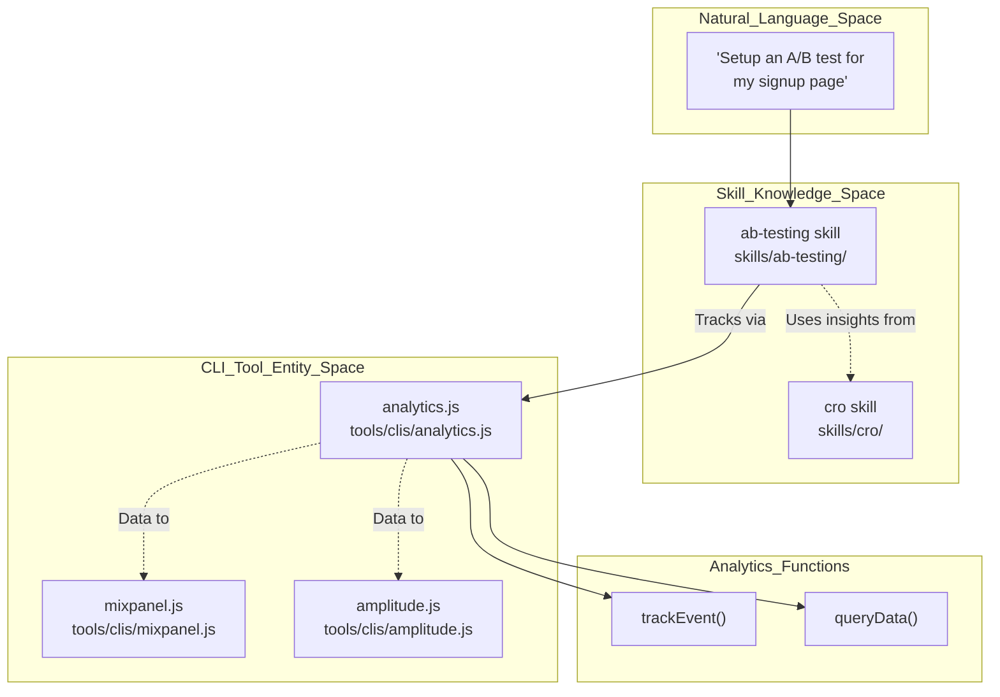
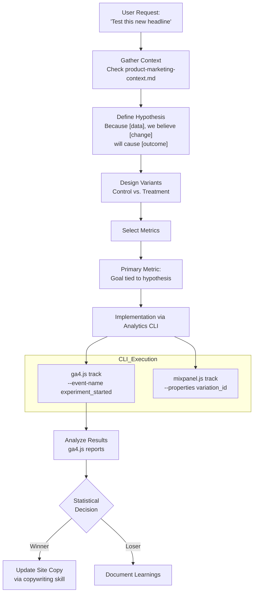
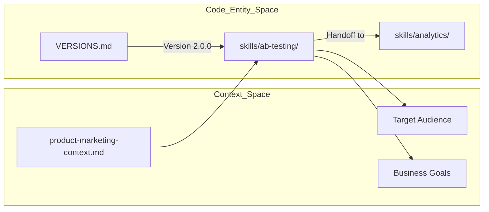

<!-- source: DeepWiki mcp.deepwiki.com · repo coreyhaines31/marketingskills · extra page A/B Test Setup · fetched 2026-10-27 -->

# A/B Test Setup

Relevant source files

The following files were used as context for generating this wiki page:

- [.claude-plugin/marketplace.json](.claude-plugin/marketplace.json)
- [.claude-plugin/plugin.json](.claude-plugin/plugin.json)
- [README.md](README.md)
- [VERSIONS.md](VERSIONS.md)

This document covers the **ab-testing skill**, which provides AI agents with knowledge for planning, designing, and implementing A/B tests and optimization experiments. This skill focuses on experiment design methodology, statistical considerations, and implementation patterns for conversion rate optimization.

For information about event tracking and analytics instrumentation that supports A/B tests, see [Analytics Tracking](#4.7.1). For applying optimization insights to reduce customer churn, see [Churn Prevention](#4.3.1).

**Sources:** [README.md:63](), [README.md:19-27](), [VERSIONS.md:7]()

## Skill Overview

The `ab-testing` skill (implemented as `skills/ab-testing/`) is a markdown-based knowledge module that guides AI agents through the process of designing and implementing optimization experiments. It is automatically invoked when users request help with:

- Planning or designing A/B tests or experiments.
- Building a growth experimentation program.
- Determining statistical significance and sample size requirements.
- Interpreting experiment results using metrics like p-values and confidence intervals.
- Prioritizing experiments using frameworks like ICE (Impact, Confidence, Ease) scoring.

**Skill Metadata:**

| Property | Value |
|----------|-------|
| Skill Name | `ab-testing` |
| Version | 2.0.0 |
| Category | Paid & Measurement |
| Implementation | Markdown Skill |

The skill is triggered when the user wants to plan, design, or implement an A/B test or experiment. [README.md:59]()

**Sources:** [README.md:59](), [VERSIONS.md:7](), [README.md:35]()

## Position in System Architecture

The `ab-testing` skill acts as the bridge between optimization strategy (like `cro`, `signup`, or `onboarding`) and technical execution (like `analytics`). It provides the statistical rigor required before using CLI tools to track experiment exposures. [README.md:45-52]()

### Technical Integration Map

**Sources:** [README.md:35-43](), [README.md:45-52](), [README.md:59-63]()

## Experiment Lifecycle Workflow

The skill follows a cross-functional workflow where `copywriting` or `cro` skills generate the content for variants, which are then structured into an experiment by `ab-testing`. [README.md:45-46]()

**Sources:** [README.md:19](), [README.md:45-46](), [README.md:63]()

## Implementation Patterns & CLI Tools

The skill leverages specific CLI tools to execute and monitor experiments by integrating with the project's analytics stack.

### Experiment Tracking
The `analytics` skill and related CLIs are the primary engines for experiment data collection:
- **GA4**: Uses `ga4` CLI to send experiment exposure events and retrieve conversion reports.
- **Mixpanel**: Uses `mixpanel` CLI to track variation assignments as user properties or events to analyze funnels.
- **Amplitude**: Uses `amplitude` CLI for advanced retention and cohort analysis of experiment participants.

### Research and Grounding
Before setting up a test, the skill may use research tools to ground the hypothesis:
- **Customer Research**: Uses `customer-research` to find qualitative pain points. [README.md:49]()
- **Competitor Profiling**: Uses `competitor-profiling` to see how others handle similar flows. [README.md:69]()

**Sources:** [README.md:63](), [README.md:49](), [README.md:69-75]()

## Integration with Context

The skill prioritizes existing knowledge by checking for the `product-marketing-context.md` file to understand the product, audience, and positioning before designing experiments. [README.md:19]()

By reading the context first, the AI avoids asking repetitive questions about the product category or target audience during the experiment setup phase. [README.md:19-27]()

**Sources:** [README.md:19-27](), [VERSIONS.md:7](), [README.md:63]()

---

