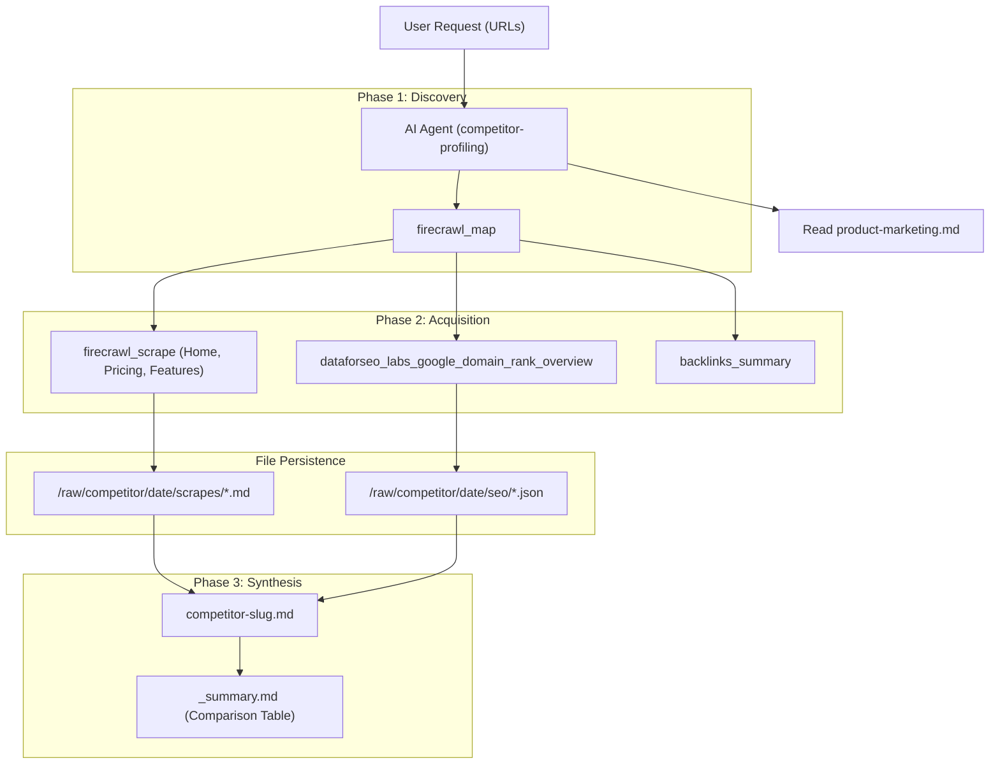
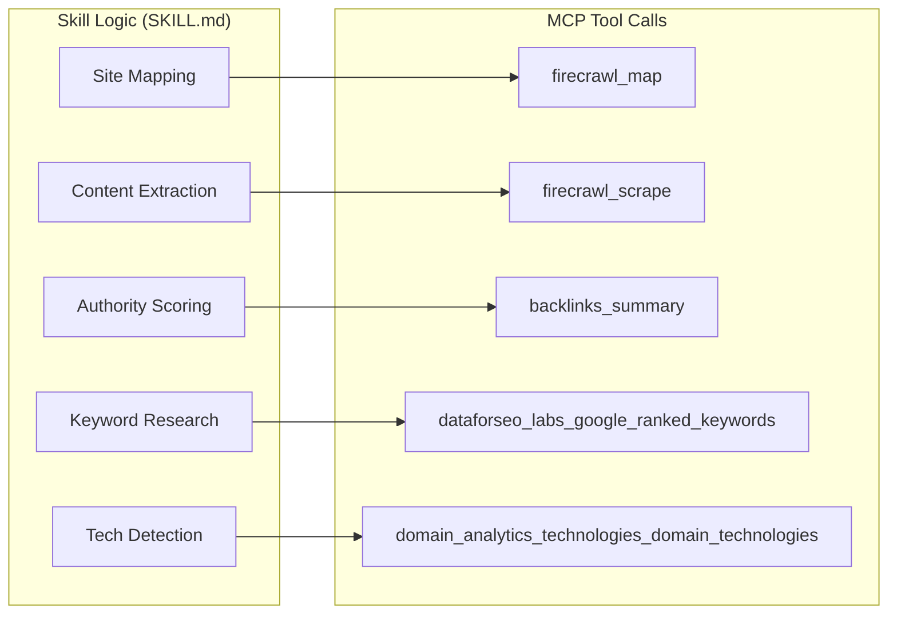

<!-- source: DeepWiki mcp.deepwiki.com · repo coreyhaines31/marketingskills · extra page Competitor Profiling · fetched 2026-10-27 -->

# Competitor Profiling

Relevant source files

The following files were used as context for generating this wiki page:

- [skills/competitor-profiling/SKILL.md](skills/competitor-profiling/SKILL.md)
- [skills/competitor-profiling/references/templates.md](skills/competitor-profiling/references/templates.md)
- [skills/competitor-profiling/references/tool-reference.md](skills/competitor-profiling/references/tool-reference.md)

The `competitor-profiling` skill (v2.0.0) is a specialized knowledge module designed for deep-dive research and competitive intelligence [skills/competitor-profiling/SKILL.md:2-5](). It automates the process of researching competitors by combining live website scraping (via Firecrawl) with quantitative SEO and market data (via DataForSEO).

The skill transforms raw competitor URLs into structured, comparable dossiers that inform product positioning, pricing strategy, and sales enablement.

## Purpose and Scope

The primary goal is to provide a factual, data-driven foundation for competitive strategy [skills/competitor-profiling/SKILL.md:10-10]().

*   **In-Scope**: Automated site mapping, feature extraction, pricing analysis, SEO authority metrics, keyword overlap, and customer sentiment from review sites [skills/competitor-profiling/SKILL.md:77-165]().
*   **Out-of-Scope**: Public-facing comparison pages (handled by `competitor-alternatives`) and internal sales battle cards (handled by `sales-enablement`) [skills/competitor-profiling/SKILL.md:3-3]().

## System Architecture and Data Flow

The skill follows a three-phase execution model: Discovery, Data Acquisition, and Synthesis.

### Research Pipeline
The research process is tiered based on the requested depth level: **Quick Scan** (speed-optimized) vs. **Deep Profile** (comprehensive) [skills/competitor-profiling/SKILL.md:21-21]().

1.  **Phase 1: Discovery**: Uses `firecrawl_map` to identify high-value URLs like `/pricing`, `/features`, and `/changelog` [skills/competitor-profiling/references/tool-reference.md:15-19]().
2.  **Phase 2: Acquisition**: Parallel execution of site scraping and SEO API calls [skills/competitor-profiling/references/tool-reference.md:121-167]().
3.  **Phase 3: Synthesis**: Mapping raw data to structured templates [skills/competitor-profiling/references/templates.md:1-3]().

### Technical Data Flow
The following diagram illustrates how natural language requests translate into MCP tool calls and structured file outputs.

**Data Flow: URL to Profile**

Sources: [skills/competitor-profiling/SKILL.md:48-60](), [skills/competitor-profiling/references/tool-reference.md:119-167]()

## Implementation Details

### Directory Structure and Persistence
To ensure auditability and reduce API costs, the skill enforces a strict directory layout for raw data [skills/competitor-profiling/SKILL.md:44-47]().

| Path | Description |
|:---|:---|
| `competitor-profiles/raw/<slug>/<date>/scrapes/` | Markdown files from Firecrawl [skills/competitor-profiling/SKILL.md:55-55]() |
| `competitor-profiles/raw/<slug>/<date>/seo/` | JSON responses from DataForSEO [skills/competitor-profiling/SKILL.md:56-56]() |
| `competitor-profiles/raw/<slug>/<date>/reviews/` | Scraped review data (G2, Capterra) [skills/competitor-profiling/SKILL.md:57-57]() |
| `competitor-profiles/<competitor-slug>.md` | The final synthesized markdown profile [skills/competitor-profiling/SKILL.md:58-58]() |

### Tool Integration (MCP)
The skill utilizes specific Model Context Protocol (MCP) tools to gather intelligence.

**Code Entity Mapping: Skill to MCP Tools**

Sources: [skills/competitor-profiling/references/tool-reference.md:13-117]()

### Core Components

#### 1. Site Scraping (Firecrawl)
*   **Map**: Identifies site structure to find non-obvious pages like `/changelog` to gauge release velocity [skills/competitor-profiling/SKILL.md:119-119]().
*   **Scrape**: Extracts headlines, CTAs, and pricing tiers into clean markdown [skills/competitor-profiling/SKILL.md:111-120]().
*   **Search**: Used to find external review pages on G2, Capterra, or TrustRadius [skills/competitor-profiling/SKILL.md:123-127]().

#### 2. SEO Intelligence (DataForSEO)
*   **Domain Rank**: Uses `backlinks_summary` for authority scores and `backlinks_bulk_ranks` for multi-competitor comparisons [skills/competitor-profiling/references/tool-reference.md:51-54](), [skills/competitor-profiling/references/tool-reference.md:111-114]().
*   **Keyword Overlap**: Uses `dataforseo_labs_google_domain_intersection` to find direct battlegrounds between the user and the competitor [skills/competitor-profiling/references/tool-reference.md:85-89]().
*   **Market Maturity**: Categorizes competitors into tiers (Challenger, Leader, Niche, Established) based on domain rank and organic traffic [skills/competitor-profiling/SKILL.md:175-181]().

#### 3. Structured Output Templates
The skill utilizes predefined templates in `references/templates.md` to ensure consistency:
*   **Quick Scan**: Focuses on tagline, target audience, and starting price [skills/competitor-profiling/references/templates.md:18-53]().
*   **Side-by-Side Summary**: A cross-competitor matrix for the `_summary.md` file [skills/competitor-profiling/references/templates.md:61-83]().
*   **Positioning Map**: A text-based quadrant (e.g., Simple vs. Complex) to identify market whitespace [skills/competitor-profiling/references/templates.md:102-122]().
*   **Competitive SWOT**: Per-competitor analysis relative to the user's product [skills/competitor-profiling/references/templates.md:130-148]().

## Skill Relationships

*   **Input Dependency**: Requires `.agents/product-marketing.md` (or legacy `product-marketing-context.md`) to avoid redundant questions about the user's own product [skills/competitor-profiling/SKILL.md:14-15]().
*   **Downstream: Competitor Alternatives**: Uses the generated profiles to build public-facing `/vs/` comparison pages [skills/competitor-profiling/SKILL.md:3-3]().
*   **Downstream: Sales Enablement**: Feeds technical and pricing data into internal battle cards and objection handling scripts [skills/competitor-profiling/SKILL.md:3-3]().

Sources: [skills/competitor-profiling/SKILL.md:1-73](), [skills/competitor-profiling/references/templates.md:1-168](), [skills/competitor-profiling/references/tool-reference.md:1-180]()

---

