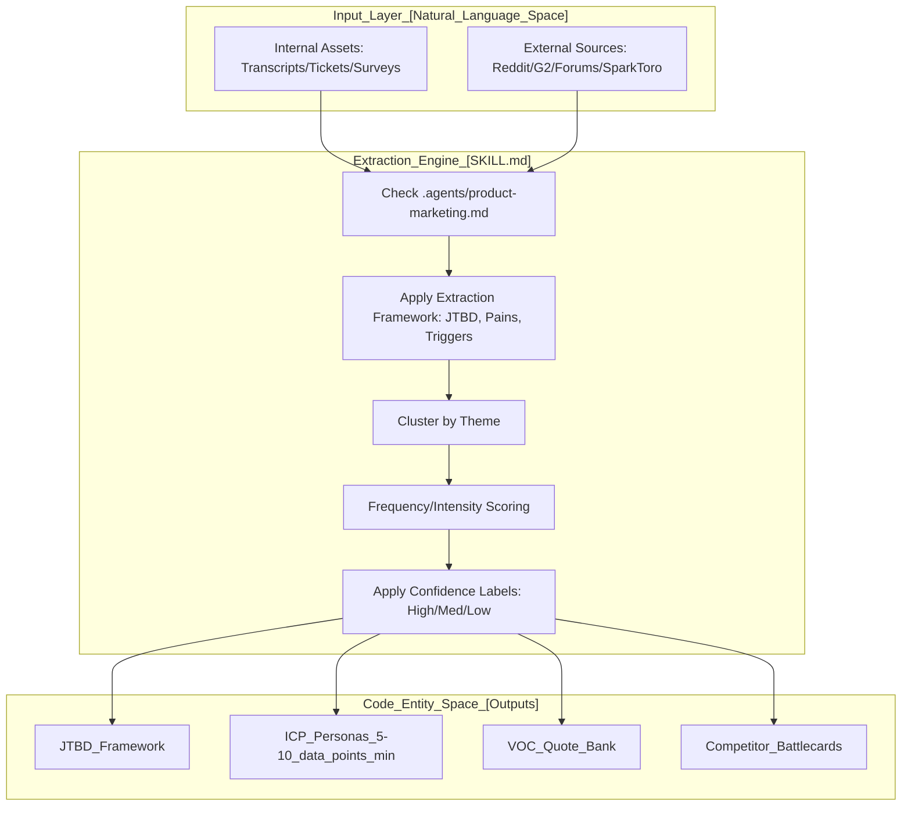
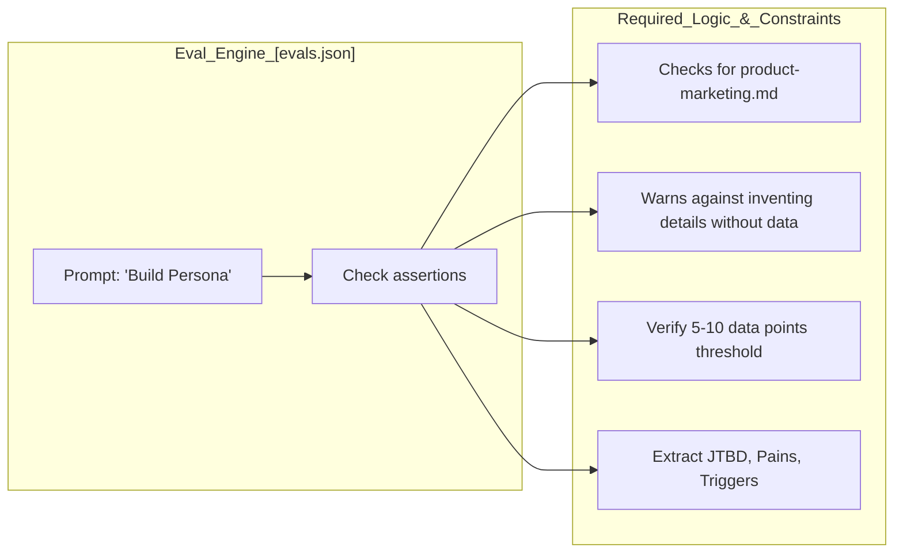

<!-- source: DeepWiki mcp.deepwiki.com · repo coreyhaines31/marketingskills · extra page Customer Research · fetched 2026-10-27 -->

# Customer Research

Relevant source files

The following files were used as context for generating this wiki page:

- [skills/customer-research/SKILL.md](skills/customer-research/SKILL.md)
- [skills/customer-research/evals/evals.json](skills/customer-research/evals/evals.json)
- [skills/customer-research/references/source-guides.md](skills/customer-research/references/source-guides.md)
- [tools/integrations/sparktoro.md](tools/integrations/sparktoro.md)

The `customer-research` skill is a knowledge module designed to uncover authentic customer insights, sentiment, and language. It operates in two primary modes: analyzing existing internal assets (transcripts, tickets, surveys) and gathering external intelligence from "digital watering holes" (Reddit, G2, Hacker News). This research serves as the foundational data layer for downstream tasks like copywriting and conversion rate optimization (CRO).

## System Overview

The skill implements a structured extraction framework to transform raw qualitative data into actionable marketing assets like Personas, Voice of Customer (VoC) banks, and Jobs to Be Done (JTBD) maps.

### Research Modes and Data Flow

The following diagram illustrates how the `customer-research` skill processes different input types through its extraction engine to produce strategic outputs.

**Diagram: Customer Research Data Pipeline**

**Sources:** [skills/customer-research/SKILL.md:19-28](), [skills/customer-research/SKILL.md:58-100](), [skills/customer-research/evals/evals.json:47-58]()

---

## Implementation Detail: The Extraction Framework

When analyzing any asset, the skill is programmed to extract six specific data points to ensure consistency across research projects.

| Field | Description | Code Reference |
|-------|-------------|----------------|
| **Jobs to Be Done** | Functional, emotional, and social outcomes. | [skills/customer-research/SKILL.md:62-65]() |
| **Pain Points** | Unprompted frustrations with current situations. | [skills/customer-research/SKILL.md:67-68]() |
| **Trigger Events** | Internal or external changes that forced a search (e.g., team growth). | [skills/customer-research/SKILL.md:70-71]() |
| **Desired Outcomes** | Verbatim success definitions. | [skills/customer-research/SKILL.md:73-74]() |
| **Language/Vocab** | Exact phrases for copy (e.g., "drowning in spreadsheets"). | [skills/customer-research/SKILL.md:76-77]() |
| **Alternatives** | Competitors, manual workarounds, or "doing nothing." | [skills/customer-research/SKILL.md:79-80]() |

**Sources:** [skills/customer-research/SKILL.md:59-81]()

---

## Digital Watering Hole Research (Mode 2)

For users without existing data, the skill utilizes `references/source-guides.md` to navigate external platforms and `tools/integrations/sparktoro.md` for audience behavior data.

### Platform-Specific Logic

The skill maps ICP (Ideal Customer Profile) types to specific digital sources:

*   **B2B SaaS/Technical:** Reddit (role-specific subs), G2, Hacker News, SparkToro. [skills/customer-research/SKILL.md:124](), [tools/integrations/sparktoro.md:60-67]()
*   **Developers:** r/devops, r/programming, Hacker News, Stack Overflow. [skills/customer-research/SKILL.md:126](), [skills/customer-research/references/source-guides.md:21]()
*   **SMB/Founders:** Indie Hackers, Product Hunt, r/entrepreneur. [skills/customer-research/SKILL.md:125](), [skills/customer-research/references/source-guides.md:100-114]()

### Review Mining Strategy
The system prioritizes specific review tiers to maximize signal:
1.  **3-Star Reviews:** Most honest/balanced feedback where something was missing. [skills/customer-research/references/source-guides.md:64]()
2.  **Competitor 4-Star Reviews:** Users who like the category but have specific unmet needs ("I wish it could..."). [skills/customer-research/references/source-guides.md:77]()
3.  **1-Star Reviews:** Identification of critical failure modes vs. support issues. [skills/customer-research/references/source-guides.md:65]()

### Audience Behavior Discovery
The skill incorporates SparkToro workflows to identify where audiences spend time, revealing:
*   **Social Accounts:** Who the ICP follows. [tools/integrations/sparktoro.md:38]()
*   **Media Consumption:** Podcasts, YouTube channels, and websites. [tools/integrations/sparktoro.md:34-36]()
*   **Search Intent:** Keywords and AI prompt topics. [tools/integrations/sparktoro.md:39-40]()

**Sources:** [skills/customer-research/SKILL.md:114-135](), [skills/customer-research/references/source-guides.md:7-136](), [tools/integrations/sparktoro.md:31-55]()

---

## Quality Guardrails and Evals

To prevent "hallucinated" personas or biased conclusions, the skill enforces specific technical constraints:

*   **Minimum Viable Sample:** No conclusions should be drawn from fewer than 5 independent data points per segment. [skills/customer-research/SKILL.md:110]()
*   **Confidence Labeling:** Insights must be tagged as High (3+ independent sources), Medium (2 sources), or Low (single source/outlier). [skills/customer-research/SKILL.md:96-100]()
*   **Recency Bias:** Data older than 12 months is weighted lower as markets shift. [skills/customer-research/SKILL.md:102]()
*   **Sample Bias Checks:** Adjusting for the fact that Reddit skews technical and support tickets skew toward problems. [skills/customer-research/SKILL.md:104-108]()

### Automated Evaluation
The `evals/evals.json` file contains test cases ensuring the agent follows these constraints.

**Diagram: Eval Assertion Logic**

**Sources:** [skills/customer-research/SKILL.md:92-111](), [skills/customer-research/evals/evals.json:47-58]()

---

## Related Components

*   **Product Marketing Context:** Every research task begins by checking `.agents/product-marketing.md` (or legacy `product-marketing-context.md`) to avoid redundant discovery. [skills/customer-research/SKILL.md:14-16]()
*   **Downstream Skills:** Research findings directly populate the "Language" and "Pains" sections used by the `copywriting` and `page-cro` skills. [skills/customer-research/SKILL.md:3]()
*   **Competitive Intelligence:** Review mining feeds directly into competitive analysis, specifically using the "Top praise" and "Top complaint" extraction template. [skills/customer-research/references/source-guides.md:88-97]()

**Sources:** [skills/customer-research/SKILL.md:1-16](), [skills/customer-research/references/source-guides.md:88-97]()

---

