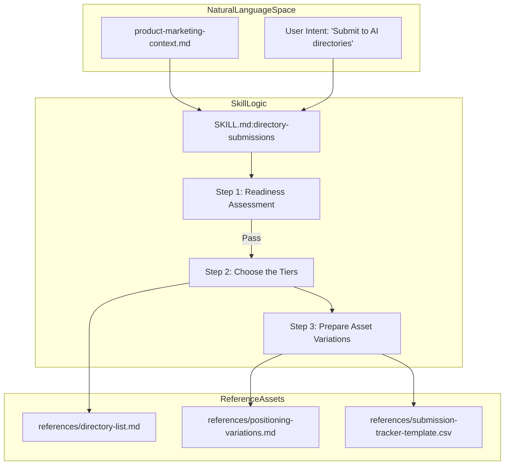
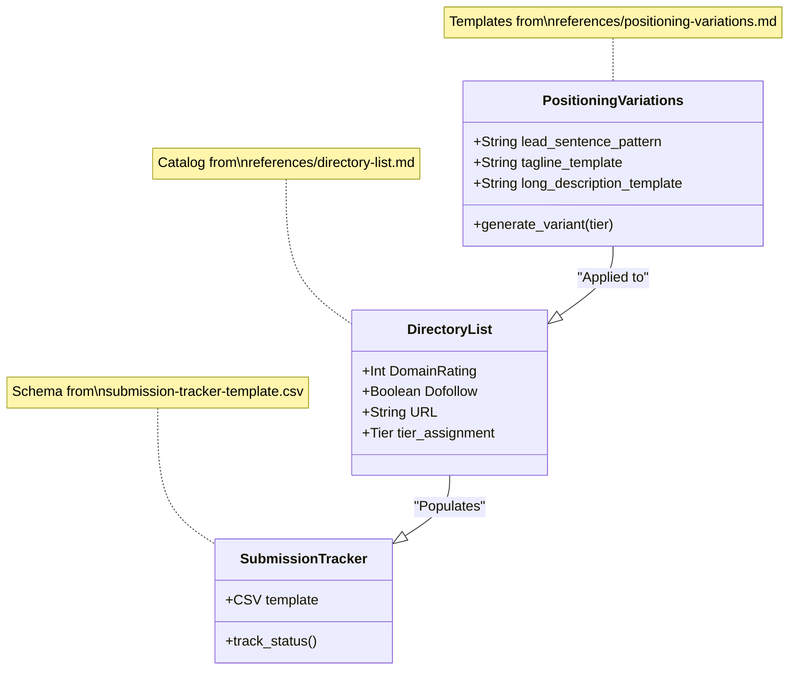

<!-- source: DeepWiki mcp.deepwiki.com · repo coreyhaines31/marketingskills · extra page Directory Submissions · fetched 2026-10-27 -->

# Directory Submissions

Relevant source files

The following files were used as context for generating this wiki page:

- [skills/directory-submissions/SKILL.md](skills/directory-submissions/SKILL.md)
- [skills/directory-submissions/references/directory-list.md](skills/directory-submissions/references/directory-list.md)
- [skills/directory-submissions/references/positioning-variations.md](skills/directory-submissions/references/positioning-variations.md)
- [skills/directory-submissions/references/submission-tracker-template.csv](skills/directory-submissions/references/submission-tracker-template.csv)

The `directory-submissions` skill documents the process of submitting products to startup, SaaS, AI, agent, MCP, and review directories. Its primary purpose is to build a compounding foundation of backlinks and discovery surface area. This skill distinguishes itself from `launch-strategy` (which covers broader launch orchestration) and `programmatic-seo` (which focuses on the landing pages that receive the link equity) by focusing specifically on the directory layer of distribution. [skills/directory-submissions/SKILL.md:3-3]()

## Core Implementation Logic

The skill operates on a "Foundation before Submission" principle. It enforces a strict sequence: building destination pages (competitor alternatives, use-case pages) before submitting to directories to ensure that passed link equity lands on high-converting assets. [skills/directory-submissions/SKILL.md:35-52]()

### Directory Tiers and Sequencing
Submissions are categorized into multiple tiers, each with specific timing and requirements. The system tracks approximately 100+ directories across these categories. [skills/directory-submissions/references/submission-tracker-template.csv:1-100]()

| Tier | Type | Timing | Key Entities | Typical Count |
| :--- | :--- | :--- | :--- | :--- |
| **Tier 1** | Flagship Launch | Launch Week | Product Hunt, Hacker News, BetaList | ~15 |
| **Tier 2** | Startup/SaaS | Week 1+ Rolling | AlternativeTo, G2, Capterra, SaaSHub | ~50 |
| **Tier 3** | AI Directories | Weeks 1-3 | TAAFT, Futurepedia, Toolify | ~40 |
| **Tier 4** | Agent/MCP | Weeks 1-3 | Glama, APITracker, LF MCP Registry | ~10 |
| **Tier 5** | No-code | Weeks 1-3 | NoCodeFinder, No Code MBA | ~8 |
| **Tier 7** | Marketplaces | Integration Ship | Zapier, HubSpot, Slack, Notion | ~5 |

Sources: [skills/directory-submissions/SKILL.md:90-99](), [skills/directory-submissions/references/directory-list.md:12-151]()

### Technical Readiness Requirements (Phase 0)
Before any submission, the system validates the "Readiness Assessment" consisting of 9 technical and asset-based checks. Hard blocks include the absence of a pricing page, missing FAQ schema, or lack of structured data (`Organization`, `Product`, `SoftwareApplication`). [skills/directory-submissions/SKILL.md:70-85]()

## Data Flow: From Context to Submission

The skill processes product information through a positioning engine that varies the "Lead Sentence" based on the directory tier to optimize for specific audience intent and avoid duplicate content penalties. [skills/directory-submissions/references/positioning-variations.md:3-19]()

### Directory Submission Pipeline
The following diagram illustrates how the `directory-submissions` skill transforms `product-marketing-context.md` into tier-specific submissions using the `positioning-variations.md` templates.

**Directory Submission Pipeline**

Sources: [skills/directory-submissions/SKILL.md:68-106](), [skills/directory-submissions/references/directory-list.md:1-10]()

## Positioning Engine

The positioning engine uses specific lead sentence patterns defined in `references/positioning-variations.md` to match the mental model of the directory's users.

| Directory Category | Lead Sentence Pattern | Audience Driver |
| :--- | :--- | :--- |
| **AI Directories** | "[Product] uses [AI capability] to [outcome]." | Explicit AI tool search |
| **Agent/MCP** | "[Product] is an MCP-native [category]." | Niche technical moat |
| **SaaS/Review** | "[Product] is the [differentiator] alternative to [competitors]." | Comparison intent |
| **Dev Tools** | "[Product] is a [technical category] with [differentiator]." | Technical substance |
| **No-Code** | "[Product] lets you build [output] without code." | Speed over depth |

Sources: [skills/directory-submissions/references/positioning-variations.md:9-19](), [skills/directory-submissions/SKILL.md:56-64]()

### Positioning Data Mapping
This diagram maps the template variables used in the positioning library to the expected data fields in the marketing context.

**Positioning Data Mapping**

Sources: [skills/directory-submissions/references/positioning-variations.md:23-147](), [skills/directory-submissions/references/directory-list.md:16-100]()

## Backlink Strategy

The skill prioritizes `dofollow` links from high Domain Rating (DR) sites to increase the site's authority. AI-referred traffic from these directories is noted to convert **6–27× higher** than traditional search. [skills/directory-submissions/SKILL.md:23-25]()

1.  **Tier 1 & 2 (DR 70-93):** Product Hunt (DR 91), G2 (DR 92), Capterra (DR 93). These provide the strongest authority signals. [skills/directory-submissions/references/directory-list.md:18-47]()
2.  **Tier 3 (AI Focus):** There's An AI For That (DR 76), Futurepedia (DR 70), and Toolify.ai (DR 71). These drive high-intent AI traffic. [skills/directory-submissions/references/directory-list.md:107-110]()
3.  **Tier 4 (MCP/Agent Moat):** Submitting to the Linux Foundation MCP Registry, Glama.ai, and APITracker to capture the emerging AI agent ecosystem. [skills/directory-submissions/references/directory-list.md:144-147]()

### Submission Tracker
Submissions are tracked using `references/submission-tracker-template.csv`, which includes fields for:
*   `Dofollow` status
*   `DR` (Domain Rating)
*   `Positioning Variant Used`
*   `Backlink Verified` status
*   `Live URL`

[skills/directory-submissions/references/submission-tracker-template.csv:1-10]()

Sources:
- [skills/directory-submissions/SKILL.md:1-106]()
- [skills/directory-submissions/references/directory-list.md:1-155]()
- [skills/directory-submissions/references/positioning-variations.md:1-180]()
- [skills/directory-submissions/references/submission-tracker-template.csv:1-81]()

---

