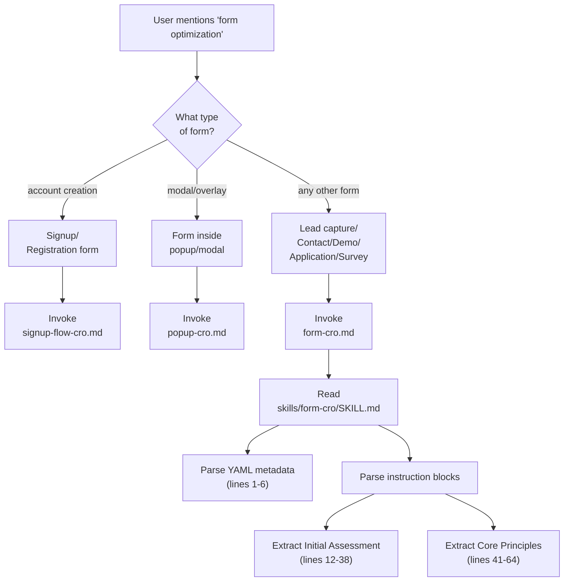
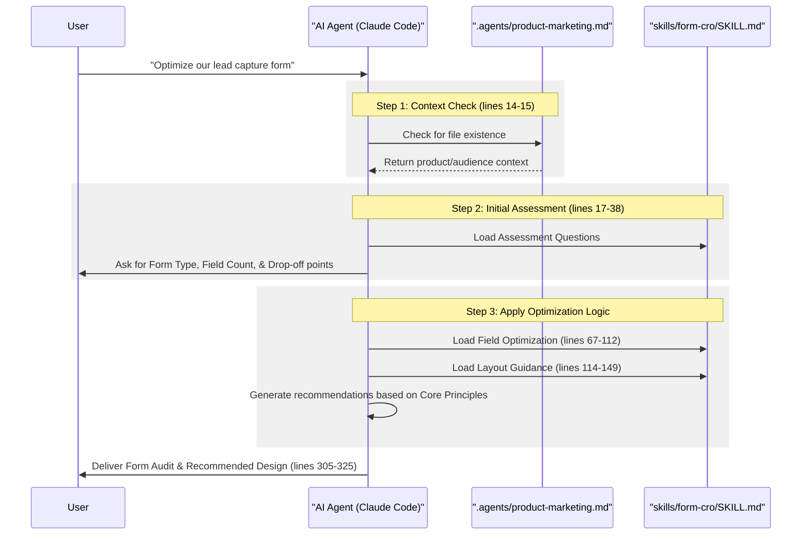
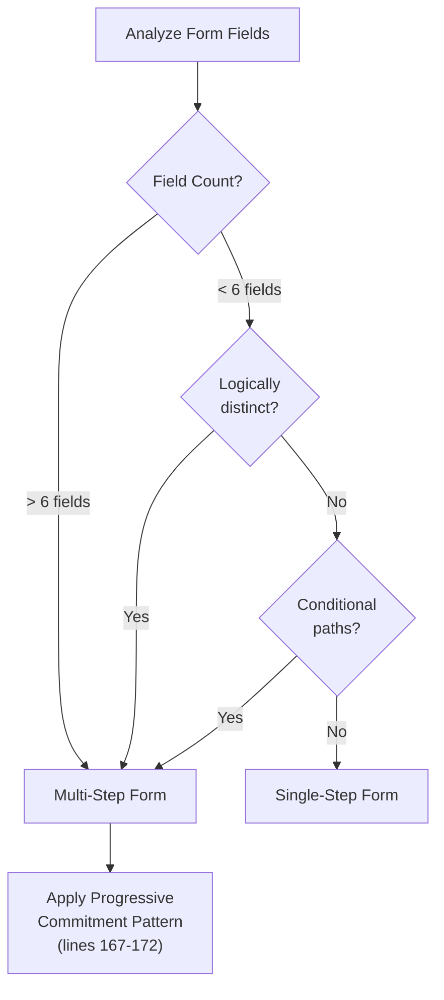

<!-- source: DeepWiki mcp.deepwiki.com · repo coreyhaines31/marketingskills · extra page Form CRO · fetched 2026-10-27 -->

# Form CRO

Relevant source files

The following files were used as context for generating this wiki page:

- [.claude-plugin/marketplace.json](.claude-plugin/marketplace.json)
- [.claude-plugin/plugin.json](.claude-plugin/plugin.json)
- [README.md](README.md)
- [VERSIONS.md](VERSIONS.md)

This page documents the Form CRO skill (`form-cro`), which provides frameworks and methodologies for optimizing form completion rates across lead capture, contact, demo request, application, survey, and checkout forms. This skill focuses on non-signup forms; for account creation and registration flows, see [4.2.2 Signup Flow CRO](), and for forms embedded in modals, see [4.2.6 Popup CRO]().

The skill is implemented as a single markdown-based knowledge module that the AI agent parses to guide form optimization decisions through field-level analysis, layout recommendations, error handling strategies, and experiment design.

Sources: [skills/form-cro/SKILL.md:1-426](), [skills/signup-flow-cro/SKILL.md:3-3](), [skills/popup-cro/SKILL.md:3-3]()

---

## Skill Metadata and Trigger Definition

The `form-cro` skill is defined with YAML front matter that specifies its scope and routing logic:

| Property | Value |
|----------|-------|
| **name** | `form-cro` |
| **description** | Triggers when user wants to optimize any form that is NOT signup/registration |
| **Trigger Keywords** | "form optimization," "lead form," "contact form," "form friction," "form fields," "form completion rate" |
| **Exclusions** | Signup/registration forms → `signup-flow-cro`, Popups containing forms → `popup-cro` |

The description field functions as a trigger specification, explicitly defining when this skill should activate versus related skills. This prevents trigger overlap and ensures precise skill routing.

Sources: [skills/form-cro/SKILL.md:1-6]()

---

## Skill Invocation Decision Tree

The following diagram bridges the **Natural Language Space** (user intent) to the **Code Entity Space** (specific skill files).

**Diagram: Skill Selection and Loading Process**

Sources: [skills/form-cro/SKILL.md:1-64](), [skills/signup-flow-cro/SKILL.md:1-6](), [skills/popup-cro/SKILL.md:1-6]()

---

## SKILL.md File Architecture

The `form-cro` skill follows the standard knowledge module structure, containing specific optimization logic:

| Section | Lines | Purpose |
|---------|-------|---------|
| **Initial Assessment** | 12-38 | Context gathering questions about form type, current state, and business context. |
| **Core Principles** | 41-64 | Foundational rules: field cost, value/effort balance, and cognitive load. |
| **Field-by-Field Optimization** | 67-112 | Specific guidance for 9 common field types (email, name, phone, etc.). |
| **Form Layout Optimization** | 114-149 | Field order, labels vs placeholders, visual design, and column layout. |
| **Multi-Step Forms** | 151-173 | Criteria for multi-step usage and the "Progressive Commitment Pattern." |
| **Error Handling** | 175-197 | Inline validation strategies and error message clarity. |
| **Submit Button Optimization** | 199-223 | Button copy formulas and placement rules. |
| **Trust and Friction Reduction** | 225-244 | Privacy statements and perceived effort reduction techniques. |
| **Form Types: Specific Guidance** | 246-272 | Specialized advice for Lead Capture, Demo Requests, and Surveys. |
| **Measurement** | 285-303 | Key metrics (start rate, completion rate, field drop-off). |
| **Output Format** | 305-325 | Standardized structure for audits and recommended designs. |
| **Experiment Ideas** | 327-406 | 40+ A/B test hypotheses categorized by form element. |

Sources: [skills/form-cro/SKILL.md:12-406]()

---

## Skill Execution Workflow

This sequence demonstrates how the AI agent interacts with the codebase and the user to execute the optimization task.

**Diagram: Skill Execution Sequence**

Sources: [skills/form-cro/SKILL.md:12-325](), [skills/sales-enablement/SKILL.md:15-15](), [skills/copywriting/SKILL.md:15-15]()

---

## Core Optimization Principles

The skill defines three fundamental principles that guide all recommendations:

### 1. Every Field Has a Cost
Each field added to a form reduces the completion rate. The skill provides a quantified impact model:
- **3 fields**: Baseline completion.
- **4-6 fields**: 10-25% reduction in conversions.
- **7+ fields**: 25-50%+ reduction in conversions.

Sources: [skills/form-cro/SKILL.md:43-48]()

### 2. Value Must Exceed Effort
Users will only complete a form if the perceived value of the offer (e.g., a lead magnet or demo) outweighs the friction of the form. Recommendations focus on clear value propositions above the form.

Sources: [skills/form-cro/SKILL.md:54-58]()

### 3. Reduce Cognitive Load
Forms should minimize thinking. This includes using one question per field, clear conversational labels, and smart defaults.

Sources: [skills/form-cro/SKILL.md:59-64]()

---

## Field-by-Field Optimization Guidance

The skill provides specific rules for common input types to minimize friction:

| Field Type | Guidance | Source |
|------------|----------|--------|
| **Email** | Single field (no confirmation), inline validation, and proper mobile keyboard. | [skills/form-cro/SKILL.md:69-74]() |
| **Name** | Single "Name" field is preferred over First/Last split to reduce friction. | [skills/form-cro/SKILL.md:75-79]() |
| **Phone** | Make optional if possible; explain why it's needed if required. | [skills/form-cro/SKILL.md:80-85]() |
| **Company** | Use auto-suggest or infer from email domain; enrich after submission. | [skills/form-cro/SKILL.md:86-90]() |
| **Dropdowns** | Use radio buttons if < 5 options; make searchable if many options. | [skills/form-cro/SKILL.md:101-106]() |

---

## Multi-Step Form Decision Framework

The skill guides the agent on when to transition from a single-step to a multi-step layout.

**Diagram: Multi-Step Form Decision Logic**

Sources: [skills/form-cro/SKILL.md:151-173]()

---

## Measurement and Tracking

The skill specifies six key metrics for assessing form performance:
1. **Form start rate**: Percentage of users who land on the page and focus on the first field.
2. **Form completion rate**: Percentage of users who start and successfully submit.
3. **Field-level drop-off**: Identifying exactly which field causes users to abandon.
4. **Time to complete**: Measuring the friction of the form.
5. **Error rate by field**: Identifying confusing validation rules.
6. **Mobile vs. desktop completion**: Detecting responsive design issues.

Sources: [skills/form-cro/SKILL.md:285-303]()

---

## Related Skills

The `form-cro` skill is part of a larger conversion optimization ecosystem and frequently references these modules:

- **[4.2.2 Signup Flow CRO]()**: Use for account creation and registration.
- **[4.2.6 Popup CRO]()**: Use for forms contained within overlays or exit-intent modals.
- **[4.2.1 Page CRO]()**: Use for optimizing the landing page surrounding the form.
- **[4.7.2 A/B Test Setup]()**: Use to design experiments based on form hypotheses.

Sources: [skills/form-cro/SKILL.md:419-426]()

---

