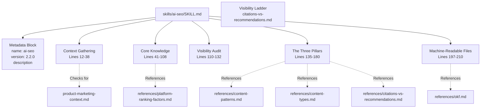
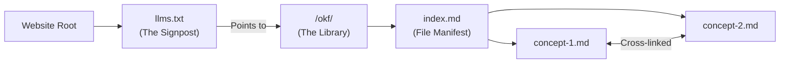
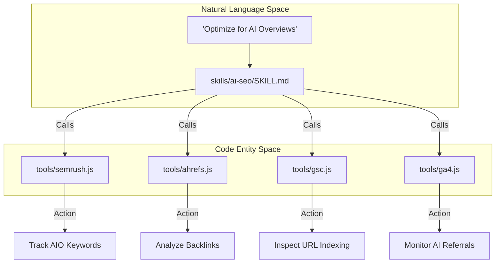

<!-- source: DeepWiki mcp.deepwiki.com · repo coreyhaines31/marketingskills · extra page AI SEO · fetched 2026-10-27 -->

# AI SEO

Relevant source files

The following files were used as context for generating this wiki page:

- [skills/ai-seo/SKILL.md](skills/ai-seo/SKILL.md)
- [skills/ai-seo/evals/evals.json](skills/ai-seo/evals/evals.json)
- [skills/ai-seo/references/citations-vs-recommendations.md](skills/ai-seo/references/citations-vs-recommendations.md)
- [skills/ai-seo/references/content-patterns.md](skills/ai-seo/references/content-patterns.md)
- [skills/ai-seo/references/content-types.md](skills/ai-seo/references/content-types.md)
- [skills/ai-seo/references/okf.md](skills/ai-seo/references/okf.md)
- [skills/ai-seo/references/platform-ranking-factors.md](skills/ai-seo/references/platform-ranking-factors.md)
- [skills/competitors/SKILL.md](skills/competitors/SKILL.md)

This page documents the `ai-seo` skill, which provides expertise in optimizing content for AI search engines and language model citations. The skill covers optimization for Google AI Overviews, ChatGPT, Perplexity, Claude, Gemini, and Microsoft Copilot.

For traditional technical SEO audits (crawlability, site structure, on-page optimization), see [SEO Audit](4.5.1). For implementing structured data that helps AI systems understand content, see [Schema Markup](4.5.4). For building SEO pages at scale, see [Programmatic SEO](4.5.3).

**Sources:** [skills/ai-seo/SKILL.md:1-10]()

---

## Skill Purpose and Scope

The `ai-seo` skill is triggered when users mention AI search optimization, getting cited by language models, or appearing in AI-generated answers. It addresses the fundamental shift from ranking-focused SEO to citation-focused optimization, where content must be discoverable, extractable, and citable by AI systems. [skills/ai-seo/SKILL.md:10-10]()

**Key distinction:** Traditional SEO gets you ranked. AI SEO gets you **cited**. AI systems select sources based on content quality, structure, and relevance, not just rank position. [skills/ai-seo/SKILL.md:58-60]()

**Triggering phrases:**
- "AI SEO", "AEO" (Answer Engine Optimization), "GEO" (Generative Engine Optimization), "LLMO" [skills/ai-seo/SKILL.md:3-3]()
- "AI Overviews", "optimize for ChatGPT/Perplexity/Claude/Gemini", "AI citations" [skills/ai-seo/SKILL.md:3-3]()
- "llms.txt", "OKF", "Open Knowledge Format", "agent-readable site" [skills/ai-seo/SKILL.md:3-3]()

**Sources:** [skills/ai-seo/SKILL.md:1-10](), [skills/ai-seo/SKILL.md:56-68]()

---

## Skill File Structure

The skill follows the standard markdown-based knowledge module pattern with metadata header, contextual prompts, and structured knowledge sections.

**Metadata structure:**
- `name`: `ai-seo` - Skill identifier [skills/ai-seo/SKILL.md:2-2]()
- `description`: Natural language triggers and scope definition [skills/ai-seo/SKILL.md:3-3]()
- `version`: `2.2.0` - Skill version tracking [skills/ai-seo/SKILL.md:5-5]()

**Sources:** [skills/ai-seo/SKILL.md:1-6]()

---

## The AI Visibility Ladder (Citations vs. Recommendations)

Added in v2.2.0, this framework distinguishes between a model consulting your content and a model recommending your brand. [skills/ai-seo/references/citations-vs-recommendations.md:1-3]()

### The Four Rungs
AI visibility is a ladder governed by different selection criteria at each stage. [skills/ai-seo/references/citations-vs-recommendations.md:11-18]()

| Rung | Meaning | Primary Driver |
|------|---------|----------------|
| **1. Retrieved** | Model read your content while building an answer. | Crawlability, parseable structure. |
| **2. Cited** | Your page appears as a linked source. | Content usefulness, structure, stats. |
| **3. Mentioned** | Your brand is named in the answer text. | Entity recognition, web-wide mentions. |
| **4. Recommended** | Product is on the buyer's shortlist. | **Offsite consensus** (reviews, analysts). |

### The Self-Promotional Listicle Risk
For emerging brands, publishing "Best [Category]" guides where they rank themselves #1 carries a significant risk. [skills/ai-seo/references/citations-vs-recommendations.md:26-30]()

- **The Data:** 69% of AI Overview citations from self-promotional listicles (224 of 323) excluded the publisher from recommendations. [skills/ai-seo/references/citations-vs-recommendations.md:30-30]()
- **The Mechanism:** The model extracts the competitors you researched but relies on offsite consensus to decide who to recommend. [skills/ai-seo/references/citations-vs-recommendations.md:32-32]()

**Sources:** [skills/ai-seo/references/citations-vs-recommendations.md:1-68]()

---

## The Three-Pillar Optimization Framework

The skill organizes AI SEO knowledge around three core pillars that address different aspects of AI citation. [skills/ai-seo/SKILL.md:135-141]()

### Pillar 1: Structure (Make Content Extractable)
Focuses on making content extractable by AI systems through specific formatting patterns. AI systems extract passages, not pages. [skills/ai-seo/SKILL.md:145-145]()

- **Definition blocks:** Use for "What is X?" queries. [skills/ai-seo/references/content-patterns.md:17-32]()
- **Step-by-step blocks:** Use for "How to X" queries. [skills/ai-seo/references/content-patterns.md:34-65]()
- **Comparison tables:** Use for "X vs Y" queries. [skills/ai-seo/references/content-patterns.md:67-83]()
- **FAQ blocks:** Essential for FAQ schema and direct answers. [skills/ai-seo/references/content-patterns.md:109-134]()

### Pillar 2: Authority (Make Content Citable)
Builds citation-worthiness through trust signals. Based on Princeton GEO research (KDD 2024). [skills/ai-seo/references/platform-ranking-factors.md:5-5]()

| Method | Visibility Boost | Implementation |
|--------|:---------------:|----------------|
| Cite sources | +40% | Add authoritative references with links [skills/ai-seo/SKILL.md:168-168]() |
| Add statistics | +37% | Include specific numbers with sources [skills/ai-seo/SKILL.md:169-169]() |
| Expert quotes | +30% | Named attribution with credentials [skills/ai-seo/SKILL.md:170-170]() |
| Authoritative tone | +25% | Professional, expert-led writing style [skills/ai-seo/SKILL.md:171-171]() |

### Pillar 3: Presence (Be Where AI Looks)
Addresses third-party source importance. Brands are **6.5x more likely** to be cited via third-party sources (Reddit, Wikipedia, review sites) than their own domains. [skills/ai-seo/SKILL.md:65-65]()

**Sources:** [skills/ai-seo/SKILL.md:135-180](), [skills/ai-seo/references/platform-ranking-factors.md:25-27](), [skills/ai-seo/references/content-patterns.md:159-195]()

---

## Machine-Readable Files & OKF

Support for the **Open Knowledge Format (OKF)** and other agent-readable files allows agents to parse site content without rendering HTML. [skills/ai-seo/references/okf.md:1-3]()

### Open Knowledge Format (OKF)
Google's v0.1 markdown spec (introduced 2026-06-12) for representing site content as an agent-readable bundle. It consists of a directory of cross-linked markdown files with YAML frontmatter. [skills/ai-seo/references/okf.md:7-13]()

**Implementation levels:**
1. **llms.txt:** A signpost at the root for AI agents. [skills/ai-seo/references/okf.md:55-55]()
2. **pricing.md:** Structured pricing for agent comparisons. [skills/ai-seo/references/okf.md:56-56]()
3. **OKF Bundle:** A `/okf/` directory containing the full content as markdown concepts. [skills/ai-seo/references/okf.md:57-57]()

**Sources:** [skills/ai-seo/references/okf.md:1-105](), [skills/ai-seo/SKILL.md:197-210]()

---

## Platform-Specific Ranking Factors

Each AI platform uses different search backends and ranking signals. [skills/ai-seo/SKILL.md:41-54]()

| Platform | Search Backend | Primary Signals | Unique Differentiator |
|----------|---------------|-----------------|----------------------|
| **Google AI Overviews** | Google Index | Schema markup, E-E-A-T | 30-40% boost with FAQ/Product schema [skills/ai-seo/references/platform-ranking-factors.md:30-30]() |
| **ChatGPT** | Bing Index | Domain authority (40%), content-answer fit (55%) | Freshness: 30-day content gets 3.2x more citations [skills/ai-seo/references/platform-ranking-factors.md:43-49]() |
| **Perplexity** | Multi-index | FAQ schema, PDFs, publishing velocity | Favors publicly accessible PDF whitepapers [skills/ai-seo/references/platform-ranking-factors.md:64-70]() |
| **Microsoft Copilot** | Bing Index | Page speed, entity definitions | LinkedIn/GitHub presence provides ranking boost [skills/ai-seo/references/platform-ranking-factors.md:86-88]() |

**Sources:** [skills/ai-seo/SKILL.md:42-54](), [skills/ai-seo/references/platform-ranking-factors.md:1-102]()

---

## Measurement Triad

To account for the "attribution blind spot" where AI recommendations drive branded search rather than referral clicks, the skill recommends a three-part measurement strategy. [skills/ai-seo/references/citations-vs-recommendations.md:68-70]()

1. **AI Prompt Tracking:** Monitoring mentions and framing in LLM answers using specialized tools. [skills/ai-seo/references/citations-vs-recommendations.md:72-72]()
2. **Self-Reported Attribution:** Asking "How did you hear about us?" during signup/demo requests to catch AI influence. [skills/ai-seo/references/citations-vs-recommendations.md:73-73]()
3. **Call Recordings:** Analyzing sales calls (via tools like Gong) for mentions of AI search engines as the discovery source. [skills/ai-seo/references/citations-vs-recommendations.md:74-74]()

**Sources:** [skills/ai-seo/references/citations-vs-recommendations.md:68-75]()

---

## Implementation & Tools

The skill references CLI tools for implementation and measurement. [skills/ai-seo/SKILL.md:218-228]()

| Tool | Path | Purpose |
|------|------|---------|
| `semrush` | `tools/semrush.js` | Track AI Overview appearances and keywords [skills/ai-seo/SKILL.md:221-221]() |
| `ahrefs` | `tools/ahrefs.js` | Analyze referring domains and AIO data [skills/ai-seo/SKILL.md:222-222]() |
| `gsc` | `tools/gsc.js` | Inspect URL indexability and search performance [skills/ai-seo/SKILL.md:223-223]() |
| `ga4` | `tools/ga4.js` | Monitor referral traffic from ChatGPT/Perplexity [skills/ai-seo/SKILL.md:224-224]() |

**Sources:** [skills/ai-seo/SKILL.md:218-228]()

---

