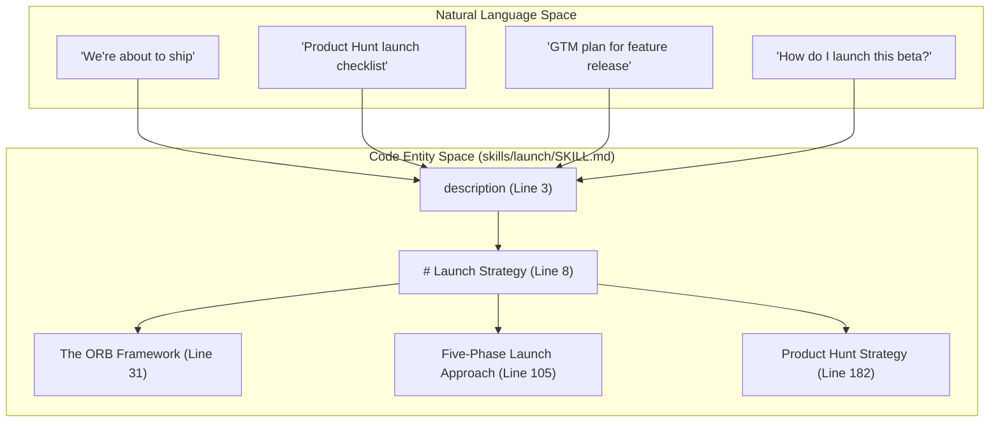
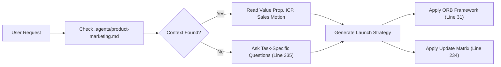

<!-- source: DeepWiki mcp.deepwiki.com · repo coreyhaines31/marketingskills · extra page Launch Strategy · fetched 2026-10-27 -->

# Launch Strategy

<details>
<summary>Relevant source files</summary>

The following files were used as context for generating this wiki page:

- [skills/copywriting/SKILL.md](skills/copywriting/SKILL.md)
- [skills/launch/SKILL.md](skills/launch/SKILL.md)
- [skills/pricing/SKILL.md](skills/pricing/SKILL.md)
- [skills/sales-enablement/SKILL.md](skills/sales-enablement/SKILL.md)

</details>


## Purpose and Scope

The Launch Strategy Skill provides AI-guided frameworks for planning and executing product launches, feature announcements, and release strategy. This skill helps users structure multi-phase launch campaigns using the **ORB channel framework** (Owned/Rented/Borrowed), implement phased rollout strategies, and maintain post-launch momentum.

This page documents the technical implementation of the `launch` skill module (referenced as `launch-strategy` in the documentation), including its file structure, trigger patterns, content architecture, and relationship with other marketing skills.

**Sources:** [skills/launch/SKILL.md:8-10](), [skills/launch/SKILL.md:31-33]()

---

## Skill Metadata and File Structure

The `launch` skill is implemented as a directory containing the core logic in `SKILL.md`. It utilizes a standardized YAML front matter for discovery by the agent distribution layer.

### Metadata Definition
The front matter defines the skill's identity and the natural language keywords that trigger its activation.

```yaml
---
name: launch
description: "When the user wants to plan a product launch, feature announcement, or release strategy. Also use when the user mentions 'launch,' 'Product Hunt,' 'feature release,' 'announcement,' 'go-to-market,' 'beta launch,' 'early access,' 'waitlist,' 'product update,' 'how do I launch this,' 'launch checklist,' 'GTM plan,' or 'we're about to ship.' Use this whenever someone is preparing to release something publicly. For ongoing marketing after launch, see marketing-ideas. For the offer being launched (bonuses, guarantees, scarcity, naming), see offers."
metadata:
  version: 2.0.1
---
```

**Sources:** [skills/launch/SKILL.md:1-6]()

---

## Trigger Pattern Architecture

The skill registers a wide array of natural language triggers. The `description` field acts as the registration layer for the system's intent-matching engine.

### Code-to-Natural-Language Mapping



**Sources:** [skills/launch/SKILL.md:1-6](), [skills/launch/SKILL.md:31-33](), [skills/launch/SKILL.md:105-107](), [skills/launch/SKILL.md:182-184]()

---

## Content Architecture

The skill is organized into modular strategic blocks that the AI uses to construct a launch plan.

### Core Frameworks

1.  **The ORB Framework**: A channel categorization system used to prioritize efforts:
    *   **Owned**: Channels the company controls like email lists, blogs, and branded communities. [skills/launch/SKILL.md:35-58]()
    *   **Rented**: High-visibility platforms subject to algorithms such as LinkedIn, X, or App Stores. [skills/launch/SKILL.md:59-82]()
    *   **Borrowed**: Tapping into external audiences via guest content, influencer partnerships, or collaborations. [skills/launch/SKILL.md:83-101]()
2.  **Five-Phase Launch Approach**: A sequential momentum-building model:
    *   **Phase 1: Internal Launch**: Gathering initial feedback from free early users. [skills/launch/SKILL.md:109-118]()
    *   **Phase 2: Alpha Launch**: First external validation with a landing page and individual invites. [skills/launch/SKILL.md:119-129]()
    *   **Phase 3: Beta Launch**: Scaling early access while generating external buzz. [skills/launch/SKILL.md:130-145]()
    *   **Phase 4: Early Access Launch**: Shifting to controlled expansion and quantitative data gathering. [skills/launch/SKILL.md:146-160]()
    *   **Phase 5: Full Launch**: Opening self-serve signups and general availability across all channels. [skills/launch/SKILL.md:161-179]()
3.  **The Update Matrix**: A decision framework for scaling launch effort based on the magnitude of the release (Major vs. Medium vs. Minor). [skills/launch/SKILL.md:234-263]()

**Sources:** [skills/launch/SKILL.md:31-101](), [skills/launch/SKILL.md:105-179](), [skills/launch/SKILL.md:234-263]()

---

## Data Flow: Context Integration

The skill follows a strict protocol to check for pre-existing product context to minimize friction and improve output accuracy.



**Sources:** [skills/launch/SKILL.md:14-16](), [skills/launch/SKILL.md:335-342]()

---

## Related Skills and Dependencies

The `launch` skill acts as a high-level orchestrator, frequently referencing or handing off to other skills for specific execution tasks.

| Skill / Asset | Purpose | File Reference |
| :--- | :--- | :--- |
| `product-marketing.md` | Provides foundational product and market context | [skills/launch/SKILL.md:15]() |
| `offers` | Used for designing the actual "thing" being sold (bonuses, guarantees) | [skills/launch/SKILL.md:3]() |
| `marketing-ideas` | Provides tactical ideas for ongoing marketing post-launch | [skills/launch/SKILL.md:3]() |
| `copywriting` | Referenced for website text that needs to persuade | [skills/copywriting/SKILL.md:3]() |
| `pricing` | Referenced for help with pricing tiers and packaging | [skills/pricing/SKILL.md:3]() |
| `sales-enablement` | Used for creating collateral (pitch decks, one-pagers) for the sales team | [skills/sales-enablement/SKILL.md:3]() |
| `introw` (Tool) | Integrated for managing deal registration and commissions for borrowed channels | [skills/launch/SKILL.md:96]() |

**Sources:** [skills/launch/SKILL.md:1-6](), [skills/launch/SKILL.md:96](), [skills/copywriting/SKILL.md:1-6](), [skills/pricing/SKILL.md:1-6](), [skills/sales-enablement/SKILL.md:1-6]()

---

