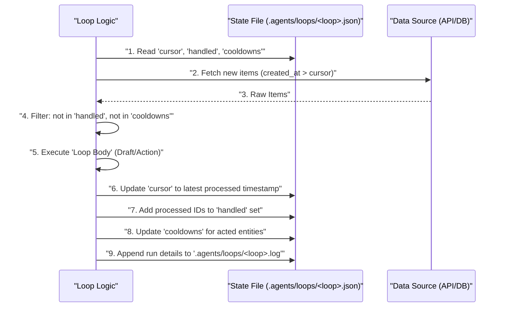
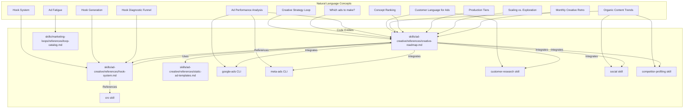

<!-- source: DeepWiki mcp.deepwiki.com · repo coreyhaines31/marketingskills · extra page Marketing Loops · fetched 2026-10-27 -->

# Marketing Loops

<details>
<summary>Relevant source files</summary>

The following files were used as context for generating this wiki page:

- [skills/ad-creative/references/creative-roadmap.md](skills/ad-creative/references/creative-roadmap.md)
- [skills/ad-creative/references/hook-system.md](skills/ad-creative/references/hook-system.md)
- [skills/ad-creative/references/static-ad-templates.md](skills/ad-creative/references/static-ad-templates.md)
- [skills/marketing-loops/SKILL.md](skills/marketing-loops/SKILL.md)
- [skills/marketing-loops/evals/evals.json](skills/marketing-loops/evals/evals.json)
- [skills/marketing-loops/references/loop-catalog.md](skills/marketing-loops/references/loop-catalog.md)
- [skills/marketing-loops/references/loop-guardrails.md](skills/marketing-loops/references/loop-guardrails.md)
- [skills/marketing-loops/references/loop-orchestration.md](skills/marketing-loops/references/loop-orchestration.md)
- [skills/marketing-loops/references/loop-state.md](skills/marketing-loops/references/loop-state.md)
- [skills/marketing-loops/references/loop-template.md](skills/marketing-loops/references/loop-template.md)

</details>


The **Marketing Loops** skill (added in v2.6.0) enables the creation of recurring, self-running marketing workflows. Unlike `marketing-ideas`, which focuses on one-off tactics, or `ab-testing`, which manages experimentation, marketing-loops provides a framework for "always-on" systems that monitor signals and execute actions on a defined cadence [skills/marketing-loops/SKILL.md:10-13]().

## Loop Anatomy

Every marketing loop follows a rigorous nine-part anatomy to ensure reliability, safety, and transparency. A loop missing these components is considered a liability rather than an asset [skills/marketing-loops/SKILL.md:27-30]().

| Part | Technical Role |
|:---|:---|
| **Check cadence** | How often the loop *looks* (weekly / daily / on-trigger). Match it to signal speed [skills/marketing-loops/SKILL.md:33](). |
| **Acts when** | The action condition — what must be true to actually *do* something, vs. just check and skip [skills/marketing-loops/SKILL.md:34](). |
| **Purpose** | The one outcome this loop exists to move [skills/marketing-loops/SKILL.md:35](). |
| **Skills used** | Which marketing skills the loop orchestrates each iteration [skills/marketing-loops/SKILL.md:36](). |
| **Loop body** | The ordered steps run each iteration [skills/marketing-loops/SKILL.md:37](). |
| **Self-check** | The verification done *before* acting — so the loop doesn't act on noise, seasonality, or a tracking bug [skills/marketing-loops/SKILL.md:38](). |
| **State / idempotency** | What the loop remembers between runs: last-run marker, dedupe key, cooldown window, "already handled" set [skills/marketing-loops/SKILL.md:39](). |
| **Stop / bail-out** | When the loop skips, halts, escalates to a human, or disables itself — plus what it does on error [skills/marketing-loops/SKILL.md:40](). |
| **Output** | Where results go: a file, a PR, a staged draft, a notification, a report [skills/marketing-loops/SKILL.md:41](). |

The distinction between **Check cadence** and **Acts when** is crucial: a loop might check daily but only act when a specific threshold is crossed and no action has been taken within a cooldown window [skills/marketing-loops/SKILL.md:43-44]().

### The Cadence Rule

The frequency of a loop's execution should match the natural speed of the signal it monitors, not an arbitrary desire for updates. Over-frequent loops lead to busywork and budget waste [skills/marketing-loops/SKILL.md:46-59]().

| Signal | Realistic Cadence | Why |
|---|---|---|
| Rankings, backlinks, domain authority | Weekly | Move slowly; daily checks are noise [skills/marketing-loops/SKILL.md:50]() |
| Ad creative fatigue, CPA drift | Every 2–3 days | Meta/Google feedback loops are days, not hours [skills/marketing-loops/SKILL.md:51]() |
| Activation / onboarding funnel | Weekly | Needs enough signups to be significant [skills/marketing-loops/SKILL.md:52]() |
| Churn signals | Daily or on-trigger | Early intervention window is short [skills/marketing-loops/SKILL.md:53]() |
| Content / copy decay | Monthly | Traffic erosion is gradual [skills/marketing-loops/SKILL.md:54]() |
| Competitor changes | Weekly | Pricing/positioning shifts are infrequent but matter [skills/marketing-loops/SKILL.md:55]() |
| Social listening / mentions | Daily | Engagement windows close fast [skills/marketing-loops/SKILL.md:56]() |

**Sources:** [skills/marketing-loops/SKILL.md:27-41](), [skills/marketing-loops/references/loop-template.md:11-25](), [skills/marketing-loops/SKILL.md:43-59]()

## Orchestration Model

Marketing loops are organized into a four-layer orchestration model. Data flows down from sensors to actions, while learnings flow back up to refine the sensors [skills/marketing-loops/references/loop-orchestration.md:7-23]().

### Loop Hierarchy Diagram
```mermaid
graph TD
    subgraph "SENSING Layer"
        A["analytics-anomaly"]
        B["tracking-QA"]
        C["weekly-marketing-review"]
    end

    subgraph "DIAGNOSTIC Layer"
        D["onboarding-drop-off"]
        E["churn-signal"]
        F["ad-fatigue"]
        D1["ranking-drop"]
        D2["landing-page-regression"]
    end

    subgraph "ACTION Layer"
        G["Staged Drafts"]
        H["Outreach Nudges"]
        I["Budget Shifts"]
    end

    subgraph "LEARNING Layer"
        J["experiment-backlog"]
        K["campaign-postmortem"]
        L["voice-of-customer"]
    end

    C -- "Dispatches Signal" --> D
    C -- "Dispatches Signal" --> E
    C -- "Dispatches Signal" --> F
    C -- "Dispatches Signal" --> D1
    C -- "Dispatches Signal" --> D2

    D -- "Proposes Fix" --> G
    E -- "Triggers Nudge" --> H
    F -- "Suggests Change" --> I

    G -- "Results" --> K
    H -- "Results" --> K
    I -- "Results" --> K

    K -- "Refines Strategy" --> A
    J -- "Feeds Hypotheses" --> D
    L -- "Informs Copy" --> G, H
    K -- "Feeds Back" --> J
```
**Sources:** [skills/marketing-loops/references/loop-orchestration.md:9-23]()

### Rollout Path

Loops should be adopted incrementally, proving their value at each stage. The recommended rollout path prioritizes foundational elements and high-ROI activities [skills/marketing-loops/references/loop-orchestration.md:35-61]():

*   **Stage 0 — Foundation**: `tracking-QA`, `weekly-marketing-review`. Essential for trustworthy data and a holistic view [skills/marketing-loops/references/loop-orchestration.md:38-41]().
*   **Stage 1 — Plug the leaks**: `failed-payment/dunning`, `churn-signal`, `lifecycle-email-refresh`. Focus on retaining existing revenue [skills/marketing-loops/references/loop-orchestration.md:43-46]().
*   **Stage 2 — Convert what you already get**: `onboarding-drop-off`, `signup-funnel-leak`, `trial-conversion`. Optimize activation and conversion within the existing funnel [skills/marketing-loops/references/loop-orchestration.md:48-51]().
*   **Stage 3 — Grow the top**: `keyword-gap`, `content-repurposing`, `ad-fatigue`, `social-listening`, `analytics-anomaly`. Scale acquisition once the funnel is sealed [skills/marketing-loops/references/loop-orchestration.md:53-56]().
*   **Stage 4 — Optimize monetization**: `pricing-page-experiment`, `paywall-optimization`, `PQL/upgrade-intent`, `expansion/upsell`. Tune revenue per user [skills/marketing-loops/references/loop-orchestration.md:58-61]().
*   **Stage 5 — Compounding & advocacy**: `referral-nudge`, `review-and-UGC-harvest`, `experiment-backlog`, `campaign-postmortem`. Build a flywheel for sustained growth and learning [skills/marketing-loops/references/loop-orchestration.md:63-66]().

**Sources:** [skills/marketing-loops/references/loop-orchestration.md:35-66]()

## State Management & Idempotency

Loops maintain state in `.agents/loops/<loop-name>.json` to ensure they do not repeat actions or spam users [skills/marketing-loops/references/loop-state.md:7-12]().

### State Schema
The state file typically tracks the following keys [skills/marketing-loops/references/loop-state.md:20-32]():
*   `loop`: The name of the loop.
*   `last_run`: Timestamp of the last successful run.
*   `cursor`: A timestamp or ID watermark; only process items newer than this.
*   `handled`: A dedupe set of keys for items already acted upon.
*   `cooldowns`: A map of entities to their next-eligible timestamp, preventing re-contact within a window.
*   `in_flight`: Tracks actions or tests currently open to prevent conflicts.
*   `counters`: For tracking attempt counts (e.g., dunning sequences).

### Data Flow: State & Idempotency

**Sources:** [skills/marketing-loops/references/loop-state.md:20-47](), [skills/marketing-loops/references/loop-state.md:53-57]()

### Idempotency Patterns

*   **Watermark**: Processes only items newer than `cursor`; advances `cursor` after a successful run [skills/marketing-loops/references/loop-state.md:44]().
*   **Dedupe set**: Checks `handled` before acting on an item; adds the item's key after acting [skills/marketing-loops/references/loop-state.md:45]().
*   **Cooldown map**: Checks `cooldowns[entity]` before contacting; sets it after contact [skills/marketing-loops/references/loop-state.md:46]().
*   **In-flight guard**: Checks `in_flight` before starting an action that shouldn't overlap [skills/marketing-loops/references/loop-state.md:47]().

### Run Logging

An append-only log (`.agents/loops/<loop-name>.log`) tracks each run, including timestamp, items checked, items acted on, and a short note. This helps identify "vanity loops" (always `acted=0`) or double-acting issues [skills/marketing-loops/references/loop-state.md:49-57]().

**Sources:** [skills/marketing-loops/references/loop-state.md:44-57]()

## The 43-Loop Catalog

The system provides a catalog of 43 pre-defined loops across the funnel [skills/marketing-loops/references/loop-catalog.md:1-5]().

### Key Funnel Stages
1.  **SEO & Content**: Includes `keyword-gap` (surfacing new ranking opportunities), `ranking-drop watch` (diagnosing SEO regressions), `content-decay` (refreshing declining content), `internal-linking` (distributing link equity), `programmatic-SEO quality` (keeping templated pages healthy), `content-repurposing` (turning long-form assets into channel-native content), and `content-calendar refill` (maintaining the editorial pipeline) [skills/marketing-loops/references/loop-catalog.md:15-115]().
2.  **Paid**: Covers `ad-fatigue` (refreshing underperforming ads), `paid-search query-mining` (finding new keywords), `retargeting-hygiene` (cleaning up audiences), `landing-page regression` (monitoring page performance), and `ad-creative-strategy` (the creative roadmap loop, detailed in `ad-creative/references/creative-roadmap.md`) [skills/marketing-loops/references/loop-catalog.md:119-190]().
3.  **Earned/Social/Partnerships**: Examples include `social-listening` (monitoring brand mentions), `newsjacking` (identifying trending stories), `community-engagement` (responding to community activity), `backlink-prospecting` (finding link opportunities), `directory-submission` (submitting to directories), and `partner-pipeline` (identifying co-marketing partners) [skills/marketing-loops/references/loop-catalog.md:192-244]().
4.  **Activation**: Focuses on `signup-funnel-leak` (identifying drop-offs), `onboarding-drop-off` (improving first-value attainment), and `trial-conversion` (optimizing trial-to-paid conversion) [skills/marketing-loops/references/loop-catalog.md:246-290]().
5.  **Retention**: Addresses `churn-signal` (identifying at-risk customers), `failed-payment/dunning` (recovering failed subscriptions), and `lifecycle-email-refresh` (updating email sequences) [skills/marketing-loops/references/loop-catalog.md:292-320]().
6.  **Revenue**: Includes `PQL/upgrade-intent` (identifying product-qualified leads), `expansion/upsell` (finding growth opportunities), and `pricing-page-experiment` (optimizing pricing pages) [skills/marketing-loops/references/loop-catalog.md:322-350]().
7.  **Referral & Advocacy**: Covers `referral-nudge` (prompting referrals), `review-and-UGC-harvest` (collecting social proof), and `review-site-management` (managing review platforms) [skills/marketing-loops/references/loop-catalog.md:352-378]().
8.  **Ongoing Ops**: General operational loops like `analytics-anomaly` (detecting data shifts), `tracking-QA` (ensuring data integrity), `competitor-watch` (monitoring competitors), `experiment-backlog` (managing test hypotheses), `campaign-postmortem` (analyzing campaign performance), `voice-of-customer` (mining customer feedback), `weekly-marketing-review` (overall performance check), `lead-capture-asset` (optimizing lead magnets), and `email-deliverability` (monitoring email health) [skills/marketing-loops/references/loop-catalog.md:380-450]().

**Sources:** [skills/marketing-loops/references/loop-catalog.md:15-450]()

## Guardrails and Scheduling

### Two-Tier Action Model
To prevent autonomous errors, actions are classified into two tiers [skills/marketing-loops/references/loop-guardrails.md:5-15]():
*   **Tier 1 (Autonomous-Safe)**: Reading data, analyzing, diffing, scoring, **drafting**, and **staging** work for review. These actions can be performed unattended [skills/marketing-loops/references/loop-guardrails.md:9-10]().
*   **Tier 2 (Gated)**: **Spending** money, **shifting budget**, **sending** messages, **publishing** anything public, **deleting/suppressing** records, or **changing** live account settings. These require a human checkpoint by default, unless explicitly authorized with hard caps and allowlists [skills/marketing-loops/references/loop-guardrails.md:12-15]().

### Compliance and PII Handling
Loops must adhere to compliance regulations like CAN-SPAM, GDPR, CCPA, and FTC guidelines. They must also respect platform Terms of Service. Raw PII should never be logged in loop state or run logs; only internal IDs or hashes should be used [skills/marketing-loops/references/loop-guardrails.md:31-47]().

### Always-Escalate List
Certain high-risk situations always require human intervention, regardless of authorization. These include negative brand mentions, crisis responses, newsjacking angles (due to the veto list), high-value accounts, anomalies in revenue or ad spend, and actions that would delete data or contact a large audience [skills/marketing-loops/references/loop-guardrails.md:49-56]().

### Kill Switch
Every scheduled loop must have a manual off switch, and the ability to stop all loops quickly should be documented [skills/marketing-loops/references/loop-guardrails.md:58-60]().

### Scheduling Primitives
For environments like **Claude Code**, loops utilize specific primitives [skills/marketing-loops/SKILL.md:76-80]():
*   `CronCreate`: For fixed, time-of-day schedules (e.g., weekly reviews, ranking watches) [skills/marketing-loops/SKILL.md:77]().
*   `ScheduleWakeup`: For dynamic pacing that reacts to state changes (e.g., churn watches, launch-day tracking) [skills/marketing-loops/SKILL.md:77]().
*   `/loop`: For self-paced execution until a condition is met [skills/marketing-loops/SKILL.md:76]().

For other environments, the loop body can be wrapped as a scheduled prompt or script using standard cron expressions [skills/marketing-loops/SKILL.md:78](). Manual cadence is also a valid option for high-judgment loops [skills/marketing-loops/SKILL.md:79]().

**Sources:** [skills/marketing-loops/references/loop-guardrails.md:9-60](), [skills/marketing-loops/SKILL.md:72-81]()

## When NOT to Loop

Not all marketing tasks are suitable for loops. Loops are best for recurring, signal-driven tasks. They are not designed for strategy, creative direction, or inventing campaigns. Loops should also be avoided if the signal is too sparse to be significant, or if the output is consistently ignored (vanity loops) [skills/marketing-loops/SKILL.md:62-69]().

**Sources:** [skills/marketing-loops/SKILL.md:62-69](), [skills/marketing-loops/evals/evals.json:60-70]()

### Natural Language to Code Entity Mapping: Marketing Loops

```mermaid
graph TD
    subgraph "Natural Language Concepts"
        NL1["Recurring Marketing Workflow"]
        NL2["Automate Marketing"]
        NL3["Weekly SEO Scan"]
        NL4["Ad Fatigue Check"]
        NL5["Churn Watch"]
        NL6["Marketing on Autopilot"]
        NL7["Loop Anatomy"]
        NL8["State Management"]
        NL9["Guardrails"]
        NL10["Scheduling"]
        NL11["Loop Catalog"]
    end

    subgraph "Code Entities"
        CE1["skills/marketing-loops/SKILL.md"]
        CE2["skills/marketing-loops/references/loop-catalog.md"]
        CE3["skills/marketing-loops/references/loop-template.md"]
        CE4["skills/marketing-loops/references/loop-state.md"]
        CE5["skills/marketing-loops/references/loop-guardrails.md"]
        CE6["skills/marketing-loops/references/loop-orchestration.md"]
        CE7["/loop (Claude Code Primitive)"]
        CE8["ScheduleWakeup (Claude Code Primitive)"]
        CE9["CronCreate (Claude Code Primitive)"]
        CE10["skills/marketing-loops/evals/evals.json"]
    end

    NL1 --> CE1
    NL2 --> CE1
    NL3 --> CE2
    NL4 --> CE2
    NL5 --> CE2
    NL6 --> CE1
    NL6 --> CE10
    NL7 --> CE1
    NL7 --> CE3
    NL8 --> CE4
    NL9 --> CE5
    NL10 --> CE1
    NL10 --> CE7
    NL10 --> CE8
    NL10 --> CE9
    NL11 --> CE2
    CE1 -- "Defines" --> CE3
    CE1 -- "References" --> CE2
    CE1 -- "References" --> CE4
    CE1 -- "References" --> CE5
    CE1 -- "References" --> CE6
```

**Sources:** [skills/marketing-loops/SKILL.md](), [skills/marketing-loops/references/loop-catalog.md](), [skills/marketing-loops/references/loop-template.md](), [skills/marketing-loops/references/loop-state.md](), [skills/marketing-loops/references/loop-guardrails.md](), [skills/marketing-loops/references/loop-orchestration.md](), [skills/marketing-loops/evals/evals.json]()

### Natural Language to Code Entity Mapping: Ad Creative Loops

**Sources:** [skills/ad-creative/references/creative-roadmap.md](), [skills/ad-creative/references/hook-system.md](), [skills/ad-creative/references/static-ad-templates.md](), [skills/marketing-loops/references/loop-catalog.md]()

---

