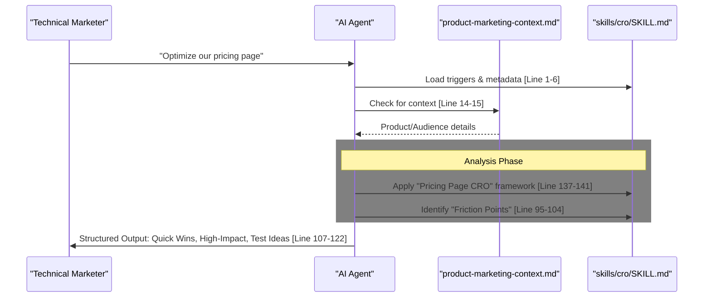
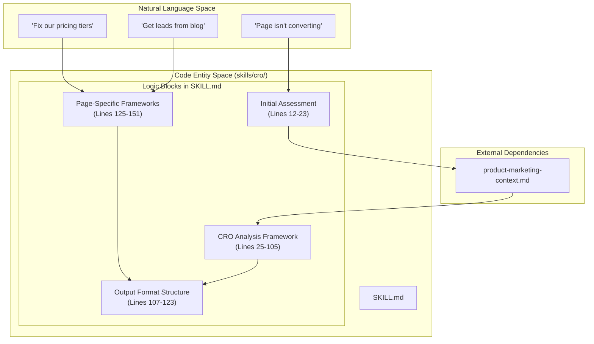

<!-- source: DeepWiki mcp.deepwiki.com · repo coreyhaines31/marketingskills · extra page Page CRO · fetched 2026-10-27 -->

# Page CRO

Relevant source files

The following files were used as context for generating this wiki page:

- [.claude-plugin/marketplace.json](.claude-plugin/marketplace.json)
- [.claude-plugin/plugin.json](.claude-plugin/plugin.json)
- [README.md](README.md)
- [VERSIONS.md](VERSIONS.md)

## Purpose and Scope

The `cro` skill provides AI agents with specialized knowledge for optimizing marketing pages for conversions. This skill covers homepage optimization, landing page conversion rate improvement, feature pages, pricing pages, and blog posts. It provides a systematic framework for analyzing page performance and generating prioritized recommendations. [skills/cro/SKILL.md:1-10]()

This skill focuses on **pre-signup marketing pages**. For related conversion optimization scenarios, see:
- **4.2.2 Signup Flow CRO** — Registration and account creation flows. [skills/cro/SKILL.md:178]()
- **4.2.3 Form CRO** — Lead capture and contact forms. [skills/cro/SKILL.md:179]()
- **4.2.5 Onboarding CRO** — Post-signup activation experiences. [skills/cro/SKILL.md:3-4]()
- **4.2.4 Paywall & Upgrade CRO** — In-app upgrade moments and feature gates. [skills/cro/SKILL.md:176-183]()
- **4.2.6 Popup CRO** — Modal and overlay optimization. [skills/cro/SKILL.md:180]()

Sources: [skills/cro/SKILL.md:1-10](), [skills/cro/SKILL.md:176-183]()

---

## CRO Analysis Framework

The skill implements a 7-dimension analysis framework prioritized by impact. Agents use this to evaluate any provided URL or page content. [skills/cro/SKILL.md:25-27]()

| Dimension | Key Evaluation Criteria | Source |
|:---|:---|:---|
| **1. Value Prop Clarity** | 5-second test, specific benefits, customer language. | [skills/cro/SKILL.md:29-40]() |
| **2. Headline Effectiveness** | Outcome-focused patterns, specificity, message match. | [skills/cro/SKILL.md:41-52]() |
| **3. CTA Hierarchy** | Primary action visibility, value-oriented copy (e.g., "Start Free Trial"). | [skills/cro/SKILL.md:53-65]() |
| **4. Visual Hierarchy** | Scannability, white space, supportive imagery. | [skills/cro/SKILL.md:66-73]() |
| **5. Trust Signals** | Specific testimonials, recognizable logos, case study data. | [skills/cro/SKILL.md:74-84]() |
| **6. Objection Handling** | FAQ sections, guarantees, process transparency. | [skills/cro/SKILL.md:85-94]() |
| **7. Friction Points** | Form field count, navigation clutter, mobile UX, load times. | [skills/cro/SKILL.md:95-104]() |

Sources: [skills/cro/SKILL.md:25-104]()

---

## Skill Implementation & Data Flow

The `cro` skill is a knowledge module that interacts with the `product-marketing-context.md` file and other specialized skills to produce structured recommendations.

Title: cro Implementation Flow

Sources: [skills/cro/SKILL.md:1-23](), [skills/cro/SKILL.md:107-122](), [skills/cro/SKILL.md:137-141](), [README.md:19-25]()

---

## Page-Specific Frameworks

The skill provides specialized guidance for different page architectures. [skills/cro/SKILL.md:125-151]()

### Homepage CRO
- **Focus**: Clear positioning for cold visitors and quick paths to common conversions. [skills/cro/SKILL.md:127-129]()
- **Logic**: Must handle both "ready to buy" and "still researching" segments. [skills/cro/SKILL.md:130]()

### Pricing Page CRO
- **Focus**: Reducing "which plan is right for me?" anxiety. [skills/cro/SKILL.md:137-141]()
- **Implementation**: Clear plan comparison, recommended plan indication, and addressing price/value concerns. [skills/cro/SKILL.md:138-140]()

### Blog Post CRO
- **Focus**: Contextual CTAs matching content topics. [skills/cro/SKILL.md:147-150]()
- **Implementation**: Inline CTAs at natural stopping points rather than generic sidebars. [skills/cro/SKILL.md:149]()

Sources: [skills/cro/SKILL.md:125-151]()

---

## Relationship to Code Entities

This diagram bridges the natural language requests to the specific markdown entities that govern the agent's behavior for this skill.

Title: Natural Language to Code Entity Mapping

Sources: [skills/cro/SKILL.md:12-151](), [README.md:19-25]()

---

## Integration and Related Skills

The `cro` skill is a "hub" that frequently delegates to or references other skills for specific implementation details. [skills/cro/SKILL.md:176-183]()

- **`copywriting`**: Referenced when the page needs a complete rewrite or headline alternatives. [skills/cro/SKILL.md:181]()
- **`ab-testing`**: Referenced to properly structure the experiments identified in the "Test Ideas" output section. [skills/cro/SKILL.md:182]()
- **`form-cro`**: Used if the analysis identifies that forms on the page are the primary friction point. [skills/cro/SKILL.md:179]()
- **`signup`**: Invoked if the conversion issue persists into the registration process. [skills/cro/SKILL.md:178]()
- **`offers`**: Handles the construction of the underlying offer (Value Equation, guarantees, bonuses) which informs page-level CRO. [skills/cro/SKILL.md:183]()
- **`pricing`**: Specifically for optimizing pricing page conversion and tier structures. [VERSIONS.md:39]()

Sources: [skills/cro/SKILL.md:176-183](), [README.md:45-50](), [VERSIONS.md:39]()

---

