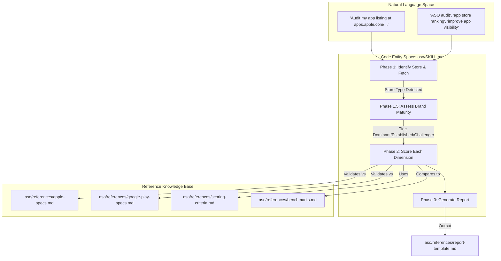
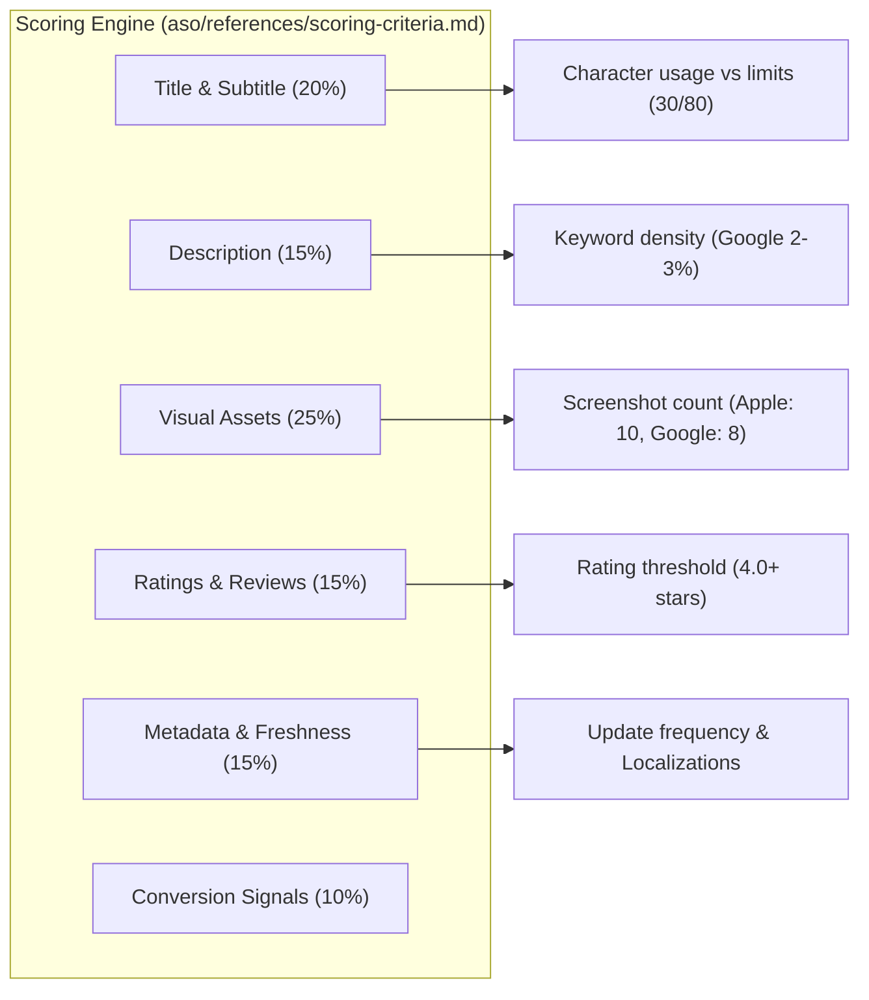

<!-- source: DeepWiki mcp.deepwiki.com · repo coreyhaines31/marketingskills · extra page ASO Audit · fetched 2026-10-27 -->

# ASO Audit

Relevant source files

The following files were used as context for generating this wiki page:

- [.claude-plugin/marketplace.json](.claude-plugin/marketplace.json)
- [.claude-plugin/plugin.json](.claude-plugin/plugin.json)
- [README.md](README.md)
- [VERSIONS.md](VERSIONS.md)

The `aso` skill (referred to as `aso-audit` in documentation) provides a comprehensive framework for auditing and optimizing mobile app listings on the Apple App Store and Google Play Store. It implements a four-phase pipeline—Fetch, Brand Maturity Assessment, Multi-Dimensional Scoring, and Report Generation—to transform raw listing data into a prioritized action plan for improving visibility and conversion.

## ASO Pipeline Architecture

The skill operates through a structured sequence that first identifies the platform and then applies specific logic based on the store's unique indexing rules (e.g., Apple's hidden keyword field vs. Google's full-description indexing).

### Technical Data Flow

The following diagram illustrates the transition from the Natural Language request to the structured audit output, referencing specific files in the `skills/aso/` directory.

**ASO Audit System Flow**

Sources: [README.md:64](), [VERSIONS.md:11](), [skills/aso/SKILL.md:1-12](), [skills/aso/SKILL.md:25-32](), [skills/aso/SKILL.md:100-106](), [skills/aso/SKILL.md:140-144]()

---

## Phase 1: Identify & Fetch

The system first detects the store type from the provided URL or searches the web if only an app name is provided.

| Platform | URL Pattern | Key Indexing Logic |
| :--- | :--- | :--- |
| **Apple** | `apps.apple.com/{country}/app/{name}/id{digits}` | Title, Subtitle, and 100-byte Keyword field are indexed. Description is **not** indexed for search. |
| **Google** | `play.google.com/store/apps/details?id={package}` | Title, Short Description, and Full Description (4,000 chars) are **all** indexed by Google NLP. |

### Data Extraction
The skill uses `WebFetch` to extract fields such as:
*   **Apple:** App name (30 chars), Subtitle (30 chars), Promotional text (170 chars), Ratings, and Version history notes [skills/aso/references/apple-specs.md:7-14]().
*   **Google:** App title (30 chars), Short description (80 chars), Full description (4,000 chars), Downloads range, and Data safety section [skills/aso/references/google-play-specs.md:7-12]().

Sources: [skills/aso/SKILL.md:29-32](), [skills/aso/SKILL.md:41-80](), [skills/aso/references/apple-specs.md:7-14](), [skills/aso/references/google-play-specs.md:7-12]()

---

## Phase 1.5: Brand Maturity Assessment

A critical technical step is classifying the app into a **Brand Maturity Tier**. This prevents "textbook ASO" rules from incorrectly penalizing major brands that prioritize brand recognition over generic keyword stuffing.

| Tier | Signal | Scoring Impact |
| :--- | :--- | :--- |
| **Dominant** | 1M+ ratings, Top-10 category. | Brand-only titles (e.g., "Instagram") score 8+. Description scored on conversion, not keywords. |
| **Established** | 100k+ ratings, recognized brand. | Brand-first titles are accepted if they include 1-2 keywords. |
| **Challenger** | <100k ratings, indie/startup. | Scored strictly against textbook ASO best practices. Every character and keyword matters. |

Sources: [skills/aso/SKILL.md:107-132](), [skills/aso/references/scoring-criteria.md:8-33]()

---

## Phase 2: Multi-Dimensional Scoring

The audit evaluates the listing across six dimensions, each weighted by its impact on visibility and conversion.

**Scoring Weights and Entities**

### Scoring Criteria Highlights
*   **Title & Subtitle:** Checks for high-value keywords and lack of word repetition. "Near max" usage is defined as within 3 characters of the limit [skills/aso/references/scoring-criteria.md:37-55]().
*   **Visual Assets:** Evaluates icon quality, screenshot captions, and preview videos. On iOS, videos provide a 20-40% conversion lift, while on Google Play, the lift is minimal as they do not autoplay [skills/aso/references/benchmarks.md:30-45]().
*   **Ratings:** The system identifies critical thresholds; apps below 3.5 stars suffer a sharp visibility drop [skills/aso/references/scoring-criteria.md:85-95]().

Sources: [skills/aso/SKILL.md:151-159](), [skills/aso/references/scoring-criteria.md:37-109](), [skills/aso/references/benchmarks.md:30-61]()

---

## Phase 3: Report Generation

The output is a structured report following the `report-template.md`. It includes:

1.  **Score Card:** A weighted 0-100 score and letter grade [skills/aso/references/report-template.md:9-32]().
2.  **Top 3 Quick Wins:** Actions taking <1 hour with high impact (e.g., updating a title to use the full 30-character limit) [skills/aso/references/report-template.md:38-51]().
3.  **Detailed Findings:** Deep dives into each dimension with "Current" vs "Recommended" comparisons.
4.  **Keyword Suggestions:** Prioritized list of terms for placement in titles, subtitles, or the hidden keyword field.
5.  **Priority Action Plan:** A roadmap categorized by "Do This Week," "Do This Month," and "Next Quarter" [skills/aso/references/report-template.md:179-195]().

Sources: [skills/aso/references/report-template.md:9-51](), [skills/aso/references/report-template.md:179-195]()

## Platform Specifics & Constraints

### Apple App Store
*   **Keywords Field:** 100 bytes (not characters). Non-Latin scripts use 2-3 bytes per character [skills/aso/references/apple-specs.md:16-23]().
*   **Rejection Triggers:** Guideline 2.3.7 prohibits keyword stuffing (trademarks, competitor names) [skills/aso/references/apple-specs.md:58-67]().
*   **Product Page Optimization (PPO):** Allows A/B testing of icons and screenshots but **not** titles or descriptions.

### Google Play Store
*   **Android Vitals:** High crash rates (>1.09%) or ANR rates (>0.47%) lead to reduced search visibility [skills/aso/references/google-play-specs.md:104-116]().
*   **Indexing:** Heavily relies on the Full Description; keyword density should target 2-3% [skills/aso/references/google-play-specs.md:14-22]().
*   **Prohibitions:** Policy bans emojis, ALL CAPS, and performance claims ("#1", "Best") in titles and icons [skills/aso/references/google-play-specs.md:55-65]().

Sources: [skills/aso/references/apple-specs.md:7-67](), [skills/aso/references/google-play-specs.md:7-116]()

---

