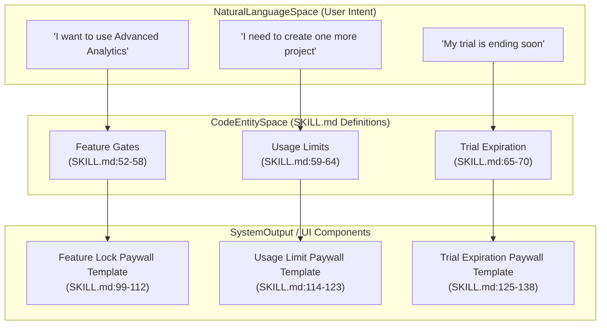
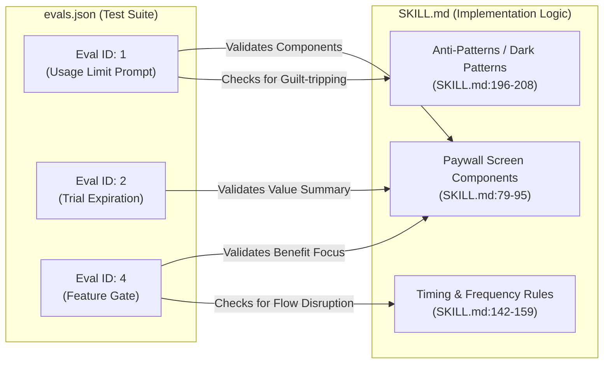

<!-- source: DeepWiki mcp.deepwiki.com · repo coreyhaines31/marketingskills · extra page Paywall & Upgrade CRO · fetched 2026-10-27 -->

# Paywall & Upgrade CRO

Relevant source files

The following files were used as context for generating this wiki page:

- [.claude-plugin/marketplace.json](.claude-plugin/marketplace.json)
- [.claude-plugin/plugin.json](.claude-plugin/plugin.json)
- [README.md](README.md)
- [VERSIONS.md](VERSIONS.md)

## Purpose and Scope

The `paywall-upgrade-cro` skill is a technical knowledge module designed to optimize in-app upgrade moments. Unlike public-facing pricing pages (handled by the `copywriting` or `cro` skills), this skill focuses on the "logged-in" experience where users have already interacted with the product. It specifically addresses conversion from free-to-paid, trial-to-paid, and tier-to-tier upgrades at moments when the user has already experienced product value. [skills/paywall-upgrade-cro/SKILL.md:1-6]()

**Key Use Cases:**
- **Feature Gates:** Restricting access to specific high-value features with a "Feature Lock" preview. [skills/paywall-upgrade-cro/SKILL.md:52-58]()
- **Usage Limits:** Prompting upgrades when a user hits a resource cap (e.g., "3/3 projects used"). [skills/paywall-upgrade-cro/SKILL.md:59-64]()
- **Trial Expiration:** Managing the transition as a limited-time trial ends with value summaries. [skills/paywall-upgrade-cro/SKILL.md:65-70]()
- **Upsell Modals:** Contextual prompts based on time-based triggers or engagement patterns. [skills/paywall-upgrade-cro/SKILL.md:71-76]()

**Sources:** [skills/paywall-upgrade-cro/SKILL.md:1-6](), [skills/paywall-upgrade-cro/SKILL.md:50-77]()

---

## Code Entity Mapping

The following diagrams map the natural language concepts used by the agent to the specific code entities and data structures defined in the skill files.

### Upgrade Trigger Logic
This diagram shows how user actions in the "Natural Language Space" map to specific "Trigger Points" and UI templates defined in the skill's logic.

**Sources:** [skills/paywall-upgrade-cro/SKILL.md:50-77](), [skills/paywall-upgrade-cro/SKILL.md:97-139]()

### Skill Evaluation & Assertion Mapping
This diagram maps the `evals.json` test cases to the specific logic blocks they validate within the `SKILL.md` file to ensure consistent AI behavior.

**Sources:** [skills/paywall-upgrade-cro/evals/evals.json:1-94](), [skills/paywall-upgrade-cro/SKILL.md:79-208]()

---

## Implementation Detail: The 7-Component Paywall

The skill enforces a standardized structural framework for any upgrade screen generated. This ensures that the AI agent does not omit critical conversion elements like "Social Proof" or "Escape Hatches."

| Component | Logic / Implementation Requirement | Code Reference |
| :--- | :--- | :--- |
| **Headline** | Must focus on the *benefit* of the upgrade (e.g., "Unlock [Feature] to [Benefit]"). | [skills/paywall-upgrade-cro/SKILL.md:81-81]() |
| **Value Demo** | Requires a preview, before/after, or "With Pro you could..." | [skills/paywall-upgrade-cro/SKILL.md:83-83]() |
| **Comparison** | Side-by-side table highlighting differences from current plan. | [skills/paywall-upgrade-cro/SKILL.md:85-85]() |
| **Pricing** | Clear annual vs. monthly toggle options. | [skills/paywall-upgrade-cro/SKILL.md:87-87]() |
| **Social Proof** | Customer quotes or "X teams use this" metrics. | [skills/paywall-upgrade-cro/SKILL.md:89-89]() |
| **Primary CTA** | Must be value-oriented (e.g., "Start Getting [Benefit]"). | [skills/paywall-upgrade-cro/SKILL.md:91-91]() |
| **Escape Hatch** | A clear "Not now" or "Continue with Free" link to maintain trust. | [skills/paywall-upgrade-cro/SKILL.md:93-93]() |

**Sources:** [skills/paywall-upgrade-cro/SKILL.md:79-95]()

---

## Timing and Frequency Rules

To prevent user frustration and "dark patterns," the skill includes specific constraints on when prompts should appear.

1.  **Aha Moment Prerequisite:** Upgrade prompts should appear *after* the user has reached an "aha moment" (activation), not during initial onboarding. [skills/paywall-upgrade-cro/SKILL.md:145-150]()
2.  **Frequency Capping:** The system enforces cooldown periods after a user dismisses a prompt (days, not hours) and tracks annoyance signals. [skills/paywall-upgrade-cro/SKILL.md:154-157]()
3.  **Flow Protection:** Prompts must not be shown while a user is in the middle of a critical flow (e.g., in the middle of a complex data export). [skills/paywall-upgrade-cro/SKILL.md:151-151]()

**Sources:** [skills/paywall-upgrade-cro/SKILL.md:142-159]()

---

## Anti-Patterns & Validation

The skill's evaluation suite (`evals.json`) specifically tests for the avoidance of "Dark Patterns" and "Conversion Killers."

- **Dark Patterns:** Hiding close buttons, confusing plan selection, or using "guilt-trip" copy (e.g., "No, I want to stay unproductive"). [skills/paywall-upgrade-cro/SKILL.md:198-202]()
- **Conversion Killers:** Asking for payment before value is demonstrated or blocking critical flows abruptly. [skills/paywall-upgrade-cro/SKILL.md:203-208]()

**Assertion Logic Example:**
The test suite ensures that if a user asks for an "Advanced Analytics" gate, the output includes an "escape hatch" to go back to basic analytics, preventing a "trap" scenario. [skills/paywall-upgrade-cro/evals/evals.json:53-65]()

**Sources:** [skills/paywall-upgrade-cro/SKILL.md:196-208](), [skills/paywall-upgrade-cro/evals/evals.json:67-78]()

---

## Related Skills Context

The `paywall-upgrade-cro` skill is part of a wider conversion ecosystem. It frequently references or defers to other skills depending on the specific user request:

- **[Copywriting](4.4.1):** Used for generating the specific persuasive text within the paywall components. [skills/copywriting/SKILL.md:1-6]()
- **[Pricing Strategy](4.3.2):** Used for determining actual price points, packaging, or value metrics. [skills/pricing/SKILL.md:1-6]()
- **[Churn Prevention](4.3.1):** Relevant for "Save Offers" when a user tries to downgrade or cancel post-upgrade. [skills/paywall-upgrade-cro/SKILL.md:224-224]()
- **[Onboarding CRO](4.2.5):** Used to ensure users reach the "aha moment" before the paywall is presented. [skills/paywall-upgrade-cro/SKILL.md:226-226]()
- **[Sales Enablement](4.9.1):** For high-ticket B2B, the paywall might lead to a "Talk to Sales" flow using sales collateral frameworks. [skills/sales-enablement/SKILL.md:57-71]()

**Sources:** [skills/paywall-upgrade-cro/SKILL.md:222-228](), [skills/pricing/SKILL.md:1-6](), [skills/sales-enablement/SKILL.md:1-10](), [README.md:33-40]()

---

