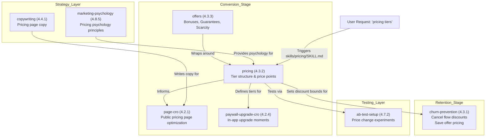
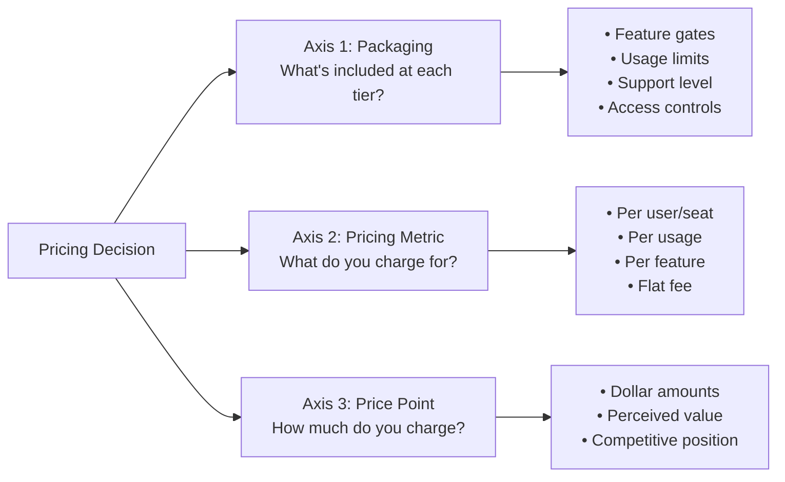
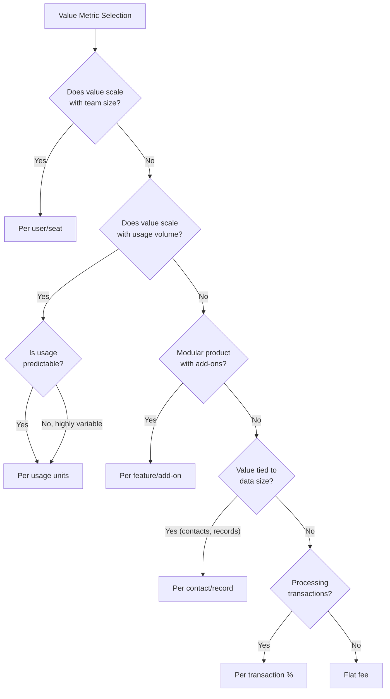
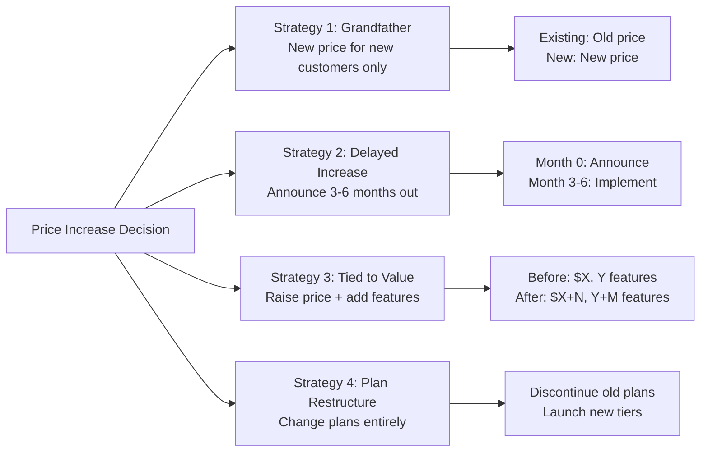
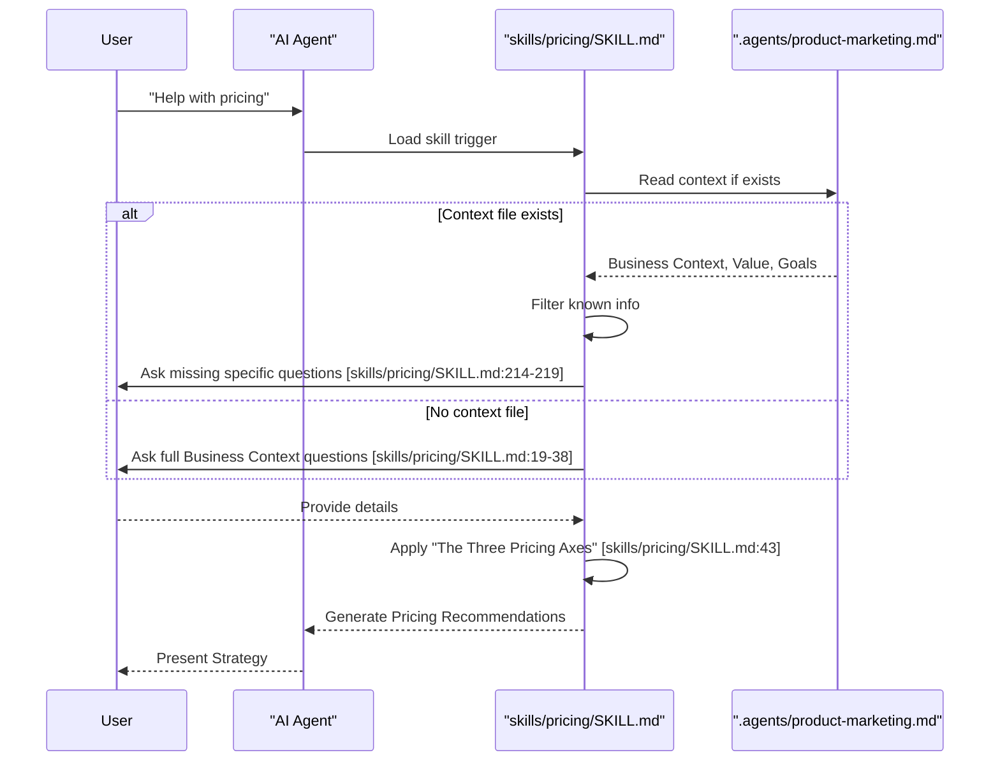

<!-- source: DeepWiki mcp.deepwiki.com · repo coreyhaines31/marketingskills · extra page Pricing Strategy · fetched 2026-10-27 -->

# Pricing Strategy

Relevant source files

The following files were used as context for generating this wiki page:

- [skills/copywriting/SKILL.md](skills/copywriting/SKILL.md)
- [skills/launch/SKILL.md](skills/launch/SKILL.md)
- [skills/pricing/SKILL.md](skills/pricing/SKILL.md)
- [skills/sales-enablement/SKILL.md](skills/sales-enablement/SKILL.md)

## Purpose and Scope

This page documents the `pricing-strategy` skill, which provides expertise in SaaS pricing and monetization strategy. The skill guides users through pricing research, tier structure design, value metric selection, and price point optimization. It focuses on value-based pricing methodology and helps align pricing with customer willingness to pay. [skills/pricing/SKILL.md:8-10]()

For in-app upgrade moments and paywall optimization, see [Paywall & Upgrade CRO (4.2.4)](/skills/paywall-upgrade-cro/SKILL.md). For cancel flow discounting and save offers, see [Churn Prevention (4.3.1)](/skills/churn-prevention/SKILL.md). For public pricing page conversion optimization, see [Page CRO (4.2.1)](/skills/page-cro/SKILL.md). For the specific components of an offer (bonuses, guarantees, scarcity), see [Offer Design (4.3.3)](/skills/offers/SKILL.md). [skills/pricing/SKILL.md:3-3]()

---

## Skill Definition

The `pricing-strategy` skill is a markdown-based knowledge module that provides pricing expertise to AI agents. It does not execute code or make API calls; rather, it guides decision-making through frameworks, research methods, and best practices.

**Skill Location:** [skills/pricing/SKILL.md:1-230]()

**Trigger Phrases:** The skill activates when users mention terms like `"pricing,"` `"pricing tiers,"` `"freemium,"` `"free trial,"` `"packaging,"` `"price increase,"` `"value metric,"` `"Van Westendorp,"` `"willingness to pay,"` or `"monetization."` [skills/pricing/SKILL.md:3-3]()

**Primary Outputs:**
- Pricing research methodology recommendations.
- Tier structure designs with feature-to-plan mappings.
- Value metric selection guidance.
- Price point recommendations based on competitive analysis.
- Pricing page structure and copy principles.

Sources: [skills/pricing/SKILL.md:1-10]()

---

## Architecture Context

### Position in Skill Hierarchy

The `pricing-strategy` skill sits in the **Retention & Monetization** category within the Skills Layer. It coordinates with multiple skills across the customer lifecycle:

**System Relationship Diagram**

**Integration Points:**
- **Downstream:** Pricing structure informs `page-cro` for conversion optimization and `paywall-upgrade-cro` for in-app upgrade flows. [skills/pricing/SKILL.md:226-227]()
- **Coordination:** Works with `churn-prevention` to set discount boundaries and save offer limits. [skills/pricing/SKILL.md:225-225]()
- **Support:** Uses `marketing-psychology` for anchoring and framing principles. [skills/pricing/SKILL.md:228-228]()
- **Testing:** Leverages `ab-test-setup` for price change validation. [skills/pricing/SKILL.md:229-229]()

Sources: [skills/pricing/SKILL.md:223-230](), [skills/copywriting/SKILL.md:182-186]()

---

## Core Concepts

### The Three Pricing Axes

The skill organizes pricing decisions into three independent dimensions:

**Pricing Dimension Mapping**

**Implementation Pattern:** The skill recommends addressing these axes sequentially:
1. **Packaging first:** Define features, limits, and support levels. [skills/pricing/SKILL.md:45-47]()
2. **Metric second:** Select how price scales with value (e.g., per user, per usage). [skills/pricing/SKILL.md:49-51]()
3. **Price point last:** Set actual dollar amounts based on perceived value vs. cost. [skills/pricing/SKILL.md:53-55]()

Sources: [skills/pricing/SKILL.md:41-56]()

---

### Value Metric Selection

The skill provides a decision framework for selecting the pricing metric, ensuring it scales as the customer grows. [skills/pricing/SKILL.md:76-80]()

| Metric Type | Logic Mapping | Best For | Example Products |
|-------------|---------------------------|----------|------------------|
| Per user/seat | `seats * price_per_seat` | Collaboration tools | Slack, Notion |
| Per usage | `units * unit_price` | Variable consumption | AWS, Twilio |
| Per feature | `base + addon_price` | Modular products | HubSpot add-ons |
| Per contact/record | `records * tier_price` | CRM, email tools | Mailchimp |
| Per transaction | `amount * fee_percentage` | Payments, marketplaces | Stripe |
| Flat fee | `fixed_price` | Simple products | Basecamp |

**Value Metric Decision Tree:**

**Key Validation Question:** "As a customer uses more of [metric], do they get more value?" If no, the metric doesn't align with value. [skills/pricing/SKILL.md:95-98]()

Sources: [skills/pricing/SKILL.md:72-98]()

---

### Tier Structure Framework

The skill implements a **Good-Better-Best** packaging model to differentiate tiers via feature gating, usage limits, and support levels. [skills/pricing/SKILL.md:103-115]()

**Tier Architecture Diagram**

```mermaid
graph TB
    subgraph "Tier_Differentiation_Layers"
        FEATURES["Feature Gating Layer"]
        LIMITS["Usage Limits Layer"]
        SUPPORT["Support Level Layer"]
        ACCESS["Access Control Layer"]
    end
    
    subgraph "Good_Tier_Entry"
        G_FEAT["Core features only"]
        G_LIMIT["Restrictive limits"]
        G_SUPP["Email support"]
        G_ACCESS["Basic access"]
    end
    
    subgraph "Better_Tier_Anchor"
        B_FEAT["Full feature set"]
        B_LIMIT["Reasonable limits"]
        B_SUPP["Priority support"]
        B_ACCESS["Standard access"]
    end
    
    subgraph "Best_Tier_Premium"
        P_FEAT["Everything + advanced"]
        P_LIMIT["Unlimited/high limits"]
        P_SUPP["Dedicated support"]
        P_ACCESS["SSO, API, custom"]
    end
    
    FEATURES --> G_FEAT
    FEATURES --> B_FEAT
    FEATURES --> P_FEAT
    
    LIMITS --> G_LIMIT
    LIMITS --> B_LIMIT
    LIMITS --> P_LIMIT
    
    SUPPORT --> G_SUPP
    SUPPORT --> B_SUPP
    SUPPORT --> P_SUPP
    
    ACCESS --> G_ACCESS
    ACCESS --> B_ACCESS
    ACCESS --> P_ACCESS
```

**Tier Design Principles:**
- **Good tier:** Entry level with core features and limited usage. [skills/pricing/SKILL.md:105-105]()
- **Better tier:** Recommended "anchor" price with full features and reasonable limits. [skills/pricing/SKILL.md:106-106]()
- **Best tier:** Premium offering with advanced features, typically 2-3x the price of the Better tier. [skills/pricing/SKILL.md:107-107]()

Sources: [skills/pricing/SKILL.md:101-117]()

---

## Pricing Research Methods

### Van Westendorp Price Sensitivity Meter

The skill references the Van Westendorp method for identifying acceptable price ranges via four specific questions. [skills/pricing/SKILL.md:122-130]()

| Question | Purpose |
|----------|---------|
| "Too expensive (wouldn't consider)" | Identify the absolute ceiling where customers drop out. |
| "Too cheap (question quality)" | Identify the floor where customers doubt the product value. |
| "Expensive but might consider" | Identify the upper range of acceptable pricing. |
| "A bargain" | Identify the price point where customers feel they are getting high value. |

### MaxDiff Analysis

Used to identify which features customers value most by showing sets of features and asking for the "Most important" and "Least important." [skills/pricing/SKILL.md:132-137]() This informs how features should be gated across tiers. [skills/pricing/SKILL.md:137-137]()

Sources: [skills/pricing/SKILL.md:120-139]()

---

## Pricing Change Strategy

### Price Increase Implementation Patterns

The skill defines clear signals for when to raise prices (e.g., conversion > 40%, churn < 3%) and strategies for execution. [skills/pricing/SKILL.md:145-160]()

**Strategy Selection Logic**

**Implementation Strategies:**
- **Grandfathering:** Protect existing revenue while testing higher points on new cohorts. [skills/pricing/SKILL.md:163-163]()
- **Delayed Increase:** Provide a grace period to maintain trust. [skills/pricing/SKILL.md:164-164]()
- **Value-Tied:** Justify increases by adding significant new functionality. [skills/pricing/SKILL.md:165-165]()

Sources: [skills/pricing/SKILL.md:143-168]()

---

## Context Gathering Pattern

The skill implements a mandatory context-checking pattern to reduce repetitive questioning by reading the shared product context file. [skills/pricing/SKILL.md:12-15]()

**Agent Context Initialization Flow**

Sources: [skills/pricing/SKILL.md:12-38](), [skills/pricing/SKILL.md:212-220]()

---

