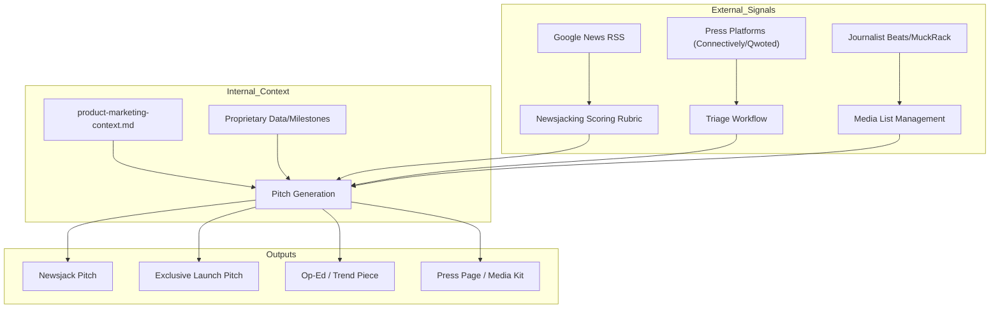

<!-- source: DeepWiki mcp.deepwiki.com · repo coreyhaines31/marketingskills · extra page Public Relations · fetched 2026-10-27 -->

# Public Relations

<details>
<summary>Relevant source files</summary>

The following files were used as context for generating this wiki page:

- [skills/public-relations/SKILL.md](skills/public-relations/SKILL.md)
- [skills/public-relations/references/journalist-pitching.md](skills/public-relations/references/journalist-pitching.md)
- [skills/public-relations/references/media-outlets.md](skills/public-relations/references/media-outlets.md)
- [skills/public-relations/references/newsjacking.md](skills/public-relations/references/newsjacking.md)
- [skills/public-relations/references/press-platforms.md](skills/public-relations/references/press-platforms.md)

</details>


The `public-relations` skill documents and executes earned media strategies for software products. It focuses on building brand legitimacy, backlinks, and AI-citation surface area through four distinct PR modes. This skill is distinguished from `directory-submissions` (which focuses on startup/SaaS directories) and `launch` (which covers broader launch moments) by its focus on journalist relationships and news cycles [skills/public-relations/SKILL.md:2-3]().

## Core Architecture

The PR system operates through four primary modes, each with varying effort and speed-to-coverage profiles [skills/public-relations/SKILL.md:42-52]().

### The Four PR Modes

| Mode | Implementation | Effort | Speed |
| :--- | :--- | :--- | :--- |
| **Reactive** | Newsjacking trending stories | Low–Medium | Hours to Days |
| **Proactive** | Targeted journalist pitching | High | 2–8 Weeks |
| **Inbound** | Press request platforms (Connectively, Qwoted) | Low | Days to Weeks |
| **Owned** | Press page and media kit maintenance | One-time | N/A |

### System Data Flow

The following diagram illustrates how the `public-relations` skill processes external news signals and internal product data to generate media outputs.

**PR Strategy Data Flow**

Sources: [skills/public-relations/SKILL.md:12-16](), [skills/public-relations/references/newsjacking.md:33-43](), [skills/public-relations/references/journalist-pitching.md:17-31]()

---

## Reactive PR: Newsjacking

Newsjacking is the process of injecting a brand's POV into a trending story. The skill implements a "Detect → Score → Angle → Pitch" loop [skills/public-relations/references/newsjacking.md:33-43]().

### Newsworthiness Scoring Rubric
Candidates are scored 1–10 on five dimensions, weighted for priority. A weighted total of ≥ 50/80 is required to proceed [skills/public-relations/references/newsjacking.md:65-77]().

| Dimension | Weight | Requirement |
| :--- | :--- | :--- |
| **Timeliness** | 2x | Story < 24h old |
| **Relevance** | 2x | Genuinely in expertise area |
| **Angle Uniqueness** | 2x | Non-obvious perspective |
| **Authority** | 1x | Data or experience to back it |
| **Reach Potential** | 1x | Growth trajectory of the story |

### Story Angle Library
The system uses seven templates to generate angles rapidly [skills/public-relations/references/newsjacking.md:86-125]():
1. **Data Hot Take**: Based on proprietary data.
2. **Contrarian**: Challenging the popular take.
3. **"We Predicted This"**: Connecting to past content.
4. **Customer Impact**: Real-world effects on a specific segment.
5. **Insider Explainer**: Nuanced education on complex topics.
6. **Trend Connector**: Linking isolated events into a pattern.
7. **Founder POV**: Deep expertise/opinion pieces.

Sources: [skills/public-relations/references/newsjacking.md:1-140]()

---

## Proactive PR: Journalist Pitching

Proactive pitching focuses on building a curated media list (20–40 names) rather than mass distribution [skills/public-relations/references/journalist-pitching.md:17-19]().

### Journalist Fit Scoring
Journalists are tiered based on four dimensions [skills/public-relations/references/journalist-pitching.md:52-67]():
* **Beat Match (3x)**: Specificity of category coverage.
* **Reach (2x)**: Outlet audience size and byline traction.
* **Engagement (2x)**: Responsiveness to public pitches.
* **Recency (1x)**: Activity within the last 30 days.

### Pitch Templates
The skill provides specialized structures for different intents:
* **Data Story**: Leading with a specific stat and implication [skills/public-relations/references/journalist-pitching.md:74-97]().
* **Exclusive Launch**: Offering an embargoed first look at a milestone [skills/public-relations/references/journalist-pitching.md:99-118]().
* **Op-Ed**: Provocative thesis for contributed pieces [skills/public-relations/references/journalist-pitching.md:120-142]().
* **Customer Story**: Connecting reporters with users willing to talk [skills/public-relations/references/journalist-pitching.md:144-166]().
* **Trend Connector**: Identifying patterns across three signals [skills/public-relations/references/journalist-pitching.md:168-188]().
* **Newsjack Response**: Rapid follow-up to a specific article [skills/public-relations/references/journalist-pitching.md:190-210]().

Sources: [skills/public-relations/references/journalist-pitching.md:1-210]()

---

## Inbound PR: Press Platforms

The system triages inbound requests from platforms like Connectively (formerly HARO), Qwoted, and Featured [skills/public-relations/references/press-platforms.md:15-28]().

### Triage Workflow
1. **Filter (5 min)**: Drop requests without direct experience, wrong audience, or missed deadlines [skills/public-relations/references/press-platforms.md:36-44]().
2. **Deep Response (15 min)**: Custom response under 200 words using a specific structure: Intro → Credential → Answer → Quotable Example → Attribution [skills/public-relations/references/press-platforms.md:46-101]().

**Press Platform Triage Logic**
```mermaid
graph LR
    "Feed"["Request Feed"] --> "ExpCheck"{"Direct Experience?"}
    "ExpCheck" -- "No" --> "Drop1"["Drop"]
    "ExpCheck" -- "Yes" --> "ICPCheck"{"ICP Reads Outlet?"}
    "ICPCheck" -- "No" --> "Drop2"["Drop"]
    "ICPCheck" -- "Yes" --> "DeadlineCheck"{"Deadline Met?"}
    "DeadlineCheck" -- "No" --> "Drop3"["Drop"]
    "DeadlineCheck" -- "Yes" --> "Draft"["Draft Response"]
    
    subgraph "Response_Structure"
        "Draft" --> "Cred"["Credential (1 sentence)"]
        "Draft" --> "Quote"["Quotable Specific (2 sentences)"]
        "Draft" --> "Attr"["Pre-written Attribution"]
    end
```
Sources: [skills/public-relations/references/press-platforms.md:32-101]()

---

## Media Outlet Tiers

Outlets are categorized by audience and intent to guide pitching priority [skills/public-relations/references/media-outlets.md:1-12]().

| Tier | Category | Example Outlets |
| :--- | :--- | :--- |
| **Tier 1** | Tech & Startup | TechCrunch, The Verge, Wired, WSJ Tech |
| **Tier 1-2** | SaaS & B2B | SaaStr, First Round Review, Lenny's Newsletter |
| **Tier 1-2** | AI / ML | The Decoder, Import AI, MIT Tech Review |
| **Niche** | DevTools | The New Stack, InfoQ, Changelog |

Sources: [skills/public-relations/references/media-outlets.md:14-126]()

---

## Implementation Details

### Integration with Social Listening
The `public-relations` skill reuses technical components from the `social` skill for news detection, specifically utilizing CLI tools for RSS and API monitoring [skills/public-relations/references/newsjacking.md:143-170]().

**News Detection Implementation**
* **Google News RSS**: `curl -s "https://news.google.com/rss/search?q=QUERY..."` [skills/public-relations/references/newsjacking.md:147-153]()
* **Hacker News API**: `curl -s "https://hn.algolia.com/api/v1/search_by_date?query=QUERY..."` [skills/public-relations/references/newsjacking.md:155-161]()
* **Reddit API**: `curl -s -A "newsjack/1.0" "https://www.reddit.com/r/SUBREDDIT/top.json..."` [skills/public-relations/references/newsjacking.md:163-169]()

### Key Files
* `skills/public-relations/SKILL.md`: Main entry point and core philosophy [skills/public-relations/SKILL.md:1-132]().
* `skills/public-relations/references/newsjacking.md`: Reactive PR workflows and scoring [skills/public-relations/references/newsjacking.md:1-140]().
* `skills/public-relations/references/journalist-pitching.md`: Proactive outreach and templates [skills/public-relations/references/journalist-pitching.md:1-240]().
* `skills/public-relations/references/press-platforms.md`: Inbound triage system [skills/public-relations/references/press-platforms.md:1-189]().

Sources: [skills/public-relations/SKILL.md:1-132](), [skills/public-relations/references/newsjacking.md:143-170]()

---

