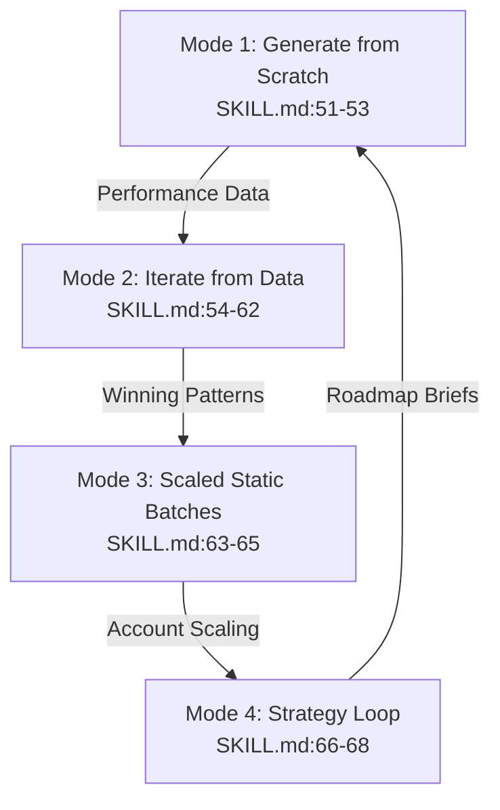
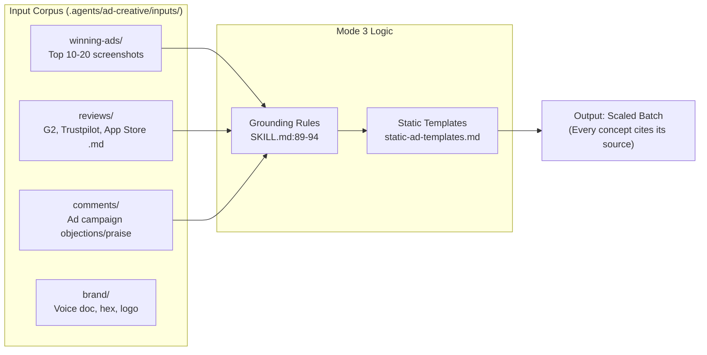
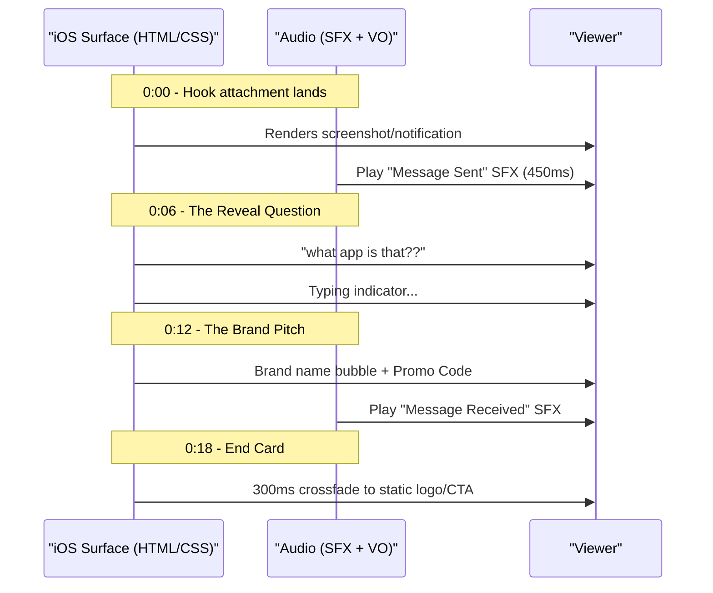
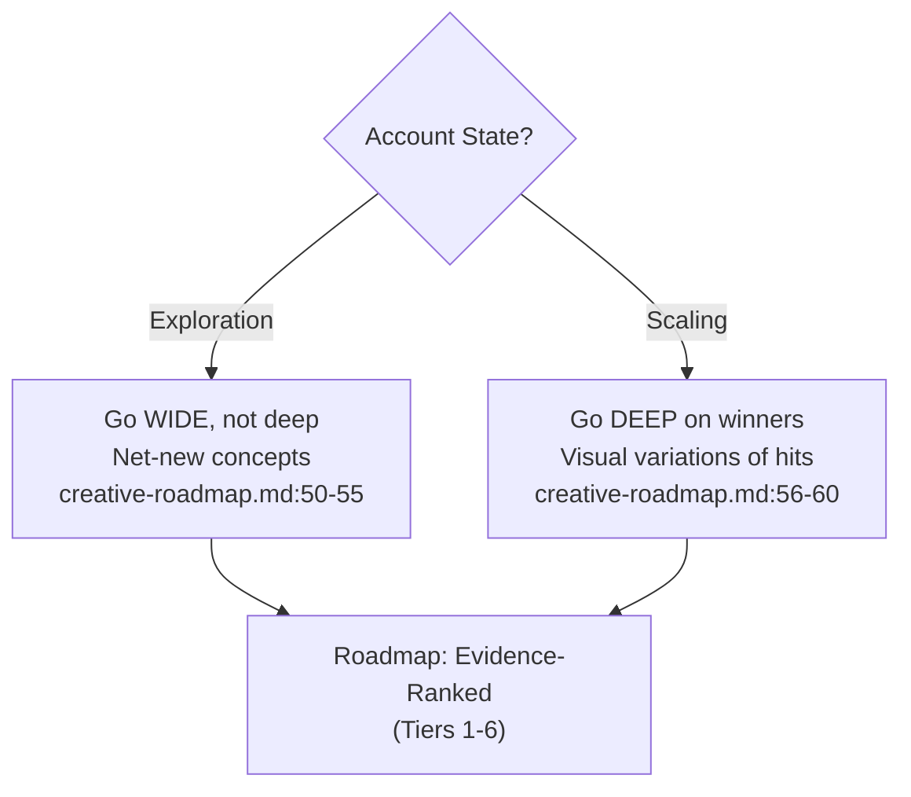
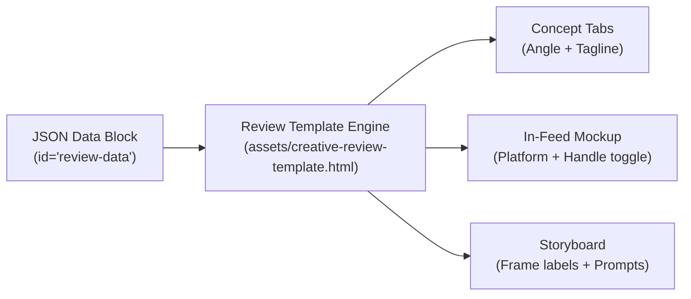
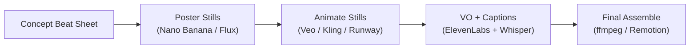

<!-- source: DeepWiki mcp.deepwiki.com · repo coreyhaines31/marketingskills · extra page Ad Creative · fetched 2026-10-27 -->

# Ad Creative

Relevant source files

The following files were used as context for generating this wiki page:

- [skills/ad-creative/SKILL.md](skills/ad-creative/SKILL.md)
- [skills/ad-creative/assets/creative-review-template.html](skills/ad-creative/assets/creative-review-template.html)
- [skills/ad-creative/evals/evals.json](skills/ad-creative/evals/evals.json)
- [skills/ad-creative/references/creative-review-page.md](skills/ad-creative/references/creative-review-page.md)
- [skills/ad-creative/references/creative-roadmap.md](skills/ad-creative/references/creative-roadmap.md)
- [skills/ad-creative/references/generative-tools.md](skills/ad-creative/references/generative-tools.md)
- [skills/ad-creative/references/hook-system.md](skills/ad-creative/references/hook-system.md)
- [skills/ad-creative/references/imessage-video-ads.md](skills/ad-creative/references/imessage-video-ads.md)
- [skills/ad-creative/references/motion-video-ads.md](skills/ad-creative/references/motion-video-ads.md)
- [skills/ad-creative/references/platform-specs.md](skills/ad-creative/references/platform-specs.md)
- [skills/ad-creative/references/static-ad-templates.md](skills/ad-creative/references/static-ad-templates.md)
- [skills/marketing-loops/SKILL.md](skills/marketing-loops/SKILL.md)
- [skills/marketing-loops/references/loop-catalog.md](skills/marketing-loops/references/loop-catalog.md)

## Purpose and Scope

The `ad-creative` skill provides knowledge and frameworks for generating, iterating, and scaling ad creative (headlines, descriptions, primary text, images, and videos) for paid advertising platforms. This skill covers **ad copy generation** with platform-specific character limits, **ad visual production** using generative AI tools (image, video, voice), and **advanced video formats** like iOS-native reveals and code-based rendering with Remotion.

For overall campaign strategy, audience targeting, and budget allocation, see [Paid Ads Strategy](4.6.1). For landing page copy where ad traffic converts, see [Copywriting](4.4.1). For tracking ad performance, see [Analytics Tracking](4.7.1).

**Sources:** [skills/ad-creative/SKILL.md:1-6](), [skills/ad-creative/SKILL.md:10-10]()

---

## Skill Structure and Operational Modes

The `ad-creative` skill is organized into four distinct operational modes that transition from initial concepting to scaled, data-driven production.

**Operational Modes Diagram**

### The Four Operational Modes

| Mode | Purpose | Key Artifacts |
| :--- | :--- | :--- |
| **Mode 1: Generate from Scratch** | Creating initial ad creative without prior performance data. | Platform-specific RSA/Feed copy sets. |
| **Mode 2: Iterate from Data** | Analyzing winners/losers (CTR, CVR, ROAS) to generate variations of winning themes. | Iteration reports, "Double-down" copy sets. |
| **Mode 3: Scaled Batches** | High-volume production (e.g., 50 concepts) using a **Grounded Inputs** corpus. | [creative-review-page.md](), [static-ad-templates.md]() |
| **Mode 4: Strategy Loop** | Deciding *which* ads to make before making them using the [creative-roadmap.md](). | `roadmap.md`, `retros/YYYY-MM.md`, hook matrix. |

**Sources:** [skills/ad-creative/SKILL.md:49-68](), [skills/ad-creative/references/creative-roadmap.md:1-7]()

---

## Grounded Inputs System

A core requirement for scaled production (Mode 3) is the maintenance of a **Grounded Inputs** corpus. This prevents ungrounded "hallucinated" generation by forcing the AI to trace every concept to real source material.

**Grounded Data Flow**

**Grounding Rules:**
* Every concept must cite its source (which specific review or comment it traces to) [[SKILL.md:90-90]]().
* No invented claims, stats, or testimonials are permitted [[SKILL.md:91-91]]().
* Inputs must decay; `winning-ads` are refreshed as new ads scale, and `reviews` are refreshed monthly [[SKILL.md:93-93]]().

**Sources:** [skills/ad-creative/SKILL.md:71-95](), [skills/ad-creative/references/static-ad-templates.md:9-21]()

---

## iOS-Native Reveal Video Ads

The skill documents a family of 9:16 social-native video formats that recreate iOS surfaces (iMessage, ChatGPT, Notes, AirDrop) to reveal a brand or promo code conversationally.

### Reveal Formats Catalog

| Format | The Hook | The Reveal | File Reference |
| :--- | :--- | :--- | :--- |
| **iMessage Reveal** | A screenshot of a result (e.g., sleep score) sent to a friend. | Friend asks "what app is that?"; brand revealed in reply. | [imessage-video-ads.md:43-51]() |
| **ChatGPT Reveal** | A prompt asking for a solution to a specific pain point. | ChatGPT suggests the product/tool as the answer. | [imessage-video-ads.md:118-121]() |
| **Apple Notes Reveal** | A "checklist" or "brain dump" note showing a transformation. | A cursor highlights the brand as the key to the list. | [imessage-video-ads.md:122-125]() |
| **AirDrop Reveal** | **New (v2.8.0)**: An incoming AirDrop request notification. | User taps "Accept" to reveal the brand/offer asset. | [imessage-video-ads.md:126-129]() |

**Reveal Ad Anatomy**

**Sources:** [skills/ad-creative/references/imessage-video-ads.md:1-129]()

---

## The Creative Strategy Loop (Mode 4)

Mode 4 implements the **Creative Strategy Loop**, which uses account performance, customer language, and external organic signals to maintain a prioritized roadmap.

### The Roadmap Artifact (`roadmap.md`)
The roadmap categorizes concepts into three horizons:
1. **Icebox**: Every concept with evidence tier and source attached.
2. **This Quarter**: 2-4 strategic themes ("bets").
3. **This Month**: The active slate with assigned **Production Tiers** (T1 Iteration, T2 Remix, T3 Production).

**Strategy Branching Logic**

**Sources:** [skills/ad-creative/references/creative-roadmap.md:1-82]()

---

## Creative Review Page (v2.8.8)

The Creative Review Page is a self-contained HTML artifact (`assets/creative-review-template.html`) used to present generated concepts for stakeholder approval. It renders mockups from a JSON data block.

### Key Features
* **In-Feed Previews**: Shows how ads look on Instagram/Facebook feeds.
* **Frame-by-Frame Storyboard**: Breaks carousels into narrative arcs (Hook, Problem, Mechanism, Results, Ask).
* **Grounding Disclosure**: A required block stating exactly which assets are real vs. illustrative.
* **Concept Tabs**: Allows stakeholders to toggle between strategic angles.

**Data Flow: JSON to Mockup**

**Sources:** [skills/ad-creative/references/creative-review-page.md:1-83](), [skills/ad-creative/assets/creative-review-template.html:1-110]()

---

## Platform Specifications

The skill enforces strict character limits across five major platforms to prevent truncation.

| Platform | Headline | Description | Primary/Intro Text |
| :--- | :--- | :--- | :--- |
| **Google RSA** | 30 chars (up to 15) | 90 chars (up to 4) | N/A |
| **Meta** | 40 chars (rec) | 30 chars (rec) | 125 chars (visible) |
| **LinkedIn** | 70 chars (rec) | 100 chars (rec) | 150 chars (rec) |
| **TikTok** | 40 chars (name) | N/A | 80-100 chars |
| **Twitter/X** | 70 chars (card) | N/A | 280 chars |

**Sources:** [skills/ad-creative/SKILL.md:97-137](), [skills/ad-creative/evals/evals.json:25-27]()

---

## Generative Tools and Remotion

The skill provides a selection matrix for AI tools and code-based video frameworks.

### Tool Selection Matrix
* **Image Generation**: **Ideogram** (90% text accuracy), **Flux** (8-image reference for product consistency), **Nano Banana Pro** (native editing).
* **Video Generation**: **Veo 3.1** (native audio/vertical), **Kling** (3-minute cinematic), **Runway Gen-4** (character consistency).
* **Code-Based Video**: **Remotion** for templated, data-driven video ads at scale.

**Motion Video Ad Pipeline**

**Sources:** [skills/ad-creative/references/generative-tools.md:7-22](), [skills/ad-creative/references/motion-video-ads.md:22-44]()

---

