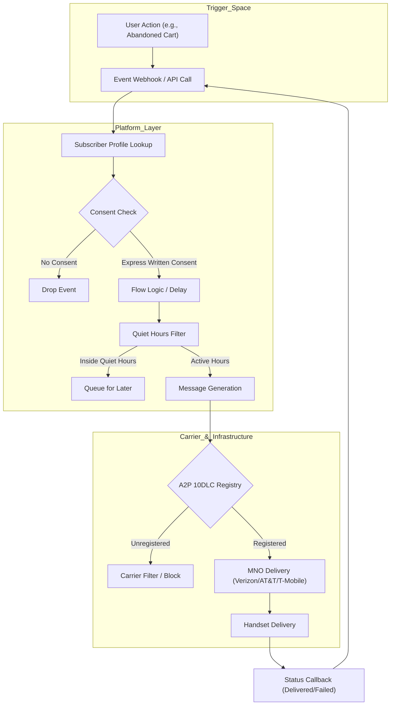
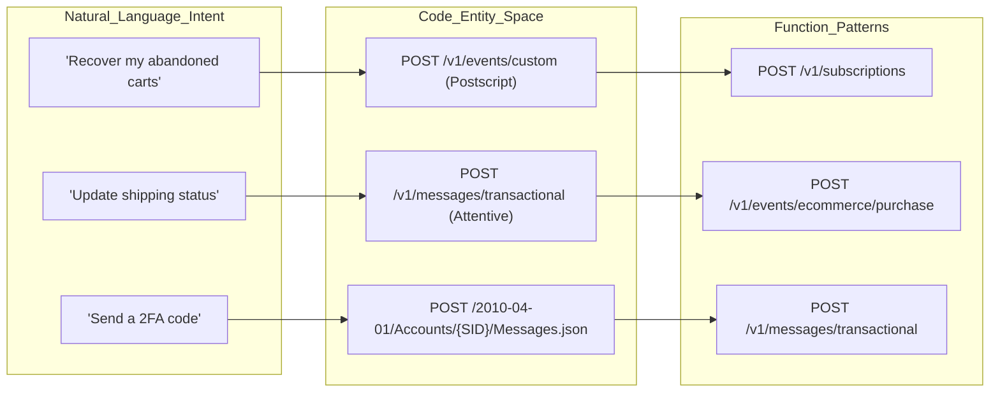

<!-- source: DeepWiki mcp.deepwiki.com · repo coreyhaines31/marketingskills · extra page SMS Marketing · fetched 2026-10-27 -->

# SMS Marketing

Relevant source files

The following files were used as context for generating this wiki page:

- [skills/sms/SKILL.md](skills/sms/SKILL.md)
- [skills/sms/evals/evals.json](skills/sms/evals/evals.json)
- [skills/sms/references/compliance.md](skills/sms/references/compliance.md)
- [skills/sms/references/platforms.md](skills/sms/references/platforms.md)
- [skills/sms/references/sequence-templates.md](skills/sms/references/sequence-templates.md)
- [tools/integrations/attentive.md](tools/integrations/attentive.md)
- [tools/integrations/audiencetap.md](tools/integrations/audiencetap.md)

The `sms` skill (v1.0.0) is a technical knowledge module for planning, building, and optimizing SMS and MMS marketing programs. It covers the strategic decision-making process for when to use SMS over email, compliance requirements (TCPA, A2P 10DLC, GDPR), infrastructure selection (phone number types and platforms), and implementation of high-ROI automated sequences.

## Purpose and Scope

SMS marketing is documented here as a high-urgency, high-engagement channel distinct from email. While email is used for long-form content and educational nurtures, SMS is reserved for time-sensitive actions like cart recovery, flash sales, and transactional updates. This page provides technical implementation details for major platforms like Klaviyo, Postscript, Attentive, and Twilio, alongside compliant sequence templates.

**Distinctions:**
*   **vs. Email Sequences:** SMS has a ~98% open rate within 3 minutes, making it the primary channel for urgency [skills/sms/SKILL.md:41-57]().
*   **vs. Popups:** Popups are the capture mechanism; SMS is the delivery channel [skills/sms/SKILL.md:1-6]().

---

## Technical Architecture & Data Flow

SMS marketing operations typically flow from a trigger event (e-commerce action or API call) through an orchestration layer (the platform) to the carrier networks.

### SMS Event Pipeline

The following diagram illustrates the flow from a user action to a delivered SMS message, including compliance checks and platform-specific routing.

**SMS Message Lifecycle**

Sources: [skills/sms/SKILL.md:61-98](), [skills/sms/references/compliance.md:83-124](), [skills/sms/references/platforms.md:102-135]()

---

## Compliance Requirements

Compliance is the technical foundation of SMS. Failure to adhere to these standards results in immediate carrier filtering or legal liability under TCPA ($500–$1,500 per message).

### US Compliance Standards

| Requirement | Technical Implementation | Code/Policy Reference |
|:---|:---|:---|
| **Express Written Consent** | Checkbox + disclosure adjacent to phone field; timestamped record. | [skills/sms/references/compliance.md:23-43]() |
| **A2P 10DLC** | Registration of Brand + Campaign via TCR (The Campaign Registry). | [skills/sms/references/compliance.md:83-124]() |
| **Quiet Hours** | No sends 9pm–8am recipient-local (based on area code/IP). | [skills/sms/SKILL.md:71-72]() |
| **Opt-out (STOP)** | Immediate suppression on keywords: STOP, END, CANCEL, QUIT. | [skills/sms/references/compliance.md:53-74]() |
| **Sender Identity** | "From [Brand]:" prefix required in every message body. | [skills/sms/SKILL.md:129-131]() |

### A2P 10DLC Throughput Tiers
Throughput is determined by the "Trust Score" assigned during Brand Registration [skills/sms/references/compliance.md:106-113]().

| Trust Score | Throughput (10DLC) | Best Use Case |
|:---|:---|:---|
| **Verified Brand** | 75–100+ msg/sec | Mid-market marketing |
| **Standard Brand** | 4–10 msg/sec | SMB / Transactional |
| **Unregistered** | 0.1 msg/sec (or blocked) | Do not use |

Sources: [skills/sms/SKILL.md:61-82](), [skills/sms/references/compliance.md:1-124]()

---

## Platform Selection & API Integration

The codebase supports multiple integration patterns depending on the business type (DTC vs. B2B SaaS).

### Natural Language to Code Entity Mapping

This diagram maps common marketing requests to the specific API entities and tools used in the system.

**Marketing Intent to API Entity Mapping**

Sources: [tools/integrations/attentive.md:23-95](), [skills/sms/references/platforms.md:102-135]()

### Platform Comparison

| Platform | Best For | Key API Endpoint / Pattern |
|:---|:---|:---|
| **Klaviyo** | Shopify DTC (Unified) | `POST /client/events` (Shared profile) [skills/sms/references/platforms.md:9-28]() |
| **Postscript** | Shopify-native | `POST /v1/subscriptions` [skills/sms/references/platforms.md:41-58]() |
| **Attentive** | Enterprise DTC | `POST /v1/events/custom` [tools/integrations/attentive.md:51-64]() |
| **Twilio** | B2B SaaS / Custom | `POST /2010-04-01/Accounts/{SID}/Messages.json` [skills/sms/references/platforms.md:102-122]() |
| **AudienceTap** | AI-forward DTC | `POST /v1/subscribers` [tools/integrations/audiencetap.md:25-37]() |
| **Plivo** | Cost-sensitive Custom | `POST /v1/Account/{auth_id}/Message/` [skills/sms/references/platforms.md:196-215]() |

---

## Sequence Implementation

High-ROI SMS sequences are built using specific timing and segmentation logic.

### Abandoned Cart (Highest ROI)
*   **Send 1 (30m delay):** Gentle reminder, no discount. [skills/sms/references/sequence-templates.md:37-42]()
*   **Send 2 (4h delay):** Urgency (items selling fast). [skills/sms/references/sequence-templates.md:44-49]()
*   **Send 3 (24h delay):** Incentive (e.g., 10% off) to close the deal. [skills/sms/references/sequence-templates.md:51-56]()

### Replenishment (Consumables)
Used for products with predictable cycles (skincare, supplements, coffee).
*   **Trigger:** At expected reorder window (e.g., 28 days for a 30-day supply). [skills/sms/references/sequence-templates.md:240-241]()
*   **Message:** "From [Brand]: Running low on [product]? Reorder in one tap: [short.link]" [skills/sms/references/sequence-templates.md:243]()

### Implementation Checklist for Developers
1.  **Character Encoding:** Use GSM-7 (160 chars/segment). Emojis force UCS-2 (70 chars/segment). [skills/sms/references/sequence-templates.md:5]()
2.  **Short Links:** Always use platform-generated or branded short links (`klvy.co`, `txt.attn.tv`) for tracking. [skills/sms/SKILL.md:127-128]()
3.  **Exclusion Rules:** Stop sequences immediately on purchase, opt-out, or 48 hours elapsed. [skills/sms/references/sequence-templates.md:61]()
4.  **Phone Number Selection:** List <10K = 10DLC; 10K–100K = Toll-Free; 100K+ = Short Code. [skills/sms/SKILL.md:108]()

Sources: [skills/sms/references/sequence-templates.md:1-255](), [skills/sms/SKILL.md:100-142]()

---

## Performance Optimization

The `sms` skill evaluates program health using the following benchmarks and diagnostic patterns.

### Healthy Benchmarks
*   **Opt-out rate:** Should be <2% per send (promotional sends <0.5%). [skills/sms/evals/evals.json:56-59]()
*   **Open Rate:** Expected 98% within 3 minutes (vs 20% for email in 24h). [skills/sms/SKILL.md:47]()
*   **ROI:** SMS should drive measurable revenue, but costs $0.0075–$0.04 per send + carrier fees. [skills/sms/SKILL.md:115]()

### List Fatigue Diagnosis
If opt-out rates exceed 2%, the system diagnoses:
1.  **Over-sending:** More than 2-3 promotional sends per week. [skills/sms/evals/evals.json:58-60]()
2.  **Lack of Segmentation:** Sending "blasts" to the entire list instead of engaged segments. [skills/sms/evals/evals.json:61]()
3.  **Irrelevance:** Sending messages that could have been emails (not time-sensitive). [skills/sms/SKILL.md:57]()

Sources: [skills/sms/evals/evals.json:54-67](), [skills/sms/SKILL.md:112-132]()

---

