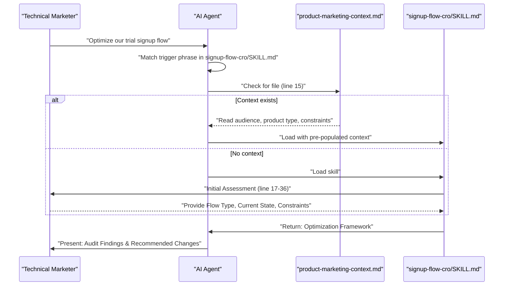
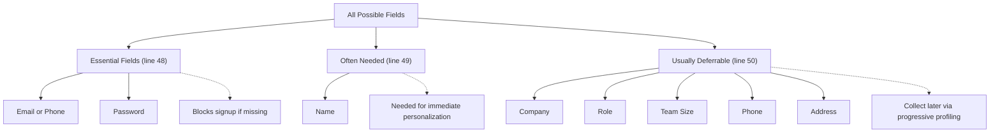
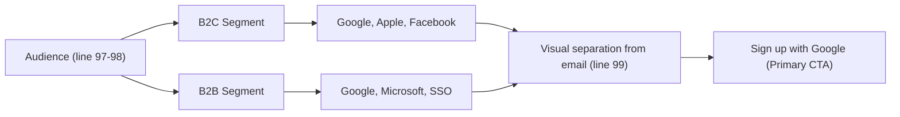

<!-- source: DeepWiki mcp.deepwiki.com · repo coreyhaines31/marketingskills · extra page Signup Flow CRO · fetched 2026-10-27 -->

# Signup Flow CRO

Relevant source files

The following files were used as context for generating this wiki page:

- [.claude-plugin/marketplace.json](.claude-plugin/marketplace.json)
- [.claude-plugin/plugin.json](.claude-plugin/plugin.json)
- [README.md](README.md)
- [VERSIONS.md](VERSIONS.md)

## Purpose and Scope

The `signup-flow-cro` skill provides specialized knowledge for optimizing signup, registration, and account creation flows. It focuses on reducing friction during the conversion moment when a visitor becomes a user by creating an account. [skills/signup-flow-cro/SKILL.md:1-6]()

**Scope boundaries:**
- **In scope:** Registration forms, trial signups, account creation, and waitlist signups. [skills/signup-flow-cro/SKILL.md:19-25]()
- **Out of scope:** Post-signup onboarding (see [Onboarding CRO](4.2.5)), lead capture forms that don't create accounts (see [Form CRO](4.2.3)), and landing page optimization before signup (see [Page CRO](4.2.1)). [skills/signup-flow-cro/SKILL.md:3]()

This skill provides frameworks, best practices, and audit structures but does not execute code. For designing experiments to test these changes, see [A/B Test Setup](4.7.2). [skills/ab-test-setup/SKILL.md:1-10]()

Sources: [skills/signup-flow-cro/SKILL.md:1-209](), [skills/ab-test-setup/SKILL.md:1-10]()

---

## Skill Metadata and Trigger Conditions

The skill is defined with specific metadata that controls when AI agents invoke it:

| Property | Value |
|----------|-------|
| **Name** | `signup-flow-cro` |
| **Version** | 2.0.0 |
| **Skill Type** | Knowledge module (non-executable) |
| **Category** | Conversion Optimization |

**Natural language trigger patterns:**
- Direct terms: "signup conversions", "registration friction", "signup form optimization". [skills/signup-flow-cro/SKILL.md:3]()
- Use cases: "free trial signup", "reduce signup dropoff", "account creation flow", "signup abandonment". [skills/signup-flow-cro/SKILL.md:3]()
- The skill activates when users request optimization of the moment a visitor creates an account.

**Differentiation from similar skills:**
- `form-cro`: For forms that capture leads but don't create accounts (contact forms, demo requests). [skills/form-cro/SKILL.md:3]()
- `onboarding-cro`: For post-signup activation and first-run experience. [skills/signup-flow-cro/SKILL.md:3]()
- `copywriting`: For the specific persuasive text used within the flow. [skills/copywriting/SKILL.md:2-3]()
- `offers`: For the core offer being sold (bonuses, guarantees, pricing structure). [skills/offers/SKILL.md:1-10]()

Sources: [skills/signup-flow-cro/SKILL.md:1-6](), [skills/form-cro/SKILL.md:3](), [skills/copywriting/SKILL.md:1-5](), [skills/offers/SKILL.md:1-10]()

---

## Skill Invocation and Context Integration

The skill follows a standard initialization pattern that prioritizes existing product knowledge stored in the repository.

### Context Retrieval Logic
"Code Entity Space" mapping for context integration:

**Context integration pattern:**
1. The skill checks for `.agents/product-marketing.md` or legacy `product-marketing-context.md`. [skills/signup-flow-cro/SKILL.md:14-15]()
2. Uses context to determine if the flow is B2B vs B2C, free trial vs freemium, and existing business constraints. [skills/signup-flow-cro/SKILL.md:19-36]()
3. Only asks for information specific to the signup flow optimization task that isn't already documented. [skills/signup-flow-cro/SKILL.md:15]()

Sources: [skills/signup-flow-cro/SKILL.md:12-36](), [README.md:19-25]()

---

## Core Optimization Framework

The skill implements four core principles for signup optimization:

### Principle Matrix

| Principle | Implementation | Rationale |
|-----------|----------------|-----------|
| **Minimize Required Fields** | Remove deferrable fields, use progressive profiling | Every field reduces conversion. [skills/signup-flow-cro/SKILL.md:41-42]() |
| **Show Value Before Commitment** | Value first, signup second; product experience first | Reduces psychological barrier. [skills/signup-flow-cro/SKILL.md:52-55]() |
| **Reduce Perceived Effort** | Progress indicators, smart defaults, pre-fill | Lowers cognitive load. [skills/signup-flow-cro/SKILL.md:57-61]() |
| **Remove Uncertainty** | Clear expectations ("Takes 30s"), show next steps | Eliminates surprises. [skills/signup-flow-cro/SKILL.md:63-66]() |

**Field priority hierarchy defined in skill:**

Sources: [skills/signup-flow-cro/SKILL.md:39-67]()

---

## Field-Level Optimization Patterns

### Email and Password UX
The skill specifies technical requirements for the primary account fields:

| Field | Optimization | Requirement |
|-------|--------------|-------------|
| **Email** | Single field | No email confirmation field. [skills/signup-flow-cro/SKILL.md:73]() |
| **Email** | Validation | Inline validation + typo detection (gmial.com). [skills/signup-flow-cro/SKILL.md:74-75]() |
| **Password** | Visibility | Password toggle (eye icon). [skills/signup-flow-cro/SKILL.md:79]() |
| **Password** | Requirements | Show upfront, not after failure; use strength meter. [skills/signup-flow-cro/SKILL.md:80-86]() |
| **Password** | Accessibility | Allow paste (don't disable). [skills/signup-flow-cro/SKILL.md:85]() |

### Social Authentication Priority
"Natural Language Space" to "Code Entity Space" for Auth Options:

Sources: [skills/signup-flow-cro/SKILL.md:70-101]()

---

## Flow Structure Decision Framework

### Single-Step vs. Multi-Step

| Type | When to Use | Best Practices |
|------|-------------|----------------|
| **Single-Step** | 3 or fewer fields; simple B2C; high-intent traffic [skills/signup-flow-cro/SKILL.md:122-125]() | All fields visible, clear CTA |
| **Multi-Step** | 4+ fields; complex B2B; segmentation needed [skills/signup-flow-cro/SKILL.md:127-130]() | Progress indicator, lead with easy questions [skills/signup-flow-cro/SKILL.md:133-134]() |

**Progressive Commitment Pattern:**
1. **Step 1:** Email only (lowest barrier). [skills/signup-flow-cro/SKILL.md:141]()
2. **Step 2:** Password + name. [skills/signup-flow-cro/SKILL.md:142]()
3. **Step 3:** Customization/segmentation questions (optional). [skills/signup-flow-cro/SKILL.md:143]()

Sources: [skills/signup-flow-cro/SKILL.md:120-144]()

---

## Trust and Friction Reduction

### Form-Level Elements
- **Microcopy:** "No credit card required" [skills/signup-flow-cro/SKILL.md:150](), "Free forever" [skills/signup-flow-cro/SKILL.md:151]().
- **Labels:** Keep visible; do not use placeholders as labels as they disappear when typing. [skills/signup-flow-cro/SKILL.md:164]()
- **Error Handling:** Inline validation (not just on submit); preserve data on error. [skills/signup-flow-cro/SKILL.md:157-159]()

### Mobile Optimization
- **Touch Targets:** 44px+ height. [skills/signup-flow-cro/SKILL.md:171]()
- **Input Types:** Proper keyboard types (email, tel). [skills/signup-flow-cro/SKILL.md:172]()
- **Layout:** Single column with sticky CTA button. [skills/signup-flow-cro/SKILL.md:175-176]()

Sources: [skills/signup-flow-cro/SKILL.md:147-178]()

---

## Measurement and Evals

### Key Metrics
The skill defines specific metrics for tracking flow performance:
- **Form start rate:** Landed → started filling. [skills/signup-flow-cro/SKILL.md:203]()
- **Form completion rate:** Started → submitted. [skills/signup-flow-cro/SKILL.md:204]()
- **Field-level drop-off:** Identifying which specific fields lose users. [skills/signup-flow-cro/SKILL.md:205]()

### Skill Evals
The repository includes evaluation cases to ensure consistent agent behavior. These tests verify the agent's ability to:
- Audit complex B2B flows.
- Recommend appropriate SSO options based on audience.
- Evaluate the impact of email verification requirements.
- Maintain boundary checks by deferring post-signup activation issues to the `onboarding` skill. [skills/signup-flow-cro/SKILL.md:3]()

Sources: [skills/signup-flow-cro/SKILL.md:200-215](), [skills/signup-flow-cro/SKILL.md:3]()

---

