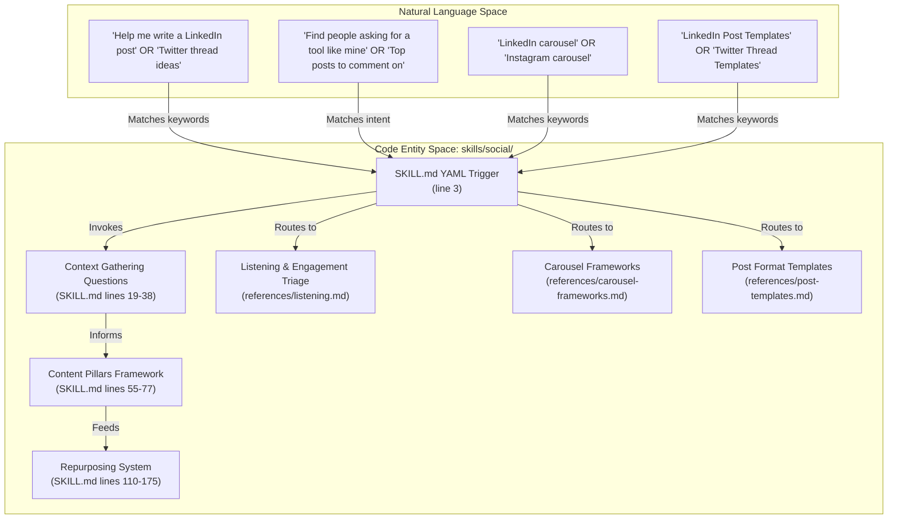
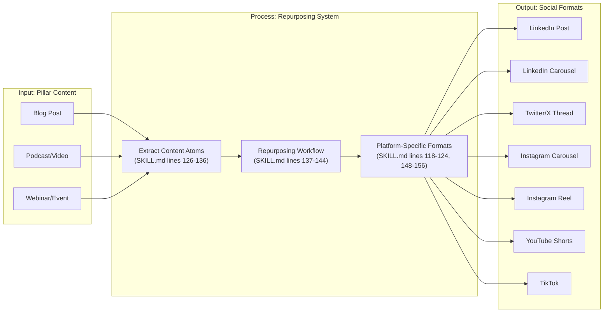

<!-- source: DeepWiki mcp.deepwiki.com · repo coreyhaines31/marketingskills · extra page Social Content · fetched 2026-10-27 -->

# Social Content

Relevant source files

The following files were used as context for generating this wiki page:

- [skills/social/SKILL.md](skills/social/SKILL.md)
- [skills/social/evals/evals.json](skills/social/evals/evals.json)
- [skills/social/references/carousel-frameworks.md](skills/social/references/carousel-frameworks.md)
- [skills/social/references/listening-sources-template.md](skills/social/references/listening-sources-template.md)
- [skills/social/references/listening.md](skills/social/references/listening.md)
- [skills/social/references/post-templates.md](skills/social/references/post-templates.md)

The `social` skill (referenced as `social-content` in system documentation) provides a comprehensive framework for creating, scheduling, and optimizing social media content across major platforms including LinkedIn, Twitter/X, Instagram, TikTok, and Facebook. It focuses on strategic content pillars, platform-specific formatting, engagement routines, systematic content repurposing, and advanced social listening.

For broader content strategy beyond social channels, see [Content Strategy](#4.5.6). For earned media and journalist outreach, see [Public Relations](#4.4.7).

Sources: [skills/social/SKILL.md:1-5]()

## Skill Architecture and Triggers

The skill is implemented as a structured knowledge module that an AI agent loads when specific social media-related keywords are detected in the user's prompt.

### Natural Language to Code Entity Mapping

The following diagram shows how natural language triggers map to the `social` skill and its internal logic sections.

Sources: [skills/social/SKILL.md:1-175](), [skills/social/references/listening.md:1-25](), [skills/social/references/carousel-frameworks.md:1-102](), [skills/social/references/post-templates.md:1-180]()

### Trigger Keywords
The skill is activated by phrases including:
*   "LinkedIn post" / "Twitter thread"
*   "content calendar" / "social scheduling"
*   "viral content" / "grow my following"
*   "repurpose this content"
*   "LinkedIn carousel" / "tweet ideas"
*   "social listening" / "competitor monitoring"
*   "TikTok video" / "Reels" / "Shorts" / "video script" / "video hook" / "short-form video" / "create a reel"
*   "carousel" / "slide-by-slide" / "document post"

Sources: [skills/social/SKILL.md:3-3]()

## Implementation Detail: Context Gathering

The skill enforces a "Context First" pattern. Before generating content, it checks for the existence of `.agents/product-marketing.md` (or `.claude/product-marketing.md`) to avoid redundant questions.

| Category | Key Data Points Required | Line Reference |
| :--- | :--- | :--- |
| **Goals** | Primary objective (Leads vs Awareness), desired action, brand type | [skills/social/SKILL.md:19-22]() |
| **Audience** | Target persona, platform activity, existing engagement patterns | [skills/social/SKILL.md:24-27]() |
| **Brand Voice** | Tone (Casual vs Professional), topics to avoid, style guidelines | [skills/social/SKILL.md:29-32]() |
| **Resources** | Time commitment, existing assets for repurposing, video capability | [skills/social/SKILL.md:34-37]() |

Sources: [skills/social/SKILL.md:14-38]()

## Platform Technical Constraints

The skill utilizes reference files to ensure generated content adheres to platform-specific technical limits and algorithmic preferences.

| Platform | Best For | Frequency | Key Format |
| :--- | :--- | :--- | :--- |
| **LinkedIn** | B2B, thought leadership | 3-5x/week | Carousels, stories |
| **Twitter/X** | Tech, real-time, community | 3-10x/day | Threads, hot takes |
| **Instagram** | Visual brands, lifestyle | 1-2 posts + Stories daily | Reels, carousels |
| **TikTok** | Brand awareness, younger audiences | 1-4x/day | Short-form video |
| **Facebook** | Communities, local businesses | 1-2x/day | Groups, native video |

Sources: [skills/social/SKILL.md:43-49]()

## Core Frameworks

### Content Pillars
The skill implements a percentage-based allocation model to ensure variety and brand alignment.
*   **Industry Insights (30%)**: Trends, data, and predictions.
*   **Behind-the-scenes (25%)**: Building the company, lessons learned.
*   **Educational (25%)**: How-tos, frameworks, tips.
*   **Personal (15%)**: Stories, values, hot takes.
*   **Promotional (5%)**: Product updates, offers.

Sources: [skills/social/SKILL.md:55-68]()

### The Hook System
The skill utilizes four primary "Hook Formulas" to optimize scroll-stopping potential: Curiosity, Story, Value, and Contrarian hooks. These are detailed in `skills/social/SKILL.md` and further expanded in `skills/social/references/post-templates.md`.

Sources: [skills/social/SKILL.md:80-104](), [skills/social/references/post-templates.md:149-174]()

### Carousel Frameworks
For multi-slide content like Instagram carousels or LinkedIn document posts, the skill leverages five narrative architectures defined in `references/carousel-frameworks.md`. These frameworks guide the structure and content of each slide to maximize engagement.

| Framework | Use Case | Key Principle |
| :--- | :--- | :--- |
| **Value-Stack** | List of resources, tools, or tips | Completeness is the promise; count is the hook |
| **Problem-Proof** | Personal result with a system | Proof opens and closes the loop; system is the meat |
| **Hack List** | Several named techniques on one theme | Each hack re-earns the swipe independently |
| **Rant Callout** | Strong opinion about common practice | Conviction is the content; structure keeps it fair |
| **Demo Walkthrough** | Product or workflow demonstration | Seeing the steps is more persuasive than describing them |

Sources: [skills/social/SKILL.md:108-108](), [skills/social/references/carousel-frameworks.md:1-102]()

### Post Format Templates
The skill provides ready-to-use templates for various platforms and content types, including LinkedIn posts, Twitter/X threads, and Instagram formats. These templates offer structured guidance for crafting effective social media updates.

Sources: [skills/social/references/post-templates.md:1-144]()

## Data Flow: Content Repurposing

The skill provides a systematic workflow for transforming "Pillar Content" (long-form) into "Content Atoms" (micro-content).

Sources: [skills/social/SKILL.md:110-162]()

## Social Listening & Engagement Triage

A specialized module handles the "Daily Triage Loop" to surface high-value posts for engagement rather than passive scrolling. This process is detailed in `references/listening.md`.

### Scoring Rubric
Posts are scored 1–10 across five dimensions to prioritize interaction:
1.  **ICP Fit (2x weight)**: Is the author a target customer / influencer?
2.  **Intent Signal (2x weight)**: Are they expressing a problem, asking, or shopping?
3.  **Reach Potential (1x weight)**: Is the post getting traction (likes/comments rising)?
4.  **Comment Opportunity (2x weight)**: Can you say something genuinely useful, not generic?
5.  **Recency (1x weight)**: Posted in last 1–4h (early comments win, especially on LinkedIn).

Sources: [skills/social/references/listening.md:54-64]()

### Comment Quality Tiers
The skill defines three tiers for comment quality to match the engagement opportunity:
*   **Tier 1 — Relationship builder**: Specific insight, thoughtful follow-up (2–4 sentences, no link).
*   **Tier 2 — Visibility play**: One sharp insight (1–2 sentences).
*   **Tier 3 — Light touch**: Specific reaction (1 sentence).

Sources: [skills/social/references/listening.md:85-100]()

### Technical Implementation: Listening Tools
The skill provides zero-dependency `curl` recipes to fetch data from public APIs for processing by the agent. It also leverages the `listening-sources-template.md` to define target accounts and keywords.

| Source | Command/Tool | Purpose |
| :--- | :--- | :--- |
| **Reddit** | `curl ... reddit.com/r/SaaS/new.json` | Fetch new posts in subreddits |
| **Hacker News** | `curl ... hn.algolia.com/api/v1/search` | Search stories and comments by keyword |
| **Bluesky** | `curl ... public.api.bsky.app/xrpc` | Search posts by keyword |
| **RSS** | `curl ... example.com/feed/` | For blogs, podcasts, YouTube channels |
| **LinkedIn/X** | `dev-browser` (MCP) | Navigate authenticated feeds and extract text |

Sources: [skills/social/references/listening.md:117-171](), [skills/social/references/listening-sources-template.md:1-124]()

## Skill Evals

The `social` skill includes a set of evaluation prompts and assertions in `skills/social/evals/evals.json` to ensure consistent and correct behavior. These evals cover various aspects of the skill, from content strategy to repurposing and social listening.

```mermaid
graph TD
    subgraph "Eval Scenarios"
        E1["Eval 1: LinkedIn Content Strategy"]
        E2["Eval 2: Twitter/X Thread (Bootstrapping SaaS)"]
        E3["Eval 3: Blog Post Repurposing"]
        E4["Eval 4: Low LinkedIn Engagement Diagnosis"]
        E5["Eval 5: Reverse-Engineering Viral Content"]
        E6["Eval 6: Email Sequence (Cross-Skill Check)"]
        E7["Eval 7: LinkedIn Carousel (Pricing Guide)"]
    end

    subgraph "Expected Skill Behavior"
        CheckProductMarketing["Check for product-marketing.md"]
        ContentPillars["Establish 3-5 content pillars"]
        PlatformGuidance["Apply platform-specific guidance"]
        HookFormulas["Provide hook formulas"]
        RepurposingSystem["Apply content repurposing system"]
        EngagementStrategy["Include engagement strategy"]
        CrossReferenceEmails["Reference/defer to emails skill"]
        CarouselFrameworks["Apply carousel frameworks"]
    end

    E1 --> CheckProductMarketing
    E1 --> ContentPillars
    E1 --> PlatformGuidance
    E1 --> HookFormulas
    E1 --> EngagementStrategy

    E2 --> HookFormulas
    E2 --> PlatformGuidance

    E3 --> RepurposingSystem

    E4 --> EngagementStrategy
    E4 --> HookFormulas

    E5 --> RepurposingSystem

    E6 --> CrossReferenceEmails

    E7 --> CarouselFrameworks
    E7 --> PlatformGuidance
```

Sources: [skills/social/evals/evals.json:1-98]()

## Related Skills
*   **content-strategy**: For high-level topic planning. [skills/social/SKILL.md:3]()
*   **ad-creative**: For paid social media advertising. [skills/social/SKILL.md:3]()
*   **public-relations**: For earned media and journalist outreach. [skills/social/SKILL.md:3]()
*   **copywriting**: For long-form content generation. [skills/social/SKILL.md:227]()
*   **email-sequences**: For email campaign tasks, as identified by Eval 6. [skills/social/evals/evals.json:81-86]()

Sources: [skills/social/SKILL.md:3-3](), [skills/social/SKILL.md:227-228](), [skills/social/evals/evals.json:81-86]()

---

