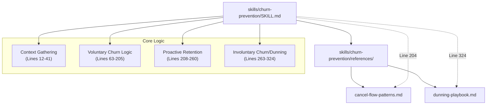
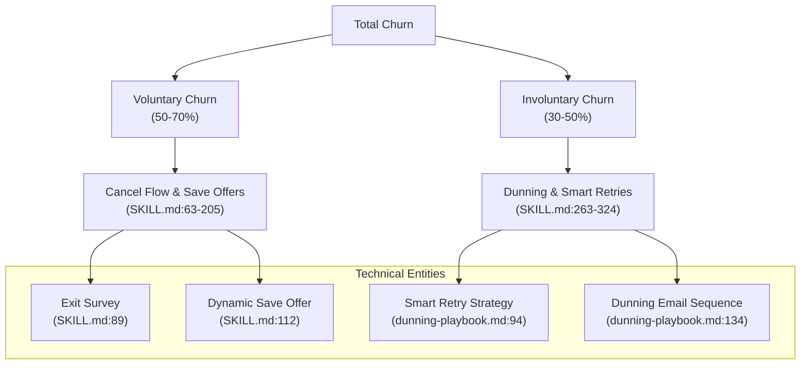
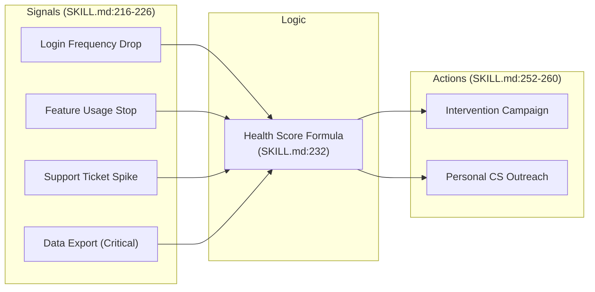

<!-- source: DeepWiki mcp.deepwiki.com · repo coreyhaines31/marketingskills · extra page Churn Prevention · fetched 2026-10-27 -->

# Churn Prevention

Relevant source files

The following files were used as context for generating this wiki page:

- [skills/churn-prevention/SKILL.md](skills/churn-prevention/SKILL.md)
- [skills/churn-prevention/references/cancel-flow-patterns.md](skills/churn-prevention/references/cancel-flow-patterns.md)
- [skills/churn-prevention/references/dunning-playbook.md](skills/churn-prevention/references/dunning-playbook.md)
- [skills/cold-email/SKILL.md](skills/cold-email/SKILL.md)
- [skills/revops/SKILL.md](skills/revops/SKILL.md)

This page documents the `churn-prevention` skill, a comprehensive knowledge module for AI agents to reduce both voluntary churn (customers choosing to cancel) and involuntary churn (failed payments). It covers the design of cancel flows, exit surveys, dynamic save offers, dunning sequences, and proactive retention mechanisms.

**Sources:** [skills/churn-prevention/SKILL.md:1-10]()

---

## Skill Architecture

The `churn-prevention` skill is organized into a main instruction file and specialized reference documents for implementation patterns.

| Component | Location | Purpose |
|-----------|----------|---------|
| Skill Metadata | [skills/churn-prevention/SKILL.md:1-6]() | Versioning (2.0.0) and trigger phrases |
| Context Gathering | [skills/churn-prevention/SKILL.md:12-41]() | Questions on churn rate, billing platform (Stripe/Paddle), and usage data |
| Cancel Flow Design | [skills/churn-prevention/SKILL.md:63-205]() | Survey structure, dynamic mapping, and UI patterns |
| Dunning Strategy | [skills/churn-prevention/SKILL.md:263-324]() | Failed payment recovery and retry logic |
| Reference Patterns | [skills/churn-prevention/references/cancel-flow-patterns.md:1-200]() | Business-type specific flows (B2B vs B2C) |
| Dunning Playbook | [skills/churn-prevention/references/dunning-playbook.md:1-240]() | Technical setup for card updaters and retry schedules |

**Sources:** [skills/churn-prevention/SKILL.md:1-325](), [skills/churn-prevention/references/cancel-flow-patterns.md:1-5]()

---

## Churn Type Classification

The system treats churn as two distinct technical problems requiring different recovery mechanisms.

**Comparison Table**

| Type | Cause | Solution | Impact |
|------|-------|----------|--------|
| **Voluntary** | Customer choice (Price, Usage, Competitor) | Cancel flows, Save offers, Exit surveys | [skills/churn-prevention/SKILL.md:50-53]() |
| **Involuntary** | Payment failure (Expired card, Insufficient funds) | Dunning emails, Smart retries, Card updaters | [skills/churn-prevention/SKILL.md:51-53]() |

**Sources:** [skills/churn-prevention/SKILL.md:46-54](), [skills/churn-prevention/references/dunning-playbook.md:7-12]()

---

## Voluntary Churn: Cancel Flow Design

The skill defines a standard five-step sequence for offboarding:
`Trigger → Survey → Dynamic Offer → Confirmation → Post-Cancel` [skills/churn-prevention/SKILL.md:70]().

### 1. Exit Survey & Mapping
The foundation of the flow is the reason-to-offer mapping. A discount should not be offered if the user isn't using the product [skills/churn-prevention/SKILL.md:112-113]().

| Cancel Reason | Primary Offer | Fallback Offer |
|---------------|---------------|----------------|
| Too expensive | Discount (20-30% for 2-3 months) | Plan Downgrade |
| Not using it enough | Pause (1-3 months) | Free onboarding session |
| Missing feature | Roadmap preview + timeline | Workaround guide |
| Technical issues | Immediate Support Escalation | Credit + Priority fix |

**Sources:** [skills/churn-prevention/SKILL.md:116-124]()

### 2. Save Offer Types
*   **Discount:** 20-30% for 2-3 months is the "sweet spot" [skills/churn-prevention/SKILL.md:129]().
*   **Pause:** 1-3 months maximum; 60-80% of pausers eventually return [skills/churn-prevention/SKILL.md:135-136]().
*   **Downgrade:** Positioned as "right-sizing," showing a clear keep/lose comparison [skills/churn-prevention/SKILL.md:143-144]().

**Sources:** [skills/churn-prevention/SKILL.md:128-155]()

---

## Involuntary Churn: Dunning Playbook

Failed payments cause 30-50% of subscription churn [skills/churn-prevention/references/dunning-playbook.md:9](). The skill implements a recovery timeline and retry logic.

### Dunning Timeline
*   **Day 0:** Payment fails → Smart Retry #1 + Email #1 [skills/churn-prevention/references/dunning-playbook.md:20]().
*   **Day 1-3:** Smart Retry #2 + Email #2 [skills/churn-prevention/references/dunning-playbook.md:21]().
*   **Day 7:** Smart Retry #4 + Email #3 (Urgency) [skills/churn-prevention/references/dunning-playbook.md:23]().
*   **Day 10:** Final Retry + Email #4 (Final Warning) [skills/churn-prevention/references/dunning-playbook.md:24]().

### Smart Retry Logic
The system classifies declines into **Soft** (retryable) and **Hard** (non-retryable) [skills/churn-prevention/references/dunning-playbook.md:98-106]().

| Decline Type | Meaning | Action |
|--------------|---------|--------|
| `insufficient_funds` | Soft | Retry in 2-3 days [skills/churn-prevention/references/dunning-playbook.md:100]() |
| `expired_card` | Hard | No retry; request new card [skills/churn-prevention/references/dunning-playbook.md:103]() |
| `stolen_card` | Hard | No retry; request new card [skills/churn-prevention/references/dunning-playbook.md:104]() |
| `processing_error` | Soft | Retry within 24h [skills/churn-prevention/references/dunning-playbook.md:102]() |

**Sources:** [skills/churn-prevention/references/dunning-playbook.md:19-27](), [skills/churn-prevention/references/dunning-playbook.md:98-107]()

---

## Proactive Retention (Health Scoring)

The skill includes a mechanism to identify churn risk before the user clicks cancel.

**Health Score Formula:**
`Health Score = (Login freq * 0.30) + (Feature usage * 0.25) + (Support sentiment * 0.15) + (Billing health * 0.15) + (Engagement * 0.15)` [skills/churn-prevention/SKILL.md:232-239]().

**Sources:** [skills/churn-prevention/SKILL.md:216-260]()

---

## Technical Implementation & Tools

The skill provides guidance for integrating with billing providers and analytics tools.

| Category | Tools | Purpose |
|----------|-------|---------|
| **Billing** | `Stripe`, `Chargebee`, `Paddle`, `Recurly` | Smart retries and card updaters [skills/churn-prevention/references/dunning-playbook.md:72-75]() |
| **Retention Platforms** | `Churnkey`, `ProsperStack`, `Raaft` | Automated cancel flows [skills/churn-prevention/SKILL.md:388-391]() |
| **Analytics** | `PostHog`, `Mixpanel`, `Segment` | Funnel tracking and health score events [skills/churn-prevention/SKILL.md:411-414]() |

### Integration Points
*   **Stripe:** Recommends enabling "Smart Retries" in the Dashboard to use ML-based timing [skills/churn-prevention/references/dunning-playbook.md:110-114]().
*   **Card Updaters:** Encourages enabling Visa Account Updater (VAU) and Mastercard ABU to reduce hard declines by 30-50% [skills/churn-prevention/references/dunning-playbook.md:61-69]().

**Sources:** [skills/churn-prevention/SKILL.md:382-414](), [skills/churn-prevention/references/dunning-playbook.md:61-114]()

---

## Related Skills

*   **Email Sequences:** Used for post-cancel win-back sequences [skills/churn-prevention/SKILL.md:419]().
*   **Paywall & Upgrade CRO:** Used for in-app upgrade moments and feature gates [skills/churn-prevention/SKILL.md:420]().
*   **Pricing Strategy:** Used for plan structure and discount strategies [skills/churn-prevention/SKILL.md:421]().
*   **Revenue Operations (RevOps):** Used for lead lifecycle stages and routing high-value churn alerts [skills/revops/SKILL.md:50-58]().
*   **Community Marketing:** Integrated for support deflection and community health metrics [skills/churn-prevention/SKILL.md:425]().

**Sources:** [skills/churn-prevention/SKILL.md:417-425](), [skills/revops/SKILL.md:50-58]()

---

