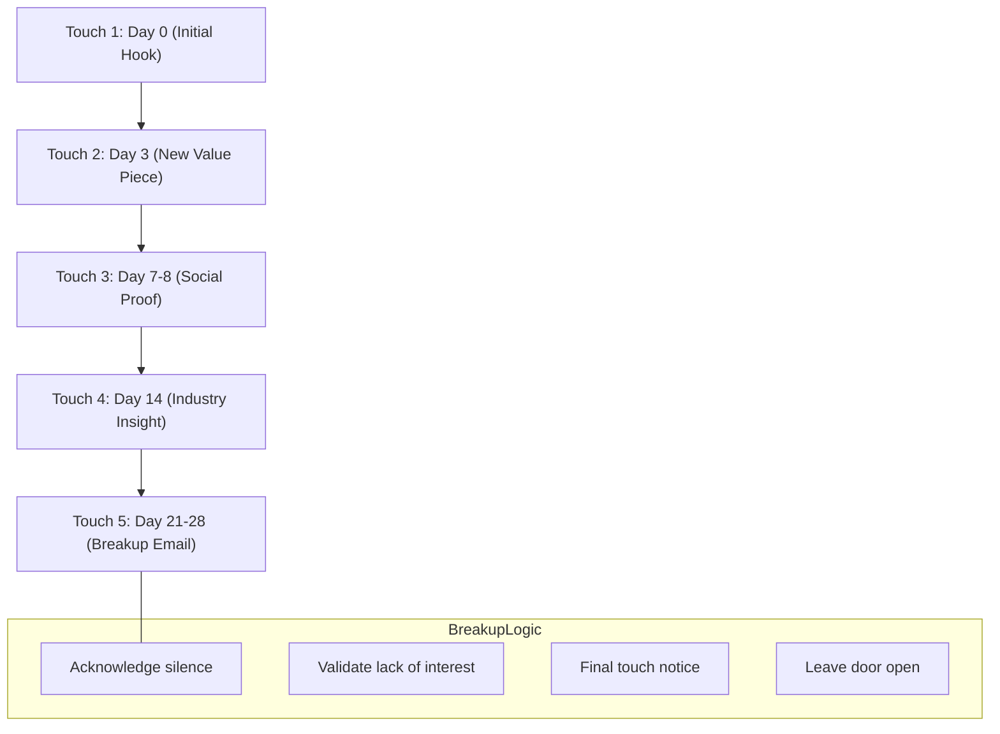

<!-- source: DeepWiki mcp.deepwiki.com · repo coreyhaines31/marketingskills · extra page Cold Email · fetched 2026-10-27 -->

# Cold Email

Relevant source files

The following files were used as context for generating this wiki page:

- [skills/churn-prevention/SKILL.md](skills/churn-prevention/SKILL.md)
- [skills/cold-email/SKILL.md](skills/cold-email/SKILL.md)
- [skills/cold-email/references/benchmarks.md](skills/cold-email/references/benchmarks.md)
- [skills/cold-email/references/follow-up-sequences.md](skills/cold-email/references/follow-up-sequences.md)
- [skills/cold-email/references/frameworks.md](skills/cold-email/references/frameworks.md)
- [skills/cold-email/references/personalization.md](skills/cold-email/references/personalization.md)
- [skills/cold-email/references/subject-lines.md](skills/cold-email/references/subject-lines.md)
- [skills/revops/SKILL.md](skills/revops/SKILL.md)

## Purpose and Scope

The `cold-email` skill provides AI agents with expert knowledge for writing B2B cold outreach emails and follow-up sequences that generate replies. This skill covers subject line optimization, opening lines, body copy, CTAs, personalization systems (4 levels), and multi-touch follow-up sequences.

The skill is optimized for B2B sales development representatives (SDRs), founders, and technical marketers. It emphasizes human-sounding, peer-level copy over template-based approaches, supported by performance benchmarks and data-driven frameworks.

For lifecycle email automation (welcome sequences, nurture campaigns), see [Email Sequences](4.4.3). For sales collateral like pitch decks or objection handling, see [Sales Enablement](4.9.1).

Sources: [skills/cold-email/SKILL.md:1-6]()

---

## System Context

The `cold-email` skill is a core component of the **Consideration and Outreach** phase of the customer lifecycle. It bridges the gap between lead identification and active sales conversations.

### Logic and Data Flow

The following diagram illustrates how the `cold-email` skill (Natural Language Space) interacts with the underlying data references and the eventual execution via CLI tools (Code Entity Space).

```mermaid
graph TB
    subgraph "NaturalLanguageSpace (Skills)"
        COLD["cold-email skill (SKILL.md)"]
        PMC[".agents/product-marketing.md"]
        PROSPECTING["prospecting skill (SKILL.md)"]
    end

    subgraph "KnowledgeReferenceSpace (Data)"
        PERS["personalization.md (4-Level System)"]
        SUBJ["subject-lines.md (2-4 Word Rule)"]
        FOLLOW["follow-up-sequences.md (Angle Rotation)"]
        FRAME["frameworks.md (11 Copy Patterns)"]
        BENCH["benchmarks.md (Reply Rate Data)"]
    end

    subgraph "CodeEntitySpace (Tools)"
        RESEND["tools/resend.js (send, domains)"]
        SG["tools/sendgrid.js (send, campaigns)"]
        LEMLIST["lemlist CLI (sequencing)"]
        INSTANTLY["instantly CLI (sequencing)"]
    end

    COLD -->|"Reads context"| PMC
    COLD -.->|"References"| PERS
    COLD -.->|"References"| SUBJ
    COLD -.->|"References"| FOLLOW
    COLD -.->|"References"| FRAME
    COLD -.->|"References"| BENCH

    COLD -->|"Outputs copy for"| RESEND
    COLD -->|"Outputs copy for"| SG
    COLD -->|"Copy for sequences"| LEMLIST
    COLD -->|"Copy for sequences"| INSTANTLY
    PROSPECTING -->|"Feeds qualified leads"| COLD
```

**Skill Integration**: The skill is triggered by phrases like "cold outreach," "prospecting email," "outbound email," or "follow-up email sequence" [skills/cold-email/SKILL.md:3-3](). It explicitly checks for `.agents/product-marketing.md` (or legacy `product-marketing-context.md`) to ensure brand consistency without repetitive prompting [skills/cold-email/SKILL.md:14-15]().

Sources: [skills/cold-email/SKILL.md:1-6](), [skills/cold-email/SKILL.md:12-15](), [skills/cold-email/SKILL.md:152-159]()

---

## The 4-Level Personalization System

The skill implements a tiered personalization system documented in `personalization.md` to balance research effort with campaign scale.

| Level | Type | Implementation | Impact |
| :--- | :--- | :--- | :--- |
| **Level 1** | Basic | Merge tags: `{{firstName}}`, `{{company}}`, `{{jobTitle}}` | ~5% lift |
| **Level 2** | Industry | Segment-specific pain points and trends | Scalable |
| **Level 3** | Role-level | Challenges specific to seniority (e.g., Head of Sales) | High Relevance |
| **Level 4** | Individual | Timely observations (funding, posts, tech changes) | 50-250% lift |

### Research Signal Stack
The system identifies primary research signals for Level 4 personalization:
1. **Recent Funding**: Crunchbase/LinkedIn (Logic: Scaling creates specific challenges) [skills/cold-email/references/personalization.md:33-33]().
2. **Job Postings**: LinkedIn Jobs (Logic: Hiring SDRs signals outbound scaling) [skills/cold-email/references/personalization.md:34-34]().
3. **Tech Stack**: BuiltWith/Wappalyzer (Logic: Using HubSpot implies specific ceilings) [skills/cold-email/references/personalization.md:35-35]().
4. **LinkedIn Activity**: Posts/Comments [skills/cold-email/references/personalization.md:36-36]().
5. **Company News**: Acquisitions/Press releases [skills/cold-email/references/personalization.md:37-37]().
6. **Podcasts/Talks**: YouTube/Google [skills/cold-email/references/personalization.md:38-38]().
7. **Website Changes**: Pricing or landing page updates [skills/cold-email/references/personalization.md:39-39]().

Sources: [skills/cold-email/references/personalization.md:5-40]()

---

## Subject Line Optimization

Subject line logic is governed by the "Internal Camouflage Principle"—making external outreach look like internal colleague communication [skills/cold-email/references/subject-lines.md:12-14]().

### Technical Constraints and Rules
*   **Length**: 2-4 words. 2-word subjects get 60% more opens than 5-word subjects [skills/cold-email/references/subject-lines.md:5-9]().
*   **Casing**: All-lowercase preferred (looks more personal/human) [skills/cold-email/references/subject-lines.md:18-21]().
*   **Punctuation**: No "!!!" or "??". No emojis [skills/cold-email/references/subject-lines.md:40-42]().
*   **Personalization**: Context over name. `{{firstName}}` in subject lines reduces replies by 12% [skills/cold-email/references/subject-lines.md:26-28]().
*   **Executive Filter**: For C-suite, use ultra-brief, understated subjects like "reply rates" or "Q2 forecast" [skills/cold-email/references/subject-lines.md:47-53]().

Sources: [skills/cold-email/references/subject-lines.md:1-54]()

---

## Follow-Up Sequence Architecture

The skill enforces a multi-touch cadence where each email adds new value rather than "bumping" previous threads [skills/cold-email/references/follow-up-sequences.md:30-30]().

### Angle Rotation Logic
Each touchpoint in a 3-5 email sequence must rotate its angle:

**The Breakup Email**: Leverages loss aversion [skills/cold-email/references/follow-up-sequences.md:42-44](). The "1-2-3 Format" (Reply with 1 for Interested, 2 for Later, 3 for Stop) is recommended to reduce friction [skills/cold-email/references/follow-up-sequences.md:57-64]().

Sources: [skills/cold-email/references/follow-up-sequences.md:1-65]()

---

## Copywriting Frameworks

The skill provides distinct frameworks in `frameworks.md`. The default is **PAS (Problem, Agitate, Solution)** [skills/cold-email/references/frameworks.md:5-10]().

| Framework | Structure | Best For |
| :--- | :--- | :--- |
| **PAS** | Pain → Amplify → Solution + CTA | Default workhorse |
| **BAB** | Before → After → Bridge | Transformation-driven offers |
| **QVC** | Question → Value → CTA | C-suite (brevity) |
| **AIDA** | Attention → Interest → Desire → Action | Data-driven/High-ticket |
| **Mouse Trap** | Observation + Binary Question | 1-2 sentence maximum brevity |
| **Justin Michael** | Trigger → Solution Hint → Binary CTA | High-velocity SDR teams |
| **3C's** | Compliment → Case Study → CTA | Agency/Services outreach |

Sources: [skills/cold-email/references/frameworks.md:1-80]()

---

## Performance Benchmarks (2024-2025)

The skill uses real-world data to calibrate AI outputs and set user expectations.

*   **Average Open Rate**: 27.7% (Excellent: 40-45%) [skills/cold-email/references/benchmarks.md:5-7]().
*   **Average Reply Rate**: 4-5.8% (Excellent: 10-15%) [skills/cold-email/references/benchmarks.md:8-8]().
*   **Brevity Impact**: Emails under 75 words see 83% more replies [skills/cold-email/references/benchmarks.md:22-22]().
*   **Reading Level**: 3rd-5th grade reading level yields 67% more replies than complex copy [skills/cold-email/references/benchmarks.md:25-25]().
*   **Seniority Variance**: C-level prospects are 23% more likely to respond than non-C-suite if the email passes their initial filter [skills/cold-email/references/benchmarks.md:35-35]().

Sources: [skills/cold-email/references/benchmarks.md:1-38]()

---

## Implementation Quality Check

Before generating output, the skill performs a final validation against these technical criteria:

1.  **Peer Voice**: Does it use contractions? Does it avoid "I hope this email finds you well" [skills/cold-email/SKILL.md:31-33]()[skills/cold-email/SKILL.md:70-70]()?
2.  **Sentence Utility**: Does every sentence move the reader toward a reply [skills/cold-email/SKILL.md:35-37]()?
3.  **The "So What?" Test**: If the personalization is removed, does the email still make sense? (If yes, the personalization is failing) [skills/cold-email/references/personalization.md:77-79]().
4.  **Low-Friction CTA**: Is it an interest-based ask ("Worth exploring?") rather than a time-based ask ("Have 30 mins Tuesday?") [skills/cold-email/SKILL.md:49-51]().

Sources: [skills/cold-email/SKILL.md:113-121](), [skills/cold-email/references/personalization.md:77-80]()

---

