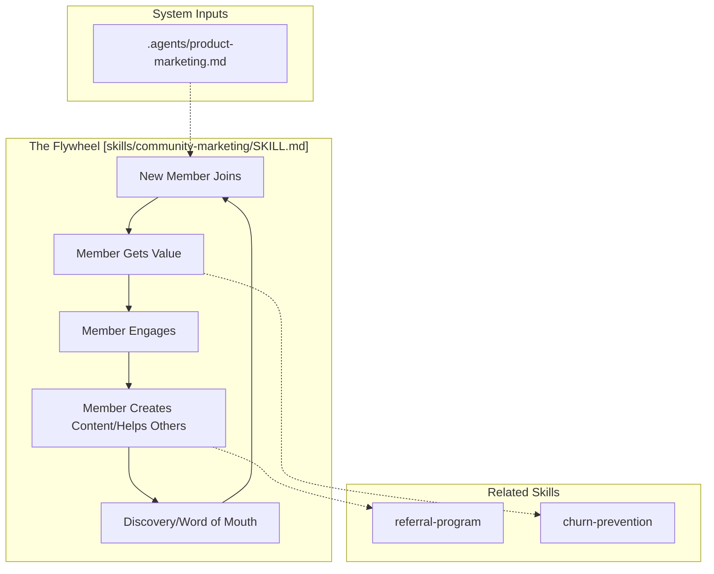
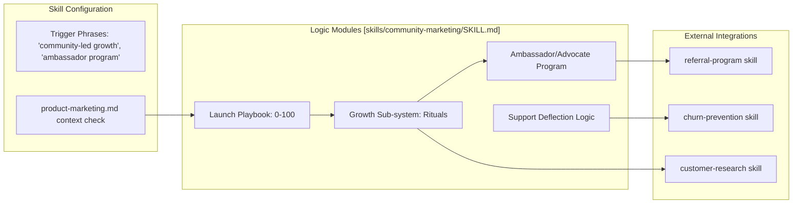
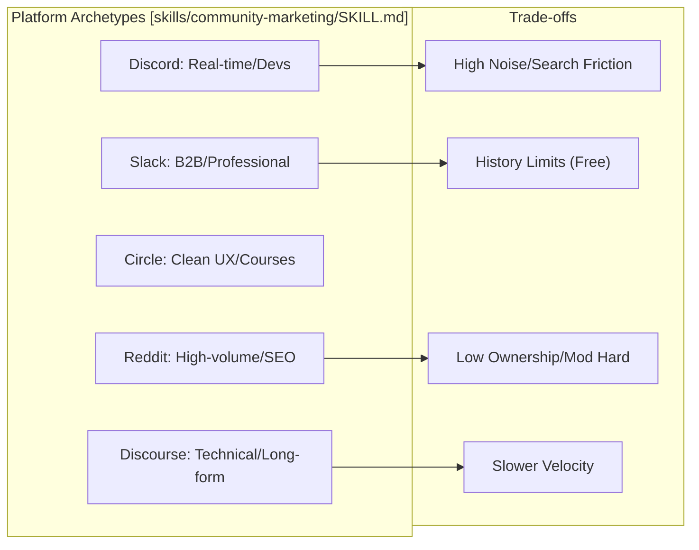

<!-- source: DeepWiki mcp.deepwiki.com · repo coreyhaines31/marketingskills · extra page Community Marketing · fetched 2026-10-27 -->

# Community Marketing

Relevant source files

The following files were used as context for generating this wiki page:

- [skills/community-marketing/SKILL.md](skills/community-marketing/SKILL.md)

The `community-marketing` skill (v2.0.0) is designed to help users build, launch, and scale online communities that drive measurable business outcomes through community-led growth. It provides frameworks for platform selection, member onboarding, engagement rituals, and health monitoring across platforms like Discord, Slack, Circle, and Reddit.

## Purpose and Scope

The skill focuses on moving beyond "product-centric" groups toward "identity-centric" communities [skills/community-marketing/SKILL.md:31-40](). It provides a structured approach to:
*   **The Community Flywheel:** Designing loops where member value leads to content creation and discovery [skills/community-marketing/SKILL.md:52-62]().
*   **Launch Playbooks:** Tactical steps for moving from 0 to 100 members [skills/community-marketing/SKILL.md:68-75]().
*   **Engagement Systems:** Creating rituals and identifying power users to sustain activity [skills/community-marketing/SKILL.md:76-83]().
*   **Metrics & Health:** Technical KPIs to measure stickiness and participation quality [skills/community-marketing/SKILL.md:114-129]().
*   **Support Deflection:** Leveraging community knowledge to reduce official support load [skills/community-marketing/SKILL.md:92-98]().

## System Architecture and Logic

The skill operates by analyzing the product context and community stage to recommend specific playbooks. It integrates with other retention and growth skills to ensure the community serves as a defensive moat against churn.

### The Community Flywheel Model

The core logic of the skill is based on a compounding loop where value flows to members first, who then generate the social proof required to attract new members.

**Sources:** [skills/community-marketing/SKILL.md:52-62](), [skills/community-marketing/SKILL.md:14-15]()

### Code Entity Mapping
This diagram maps the natural language strategies defined in the skill to the underlying system context and related skill entities.

**Sources:** [skills/community-marketing/SKILL.md:2-3](), [skills/community-marketing/SKILL.md:14-15](), [skills/community-marketing/SKILL.md:68-98]()

## Implementation Details

### Community Health Metrics
The skill defines specific technical ratios to monitor the health of the community database and engagement logs.

| Metric | Definition | Target/Healthy Range |
| :--- | :--- | :--- |
| **DAU/MAU Ratio** | Stickiness of the community platform | > 20% |
| **New Member Post Rate** | % of new members posting within 7 days | High (indicates successful onboarding) |
| **Thread Reply Rate** | % of posts receiving at least one reply | High (indicates responsiveness) |
| **Lurker Ratio** | Members joined but inactive for 30+ days | Low (indicates retention) |
| **Non-Staff Content %** | Ratio of member posts vs. company posts | High (indicates organic health) |

**Sources:** [skills/community-marketing/SKILL.md:114-123]()

### Platform Archetypes
The skill provides a selection guide to match product needs with platform technical constraints.

**Sources:** [skills/community-marketing/SKILL.md:101-111]()

## Execution Playbooks

### Launch Playbook (0-100 Members)
1.  **Manual Recruitment:** Identify 20–50 founding members via 1:1 DMs [skills/community-marketing/SKILL.md:70]().
2.  **Culture Setting:** Define community guidelines that describe the "vibe," modeling great participation [skills/community-marketing/SKILL.md:71]().
3.  **Conversation Seeding:** Pre-populate channels with 5–10 posts (questions, wins, resources) [skills/community-marketing/SKILL.md:72]().
4.  **Social Proof Acquisition:** Respond to every post and welcome members by name to buy social proof [skills/community-marketing/SKILL.md:73]().

### Growth and Onboarding Sub-system
The skill emphasizes the "New Member Journey" to prevent drop-off:
*   **Pinned Welcome Posts:** Orientation for new arrivals [skills/community-marketing/SKILL.md:79]().
*   **#introduce-yourself Channels:** Low-friction first engagement [skills/community-marketing/SKILL.md:79]().
*   **Community Rituals:** Recurring threads (e.g., "Weekly Wins", "What are you working on?") to build habit [skills/community-marketing/SKILL.md:81]().
*   **Power User Investment:** Identify the 1% of members generating 90% of value for moderator roles or early access [skills/community-marketing/SKILL.md:82]().

### Ambassador Program Design
To scale growth, the skill provides a framework for advocate programs:
*   **Identification:** Use reviews and social mentions to find candidates who recommend the product unprompted [skills/community-marketing/SKILL.md:86]().
*   **Personalized Outreach:** 1:1 recruitment instead of generic forms [skills/community-marketing/SKILL.md:87]().
*   **Meaningful Benefits:** Offer status, swag, or revenue share rather than just "feature access" [skills/community-marketing/SKILL.md:88]().
*   **Enablement:** Provide referral links and shareable assets [skills/community-marketing/SKILL.md:89]().

### Support Deflection & Retention
The skill includes a subsystem for community-led support:
*   **Knowledge Base Generation:** Converting top community questions into searchable documentation [skills/community-marketing/SKILL.md:94]().
*   **Expert Recognition:** Using badges and leaderboards to reward members who help others [skills/community-marketing/SKILL.md:95]().
*   **Sentiment Monitoring:** Weekly checks for complaints that serve as early churn signals [skills/community-marketing/SKILL.md:97]().

## Skill Integration

The `community-marketing` skill is designed to work in tandem with other modules in the `marketingskills` repository:

*   **Referral Programs:** Community power users are the primary candidates for the `referral-program` skill [skills/community-marketing/SKILL.md:89]().
*   **Churn Prevention:** High DAU/MAU in the community is a leading indicator of retention, and community-led support deflects tickets [skills/community-marketing/SKILL.md:92-97]().
*   **Customer Research:** Community discussions serve as a primary data source for the `customer-research` skill, providing voice-of-customer (VoC) data.

**Sources:** [skills/community-marketing/SKILL.md:84-97](), [skills/community-marketing/SKILL.md:118]()

---

