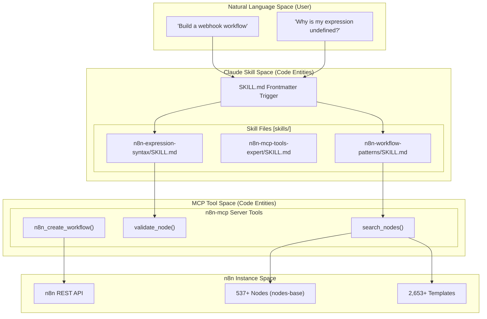
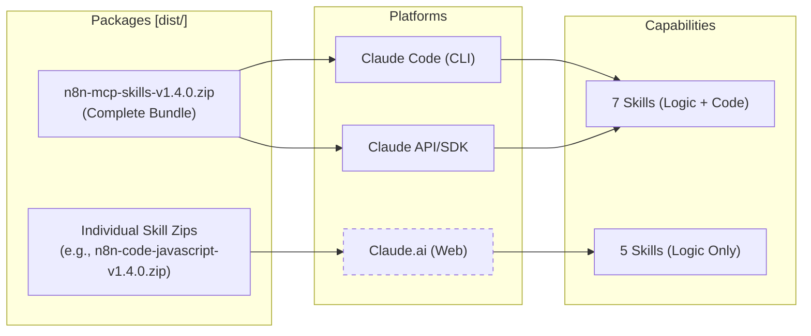

<!-- source: DeepWiki mcp.deepwiki.com · repo czlonkowski/n8n-skills · page 2 Getting Started · fetched 2026-10-27 -->

# Getting Started

<details>
<summary>Relevant source files</summary>

The following files were used as context for generating this wiki page:

- [.gitignore](.gitignore)
- [.mcp.json.example](.mcp.json.example)
- [build.sh](build.sh)
- [dist/README.md](dist/README.md)
- [docs/DEVELOPMENT.md](docs/DEVELOPMENT.md)
- [docs/INSTALLATION.md](docs/INSTALLATION.md)
- [docs/MCP_TESTING_LOG.md](docs/MCP_TESTING_LOG.md)
- [docs/USAGE.md](docs/USAGE.md)

</details>


This document provides a high-level guide for initial setup, platform selection, and verification of the **n8n-skills** system. It bridges the gap between your Claude interface (Claude Code, Claude.ai, or API) and the underlying **n8n-mcp** server.

For detailed step-by-step procedures, see the child page **[Installation](#2.1)**. For troubleshooting activation issues, see **[Verification and Troubleshooting](#2.2)**.

---

## System Architecture Overview

The following diagram illustrates how the natural language interface connects to the technical entities within the codebase and the external n8n ecosystem.

**Bridge: Natural Language to Code Entity Space**

**Sources:** [dist/README.md:99-116](), [docs/USAGE.md:8-25](), [docs/MCP_TESTING_LOG.md:26-53]()

---

## Prerequisites

Before starting the installation, ensure you have the following components ready:

1.  **n8n-mcp Server**: The core engine that provides 40+ tools.
2.  **Claude Access**: One of the supported Claude platforms (Pro, Team, or Enterprise for Claude.ai).
3.  **Configuration**: A valid `.mcp.json` file.

| Requirement | File/Command Reference | Purpose |
| :--- | :--- | :--- |
| **MCP Server** | `npm install -g n8n-mcp` | Provides the tools that skills reference. |
| **Config File** | `.mcp.json` | Connects Claude to the `n8n-mcp` executable. |
| **API Credentials** | `N8N_API_KEY` | (Optional) Required for `n8n_create_workflow`. |

**Sources:** [docs/INSTALLATION.md:9-37](), [docs/MCP_TESTING_LOG.md:154-168]()

---

## Platform Selection

The installation method and skill availability depend on your chosen platform. 

**Platform Capability Mapping**


| Platform | Package | Skills Included |
| :--- | :--- | :--- |
| **Claude Code** | Complete Bundle | All 7 skills (including JS/Python Code) |
| **Claude.ai** | Individual Zips | 5 core skills (JS/Python excluded by platform) |
| **Claude API** | Extracted `skills/` | All 7 skills |

**Sources:** [dist/README.md:40-47](), [build.sh:19-45]()

---

## Installation Summary

High-level steps for the three primary paths. For details, see **[Installation](#2.1)**.

### Path 1: Claude Code (Recommended)
Use the plugin system for the fastest setup:
```bash
/plugin install czlonkowski/n8n-skills
```
Alternatively, manually copy the `skills/` directory content to `~/.claude/skills/`.
**Sources:** [dist/README.md:31-38](), [docs/INSTALLATION.md:50-81]()

### Path 2: Claude.ai (Web)
1.  Navigate to **Settings > Capabilities > Skills**.
2.  Upload individual zip files from the `dist/` folder (e.g., `n8n-expression-syntax-v1.4.0.zip`).
3.  **Note:** You must upload each skill separately; the bundle is not supported here.
**Sources:** [dist/README.md:19-23](), [dist/README.md:133-135]()

### Path 3: Claude API/SDK
Extract the `skills/` directory from the repository and load them programmatically into your `client.messages.create` call using the `skills` parameter.
**Sources:** [docs/INSTALLATION.md:119-164]()

---

## Initial Verification

Once installed, verify that the skills are triggering correctly and can communicate with the MCP server.

### 1. Tool Check
Ask Claude: *"Search for the Slack node using n8n-mcp."*
*   **Success:** Claude calls `search_nodes({query: "slack"})` and returns `nodes-base.slack`.
*   **Failure:** Claude reports it cannot find the tool. Check your `.mcp.json`.

### 2. Skill Activation Check
Ask Claude: *"How do I access webhook data in an expression?"*
*   **Success:** The **n8n Expression Syntax** skill activates, providing guidance on `$json.body`.
*   **Failure:** Claude gives a generic answer. Check that `SKILL.md` is in the correct directory.

For a comprehensive guide on testing and resolving common setup errors, see **[Verification and Troubleshooting](#2.2)**.

**Sources:** [dist/README.md:97-116](), [docs/INSTALLATION.md:168-200]()

---

