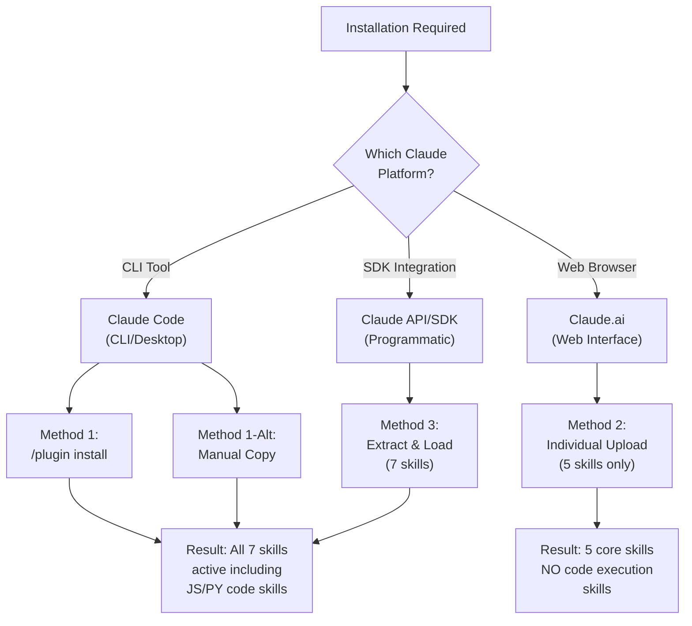
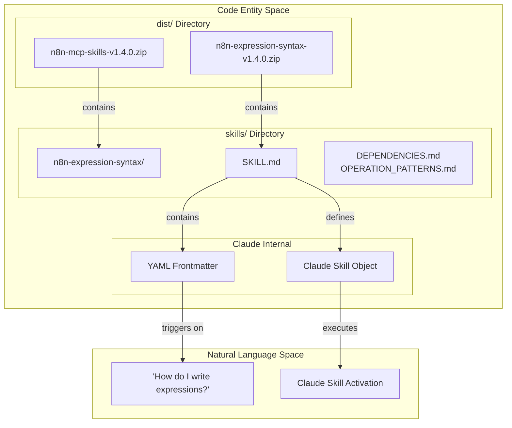

<!-- source: DeepWiki mcp.deepwiki.com · repo czlonkowski/n8n-skills · page 2.1 Installation · fetched 2026-10-27 -->

# Installation

<details>
<summary>Relevant source files</summary>

The following files were used as context for generating this wiki page:

- [.gitignore](.gitignore)
- [.mcp.json.example](.mcp.json.example)
- [build.sh](build.sh)
- [dist/README.md](dist/README.md)
- [dist/n8n-mcp-skills-v1.4.0.zip](dist/n8n-mcp-skills-v1.4.0.zip)
- [dist/n8n-mcp-tools-expert-v1.4.0.zip](dist/n8n-mcp-tools-expert-v1.4.0.zip)
- [dist/n8n-node-configuration-v1.4.0.zip](dist/n8n-node-configuration-v1.4.0.zip)
- [dist/n8n-validation-expert-v1.4.0.zip](dist/n8n-validation-expert-v1.4.0.zip)
- [docs/INSTALLATION.md](docs/INSTALLATION.md)

</details>


## Purpose and Scope

This page provides detailed installation instructions for the n8n-skills package across all supported Claude platforms. It covers prerequisite setup (n8n-mcp MCP server configuration), installation procedures for Claude Code, Claude.ai, and Claude API/SDK, and verification steps to confirm successful installation.

The n8n-skills system acts as a bridge between Claude's reasoning and the technical requirements of n8n. While the `n8n-mcp` server provides the raw tools (API access, node discovery, validation), these skills provide the "expert knowledge" required to use those tools effectively.

---

## Prerequisites

### n8n-mcp MCP Server

The n8n-skills package requires the `n8n-mcp` MCP server to be installed and configured before skill installation. Skills guide Claude on how to use MCP tools but do not execute operations themselves.

**Installation**:
```bash
npm install -g n8n-mcp
```

**Configuration File**: `.mcp.json`

The MCP server configuration must exist in one of these locations:
- `~/.mcp.json` (macOS/Linux)
- `%USERPROFILE%\.mcp.json` (Windows)

**Minimum Configuration** (read-only mode):
```json
{
  "mcpServers": {
    "n8n-mcp": {
      "command": "npx",
      "args": ["n8n-mcp"],
      "env": {
        "MCP_MODE": "stdio",
        "LOG_LEVEL": "error",
        "DISABLE_CONSOLE_OUTPUT": "true"
      }
    }
  }
}
```

**Full Configuration** (workflow management enabled):
To enable workflow creation and modification, you must provide n8n API credentials.

```json
{
  "mcpServers": {
    "n8n-mcp": {
      "command": "npx",
      "args": ["n8n-mcp"],
      "env": {
        "MCP_MODE": "stdio",
        "LOG_LEVEL": "error",
        "DISABLE_CONSOLE_OUTPUT": "true",
        "N8N_API_URL": "https://your-n8n-instance.com",
        "N8N_API_KEY": "your-api-key-here"
      }
    }
  }
}
```

Sources: [docs/INSTALLATION.md:9-37](), [.mcp.json.example:1-15]()

### Claude Platform Access

One of the following is required:
- **Claude Code**: Supports all 7 skills including JavaScript and Python code skills.
- **Claude.ai**: Supports 5 core skills only (excludes code execution skills like JS/Python).
- **Claude API/SDK**: Supports all 7 skills via programmatic integration.

Sources: [dist/README.md:39-46](), [docs/INSTALLATION.md:39-45]()

---

## Installation Method Decision Flow



Sources: [dist/README.md:40-47](), [docs/INSTALLATION.md:48-119]()

---

## Method 1: Claude Code Installation

### Option A: Plugin Installation (Recommended)

Claude Code supports direct plugin installation. The complete bundle includes metadata in `.claude-plugin/plugin.json` and `.claude-plugin/marketplace.json`.

**Repository Installation**:
```bash
/plugin install czlonkowski/n8n-skills
```

**Local File Installation**:
```bash
/plugin install /path/to/n8n-mcp-skills-v1.4.0.zip
```

Sources: [dist/README.md:31-38](), [dist/n8n-mcp-skills-v1.4.0.zip:1-10]()

### Option B: Manual Copy

You can manually clone the repository and copy the skills to the local Claude directory.

**macOS/Linux**:
```bash
mkdir -p ~/.claude/skills
cp -r skills/* ~/.claude/skills/
```

**Windows**:
```powershell
New-Item -ItemType Directory -Force -Path "$env:USERPROFILE\.claude\skills"
Copy-Item -Recurse skills\* "$env:USERPROFILE\.claude\skills\"
```

Sources: [docs/INSTALLATION.md:52-70]()

---

## Method 2: Claude.ai Web Interface Installation

### Limitations
Claude.ai restricts skills that appear to perform code execution or complex scripting.
- **Supported**: Expression Syntax, MCP Tools Expert, Workflow Patterns, Validation Expert, Node Configuration.
- **Unsupported**: JavaScript and Python Code skills (typically blocked or non-functional in web UI).

Sources: [dist/README.md:25-29](), [dist/README.md:40-47]()

### Upload Process
Each skill must be uploaded as an individual ZIP file.

1. **Navigate to**: Settings > Capabilities > Skills (bottom of page).
2. **Click**: "Upload Skill".
3. **Select**: One of the individual ZIP files from the `dist/` directory (e.g., `n8n-expression-syntax-v1.4.0.zip`).
4. **Repeat**: For each of the 5 core skills.

Sources: [dist/README.md:19-23](), [dist/README.md:53-62]()

---

## Method 3: Claude API / SDK

For developers building custom applications, skills are loaded programmatically by reading the `SKILL.md` content and passing it to the `skills` array in the messages creation call.

**Skill Loading Implementation**:
```typescript
import fs from 'fs';
import path from 'path';

function loadSkillsFromDirectory(dir: string) {
  const skillDirs = fs.readdirSync(dir);
  return skillDirs.map(skillName => {
    const skillPath = path.join(dir, skillName, 'SKILL.md');
    const skillContent = fs.readFileSync(skillPath, 'utf-8');

    return {
      name: skillName,
      content: skillContent
    };
  });
}
```

Sources: [docs/INSTALLATION.md:119-164]()

---

## Code Entity Mapping: Distribution & Skills

This diagram bridges the logical distribution packages to the physical files and the resulting Claude "Skill" entity.



Sources: [dist/README.md:67-95](), [build.sh:19-45](), [skills/n8n-node-configuration/SKILL.md:1-10]()

---

## Verification

After installation, verify that the skills are active by asking Claude specific questions that trigger the skill keywords.

| Skill | Trigger Question | Expected Behavior |
|-------|------------------|-------------------|
| **Expression Syntax** | "How do I write n8n expressions?" | Claude explains `$json`, `$node`, etc. |
| **MCP Tools Expert** | "Find me a Slack node" | Claude uses `search_nodes` via MCP. |
| **Workflow Patterns** | "Build a webhook workflow" | Claude suggests the Webhook Processing Pattern. |
| **Code JavaScript** | "How do I access webhook data in a Code node?" | Claude explains `$input.all()` and `return [{json:{}}]`. |
| **Code Python** | "Can I use pandas in Python Code node?" | Claude warns about no external libraries. |

Sources: [dist/README.md:97-116](), [docs/INSTALLATION.md:168-199]()

---

## Troubleshooting

### Common Installation Issues

| Issue | Platform | Solution |
|-------|----------|----------|
| **"Zip must contain exactly one SKILL.md file"** | Claude.ai | Use individual skill ZIPs, not the bundle. [dist/README.md:133-135]() |
| **Skills not activating** | Claude Code | Verify skills are in `~/.claude/skills/` and reload. [dist/README.md:137-141]() |
| **MCP Tools missing** | All | Check if `n8n-mcp` is running and `.mcp.json` is correct. [docs/INSTALLATION.md:224-233]() |
| **N8N API tools missing** | All | Verify `N8N_API_URL` and `N8N_API_KEY` in `.mcp.json`. [docs/INSTALLATION.md:234-242]() |

Sources: [dist/README.md:131-146](), [docs/INSTALLATION.md:203-254]()

---

