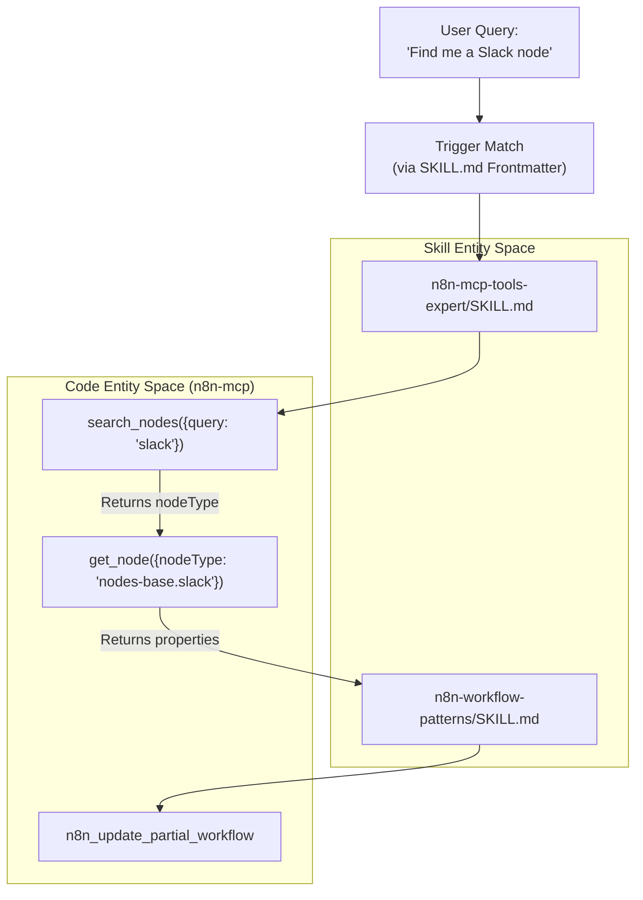
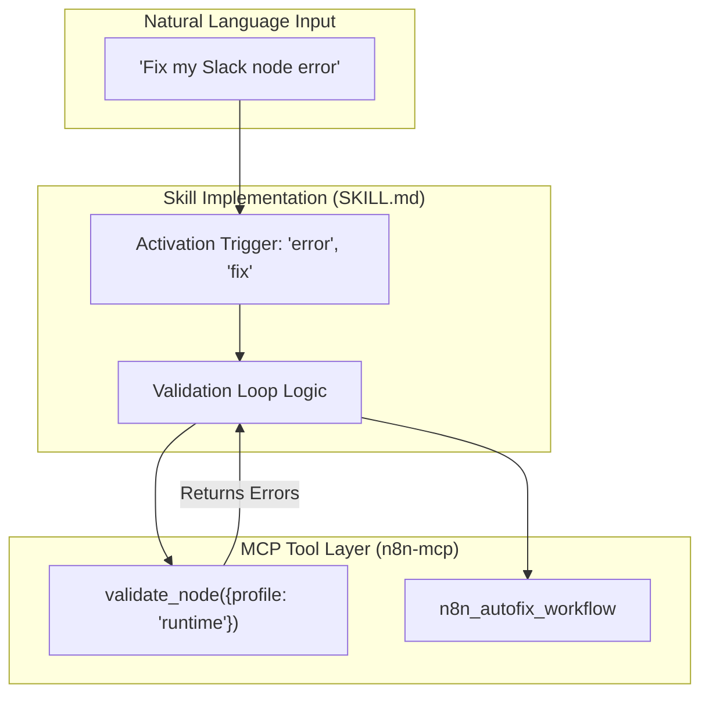

<!-- source: DeepWiki mcp.deepwiki.com · repo czlonkowski/n8n-skills · page 2.2 Verification and Troubleshooting · fetched 2026-10-27 -->

# Verification and Troubleshooting

Relevant source files

The following files were used as context for generating this wiki page:

- [CLAUDE.md](CLAUDE.md)
- [build.sh](build.sh)
- [dist/README.md](dist/README.md)
- [docs/DEVELOPMENT.md](docs/DEVELOPMENT.md)
- [docs/MCP_TESTING_LOG.md](docs/MCP_TESTING_LOG.md)
- [docs/USAGE.md](docs/USAGE.md)

## Purpose and Scope

This page provides technical verification procedures and troubleshooting solutions for the `n8n-skills` system. It details how to confirm that the seven complementary skills are correctly loaded across different Claude platforms (Claude Code, Claude.ai, and API/SDK) and how to diagnose issues involving the underlying `n8n-mcp` server.

---

## Quick Verification Tests

After installation, verify skill activation by using specific trigger queries. Skills activate automatically when user input matches keywords defined in the `SKILL.md` frontmatter [docs/USAGE.md:7-22]().

### Verification Query Table

| Skill | Test Query | Expected Code Entity/Behavior |
|-------|-----------|-------------------------------|
| **Expression Syntax** | `"How do I write n8n expressions?"` | References to `$json.body`, `$node`, and `{{}}` [docs/USAGE.md:30-46]() |
| **MCP Tools Expert** | `"Find me a Slack node"` | Executes `search_nodes`, mentions `nodes-base.slack` [docs/USAGE.md:70-104]() |
| **Workflow Patterns** | `"Build a webhook workflow"` | Identifies "Webhook Processing Pattern" [docs/USAGE.md:112-147]() |
| **Validation Expert** | `"Why is validation failing?"` | Discusses `runtime` vs `ai-friendly` profiles [docs/USAGE.md:155-196]() |
| **Node Configuration** | `"Configure HTTP Request node"` | Explains property dependencies (e.g., `sendBody` → `contentType`) [docs/USAGE.md:204-240]() |
| **Code JavaScript** | `"Access webhook data in Code node"` | References `$input.all()`, `$json.body`, and `$helpers` [CLAUDE.md:64-67]() |
| **Code Python** | `"Can I use pandas in Python?"` | Identifies "no external libraries" limitation [CLAUDE.md:68-71]() |

**Sources:** [dist/README.md:97-116](), [docs/USAGE.md:7-22](), [docs/USAGE.md:30-240](), [CLAUDE.md:40-71]()

---

## System Activation Flow

The following diagram bridges the "Natural Language Space" (User Queries) to the "Code Entity Space" (MCP Tools and Skill Files).

### Skill Activation and Tool Execution Flow

**Sources:** [CLAUDE.md:145-159](), [docs/USAGE.md:244-289](), [dist/README.md:97-116]()

---

## Platform-Specific Verification

### Claude Code (CLI)
Claude Code uses a specific directory structure for plugins. Verify that the bundle is extracted correctly.

*   **Skills Path:** `~/.claude/skills/` (should contain 7 subdirectories) [dist/README.md:87-95]().
*   **Metadata:** `.claude-plugin/plugin.json` and `marketplace.json` must be present [dist/README.md:82-84]().
*   **Command:** Run `/plugin install czlonkowski/n8n-skills` or point to the local `n8n-mcp-skills-v1.4.0.zip` [dist/README.md:31-38]().

### Claude.ai (Web)
Claude.ai requires individual skill uploads. 

*   **Requirement:** Zip files must contain exactly one `SKILL.md` at the root [dist/README.md:133-135]().
*   **Verification:** Navigate to **Settings > Capabilities > Skills**. You should see separate entries for the core skills [dist/README.md:19-23]().
*   **Limitation:** Claude.ai does not currently support the nested `skills/` directory used in the Claude Code bundle [dist/README.md:29-30]().

**Sources:** [dist/README.md:7-46](), [dist/README.md:79-95](), [dist/README.md:133-135]()

---

## MCP Server Troubleshooting

Skills rely on the `n8n-mcp` server to interact with n8n instances. If skills activate but tools fail, check the MCP configuration.

### Tool Availability and API Requirements
The system operates in two modes based on the presence of `N8N_API_KEY` in the environment [docs/MCP_TESTING_LOG.md:154-169]().

| Tool Category | Key Code Entities | API Key Required? |
|---------------|-------------------|-------------------|
| **Discovery** | `search_nodes`, `get_node` | **No** |
| **Validation** | `validate_node`, `validate_workflow` | **No** |
| **Templates** | `search_templates`, `get_template` | **No** |
| **Management** | `n8n_create_workflow`, `n8n_update_partial_workflow` | **Yes** |
| **Credentials** | `n8n_manage_credentials` | **Yes** |

**Sources:** [docs/MCP_TESTING_LOG.md:154-169](), [CLAUDE.md:72-116]()

### Common MCP Errors

1.  **"Zip must contain exactly one SKILL.md file":** Occurs in Claude.ai when uploading the complete bundle instead of individual skill zips [dist/README.md:133-135]().
2.  **Node Not Found:** Often caused by using the wrong `nodeType` format. `search_nodes` returns `nodes-base.webhook`, but internal workflow structures may require `n8n-nodes-base.webhook` [docs/MCP_TESTING_LOG.md:57-67]().
3.  **Skills Not Triggering:** Check if the `SKILL.md` frontmatter `description` contains the keywords used in the query [dist/README.md:142-146]().

---

## Implementation Architecture

The relationship between user input, skill logic, and MCP tool execution is governed by the following architecture.

### Logic-to-Code Mapping

**Sources:** [CLAUDE.md:55-58](), [CLAUDE.md:124-128](), [docs/USAGE.md:151-196]()

---

## Build and Distribution Verification

The `build.sh` script generates two types of distributions. Verify the `dist/` folder contents after a build [build.sh:19-45]().

*   **Individual Zips:** `n8n-[skill-name]-v1.4.0.zip`. Structure: `[skill-name]/SKILL.md` at root [build.sh:19-36]().
*   **Bundle Zip:** `n8n-mcp-skills-v1.4.0.zip`. Structure: `.claude-plugin/`, `skills/`, `README.md` [build.sh:38-45]().

**Sources:** [build.sh:1-55](), [dist/README.md:50-63]()

---

