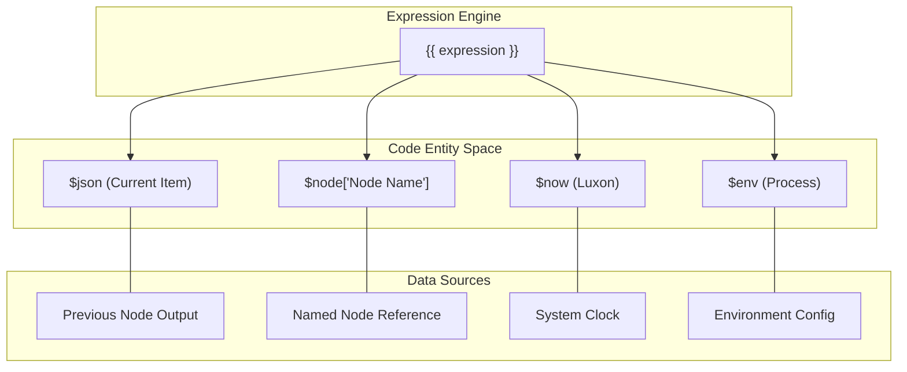
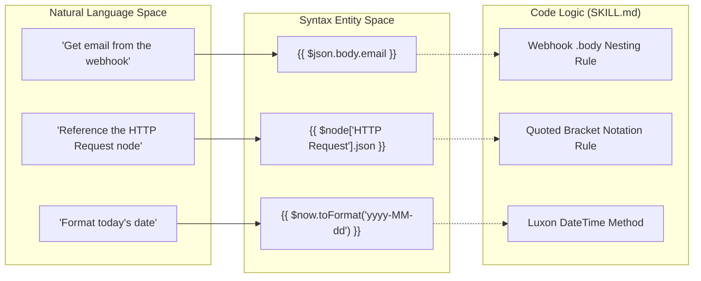

<!-- source: DeepWiki mcp.deepwiki.com · repo czlonkowski/n8n-skills · page 3.1 n8n Expression Syntax · fetched 2026-10-27 -->

# n8n Expression Syntax

<details>
<summary>Relevant source files</summary>

The following files were used as context for generating this wiki page:

- [evaluations/expression-syntax/eval-001-missing-braces.json](evaluations/expression-syntax/eval-001-missing-braces.json)
- [evaluations/expression-syntax/eval-002-webhook-body-data.json](evaluations/expression-syntax/eval-002-webhook-body-data.json)
- [evaluations/expression-syntax/eval-003-code-node-confusion.json](evaluations/expression-syntax/eval-003-code-node-confusion.json)
- [evaluations/expression-syntax/eval-004-node-reference.json](evaluations/expression-syntax/eval-004-node-reference.json)
- [skills/n8n-expression-syntax/COMMON_MISTAKES.md](skills/n8n-expression-syntax/COMMON_MISTAKES.md)
- [skills/n8n-expression-syntax/EXAMPLES.md](skills/n8n-expression-syntax/EXAMPLES.md)
- [skills/n8n-expression-syntax/README.md](skills/n8n-expression-syntax/README.md)
- [skills/n8n-expression-syntax/SKILL.md](skills/n8n-expression-syntax/SKILL.md)

</details>


## Purpose and Scope

This document covers the **n8n Expression Syntax** skill, which provides the technical foundation for writing dynamic data accessors and transformations within n8n workflows. This skill specifically addresses:

- The `{{}}` double-curly-brace syntax required for expressions.
- Core system variables including `$json`, `$node`, `$now`, and `$env`.
- The critical data nesting structure of Webhook nodes (`$json.body`).
- Distinctions between expression contexts and direct JavaScript access in Code nodes.
- Common syntax errors such as missing quotes for nodes with spaces and incorrect case sensitivity.

Sources: [skills/n8n-expression-syntax/SKILL.md:1-12](), [skills/n8n-expression-syntax/README.md:7-10]()

---

## Expression Format and Variables

All dynamic content in n8n (outside of Code nodes) must be wrapped in double curly braces. Text outside these braces is treated as a literal string [skills/n8n-expression-syntax/SKILL.md:14-27]().

### Core Variables

| Variable | Description | Example |
| :--- | :--- | :--- |
| `$json` | Accesses fields from the current (previous) node's output. | `{{$json.email}}` |
| `$node` | References data from any specific named node in the workflow. | `{{$node["HTTP Request"].json.data}}` |
| `$now` | Returns the current timestamp as a Luxon DateTime object. | `{{$now.plus({days: 7})}}` |
| `$env` | Accesses system environment variables. | `{{$env.API_KEY}}` |

Sources: [skills/n8n-expression-syntax/SKILL.md:31-78]()

### Expression Data Flow

The following diagram illustrates how the `ExpressionEvaluator` (conceptual) pulls data from different system entities based on the variable prefix used.

**Title: n8n Variable Resolution Logic**

Sources: [skills/n8n-expression-syntax/SKILL.md:31-78](), [evaluations/expression-syntax/eval-004-node-reference.json:5-10]()

---

## CRITICAL: Webhook Data Structure

The most frequent error in n8n workflow development is attempting to access Webhook data at the root of the `$json` object. The Webhook node wraps incoming payloads under a `.body` property to preserve metadata like headers and query parameters [skills/n8n-expression-syntax/SKILL.md:81-111]().

### Webhook Object Schema
```javascript
{
  "headers": { ... },
  "params": { ... },
  "query": { ... },
  "body": {           // ⚠️ ACTUAL USER DATA IS NESTED HERE
    "email": "user@example.com",
    "name": "John Doe"
  }
}
```
[skills/n8n-expression-syntax/SKILL.md:87-98]()

### Correct Access Patterns
- **Incorrect**: `{{$json.email}}` (Returns `undefined`)
- **Correct**: `{{$json.body.email}}`
- **Metadata**: `{{$json.headers['user-agent']}}`

Sources: [skills/n8n-expression-syntax/SKILL.md:100-111](), [skills/n8n-expression-syntax/COMMON_MISTAKES.md:27-60]()

---

## Common Mistakes and Validation Rules

### 1. Node References and Spaces
Node names containing spaces **must** use bracket notation and double quotes. Furthermore, node names are strictly case-sensitive [skills/n8n-expression-syntax/SKILL.md:54-58]().
- `❌ {{$node.HTTP Request.json}}`
- `✅ {{$node["HTTP Request"].json}}`
- `❌ {{$node["http request"].json}}` (Wrong case)

### 2. Code Node Context
Code nodes (JavaScript/Python) use **direct object access**. Wrapping variables in `{{}}` inside a Code node will result in the literal string being assigned rather than the evaluated value [skills/n8n-expression-syntax/SKILL.md:166-182]().
- `❌ const email = '{{$json.email}}';` (Result: literal string)
- `✅ const email = $json.email;` (Result: value of email)

### 3. Bracket vs Dot Notation
Fields with spaces in their names require bracket notation [skills/n8n-expression-syntax/SKILL.md:127-130]().
- `❌ {{$json.first name}}`
- `✅ {{$json['first name']}}`

Sources: [skills/n8n-expression-syntax/SKILL.md:206-247](), [skills/n8n-expression-syntax/COMMON_MISTAKES.md:64-106](), [evaluations/expression-syntax/eval-003-code-node-confusion.json:5-10]()

---

## Implementation Mapping

This diagram bridges the Natural Language concepts (like "referencing a node") to the specific syntax entities required by the n8n engine.

**Title: Natural Language to Syntax Entity Mapping**

Sources: [skills/n8n-expression-syntax/SKILL.md:100-111](), [skills/n8n-expression-syntax/SKILL.md:49-58](), [skills/n8n-expression-syntax/EXAMPLES.md:172-214]()

---

## Activation Triggers

The `n8n-expression-syntax` skill is triggered by the following keywords and patterns in user queries:
- `expression` or `{{}}` syntax
- `$json`, `$node`, `$now`, `$env`
- `webhook data` or `undefined` in workflow troubleshooting
- Requests to "access data" from previous steps

Sources: [skills/n8n-expression-syntax/README.md:11-18](), [evaluations/expression-syntax/eval-001-missing-braces.json:4]()

---

