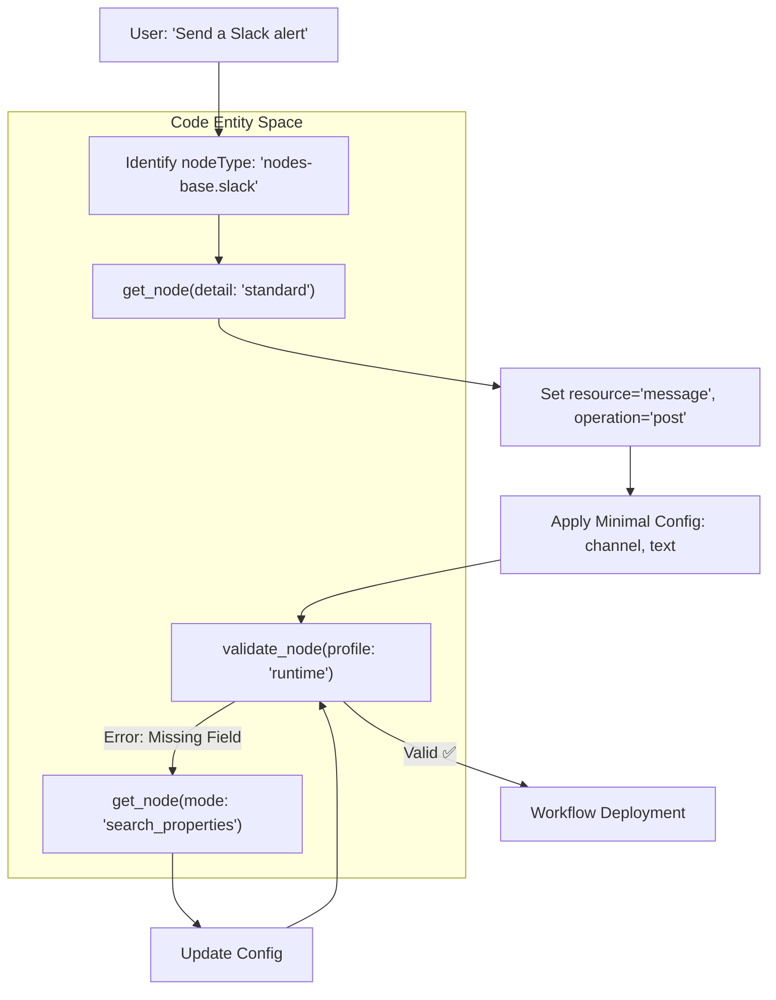
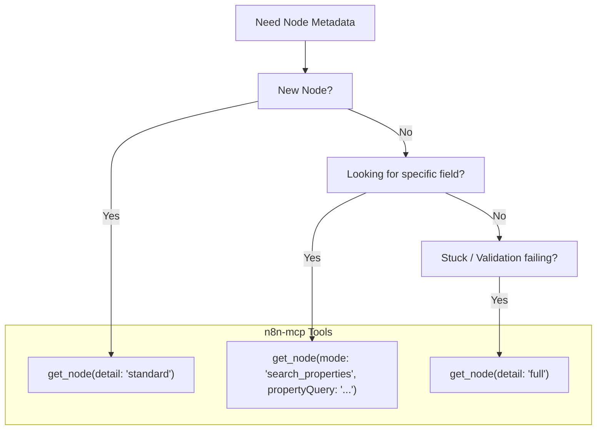

<!-- source: DeepWiki mcp.deepwiki.com · repo czlonkowski/n8n-skills · page 3.5 n8n Node Configuration · fetched 2026-10-27 -->

# n8n Node Configuration

<details>
<summary>Relevant source files</summary>

The following files were used as context for generating this wiki page:

- [evaluations/node-configuration/eval-001-property-dependencies.json](evaluations/node-configuration/eval-001-property-dependencies.json)
- [evaluations/node-configuration/eval-002-operation-specific-config.json](evaluations/node-configuration/eval-002-operation-specific-config.json)
- [evaluations/node-configuration/eval-003-conditional-fields.json](evaluations/node-configuration/eval-003-conditional-fields.json)
- [evaluations/node-configuration/eval-004-essentials-vs-info.json](evaluations/node-configuration/eval-004-essentials-vs-info.json)
- [skills/n8n-node-configuration/DEPENDENCIES.md](skills/n8n-node-configuration/DEPENDENCIES.md)
- [skills/n8n-node-configuration/OPERATION_PATTERNS.md](skills/n8n-node-configuration/OPERATION_PATTERNS.md)
- [skills/n8n-node-configuration/README.md](skills/n8n-node-configuration/README.md)
- [skills/n8n-node-configuration/SKILL.md](skills/n8n-node-configuration/SKILL.md)
- [skills/n8n-workflow-patterns/ai_agent_workflow.md](skills/n8n-workflow-patterns/ai_agent_workflow.md)

</details>


## Purpose and Scope

This document provides a technical overview of the **n8n Node Configuration** skill within the n8n-skills system. It documents the expert guidance for operation-aware node configuration, property dependencies, and the progressive discovery workflow used by AI models to configure nodes accurately.

**Scope:**
- **Operation-Aware Setup**: How resource and operation selections dictate field requirements.
- **Property Dependencies**: The `displayOptions` mechanism that controls field visibility.
- **Progressive Discovery**: The tiered approach to gathering node metadata (Standard → Search → Full).
- **AI Workflow Patterns**: Mapping natural language configuration requests to specific code-level tool patterns.

Sources:
- [skills/n8n-node-configuration/SKILL.md:1-9]()
- [skills/n8n-node-configuration/README.md:5-10]()

---

## Configuration Philosophy: Progressive Disclosure

The system follows a **progressive disclosure** model to minimize token usage and cognitive load. Instead of fetching a massive JSON schema for every node, the AI starts with minimal data and escalates only when necessary.

- **Standard Detail (Default)**: Used first for 95% of needs. It provides required fields, common options, and operation lists in a compact 1-2K token response. [skills/n8n-node-configuration/SKILL.md:84-87]()
- **Search Properties Mode**: Used to find specific fields (e.g., "auth", "headers") without loading the entire schema. [skills/n8n-node-configuration/SKILL.md:89-91]()
- **Full Detail**: The complete schema (3-8K tokens). Reserved for complex troubleshooting where standard info is insufficient. [skills/n8n-node-configuration/SKILL.md:93-95]()

**Key Metric**: There is a 91.7% success rate when configuring nodes using only "standard" detail. [skills/n8n-node-configuration/README.md:15-17]()

Sources:
- [skills/n8n-node-configuration/SKILL.md:12-23]()
- [skills/n8n-node-configuration/SKILL.md:197-216]()

---

## Core Concepts

### 1. Operation-Aware Configuration
In n8n, a single node type (e.g., `nodes-base.slack`) can perform dozens of different actions. The **Resource + Operation** combination is the primary driver of configuration requirements.

| Resource | Operation | Required Fields | File Reference |
| :--- | :--- | :--- | :--- |
| `message` | `post` | `channel`, `text` | [SKILL.md:31-40]() |
| `message` | `update` | `messageId`, `text` | [SKILL.md:41-49]() |
| `channel` | `create` | `name` | [OPERATION_PATTERNS.md:297-306]() |

### 2. Property Dependencies (`displayOptions`)
Field visibility is governed by a `displayOptions` mechanism in the node's underlying code. Fields "appear" or "disappear" based on the values of other properties.

**Logic Types:**
- **AND Logic**: All conditions in the `show` object must be met. [skills/n8n-node-configuration/DEPENDENCIES.md:73-92]()
- **OR Logic**: Any value within a specific field's array can trigger visibility. [skills/n8n-node-configuration/DEPENDENCIES.md:93-111]()

**Example: HTTP Request `body` visibility**
```javascript
{
  "name": "body",
  "displayOptions": {
    "show": {
      "sendBody": [true],
      "method": ["POST", "PUT", "PATCH"]
    }
  }
}
```
*The `body` field only shows if `sendBody` is true AND the method is a write operation.* [skills/n8n-node-configuration/SKILL.md:57-78]()

Sources:
- [skills/n8n-node-configuration/SKILL.md:27-79]()
- [skills/n8n-node-configuration/DEPENDENCIES.md:7-111]()

---

## Configuration Workflow

The AI follows a standardized 8-step process to ensure valid node setups.

### Diagram: Node Configuration Lifecycle
This diagram bridges the "Natural Language Space" (User Intent) to the "Code Entity Space" (MCP Tools and Node Types).


Sources:
- [skills/n8n-node-configuration/SKILL.md:101-119]()
- [skills/n8n-node-configuration/README.md:118-127]()

---

## Common Node Patterns

The skill documents specific configuration "shapes" for the most frequently used nodes.

### HTTP & API Nodes
- **HTTP Request (`nodes-base.httpRequest`)**: Critical requirement to set `sendBody: true` for POST/PUT/PATCH operations. [skills/n8n-node-configuration/OPERATION_PATTERNS.md:23-110]()
- **Webhook (`nodes-base.webhook`)**: Data is nested under `$json.body`. Accessing `$json.email` directly is a common anti-pattern; it must be `={{$json.body.email}}`. [skills/n8n-node-configuration/OPERATION_PATTERNS.md:159-186]()

### AI Agent Nodes
AI workflows utilize specific connection ports that must be configured correctly in the JSON structure.
- **Connection Types**: `ai_languageModel`, `ai_tool`, `ai_memory`. [skills/n8n-workflow-patterns/ai_agent_workflow.md:17-29]()
- **Tool Mapping**: Any node can be a tool if connected via the `ai_tool` port. [skills/n8n-workflow-patterns/ai_agent_workflow.md:73-82]()

### Database Nodes
- **Postgres/MySQL**: Focus on parameterized queries to prevent SQL injection. [skills/n8n-node-configuration/README.md:173]()

Sources:
- [skills/n8n-node-configuration/OPERATION_PATTERNS.md:1-372]()
- [skills/n8n-workflow-patterns/ai_agent_workflow.md:1-82]()

---

## Technical Implementation: Discovery Decision Tree

When the AI model needs information about a node, it uses the following logic to select the correct tool and detail level.

### Diagram: Discovery Tool Selection


Sources:
- [skills/n8n-node-configuration/SKILL.md:247-275]()
- [evaluations/node-configuration/eval-004-essentials-vs-info.json:1-13]()

---

## Summary of Usage Statistics
| Metric | Value | Technical Insight |
| :--- | :--- | :--- |
| **Discovery Latency** | 18s (avg) | Time from search to `get_node` standard detail. |
| **Edit Interval** | 56s (avg) | Time between iterative configuration adjustments. |
| **Success Rate** | 91.7% | Success using standard detail without escalating to full schema. |

Sources:
- [skills/n8n-node-configuration/README.md:107-115]()
- [skills/n8n-node-configuration/SKILL.md:17-19]()

---

