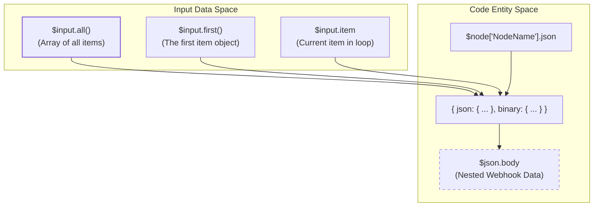
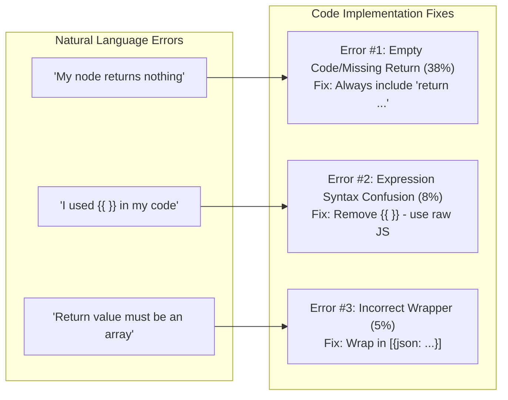

<!-- source: DeepWiki mcp.deepwiki.com · repo czlonkowski/n8n-skills · page 3.6 n8n Code JavaScript · fetched 2026-10-27 -->

# n8n Code JavaScript

<details>
<summary>Relevant source files</summary>

The following files were used as context for generating this wiki page:

- [evaluations/code-javascript/eval-001-webhook-body-gotcha.json](evaluations/code-javascript/eval-001-webhook-body-gotcha.json)
- [evaluations/code-javascript/eval-002-return-format-error.json](evaluations/code-javascript/eval-002-return-format-error.json)
- [evaluations/code-javascript/eval-003-http-request.json](evaluations/code-javascript/eval-003-http-request.json)
- [evaluations/code-javascript/eval-004-aggregation-pattern.json](evaluations/code-javascript/eval-004-aggregation-pattern.json)
- [evaluations/code-javascript/eval-005-expression-syntax-confusion.json](evaluations/code-javascript/eval-005-expression-syntax-confusion.json)
- [skills/n8n-code-javascript/BUILTIN_FUNCTIONS.md](skills/n8n-code-javascript/BUILTIN_FUNCTIONS.md)
- [skills/n8n-code-javascript/COMMON_PATTERNS.md](skills/n8n-code-javascript/COMMON_PATTERNS.md)
- [skills/n8n-code-javascript/DATA_ACCESS.md](skills/n8n-code-javascript/DATA_ACCESS.md)
- [skills/n8n-code-javascript/ERROR_PATTERNS.md](skills/n8n-code-javascript/ERROR_PATTERNS.md)
- [skills/n8n-code-javascript/README.md](skills/n8n-code-javascript/README.md)
- [skills/n8n-code-javascript/SKILL.md](skills/n8n-code-javascript/SKILL.md)

</details>


## Purpose and Scope

This document covers the **n8n Code JavaScript** skill, which provides expert guidance for writing JavaScript within n8n Code nodes. This skill handles approximately 95% of custom logic use cases in n8n workflows by utilizing proper data access patterns ($input), built-in helper functions ($helpers), and mandatory return formats.

For n8n expression syntax (using `{{}}` patterns in non-Code nodes), see [n8n Expression Syntax](#3.1). For Python-based Code nodes and their specific limitations, see [n8n Code Python](#3.7).

**Sources:** [skills/n8n-code-javascript/SKILL.md:6-9](), [skills/n8n-code-javascript/README.md:7-9](), [skills/n8n-code-javascript/README.md:151-154]()

---

## Activation Triggers

The skill activates automatically when Claude detects keywords or scenarios related to:

- **JavaScript Keywords**: "javascript code node", "write javascript in n8n", "code node javascript".
- **Syntax & Methods**: "$input syntax", "$json syntax", "$helpers.httpRequest", "DateTime luxon".
- **Troubleshooting**: "code node error", "webhook data code", "return format code node".
- **Decision Making**: Choosing between "All Items" and "Each Item" execution modes.

**Sources:** [skills/n8n-code-javascript/README.md:13-34]()

---

## Mode Selection Guide

The Code node offers two distinct execution modes. Selecting the correct mode is the first step in implementation.

| Mode | Execution | Best For | Data Access |
| :--- | :--- | :--- | :--- |
| **Run Once for All Items** | Executes **once** for the entire input set. | 95% of use cases: Aggregation, filtering, batch processing, sorting, deduplication. | `$input.all()`, `$input.first()` |
| **Run Once for Each Item** | Executes **separately** for every input item. | Specialized cases: Independent per-item API calls or unique per-item validation logic. | `$input.item` |

**Sources:** [skills/n8n-code-javascript/SKILL.md:40-107]()

---

## Data Access Patterns

### The $input Object

The `$input` object is the modern standard for accessing data from previous nodes.



**Common Patterns:**
- **`$input.all()`**: Used for batch operations. Returns an array of objects [skills/n8n-code-javascript/DATA_ACCESS.md:20-47]().
- **`$input.first()`**: Used when the previous node returns a single object (e.g., an API response) [skills/n8n-code-javascript/DATA_ACCESS.md:161-183]().
- **`$input.item`**: Only available in "Run Once for Each Item" mode [skills/n8n-code-javascript/DATA_ACCESS.md:275-285]().
- **`$node["Name"]`**: Used to reference data from specific nodes earlier in the workflow [skills/n8n-code-javascript/SKILL.md:165-182]().

### The Webhook Data Gotcha
The most common mistake (Error #1 in troubleshooting) is attempting to access webhook data directly via `$json.field`. Webhook nodes wrap all incoming data (body, query, headers) under a `.body` property.

- **❌ Incorrect**: `const name = $json.name;`
- **✅ Correct**: `const name = $json.body.name;` or `$input.first().json.body.name;`

**Sources:** [skills/n8n-code-javascript/SKILL.md:188-206](), [skills/n8n-code-javascript/README.md:185-194](), [evaluations/code-javascript/eval-001-webhook-body-gotcha.json:1-12]()

---

## Return Format Requirements

Code nodes must strictly adhere to the n8n data structure. Failure to do so results in the "Return value must be an array of objects" error.

### Format Rules
1. **Array Wrapper**: Data must be returned inside an array `[]`.
2. **JSON Property**: Every object in the array must have a `json` key containing the data.

```javascript
// ✅ Correct: Single Result
return [{ json: { result: "success" } }];

// ✅ Correct: Multiple Results
return [
  { json: { id: 1 } },
  { json: { id: 2 } }
];

// ❌ Incorrect
return { json: { id: 1 } }; // Missing array
return [{ id: 1 }];         // Missing 'json' key
```

**Sources:** [skills/n8n-code-javascript/SKILL.md:212-274](), [evaluations/code-javascript/eval-002-return-format-error.json:1-13]()

---

## Built-in Functions & Helpers

n8n provides several global objects and modules to extend JavaScript functionality.

### $helpers.httpRequest()
Allows making HTTP calls directly from the Code node without adding an HTTP Request node. It is `async` and requires `await`.

```javascript
const response = await $helpers.httpRequest({
  method: 'POST',
  url: 'https://api.example.com/data',
  headers: { 'Authorization': `Bearer ${$env.TOKEN}` },
  body: { key: 'value' }
});
```
**Sources:** [skills/n8n-code-javascript/BUILTIN_FUNCTIONS.md:20-59](), [evaluations/code-javascript/eval-003-http-request.json:1-14]()

### DateTime (Luxon)
The Luxon library is available globally as `DateTime` for advanced date/time operations.

```javascript
const now = DateTime.now();
const formatted = now.toFormat('yyyy-MM-dd');
const plusWeek = now.plus({ weeks: 1 }).toISO();
```
**Sources:** [skills/n8n-code-javascript/BUILTIN_FUNCTIONS.md:227-273]()

### Additional Built-ins
- **`$jmespath()`**: For querying complex JSON structures [skills/n8n-code-javascript/BUILTIN_FUNCTIONS.md:13-16]().
- **`$getWorkflowStaticData()`**: For persistent storage across workflow executions [skills/n8n-code-javascript/BUILTIN_FUNCTIONS.md:131-136]().
- **Node.js Modules**: `crypto`, `Buffer`, and `URL` are available [skills/n8n-code-javascript/BUILTIN_FUNCTIONS.md:15-16]().

---

## Error Prevention & Troubleshooting

62% of Code node failures are caused by five specific patterns.



### Critical Warning: Expression Syntax
Do **not** use `{{ }}` inside a Code node. Code nodes are pure JavaScript environments.
- **❌ Wrong**: `const val = "{{ $json.name }}";`
- **✅ Right**: `const val = $json.name;`

**Sources:** [skills/n8n-code-javascript/ERROR_PATTERNS.md:116-218](), [evaluations/code-javascript/eval-005-expression-syntax-confusion.json:1-14]()

---

## Production-Tested Patterns

The skill includes optimized patterns for common workflows:

1.  **Multi-Source Aggregation**: Merging data from different APIs into a unified list [skills/n8n-code-javascript/COMMON_PATTERNS.md:25-96]().
2.  **Regex Filtering**: Extracting patterns like emails, hashtags, or stock tickers from unstructured text [skills/n8n-code-javascript/COMMON_PATTERNS.md:128-203]().
3.  **Markdown Parsing**: Converting structured markdown text into JSON objects [skills/n8n-code-javascript/COMMON_PATTERNS.md:231-250]().
4.  **Data Summation**: Using `.reduce()` with `$input.all()` to calculate totals across items [evaluations/code-javascript/eval-004-aggregation-pattern.json:1-15]().
5.  **Deduplication**: Using a `Set` to remove duplicate items by a specific ID [skills/n8n-code-javascript/DATA_ACCESS.md:138-157]().

**Sources:** [skills/n8n-code-javascript/COMMON_PATTERNS.md:1-250](), [skills/n8n-code-javascript/DATA_ACCESS.md:49-157]()

---

