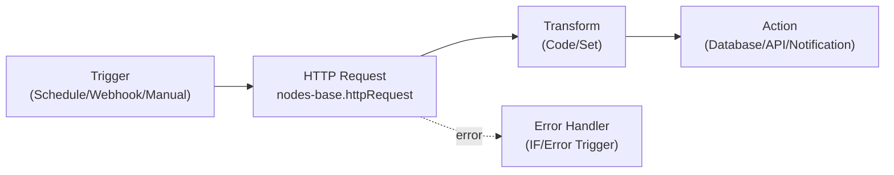
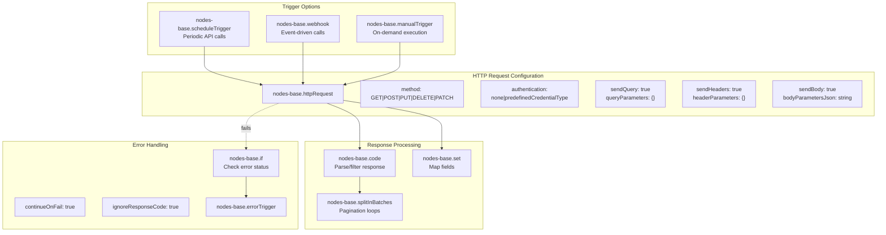
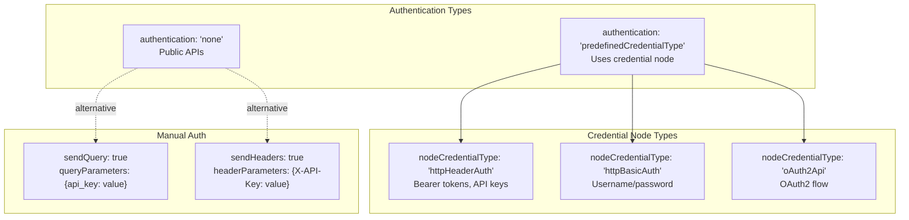
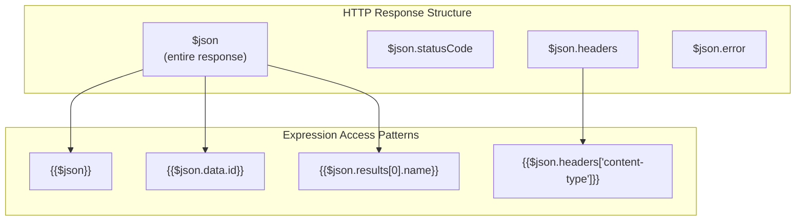
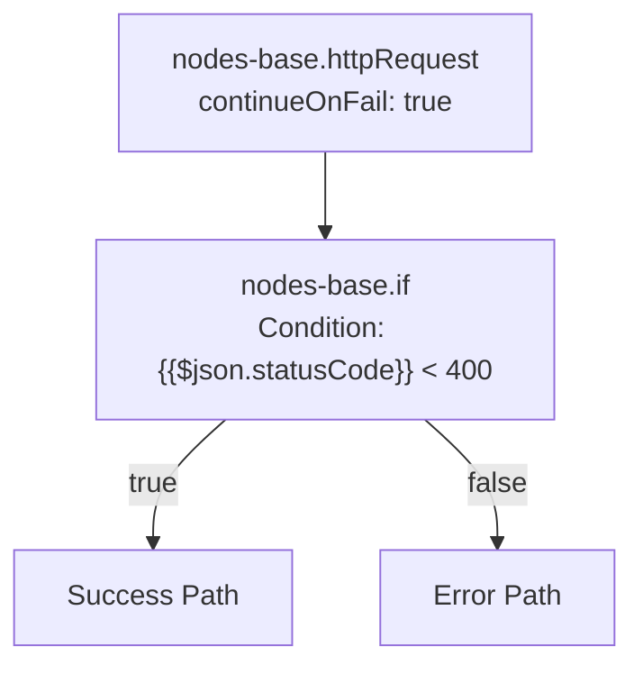

<!-- source: DeepWiki mcp.deepwiki.com · repo czlonkowski/n8n-skills · page 4.2 HTTP API Integration Pattern · fetched 2026-10-27 -->

# HTTP API Integration Pattern

<details>
<summary>Relevant source files</summary>

The following files were used as context for generating this wiki page:

- [skills/n8n-mcp-tools-expert/VALIDATION_GUIDE.md](skills/n8n-mcp-tools-expert/VALIDATION_GUIDE.md)
- [skills/n8n-workflow-patterns/README.md](skills/n8n-workflow-patterns/README.md)
- [skills/n8n-workflow-patterns/SKILL.md](skills/n8n-workflow-patterns/SKILL.md)
- [skills/n8n-workflow-patterns/database_operations.md](skills/n8n-workflow-patterns/database_operations.md)
- [skills/n8n-workflow-patterns/http_api_integration.md](skills/n8n-workflow-patterns/http_api_integration.md)
- [skills/n8n-workflow-patterns/scheduled_tasks.md](skills/n8n-workflow-patterns/scheduled_tasks.md)
- [skills/n8n-workflow-patterns/webhook_processing.md](skills/n8n-workflow-patterns/webhook_processing.md)

</details>


## Purpose and Scope

This document describes the HTTP API Integration Pattern, one of the five core workflow patterns in n8n. This pattern enables workflows to fetch data from external REST APIs, transform responses, and integrate with other systems. It focuses on the configuration and usage of the HTTP Request node (`nodes-base.httpRequest`) for calling external APIs with various authentication methods, handling responses, managing pagination, and implementing rate limiting.

For receiving HTTP requests (webhooks) rather than making requests, see [Webhook Processing Pattern](4.1). For AI-powered API interactions, see [AI Agent Workflow Pattern](4.4). For recurring API calls, see [Scheduled Tasks Pattern](4.5).

Sources: [skills/n8n-workflow-patterns/SKILL.md:20-22](), [skills/n8n-workflow-patterns/README.md:57-61]()

---

## Pattern Architecture

### Basic Flow Structure

The pattern typically follows a linear or looping flow depending on whether pagination is required.



**Core Characteristic**: External data fetching with authentication, pagination, and error handling.

Sources: [skills/n8n-workflow-patterns/http_api_integration.md:1-15]()

---

### Node Type Mapping

This diagram bridges the conceptual pattern to specific n8n node types and configuration properties.



Sources: [skills/n8n-workflow-patterns/http_api_integration.md:9-27](), [skills/n8n-workflow-patterns/http_api_integration.md:298-320](), [skills/n8n-workflow-patterns/SKILL.md:78-106]()

---

## HTTP Request Node Configuration

### Core Properties

The `nodes-base.httpRequest` node is the primary engine for this pattern.

| Property | Type | Purpose | Example Value |
|----------|------|---------|---------------|
| `method` | string | HTTP method | `"GET"`, `"POST"`, `"PUT"`, `"DELETE"`, `"PATCH"` |
| `url` | string | Target endpoint | `"https://api.example.com/users"` |
| `authentication` | string | Auth type | `"none"`, `"predefinedCredentialType"` |
| `nodeCredentialType` | string | Credential node type | `"httpHeaderAuth"`, `"httpBasicAuth"`, `"oAuth2Api"` |
| `sendQuery` | boolean | Include query params | `true` |
| `queryParameters` | object | Query string params | `{"page": "1", "limit": "100"}` |
| `sendHeaders` | boolean | Include headers | `true` |
| `headerParameters` | object | HTTP headers | `{"Accept": "application/json"}` |
| `sendBody` | boolean | Include request body | `true` |
| `bodyParametersJson` | string | JSON body (stringified) | `"{\"name\": \"John\"}"` |
| `continueOnFail` | boolean | Don't stop on error | `true` |
| `ignoreResponseCode` | boolean | Accept error codes | `true` |

Sources: [skills/n8n-workflow-patterns/http_api_integration.md:28-46](), [skills/n8n-workflow-patterns/http_api_integration.md:298-304]()

### Request Examples

#### GET Request with Query Parameters
```javascript
{
  method: "GET",
  url: "https://api.example.com/users",
  sendQuery: true,
  queryParameters: {
    "page": "={{$json.page}}",
    "limit": "100"
  }
}
```
Sources: [skills/n8n-workflow-patterns/http_api_integration.md:30-45]()

#### POST Request with JSON Body
```javascript
{
  method: "POST",
  url: "https://api.example.com/users",
  sendBody: true,
  bodyParametersJson: "={{JSON.stringify({name: $json.name, email: $json.email})}}"
}
```
Sources: [skills/n8n-workflow-patterns/http_api_integration.md:31-45]()

---

## Authentication Methods

n8n uses a credential-first approach for security.

### Authentication Configuration Mapping



Sources: [skills/n8n-workflow-patterns/http_api_integration.md:156-230]()

### Implementation Details

*   **Bearer Token**: Configured via `httpHeaderAuth` with header name `Authorization` and value `Bearer YOUR_TOKEN`. [skills/n8n-workflow-patterns/http_api_integration.md:165-184]()
*   **API Key**: Can be sent via headers (`X-API-Key`) or query parameters (`api_key`). [skills/n8n-workflow-patterns/http_api_integration.md:186-205]()
*   **OAuth2**: Requires Authorization URL, Token URL, Client ID, and Client Secret. [skills/n8n-workflow-patterns/http_api_integration.md:216-229]()

---

## Response Handling

### Response Data Access

Data returned from an HTTP Request node is accessible via the `$json` variable.



Sources: [skills/n8n-workflow-patterns/http_api_integration.md:233-247]()

### Pagination Strategies

#### Offset-Based Pagination
Commonly used with `nodes-base.splitInBatches` and a loop.

```javascript
// Code node logic to calculate next page
const items = $input.first().json;
const currentPage = $json.page || 1;

return [{
  json: {
    items: items.results,
    page: currentPage + 1,
    has_more: items.next !== null
  }
}];
```
Sources: [skills/n8n-workflow-patterns/http_api_integration.md:250-271]()

#### Cursor and Link Header Pagination
*   **Cursor**: Extract `next_cursor` from the body and pass it into the next request's query params. [skills/n8n-workflow-patterns/http_api_integration.md:273-279]()
*   **Link Header**: Parse the `link` header to find `rel="next"`. [skills/n8n-workflow-patterns/http_api_integration.md:281-294]()

---

## Rate Limiting and Error Handling

### Rate Limiting Patterns

1.  **Fixed Wait**: Use `nodes-base.wait` between requests in a loop. [skills/n8n-workflow-patterns/http_api_integration.md:323-331]()
2.  **Exponential Backoff**: Use a Code node to calculate increasing delays (e.g., `Math.pow(2, retryCount) * 1000`). [skills/n8n-workflow-patterns/http_api_integration.md:333-350]()
3.  **Header-Aware**: Parse `x-ratelimit-remaining` and `x-ratelimit-reset` to dynamically adjust wait times. [skills/n8n-workflow-patterns/http_api_integration.md:352-373]()

### Error Handling Configuration

To handle errors without stopping the workflow:
*   Set `continueOnFail: true`. [skills/n8n-workflow-patterns/http_api_integration.md:301]()
*   Set `ignoreResponseCode: true` to receive the body even on 4xx/5xx errors. [skills/n8n-workflow-patterns/http_api_integration.md:302]()



Sources: [skills/n8n-workflow-patterns/http_api_integration.md:296-320]()

---

## Common Use Cases

### 1. Data Fetching & Storage
Periodic synchronization from an API (e.g., GitHub Issues) to a database (e.g., Postgres).
Sources: [skills/n8n-workflow-patterns/http_api_integration.md:74-88]()

### 2. API to API Integration
Fetching data from one service (e.g., Jira) and pushing it to another (e.g., Slack).
Sources: [skills/n8n-workflow-patterns/http_api_integration.md:105-115]()

### 3. Monitoring & Health Checks
Scheduled requests to `/health` endpoints with alerts via Slack or PagerDuty if the status code is not 200.
Sources: [skills/n8n-workflow-patterns/http_api_integration.md:129-139]()

### 4. Batch Processing
Fetching a large dataset (1000+ items) and processing them in chunks of 100 to avoid memory issues.
Sources: [skills/n8n-workflow-patterns/http_api_integration.md:141-152]()

---

