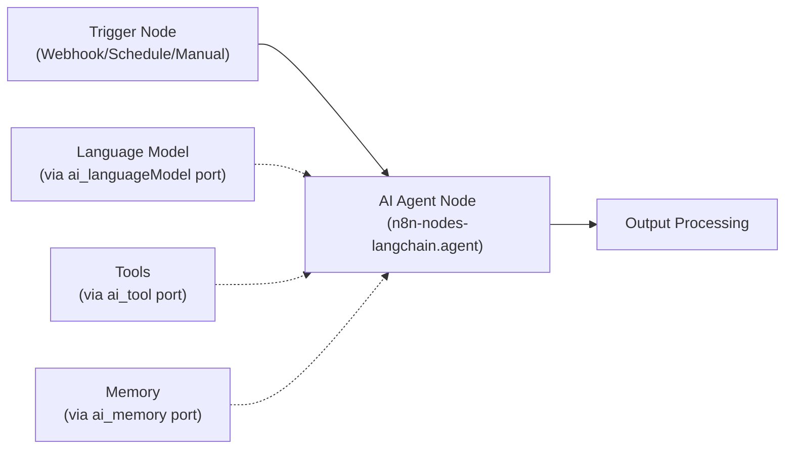
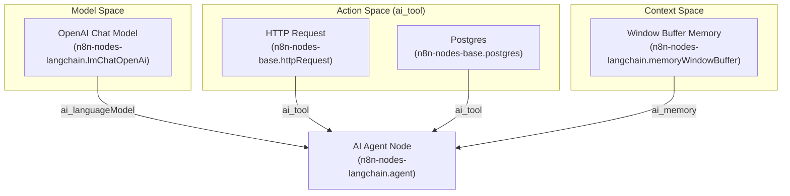
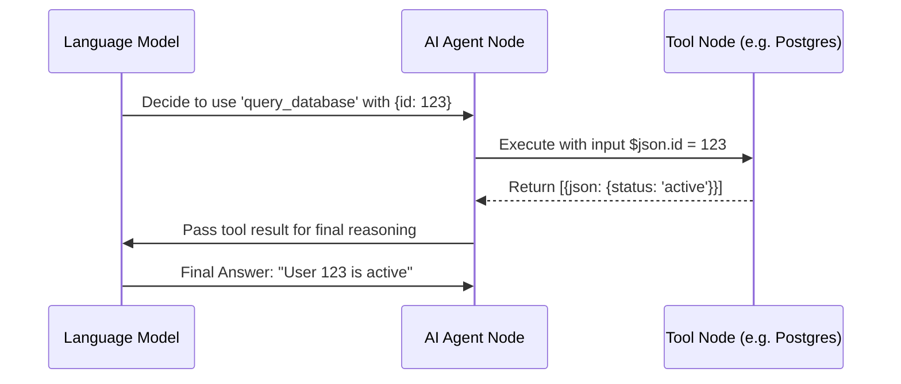

<!-- source: DeepWiki mcp.deepwiki.com · repo czlonkowski/n8n-skills · page 4.4 AI Agent Workflow Pattern · fetched 2026-10-27 -->

# AI Agent Workflow Pattern

<details>
<summary>Relevant source files</summary>

The following files were used as context for generating this wiki page:

- [evaluations/workflow-patterns/eval-001-webhook-workflow.json](evaluations/workflow-patterns/eval-001-webhook-workflow.json)
- [evaluations/workflow-patterns/eval-002-http-api-workflow.json](evaluations/workflow-patterns/eval-002-http-api-workflow.json)
- [evaluations/workflow-patterns/eval-003-database-sync.json](evaluations/workflow-patterns/eval-003-database-sync.json)
- [evaluations/workflow-patterns/eval-004-ai-agent.json](evaluations/workflow-patterns/eval-004-ai-agent.json)
- [evaluations/workflow-patterns/eval-005-scheduled-report.json](evaluations/workflow-patterns/eval-005-scheduled-report.json)
- [skills/n8n-mcp-tools-expert/VALIDATION_GUIDE.md](skills/n8n-mcp-tools-expert/VALIDATION_GUIDE.md)
- [skills/n8n-node-configuration/README.md](skills/n8n-node-configuration/README.md)
- [skills/n8n-workflow-patterns/SKILL.md](skills/n8n-workflow-patterns/SKILL.md)
- [skills/n8n-workflow-patterns/ai_agent_workflow.md](skills/n8n-workflow-patterns/ai_agent_workflow.md)

</details>


## Purpose and Scope

This document describes the AI Agent workflow pattern in n8n, covering the architecture, configuration, and implementation of AI-powered workflows that combine language models with tools and memory. This pattern enables building autonomous agents that can reason, use tools, and maintain context by orchestrating specialized AI connection types.

**Sources:** [skills/n8n-workflow-patterns/SKILL.md:28-30](), [skills/n8n-workflow-patterns/ai_agent_workflow.md:1-5]()

---

## Pattern Architecture

### Basic Structure

The AI Agent pattern follows a trigger-process-output flow where the AI agent node acts as the central orchestrator, coordinating between language models, tools, and memory components.

**AI Agent Architecture Flow**


**Pattern Flow:**
1. **Trigger** receives input (e.g., `Webhook` payload under `$json.body`). [skills/n8n-workflow-patterns/SKILL.md:181-188]()
2. **AI Agent** coordinates reasoning and determines if tools are required. [skills/n8n-workflow-patterns/ai_agent_workflow.md:41-42]()
3. **Language Model** provides the core reasoning engine. [skills/n8n-workflow-patterns/ai_agent_workflow.md:57-62]()
4. **Tools** execute specific actions (ANY n8n node can be connected). [skills/n8n-workflow-patterns/ai_agent_workflow.md:73-74]()
5. **Memory** maintains conversation context (e.g., `Window Buffer Memory`). [skills/n8n-workflow-patterns/ai_agent_workflow.md:83-90]()
6. **Output** processes the final response for delivery. [skills/n8n-workflow-patterns/ai_agent_workflow.md:91-98]()

**Sources:** [skills/n8n-workflow-patterns/ai_agent_workflow.md:7-15](), [skills/n8n-workflow-patterns/SKILL.md:304-311]()

---

## AI Connection Types

n8n utilizes **8 specialized AI connection types** to bridge the gap between standard workflow nodes and the LangChain-based AI ecosystem.

| Connection Type | Port Name | Purpose |
|----------------|-----------|---------|
| `ai_languageModel` | Language Model | Connects the LLM provider (OpenAI, Anthropic, etc.) |
| `ai_tool` | Tool | Connects executable actions (HTTP Request, Code, etc.) |
| `ai_memory` | Memory | Provides conversation context storage |
| `ai_outputParser` | Output Parser | Forces structured response formats |
| `ai_embedding` | Embeddings | Generates vector representations of text |
| `ai_vectorStore` | Vector Store | Connects to vector databases (Pinecone, Qdrant) |
| `ai_document` | Document | Loads raw data into the AI context |
| `ai_textSplitter` | Text Splitter | Handles chunking of large documents |

**Natural Language to Code Entity Mapping (Connections)**


**Sources:** [skills/n8n-workflow-patterns/ai_agent_workflow.md:17-29](), [skills/n8n-workflow-patterns/ai_agent_workflow.md:73-82]()

---

## Core Components

### AI Agent Node Configuration
The AI Agent node (`n8n-nodes-langchain.agent`) is configured by selecting an agent type and defining a system prompt.

```javascript
{
  "agent": "conversationalAgent", // or "openAIFunctionsAgent"
  "promptType": "define",
  "text": "You are a helpful assistant that can search docs and query databases."
}
```

**Sources:** [skills/n8n-workflow-patterns/ai_agent_workflow.md:40-50]()

### Language Models
LLMs connect via the `ai_languageModel` port. Common configurations include `model`, `temperature`, and `maxTokens`. [skills/n8n-workflow-patterns/ai_agent_workflow.md:64-71]()

### Tools System
**Critical Insight**: ANY n8n node can be a tool. To convert a standard node into a tool, it must be connected to the `ai_tool` port of the agent.

**Tool Requirements:**
1. **Name**: Unique identifier used by the LLM.
2. **Description**: Natural language instructions telling the LLM *when* and *how* to use the tool. [skills/n8n-workflow-patterns/ai_agent_workflow.md:230-237]()

**Tool Data Flow**


**Sources:** [skills/n8n-workflow-patterns/ai_agent_workflow.md:73-82](), [skills/n8n-workflow-patterns/ai_agent_workflow.md:256-261]()

---

## Implementation Patterns

### 1. Conversational Chatbot
Used for customer support or interactive assistants.
- **Trigger**: `Webhook` receiving `session_id`.
- **Memory**: `Window Buffer Memory` using `{{$json.body.session_id}}` as the session key. [skills/n8n-workflow-patterns/ai_agent_workflow.md:103-117]()

### 2. Document Q&A (RAG)
Used for querying internal knowledge bases.
- **Components**: `Vector Store Tool` connected to a `Vector Store` node (e.g., Pinecone).
- **Flow**: Agent uses the tool to retrieve relevant chunks before answering. [skills/n8n-workflow-patterns/ai_agent_workflow.md:135-153]()

### 3. SQL Analyst Agent
Used for natural language data exploration.
- **Tool**: `Postgres` or `MySQL` node configured with `operation: "executeQuery"`.
- **Safety**: Prompt should explicitly restrict the agent to `SELECT` queries only. [skills/n8n-workflow-patterns/ai_agent_workflow.md:155-179]()

---

## Validation and Configuration

When building AI workflows, configuration is iterative. Use the `validate_node` and `validate_workflow` tools to ensure connections are correct. [skills/n8n-mcp-tools-expert/VALIDATION_GUIDE.md:15-17](), [skills/n8n-mcp-tools-expert/VALIDATION_GUIDE.md:134-136]()

**Common Validation Checks for AI Agents:**
- Verify `ai_languageModel` is connected (required). [skills/n8n-workflow-patterns/ai_agent_workflow.md:53]()
- Ensure all `ai_tool` nodes have a `description`. [skills/n8n-workflow-patterns/ai_agent_workflow.md:235]()
- Check for `ai_memory` session ID expressions. [skills/n8n-workflow-patterns/ai_agent_workflow.md:111]()

**Sources:** [skills/n8n-node-configuration/README.md:159-166](), [skills/n8n-mcp-tools-expert/VALIDATION_GUIDE.md:151-161]()

---

## Summary Checklist

| Phase | Task | Tool/Node |
|-------|------|-----------|
| **Planning** | Identify required tools and model | `search_nodes` |
| **Setup** | Connect LLM and Memory | `OpenAI Chat Model`, `Buffer Memory` |
| **Tooling** | Define tool descriptions | `HTTP Request`, `Postgres`, etc. |
| **Validation**| Check connection types and expressions | `validate_workflow` |
| **Deployment**| Activate workflow | `activateWorkflow` |

**Sources:** [skills/n8n-workflow-patterns/SKILL.md:110-139]()

---

