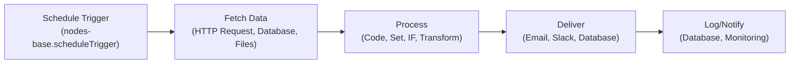
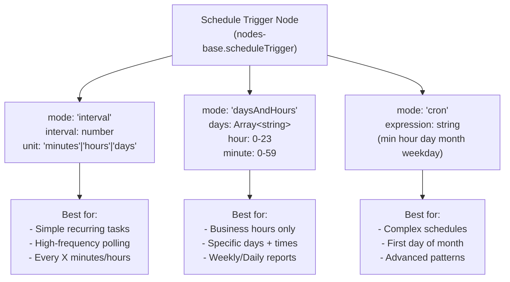
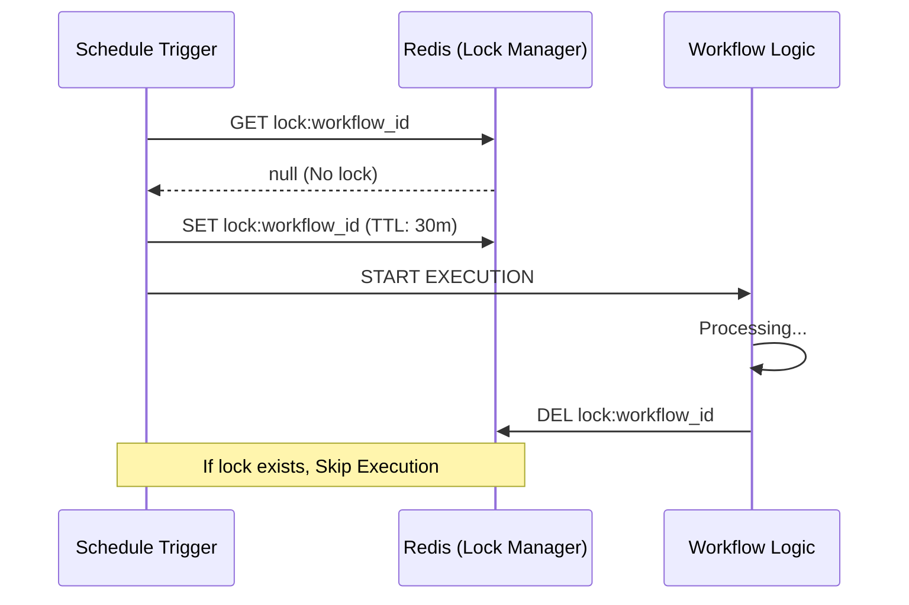

<!-- source: DeepWiki mcp.deepwiki.com · repo czlonkowski/n8n-skills · page 4.5 Scheduled Tasks Pattern · fetched 2026-10-27 -->

# Scheduled Tasks Pattern

<details>
<summary>Relevant source files</summary>

The following files were used as context for generating this wiki page:

- [evaluations/workflow-patterns/eval-001-webhook-workflow.json](evaluations/workflow-patterns/eval-001-webhook-workflow.json)
- [evaluations/workflow-patterns/eval-002-http-api-workflow.json](evaluations/workflow-patterns/eval-002-http-api-workflow.json)
- [evaluations/workflow-patterns/eval-003-database-sync.json](evaluations/workflow-patterns/eval-003-database-sync.json)
- [evaluations/workflow-patterns/eval-004-ai-agent.json](evaluations/workflow-patterns/eval-004-ai-agent.json)
- [evaluations/workflow-patterns/eval-005-scheduled-report.json](evaluations/workflow-patterns/eval-005-scheduled-report.json)
- [skills/n8n-workflow-patterns/README.md](skills/n8n-workflow-patterns/README.md)
- [skills/n8n-workflow-patterns/database_operations.md](skills/n8n-workflow-patterns/database_operations.md)
- [skills/n8n-workflow-patterns/http_api_integration.md](skills/n8n-workflow-patterns/http_api_integration.md)
- [skills/n8n-workflow-patterns/scheduled_tasks.md](skills/n8n-workflow-patterns/scheduled_tasks.md)
- [skills/n8n-workflow-patterns/webhook_processing.md](skills/n8n-workflow-patterns/webhook_processing.md)

</details>


## Purpose and Scope

This page covers the **Scheduled Tasks Pattern**, one of the five core workflow patterns in n8n. This pattern enables recurring automation workflows that execute automatically on a time-based schedule.

**Purpose**: Build workflows that run periodically without manual intervention or external triggers. Scheduled tasks account for approximately 28% of all n8n workflows.

**Scope**: This document covers Schedule Trigger configuration (Interval, Days & Hours, and Cron modes), timezone handling, execution locks, batch processing, and error handling strategies. For real-time event processing, see [Webhook Processing Pattern](). For the complete workflow patterns overview, see [n8n Workflow Patterns]().

**Sources**: [skills/n8n-workflow-patterns/scheduled_tasks.md:1-5](), [skills/n8n-workflow-patterns/README.md:72-76](), [skills/n8n-workflow-patterns/README.md:129]()

---

## Pattern Structure

The Scheduled Tasks Pattern follows a five-stage architecture designed for reliable automated execution.



**Key Characteristic**: Time-based automated execution with no external trigger required.

**Sources**: [skills/n8n-workflow-patterns/scheduled_tasks.md:7-13](), [skills/n8n-workflow-patterns/scheduled_tasks.md:19-55]()

---

## Schedule Trigger Modes

The `nodes-base.scheduleTrigger` node supports three distinct execution modes, each optimized for different recurring requirements.

### Mode Comparison and Use Cases



**Sources**: [skills/n8n-workflow-patterns/scheduled_tasks.md:22-25](), [skills/n8n-workflow-patterns/scheduled_tasks.md:58-109]()

### 1. Interval Mode
Best for simple recurring tasks at fixed intervals.

| Property | Type | Description |
| :--- | :--- | :--- |
| `mode` | `string` | Must be set to `"interval"` |
| `interval` | `number` | The frequency value |
| `unit` | `string` | `"minutes"`, `"hours"`, or `"days"` |

**Example (Every 15 minutes)**:
```javascript
{
  "mode": "interval",
  "interval": 15,
  "unit": "minutes"
}
```
**Sources**: [skills/n8n-workflow-patterns/scheduled_tasks.md:60-85]()

### 2. Days & Hours Mode
Best for specific days and times (e.g., "Weekdays at 9 AM").

**Example (Monday at 6 PM)**:
```javascript
{
  "mode": "daysAndHours",
  "days": ["monday"],
  "hour": 18,
  "minute": 0
}
```
**Sources**: [skills/n8n-workflow-patterns/scheduled_tasks.md:87-107]()

### 3. Cron Mode (Advanced)
Best for complex schedules using standard cron syntax: `minute hour day month weekday`.

| Expression | Meaning |
| :--- | :--- |
| `*/15 9-17 * * 1-5` | Every 15 mins during business hours (9-5) on weekdays |
| `0 0 1 * *` | First day of every month at midnight |
| `0 9,17 * * *` | At 9 AM and 5 PM daily |

**Sources**: [skills/n8n-workflow-patterns/scheduled_tasks.md:109-147]()

---

## Timezone Handling

Timezone configuration is critical to ensure workflows execute at the intended local time, especially during Daylight Saving Time (DST) transitions.

**Configuration**: Set the workflow timezone explicitly in the workflow settings.
```javascript
// Example: Workflow Settings
{
  "timezone": "America/New_York"
}
```

**Impact**: 
- Without a timezone, schedules default to UTC, which does not adjust for DST.
- With a timezone (e.g., `Europe/London`), a 9 AM schedule will correctly adjust when the clock shifts between GMT and BST.

**Sources**: [skills/n8n-workflow-patterns/README.md:176](), [skills/n8n-workflow-patterns/scheduled_tasks.md:347-386]()

---

## Execution Management and Performance

### Execution Locks
When a schedule interval (e.g., every 5 minutes) is shorter than the workflow execution time (e.g., 10 minutes), multiple instances may overlap. Use an execution lock pattern to prevent data corruption.



**Sources**: [skills/n8n-workflow-patterns/README.md:177](), [skills/n8n-workflow-patterns/scheduled_tasks.md:456-468]()

### Batch Processing
For scheduled tasks involving large datasets (e.g., database cleanup or enrichment), use the `Split In Batches` node to avoid memory exhaustion.

**Example (Enrichment Loop)**:
1. **Schedule**: Daily at 3 AM.
2. **Fetch**: `Postgres` query for 100 incomplete records.
3. **Batch**: `Split In Batches` (batch size: 10).
4. **Action**: `HTTP Request` to Enrichment API.
5. **Wait**: `Wait` node (1 second) for rate limiting.
6. **Loop**: Back to batch node until finished.

**Sources**: [skills/n8n-workflow-patterns/scheduled_tasks.md:259-287](), [skills/n8n-workflow-patterns/README.md:179]()

---

## Common Use Case Examples

### 1. Daily Sales Report
**Flow**: `Schedule (9 AM)` → `Postgres (Query yesterday's sales)` → `Code (Calculate Metrics)` → `Email (Send Report)`.
**Sources**: [skills/n8n-workflow-patterns/scheduled_tasks.md:152-178]()

### 2. Website Uptime Monitor
**Flow**: `Schedule (5 min)` → `HTTP Request (Health Check)` → `IF (Status != 200)` → `Redis (Check Alert Cooldown)` → `Slack (Alert)`.
**Sources**: [skills/n8n-workflow-patterns/scheduled_tasks.md:205-231]()

### 3. Database Maintenance
**Flow**: `Schedule (Weekly)` → `Postgres (Find records > 90 days)` → `Google Drive (Upload Archive)` → `Postgres (Delete Records)`.
**Sources**: [skills/n8n-workflow-patterns/scheduled_tasks.md:233-257]()

---

## Error Handling Strategies

| Strategy | Implementation |
| :--- | :--- |
| **Error Trigger** | Use an "Error Trigger" workflow to receive alerts when the main scheduled workflow fails. |
| **Retry Logic** | Configure `continueOnFail: true` on nodes and use `Wait` nodes to retry API calls after a delay. |
| **Partial Failure** | Use `Split In Batches` so that if one batch fails, the others can still complete. |

**Sources**: [skills/n8n-workflow-patterns/README.md:178](), [skills/n8n-workflow-patterns/scheduled_tasks.md:389-430]()

---

## Implementation Checklist

- [ ] **Timezone**: Is the workflow timezone explicitly set in settings? [skills/n8n-workflow-patterns/scheduled_tasks.md:675]()
- [ ] **Overlaps**: If running frequently, is there a lock mechanism? [skills/n8n-workflow-patterns/scheduled_tasks.md:679]()
- [ ] **Batching**: Are you using `Split In Batches` for large data? [skills/n8n-workflow-patterns/scheduled_tasks.md:684]()
- [ ] **Error Handling**: Is there an Error Trigger workflow configured? [skills/n8n-workflow-patterns/scheduled_tasks.md:689]()
- [ ] **Logging**: Are execution results logged to a database or monitoring service? [skills/n8n-workflow-patterns/scheduled_tasks.md:698]()

**Sources**: [skills/n8n-workflow-patterns/scheduled_tasks.md:671-715]()

---

