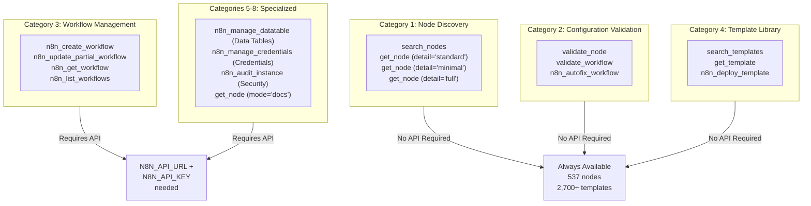
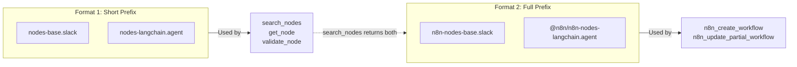
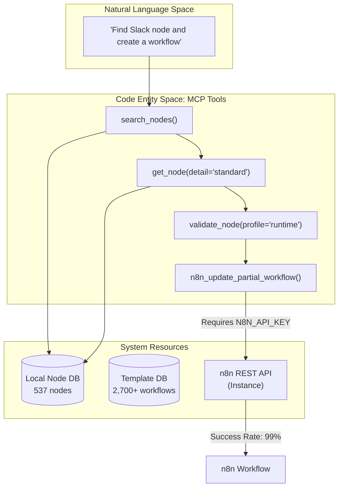

<!-- source: DeepWiki mcp.deepwiki.com · repo czlonkowski/n8n-skills · page 5.1 Tool Categories and Availability · fetched 2026-10-27 -->

# Tool Categories and Availability

<details>
<summary>Relevant source files</summary>

The following files were used as context for generating this wiki page:

- [skills/n8n-mcp-tools-expert/README.md](skills/n8n-mcp-tools-expert/README.md)
- [skills/n8n-mcp-tools-expert/SEARCH_GUIDE.md](skills/n8n-mcp-tools-expert/SEARCH_GUIDE.md)
- [skills/n8n-mcp-tools-expert/SKILL.md](skills/n8n-mcp-tools-expert/SKILL.md)
- [skills/n8n-validation-expert/ERROR_CATALOG.md](skills/n8n-validation-expert/ERROR_CATALOG.md)
- [skills/n8n-validation-expert/FALSE_POSITIVES.md](skills/n8n-validation-expert/FALSE_POSITIVES.md)
- [skills/n8n-validation-expert/README.md](skills/n8n-validation-expert/README.md)

</details>


This document catalogs the 40+ MCP tools provided by the n8n-mcp server, organized by functional category and availability requirements. It specifies which tools require n8n API credentials versus those available without any API configuration.

For guidance on using these tools effectively, see [MCP Server Integration](). For validation-specific tools and profiles, see [Validation System](). For workflow management operations, see [Workflow Management Tools](). For usage patterns based on telemetry, see [Common Tool Usage Patterns]().

---

## Tool Categories Overview

The n8n-mcp server provides 40+ tools organized into eight functional categories, with different availability requirements:

Title: n8n MCP Tool Ecosystem


**Sources:** [skills/n8n-mcp-tools-expert/SKILL.md:12-24](), [skills/n8n-mcp-tools-expert/SKILL.md:29-43]()

---

## Category 1: Node Discovery Tools

Tools for finding and understanding n8n nodes. These tools provide access to metadata for 537 nodes across all packages.

### search_nodes (Start Here)

**Purpose**: Find nodes by keyword search. This is the entry point for node discovery. [skills/n8n-mcp-tools-expert/SEARCH_GUIDE.md:7-12]()

**Parameters**:
- `query` (string): Search keywords (e.g., "slack", "webhook").
- `mode` (string): "OR" (default), "AND", or "FUZZY" (typo-tolerant). [skills/n8n-mcp-tools-expert/SEARCH_GUIDE.md:15-17]()
- `limit` (number): Max results (default: 20).
- `source` (string): "all", "core", "community", or "verified". [skills/n8n-mcp-tools-expert/SEARCH_GUIDE.md:19-20]()

**Returns**:
```javascript
{
  "nodeType": "nodes-base.slack",          // For search/validate tools
  "workflowNodeType": "n8n-nodes-base.slack",  // For workflow tools
  "displayName": "Slack",
  "description": "Consume Slack API"
}
```
[skills/n8n-mcp-tools-expert/SEARCH_GUIDE.md:24-39]()

---

### get_node (Unified Node Information)

The `get_node` tool is a polymorphic tool that provides information based on `detail` levels and `mode` settings. [skills/n8n-mcp-tools-expert/SEARCH_GUIDE.md:51-53]()

| Detail Level | Tokens | Use When |
|--------------|--------|----------|
| `minimal`    | ~200   | Quick metadata check. [skills/n8n-mcp-tools-expert/SEARCH_GUIDE.md:59-85]() |
| `standard`   | ~1-2K  | **DEFAULT**. Most use cases; includes operations and common properties. [skills/n8n-mcp-tools-expert/SEARCH_GUIDE.md:60-75]() |
| `full`       | ~3-8K  | Complex debugging; includes complete property schema. [skills/n8n-mcp-tools-expert/SEARCH_GUIDE.md:61-100]() |

**Additional Modes**:
- `mode="docs"`: Returns formatted markdown documentation, usage examples, and best practices. [skills/n8n-mcp-tools-expert/SEARCH_GUIDE.md:117-134]()
- `mode="search_properties"`: Find specific fields within a node using `propertyQuery` (e.g., "auth"). [skills/n8n-mcp-tools-expert/SEARCH_GUIDE.md:136-151]()
- `mode="versions"`: Check version history and breaking changes. [skills/n8n-mcp-tools-expert/SEARCH_GUIDE.md:153-161]()

---

## Category 2: Configuration Validation Tools

Tools for interpreting and fixing n8n validation errors. These tools do not require API access.

### validate_node

**Purpose**: Check a node configuration against a specific validation profile. [skills/n8n-mcp-tools-expert/SKILL.md:75-82]()

**Validation Profiles**:
- `minimal`: Only required fields (fast, permissive). [skills/n8n-mcp-tools-expert/SKILL.md:188-188]()
- `runtime`: Values + types (recommended for pre-deployment). [skills/n8n-mcp-tools-expert/SKILL.md:189-189]()
- `ai-friendly`: Reduces false positives by 60% for AI-generated configurations. [skills/n8n-validation-expert/README.md:50-50]()
- `strict`: Maximum validation for production environments. [skills/n8n-mcp-tools-expert/SKILL.md:191-191]()

### validate_workflow

**Purpose**: Validate a complete workflow structure, including node connections and expressions. [skills/n8n-mcp-tools-expert/SKILL.md:38-38]()

### n8n_autofix_workflow

**Purpose**: Automatically fix specific error types like `operator_structure`. [skills/n8n-validation-expert/ERROR_CATALOG.md:18-18]()
- **Fixes**: Binary/Unary operator structures and missing IF/Switch metadata. [skills/n8n-validation-expert/README.md:41-45]()
- **Limitation**: Cannot fix broken connections or branch count mismatches. [skills/n8n-mcp-tools-expert/SKILL.md:210-213]()

---

## Category 3: Workflow Management Tools

Tools for creating and modifying workflows. **Requires N8N_API_URL and N8N_API_KEY**.

### n8n_update_partial_workflow

**Purpose**: Modify existing workflows using targeted operations. This is the **most used tool** in the ecosystem. [skills/n8n-mcp-tools-expert/SKILL.md:37-37]()

**Key Features**:
- **Smart Parameters**: Use semantic branch names (`branch: "true"`) or Switch cases (`case: 0`) instead of manual `sourceIndex`. [skills/n8n-mcp-tools-expert/SKILL.md:221-237]()
- **Auto-Sanitization**: Every update triggers a sanitation pass that automatically corrects operator structures across all nodes. [skills/n8n-mcp-tools-expert/SKILL.md:201-219]()

### n8n_create_workflow

**Purpose**: Create a new workflow. Requires node definitions using the **Full Prefix** format (e.g., `n8n-nodes-base.slack`). [skills/n8n-mcp-tools-expert/SKILL.md:120-130]()

---

## Category 4: Specialized & Management Tools

These tools provide deep integration with n8n instance features and require API credentials.

| Tool | Purpose | Source |
|------|---------|--------|
| `n8n_deploy_template` | Deploy a workflow from the 2,700+ template library directly to an instance. | [skills/n8n-mcp-tools-expert/SKILL.md:39-39]() |
| `n8n_manage_datatable` | Manage n8n data tables and rows. | [skills/n8n-mcp-tools-expert/SKILL.md:20-20]() |
| `n8n_manage_credentials` | Full credential CRUD operations and schema discovery. | [skills/n8n-mcp-tools-expert/SKILL.md:21-21]() |
| `n8n_audit_instance` | Security auditing with custom deep scans. | [skills/n8n-mcp-tools-expert/SKILL.md:22-22]() |

---

## Critical: nodeType Formats

There is a strict distinction between the formats required for discovery tools vs. workflow management tools. [skills/n8n-mcp-tools-expert/SKILL.md:101-103]()

Title: nodeType Format Mapping


**Sources:** [skills/n8n-mcp-tools-expert/SKILL.md:105-132](), [skills/n8n-mcp-tools-expert/SEARCH_GUIDE.md:287-295]()

---

## Tool Availability and Data Flow

Title: n8n-skills Data Flow Architecture


**Sources:** [skills/n8n-mcp-tools-expert/SKILL.md:12-24](), [skills/n8n-mcp-tools-expert/SEARCH_GUIDE.md:241-265](), [skills/n8n-validation-expert/README.md:15-17]()

---

## Common Tool Usage Patterns

1.  **Node Discovery Pattern**: `search_nodes` → `get_node` (standard). Average time: 18 seconds. [skills/n8n-mcp-tools-expert/SKILL.md:73-73]()
2.  **Validation Loop**: `validate_node` → fix errors → `validate_node`. Average: 2-3 iterations. [skills/n8n-validation-expert/README.md:17-17]()
3.  **Workflow Iteration**: `n8n_update_partial_workflow` (add node) → `n8n_update_partial_workflow` (add connection). Average 56 seconds between edits. [skills/n8n-mcp-tools-expert/SKILL.md:97-97]()

**Sources:** [skills/n8n-mcp-tools-expert/SKILL.md:47-98](), [skills/n8n-validation-expert/README.md:30-34]()

---

