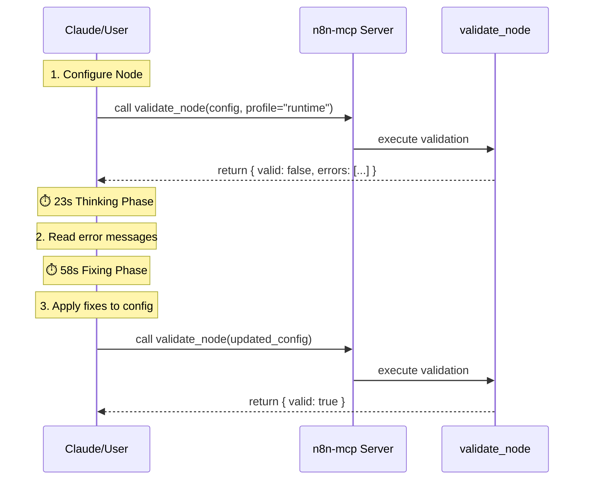

<!-- source: DeepWiki mcp.deepwiki.com · repo czlonkowski/n8n-skills · page 5.2 Validation System · fetched 2026-10-27 -->

# Validation System

<details>
<summary>Relevant source files</summary>

The following files were used as context for generating this wiki page:

- [evaluations/validation-expert/eval-001-missing-required-field.json](evaluations/validation-expert/eval-001-missing-required-field.json)
- [evaluations/validation-expert/eval-002-false-positive.json](evaluations/validation-expert/eval-002-false-positive.json)
- [evaluations/validation-expert/eval-003-auto-sanitization.json](evaluations/validation-expert/eval-003-auto-sanitization.json)
- [evaluations/validation-expert/eval-004-validation-loop.json](evaluations/validation-expert/eval-004-validation-loop.json)
- [skills/n8n-mcp-tools-expert/VALIDATION_GUIDE.md](skills/n8n-mcp-tools-expert/VALIDATION_GUIDE.md)
- [skills/n8n-validation-expert/SKILL.md](skills/n8n-validation-expert/SKILL.md)
- [skills/n8n-workflow-patterns/SKILL.md](skills/n8n-workflow-patterns/SKILL.md)

</details>


## Purpose and Scope

The n8n-skills validation system provides a robust framework for ensuring node configurations and workflow structures are correct before execution. It is built upon an analysis of over 447,000 real-world validation events and handles everything from simple required field checks to complex operator structure auto-sanitization. The system is designed for an iterative "validate → fix" loop, typically requiring 2-3 iterations to reach a valid state.

**Sources:** [skills/n8n-validation-expert/SKILL.md:1-21](), [skills/n8n-mcp-tools-expert/VALIDATION_GUIDE.md:1-13]()

---

## Validation Profiles

The system offers four distinct profiles to balance between strictness and developer velocity depending on the current stage of workflow creation.

### Profile Selection Logic

```mermaid
graph TD
    "Start"["Select Validation Profile"] --> "Stage"{"Current Stage?"}
    
    "Stage" -- "Initial Drafting" --> "Minimal"["'minimal' Profile"]
    "Stage" -- "Development" --> "Runtime"["'runtime' Profile"]
    "Stage" -- "AI Generation" --> "AIFriendly"["'ai-friendly' Profile"]
    "Stage" -- "Final Review" --> "Strict"["'strict' Profile"]

    "Minimal" --> "MinDesc"["- Only required fields<br/>- Fastest execution<br/>- Most permissive"]
    "Runtime" --> "RunDesc"["- RECOMMENDED<br/>- Values + Types<br/>- Catches real errors"]
    "AIFriendly" --> "AIDesc"["- Reduces false positives<br/>- Tolerates minor issues<br/>- For AI-generated configs"]
    "Strict" --> "StrDesc"["- Maximum validation<br/>- Best practices<br/>- Performance/Security"]
```
**Diagram: Validation Profile Selection Logic**
**Sources:** [skills/n8n-validation-expert/SKILL.md:137-187](), [skills/n8n-mcp-tools-expert/VALIDATION_GUIDE.md:64-88]()

### Profile Details

| Profile | Use Case | Validates | Pros/Cons |
| :--- | :--- | :--- | :--- |
| `minimal` | Quick checks during editing | Only required fields and basic structure | **Pros:** Fastest. **Cons:** May miss issues. |
| `runtime` | **Recommended** for pre-deployment | Required fields, types, allowed values, basic dependencies | **Pros:** Balanced, catches real errors. |
| `ai-friendly` | AI-generated configurations | Same as runtime but reduces false positives | **Pros:** Less noisy for AI workflows. |
| `strict` | Production deployment | Everything + best practices, performance, and security | **Pros:** Max safety. **Cons:** High noise/false positives. |

**Sources:** [skills/n8n-validation-expert/SKILL.md:141-187](), [skills/n8n-mcp-tools-expert/VALIDATION_GUIDE.md:68-86]()

---

## Error Classification (9 Categories)

The system categorizes issues into three severity levels. Errors must be fixed to execute, while warnings and suggestions are advisory.

### Error Severity Hierarchy

```mermaid
graph LR
    subgraph "Level 1: Errors (Must Fix)"
        "missing_required"
        "invalid_value"
        "type_mismatch"
        "invalid_reference"
        "invalid_expression"
    end
    
    subgraph "Level 2: Warnings (Should Fix)"
        "best_practice"
        "deprecated"
        "performance"
    end
    
    subgraph "Level 3: Suggestions (Optional)"
        "optimization"
        "alternative"
    end

    "ValidationResult"["Validation Result Object"] --> "Level 1: Errors (Must Fix)"
    "ValidationResult" --> "Level 2: Warnings (Should Fix)"
    "ValidationResult" --> "Level 3: Suggestions (Optional)"
```
**Diagram: Error Severity and Category Mapping**
**Sources:** [skills/n8n-validation-expert/SKILL.md:25-72](), [skills/n8n-mcp-tools-expert/VALIDATION_GUIDE.md:124-131]()

### Common Error Types and Fixes

1.  **`missing_required`**: A mandatory field is empty. **Fix:** Use `get_node` to identify requirements and provide a value. [skills/n8n-validation-expert/SKILL.md:192-211]()
2.  **`invalid_value`**: Value not in the allowed list (e.g., wrong operation name). **Fix:** Update to a valid option. [skills/n8n-validation-expert/SKILL.md:213-233]()
3.  **`type_mismatch`**: Wrong data type (e.g., string instead of number). **Fix:** Convert to expected type. [skills/n8n-validation-expert/SKILL.md:235-254]()
4.  **`invalid_expression`**: Syntax error in `={{ }}`. **Fix:** Check for missing braces or typos. [skills/n8n-validation-expert/SKILL.md:256-277]()
5.  **`invalid_reference`**: Node name in expression doesn't exist. **Fix:** Correct the node name. [skills/n8n-validation-expert/SKILL.md:278-299]()

**Sources:** [skills/n8n-validation-expert/SKILL.md:190-299]()

---

## Auto-Sanitization System

The system includes an automatic repair mechanism that runs on any workflow creation or partial update. This prevents common structural errors that are difficult for users (or AIs) to spot manually.

### Automatic Repairs
*   **Binary Operators**: Automatically removes `singleValue: true` from operators like `equals` or `contains`. [skills/n8n-mcp-tools-expert/VALIDATION_GUIDE.md:230-232]()
*   **Unary Operators**: Automatically adds `singleValue: true` to operators like `isEmpty` or `true`. [skills/n8n-mcp-tools-expert/VALIDATION_GUIDE.md:232-232]()
*   **IF/Switch Nodes**: Automatically injects required `conditions.options` metadata for modern node versions (IF v2.2+, Switch v3.2+). [skills/n8n-mcp-tools-expert/VALIDATION_GUIDE.md:234-235]()

### Manual Recovery Tools
If auto-sanitization cannot resolve an issue (e.g., broken connections), the following tools are available:
*   **`cleanStaleConnections`**: Operation within `n8n_update_partial_workflow` to remove references to deleted nodes. [skills/n8n-mcp-tools-expert/VALIDATION_GUIDE.md:260]()
*   **`n8n_autofix_workflow`**: A dedicated tool to preview and apply complex fixes like typeVersion upgrades or UUID generation for webhooks. [skills/n8n-mcp-tools-expert/VALIDATION_GUIDE.md:265-292]()

**Sources:** [skills/n8n-mcp-tools-expert/VALIDATION_GUIDE.md:226-292](), [evaluations/validation-expert/eval-003-auto-sanitization.json:1-15]()

---

## The Validation Loop

Validation is an iterative process. Telemetry shows a consistent pattern across thousands of successful workflow creations.

### Iteration Pattern (Telemetry Data)
*   **Total Occurrences**: 7,841 documented cycles. [skills/n8n-validation-expert/SKILL.md:77]()
*   **Typical Iterations**: 2-3 cycles of `validate` → `fix`. [skills/n8n-validation-expert/SKILL.md:90]()
*   **Average Timing**: 23 seconds of "thinking" (analyzing errors) followed by 58 seconds of "fixing" (updating configuration). [skills/n8n-validation-expert/SKILL.md:19]()

### The Cycle in Code Entity Space


**Diagram: The Iterative Validation Loop Flow**
**Sources:** [skills/n8n-validation-expert/SKILL.md:74-131](), [skills/n8n-mcp-tools-expert/VALIDATION_GUIDE.md:182-196](), [evaluations/validation-expert/eval-004-validation-loop.json:1-15]()

---

## False Positives and Warnings

Warnings (Severity 2) often represent "best practices" that might not be applicable in every context.

### Common Patterns
*   **Error Handling**: Warnings about missing `onError: 'continueRegularOutput'` are common. While recommended for production, they can be ignored for simple utility workflows. [skills/n8n-validation-expert/SKILL.md:58-62]()
*   **Rate Limiting**: Suggestions to add retries on Slack or other API nodes. [skills/n8n-validation-expert/SKILL.md:60]()

**Strategy:** Use the `ai-friendly` profile to filter out these non-critical warnings when working with AI-generated nodes, as it is specifically tuned to reduce noise. [skills/n8n-validation-expert/SKILL.md:165-175](), [evaluations/validation-expert/eval-002-false-positive.json:1-15]()

**Sources:** [skills/n8n-validation-expert/SKILL.md:47-65](), [skills/n8n-mcp-tools-expert/VALIDATION_GUIDE.md:78-82]()

---

