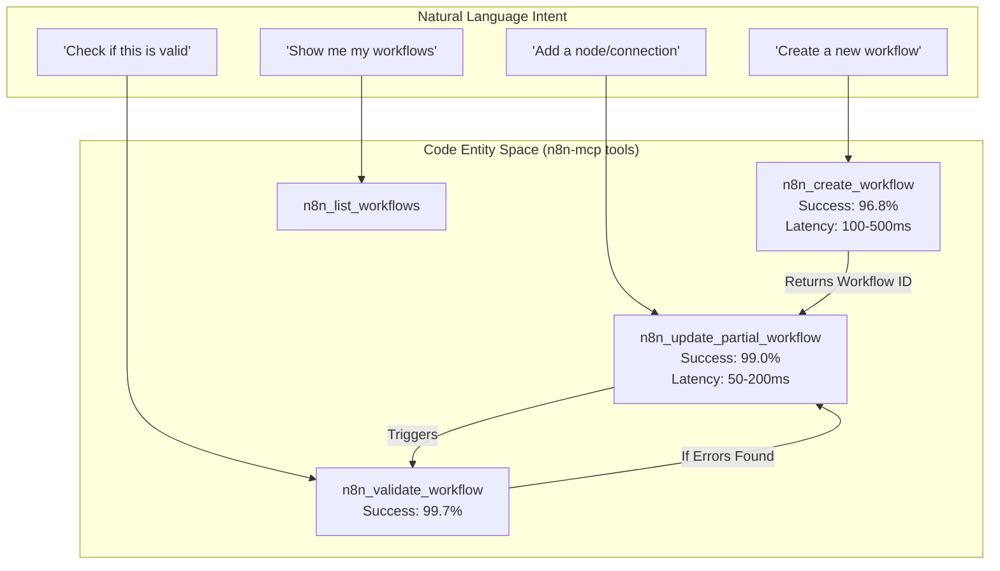
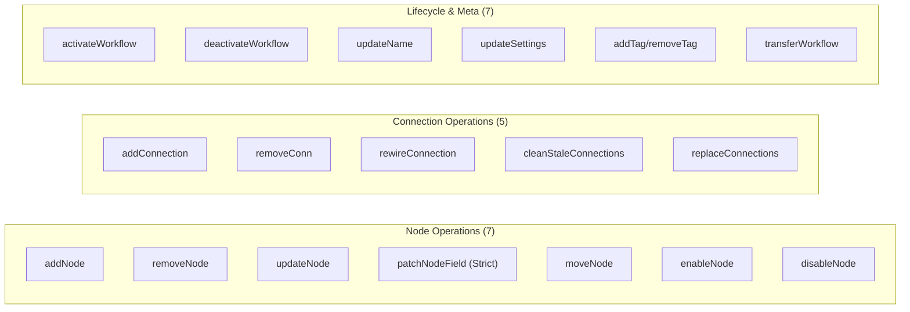
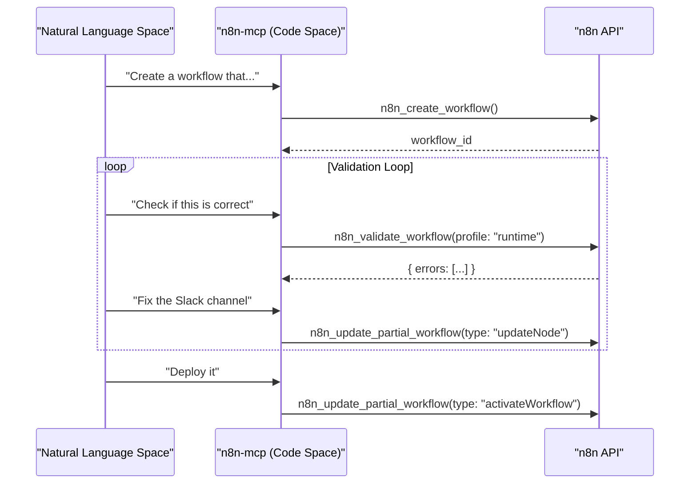

<!-- source: DeepWiki mcp.deepwiki.com · repo czlonkowski/n8n-skills · page 5.3 Workflow Management Tools · fetched 2026-10-27 -->

# Workflow Management Tools

Relevant source files

The following files were used as context for generating this wiki page:

- [evaluations/mcp-tools/eval-001-tool-selection.json](evaluations/mcp-tools/eval-001-tool-selection.json)
- [evaluations/mcp-tools/eval-002-nodetype-format.json](evaluations/mcp-tools/eval-002-nodetype-format.json)
- [evaluations/mcp-tools/eval-003-validation-workflow.json](evaluations/mcp-tools/eval-003-validation-workflow.json)
- [evaluations/mcp-tools/eval-004-essentials-vs-info.json](evaluations/mcp-tools/eval-004-essentials-vs-info.json)
- [evaluations/mcp-tools/eval-005-smart-parameters.json](evaluations/mcp-tools/eval-005-smart-parameters.json)
- [skills/n8n-mcp-tools-expert/WORKFLOW_GUIDE.md](skills/n8n-mcp-tools-expert/WORKFLOW_GUIDE.md)

This page documents the workflow management tools provided by the `n8n-mcp` server for creating, updating, validating, and retrieving n8n workflows. These tools enable programmatic workflow construction and modification through API-driven operations.

**Scope**: This page covers `n8n_create_workflow`, `n8n_update_partial_workflow` (the most-used tool with 19 operation types), smart connection parameters, AI connection types, and workflow lifecycle management.

**Related pages**: For tool availability and API requirements, see [Tool Categories and Availability](). For validation profiles and error handling, see [Validation System](). For usage patterns and telemetry insights, see [Common Tool Usage Patterns]().

---

## API Requirements

All workflow management tools require n8n API credentials to be configured in the MCP server.

**Required Environment Variables**:
- `N8N_API_URL` - Base URL of n8n instance (e.g., `http://localhost:5678`)
- `N8N_API_KEY` - API key with workflow management permissions

**Without API credentials**: Discovery tools (`search_nodes`, `get_node_essentials`), validation tools (`validate_node_operation`, `validate_workflow`), and template tools remain available. Workflows can be constructed as JSON but not deployed to n8n.

Sources: [skills/n8n-mcp-tools-expert/WORKFLOW_GUIDE.md:7-12](), [skills/n8n-mcp-tools-expert/SKILL.md:418-432]()

---

## Tool Overview

### Natural Language to Code Entity Space: Workflow Management

This diagram maps common natural language intents to the specific MCP tool functions and their technical success metrics.

**Core Workflow Management Tools**

| Tool | Purpose | Success Rate | Response Time | API Required |
|------|---------|--------------|---------------|--------------|
| `n8n_create_workflow` | Create new workflows from scratch | 96.8% | 100-500ms | Yes |
| `n8n_update_partial_workflow` | **MOST USED** (38,287 uses). Incremental changes. | 99.0% | 50-200ms | Yes |
| `n8n_validate_workflow` | Validate by workflow ID | 99.7% | Variable | Yes |
| `n8n_get_workflow` | Retrieve complete JSON | N/A | Variable | Yes |
| `n8n_get_workflow_structure` | Nodes + connections only (lightweight) | N/A | Variable | Yes |

Sources: [skills/n8n-mcp-tools-expert/WORKFLOW_GUIDE.md:15-80](), [skills/n8n-mcp-tools-expert/SKILL.md:26-35]()

---

## n8n_create_workflow

Creates a new workflow in the n8n instance. Workflows are created in **inactive** state by default.

### Parameters
- `name` (string): Required.
- `nodes` (array): Required. Array of node objects.
- `connections` (object): Required. Connection mapping.
- `settings` (object): Optional. Workflow-level settings.

### Technical Requirements
- **Node Type Format**: Must use the full prefix (e.g., `n8n-nodes-base.webhook`) [skills/n8n-mcp-tools-expert/WORKFLOW_GUIDE.md:41]().
- **Auto-sanitization**: Runs automatically upon creation to fix operator structures [skills/n8n-mcp-tools-expert/WORKFLOW_GUIDE.md:73]().

Sources: [skills/n8n-mcp-tools-expert/WORKFLOW_GUIDE.md:15-75]()

---

## n8n_update_partial_workflow

This is the primary tool for workflow development. It supports **19 operation types** for surgical modifications.

### Operation Types

### patchNodeField vs. updateNode
`patchNodeField` is the preferred tool for surgical string edits in code, HTML, or JSON bodies. Unlike the legacy `updateNode` with `__patch_find_replace`, `patchNodeField` is **strict**: it throws an error if the string is not found or if multiple ambiguous matches exist [skills/n8n-mcp-tools-expert/WORKFLOW_GUIDE.md:228-251]().

### Smart Parameters
For multi-output nodes, use semantic names instead of `sourceIndex`:
- **IF Nodes**: Use `branch: "true"` or `branch: "false"` [skills/n8n-mcp-tools-expert/WORKFLOW_GUIDE.md:131-146]().
- **Switch Nodes**: Use `case: 0`, `case: 1`, etc [skills/n8n-mcp-tools-expert/WORKFLOW_GUIDE.md:148-163]().

### AI Connection Types
Full support for AI Agent architecture via 8 specialized `sourceOutput` types:
- `ai_languageModel`, `ai_tool`, `ai_memory`, `ai_outputParser`, `ai_embedding`, `ai_vectorStore`, `ai_document`, `ai_textSplitter` [skills/n8n-mcp-tools-expert/WORKFLOW_GUIDE.md:194-203]().

Sources: [skills/n8n-mcp-tools-expert/WORKFLOW_GUIDE.md:86-203](), [skills/n8n-mcp-tools-expert/WORKFLOW_GUIDE.md:228-251]()

---

## Workflow Lifecycle and Patterns

### The Edit-Validate Loop
Telemetry indicates a high-frequency loop between editing and validating.

| Metric | Value | Source |
|--------|-------|--------|
| **Avg. Thinking Time** | 23 seconds | [evaluations/mcp-tools/eval-003-validation-workflow.json:12]() |
| **Avg. Fixing Time** | 58 seconds | [evaluations/mcp-tools/eval-003-validation-workflow.json:12]() |
| **Time Between Edits** | 56 seconds | [skills/n8n-mcp-tools-expert/WORKFLOW_GUIDE.md:84]() |

### Natural Language Space to Workflow Lifecycle

This diagram maps user phases to the specific sequence of MCP tool calls.

### Validation Profiles
When using `n8n_validate_workflow`, choose the profile based on the lifecycle stage:
- `minimal`: Basic structure check.
- `runtime`: **Recommended for pre-deployment**. Checks values and types.
- `ai-friendly`: Reduced false positives for AI-generated patterns.
- `strict`: Full schema compliance.

Sources: [evaluations/mcp-tools/eval-003-validation-workflow.json:1-12](), [skills/n8n-mcp-tools-expert/WORKFLOW_GUIDE.md:78-85]()

---

## Retrieval Tools

| Tool | Response Size | Success Rate | Use Case |
|------|---------------|--------------|----------|
| `n8n_get_workflow` | 100KB+ | High | Full debugging/cloning |
| `n8n_get_workflow_structure` | ~10KB | High | Mapping connections |
| `n8n_get_workflow_minimal` | <2KB | High | Quick status check |

Sources: [skills/n8n-mcp-tools-expert/WORKFLOW_GUIDE.md:330-359](), [evaluations/mcp-tools/eval-004-essentials-vs-info.json:7-11]()

---

