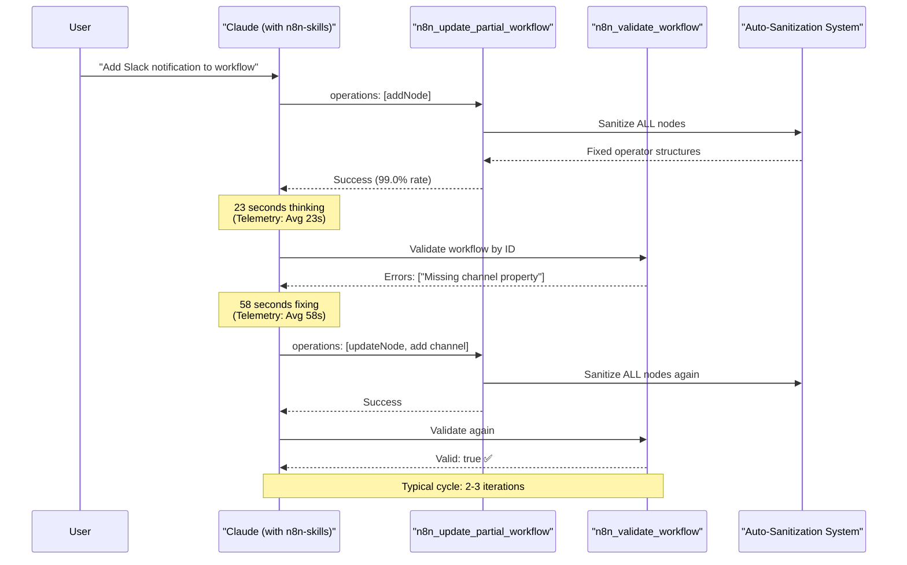
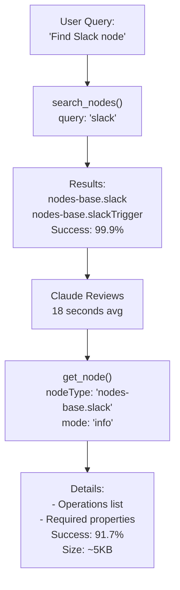
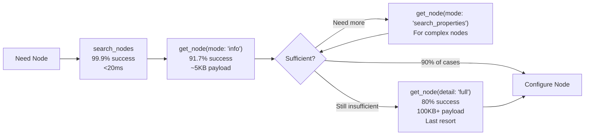

<!-- source: DeepWiki mcp.deepwiki.com · repo czlonkowski/n8n-skills · page 5.4 Common Tool Usage Patterns · fetched 2026-10-27 -->

# Common Tool Usage Patterns

<details>
<summary>Relevant source files</summary>

The following files were used as context for generating this wiki page:

- [CLAUDE.md](CLAUDE.md)
- [docs/DEVELOPMENT.md](docs/DEVELOPMENT.md)
- [docs/MCP_TESTING_LOG.md](docs/MCP_TESTING_LOG.md)
- [docs/USAGE.md](docs/USAGE.md)
- [skills/n8n-mcp-tools-expert/WORKFLOW_GUIDE.md](skills/n8n-mcp-tools-expert/WORKFLOW_GUIDE.md)

</details>


## Purpose and Scope

This page documents real-world usage patterns for n8n-mcp MCP tools, derived from telemetry analysis of 447,557 actual tool invocations. It provides data-driven guidance on tool selection, chaining patterns, success rates, and timing characteristics observed in production usage. These insights inform the design of the seven complementary skills in the `n8n-skills` repository.

Sources: [CLAUDE.md:1-17](), [docs/MCP_TESTING_LOG.md:1-44]()

---

## The Edit-Validate Loop (Most Common Pattern)

The most frequently observed pattern in production usage is the **edit-validate loop**, representing the iterative nature of workflow development.

### Pattern Frequency

| Pattern Component | Occurrences | Success Rate | Avg Timing |
|------------------|-------------|--------------|------------|
| `n8n_update_partial_workflow` | 38,287 | 99.0% | 50-200ms |
| Edit → Validate sequence | 7,841 | - | 23s thinking |
| Validate → Fix sequence | 7,266 | - | 58s fixing |
| Update → Update sequence | 31,464 | - | 56s between |

Sources: [skills/n8n-mcp-tools-expert/WORKFLOW_GUIDE.md:78-85](), [CLAUDE.md:119-134]()

### Edit-Validate Loop Flow



**Diagram: Edit-Validate Loop Sequence**

Sources: [skills/n8n-mcp-tools-expert/WORKFLOW_GUIDE.md:78-116](), [CLAUDE.md:124-128](), [docs/USAGE.md:151-170]()

### Key Characteristics

1. **Most-Used Tool**: `n8n_update_partial_workflow` with 38,287 invocations, representing the highest usage of any MCP tool. [skills/n8n-mcp-tools-expert/WORKFLOW_GUIDE.md:78-80]()
2. **High Reliability**: 99.0% success rate despite iterative nature. [CLAUDE.md:132]()
3. **Iterative Building**: Average 56 seconds between consecutive edits, indicating thoughtful, incremental development. [skills/n8n-mcp-tools-expert/WORKFLOW_GUIDE.md:84-85]()
4. **Validation Thinking Time**: 23 seconds average between edit and validation (user/AI reviewing changes). [CLAUDE.md:127]()
5. **Fixing Time**: 58 seconds average between validation and fix (interpreting errors and planning corrections). [CLAUDE.md:127]()

---

## Node Discovery Pattern (Second Most Common)

The second most frequent pattern is **node discovery**, where users search for nodes and then retrieve focused configuration information.

### Pattern Frequency

| Tool Sequence | Occurrences | Avg Time Between | Success Rate Chain |
|--------------|-------------|------------------|-------------------|
| `search_nodes` → `get_node` | 9,835 | 18 seconds | 99.9% → 91.7% |

Sources: [CLAUDE.md:119-122](), [docs/MCP_TESTING_LOG.md:55-68]()

### Node Discovery Flow



**Diagram: Node Discovery Pattern**

Sources: [CLAUDE.md:74-79](), [docs/USAGE.md:87-104](), [docs/MCP_TESTING_LOG.md:55-68]()

### Progressive Disclosure Workflow

The system uses progressive disclosure to minimize payload size and context window usage.



**Diagram: Progressive Disclosure Pattern**

Sources: [CLAUDE.md:74-79](), [docs/USAGE.md:100-104](), [docs/MCP_TESTING_LOG.md:129-132]()

---

## Tool Success Rates and Performance

Real-world success rates and performance characteristics from 447,557 tool invocations.

### Success Rate Tiers

| Tier | Success Rate Range | Tools | Characteristics |
|------|-------------------|-------|----------------|
| **Exceptional** | 99%+ | `search_nodes` (99.9%), `n8n_update_partial_workflow` (99.0%) | Fast, reliable, small payloads |
| **High** | 95-97% | `n8n_create_workflow` (96.8%), `n8n_validate_workflow` (95.5%) | Reliable for production use |
| **Medium** | 90-95% | `get_node` (91.7% for standard mode) | Good balance, preferred tool |
| **Lower** | 80% | `get_node(detail: "full")` | Large payload, higher failure rate |

Sources: [CLAUDE.md:119-134](), [docs/MCP_TESTING_LOG.md:129-132]()

### Performance Characteristics Table

| Tool | Response Time | Payload Size | Usage Priority |
|------|---------------|--------------|----------------|
| `search_nodes` | <20ms | Small | ⭐⭐⭐ High |
| `get_node` (standard) | <100ms | ~5KB | ⭐⭐⭐ High (Preferred) |
| `get_node` (full) | Varies | 100KB+ | ⭐ Avoid |
| `n8n_update_partial_workflow`| 50-200ms | Small | ⭐⭐⭐ Highest |
| `n8n_create_workflow` | 100-500ms | Medium | ⭐⭐⭐ High |

Sources: [skills/n8n-mcp-tools-expert/WORKFLOW_GUIDE.md:17-80](), [docs/MCP_TESTING_LOG.md:129-132]()

---

## Update Operation Types

The `n8n_update_partial_workflow` tool supports 19 distinct operation types, enabling fine-grained workflow modifications.

| Category | Operations |
|----------|-----------|
| **Node Operations** | `addNode`, `removeNode`, `updateNode`, `patchNodeField`, `moveNode`, `enableNode`, `disableNode` |
| **Connection Operations** | `addConnection`, `removeConnection`, `rewireConnection`, `cleanStaleConnections`, `replaceConnections` |
| **Metadata Operations** | `updateSettings`, `updateName`, `addTag`, `removeTag` |
| **Workflow State** | `activateWorkflow`, `deactivateWorkflow` |
| **Project Management** | `transferWorkflow` |

Sources: [skills/n8n-mcp-tools-expert/WORKFLOW_GUIDE.md:86-115]()

### Surgical String Edits Pattern
The `patchNodeField` operation (Operation #4) is used for strict find/replace edits on string fields like `jsCode` or `jsonBody`. It is preferred over `updateNode` for code edits because it errors if the find string is not found or is ambiguous.

Sources: [skills/n8n-mcp-tools-expert/WORKFLOW_GUIDE.md:228-250]()

---

## Smart Parameters and AI Connections

Telemetry shows significant usage of "Smart Parameters" which simplify workflow creation by using semantic names instead of index numbers.

### Smart Connection Pattern
```javascript
// IF nodes - Use semantic branch names
{
  type: "addConnection",
  source: "IF",
  target: "True Handler",
  branch: "true"  // Instead of sourceIndex: 0
}

// Switch nodes - Use semantic case numbers
{
  type: "addConnection",
  source: "Switch",
  target: "Handler A",
  case: 0
}
```
Sources: [skills/n8n-mcp-tools-expert/WORKFLOW_GUIDE.md:129-164]()

### AI Connection Pattern
The system supports 8 specific AI connection types, crucial for building AI Agent workflows.
- `ai_languageModel`
- `ai_tool`
- `ai_memory`
- `ai_outputParser`
- `ai_embedding`
- `ai_vectorStore`
- `ai_document`
- `ai_textSplitter`

Sources: [skills/n8n-mcp-tools-expert/WORKFLOW_GUIDE.md:165-203](), [docs/USAGE.md:235-240]()

---

## Summary of Real-World Findings

Based on `docs/MCP_TESTING_LOG.md` and `CLAUDE.md` telemetry:

1. **Webhook Data Structure**: The most common expression error is accessing webhook data at the root. Telemetry confirms it is always under `$json.body`. [docs/MCP_TESTING_LOG.md:80-92]()
2. **nodeType Format Divergence**: Tools like `search_nodes` use the `nodes-base.*` format, while workflow tools require the `n8n-nodes-base.*` format. [docs/MCP_TESTING_LOG.md:59-62]()
3. **Auto-Sanitization**: Every update operation triggers auto-sanitization, which automatically fixes binary/unary operator structures in IF and Switch nodes. [docs/USAGE.md:188-192]()
4. **Tool Availability**: Tools for discovery (search, get_node) and templates are available without API credentials, while workflow management (create, update) requires an active API connection. [docs/MCP_TESTING_LOG.md:154-168]()

Sources: [docs/MCP_TESTING_LOG.md:122-152](), [CLAUDE.md:119-134]()

---

