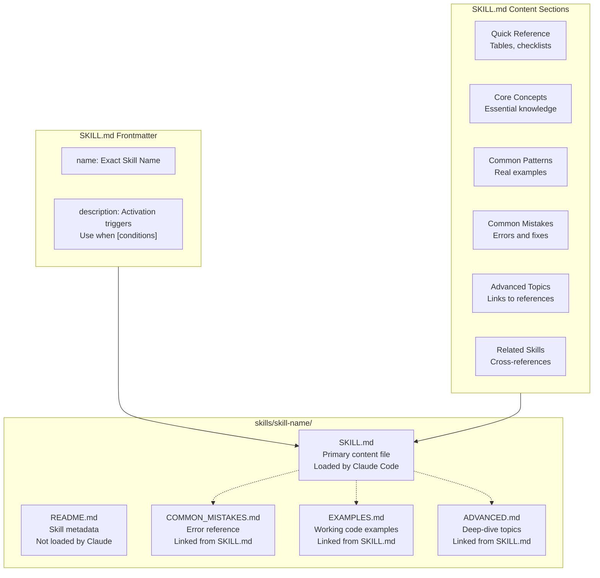
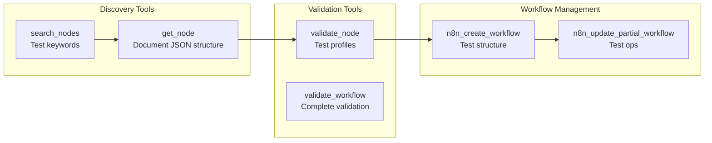
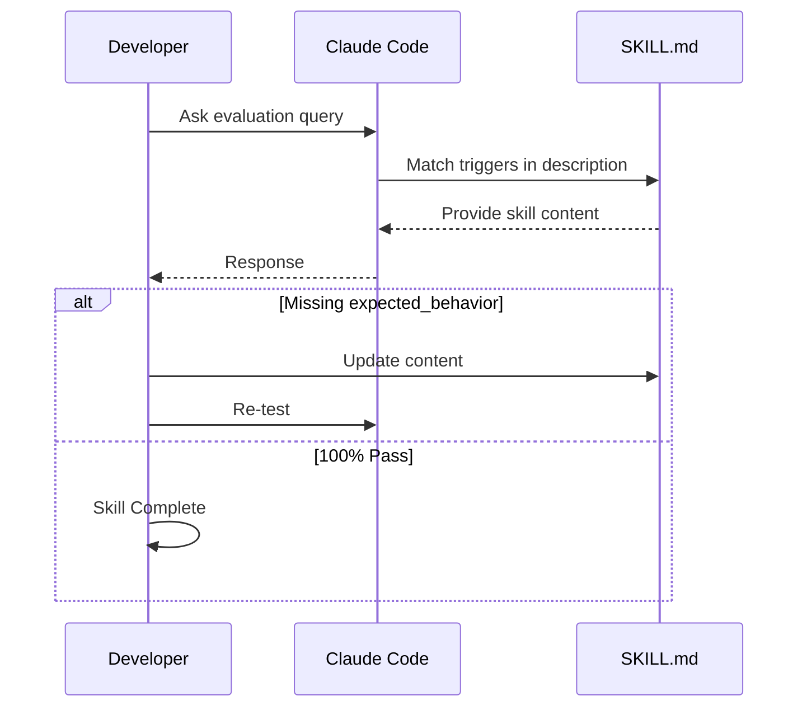
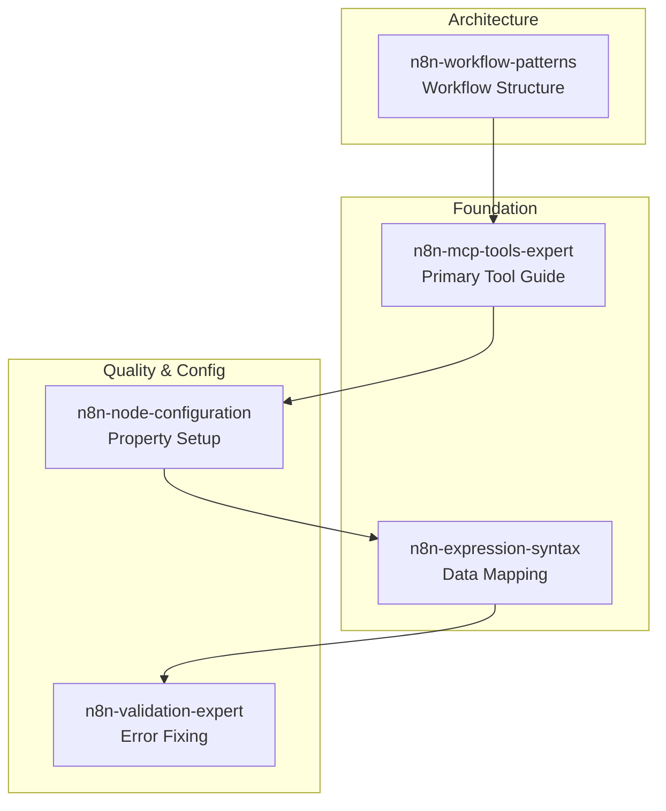

<!-- source: DeepWiki mcp.deepwiki.com · repo czlonkowski/n8n-skills · page 6.2 Creating New Skills · fetched 2026-10-27 -->

# Creating New Skills

<details>
<summary>Relevant source files</summary>

The following files were used as context for generating this wiki page:

- [.gitignore](.gitignore)
- [.mcp.json.example](.mcp.json.example)
- [CLAUDE.md](CLAUDE.md)
- [docs/DEVELOPMENT.md](docs/DEVELOPMENT.md)
- [docs/INSTALLATION.md](docs/INSTALLATION.md)
- [docs/MCP_TESTING_LOG.md](docs/MCP_TESTING_LOG.md)
- [docs/USAGE.md](docs/USAGE.md)

</details>


This document provides a step-by-step guide for creating new Claude Code skills for the n8n-skills system. It covers the complete skill development lifecycle from initial scoping through integration into the distribution packages. For the overall development philosophy and Evaluation-Driven Development methodology, see **6.1 Evaluation-Driven Development (EDD)**. For testing and quality requirements, see **6.3 Testing and Quality Standards**.

---

## Skill Directory Structure

Each skill is organized as a self-contained directory under `skills/` with the following structure:

```
skills/[skill-name]/
├── SKILL.md                  # Main skill content (< 500 lines)
├── README.md                 # Metadata and overview
├── COMMON_MISTAKES.md        # Optional: Error catalog
├── EXAMPLES.md               # Optional: Working examples
└── [additional-refs].md      # Optional: Topic-specific references
```

The `SKILL.md` file is the only file directly loaded by Claude Code as a skill definition. Additional reference files are linked from `SKILL.md` to keep the primary file concise.

**Sources:** [CLAUDE.md:20-36](), [docs/DEVELOPMENT.md:59-84]()

---

## Skill File Structure and Components

The relationship between the primary `SKILL.md` file, its mandatory frontmatter, and supplementary reference files is shown below.

Title: "Skill File Organization"


**Sources:** [docs/DEVELOPMENT.md:155-186](), [docs/DEVELOPMENT.md:188-208]()

---

## Step-by-Step Creation Process

### Step 1: Define Skill Scope

Before writing content, define the skill's purpose and boundaries in `skills/[skill-name]/README.md`.

| Field | Description | Example |
|-------|-------------|---------|
| **Purpose** | One-sentence problem statement | "Teaches correct n8n expression syntax" |
| **Activates on** | Keywords that trigger the skill | "expression, {{}}, $json, webhook data" |
| **MCP Tools** | Tools this skill teaches | `search_nodes`, `get_node` |
| **Key Examples** | 3 representative scenarios | Webhook data access, node references |

**Sources:** [docs/DEVELOPMENT.md:88-98](), [docs/DEVELOPMENT.md:226-249]()

---

### Step 2: Create Evaluation Files

Following EDD, create evaluation scenarios **before** writing skill content.

**Location:** `evaluations/[skill-name]/eval-NNN-description.json`

```json
{
  "id": "expr-001",
  "skills": ["n8n-expression-syntax"],
  "query": "Why is {{$json.email}} undefined in my webhook workflow?",
  "expected_behavior": [
    "Identifies webhook data structure issue",
    "Explains data is under $json.body",
    "Provides corrected expression: {{$json.body.email}}"
  ]
}
```

**Sources:** [docs/DEVELOPMENT.md:99-130](), [docs/DEVELOPMENT.md:253-276]()

---

### Step 3: Test MCP Tools and Document Responses

Test all relevant MCP tools and document actual responses in `docs/MCP_TESTING_LOG.md`. This ensures skill content is based on real system behavior.

Title: "MCP Tool Testing Sequence"


**Sources:** [docs/DEVELOPMENT.md:25-37](), [docs/MCP_TESTING_LOG.md:1-172]()

---

### Step 4: Write SKILL.md

#### Frontmatter Format
The `description` field is critical as it defines the **Activation Triggers**.

```yaml
---
name: n8n Expression Syntax
description: Validate n8n expression syntax and fix common errors. Use when writing n8n expressions, using {{}} syntax, accessing $json/$node variables, or troubleshooting expression errors in workflows.
---
```

**Sources:** [docs/DEVELOPMENT.md:157-163](), [docs/USAGE.md:7-23]()

#### Content Constraints
- **Length**: Must be under 500 lines.
- **Real Examples**: Use data from `docs/MCP_TESTING_LOG.md`.
- **Code Blocks**: Always specify language (e.g., ` ```javascript `).

**Sources:** [docs/DEVELOPMENT.md:39-49](), [docs/DEVELOPMENT.md:50-56]()

---

### Step 5: Add Reference Files

If content exceeds 500 lines, move details to supplementary files:
- `COMMON_MISTAKES.md`: Error catalogs.
- `EXAMPLES.md`: Complex code blocks.
- `PATTERNS.md`: Architectural guidance.

**Sources:** [docs/DEVELOPMENT.md:195-208]()

---

### Step 6: Test and Iterate

Test the skill by running the queries defined in Step 2 through Claude Code.

Title: "Evaluation Testing Loop"


**Sources:** [docs/DEVELOPMENT.md:210-223](), [docs/DEVELOPMENT.md:287-298]()

---

## Integration and Activation

Skills activate **automatically** when the user query matches keywords in the `description` frontmatter. They are designed to work together through **Cross-Skill Composition**.

Title: "Cross-Skill Dependency Map"


**Sources:** [CLAUDE.md:151-159](), [docs/USAGE.md:244-288]()

---

