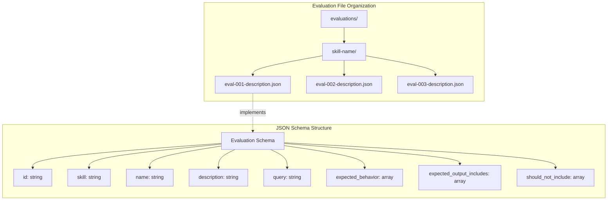
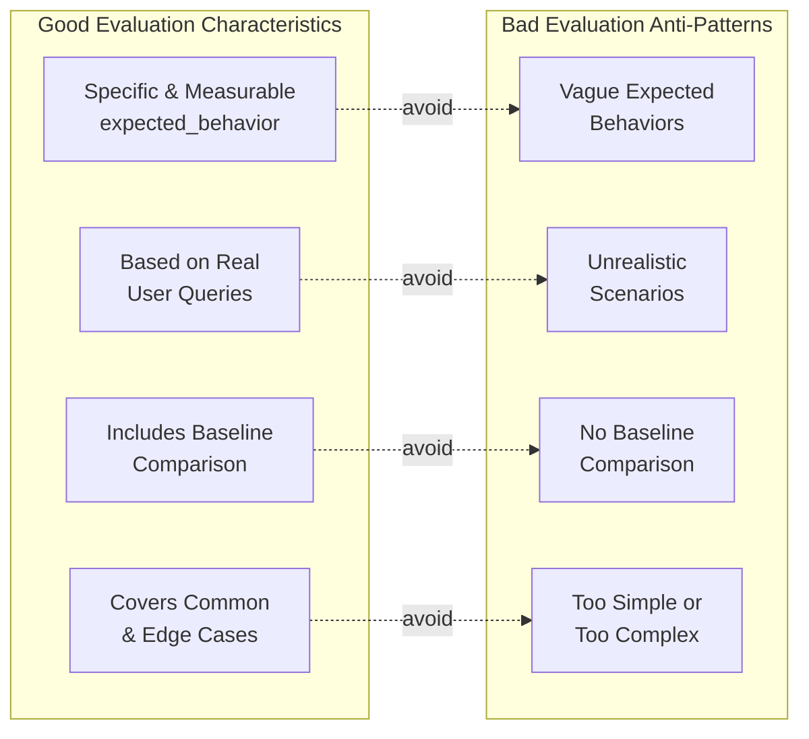
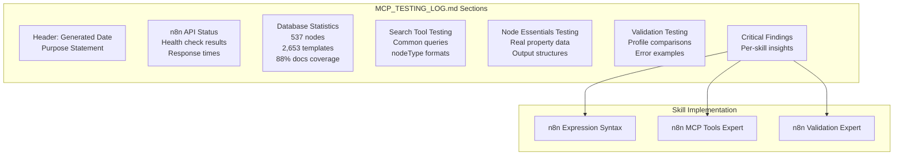
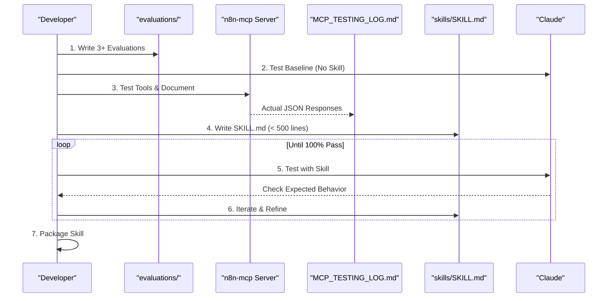
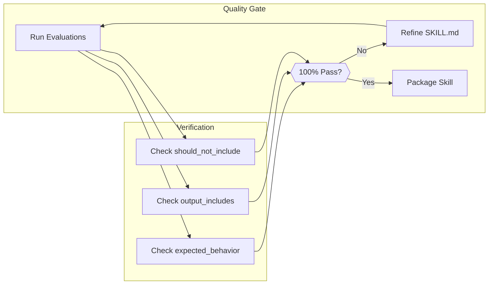

<!-- source: DeepWiki mcp.deepwiki.com · repo czlonkowski/n8n-skills · page 6.3 Testing and Quality Standards · fetched 2026-10-27 -->

# Testing and Quality Standards

Relevant source files

The following files were used as context for generating this wiki page:

- [docs/DEVELOPMENT.md](docs/DEVELOPMENT.md)
- [docs/MCP_TESTING_LOG.md](docs/MCP_TESTING_LOG.md)
- [docs/USAGE.md](docs/USAGE.md)
- [evaluations/code-python/eval-001-module-import-error.json](evaluations/code-python/eval-001-module-import-error.json)
- [evaluations/code-python/eval-002-dictionary-keyerror.json](evaluations/code-python/eval-002-dictionary-keyerror.json)
- [evaluations/mcp-tools/eval-001-tool-selection.json](evaluations/mcp-tools/eval-001-tool-selection.json)
- [evaluations/mcp-tools/eval-002-nodetype-format.json](evaluations/mcp-tools/eval-002-nodetype-format.json)
- [evaluations/mcp-tools/eval-003-validation-workflow.json](evaluations/mcp-tools/eval-003-validation-workflow.json)
- [evaluations/mcp-tools/eval-004-essentials-vs-info.json](evaluations/mcp-tools/eval-004-essentials-vs-info.json)
- [evaluations/mcp-tools/eval-005-smart-parameters.json](evaluations/mcp-tools/eval-005-smart-parameters.json)
- [evaluations/validation-expert/eval-001-missing-required-field.json](evaluations/validation-expert/eval-001-missing-required-field.json)
- [evaluations/validation-expert/eval-002-false-positive.json](evaluations/validation-expert/eval-002-false-positive.json)
- [evaluations/validation-expert/eval-003-auto-sanitization.json](evaluations/validation-expert/eval-003-auto-sanitization.json)
- [evaluations/validation-expert/eval-004-validation-loop.json](evaluations/validation-expert/eval-004-validation-loop.json)

## Purpose and Scope

This document defines the testing methodology and quality standards for `n8n-skills` development. It covers the evaluation format, MCP tool testing requirements, success criteria, and the 100% pass requirement before packaging. The core of this system is **Evaluation-Driven Development (EDD)**, ensuring that every skill is grounded in real-world performance data and actual tool responses from the `n8n-mcp` server.

For the broader philosophy and workflow of Evaluation-Driven Development, see [Evaluation-Driven Development (EDD)](). For the complete skill creation process, see [Creating New Skills]().

---

## Evaluation Structure

### Evaluation File Organization

All evaluations follow a standardized JSON schema stored in the `evaluations/` directory, organized by skill name.

**Sources:** [evaluations/code-python/eval-001-module-import-error.json:1-28](), [docs/DEVELOPMENT.md:59-83]()

### Required Evaluation Fields

| Field | Type | Purpose | Example |
|-------|------|---------|---------|
| `id` | string | Unique identifier (kebab-case) | `"code-python-001"` |
| `skill` | string | Target skill name | `"n8n-code-python"` |
| `name` | string | Human-readable scenario name | `"Module Import Error"` |
| `description` | string | What this evaluation tests | `"Tests understanding that Python nodes have NO external libraries"` |
| `query` | string | User question or scenario | `"How do I import requests in Python node?"` |
| `expected_behavior` | array | List of specific measurable behaviors | `["Identify Python node limitation"]` |
| `expected_output_includes` | array | Keywords/phrases that must appear | `["ModuleNotFoundError", "standard library only"]` |
| `should_not_include` | array | Incorrect responses to avoid | `["pip install", "add requirements.txt"]` |

**Sources:** [evaluations/code-python/eval-001-module-import-error.json:2-27](), [docs/DEVELOPMENT.md:104-124]()

---

## Evaluation Requirements

### Minimum Evaluation Count (3+ Scenarios)

Each skill must have **at least 3 evaluations** covering different levels of complexity:

1.  **Basic Usage**: Common, straightforward scenario (e.g., [evaluations/mcp-tools/eval-001-tool-selection.json]()).
2.  **Common Mistake**: Frequent user error or misconception (e.g., [evaluations/code-python/eval-001-module-import-error.json]()).
3.  **Advanced Scenario**: Edge case or complex integration (e.g., [evaluations/mcp-tools/eval-003-validation-workflow.json]()).

**Sources:** [docs/DEVELOPMENT.md:126-130](), [docs/DEVELOPMENT.md:15-20]()

### Evaluation Quality Criteria

**Sources:** [docs/DEVELOPMENT.md:255-284]()

---

## MCP Tool Testing Log

### Purpose and Structure

The `docs/MCP_TESTING_LOG.md` file documents actual responses from `n8n-mcp` tools. This log serves as the **source of truth** for skill content creation. It ensures that Claude's guidance matches the actual JSON outputs and performance characteristics of the server [docs/MCP_TESTING_LOG.md:1-7]().

**Sources:** [docs/MCP_TESTING_LOG.md:1-172](), [docs/DEVELOPMENT.md:25-38]()

### Critical MCP Findings

Key insights from the testing log that must be reflected in skills:
*   **nodeType Formats**: `nodes-base.webhook` (search/validate) vs `n8n-nodes-base.webhook` (workflow creation) [docs/MCP_TESTING_LOG.md:59-62]().
*   **Data Access**: Webhook data is always under `.body` (e.g., `$json.body.name`) [docs/MCP_TESTING_LOG.md:80-93]().
*   **Tool Performance**: `get_node` (essentials) is ~5KB while `get_node({detail: "full"})` is 100KB+ [docs/MCP_TESTING_LOG.md:131-132]().
*   **Auto-Sanitization**: Runs on all nodes during updates to fix operator structures [docs/MCP_TESTING_LOG.md:134-135]().

**Sources:** [docs/MCP_TESTING_LOG.md:122-151]()

---

## Testing Workflow

### Evaluation-Driven Testing Process

**Sources:** [docs/DEVELOPMENT.md:9-24](), [docs/DEVELOPMENT.md:210-223]()

### Success Criteria: The 100% Pass Requirement

Before a skill can be packaged for distribution, it **must achieve 100% pass rate** on all evaluations [docs/DEVELOPMENT.md:19-21]().

| Criteria | Verification Method |
|----------|---------------------|
| **Functional Pass** | All `expected_behavior` items are addressed in Claude's response [evaluations/code-python/eval-001-module-import-error.json:7-15](). |
| **Keyword Pass** | All `expected_output_includes` strings are present [evaluations/code-python/eval-001-module-import-error.json:16-22](). |
| **Negative Pass** | No `should_not_include` items are present (e.g., no "pip install" for Python) [evaluations/code-python/eval-001-module-import-error.json:23-27](). |
| **Conciseness** | `SKILL.md` remains under 500 lines to ensure performance [docs/DEVELOPMENT.md:41-43](). |

**Sources:** [docs/DEVELOPMENT.md:218-223](), [docs/DEVELOPMENT.md:39-44]()

---

## Skill-Specific Testing Examples

### Validation Expert Testing
Testing the `n8n-validation-expert` skill involves verifying the "Validation Loop" pattern: `validate` -> `read errors` -> `fix` -> `validate again` [evaluations/validation-expert/eval-004-validation-loop.json:8-12]().
*   **Scenario**: Missing required fields like `channel` in Slack [evaluations/validation-expert/eval-001-missing-required-field.json:4-11]().
*   **Scenario**: Handling false positives/warnings (e.g., best practices vs. hard errors) [evaluations/validation-expert/eval-002-false-positive.json:4-13]().

### MCP Tools Expert Testing
Testing the `n8n-mcp-tools-expert` skill focuses on tool selection and efficiency.
*   **Scenario**: Choosing `get_node_essentials` (5KB) over `get_node_info` (100KB+) for performance [evaluations/mcp-tools/eval-004-essentials-vs-info.json:4-13]().
*   **Scenario**: Correct syntax for `search_nodes({query: 'slack'})` [evaluations/mcp-tools/eval-001-tool-selection.json:4-12]().

**Sources:** [evaluations/validation-expert/eval-004-validation-loop.json:1-15](), [evaluations/mcp-tools/eval-004-essentials-vs-info.json:1-26](), [docs/MCP_TESTING_LOG.md:129-135]()

---

## Integration with Development Pipeline

**Sources:** [docs/DEVELOPMENT.md:9-24](), [docs/DEVELOPMENT.md:210-223]()

---

