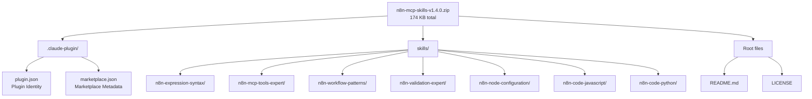
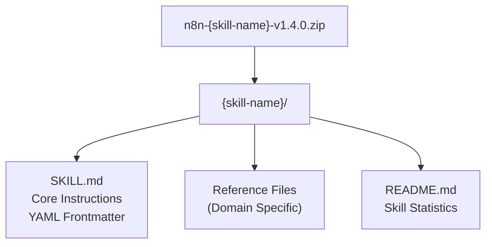
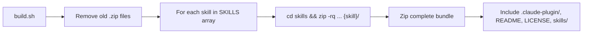

<!-- source: DeepWiki mcp.deepwiki.com · repo czlonkowski/n8n-skills · page 7.1 Distribution Package Structure · fetched 2026-10-27 -->

# Distribution Package Structure

Relevant source files

The following files were used as context for generating this wiki page:

- [build.sh](build.sh)
- [dist/README.md](dist/README.md)
- [dist/n8n-mcp-skills-v1.4.0.zip](dist/n8n-mcp-skills-v1.4.0.zip)
- [dist/n8n-mcp-tools-expert-v1.4.0.zip](dist/n8n-mcp-tools-expert-v1.4.0.zip)
- [dist/n8n-node-configuration-v1.4.0.zip](dist/n8n-node-configuration-v1.4.0.zip)
- [dist/n8n-validation-expert-v1.4.0.zip](dist/n8n-validation-expert-v1.4.0.zip)

## Purpose and Scope

This document describes the structure and organization of distribution packages in the `n8n-skills` repository. It covers the two packaging strategies (complete bundle vs. individual skills), file organization within each package type, metadata specifications, and platform-specific requirements. The current distribution version is **v1.4.0**.

---

## Package Types Overview

The `n8n-skills` repository generates two distinct package types to accommodate different Claude platform requirements and user preferences. The build process is managed by `build.sh`, which automates the creation of these assets in the `dist/` directory.

| Package Type | File Pattern | Size | Target Platform | Skills Included |
|-------------|--------------|------------|-----------------|-----------------|
| **Complete Bundle** | `n8n-mcp-skills-v1.4.0.zip` | 174 KB | Claude Code, API/SDK | All 7 skills |
| **Individual Packages** | `n8n-{skill}-v1.4.0.zip` | 11-37 KB | Claude.ai, Claude Desktop | 1 skill per zip |

**Sources:** [dist/README.md:5-27](), [build.sh:7-31]()

---

## Complete Bundle Structure (Claude Code)

The complete bundle (`n8n-mcp-skills-v1.4.0.zip`) follows the Claude Code plugin specification. It organizes all skills under a nested `skills/` directory and includes plugin metadata in `.claude-plugin/`.

### Bundle Directory Layout

### Bundle Component Mapping

| Directory/File | Code Entity / Purpose | Source Reference |
|----------------|-----------------------|------------------|
| `.claude-plugin/` | Plugin metadata for Claude Code discovery | [dist/README.md:82-84]() |
| `skills/` | Nested skill storage required by `/plugin install` | [dist/README.md:87-95]() |
| `plugin.json` | Defines name, version, and keywords | [dist/n8n-mcp-skills-v1.4.0.zip:3]() |
| `marketplace.json` | Category (`automation`) and publisher info | [dist/n8n-mcp-skills-v1.4.0.zip:2]() |

**Sources:** [dist/README.md:79-95](), [build.sh:38-45]()

---

## Individual Skill Package Structure (Claude.ai)

Individual packages are optimized for the Claude.ai "Upload Skill" interface. Unlike the bundle, these have a **flat structure** where the skill folder is at the zip root.

### Individual Package Layout

### File Distribution Examples

Each package contains specialized reference files to keep the main `SKILL.md` under the 500-line limit:

*   **n8n-validation-expert**: Includes `ERROR_CATALOG.md` and `FALSE_POSITIVES.md`. [dist/n8n-validation-expert-v1.4.0.zip:2-26]()
*   **n8n-node-configuration**: Includes `DEPENDENCIES.md` and `OPERATION_PATTERNS.md`. [dist/n8n-node-configuration-v1.4.0.zip:2-23]()
*   **n8n-mcp-tools-expert**: Includes the main `SKILL.md` and `README.md`. [dist/n8n-mcp-tools-expert-v1.4.0.zip:3-5]()

**Sources:** [dist/README.md:69-77](), [build.sh:19-36]()

---

## Platform Selection Matrix

The choice of package depends entirely on the Claude interface being used.

| Platform | Recommended Package | Skills | Installation Method |
|----------|---------------------|--------|---------------------|
| **Claude Code** | Complete Bundle | All 7 | `/plugin install czlonkowski/n8n-skills` |
| **Claude.ai** | Individual Zips | 7 (Separate) | Settings > Capabilities > Skills > Upload |
| **Claude Desktop** | Individual Zips | 7 (Separate) | Settings > Capabilities > Skills > Upload |
| **Claude API** | Complete Bundle | All 7 | Extract `skills/` to local directory |

**Sources:** [dist/README.md:40-47]()

---

## Package Size and Content Analysis

Package sizes vary based on the depth of reference documentation. Workflow Patterns is the largest individual package due to detailed architectural guides.

| Skill / Package | Size | Primary Reference Files |
|-----------------|------|-------------------------|
| `n8n-workflow-patterns` | 37 KB | Pattern-specific architecture guides |
| `n8n-validation-expert` | 19 KB | `ERROR_CATALOG.md`, `FALSE_POSITIVES.md` |
| `n8n-mcp-tools-expert` | 19 KB | `SKILL.md` (MCP tool usage instructions) |
| `n8n-node-configuration` | 18 KB | `DEPENDENCIES.md`, `OPERATION_PATTERNS.md` |
| `n8n-code-javascript` | 34 KB | JavaScript implementation patterns |
| `n8n-code-python` | 31 KB | Python standard library constraints |
| `n8n-expression-syntax` | 11 KB | n8n syntax and webhook body access |

**Sources:** [dist/README.md:53-63]()

---

## Build Implementation

The `build.sh` script defines how these packages are assembled. It uses two distinct logic paths for individual vs. bundle packaging.

### Build Logic Flow

**Key Code Entities:**
*   `DIST_DIR`: Set to `"dist"`. [build.sh:7]()
*   `VERSION`: Set to `"1.4.0"`. [build.sh:8]()
*   `SKILLS` Array: Lists the 7 core skills for individual packaging. [build.sh:23-31]()
*   `zip -rq`: Command used to ensure quiet, recursive packaging without system files like `.DS_Store`. [build.sh:35,40]()

**Sources:** [build.sh:1-55]()

---

## Common Issues and Solutions

The distribution README identifies specific errors related to package structure.

### Zip must contain exactly one SKILL.md file
This error occurs in **Claude.ai** when a user attempts to upload the Complete Bundle. Claude.ai expects a flat structure where `SKILL.md` is discoverable at the zip root (or within one root folder).
*   **Solution**: Use individual skill zips from the `dist/` folder. [dist/README.md:133-135]()

### Skills not triggering
This is often a metadata or frontmatter issue.
*   **Verification**: Ensure `SKILL.md` files have correct YAML frontmatter and that queries match the activation keywords defined in the `README.md` for each skill. [dist/README.md:142-146]()

**Sources:** [dist/README.md:131-146]()

---

