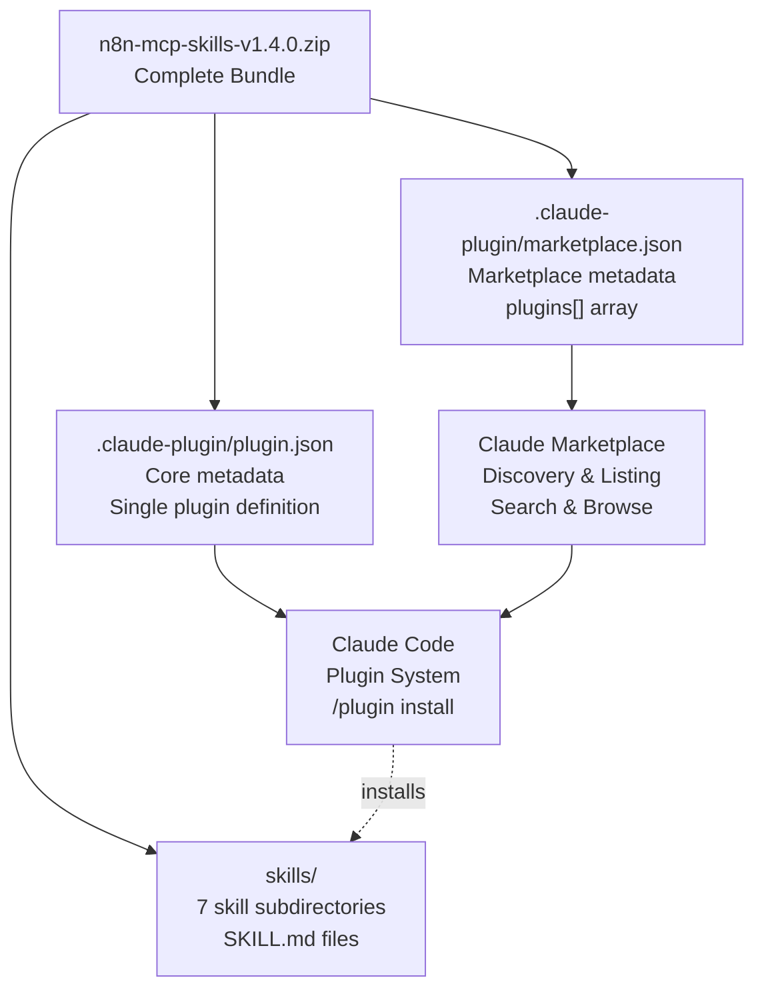
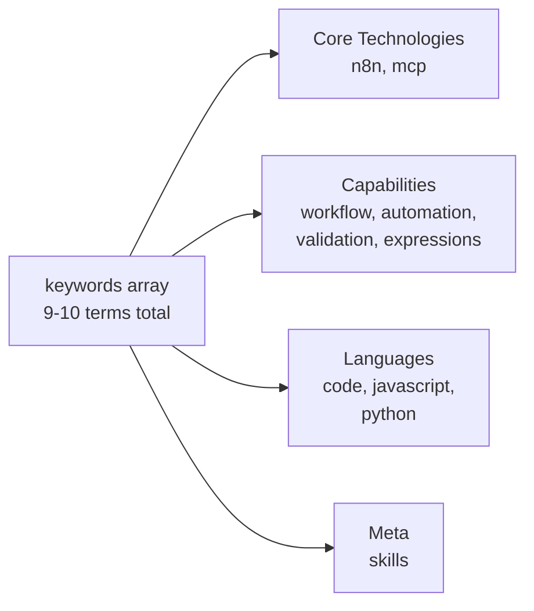
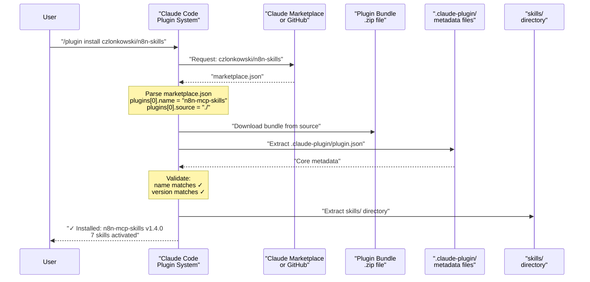

<!-- source: DeepWiki mcp.deepwiki.com · repo czlonkowski/n8n-skills · page 7.2 Plugin Metadata Specification · fetched 2026-10-27 -->

# Plugin Metadata Specification

<details>
<summary>Relevant source files</summary>

The following files were used as context for generating this wiki page:

- [.claude-plugin/marketplace.json](.claude-plugin/marketplace.json)
- [.claude-plugin/plugin.json](.claude-plugin/plugin.json)

</details>


## Purpose and Scope

This document specifies the JSON metadata schemas used by the n8n-skills plugin system. It details the structure and fields of `plugin.json` and `marketplace.json`, how Claude platforms consume this metadata during installation and discovery, and the relationship between these two files. These files are located in the `.claude-plugin/` directory and are essential for the distribution of the 7 expert skills.

---

## Metadata Files Overview

The n8n-skills plugin uses two metadata files located in the `.claude-plugin/` directory:

| File | Purpose | Used By | Location in Bundle |
|------|---------|---------|-------------------|
| `plugin.json` | Core plugin metadata for Claude Code | Plugin installation system | [.claude-plugin/plugin.json]() |
| `marketplace.json` | Marketplace listing and discovery | Claude marketplace, multi-plugin repos | [.claude-plugin/marketplace.json]() |

Both files use JSON format with overlapping but distinct schemas. The `plugin.json` file defines the plugin as a single installable unit, while `marketplace.json` can describe multiple plugins in a monorepo structure.

**Metadata File Relationship:**



**Sources:** [.claude-plugin/plugin.json:1-23](), [.claude-plugin/marketplace.json:1-36]()

---

## plugin.json Schema

The `plugin.json` file defines core metadata for the plugin as recognized by the Claude Code installation system. This file is required for plugin installation via `/plugin install` command.

### Field Specification

| Field | Type | Required | Description | Example Value |
|-------|------|----------|-------------|---------------|
| `name` | string | ✓ | Plugin identifier (kebab-case) | `"n8n-mcp-skills"` |
| `version` | string | ✓ | Semantic version (MAJOR.MINOR.PATCH) | `"1.4.0"` |
| `description` | string | ✓ | One-line plugin description | `"Expert skills for building n8n workflows with n8n-mcp"` |
| `author` | object | ✓ | Plugin author metadata | `{"name": "...", "url": "..."}` |
| `author.name` | string | ✓ | Author's full name | `"Romuald Członkowski"` |
| `author.url` | string | ○ | Author's website or profile URL | `"https://www.aiadvisors.pl/en"` |
| `license` | string | ✓ | SPDX license identifier | `"MIT"` |
| `keywords` | string[] | ○ | Search keywords (lowercase, no spaces) | `["n8n", "workflow", "automation"]` |
| `repository` | string | ○ | Git repository URL | `"https://github.com/czlonkowski/n8n-skills"` |
| `homepage` | string | ○ | Plugin homepage URL | `"https://github.com/czlonkowski/n8n-skills"` |

### Actual plugin.json Structure

The n8n-skills `plugin.json` file contains:

```json
{
  "name": "n8n-mcp-skills",
  "version": "1.4.0",
  "description": "Expert skills for building n8n workflows with n8n-mcp",
  "author": {
    "name": "Romuald Członkowski",
    "url": "https://www.aiadvisors.pl/en"
  },
  "license": "MIT",
  "keywords": [
    "n8n", "workflow", "automation", "mcp",
    "validation", "expressions", "code",
    "javascript", "python"
  ],
  "repository": "https://github.com/czlonkowski/n8n-skills",
  "homepage": "https://github.com/czlonkowski/n8n-skills"
}
```

**Sources:** [.claude-plugin/plugin.json:1-23]()

---

## marketplace.json Schema

The `marketplace.json` file defines how the plugin appears in the Claude marketplace and supports multi-plugin repositories. It includes additional fields for categorization and discovery.

### Top-Level Field Specification

| Field | Type | Required | Description | Example Value |
|-------|------|----------|-------------|---------------|
| `name` | string | ✓ | Marketplace project name | `"n8n-mcp-skills"` |
| `description` | string | ✓ | Project-level description | `"Expert skills for building n8n workflows"` |
| `owner` | object | ✓ | Project owner (may differ from plugin author) | `{"name": "...", "url": "..."}` |
| `owner.name` | string | ✓ | Owner's full name | `"Romuald Członkowski"` |
| `owner.url` | string | ○ | Owner's website | `"https://www.aiadvisors.pl/en"` |
| `plugins` | array | ✓ | Array of plugin definitions | `[{...}]` |

### Plugin Array Entry Schema

Each entry in the `plugins[]` array defines a single installable plugin:

| Field | Type | Required | Description | Example Value |
|-------|------|----------|-------------|---------------|
| `name` | string | ✓ | Plugin identifier (must match plugin.json) | `"n8n-mcp-skills"` |
| `source` | string | ✓ | Relative path to plugin directory | `"./"` |
| `description` | string | ✓ | Plugin-specific description (longer than plugin.json) | `"Complete bundle: 7 expert skills..."` |
| `version` | string | ✓ | Semantic version (must match plugin.json) | `"1.4.0"` |
| `author` | object | ✓ | Plugin author metadata | `{"name": "...", "url": "..."}` |
| `category` | string | ✓ | Marketplace category | `"automation"` |
| `keywords` | string[] | ○ | Search keywords | `["n8n", "workflow", ...]` |
| `homepage` | string | ○ | Plugin homepage | `"https://github.com/..."` |
| `repository` | string | ○ | Git repository URL | `"https://github.com/..."` |
| `license` | string | ○ | SPDX license identifier | `"MIT"` |

### Actual marketplace.json Structure

The n8n-skills `marketplace.json` file contains:

```json
{
  "name": "n8n-mcp-skills",
  "description": "Expert skills for building n8n workflows",
  "owner": {
    "name": "Romuald Członkowski",
    "url": "https://www.aiadvisors.pl/en"
  },
  "plugins": [
    {
      "name": "n8n-mcp-skills",
      "source": "./",
      "description": "Complete bundle: 7 expert skills for building flawless n8n workflows using n8n-mcp MCP server. Includes skills for expression syntax, MCP tools usage, workflow patterns, validation, node configuration, JavaScript code, and Python code.",
      "version": "1.4.0",
      "author": {
        "name": "Romuald Członkowski",
        "url": "https://www.aiadvisors.pl/en"
      },
      "category": "automation",
      "keywords": [
        "n8n", "workflow", "mcp", "automation",
        "validation", "expressions", "code",
        "javascript", "python", "skills"
      ],
      "homepage": "https://github.com/czlonkowski/n8n-skills",
      "repository": "https://github.com/czlonkowski/n8n-skills",
      "license": "MIT"
    }
  ]
}
```

**Sources:** [.claude-plugin/marketplace.json:1-36]()

---

## Field Specifications Deep Dive

### Name Field

The `name` field must:
- Use kebab-case formatting (lowercase with hyphens)
- Be unique in the Claude marketplace
- Match between `plugin.json` and `marketplace.json`
- Match the plugin identifier used in `/plugin install` commands

Example: `"n8n-mcp-skills"` enables installation via the identifier `czlonkowski/n8n-skills` [[.claude-plugin/plugin.json:2](), [.claude-plugin/marketplace.json:2]()]

### Version Field

The `version` field must:
- Follow semantic versioning (MAJOR.MINOR.PATCH)
- Match exactly between `plugin.json` and `marketplace.json`
- Increment for each release

Current version: `"1.4.0"` [[.claude-plugin/plugin.json:3](), [.claude-plugin/marketplace.json:13]()]

### Description Fields

Three description fields exist with different purposes:

| Location | Purpose | Example |
|----------|---------|---------|
| `plugin.json` | Brief, shown in plugin list | `"Expert skills for building n8n workflows with n8n-mcp"` [[.claude-plugin/plugin.json:4]()] |
| `marketplace.json` (top) | Project-level summary | `"Expert skills for building n8n workflows"` [[.claude-plugin/marketplace.json:3]()] |
| `marketplace.json` (plugin) | Full plugin description with details | `"Complete bundle: 7 expert skills for building flawless n8n workflows..."` [[.claude-plugin/marketplace.json:12]()] |

### Author vs Owner

**Author** (`plugin.json` and `marketplace.json` plugin entry):
- Individual or organization that created the plugin
- Has `name` and optional `url` fields
- Represents the plugin maintainer [[.claude-plugin/plugin.json:5-8](), [.claude-plugin/marketplace.json:14-17]()]

**Owner** (`marketplace.json` top-level only):
- Repository or organization owner
- Represents the project/repository maintainer [[.claude-plugin/marketplace.json:4-7]()]

In n8n-skills, author and owner are the same: Romuald Członkowski.

### Source Field

The `source` field in `marketplace.json` plugins array specifies the relative path from the repository root to the plugin directory:

- `"./"` - Plugin at repository root (n8n-skills case) [[.claude-plugin/marketplace.json:11]()]

### Category Field

The `category` field (marketplace.json only) classifies plugins for marketplace browsing. n8n-skills uses `"automation"` as the primary category [[.claude-plugin/marketplace.json:18]()].

---

## Keywords and Categorization

### Keyword Strategy

The `keywords` array enables marketplace search and discovery. Keywords include core technologies (`n8n`, `mcp`), capabilities (`validation`, `expressions`), and languages (`javascript`, `python`).

### n8n-skills Keywords Analysis



### Keyword Differences Between Files

| File | Keyword Count | Additional Keywords | Rationale |
|------|--------------|---------------------|-----------|
| `plugin.json` | 9 keywords | - | Core set for plugin system [[.claude-plugin/plugin.json:10-20]()] |
| `marketplace.json` | 10 keywords | `"skills"` | Marketplace-specific term emphasizing the bundle nature [[.claude-plugin/marketplace.json:19-30]()] |

**Sources:** [.claude-plugin/plugin.json:10-20](), [.claude-plugin/marketplace.json:19-30]()

---

## How Claude Platforms Use Metadata

### Installation Flow



### Metadata Validation During Installation

Claude Code performs validation checks to ensure the `name` and `version` fields match between the requested plugin and the provided metadata [[.claude-plugin/plugin.json:2-3](), [.claude-plugin/marketplace.json:10-13]()].

**Sources:** [.claude-plugin/plugin.json:1-23](), [.claude-plugin/marketplace.json:1-36]()

---

## Summary Table: Metadata File Comparison

| Aspect | plugin.json | marketplace.json |
|--------|-------------|------------------|
| **Primary Purpose** | Plugin installation | Marketplace discovery & listing |
| **Consumed By** | Claude Code plugin system | Claude marketplace |
| **Version** | `1.4.0` | `1.4.0` |
| **Keywords Difference** | 9 keywords | 10 keywords (+`"skills"`) |
| **Multi-Plugin Support** | No (single plugin per file) | Yes (plugins[] array) |
| **File Location** | `.claude-plugin/plugin.json` | `.claude-plugin/marketplace.json` |

Both files are required for marketplace distribution. The `plugin.json` defines the plugin itself, while `marketplace.json` defines how it appears in the marketplace and supports monorepo structures.

**Sources:** [.claude-plugin/plugin.json:1-23](), [.claude-plugin/marketplace.json:1-36]()

---

