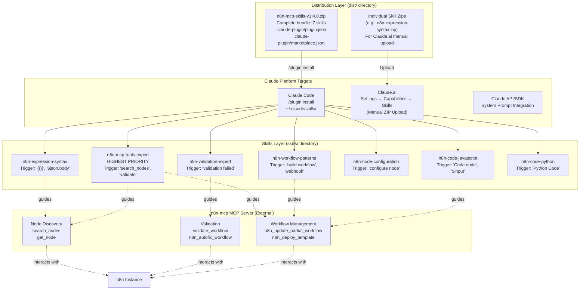
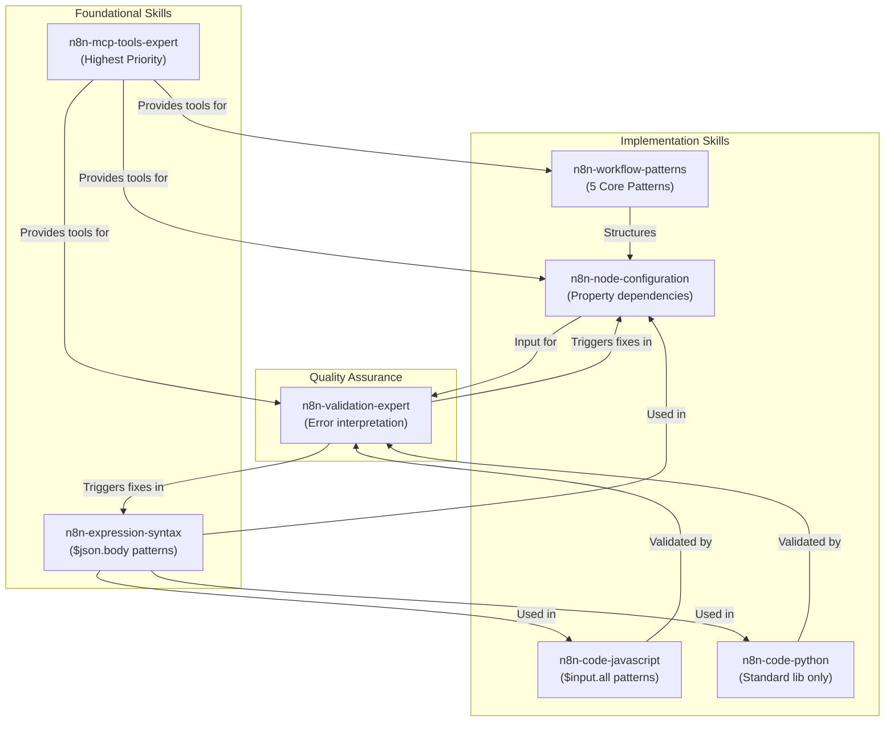
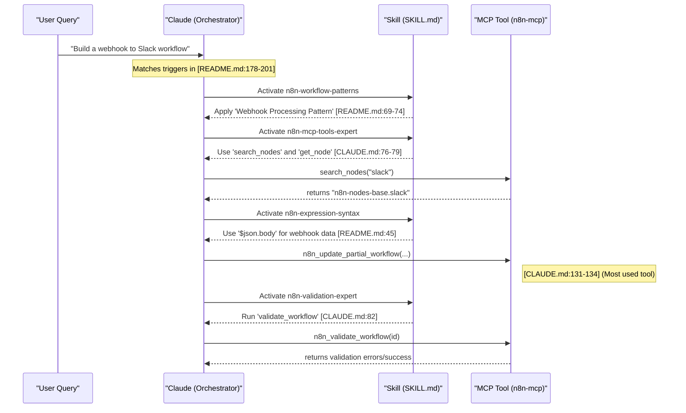
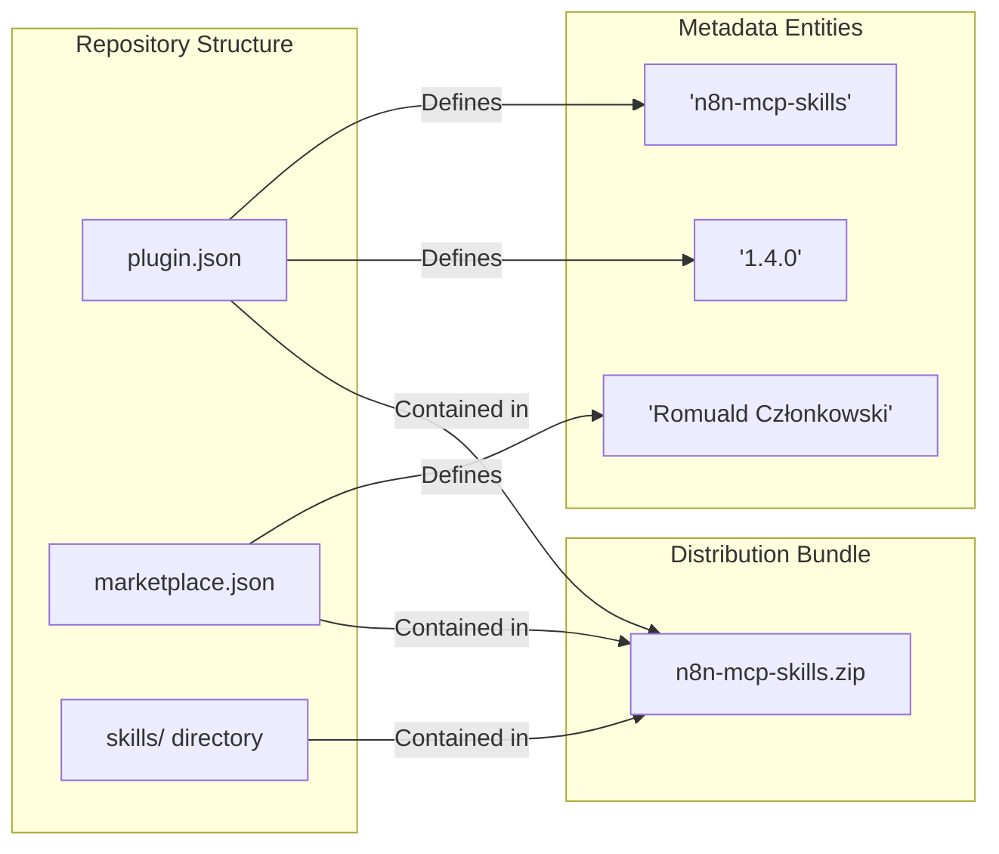
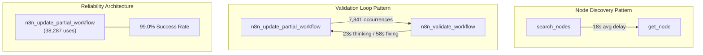

<!-- source: DeepWiki mcp.deepwiki.com · repo czlonkowski/n8n-skills · page 7.3 System Architecture Diagrams · fetched 2026-10-27 -->

# System Architecture Diagrams

Relevant source files

The following files were used as context for generating this wiki page:

- [.claude-plugin/marketplace.json](.claude-plugin/marketplace.json)
- [.claude-plugin/plugin.json](.claude-plugin/plugin.json)
- [CLAUDE.md](CLAUDE.md)
- [README.md](README.md)
- [skills.png](skills.png)

This page provides comprehensive technical diagrams of the **n8n-skills** system architecture, including the three-layer ecosystem, skill relationships, distribution strategy, activation flows, and tool usage patterns derived from telemetry data. These diagrams map high-level concepts to concrete code entities (file paths, skill names, tool functions) to facilitate codebase navigation.

---

## Overall System Ecosystem

### Three-Layer Architecture

The system operates across three distinct layers: the distribution layer for packaging, the skills layer for expert logic, and the MCP server layer for execution.

**Key Architectural Insights:**

| Layer | Purpose | Key Components |
|-------|---------|----------------|
| **Distribution** | Package skills for different platforms | `plugin.json`, `marketplace.json`, `dist/` |
| **Skills** | Provide expert guidance on HOW to use tools | 7 `SKILL.md` files in `skills/` subdirectories |
| **MCP Server** | Provide data access and execution | `search_nodes`, `n8n_update_partial_workflow`, `validate_workflow` |

**Sources:** [.claude-plugin/plugin.json:1-23](), [CLAUDE.md:13-17](), [README.md:15-34](), [README.md:126-172]()

---

## Skill Relationship and Dependency Graph

Skills are designed to be complementary and often work in a specific sequence or hierarchy, with the **n8n-mcp-tools-expert** acting as the primary orchestrator for tool interaction.

**Sources:** [CLAUDE.md:38-71](), [CLAUDE.md:151-159](), [README.md:203-214]()

---

## Activation Flow: Natural Language to Code Entity

This diagram illustrates how a user's natural language request triggers specific code entities (skills) and how those skills subsequently invoke MCP tools.

**Sources:** [CLAUDE.md:145-150](), [README.md:178-201](), [README.md:203-214]()

---

## Distribution Strategy and Metadata

The following diagram maps the distribution files to their roles in the Claude ecosystem.

**Key Metadata Fields:**
* **Name:** `n8n-mcp-skills` [.claude-plugin/plugin.json:2]()
* **Version:** `1.4.0` [.claude-plugin/plugin.json:3]()
* **Keywords:** `n8n`, `workflow`, `mcp`, `validation`, `expressions` [.claude-plugin/plugin.json:10-20]()

**Sources:** [.claude-plugin/plugin.json:1-23](), [.claude-plugin/marketplace.json:1-36]()

---

## Tool Usage Patterns (Telemetry Insights)

Architecture of the most common operational loops based on telemetry data from 447K events.

**Key Operational Metrics:**
* **Edit Frequency:** 56 seconds average between edits [.claude-plugin/plugin.json:134]()
* **Validation Intensity:** 7,841 occurrences of the update-validate loop [.claude-plugin/plugin.json:126]()
* **Discovery Latency:** 18s average between searching and getting node details [.claude-plugin/plugin.json:121]()

**Sources:** [CLAUDE.md:119-134]()

---

