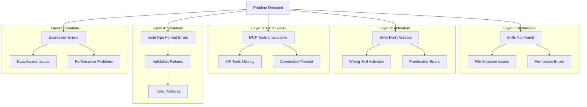
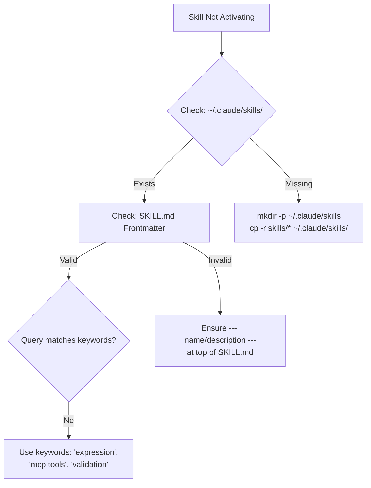
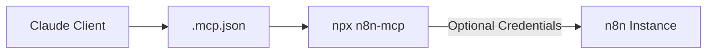
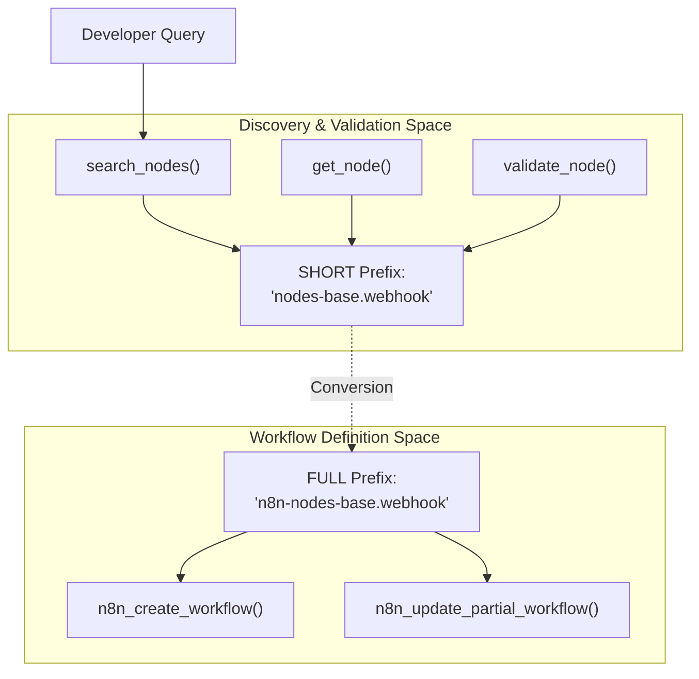

<!-- source: DeepWiki mcp.deepwiki.com · repo czlonkowski/n8n-skills · page 7.4 Common Issues and Solutions · fetched 2026-10-27 -->

# Common Issues and Solutions

<details>
<summary>Relevant source files</summary>

The following files were used as context for generating this wiki page:

- [.gitignore](.gitignore)
- [.mcp.json.example](.mcp.json.example)
- [docs/DEVELOPMENT.md](docs/DEVELOPMENT.md)
- [docs/INSTALLATION.md](docs/INSTALLATION.md)
- [docs/MCP_TESTING_LOG.md](docs/MCP_TESTING_LOG.md)
- [docs/USAGE.md](docs/USAGE.md)
- [skills/n8n-mcp-tools-expert/README.md](skills/n8n-mcp-tools-expert/README.md)
- [skills/n8n-mcp-tools-expert/SEARCH_GUIDE.md](skills/n8n-mcp-tools-expert/SEARCH_GUIDE.md)
- [skills/n8n-validation-expert/ERROR_CATALOG.md](skills/n8n-validation-expert/ERROR_CATALOG.md)
- [skills/n8n-validation-expert/FALSE_POSITIVES.md](skills/n8n-validation-expert/FALSE_POSITIVES.md)
- [skills/n8n-validation-expert/README.md](skills/n8n-validation-expert/README.md)

</details>


## Purpose and Scope

This page provides diagnostic guidance and solutions for common problems encountered when installing, configuring, and using n8n-skills across Claude platforms. It covers troubleshooting for skill activation failures, MCP server connectivity, validation errors, nodeType format confusion, and platform-specific limitations.

---

## Issue Categories

The troubleshooting process follows a hierarchical diagnostic flow, addressing issues from installation through runtime operation:

Title: Diagnostic Hierarchy

Sources: [docs/INSTALLATION.md:203-254](), [skills/n8n-validation-expert/README.md:11-19]()

---

## Installation and Activation Issues

### Skills Not Found or Activating

**Issue**: Skills are installed but do not appear in Claude or fail to activate on triggers.

**Diagnosis Flow**:

Title: Activation Troubleshooting


**Common Solutions**:
1. **Directory Location**: For Claude Code, skills must reside in `~/.claude/skills/` (macOS/Linux) or `%USERPROFILE%\.claude\skills\` (Windows) [docs/INSTALLATION.md:58-71]().
2. **Frontmatter Format**: Every `SKILL.md` must start with valid YAML frontmatter containing `name` and `description` [docs/DEVELOPMENT.md:158-163]().
3. **Trigger Keywords**: Skills activate based on keywords in the query. For example, `n8n-mcp-tools-expert` triggers on "search nodes", "validate", or "mcp tools" [skills/n8n-mcp-tools-expert/README.md:11-20]().

Sources: [docs/INSTALLATION.md:58-71](), [docs/INSTALLATION.md:205-223](), [docs/USAGE.md:7-23]()

---

## MCP Server Connection Issues

### MCP Tools Unavailable

**Issue**: Claude reports that `n8n-mcp` tools (like `search_nodes`) are unavailable.

**Configuration Requirements**:
The `.mcp.json` file must be correctly configured in the user's home directory or project root [docs/INSTALLATION.md:18-35]().

Title: MCP Connection Logic


**Diagnostic Checklist**:
| Component | Requirement | Verification |
|-----------|-------------|--------------|
| Installation | `n8n-mcp` installed | `npm list -g n8n-mcp` [docs/INSTALLATION.md:230-230]() |
| Config File | `.mcp.json` presence | Check `~/.mcp.json` [docs/INSTALLATION.md:18-18]() |
| Environment | `MCP_MODE: "stdio"` | Check env in `.mcp.json` [docs/INSTALLATION.md:26-26]() |
| API Access | `N8N_API_URL` & `KEY` | Required for `n8n_create_workflow` [docs/INSTALLATION.md:234-242]() |

Sources: [docs/INSTALLATION.md:9-37](), [docs/INSTALLATION.md:225-233](), [.mcp.json.example:1-16]()

---

## Validation and nodeType Issues

### nodeType Format Confusion

**Issue**: Errors like "Node type not found" when using MCP tools.

**Root Cause**: Different contexts require different prefix formats for node types [docs/MCP_TESTING_LOG.md:59-62]().

Title: nodeType Format Mapping


**Resolution**:
- Use `nodes-base.name` for discovery tools (`search_nodes`, `get_node`, `validate_node`) [skills/n8n-mcp-tools-expert/SEARCH_GUIDE.md:288-295]().
- Use `n8n-nodes-base.name` for workflow management tools (`n8n_create_workflow`) [skills/n8n-mcp-tools-expert/SEARCH_GUIDE.md:288-295]().

Sources: [docs/MCP_TESTING_LOG.md:59-62](), [skills/n8n-mcp-tools-expert/SEARCH_GUIDE.md:288-295](), [skills/n8n-mcp-tools-expert/README.md:44-44]()

---

### Handling Validation Loops and False Positives

**Issue**: Stuck in a cycle of "Configure → Validate → Fix".

**Key Insights**:
- **The Validation Loop**: Achieving a valid configuration typically takes **2-3 iterations** [skills/n8n-validation-expert/README.md:17-17]().
- **False Positives**: Approximately **40% of warnings** are acceptable in context (e.g., missing error handling in a dev workflow) [skills/n8n-validation-expert/README.md:49-49]().

**Solution Matrix**:
| Error Type | Auto-Fix | Severity | Strategy |
|------------|----------|----------|----------|
| `missing_required` | ❌ | Error | Must provide field [skills/n8n-validation-expert/ERROR_CATALOG.md:101-101]() |
| `invalid_value` | ❌ | Error | Check allowed enums via `get_node` [skills/n8n-validation-expert/ERROR_CATALOG.md:102-102]() |
| `operator_structure`| ✅ | Warning | Trust auto-sanitization [skills/n8n-validation-expert/README.md:106-106]() |
| `best_practice` | ❌ | Warning | Use `ai-friendly` profile to reduce noise [skills/n8n-validation-expert/README.md:38-38]() |

Sources: [skills/n8n-validation-expert/README.md:15-19](), [skills/n8n-validation-expert/README.md:97-107](), [skills/n8n-validation-expert/FALSE_POSITIVES.md:7-15]()

---

## Runtime and Expression Issues

### Webhook Data Access Errors

**Issue**: Expressions like `{{$json.email}}` return undefined in webhook-triggered workflows.

**Root Cause**: Webhook data is nested under the `.body` property [docs/MCP_TESTING_LOG.md:80-81]().

**Corrective Action**:
- **Incorrect**: `{{$json.email}}`
- **Correct**: `{{$json.body.email}}` [docs/MCP_TESTING_LOG.md:88-91]()

### Code Node Return Format

**Issue**: Code nodes (JavaScript/Python) fail to pass data to the next node.

**Requirement**: Data must be returned as an array of objects with a `json` key [skills/n8n-validation-expert/README.md:131-149]().

```javascript
// Correct JS Return Format
return [{
  json: {
    key: "value"
  }
}];
```

Sources: [docs/MCP_TESTING_LOG.md:80-93](), [docs/USAGE.md:48-62](), [skills/n8n-validation-expert/README.md:129-149]()

---

