# Page: Overview

# Overview

<details>
<summary>Relevant source files</summary>

The following files were used as context for generating this wiki page:

- [.claude-plugin/marketplace.json](.claude-plugin/marketplace.json)
- [.claude-plugin/plugin.json](.claude-plugin/plugin.json)
- [CLAUDE.md](CLAUDE.md)
- [README.md](README.md)
- [skills.png](skills.png)

</details>


## Purpose and Scope

This document introduces the **n8n-skills** system: a collection of seven Claude Code skills designed to extend Claude's capabilities for creating production-ready n8n workflows. It explains the relationship between Claude Skills, the `n8n-mcp` server, and n8n instances, detailing the implementation and data flow of this expert guidance system.

**Sources:** [README.md:1-17](), [CLAUDE.md:1-12]()

---

## What is n8n-skills?

The **n8n-skills** repository contains **7 complementary Claude Code skills** that teach AI assistants how to build production-ready n8n workflows using the [n8n-mcp](https://github.com/czlonkowski/n8n-mcp) MCP server.

### Core Concept: Guidance vs. Execution

The system follows a strict separation of concerns. The **Skills** provide the "brain" (expert guidance), while the **MCP Server** provides the "hands" (data access and execution).

*   **Claude Skills**: Teach Claude *how* to use tools effectively, which patterns to follow, and how to fix errors.
*   **n8n-mcp Server**: Provides the actual tools to search 800+ nodes, validate workflows, and manage n8n instances via API.

**Sources:** [README.md:15-33](), [CLAUDE.md:13-17]()

---

## System Architecture

The n8n-skills system operates in a multi-layered architecture where skills act as an intermediary layer between the user's natural language intent and the technical execution of MCP tools.

### High-Level Ecosystem

Title: n8n-skills System Architecture
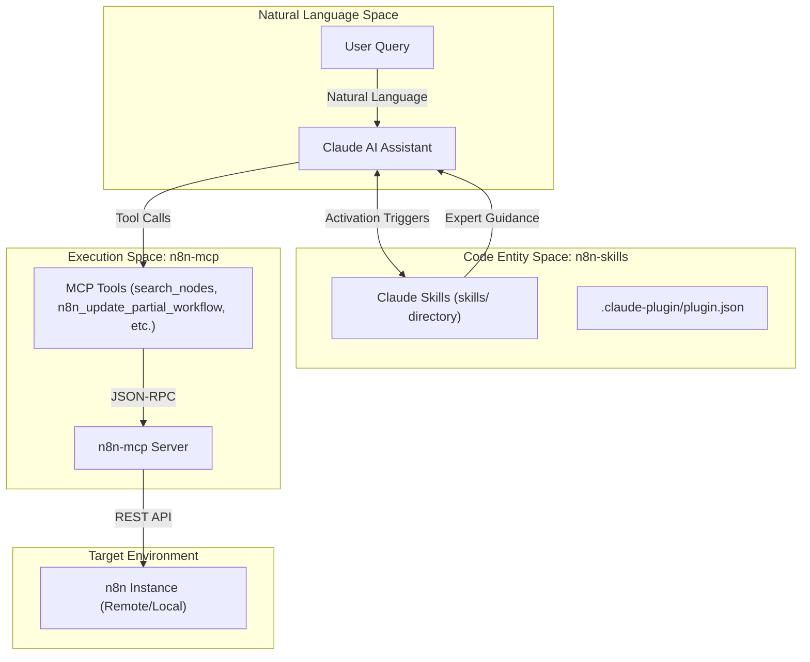
**Sources:** [CLAUDE.md:13-36](), [README.md:126-162]()

### Data Flow: From Intent to Workflow

When a user asks to build a workflow, the skills coordinate to ensure the resulting JSON structure is valid and follows best practices.

Title: Data Flow and Skill Composition
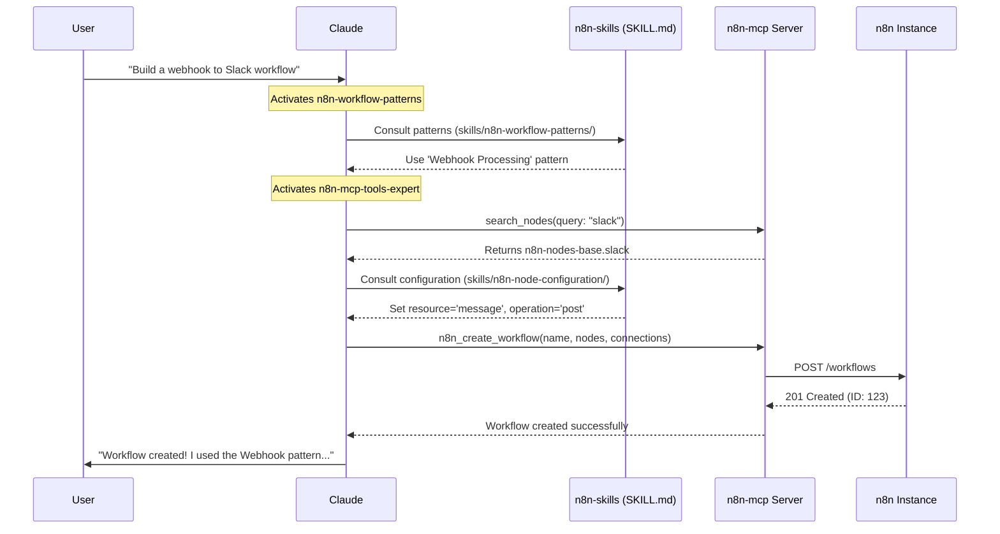
**Sources:** [README.md:176-214](), [CLAUDE.md:117-159]()

---

## The Seven Skills

The repository is structured into seven distinct skill directories under `skills/`. Each skill addresses a specific domain of n8n development.

| Skill | Directory | Primary Purpose |
| :--- | :--- | :--- |
| **n8n Expression Syntax** | `skills/n8n-expression-syntax/` | Teaches `{{}}` patterns and `$json.body` access. |
| **n8n MCP Tools Expert** | `skills/n8n-mcp-tools-expert/` | **Highest Priority.** Guides tool selection and parameter formatting. |
| **n8n Workflow Patterns** | `skills/n8n-workflow-patterns/` | Architecture for Webhook, API, DB, AI, and Scheduled tasks. |
| **n8n Validation Expert** | `skills/n8n-validation-expert/` | Interprets errors and handles the validation loop. |
| **n8n Node Configuration** | `skills/n8n-node-configuration/` | Manages property dependencies and operation-aware setup. |
| **n8n Code JavaScript** | `skills/n8n-code-javascript/` | Handles `$input.all()` and `$helpers.httpRequest()`. |
| **n8n Code Python** | `skills/n8n-code-python/` | Focuses on standard library limitations (no external libs). |

**Sources:** [CLAUDE.md:38-71](), [README.md:36-123]()

---

## Skill Implementation Details

Each skill is a self-contained unit defined by a `SKILL.md` file. These files use YAML frontmatter to define their metadata and activation triggers.

### Activation Mechanism
Skills activate automatically when Claude detects that a user's query matches the `description` or triggers defined in the skill's metadata.

*   **Example Trigger**: A query about "how to access webhook data" triggers `n8n-code-javascript` because of its focus on `$json.body` access patterns.
*   **Cross-Skill Integration**: For a complex task like "Build and validate a workflow," multiple skills (Patterns, Tools Expert, Validation Expert) activate simultaneously to provide holistic guidance.

**Sources:** [CLAUDE.md:145-159](), [README.md:178-214]()

### Distribution and Metadata
The system is packaged for different Claude platforms using metadata files located in `.claude-plugin/`.

*   **`plugin.json`**: Defines the name (`n8n-mcp-skills`), version (`1.4.0`), and author details for the Claude Code ecosystem. [[.claude-plugin/plugin.json:1-23]()]
*   **`marketplace.json`**: Contains the marketplace listing details, categorizing the plugin under "automation" and listing the 7-skill bundle. [[.claude-plugin/marketplace.json:1-36]()]

**Sources:** [.claude-plugin/plugin.json:1-23](), [.claude-plugin/marketplace.json:1-36](), [CLAUDE.md:166-172]()

---

# Page: Getting Started

# Getting Started

<details>
<summary>Relevant source files</summary>

The following files were used as context for generating this wiki page:

- [.gitignore](.gitignore)
- [.mcp.json.example](.mcp.json.example)
- [build.sh](build.sh)
- [dist/README.md](dist/README.md)
- [docs/DEVELOPMENT.md](docs/DEVELOPMENT.md)
- [docs/INSTALLATION.md](docs/INSTALLATION.md)
- [docs/MCP_TESTING_LOG.md](docs/MCP_TESTING_LOG.md)
- [docs/USAGE.md](docs/USAGE.md)

</details>


This document provides a high-level guide for initial setup, platform selection, and verification of the **n8n-skills** system. It bridges the gap between your Claude interface (Claude Code, Claude.ai, or API) and the underlying **n8n-mcp** server.

For detailed step-by-step procedures, see the child page **[Installation](#2.1)**. For troubleshooting activation issues, see **[Verification and Troubleshooting](#2.2)**.

---

## System Architecture Overview

The following diagram illustrates how the natural language interface connects to the technical entities within the codebase and the external n8n ecosystem.

**Bridge: Natural Language to Code Entity Space**
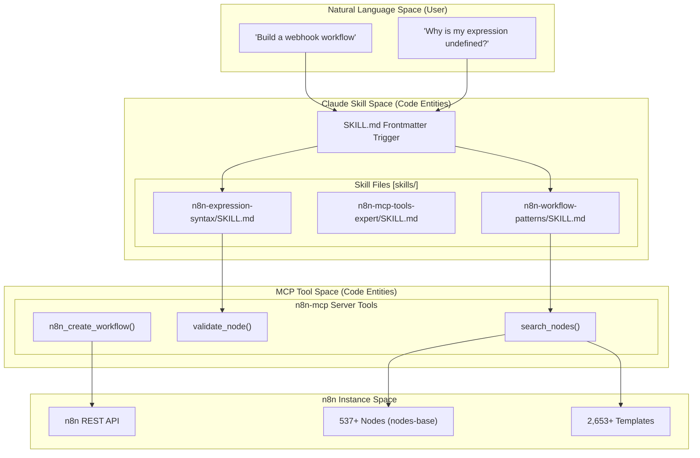
**Sources:** [dist/README.md:99-116](), [docs/USAGE.md:8-25](), [docs/MCP_TESTING_LOG.md:26-53]()

---

## Prerequisites

Before starting the installation, ensure you have the following components ready:

1.  **n8n-mcp Server**: The core engine that provides 40+ tools.
2.  **Claude Access**: One of the supported Claude platforms (Pro, Team, or Enterprise for Claude.ai).
3.  **Configuration**: A valid `.mcp.json` file.

| Requirement | File/Command Reference | Purpose |
| :--- | :--- | :--- |
| **MCP Server** | `npm install -g n8n-mcp` | Provides the tools that skills reference. |
| **Config File** | `.mcp.json` | Connects Claude to the `n8n-mcp` executable. |
| **API Credentials** | `N8N_API_KEY` | (Optional) Required for `n8n_create_workflow`. |

**Sources:** [docs/INSTALLATION.md:9-37](), [docs/MCP_TESTING_LOG.md:154-168]()

---

## Platform Selection

The installation method and skill availability depend on your chosen platform. 

**Platform Capability Mapping**
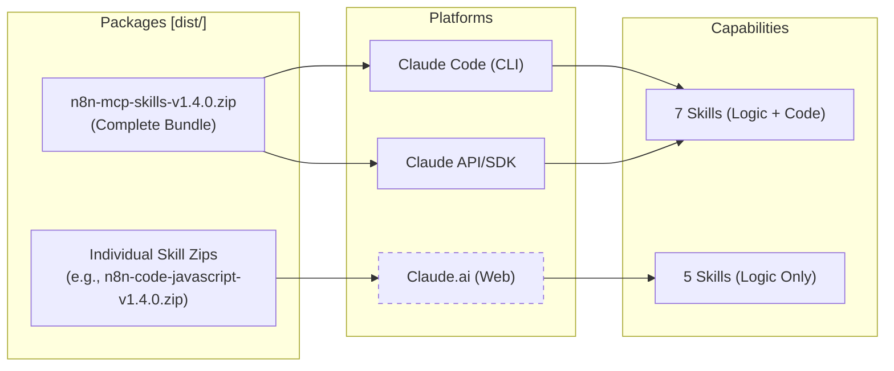

| Platform | Package | Skills Included |
| :--- | :--- | :--- |
| **Claude Code** | Complete Bundle | All 7 skills (including JS/Python Code) |
| **Claude.ai** | Individual Zips | 5 core skills (JS/Python excluded by platform) |
| **Claude API** | Extracted `skills/` | All 7 skills |

**Sources:** [dist/README.md:40-47](), [build.sh:19-45]()

---

## Installation Summary

High-level steps for the three primary paths. For details, see **[Installation](#2.1)**.

### Path 1: Claude Code (Recommended)
Use the plugin system for the fastest setup:
```bash
/plugin install czlonkowski/n8n-skills
```
Alternatively, manually copy the `skills/` directory content to `~/.claude/skills/`.
**Sources:** [dist/README.md:31-38](), [docs/INSTALLATION.md:50-81]()

### Path 2: Claude.ai (Web)
1.  Navigate to **Settings > Capabilities > Skills**.
2.  Upload individual zip files from the `dist/` folder (e.g., `n8n-expression-syntax-v1.4.0.zip`).
3.  **Note:** You must upload each skill separately; the bundle is not supported here.
**Sources:** [dist/README.md:19-23](), [dist/README.md:133-135]()

### Path 3: Claude API/SDK
Extract the `skills/` directory from the repository and load them programmatically into your `client.messages.create` call using the `skills` parameter.
**Sources:** [docs/INSTALLATION.md:119-164]()

---

## Initial Verification

Once installed, verify that the skills are triggering correctly and can communicate with the MCP server.

### 1. Tool Check
Ask Claude: *"Search for the Slack node using n8n-mcp."*
*   **Success:** Claude calls `search_nodes({query: "slack"})` and returns `nodes-base.slack`.
*   **Failure:** Claude reports it cannot find the tool. Check your `.mcp.json`.

### 2. Skill Activation Check
Ask Claude: *"How do I access webhook data in an expression?"*
*   **Success:** The **n8n Expression Syntax** skill activates, providing guidance on `$json.body`.
*   **Failure:** Claude gives a generic answer. Check that `SKILL.md` is in the correct directory.

For a comprehensive guide on testing and resolving common setup errors, see **[Verification and Troubleshooting](#2.2)**.

**Sources:** [dist/README.md:97-116](), [docs/INSTALLATION.md:168-200]()

---

# Page: Installation

# Installation

<details>
<summary>Relevant source files</summary>

The following files were used as context for generating this wiki page:

- [.gitignore](.gitignore)
- [.mcp.json.example](.mcp.json.example)
- [build.sh](build.sh)
- [dist/README.md](dist/README.md)
- [dist/n8n-mcp-skills-v1.4.0.zip](dist/n8n-mcp-skills-v1.4.0.zip)
- [dist/n8n-mcp-tools-expert-v1.4.0.zip](dist/n8n-mcp-tools-expert-v1.4.0.zip)
- [dist/n8n-node-configuration-v1.4.0.zip](dist/n8n-node-configuration-v1.4.0.zip)
- [dist/n8n-validation-expert-v1.4.0.zip](dist/n8n-validation-expert-v1.4.0.zip)
- [docs/INSTALLATION.md](docs/INSTALLATION.md)

</details>


## Purpose and Scope

This page provides detailed installation instructions for the n8n-skills package across all supported Claude platforms. It covers prerequisite setup (n8n-mcp MCP server configuration), installation procedures for Claude Code, Claude.ai, and Claude API/SDK, and verification steps to confirm successful installation.

The n8n-skills system acts as a bridge between Claude's reasoning and the technical requirements of n8n. While the `n8n-mcp` server provides the raw tools (API access, node discovery, validation), these skills provide the "expert knowledge" required to use those tools effectively.

---

## Prerequisites

### n8n-mcp MCP Server

The n8n-skills package requires the `n8n-mcp` MCP server to be installed and configured before skill installation. Skills guide Claude on how to use MCP tools but do not execute operations themselves.

**Installation**:
```bash
npm install -g n8n-mcp
```

**Configuration File**: `.mcp.json`

The MCP server configuration must exist in one of these locations:
- `~/.mcp.json` (macOS/Linux)
- `%USERPROFILE%\.mcp.json` (Windows)

**Minimum Configuration** (read-only mode):
```json
{
  "mcpServers": {
    "n8n-mcp": {
      "command": "npx",
      "args": ["n8n-mcp"],
      "env": {
        "MCP_MODE": "stdio",
        "LOG_LEVEL": "error",
        "DISABLE_CONSOLE_OUTPUT": "true"
      }
    }
  }
}
```

**Full Configuration** (workflow management enabled):
To enable workflow creation and modification, you must provide n8n API credentials.

```json
{
  "mcpServers": {
    "n8n-mcp": {
      "command": "npx",
      "args": ["n8n-mcp"],
      "env": {
        "MCP_MODE": "stdio",
        "LOG_LEVEL": "error",
        "DISABLE_CONSOLE_OUTPUT": "true",
        "N8N_API_URL": "https://your-n8n-instance.com",
        "N8N_API_KEY": "your-api-key-here"
      }
    }
  }
}
```

Sources: [docs/INSTALLATION.md:9-37](), [.mcp.json.example:1-15]()

### Claude Platform Access

One of the following is required:
- **Claude Code**: Supports all 7 skills including JavaScript and Python code skills.
- **Claude.ai**: Supports 5 core skills only (excludes code execution skills like JS/Python).
- **Claude API/SDK**: Supports all 7 skills via programmatic integration.

Sources: [dist/README.md:39-46](), [docs/INSTALLATION.md:39-45]()

---

## Installation Method Decision Flow

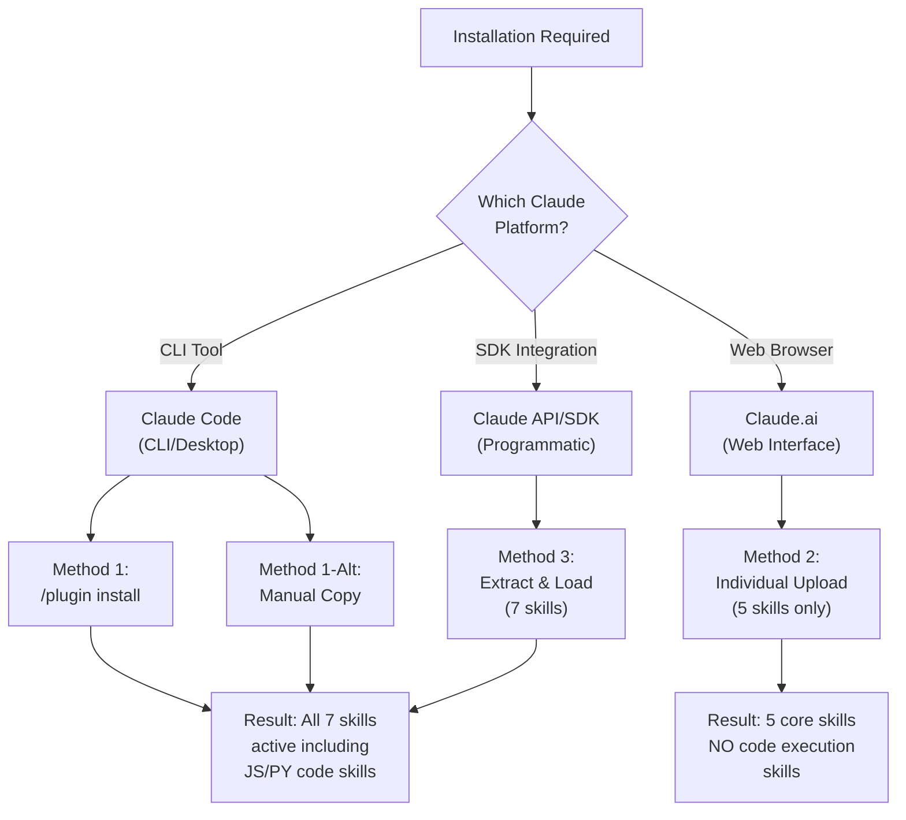

Sources: [dist/README.md:40-47](), [docs/INSTALLATION.md:48-119]()

---

## Method 1: Claude Code Installation

### Option A: Plugin Installation (Recommended)

Claude Code supports direct plugin installation. The complete bundle includes metadata in `.claude-plugin/plugin.json` and `.claude-plugin/marketplace.json`.

**Repository Installation**:
```bash
/plugin install czlonkowski/n8n-skills
```

**Local File Installation**:
```bash
/plugin install /path/to/n8n-mcp-skills-v1.4.0.zip
```

Sources: [dist/README.md:31-38](), [dist/n8n-mcp-skills-v1.4.0.zip:1-10]()

### Option B: Manual Copy

You can manually clone the repository and copy the skills to the local Claude directory.

**macOS/Linux**:
```bash
mkdir -p ~/.claude/skills
cp -r skills/* ~/.claude/skills/
```

**Windows**:
```powershell
New-Item -ItemType Directory -Force -Path "$env:USERPROFILE\.claude\skills"
Copy-Item -Recurse skills\* "$env:USERPROFILE\.claude\skills\"
```

Sources: [docs/INSTALLATION.md:52-70]()

---

## Method 2: Claude.ai Web Interface Installation

### Limitations
Claude.ai restricts skills that appear to perform code execution or complex scripting.
- **Supported**: Expression Syntax, MCP Tools Expert, Workflow Patterns, Validation Expert, Node Configuration.
- **Unsupported**: JavaScript and Python Code skills (typically blocked or non-functional in web UI).

Sources: [dist/README.md:25-29](), [dist/README.md:40-47]()

### Upload Process
Each skill must be uploaded as an individual ZIP file.

1. **Navigate to**: Settings > Capabilities > Skills (bottom of page).
2. **Click**: "Upload Skill".
3. **Select**: One of the individual ZIP files from the `dist/` directory (e.g., `n8n-expression-syntax-v1.4.0.zip`).
4. **Repeat**: For each of the 5 core skills.

Sources: [dist/README.md:19-23](), [dist/README.md:53-62]()

---

## Method 3: Claude API / SDK

For developers building custom applications, skills are loaded programmatically by reading the `SKILL.md` content and passing it to the `skills` array in the messages creation call.

**Skill Loading Implementation**:
```typescript
import fs from 'fs';
import path from 'path';

function loadSkillsFromDirectory(dir: string) {
  const skillDirs = fs.readdirSync(dir);
  return skillDirs.map(skillName => {
    const skillPath = path.join(dir, skillName, 'SKILL.md');
    const skillContent = fs.readFileSync(skillPath, 'utf-8');

    return {
      name: skillName,
      content: skillContent
    };
  });
}
```

Sources: [docs/INSTALLATION.md:119-164]()

---

## Code Entity Mapping: Distribution & Skills

This diagram bridges the logical distribution packages to the physical files and the resulting Claude "Skill" entity.

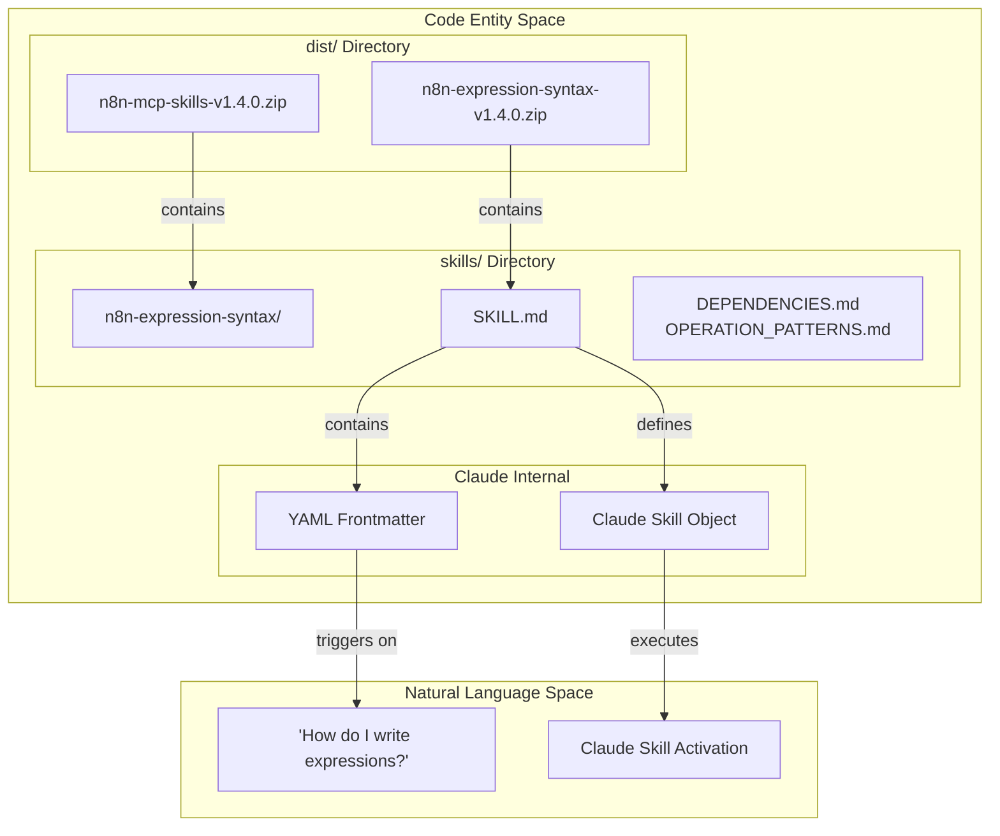

Sources: [dist/README.md:67-95](), [build.sh:19-45](), [skills/n8n-node-configuration/SKILL.md:1-10]()

---

## Verification

After installation, verify that the skills are active by asking Claude specific questions that trigger the skill keywords.

| Skill | Trigger Question | Expected Behavior |
|-------|------------------|-------------------|
| **Expression Syntax** | "How do I write n8n expressions?" | Claude explains `$json`, `$node`, etc. |
| **MCP Tools Expert** | "Find me a Slack node" | Claude uses `search_nodes` via MCP. |
| **Workflow Patterns** | "Build a webhook workflow" | Claude suggests the Webhook Processing Pattern. |
| **Code JavaScript** | "How do I access webhook data in a Code node?" | Claude explains `$input.all()` and `return [{json:{}}]`. |
| **Code Python** | "Can I use pandas in Python Code node?" | Claude warns about no external libraries. |

Sources: [dist/README.md:97-116](), [docs/INSTALLATION.md:168-199]()

---

## Troubleshooting

### Common Installation Issues

| Issue | Platform | Solution |
|-------|----------|----------|
| **"Zip must contain exactly one SKILL.md file"** | Claude.ai | Use individual skill ZIPs, not the bundle. [dist/README.md:133-135]() |
| **Skills not activating** | Claude Code | Verify skills are in `~/.claude/skills/` and reload. [dist/README.md:137-141]() |
| **MCP Tools missing** | All | Check if `n8n-mcp` is running and `.mcp.json` is correct. [docs/INSTALLATION.md:224-233]() |
| **N8N API tools missing** | All | Verify `N8N_API_URL` and `N8N_API_KEY` in `.mcp.json`. [docs/INSTALLATION.md:234-242]() |

Sources: [dist/README.md:131-146](), [docs/INSTALLATION.md:203-254]()

---

# Page: Verification and Troubleshooting

# Verification and Troubleshooting

<details>
<summary>Relevant source files</summary>

The following files were used as context for generating this wiki page:

- [CLAUDE.md](CLAUDE.md)
- [build.sh](build.sh)
- [dist/README.md](dist/README.md)
- [docs/DEVELOPMENT.md](docs/DEVELOPMENT.md)
- [docs/MCP_TESTING_LOG.md](docs/MCP_TESTING_LOG.md)
- [docs/USAGE.md](docs/USAGE.md)

</details>


## Purpose and Scope

This page provides technical verification procedures and troubleshooting solutions for the `n8n-skills` system. It details how to confirm that the seven complementary skills are correctly loaded across different Claude platforms (Claude Code, Claude.ai, and API/SDK) and how to diagnose issues involving the underlying `n8n-mcp` server.

---

## Quick Verification Tests

After installation, verify skill activation by using specific trigger queries. Skills activate automatically when user input matches keywords defined in the `SKILL.md` frontmatter [docs/USAGE.md:7-22]().

### Verification Query Table

| Skill | Test Query | Expected Code Entity/Behavior |
|-------|-----------|-------------------------------|
| **Expression Syntax** | `"How do I write n8n expressions?"` | References to `$json.body`, `$node`, and `{{}}` [docs/USAGE.md:30-46]() |
| **MCP Tools Expert** | `"Find me a Slack node"` | Executes `search_nodes`, mentions `nodes-base.slack` [docs/USAGE.md:70-104]() |
| **Workflow Patterns** | `"Build a webhook workflow"` | Identifies "Webhook Processing Pattern" [docs/USAGE.md:112-147]() |
| **Validation Expert** | `"Why is validation failing?"` | Discusses `runtime` vs `ai-friendly` profiles [docs/USAGE.md:155-196]() |
| **Node Configuration** | `"Configure HTTP Request node"` | Explains property dependencies (e.g., `sendBody` → `contentType`) [docs/USAGE.md:204-240]() |
| **Code JavaScript** | `"Access webhook data in Code node"` | References `$input.all()`, `$json.body`, and `$helpers` [CLAUDE.md:64-67]() |
| **Code Python** | `"Can I use pandas in Python?"` | Identifies "no external libraries" limitation [CLAUDE.md:68-71]() |

**Sources:** [dist/README.md:97-116](), [docs/USAGE.md:7-22](), [docs/USAGE.md:30-240](), [CLAUDE.md:40-71]()

---

## System Activation Flow

The following diagram bridges the "Natural Language Space" (User Queries) to the "Code Entity Space" (MCP Tools and Skill Files).

### Skill Activation and Tool Execution Flow
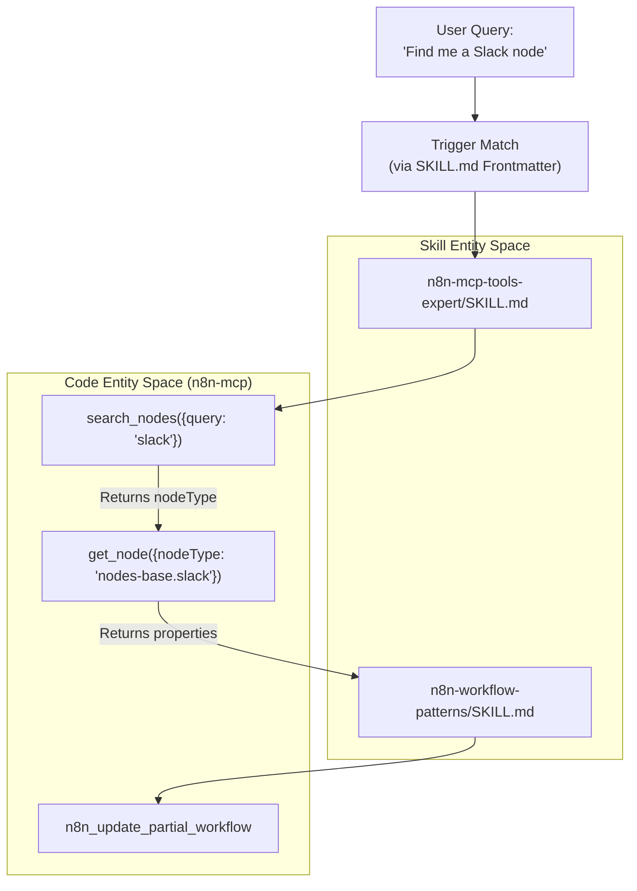

**Sources:** [CLAUDE.md:145-159](), [docs/USAGE.md:244-289](), [dist/README.md:97-116]()

---

## Platform-Specific Verification

### Claude Code (CLI)
Claude Code uses a specific directory structure for plugins. Verify that the bundle is extracted correctly.

*   **Skills Path:** `~/.claude/skills/` (should contain 7 subdirectories) [dist/README.md:87-95]().
*   **Metadata:** `.claude-plugin/plugin.json` and `marketplace.json` must be present [dist/README.md:82-84]().
*   **Command:** Run `/plugin install czlonkowski/n8n-skills` or point to the local `n8n-mcp-skills-v1.4.0.zip` [dist/README.md:31-38]().

### Claude.ai (Web)
Claude.ai requires individual skill uploads. 

*   **Requirement:** Zip files must contain exactly one `SKILL.md` at the root [dist/README.md:133-135]().
*   **Verification:** Navigate to **Settings > Capabilities > Skills**. You should see separate entries for the core skills [dist/README.md:19-23]().
*   **Limitation:** Claude.ai does not currently support the nested `skills/` directory used in the Claude Code bundle [dist/README.md:29-30]().

**Sources:** [dist/README.md:7-46](), [dist/README.md:79-95](), [dist/README.md:133-135]()

---

## MCP Server Troubleshooting

Skills rely on the `n8n-mcp` server to interact with n8n instances. If skills activate but tools fail, check the MCP configuration.

### Tool Availability and API Requirements
The system operates in two modes based on the presence of `N8N_API_KEY` in the environment [docs/MCP_TESTING_LOG.md:154-169]().

| Tool Category | Key Code Entities | API Key Required? |
|---------------|-------------------|-------------------|
| **Discovery** | `search_nodes`, `get_node` | **No** |
| **Validation** | `validate_node`, `validate_workflow` | **No** |
| **Templates** | `search_templates`, `get_template` | **No** |
| **Management** | `n8n_create_workflow`, `n8n_update_partial_workflow` | **Yes** |
| **Credentials** | `n8n_manage_credentials` | **Yes** |

**Sources:** [docs/MCP_TESTING_LOG.md:154-169](), [CLAUDE.md:72-116]()

### Common MCP Errors

1.  **"Zip must contain exactly one SKILL.md file":** Occurs in Claude.ai when uploading the complete bundle instead of individual skill zips [dist/README.md:133-135]().
2.  **Node Not Found:** Often caused by using the wrong `nodeType` format. `search_nodes` returns `nodes-base.webhook`, but internal workflow structures may require `n8n-nodes-base.webhook` [docs/MCP_TESTING_LOG.md:57-67]().
3.  **Skills Not Triggering:** Check if the `SKILL.md` frontmatter `description` contains the keywords used in the query [dist/README.md:142-146]().

---

## Implementation Architecture

The relationship between user input, skill logic, and MCP tool execution is governed by the following architecture.

### Logic-to-Code Mapping
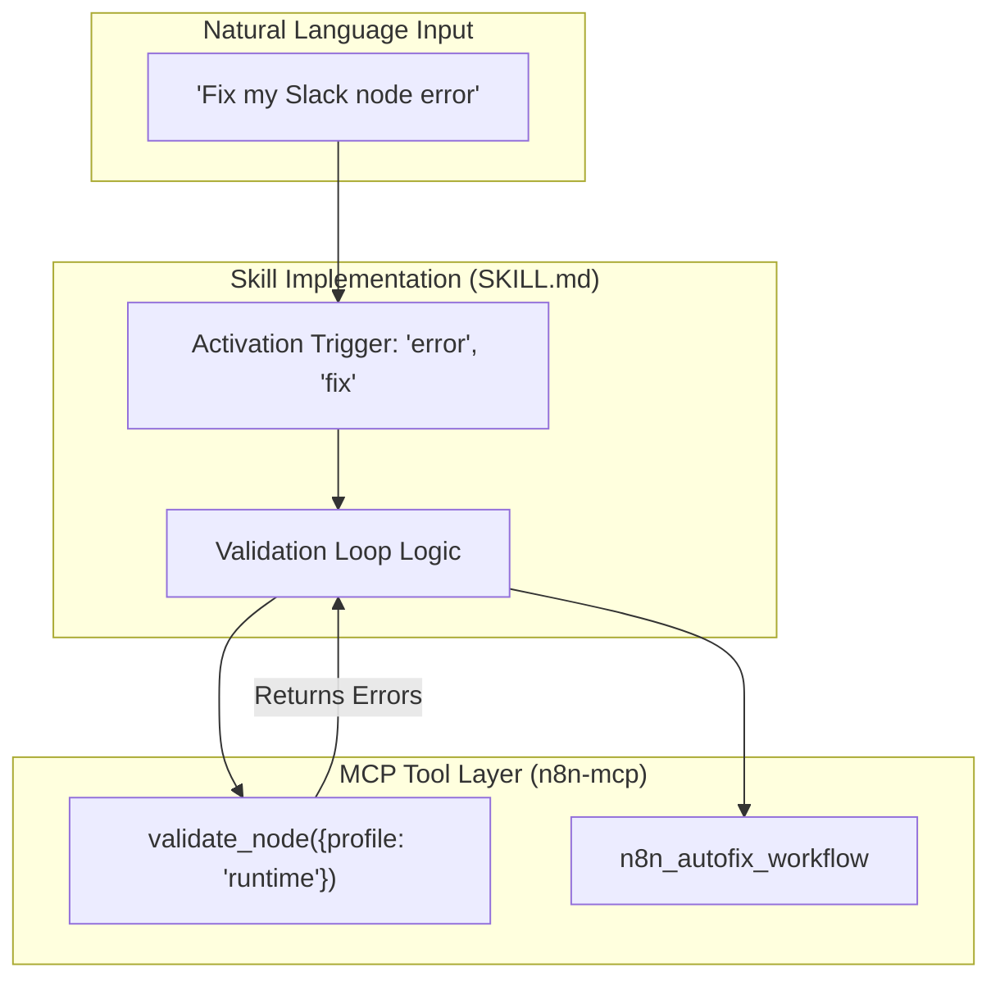

**Sources:** [CLAUDE.md:55-58](), [CLAUDE.md:124-128](), [docs/USAGE.md:151-196]()

---

## Build and Distribution Verification

The `build.sh` script generates two types of distributions. Verify the `dist/` folder contents after a build [build.sh:19-45]().

*   **Individual Zips:** `n8n-[skill-name]-v1.4.0.zip`. Structure: `[skill-name]/SKILL.md` at root [build.sh:19-36]().
*   **Bundle Zip:** `n8n-mcp-skills-v1.4.0.zip`. Structure: `.claude-plugin/`, `skills/`, `README.md` [build.sh:38-45]().

**Sources:** [build.sh:1-55](), [dist/README.md:50-63]()

---

# Page: The Seven Skills

# The Seven Skills

<details>
<summary>Relevant source files</summary>

The following files were used as context for generating this wiki page:

- [.claude-plugin/marketplace.json](.claude-plugin/marketplace.json)
- [.claude-plugin/plugin.json](.claude-plugin/plugin.json)
- [CLAUDE.md](CLAUDE.md)
- [README.md](README.md)

</details>


## Purpose and Scope

This page provides a comprehensive overview of all seven Claude Code skills in the n8n-skills system, including their relationships, activation patterns, and how they compose together to teach Claude how to build n8n workflows using the n8n-mcp MCP server.

For detailed documentation of individual skills, see:
- [n8n Expression Syntax](#3.1)
- [n8n MCP Tools Expert](#3.2)
- [n8n Workflow Patterns](#3.3)
- [n8n Validation Expert](#3.4)
- [n8n Node Configuration](#3.5)
- [n8n Code JavaScript](#3.6)
- [n8n Code Python](#3.7)

For installation instructions, see [Installation](#2.1). For MCP server integration details, see [MCP Server Integration](#5).

---

## Skills Overview

The n8n-skills system consists of seven complementary skills organized into four categories:

| Skill | Category | Priority | Lines | Platform Support | Purpose |
|-------|----------|----------|-------|------------------|---------|
| **n8n Expression Syntax** | Foundation | Medium | ~350 | All | Expression syntax and variables ($json, $node, $now) |
| **n8n MCP Tools Expert** | Foundation | **HIGHEST** | ~1,150 | All | MCP tool usage, nodeType formats, validation profiles |
| **n8n Workflow Patterns** | Architecture | Medium | ~2,224 | All | 5 core workflow patterns and composition |
| **n8n Validation Expert** | Configuration | Medium | ~2,224 | All | Error interpretation and validation loop |
| **n8n Node Configuration** | Configuration | Medium | ~2,224 | All | Operation-aware configuration with dependencies |
| **n8n Code JavaScript** | Code | Low | ~350 | Code/API only | JavaScript code patterns for Code nodes (95% use cases) |
| **n8n Code Python** | Code | Low | ~350 | Code/API only | Python limitations and standard library patterns |

**Total**: ~8,872 lines across 7 skills, with 4 files per skill on average.

Sources: [README.md:31-118](), [CLAUDE.md:38-71]()

---

## Skill Categories and Hierarchy

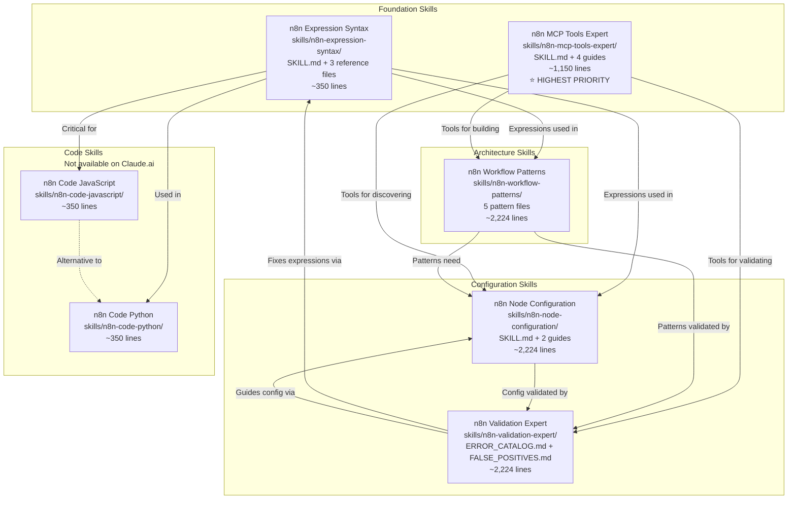

**Dependency Analysis**: 

The skills form a directed acyclic graph (DAG) with two foundational skills at the root:

1. **Foundation Layer**: n8n Expression Syntax and n8n MCP Tools Expert are prerequisites for all other skills. [CLAUDE.md:151-159]()
2. **Architecture Layer**: n8n Workflow Patterns builds on both foundation skills to define the 5 core patterns (Webhook, HTTP API, Database, AI, Scheduled). [CLAUDE.md:51-54]()
3. **Configuration Layer**: n8n Node Configuration and n8n Validation Expert depend on foundation skills and each other to interpret errors and dependencies. [CLAUDE.md:55-63]()
4. **Code Layer**: Both code skills depend on n8n Expression Syntax but are functionally independent. [CLAUDE.md:64-71]()

Sources: [CLAUDE.md:13-17](), [CLAUDE.md:151-159](), [README.md:203-214]()

---

## Priority System

### Why MCP Tools Expert is HIGHEST Priority

The **n8n MCP Tools Expert** skill has HIGHEST priority because all other skills rely on correct MCP tool usage. Without understanding how to use MCP tools, the other skills cannot effectively guide Claude. [CLAUDE.md:45]()

**Telemetry Evidence** (from 447,557 real MCP tool invocations):

| Metric | Value | Implication |
|--------|-------|-------------|
| Most-used tool | `n8n_update_partial_workflow` | 38,287 uses (99.0% success) [CLAUDE.md:130-134]() |
| Second most-used | `search_nodes` | 9,835 uses (99.9% success) [CLAUDE.md:119-122]() |
| Validation checks | `n8n_validate_workflow` | 7,841 uses (95.5% success) [CLAUDE.md:124-128]() |

**Critical Tool Knowledge**:

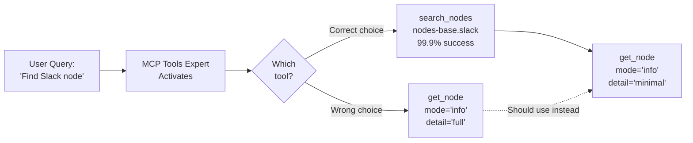

**Key Distinctions the MCP Tools Expert Teaches**:

1. **nodeType formats**: `nodes-base.*` vs `n8n-nodes-base.*`. [README.md:56]()
2. **Tool selection**: Efficient use of `get_node` detail levels (minimal, standard, full). [CLAUDE.md:78]()
3. **Validation profiles**: `minimal`, `runtime`, `ai-friendly`, `strict`. [README.md:57]()
4. **Smart parameters**: Specific logic for tools like `n8n_update_partial_workflow` (19 operation types). [CLAUDE.md:86]()

Sources: [CLAUDE.md:45-50](), [CLAUDE.md:119-134](), [README.md:49-62]()

---

## Activation System

### Frontmatter Trigger Mechanism

Skills activate automatically based on trigger keywords in the `description` field of their frontmatter:

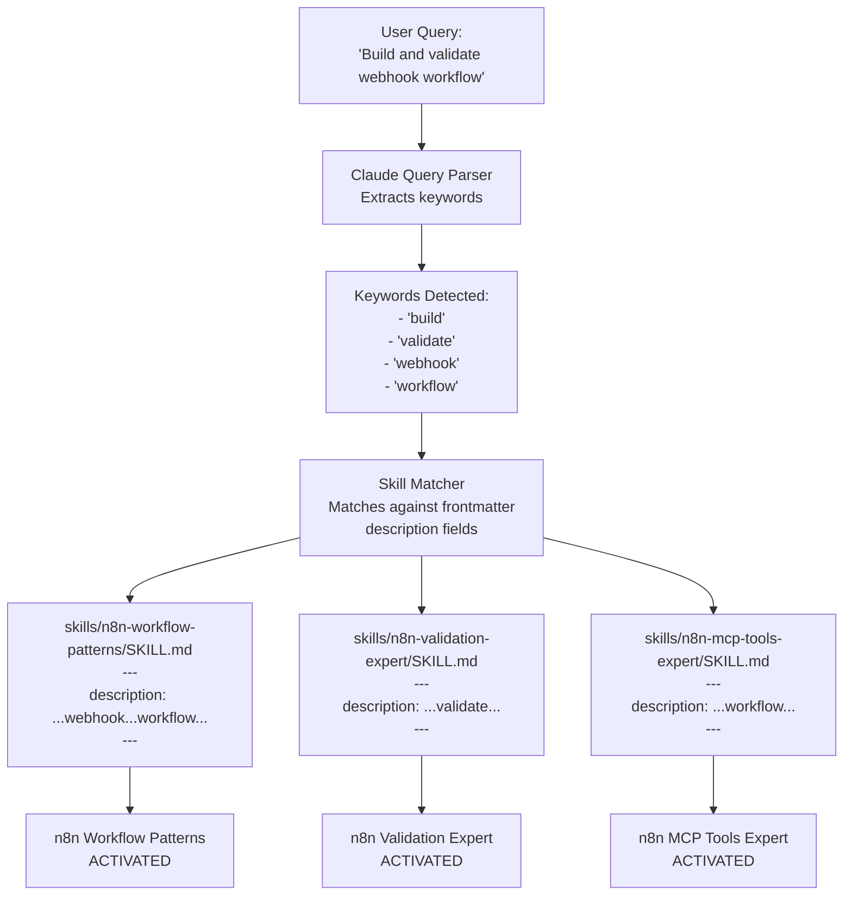

### Activation Trigger Reference

| Skill | Activation Triggers (from frontmatter description) |
|-------|---------------------------------------------------|
| **Expression Syntax** | `expression`, `{{}}`, `$json`, `$node`, `$now`, expression errors [README.md:41]() |
| **MCP Tools Expert** | `search`, `validate`, `MCP tools`, `template`, `workflow`, `tool selection` [README.md:52]() |
| **Workflow Patterns** | `build workflow`, `webhook`, `HTTP API`, `database`, `AI agent`, `scheduled` [README.md:66]() |
| **Validation Expert** | `validation error`, `validation failing`, `false positive`, `validation loop` [README.md:78]() |
| **Node Configuration** | `configure node`, `property dependencies`, `required fields`, `AI workflow` [README.md:90]() |
| **Code JavaScript** | `JavaScript`, `Code node`, `$helpers`, `$input`, date handling [README.md:101]() |
| **Code Python** | `Python`, `pandas`, `numpy`, `external libraries`, Python limitations [README.md:113]() |

Sources: [CLAUDE.md:146-150](), [README.md:178-201]()

---

## Cross-Skill Composition

Skills compose automatically when multiple activation triggers match. Each skill contributes specialized knowledge to the complete solution.

### Composition Pattern: Build and Validate Workflow

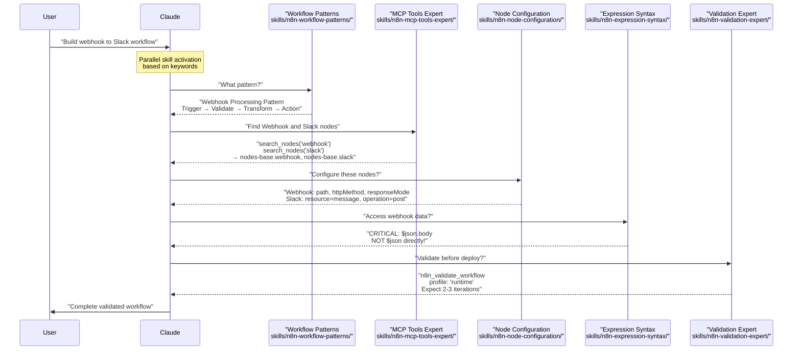

### Common Composition Patterns

**Pattern 1: Discovery + Configuration**
```
User: "How do I configure the HTTP Request node?"
→ Activates: MCP Tools Expert + Node Configuration
→ MCP: search_nodes, get_node (mode=info)
→ NC: operation-aware configuration guidance
```

**Pattern 2: Building + Validation**
```
User: "Build database sync workflow"
→ Activates: Workflow Patterns + MCP Tools Expert + Validation Expert
→ WP: Database Operations Pattern
→ MCP: search for database nodes
→ VE: validation loop guidance (n8n_autofix_workflow)
```

**Pattern 3: Expression + Code**
```
User: "Transform webhook data with JavaScript"
→ Activates: Expression Syntax + Code JavaScript + MCP Tools Expert
→ ES: $json.body for webhook data access
→ JS: $input.first().json.body, return [{json: {...}}]
→ MCP: Code node configuration
```

Sources: [README.md:203-214](), [CLAUDE.md:151-159]()

---

## Platform Availability

### Claude Platform Support Matrix

| Platform | Skills Available | Installation Method | Code Skills |
|----------|------------------|---------------------|-------------|
| **Claude Code** | All 7 skills | `/plugin install czlonkowski/n8n-skills` [README.md:139]() | ✅ JS + PY |
| **Claude.ai** | 5 core skills only | Manual upload via UI [README.md:165]() | ❌ No code execution |
| **Claude API/SDK** | All 7 skills | Via SDK loading [README.md:172]() | ✅ JS + PY |

**Why Code Skills Are Restricted on Claude.ai**:
Claude.ai does not support code execution skills for security reasons. The web interface cannot safely execute arbitrary JavaScript or Python code. [README.md:165-172]()

### Distribution Package Structure

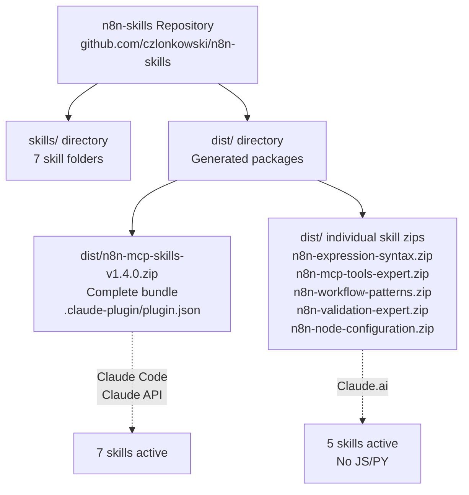

Sources: [.claude-plugin/plugin.json:1-23](), [.claude-plugin/marketplace.json:1-36](), [CLAUDE.md:166-172]()

---

## Repository Structure

### Skills Directory Layout

```
n8n-skills/
├── skills/                                    # All skill source files [CLAUDE.md:24]()
│   ├── n8n-expression-syntax/                # Expression syntax variables
│   ├── n8n-mcp-tools-expert/                 # MCP tool usage (HIGHEST PRIORITY)
│   ├── n8n-workflow-patterns/                # 5 architectural patterns
│   ├── n8n-validation-expert/                # Error interpretation
│   ├── n8n-node-configuration/               # Property dependencies
│   ├── n8n-code-javascript/                  # JS patterns (95% use cases)
│   └── n8n-code-python/                      # Python limitations
├── evaluations/                               # Test scenarios for each skill [CLAUDE.md:32]()
├── docs/                                      # Documentation [CLAUDE.md:33]()
├── dist/                                      # Distribution packages [CLAUDE.md:34]()
└── .claude-plugin/                            # Claude Code plugin configuration [CLAUDE.md:35]()
```

### Metadata and Keywords

The project is defined as `n8n-mcp-skills` version `1.4.0`. [.claude-plugin/plugin.json:2-3]()

**Core Keywords**:
- `n8n`, `workflow`, `automation`, `mcp`, `validation`, `expressions`, `code`, `javascript`, `python`. [.claude-plugin/plugin.json:10-20]()

Sources: [CLAUDE.md:20-36](), [.claude-plugin/plugin.json:1-23]()

---

# Page: n8n Expression Syntax

# n8n Expression Syntax

<details>
<summary>Relevant source files</summary>

The following files were used as context for generating this wiki page:

- [evaluations/expression-syntax/eval-001-missing-braces.json](evaluations/expression-syntax/eval-001-missing-braces.json)
- [evaluations/expression-syntax/eval-002-webhook-body-data.json](evaluations/expression-syntax/eval-002-webhook-body-data.json)
- [evaluations/expression-syntax/eval-003-code-node-confusion.json](evaluations/expression-syntax/eval-003-code-node-confusion.json)
- [evaluations/expression-syntax/eval-004-node-reference.json](evaluations/expression-syntax/eval-004-node-reference.json)
- [skills/n8n-expression-syntax/COMMON_MISTAKES.md](skills/n8n-expression-syntax/COMMON_MISTAKES.md)
- [skills/n8n-expression-syntax/EXAMPLES.md](skills/n8n-expression-syntax/EXAMPLES.md)
- [skills/n8n-expression-syntax/README.md](skills/n8n-expression-syntax/README.md)
- [skills/n8n-expression-syntax/SKILL.md](skills/n8n-expression-syntax/SKILL.md)

</details>


## Purpose and Scope

This document covers the **n8n Expression Syntax** skill, which provides the technical foundation for writing dynamic data accessors and transformations within n8n workflows. This skill specifically addresses:

- The `{{}}` double-curly-brace syntax required for expressions.
- Core system variables including `$json`, `$node`, `$now`, and `$env`.
- The critical data nesting structure of Webhook nodes (`$json.body`).
- Distinctions between expression contexts and direct JavaScript access in Code nodes.
- Common syntax errors such as missing quotes for nodes with spaces and incorrect case sensitivity.

Sources: [skills/n8n-expression-syntax/SKILL.md:1-12](), [skills/n8n-expression-syntax/README.md:7-10]()

---

## Expression Format and Variables

All dynamic content in n8n (outside of Code nodes) must be wrapped in double curly braces. Text outside these braces is treated as a literal string [skills/n8n-expression-syntax/SKILL.md:14-27]().

### Core Variables

| Variable | Description | Example |
| :--- | :--- | :--- |
| `$json` | Accesses fields from the current (previous) node's output. | `{{$json.email}}` |
| `$node` | References data from any specific named node in the workflow. | `{{$node["HTTP Request"].json.data}}` |
| `$now` | Returns the current timestamp as a Luxon DateTime object. | `{{$now.plus({days: 7})}}` |
| `$env` | Accesses system environment variables. | `{{$env.API_KEY}}` |

Sources: [skills/n8n-expression-syntax/SKILL.md:31-78]()

### Expression Data Flow

The following diagram illustrates how the `ExpressionEvaluator` (conceptual) pulls data from different system entities based on the variable prefix used.

**Title: n8n Variable Resolution Logic**
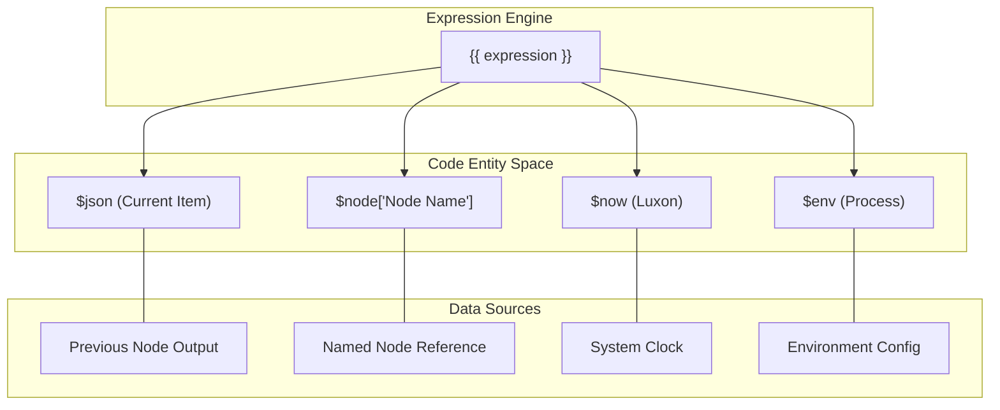
Sources: [skills/n8n-expression-syntax/SKILL.md:31-78](), [evaluations/expression-syntax/eval-004-node-reference.json:5-10]()

---

## CRITICAL: Webhook Data Structure

The most frequent error in n8n workflow development is attempting to access Webhook data at the root of the `$json` object. The Webhook node wraps incoming payloads under a `.body` property to preserve metadata like headers and query parameters [skills/n8n-expression-syntax/SKILL.md:81-111]().

### Webhook Object Schema
```javascript
{
  "headers": { ... },
  "params": { ... },
  "query": { ... },
  "body": {           // ⚠️ ACTUAL USER DATA IS NESTED HERE
    "email": "user@example.com",
    "name": "John Doe"
  }
}
```
[skills/n8n-expression-syntax/SKILL.md:87-98]()

### Correct Access Patterns
- **Incorrect**: `{{$json.email}}` (Returns `undefined`)
- **Correct**: `{{$json.body.email}}`
- **Metadata**: `{{$json.headers['user-agent']}}`

Sources: [skills/n8n-expression-syntax/SKILL.md:100-111](), [skills/n8n-expression-syntax/COMMON_MISTAKES.md:27-60]()

---

## Common Mistakes and Validation Rules

### 1. Node References and Spaces
Node names containing spaces **must** use bracket notation and double quotes. Furthermore, node names are strictly case-sensitive [skills/n8n-expression-syntax/SKILL.md:54-58]().
- `❌ {{$node.HTTP Request.json}}`
- `✅ {{$node["HTTP Request"].json}}`
- `❌ {{$node["http request"].json}}` (Wrong case)

### 2. Code Node Context
Code nodes (JavaScript/Python) use **direct object access**. Wrapping variables in `{{}}` inside a Code node will result in the literal string being assigned rather than the evaluated value [skills/n8n-expression-syntax/SKILL.md:166-182]().
- `❌ const email = '{{$json.email}}';` (Result: literal string)
- `✅ const email = $json.email;` (Result: value of email)

### 3. Bracket vs Dot Notation
Fields with spaces in their names require bracket notation [skills/n8n-expression-syntax/SKILL.md:127-130]().
- `❌ {{$json.first name}}`
- `✅ {{$json['first name']}}`

Sources: [skills/n8n-expression-syntax/SKILL.md:206-247](), [skills/n8n-expression-syntax/COMMON_MISTAKES.md:64-106](), [evaluations/expression-syntax/eval-003-code-node-confusion.json:5-10]()

---

## Implementation Mapping

This diagram bridges the Natural Language concepts (like "referencing a node") to the specific syntax entities required by the n8n engine.

**Title: Natural Language to Syntax Entity Mapping**
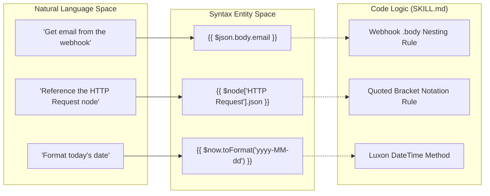
Sources: [skills/n8n-expression-syntax/SKILL.md:100-111](), [skills/n8n-expression-syntax/SKILL.md:49-58](), [skills/n8n-expression-syntax/EXAMPLES.md:172-214]()

---

## Activation Triggers

The `n8n-expression-syntax` skill is triggered by the following keywords and patterns in user queries:
- `expression` or `{{}}` syntax
- `$json`, `$node`, `$now`, `$env`
- `webhook data` or `undefined` in workflow troubleshooting
- Requests to "access data" from previous steps

Sources: [skills/n8n-expression-syntax/README.md:11-18](), [evaluations/expression-syntax/eval-001-missing-braces.json:4]()

---

# Page: n8n MCP Tools Expert

# n8n MCP Tools Expert

<details>
<summary>Relevant source files</summary>

The following files were used as context for generating this wiki page:

- [skills/n8n-mcp-tools-expert/README.md](skills/n8n-mcp-tools-expert/README.md)
- [skills/n8n-mcp-tools-expert/SEARCH_GUIDE.md](skills/n8n-mcp-tools-expert/SEARCH_GUIDE.md)
- [skills/n8n-mcp-tools-expert/SKILL.md](skills/n8n-mcp-tools-expert/SKILL.md)
- [skills/n8n-mcp-tools-expert/WORKFLOW_GUIDE.md](skills/n8n-mcp-tools-expert/WORKFLOW_GUIDE.md)
- [skills/n8n-validation-expert/ERROR_CATALOG.md](skills/n8n-validation-expert/ERROR_CATALOG.md)
- [skills/n8n-validation-expert/FALSE_POSITIVES.md](skills/n8n-validation-expert/FALSE_POSITIVES.md)
- [skills/n8n-validation-expert/README.md](skills/n8n-validation-expert/README.md)

</details>


## Purpose and Scope

The n8n MCP Tools Expert skill provides authoritative guidance for using the 40+ MCP tools provided by the n8n-mcp server. This skill is marked as **HIGHEST PRIORITY** among the seven n8n skills because all other skills rely on correct MCP tool usage to function effectively.

This page documents:
- The eight tool categories and their specific tools.
- Critical `nodeType` format differences between tool groups.
- Tool selection strategies based on task requirements.
- Usage patterns derived from 447,557 real MCP tool invocations.
- Performance characteristics and reliability metrics.
- Common mistakes and their corrections.

**Sources:** [skills/n8n-mcp-tools-expert/SKILL.md:1-10](), [skills/n8n-mcp-tools-expert/README.md:26-29]()

---

## Tool Categories and Organization

The n8n-mcp server provides tools organized into functional categories. Each category serves a distinct purpose in the workflow development lifecycle.

### Tool Category Overview

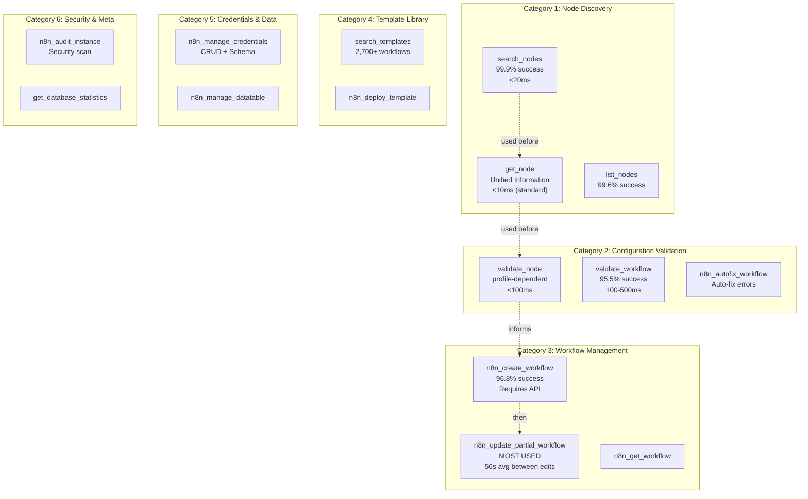

**Diagram 1:** MCP Tool Categories and Common Tool Sequencing

**Sources:** [skills/n8n-mcp-tools-expert/SKILL.md:12-24](), [skills/n8n-mcp-tools-expert/SKILL.md:28-43]()

### Tool Availability by API Requirement

| Tool Category | Requires n8n API | Notes |
|---------------|------------------|-------|
| Node Discovery (`search_nodes`, `get_node`) | ❌ No | Always available via indexed metadata. |
| Configuration Validation (`validate_node`) | ❌ No | Validates structure only, not against live instance. |
| Template Library | ❌ No | 2,700+ workflows available for search. |
| Workflow Management | ✅ Yes | Requires `N8N_API_URL` + `N8N_API_KEY`. |
| Credential Management | ✅ Yes | Full CRUD operations on credentials. |
| Data Tables | ✅ Yes | Manage n8n data tables and rows. |
| Security & Audit | ✅ Yes | Instance security auditing with deep scan. |

**Sources:** [skills/n8n-mcp-tools-expert/WORKFLOW_GUIDE.md:7-11](), [skills/n8n-mcp-tools-expert/SKILL.md:12-24]()

---

## nodeType Format: Critical Distinction

The most common source of "Node not found" errors is using the wrong `nodeType` format. The MCP server uses **two different prefix formats** depending on the tool category.

### Format Distinction Diagram

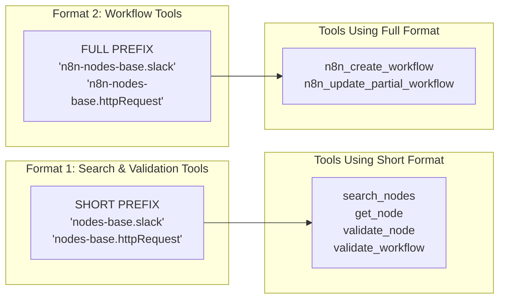

**Diagram 2:** nodeType Format Requirements by Tool Category

### Conversion Pattern

The `search_nodes` tool returns both formats to facilitate conversion:

```javascript
// search_nodes response structure
{
  "nodeType": "nodes-base.slack",           // For search/validate tools
  "workflowNodeType": "n8n-nodes-base.slack" // For workflow tools
}
```

**Sources:** [skills/n8n-mcp-tools-expert/SKILL.md:101-141]()

---

## Tool Selection Strategy

### Node Discovery Workflow

The `get_node` tool is the unified entry point for node details, replacing legacy "essentials" and "info" splits with `detail` levels.

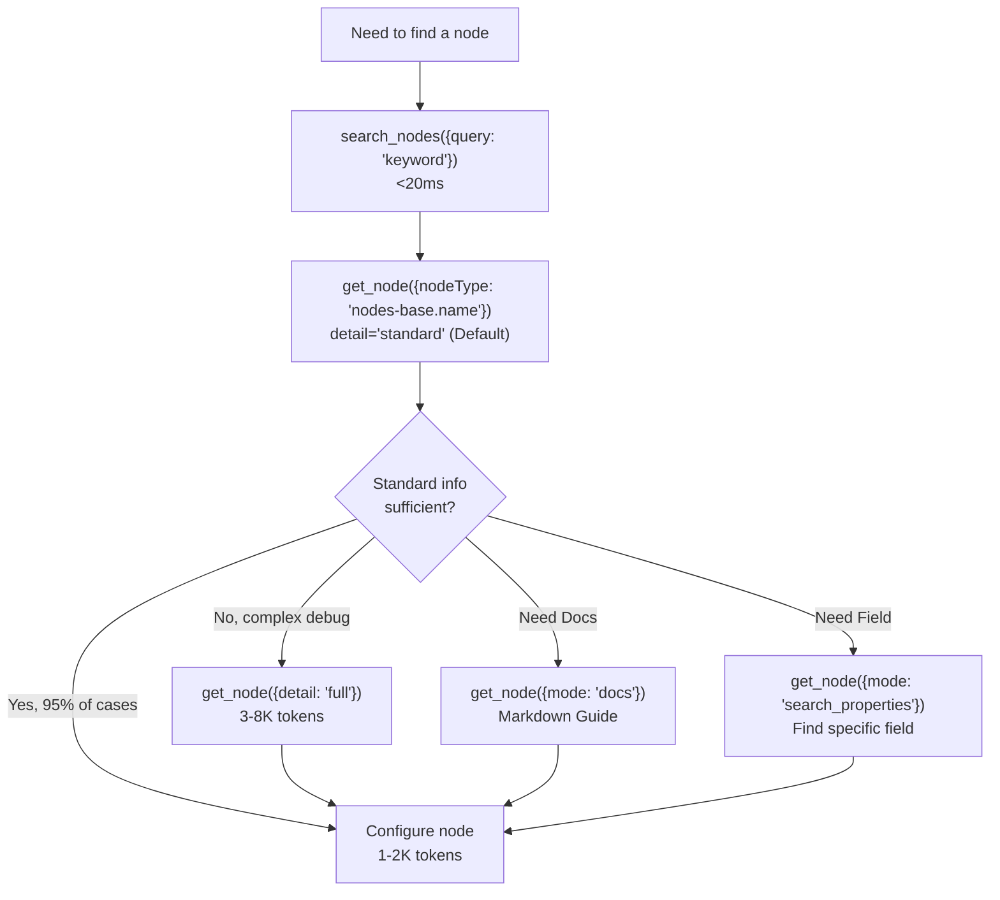

**Diagram 3:** Node Discovery Decision Tree

**Sources:** [skills/n8n-mcp-tools-expert/SEARCH_GUIDE.md:51-61](), [skills/n8n-mcp-tools-expert/SKILL.md:47-73]()

### Validation Workflow

Validation typically requires 2-3 cycles (7,841 validation checks observed).

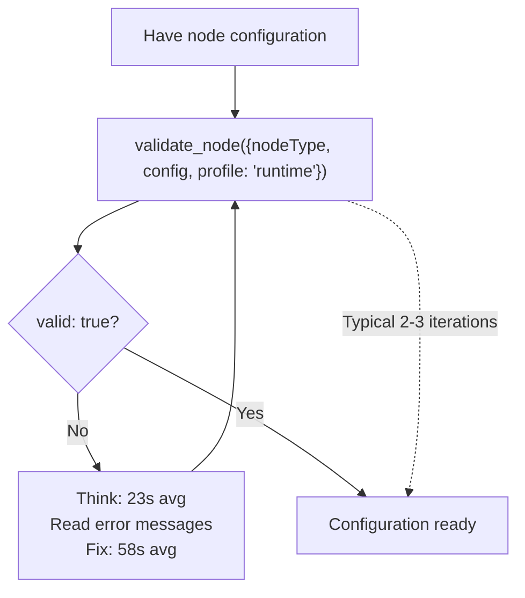

**Diagram 4:** Validation Loop Pattern

**Sources:** [skills/n8n-validation-expert/README.md:13-19](), [skills/n8n-mcp-tools-expert/SKILL.md:75-84]()

---

## Common Usage Patterns

### Pattern 1: Edit-Validate Loop (Iterative Building)

The most common pattern (38,287 occurrences) is the incremental workflow update cycle using `n8n_update_partial_workflow`.

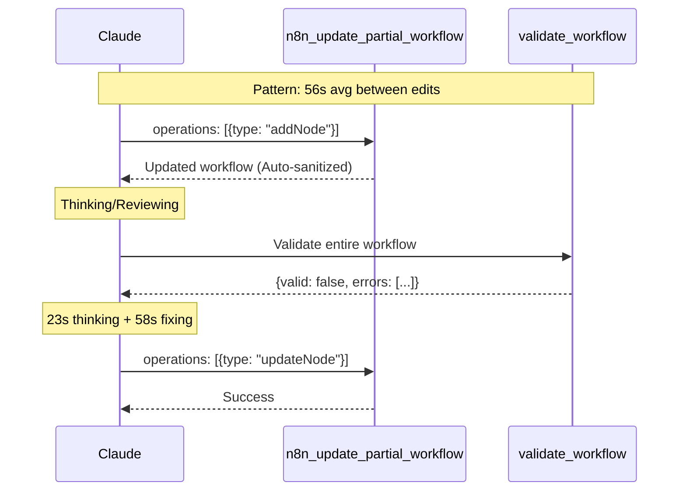

**Diagram 5: Code Entity Space - Workflow Operations**

**Sources:** [skills/n8n-mcp-tools-expert/WORKFLOW_GUIDE.md:78-86](), [skills/n8n-mcp-tools-expert/SKILL.md:86-97]()

### Pattern 2: AI Workflow Connections

Full support for AI Agent workflows involves 8 specific connection types.

| Connection Type | Source Output Name | Target Input Name |
|-----------------|--------------------|-------------------|
| Language Model  | `ai_languageModel` | `AI Agent`        |
| Tool            | `ai_tool`          | `AI Agent`        |
| Memory          | `ai_memory`        | `AI Agent`        |
| Vector Store    | `ai_vectorStore`   | `AI Agent`        |

**Sources:** [skills/n8n-mcp-tools-expert/WORKFLOW_GUIDE.md:165-203]()

---

## Tool-Specific Guidance

### Validation Profiles

The skill recommends explicit profile specification to balance error detection with false positive reduction.

| Profile | Use Case | Strictness |
|---------|----------|------------|
| `minimal` | Quick checks for required fields. | Low |
| `runtime` | **Recommended** for pre-deployment checks. | Moderate |
| `ai-friendly` | Reduces false positives by 60% for AI workflows. | Low |
| `strict` | Maximum validation for production safety. | High |

**Sources:** [skills/n8n-mcp-tools-expert/SKILL.md:183-199](), [skills/n8n-validation-expert/README.md:35-39]()

### Smart Parameters

Use semantic parameters instead of manual `sourceIndex` or `sourceOutput` for multi-output nodes.

| Node Type | Smart Parameter | Values |
|-----------|-----------------|--------|
| **IF**    | `branch`        | `"true"`, `"false"` |
| **Switch**| `case`          | `0, 1, 2, 3...` |

**Sources:** [skills/n8n-mcp-tools-expert/WORKFLOW_GUIDE.md:129-164]()

### Surgical String Edits: `patchNodeField`

Unlike `updateNode`, `patchNodeField` is strict: it errors if the find string is missing or ambiguous (multiple matches).

```javascript
// Surgical replacement in Code node
{
  type: "patchNodeField",
  nodeName: "Code",
  fieldPath: "parameters.jsCode",
  patches: [{
    find: "const limit = 10;",
    replace: "const limit = 50;"
  }]
}
```

**Sources:** [skills/n8n-mcp-tools-expert/WORKFLOW_GUIDE.md:228-251]()

---

## Auto-Sanitization System

Auto-sanitization runs on **every workflow update**, affecting **all nodes** in the workflow.

- **Binary Operators** (equals, contains): Removes `singleValue`.
- **Unary Operators** (isEmpty, isNotEmpty): Adds `singleValue: true`.
- **IF/Switch Nodes**: Adds missing metadata automatically.

**Sources:** [skills/n8n-mcp-tools-expert/SKILL.md:201-219](), [skills/n8n-validation-expert/README.md:41-46]()

---

## Summary of Common Mistakes

| Mistake | Consequence | Solution |
|---------|-------------|----------|
| Using `detail: "full"` by default | Token waste, slow response | Use `detail: "standard"` (1-2K tokens). |
| Missing `nodes-base.` prefix | "Node not found" error | Always use the short prefix for discovery tools. |
| Using short prefix in workflow tools | "Invalid node type" error | Use `n8n-nodes-base.` for `n8n_create_workflow`. |
| Manual `sourceIndex` for IF nodes | Brittle connections | Use `branch: "true"` smart parameter. |

**Sources:** [skills/n8n-mcp-tools-expert/SKILL.md:145-171](), [skills/n8n-mcp-tools-expert/SKILL.md:221-245]()

---

# Page: n8n Workflow Patterns

# n8n Workflow Patterns

<details>
<summary>Relevant source files</summary>

The following files were used as context for generating this wiki page:

- [skills/n8n-mcp-tools-expert/VALIDATION_GUIDE.md](skills/n8n-mcp-tools-expert/VALIDATION_GUIDE.md)
- [skills/n8n-node-configuration/README.md](skills/n8n-node-configuration/README.md)
- [skills/n8n-workflow-patterns/README.md](skills/n8n-workflow-patterns/README.md)
- [skills/n8n-workflow-patterns/SKILL.md](skills/n8n-workflow-patterns/SKILL.md)
- [skills/n8n-workflow-patterns/ai_agent_workflow.md](skills/n8n-workflow-patterns/ai_agent_workflow.md)
- [skills/n8n-workflow-patterns/database_operations.md](skills/n8n-workflow-patterns/database_operations.md)
- [skills/n8n-workflow-patterns/http_api_integration.md](skills/n8n-workflow-patterns/http_api_integration.md)
- [skills/n8n-workflow-patterns/scheduled_tasks.md](skills/n8n-workflow-patterns/scheduled_tasks.md)
- [skills/n8n-workflow-patterns/webhook_processing.md](skills/n8n-workflow-patterns/webhook_processing.md)

</details>


## Purpose and Scope

This page documents the **n8n Workflow Patterns** skill, a high-priority architectural guide within the n8n-skills system. This skill codifies five proven architectural patterns derived from the analysis of over 2,653 real-world n8n templates and common search behaviors (e.g., 813 unique searches for webhook processing) [skills/n8n-workflow-patterns/README.md:32-32](), [skills/n8n-workflow-patterns/README.md:218-221]().

It provides a structured framework for:
- Selecting the correct workflow architecture based on triggers and data goals [skills/n8n-workflow-patterns/SKILL.md:38-40]().
- Mapping business requirements to specific n8n node types [skills/n8n-workflow-patterns/SKILL.md:74-77]().
- Implementing standard data flow logic (Linear, Branching, Looping, etc.) [skills/n8n-workflow-patterns/SKILL.md:142-143]().
- Avoiding frequent implementation "gotchas" such as nested webhook data structures [skills/n8n-workflow-patterns/SKILL.md:181-182]().

**Sources:** [skills/n8n-workflow-patterns/SKILL.md:1-10](), [skills/n8n-workflow-patterns/README.md:1-10]()

---

## The 5 Core Patterns

The system identifies five primary patterns that account for the vast majority of automated workflows.

### 1. Webhook Processing (Event-Driven)
The most common pattern (35% of workflows). It creates an HTTP endpoint to receive data from external systems (Stripe, GitHub, Typeform) and process it instantly [skills/n8n-workflow-patterns/README.md:128-128](), [skills/n8n-workflow-patterns/webhook_processing.md:3-3]().
- **Core Node**: `nodes-base.webhook` [skills/n8n-workflow-patterns/webhook_processing.md:19-19]()
- **Data Flow**: `Webhook` → `Validate` → `Transform` → `Action` → `Respond` [skills/n8n-workflow-patterns/webhook_processing.md:9-10]()
- **Critical Detail**: Payload data is always nested under `$json.body` [skills/n8n-workflow-patterns/webhook_processing.md:32-33]().

### 2. HTTP API Integration (Data Fetching)
Used for fetching data from REST APIs, transforming it, and synchronizing it with other services [skills/n8n-workflow-patterns/http_api_integration.md:3-3]().
- **Core Node**: `nodes-base.httpRequest` [skills/n8n-workflow-patterns/http_api_integration.md:25-25]()
- **Data Flow**: `Trigger` → `HTTP Request` → `Transform` → `Action` → `Error Handler` [skills/n8n-workflow-patterns/http_api_integration.md:9-10]()
- **Key Concerns**: Authentication (Bearer, OAuth2), Pagination, and Rate Limiting [skills/n8n-workflow-patterns/http_api_integration.md:156-157](), [skills/n8n-workflow-patterns/http_api_integration.md:248-248]().

### 3. Database Operations (Persistence)
Focused on reading, writing, and syncing data between databases (Postgres, MySQL, MongoDB) [skills/n8n-workflow-patterns/database_operations.md:3-3]().
- **Core Nodes**: `nodes-base.postgres`, `nodes-base.mySql`, etc. [skills/n8n-workflow-patterns/database_operations.md:25-33]()
- **Data Flow**: `Trigger` → `Query` → `Transform` → `Write` → `Verify` [skills/n8n-workflow-patterns/database_operations.md:9-10]()
- **Security**: Mandatory use of parameterized queries to prevent SQL injection [skills/n8n-workflow-patterns/database_operations.md:158-163]().

### 4. AI Agent Workflow (Reasoning)
A specialized pattern using Large Language Models (LLMs) with access to tools and memory [skills/n8n-workflow-patterns/ai_agent_workflow.md:3-3]().
- **Core Node**: `nodes-base.agent` [skills/n8n-workflow-patterns/ai_agent_workflow.md:40-41]()
- **Connections**: Utilizes 8 specific AI connection types (e.g., `ai_languageModel`, `ai_tool`, `ai_memory`) [skills/n8n-workflow-patterns/ai_agent_workflow.md:17-28]().
- **Capability**: Any n8n node can be converted into an AI Tool by connecting to the `ai_tool` port [skills/n8n-workflow-patterns/ai_agent_workflow.md:73-74]().

### 5. Scheduled Tasks (Recurring)
Automation that runs periodically based on time intervals or Cron expressions (28% of workflows) [skills/n8n-workflow-patterns/README.md:129-129](), [skills/n8n-workflow-patterns/scheduled_tasks.md:3-3]().
- **Core Node**: `nodes-base.scheduleTrigger` [skills/n8n-workflow-patterns/scheduled_tasks.md:19-19]()
- **Modes**: `Interval`, `Cron`, or `Days & Hours` [skills/n8n-workflow-patterns/scheduled_tasks.md:22-25]().
- **Use Cases**: Daily reports, database cleanup, website uptime monitoring [skills/n8n-workflow-patterns/scheduled_tasks.md:152-153]().

**Sources:** [skills/n8n-workflow-patterns/SKILL.md:12-35](), [skills/n8n-workflow-patterns/README.md:49-76]()

---

## Pattern Implementation & Data Flow

This diagram bridges the conceptual "Pattern Space" to the specific "Code Entity Space" by mapping workflow stages to their corresponding n8n node types.

### Architectural Mapping Diagram
```mermaid
graph TD
    subgraph "Natural Language Space"
        NL_WH["'Receive data from Stripe'"]
        NL_SCH["'Every morning at 9am'"]
        NL_AI["'Ask AI to check DB'"]
    end

    subgraph "Pattern Logic (Code Entities)"
        WH_TRIG["nodes-base.webhook"]
        SCH_TRIG["nodes-base.scheduleTrigger"]
        AI_NODE["nodes-base.agent"]
        
        TRANS_SET["nodes-base.set"]
        TRANS_CODE["nodes-base.code"]
        
        OUT_HTTP["nodes-base.httpRequest"]
        OUT_DB["nodes-base.postgres"]
    end

    NL_WH --> WH_TRIG
    NL_SCH --> SCH_TRIG
    NL_AI --> AI_NODE

    WH_TRIG --> TRANS_SET
    SCH_TRIG --> TRANS_CODE
    AI_NODE --> OUT_HTTP
    
    TRANS_SET --> OUT_DB
    TRANS_CODE --> OUT_HTTP

    style WH_TRIG stroke-dasharray: 5 5
    style SCH_TRIG stroke-dasharray: 5 5
    style AI_NODE stroke-dasharray: 5 5
```
**Sources:** [skills/n8n-workflow-patterns/SKILL.md:74-107](), [skills/n8n-workflow-patterns/README.md:127-141]()

---

## Advanced Pattern Composition

Workflows often combine multiple data flow patterns to handle complexity.

| Pattern Type | Mermaid Representation | Primary Use Case |
| :--- | :--- | :--- |
| **Linear Flow** | `Trigger → Transform → Action` | Simple notifications or single API updates [skills/n8n-workflow-patterns/SKILL.md:144-148](). |
| **Branching** | `Trigger → IF → [True/False]` | Conditional logic (e.g., "Only notify if price > $100") [skills/n8n-workflow-patterns/SKILL.md:150-155](). |
| **Parallel** | `Trigger → [Branch 1 & 2] → Merge` | Simultaneous updates to multiple systems [skills/n8n-workflow-patterns/SKILL.md:157-162](). |
| **Looping** | `Split in Batches → Process → Loop` | Processing large datasets without memory timeouts [skills/n8n-workflow-patterns/SKILL.md:164-168](). |
| **Error Handler** | `Main Flow → [Error Trigger]` | Centralized alerting for workflow failures [skills/n8n-workflow-patterns/SKILL.md:170-175](). |

### AI Agent Pattern: Tool and Connection Architecture
The AI Agent pattern is unique because it uses non-linear port connections.

```mermaid
graph LR
    subgraph "AI Agent Orchestration"
        AGENT["nodes-base.agent"]
        MODEL["nodes-base.openAi<br/>(ai_languageModel)"]
        MEM["nodes-base.windowBufferMemory<br/>(ai_memory)"]
        TOOL1["nodes-base.httpRequest<br/>(ai_tool)"]
        TOOL2["nodes-base.postgres<br/>(ai_tool)"]
    end

    MODEL -- "Provides Reasoning" --> AGENT
    MEM -- "Provides Context" --> AGENT
    TOOL1 -- "Provides Action" --> AGENT
    TOOL2 -- "Provides Data" --> AGENT

    AGENT -- "Final Response" --> OUTPUT["nodes-base.webhookResponse"]
```
**Sources:** [skills/n8n-workflow-patterns/ai_agent_workflow.md:17-28](), [skills/n8n-workflow-patterns/ai_agent_workflow.md:52-55](), [skills/n8n-workflow-patterns/ai_agent_workflow.md:73-74]()

---

## Workflow Creation & Validation Cycle

Workflow creation is an iterative process characterized by a "Configuration → Validation" loop. Real-world telemetry shows an average of 56 seconds between configuration edits and 2-3 validation cycles per node [skills/n8n-node-configuration/README.md:15-18](), [skills/n8n-node-configuration/README.md:43-44]().

### The Development Loop
1. **Identify Pattern**: Select one of the 5 core patterns [skills/n8n-workflow-patterns/SKILL.md:115-115]().
2. **Discovery**: Use `search_nodes` to find the correct `nodeType` [skills/n8n-workflow-patterns/SKILL.md:116-116]().
3. **Configure**: Use `get_node` (Standard Detail) to identify required fields. 91.7% of nodes are successfully configured using standard detail without needing the full schema [skills/n8n-node-configuration/README.md:15-16](), [skills/n8n-node-configuration/README.md:132-132]().
4. **Validate**: Run `validate_node` with the `runtime` profile to catch type mismatches [skills/n8n-mcp-tools-expert/VALIDATION_GUIDE.md:57-57](), [skills/n8n-mcp-tools-expert/VALIDATION_GUIDE.md:73-76]().
5. **Sanitize**: The system automatically runs `auto-sanitization` on every update to fix common logic errors (e.g., binary vs unary operator conflicts) [skills/n8n-mcp-tools-expert/VALIDATION_GUIDE.md:228-236]().

**Sources:** [skills/n8n-workflow-patterns/SKILL.md:110-138](), [skills/n8n-mcp-tools-expert/VALIDATION_GUIDE.md:182-196](), [skills/n8n-node-configuration/README.md:36-40]()

---

## Critical Gotchas and Best Practices

- **Webhook Nesting**: Always use `{{$json.body.field}}` to access incoming data. Accessing `{{$json.field}}` directly is the #1 cause of webhook failures [skills/n8n-workflow-patterns/SKILL.md:181-188]().
- **Authentication**: Never hardcode keys in node parameters. Use the `authentication` property to link to n8n credentials (e.g., `nodeCredentialType: "httpHeaderAuth"`) [skills/n8n-workflow-patterns/SKILL.md:199-206](), [skills/n8n-workflow-patterns/http_api_integration.md:165-175]().
- **Execution Order**: Use Connection-based execution (v1) rather than the legacy Top-to-Bottom (v0) for predictable data flow [skills/n8n-workflow-patterns/SKILL.md:207-213]().
- **AI Tool Descriptions**: When connecting a node as an `ai_tool`, the `description` is the most critical field. The LLM uses this text to decide when and how to call the tool [skills/n8n-workflow-patterns/ai_agent_workflow.md:241-243]().

**Sources:** [skills/n8n-workflow-patterns/SKILL.md:179-220](), [skills/n8n-workflow-patterns/README.md:150-180]()

---

# Page: n8n Validation Expert

# n8n Validation Expert

<details>
<summary>Relevant source files</summary>

The following files were used as context for generating this wiki page:

- [skills/n8n-mcp-tools-expert/README.md](skills/n8n-mcp-tools-expert/README.md)
- [skills/n8n-mcp-tools-expert/SEARCH_GUIDE.md](skills/n8n-mcp-tools-expert/SEARCH_GUIDE.md)
- [skills/n8n-validation-expert/ERROR_CATALOG.md](skills/n8n-validation-expert/ERROR_CATALOG.md)
- [skills/n8n-validation-expert/FALSE_POSITIVES.md](skills/n8n-validation-expert/FALSE_POSITIVES.md)
- [skills/n8n-validation-expert/README.md](skills/n8n-validation-expert/README.md)
- [skills/n8n-validation-expert/SKILL.md](skills/n8n-validation-expert/SKILL.md)

</details>


## Purpose and Scope

This page documents the **n8n Validation Expert** skill, which teaches Claude how to interpret and systematically fix n8n validation errors. This skill provides expert guidance on the validation loop process, error classification, auto-sanitization behavior, and false positive recognition.

**Related pages**:
- For MCP tool usage including validation tools: see [n8n MCP Tools Expert](3.2)
- For node configuration requirements that cause validation errors: see [n8n Node Configuration](3.5)
- For expression syntax errors: see [n8n Expression Syntax](3.1)
- For validation system architecture: see [Validation System](5.2)

**Scope**: This page covers the skill itself—what it teaches Claude, not the underlying MCP validation tools. For the MCP server's validation implementation, see [Validation System](5.2).

Sources: [skills/n8n-validation-expert/README.md:1-10](), [skills/n8n-validation-expert/SKILL.md:1-22]()

---

## Core Validation Philosophy

The Validation Expert skill is built on a fundamental principle observed from telemetry data: **validation is an iterative process, not a one-shot operation**.

### Key Statistics from Real Usage

| Metric | Value | Interpretation |
|--------|-------|----------------|
| Total validation cycles | 7,841 | From 447,557 MCP events |
| Average iterations | 2-3 | Until valid configuration achieved |
| Thinking time | 23 seconds | Per validation cycle |
| Fixing time | 58 seconds | Per validation cycle |
| Total cycle time | 81 seconds | Average per iteration |
| Validation leads to feedback loops | 79% | Most validations trigger edits |

This iterative pattern is **expected and normal**—the skill teaches Claude not to be discouraged by multiple validation cycles but to embrace them as part of the development workflow [skills/n8n-validation-expert/SKILL.md:12-22]().

Sources: [skills/n8n-validation-expert/SKILL.md:12-22](), [skills/n8n-validation-expert/README.md:11-19]()

---

## Error Severity Levels

The skill teaches a three-tier severity classification system that determines how validation results should be interpreted and acted upon [skills/n8n-validation-expert/SKILL.md:25-72]().

### Error Classification Table

| Severity | Blocks Execution | Must Fix | Common Types | Action Required |
|----------|------------------|----------|--------------|-----------------|
| **Errors** | Yes | Yes | `missing_required`, `invalid_value`, `type_mismatch`, `invalid_expression`, `invalid_reference` | Fix before activation |
| **Warnings** | No | No | `best_practice`, `deprecated`, `performance` | Context-dependent |
| **Suggestions** | No | No | `optimization`, `alternative` | Optional improvements |

### Error Types Deep Dive

```mermaid
graph TB
    ValidationResult["Validation Result"]
    
    Errors["Errors<br/>(Must Fix)"]
    Warnings["Warnings<br/>(Should Fix)"]
    Suggestions["Suggestions<br/>(Optional)"]
    
    E1["missing_required<br/>45% of errors"]
    E2["invalid_value<br/>28% of errors"]
    E3["type_mismatch<br/>12% of errors"]
    E4["invalid_expression<br/>8% of errors"]
    E5["invalid_reference<br/>5% of errors"]
    E6["operator_structure<br/>2% of errors<br/>Auto-fixed"]
    
    W1["best_practice"]
    W2["deprecated"]
    W3["performance"]
    
    S1["optimization"]
    S2["alternative"]
    
    ValidationResult --> Errors
    ValidationResult --> Warnings
    ValidationResult --> Suggestions
    
    Errors --> E1
    Errors --> E2
    Errors --> E3
    Errors --> E4
    Errors --> E5
    Errors --> E6
    
    Warnings --> W1
    Warnings --> W2
    Warnings --> W3
    
    Suggestions --> S1
    Suggestions --> S2
```

**Priority Distribution**: The error frequency percentages (45%, 28%, 12%, etc.) are derived from real validation events and guide the skill's teaching priorities [skills/n8n-validation-expert/ERROR_CATALOG.md:72-79](). `missing_required` and `invalid_value` account for 73% of all errors, making them the primary focus.

Sources: [skills/n8n-validation-expert/SKILL.md:25-72](), [skills/n8n-validation-expert/README.md:98-106](), [skills/n8n-validation-expert/ERROR_CATALOG.md:11-18]()

---

## Validation Profiles

The skill teaches four distinct validation profiles, each optimized for different stages of workflow development [skills/n8n-validation-expert/SKILL.md:137-188]().

### Profile Comparison

| Profile | Use Case | Validates | Speed | False Positive Rate |
|---------|----------|-----------|-------|---------------------|
| `minimal` | Quick checks during editing | Required fields only | Fastest | Highest (most permissive) |
| `runtime` | **Pre-deployment (RECOMMENDED)** | Required + types + values | Fast | Balanced |
| `ai-friendly` | AI-generated configurations | Same as runtime + tolerance | Fast | 60% lower than runtime |
| `strict` | Production/critical workflows | Everything + best practices | Slower | Highest (most warnings) |

### Profile Selection Flowchart

```mermaid
graph TD
    Start["Choose Validation Profile"]
    
    Q1{"Editing<br/>in progress?"}
    Q2{"AI-generated<br/>config?"}
    Q3{"Production<br/>deployment?"}
    
    Minimal["minimal<br/>Quick checks only"]
    Runtime["runtime<br/>RECOMMENDED<br/>Sweet spot"]
    AIFriendly["ai-friendly<br/>Reduced false positives"]
    Strict["strict<br/>Maximum safety"]
    
    Start --> Q1
    Q1 -->|Yes| Minimal
    Q1 -->|No| Q2
    Q2 -->|Yes| AIFriendly
    Q2 -->|No| Q3
    Q3 -->|Yes| Strict
    Q3 -->|No| Runtime
```

### Profile Details

**`runtime` (Recommended)**: The skill explicitly teaches this as the "sweet spot" for most use cases [skills/n8n-validation-expert/SKILL.md:151-163](). It catches real errors without excessive noise.

**`ai-friendly`**: Specifically designed to reduce false positives when Claude generates configurations. Reduces false positive warnings from 40% to 16% (60% reduction) [skills/n8n-validation-expert/README.md:46-51]().

Sources: [skills/n8n-validation-expert/SKILL.md:137-188](), [skills/n8n-validation-expert/README.md:119-123](), [skills/n8n-validation-expert/FALSE_POSITIVES.md:13-16]()

---

## The Validation Loop Pattern

The skill teaches a systematic, iterative validation workflow based on observed real-world usage patterns [skills/n8n-validation-expert/SKILL.md:74-91]().

### Standard Validation Loop

```mermaid
sequenceDiagram
    participant User
    participant Claude
    participant ValidateOp["validate_node"]
    participant GetNode["get_node"]
    
    Note over User,GetNode: Iteration 1 (typically 2-3 iterations total)
    
    User->>Claude: Configure node
    Claude->>ValidateOp: validate_node()<br/>{nodeType, config, profile}
    ValidateOp-->>Claude: {valid: false, errors: [...]}
    
    Note over Claude: 23 seconds thinking<br/>about error messages
    
    Claude->>GetNode: get_node()<br/>to understand requirements
    GetNode-->>Claude: Required fields, examples
    
    Note over Claude: 58 seconds fixing<br/>configuration
    
    Claude->>ValidateOp: validate_node()<br/>{updated config}
    ValidateOp-->>Claude: {valid: false, errors: [...]}
    
    Note over User,GetNode: Iteration 2
    
    Note over Claude: Continue until valid<br/>(avg 2-3 iterations)
    
    Claude->>ValidateOp: validate_node()
    ValidateOp-->>Claude: {valid: true}
    Claude-->>User: Valid configuration
```

### Iteration Example from Skill Documentation

The skill teaches this concrete example to illustrate the normal multi-iteration pattern [skills/n8n-validation-expert/SKILL.md:93-131]():

**Iteration 1**:
```javascript
let config = {
  resource: "channel",
  operation: "create"
};
// validate_node → Error: Missing "name"
```

**Iteration 2** (after 23s thinking):
```javascript
config.name = "general";
// validate_node → Error: Missing "text"
```

**Iteration 3** (after 58s fixing):
```javascript
config.text = "Hello!";
// validate_node → Valid! ✅
```

This pattern is taught to set proper expectations: multiple iterations are **normal, not a failure** [skills/n8n-validation-expert/README.md:110-112]().

Sources: [skills/n8n-validation-expert/SKILL.md:74-134](), [skills/n8n-validation-expert/README.md:128-149](), [skills/n8n-mcp-tools-expert/SEARCH_GUIDE.md:243-268]()

---

## Error Catalog: 9 Error Types

The skill maintains a comprehensive error catalog with 9 distinct error types, each with specific fixing strategies [skills/n8n-validation-expert/ERROR_CATALOG.md:7-19]().

### Error Type Table

| Error Type | Priority | Frequency | Auto-Fix | Typical Cause | Primary Tool for Fix |
|------------|----------|-----------|----------|---------------|---------------------|
| `missing_required` | Highest | 45% | No | Required field not provided | `get_node` |
| `invalid_value` | High | 28% | No | Value not in allowed options | Error message lists options |
| `type_mismatch` | Medium | 12% | No | Wrong data type | Convert to expected type |
| `invalid_expression` | Medium | 8% | No | n8n expression syntax error | n8n Expression Syntax skill |
| `invalid_reference` | Low | 5% | No | Referenced node doesn't exist | Check node names in workflow |
| `operator_structure` | Low | 2% | **Yes** | Binary/unary operator mismatch | `n8n_autofix_workflow` |
| `patchNodeField` | High | <1% | No | Partial update failure | Correct field path/value |

### Error Resolution Workflow

```mermaid
graph TD
    Error["Validation Error Received"]
    
    CheckType["Check error.type"]
    
    MissingReq["missing_required"]
    InvalidVal["invalid_value"]
    TypeMis["type_mismatch"]
    InvalidExpr["invalid_expression"]
    OperatorStr["operator_structure"]
    
    UseGetNode["Use get_node<br/>to see required fields"]
    CheckAllowed["Check error.message<br/>for allowed values"]
    ConvertType["Convert value to<br/>expected type"]
    UseExprSkill["Consult n8n Expression<br/>Syntax skill"]
    TrustAutofix["Trust auto-sanitization<br/>Use n8n_autofix_workflow"]
    
    AddField["Add missing field"]
    UpdateValue["Use valid option"]
    FixExpression["Fix expression syntax"]
    
    Revalidate["validate_node again"]
    
    Error --> CheckType
    CheckType --> MissingReq
    CheckType --> InvalidVal
    CheckType --> TypeMis
    CheckType --> InvalidExpr
    CheckType --> OperatorStr
    
    MissingReq --> UseGetNode
    InvalidVal --> CheckAllowed
    TypeMis --> ConvertType
    InvalidExpr --> UseExprSkill
    OperatorStr --> TrustAutofix
    
    UseGetNode --> AddField
    CheckAllowed --> UpdateValue
    ConvertType --> Revalidate
    UseExprSkill --> FixExpression
    
    AddField --> Revalidate
    UpdateValue --> Revalidate
    FixExpression --> Revalidate
    TrustAutofix --> Revalidate
```

### Example Error Structures

The skill teaches Claude to read error structures returned by validation tools [skills/n8n-validation-expert/SKILL.md:37-45]():

```javascript
// missing_required example
{
  "type": "missing_required",
  "property": "channel",
  "message": "Channel name is required",
  "fix": "Provide a channel name (lowercase, no spaces, 1-80 characters)"
}

// invalid_value example
{
  "type": "invalid_value",
  "property": "operation",
  "message": "Operation must be one of: post, update, delete",
  "current": "send"
}

// type_mismatch example
{
  "type": "type_mismatch",
  "property": "limit",
  "message": "Expected number, got string",
  "current": "100"
}
```

Sources: [skills/n8n-validation-expert/SKILL.md:189-299](), [skills/n8n-validation-expert/README.md:98-106](), [skills/n8n-validation-expert/ERROR_CATALOG.md:24-348]()

---

## Auto-Sanitization System

The skill teaches that n8n automatically fixes certain error types, particularly operator structure issues [skills/n8n-validation-expert/README.md:41-45]().

### What Auto-Sanitization Fixes

```mermaid
graph TB
    SaveOperation["n8n_autofix_workflow<br/>Apply fixes to workflow"]
    
    AutoSanitize["Auto-Sanitization Checks"]
    
    Fix1["Binary Operators<br/>equals, contains, etc.<br/>→ Remove singleValue"]
    Fix2["Unary Operators<br/>isEmpty, isNotEmpty<br/>→ Add singleValue: true"]
    Fix3["IF/Switch Metadata<br/>Adds missing logic<br/>descriptors"]
    
    Result["Sanitized Workflow"]
    
    SaveOperation --> AutoSanitize
    AutoSanitize --> Fix1
    AutoSanitize --> Fix2
    AutoSanitize --> Fix3
    Fix1 --> Result
    Fix2 --> Result
    Fix3 --> Result
```

### Auto-Fix Workflow Example

The skill teaches how to use the `n8n_autofix_workflow` tool [skills/n8n-validation-expert/README.md:181-196]():

```javascript
// Step 1: Preview fixes
const preview = n8n_autofix_workflow({
  id: "workflow-id",
  applyFixes: false  // Preview mode
});
console.log(`Can auto-fix: ${preview.fixCount} issues`);

// Step 2: Apply fixes
if (preview.fixCount > 0) {
  n8n_autofix_workflow({
    id: "workflow-id",
    applyFixes: true
  });
}
```

Sources: [skills/n8n-validation-expert/README.md:41-45](), [skills/n8n-validation-expert/README.md:181-196](), [skills/n8n-validation-expert/README.md:116-118]()

---

## False Positive Handling

The skill teaches when validation warnings are **acceptable in context** [skills/n8n-validation-expert/FALSE_POSITIVES.md:1-12]().

### False Positive Statistics

| Metric | Value | Context |
|--------|-------|---------|
| Warnings that are false positives | 40% | In `runtime` profile |
| Warnings that are false positives | 16% | In `ai-friendly` profile |
| Reduction with ai-friendly | 60% | Compared to runtime |

### Six Common False Positive Patterns

```mermaid
graph TD
    FalsePositive["Validation Warning"]
    
    Type1["Missing error handling"]
    Type2["No retry logic"]
    Type3["Missing rate limiting"]
    Type4["Unbounded query"]
    Type5["Deprecated API usage"]
    Type6["Performance suggestions"]
    
    Context{"Context-Dependent<br/>Decision"}
    
    Acceptable["Acceptable:<br/>- Development/testing<br/>- Simple workflows<br/>- Known small datasets"]
    
    ShouldFix["Should Fix:<br/>- Production workflows<br/>- Critical automation<br/>- Flaky external APIs"]
    
    FalsePositive --> Type1
    FalsePositive --> Type2
    FalsePositive --> Type3
    FalsePositive --> Type4
    FalsePositive --> Type5
    FalsePositive --> Type6
    
    Type1 --> Context
    Type2 --> Context
    Type3 --> Context
    Type4 --> Context
    Type5 --> Context
    Type6 --> Context
    
    Context --> Acceptable
    Context --> ShouldFix
```

### Decision Framework

**"Missing error handling" warning** [skills/n8n-validation-expert/FALSE_POSITIVES.md:42-143]():
- **Acceptable when**: Testing workflows where failures should be obvious, non-critical notifications, or manual trigger workflows.
- **Must fix when**: Production automation handling customer orders or critical payments.

**"No retry logic" warning** [skills/n8n-validation-expert/FALSE_POSITIVES.md:147-219]():
- **Acceptable when**: APIs have built-in retry (like Stripe), idempotent GET operations, or local internal services.
- **Must fix when**: Known flaky external APIs or non-idempotent POST operations.

Sources: [skills/n8n-validation-expert/FALSE_POSITIVES.md:1-219](), [skills/n8n-validation-expert/README.md:47-52](), [skills/n8n-validation-expert/README.md:113-115]()

---

## Validation Tools and Profiles

The skill teaches the usage of validation tools and their associated profiles [skills/n8n-validation-expert/SKILL.md:137-188]().

### Validation Tool Usage

The skill teaches the `validate_node` tool as the primary interface for single-node validation [skills/n8n-validation-expert/SKILL.md:101-131]().

```javascript
validate_node({
  nodeType: "nodes-base.slack",    // SHORT prefix format
  config: {
    resource: "channel",
    operation: "create",
    name: "general"
  },
  profile: "runtime"                // minimal | runtime | ai-friendly | strict
})
```

### Profile Use Cases

| Profile | Primary Use Case |
|---------|------------------|
| `minimal` | Quick checks during editing to find missing fields [skills/n8n-validation-expert/SKILL.md:141-150](). |
| `runtime` | **Recommended** for pre-deployment to catch real errors [skills/n8n-validation-expert/SKILL.md:151-163](). |
| `ai-friendly` | Reducing noise in AI-generated configurations [skills/n8n-validation-expert/SKILL.md:165-175](). |
| `strict` | Final production check for maximum safety [skills/n8n-validation-expert/SKILL.md:176-187](). |

Sources: [skills/n8n-validation-expert/SKILL.md:137-188](), [skills/n8n-validation-expert/README.md:35-40](), [skills/n8n-mcp-tools-expert/README.md:80-80]()

---

## File Structure and Activation

The Validation Expert skill is organized into four primary files [skills/n8n-validation-expert/README.md:53-93]().

### File Organization

- **SKILL.md**: Core validation concepts, philosophy, and the validation loop pattern.
- **ERROR_CATALOG.md**: Detailed reference for 9 error types with examples and fixes.
- **FALSE_POSITIVES.md**: Decision framework for when to ignore validation warnings.
- **README.md**: Skill metadata, statistics, and activation triggers.

### Activation Triggers

The skill activates on phrases such as [skills/n8n-validation-expert/README.md:198-215]():
- "validation error"
- "validation failing"
- "what does this error mean"
- "false positive"
- "validation loop"
- "operator structure"
- "validation profile"

Sources: [skills/n8n-validation-expert/README.md:53-93](), [skills/n8n-validation-expert/README.md:198-215](), [skills/n8n-validation-expert/SKILL.md:1-4]()

---

# Page: n8n Node Configuration

# n8n Node Configuration

<details>
<summary>Relevant source files</summary>

The following files were used as context for generating this wiki page:

- [evaluations/node-configuration/eval-001-property-dependencies.json](evaluations/node-configuration/eval-001-property-dependencies.json)
- [evaluations/node-configuration/eval-002-operation-specific-config.json](evaluations/node-configuration/eval-002-operation-specific-config.json)
- [evaluations/node-configuration/eval-003-conditional-fields.json](evaluations/node-configuration/eval-003-conditional-fields.json)
- [evaluations/node-configuration/eval-004-essentials-vs-info.json](evaluations/node-configuration/eval-004-essentials-vs-info.json)
- [skills/n8n-node-configuration/DEPENDENCIES.md](skills/n8n-node-configuration/DEPENDENCIES.md)
- [skills/n8n-node-configuration/OPERATION_PATTERNS.md](skills/n8n-node-configuration/OPERATION_PATTERNS.md)
- [skills/n8n-node-configuration/README.md](skills/n8n-node-configuration/README.md)
- [skills/n8n-node-configuration/SKILL.md](skills/n8n-node-configuration/SKILL.md)
- [skills/n8n-workflow-patterns/ai_agent_workflow.md](skills/n8n-workflow-patterns/ai_agent_workflow.md)

</details>


## Purpose and Scope

This document provides a technical overview of the **n8n Node Configuration** skill within the n8n-skills system. It documents the expert guidance for operation-aware node configuration, property dependencies, and the progressive discovery workflow used by AI models to configure nodes accurately.

**Scope:**
- **Operation-Aware Setup**: How resource and operation selections dictate field requirements.
- **Property Dependencies**: The `displayOptions` mechanism that controls field visibility.
- **Progressive Discovery**: The tiered approach to gathering node metadata (Standard → Search → Full).
- **AI Workflow Patterns**: Mapping natural language configuration requests to specific code-level tool patterns.

Sources:
- [skills/n8n-node-configuration/SKILL.md:1-9]()
- [skills/n8n-node-configuration/README.md:5-10]()

---

## Configuration Philosophy: Progressive Disclosure

The system follows a **progressive disclosure** model to minimize token usage and cognitive load. Instead of fetching a massive JSON schema for every node, the AI starts with minimal data and escalates only when necessary.

- **Standard Detail (Default)**: Used first for 95% of needs. It provides required fields, common options, and operation lists in a compact 1-2K token response. [skills/n8n-node-configuration/SKILL.md:84-87]()
- **Search Properties Mode**: Used to find specific fields (e.g., "auth", "headers") without loading the entire schema. [skills/n8n-node-configuration/SKILL.md:89-91]()
- **Full Detail**: The complete schema (3-8K tokens). Reserved for complex troubleshooting where standard info is insufficient. [skills/n8n-node-configuration/SKILL.md:93-95]()

**Key Metric**: There is a 91.7% success rate when configuring nodes using only "standard" detail. [skills/n8n-node-configuration/README.md:15-17]()

Sources:
- [skills/n8n-node-configuration/SKILL.md:12-23]()
- [skills/n8n-node-configuration/SKILL.md:197-216]()

---

## Core Concepts

### 1. Operation-Aware Configuration
In n8n, a single node type (e.g., `nodes-base.slack`) can perform dozens of different actions. The **Resource + Operation** combination is the primary driver of configuration requirements.

| Resource | Operation | Required Fields | File Reference |
| :--- | :--- | :--- | :--- |
| `message` | `post` | `channel`, `text` | [SKILL.md:31-40]() |
| `message` | `update` | `messageId`, `text` | [SKILL.md:41-49]() |
| `channel` | `create` | `name` | [OPERATION_PATTERNS.md:297-306]() |

### 2. Property Dependencies (`displayOptions`)
Field visibility is governed by a `displayOptions` mechanism in the node's underlying code. Fields "appear" or "disappear" based on the values of other properties.

**Logic Types:**
- **AND Logic**: All conditions in the `show` object must be met. [skills/n8n-node-configuration/DEPENDENCIES.md:73-92]()
- **OR Logic**: Any value within a specific field's array can trigger visibility. [skills/n8n-node-configuration/DEPENDENCIES.md:93-111]()

**Example: HTTP Request `body` visibility**
```javascript
{
  "name": "body",
  "displayOptions": {
    "show": {
      "sendBody": [true],
      "method": ["POST", "PUT", "PATCH"]
    }
  }
}
```
*The `body` field only shows if `sendBody` is true AND the method is a write operation.* [skills/n8n-node-configuration/SKILL.md:57-78]()

Sources:
- [skills/n8n-node-configuration/SKILL.md:27-79]()
- [skills/n8n-node-configuration/DEPENDENCIES.md:7-111]()

---

## Configuration Workflow

The AI follows a standardized 8-step process to ensure valid node setups.

### Diagram: Node Configuration Lifecycle
This diagram bridges the "Natural Language Space" (User Intent) to the "Code Entity Space" (MCP Tools and Node Types).

```mermaid
graph TD
    UserIntent["User: 'Send a Slack alert'"] --> Identify["Identify nodeType: 'nodes-base.slack'"]
    Identify --> GetInfo["get_node(detail: 'standard')"]
    GetInfo --> SelectOp["Set resource='message', operation='post'"]
    SelectOp --> MinConfig["Apply Minimal Config: channel, text"]
    MinConfig --> Validate["validate_node(profile: 'runtime')"]
    Validate -- "Error: Missing Field" --> Search["get_node(mode: 'search_properties')"]
    Search --> Fix["Update Config"]
    Fix --> Validate
    Validate -- "Valid ✅" --> Deploy["Workflow Deployment"]

    subgraph "Code Entity Space"
        Identify
        GetInfo
        Validate
        Search
    end
```
Sources:
- [skills/n8n-node-configuration/SKILL.md:101-119]()
- [skills/n8n-node-configuration/README.md:118-127]()

---

## Common Node Patterns

The skill documents specific configuration "shapes" for the most frequently used nodes.

### HTTP & API Nodes
- **HTTP Request (`nodes-base.httpRequest`)**: Critical requirement to set `sendBody: true` for POST/PUT/PATCH operations. [skills/n8n-node-configuration/OPERATION_PATTERNS.md:23-110]()
- **Webhook (`nodes-base.webhook`)**: Data is nested under `$json.body`. Accessing `$json.email` directly is a common anti-pattern; it must be `={{$json.body.email}}`. [skills/n8n-node-configuration/OPERATION_PATTERNS.md:159-186]()

### AI Agent Nodes
AI workflows utilize specific connection ports that must be configured correctly in the JSON structure.
- **Connection Types**: `ai_languageModel`, `ai_tool`, `ai_memory`. [skills/n8n-workflow-patterns/ai_agent_workflow.md:17-29]()
- **Tool Mapping**: Any node can be a tool if connected via the `ai_tool` port. [skills/n8n-workflow-patterns/ai_agent_workflow.md:73-82]()

### Database Nodes
- **Postgres/MySQL**: Focus on parameterized queries to prevent SQL injection. [skills/n8n-node-configuration/README.md:173]()

Sources:
- [skills/n8n-node-configuration/OPERATION_PATTERNS.md:1-372]()
- [skills/n8n-workflow-patterns/ai_agent_workflow.md:1-82]()

---

## Technical Implementation: Discovery Decision Tree

When the AI model needs information about a node, it uses the following logic to select the correct tool and detail level.

### Diagram: Discovery Tool Selection
```mermaid
flowchart TD
    Start["Need Node Metadata"] --> IsNew["New Node?"]
    IsNew -- "Yes" --> Std["get_node(detail: 'standard')"]
    IsNew -- "No" --> Specific["Looking for specific field?"]
    Specific -- "Yes" --> Search["get_node(mode: 'search_properties', propertyQuery: '...')"]
    Specific -- "No" --> Stuck["Stuck / Validation failing?"]
    Stuck -- "Yes" --> Full["get_node(detail: 'full')"]
    
    subgraph "n8n-mcp Tools"
        Std
        Search
        Full
    end
```

Sources:
- [skills/n8n-node-configuration/SKILL.md:247-275]()
- [evaluations/node-configuration/eval-004-essentials-vs-info.json:1-13]()

---

## Summary of Usage Statistics
| Metric | Value | Technical Insight |
| :--- | :--- | :--- |
| **Discovery Latency** | 18s (avg) | Time from search to `get_node` standard detail. |
| **Edit Interval** | 56s (avg) | Time between iterative configuration adjustments. |
| **Success Rate** | 91.7% | Success using standard detail without escalating to full schema. |

Sources:
- [skills/n8n-node-configuration/README.md:107-115]()
- [skills/n8n-node-configuration/SKILL.md:17-19]()

---

# Page: n8n Code JavaScript

# n8n Code JavaScript

<details>
<summary>Relevant source files</summary>

The following files were used as context for generating this wiki page:

- [evaluations/code-javascript/eval-001-webhook-body-gotcha.json](evaluations/code-javascript/eval-001-webhook-body-gotcha.json)
- [evaluations/code-javascript/eval-002-return-format-error.json](evaluations/code-javascript/eval-002-return-format-error.json)
- [evaluations/code-javascript/eval-003-http-request.json](evaluations/code-javascript/eval-003-http-request.json)
- [evaluations/code-javascript/eval-004-aggregation-pattern.json](evaluations/code-javascript/eval-004-aggregation-pattern.json)
- [evaluations/code-javascript/eval-005-expression-syntax-confusion.json](evaluations/code-javascript/eval-005-expression-syntax-confusion.json)
- [skills/n8n-code-javascript/BUILTIN_FUNCTIONS.md](skills/n8n-code-javascript/BUILTIN_FUNCTIONS.md)
- [skills/n8n-code-javascript/COMMON_PATTERNS.md](skills/n8n-code-javascript/COMMON_PATTERNS.md)
- [skills/n8n-code-javascript/DATA_ACCESS.md](skills/n8n-code-javascript/DATA_ACCESS.md)
- [skills/n8n-code-javascript/ERROR_PATTERNS.md](skills/n8n-code-javascript/ERROR_PATTERNS.md)
- [skills/n8n-code-javascript/README.md](skills/n8n-code-javascript/README.md)
- [skills/n8n-code-javascript/SKILL.md](skills/n8n-code-javascript/SKILL.md)

</details>


## Purpose and Scope

This document covers the **n8n Code JavaScript** skill, which provides expert guidance for writing JavaScript within n8n Code nodes. This skill handles approximately 95% of custom logic use cases in n8n workflows by utilizing proper data access patterns ($input), built-in helper functions ($helpers), and mandatory return formats.

For n8n expression syntax (using `{{}}` patterns in non-Code nodes), see [n8n Expression Syntax](#3.1). For Python-based Code nodes and their specific limitations, see [n8n Code Python](#3.7).

**Sources:** [skills/n8n-code-javascript/SKILL.md:6-9](), [skills/n8n-code-javascript/README.md:7-9](), [skills/n8n-code-javascript/README.md:151-154]()

---

## Activation Triggers

The skill activates automatically when Claude detects keywords or scenarios related to:

- **JavaScript Keywords**: "javascript code node", "write javascript in n8n", "code node javascript".
- **Syntax & Methods**: "$input syntax", "$json syntax", "$helpers.httpRequest", "DateTime luxon".
- **Troubleshooting**: "code node error", "webhook data code", "return format code node".
- **Decision Making**: Choosing between "All Items" and "Each Item" execution modes.

**Sources:** [skills/n8n-code-javascript/README.md:13-34]()

---

## Mode Selection Guide

The Code node offers two distinct execution modes. Selecting the correct mode is the first step in implementation.

| Mode | Execution | Best For | Data Access |
| :--- | :--- | :--- | :--- |
| **Run Once for All Items** | Executes **once** for the entire input set. | 95% of use cases: Aggregation, filtering, batch processing, sorting, deduplication. | `$input.all()`, `$input.first()` |
| **Run Once for Each Item** | Executes **separately** for every input item. | Specialized cases: Independent per-item API calls or unique per-item validation logic. | `$input.item` |

**Sources:** [skills/n8n-code-javascript/SKILL.md:40-107]()

---

## Data Access Patterns

### The $input Object

The `$input` object is the modern standard for accessing data from previous nodes.

```mermaid
graph TD
    subgraph "Input Data Space"
        InputArray["$input.all()<br/>(Array of all items)"]
        InputSingle["$input.first()<br/>(The first item object)"]
        InputCurrent["$input.item<br/>(Current item in loop)"]
    end

    subgraph "Code Entity Space"
        ItemStructure["{ json: { ... }, binary: { ... } }"]
        WebhookBody["$json.body<br/>(Nested Webhook Data)"]
        NodeRef["$node['NodeName'].json"]
    end

    InputArray --> ItemStructure
    InputSingle --> ItemStructure
    InputCurrent --> ItemStructure
    ItemStructure --> WebhookBody
    NodeRef --> ItemStructure

    style InputArray stroke-width:2px
    style WebhookBody stroke-dasharray: 5 5
```

**Common Patterns:**
- **`$input.all()`**: Used for batch operations. Returns an array of objects [skills/n8n-code-javascript/DATA_ACCESS.md:20-47]().
- **`$input.first()`**: Used when the previous node returns a single object (e.g., an API response) [skills/n8n-code-javascript/DATA_ACCESS.md:161-183]().
- **`$input.item`**: Only available in "Run Once for Each Item" mode [skills/n8n-code-javascript/DATA_ACCESS.md:275-285]().
- **`$node["Name"]`**: Used to reference data from specific nodes earlier in the workflow [skills/n8n-code-javascript/SKILL.md:165-182]().

### The Webhook Data Gotcha
The most common mistake (Error #1 in troubleshooting) is attempting to access webhook data directly via `$json.field`. Webhook nodes wrap all incoming data (body, query, headers) under a `.body` property.

- **❌ Incorrect**: `const name = $json.name;`
- **✅ Correct**: `const name = $json.body.name;` or `$input.first().json.body.name;`

**Sources:** [skills/n8n-code-javascript/SKILL.md:188-206](), [skills/n8n-code-javascript/README.md:185-194](), [evaluations/code-javascript/eval-001-webhook-body-gotcha.json:1-12]()

---

## Return Format Requirements

Code nodes must strictly adhere to the n8n data structure. Failure to do so results in the "Return value must be an array of objects" error.

### Format Rules
1. **Array Wrapper**: Data must be returned inside an array `[]`.
2. **JSON Property**: Every object in the array must have a `json` key containing the data.

```javascript
// ✅ Correct: Single Result
return [{ json: { result: "success" } }];

// ✅ Correct: Multiple Results
return [
  { json: { id: 1 } },
  { json: { id: 2 } }
];

// ❌ Incorrect
return { json: { id: 1 } }; // Missing array
return [{ id: 1 }];         // Missing 'json' key
```

**Sources:** [skills/n8n-code-javascript/SKILL.md:212-274](), [evaluations/code-javascript/eval-002-return-format-error.json:1-13]()

---

## Built-in Functions & Helpers

n8n provides several global objects and modules to extend JavaScript functionality.

### $helpers.httpRequest()
Allows making HTTP calls directly from the Code node without adding an HTTP Request node. It is `async` and requires `await`.

```javascript
const response = await $helpers.httpRequest({
  method: 'POST',
  url: 'https://api.example.com/data',
  headers: { 'Authorization': `Bearer ${$env.TOKEN}` },
  body: { key: 'value' }
});
```
**Sources:** [skills/n8n-code-javascript/BUILTIN_FUNCTIONS.md:20-59](), [evaluations/code-javascript/eval-003-http-request.json:1-14]()

### DateTime (Luxon)
The Luxon library is available globally as `DateTime` for advanced date/time operations.

```javascript
const now = DateTime.now();
const formatted = now.toFormat('yyyy-MM-dd');
const plusWeek = now.plus({ weeks: 1 }).toISO();
```
**Sources:** [skills/n8n-code-javascript/BUILTIN_FUNCTIONS.md:227-273]()

### Additional Built-ins
- **`$jmespath()`**: For querying complex JSON structures [skills/n8n-code-javascript/BUILTIN_FUNCTIONS.md:13-16]().
- **`$getWorkflowStaticData()`**: For persistent storage across workflow executions [skills/n8n-code-javascript/BUILTIN_FUNCTIONS.md:131-136]().
- **Node.js Modules**: `crypto`, `Buffer`, and `URL` are available [skills/n8n-code-javascript/BUILTIN_FUNCTIONS.md:15-16]().

---

## Error Prevention & Troubleshooting

62% of Code node failures are caused by five specific patterns.

```mermaid
graph LR
    subgraph "Natural Language Errors"
        MissingRet["'My node returns nothing'"]
        ExprConf["'I used {{ }} in my code'"]
        WrapErr["'Return value must be an array'"]
    end

    subgraph "Code Implementation Fixes"
        E1["Error #1: Empty Code/Missing Return (38%)<br/>Fix: Always include 'return ...'"]
        E2["Error #2: Expression Syntax Confusion (8%)<br/>Fix: Remove {{ }} - use raw JS"]
        E3["Error #3: Incorrect Wrapper (5%)<br/>Fix: Wrap in [{json: ...}]"]
    end

    MissingRet --> E1
    ExprConf --> E2
    WrapErr --> E3
```

### Critical Warning: Expression Syntax
Do **not** use `{{ }}` inside a Code node. Code nodes are pure JavaScript environments.
- **❌ Wrong**: `const val = "{{ $json.name }}";`
- **✅ Right**: `const val = $json.name;`

**Sources:** [skills/n8n-code-javascript/ERROR_PATTERNS.md:116-218](), [evaluations/code-javascript/eval-005-expression-syntax-confusion.json:1-14]()

---

## Production-Tested Patterns

The skill includes optimized patterns for common workflows:

1.  **Multi-Source Aggregation**: Merging data from different APIs into a unified list [skills/n8n-code-javascript/COMMON_PATTERNS.md:25-96]().
2.  **Regex Filtering**: Extracting patterns like emails, hashtags, or stock tickers from unstructured text [skills/n8n-code-javascript/COMMON_PATTERNS.md:128-203]().
3.  **Markdown Parsing**: Converting structured markdown text into JSON objects [skills/n8n-code-javascript/COMMON_PATTERNS.md:231-250]().
4.  **Data Summation**: Using `.reduce()` with `$input.all()` to calculate totals across items [evaluations/code-javascript/eval-004-aggregation-pattern.json:1-15]().
5.  **Deduplication**: Using a `Set` to remove duplicate items by a specific ID [skills/n8n-code-javascript/DATA_ACCESS.md:138-157]().

**Sources:** [skills/n8n-code-javascript/COMMON_PATTERNS.md:1-250](), [skills/n8n-code-javascript/DATA_ACCESS.md:49-157]()

---

# Page: n8n Code Python

# n8n Code Python

<details>
<summary>Relevant source files</summary>

The following files were used as context for generating this wiki page:

- [skills/n8n-code-python/COMMON_PATTERNS.md](skills/n8n-code-python/COMMON_PATTERNS.md)
- [skills/n8n-code-python/DATA_ACCESS.md](skills/n8n-code-python/DATA_ACCESS.md)
- [skills/n8n-code-python/ERROR_PATTERNS.md](skills/n8n-code-python/ERROR_PATTERNS.md)
- [skills/n8n-code-python/README.md](skills/n8n-code-python/README.md)
- [skills/n8n-code-python/SKILL.md](skills/n8n-code-python/SKILL.md)
- [skills/n8n-code-python/STANDARD_LIBRARY.md](skills/n8n-code-python/STANDARD_LIBRARY.md)

</details>


## Purpose and Scope

This document covers the **n8n Code Python** skill, which provides technical guidance for writing Python code within n8n Code nodes. This skill emphasizes a **critical limitation**: Python Code nodes have **NO external library support** (no `pip` packages like `requests`, `pandas`, or `numpy`)—only Python's standard library is available [skills/n8n-code-python/README.md:11-12](). Due to these constraints and the availability of advanced helper functions in JavaScript, Python is recommended for only approximately 5% of Code node use cases [skills/n8n-code-python/SKILL.md:14-17]().

For JavaScript code in n8n (which handles 95% of use cases with full HTTP request support and helper functions), see [n8n Code JavaScript](). For general node configuration guidance, see [n8n Node Configuration]().

**Sources:** [skills/n8n-code-python/README.md:1-23](), [skills/n8n-code-python/SKILL.md:6-25]()

---

## When to Use Python vs JavaScript

The most critical decision when working with Code nodes is choosing between Python and JavaScript. JavaScript is the preferred language in n8n because it includes the `Luxon` library for dates and the `$helpers.httpRequest` method [skills/n8n-code-python/SKILL.md:19-23]().

### Language Selection Logic

Title: n8n Code Language Selection Logic
```mermaid
graph TD
    Start["Need to write code in n8n?"]
    
    NeedHTTP{"Need HTTP requests?"}
    NeedLibs{"Need external libraries?<br/>(pandas, numpy, requests)"}
    StandardLib{"Can solve with<br/>standard library only?"}
    UseJS["Use JavaScript<br/>95% of use cases<br/>$helpers.httpRequest() available"]
    UsePY["Use Python<br/>5% of use cases<br/>Standard library only"]
    HTTPNode["Use HTTP Request node<br/>+ Python for processing"]
    
    Start --> NeedHTTP
    NeedHTTP -->|"Yes"| UseJS
    NeedHTTP -->|"No"| NeedLibs
    NeedLibs -->|"Yes"| HTTPNode
    NeedLibs -->|"No"| StandardLib
    StandardLib -->|"Yes"| UsePY
    StandardLib -->|"No"| UseJS
```

**Key Decision Factors:**

| Factor | JavaScript | Python |
|--------|-----------|--------|
| **HTTP Requests** | ✅ Built-in `$helpers.httpRequest()` | ❌ No `requests` library [skills/n8n-code-python/ERROR_PATTERNS.md:31-36]() |
| **External Libraries** | ✅ Luxon included | ❌ None available [skills/n8n-code-python/STANDARD_LIBRARY.md:9-11]() |
| **Data Processing** | ✅ Full n8n helpers | ⚠️ Standard library only |
| **Use Case Coverage** | 95% [skills/n8n-code-python/README.md:9]() | 5% |

**Sources:** [skills/n8n-code-python/README.md:7-22](), [skills/n8n-code-python/SKILL.md:12-25](), [skills/n8n-code-python/ERROR_PATTERNS.md:89-99]()

---

## Critical Limitations: No External Libraries

The **most important limitation** of Python Code nodes is the complete absence of external library support. Attempting to import these will result in a `ModuleNotFoundError` [skills/n8n-code-python/ERROR_PATTERNS.md:21-26]().

Title: Python Code Node Environment
```mermaid
graph LR
    subgraph "NOT_Available"
        Requests["requests"]
        Pandas["pandas"]
        Numpy["numpy"]
        Beautiful["beautifulsoup4"]
        Pillow["pillow"]
    end
    
    subgraph "Python_Code_Node"
        Code["Python Code Node<br/>Standard Library ONLY"]
    end
    
    subgraph "Available_Standard_Lib"
        Json["json"]
        Datetime["datetime"]
        Re["re"]
        Math["math"]
        Statistics["statistics"]
    end
    
    Requests -.X.-> Code
    Pandas -.X.-> Code
    Numpy -.X.-> Code
    Beautiful -.X.-> Code
    Pillow -.X.-> Code
    
    Json --> Code
    Datetime --> Code
    Re --> Code
    Math --> Code
    Statistics --> Code
```

**Common Library Replacements:**

| Need | ❌ External Library | ✅ n8n Alternative |
|------|-------------------|----------------|
| HTTP requests | `requests` | HTTP Request node or JS `$helpers.httpRequest` [skills/n8n-code-python/ERROR_PATTERNS.md:93]() |
| Data analysis | `pandas` | Python list comprehensions [skills/n8n-code-python/ERROR_PATTERNS.md:94]() |
| Database | `psycopg2` | n8n Database nodes (Postgres, MySQL, etc.) [skills/n8n-code-python/ERROR_PATTERNS.md:95]() |
| Web scraping | `bs4` | HTML Extract node [skills/n8n-code-python/ERROR_PATTERNS.md:96]() |

**Sources:** [skills/n8n-code-python/STANDARD_LIBRARY.md:7-35](), [skills/n8n-code-python/ERROR_PATTERNS.md:21-40](), [skills/n8n-code-python/ERROR_PATTERNS.md:89-99]()

---

## Python Data Access Patterns

Python Code nodes use underscore-prefixed variables for data access. There are two modes: **Python (Beta)**, which includes helper syntax, and **Python (Native)**, which uses pure Python variables [skills/n8n-code-python/SKILL.md:109-112]().

### Data Access Variable Mapping

Title: Python Code Entity Space Mapping
```mermaid
graph TB
    subgraph "Natural_Language_Space"
        PrevNode["Previous Node Output"]
        CurrentExec["Current Execution Context"]
        OtherNodes["Other Nodes in Workflow"]
        WebhookData["Webhook Request Body"]
    end
    
    subgraph "Code_Entity_Space"
        InputAll["_input.all()<br/>Returns list of all items"]
        InputFirst["_input.first()<br/>Returns first item dictionary"]
        InputItem["_input.item<br/>Current item (Each Item mode)"]
        
        Json["_json<br/>Direct access to current item's JSON"]
        
        Node["_node['NodeName']<br/>Access specific node output"]
        
        WebhookBody["_json['body']<br/>Accessing webhook payloads"]
    end
    
    PrevNode --> InputAll
    PrevNode --> InputFirst
    PrevNode --> InputItem
    
    CurrentExec --> Json
    
    OtherNodes --> Node
    
    WebhookData --> WebhookBody
```

### Essential Access Syntax

| Pattern | Mode | Use Case |
|---------|------|----------|
| `_input.all()` | Beta | Process all items from previous node [skills/n8n-code-python/DATA_ACCESS.md:29-31]() |
| `_input.first()` | Beta | Get only the first item [skills/n8n-code-python/DATA_ACCESS.md:172-174]() |
| `_input.item` | Beta | Access current item in "Run Once for Each Item" mode [skills/n8n-code-python/DATA_ACCESS.md:273-275]() |
| `_items` | Native | Equivalent to `_input.all()` in Native mode [skills/n8n-code-python/SKILL.md:133-134]() |
| `_node["Name"]` | Beta | Access specific node's output [skills/n8n-code-python/SKILL.md:215-217]() |

**CRITICAL: Webhook Data Structure**
A common mistake is accessing webhook data directly. Webhook node wraps request data under a `body` property [skills/n8n-code-python/SKILL.md:238-241]().
```python
# ✅ CORRECT - Webhook data is under ["body"]
name = _json["body"]["name"] 
# ✅ SAFER - Use .get()
body = _json.get("body", {})
```

**Sources:** [skills/n8n-code-python/DATA_ACCESS.md:7-26](), [skills/n8n-code-python/SKILL.md:109-153](), [skills/n8n-code-python/SKILL.md:238-256]()

---

## Return Format Requirements

Python Code nodes **must** return a list of dictionaries where each dictionary contains a `"json"` key [skills/n8n-code-python/SKILL.md:51]().

Title: Python Return Format Validation
```mermaid
graph TD
    CodeExec["Python Code Execution"]
    
    subgraph "Required_Return_Format"
        Array["[ ... ]<br/>MUST be a list"]
        Item1["{'json': {...}}<br/>Item 1"]
        Item2["{'json': {...}}<br/>Item 2"]
    end
    
    NextNode["Next Node Receives Data"]
    
    CodeExec --> Array
    Array --> Item1
    Array --> Item2
    Item1 --> NextNode
    Item2 --> NextNode
```

**Correct vs Incorrect Examples:**
```python
# ❌ INCORRECT: Returns dict directly
return {"id": 1} 

# ❌ INCORRECT: Missing 'json' key
return [{"id": 1}] 

# ✅ CORRECT: List of dicts with 'json' key
return [{"json": {"id": 1}}] 
```

**Sources:** [skills/n8n-code-python/SKILL.md:262-281](), [skills/n8n-code-python/ERROR_PATTERNS.md:323-338]()

---

## Standard Library Reference

The following modules are available and prioritized by utility within n8n [skills/n8n-code-python/STANDARD_LIBRARY.md:41-66]().

| Module | Use Case | Implementation Example |
|--------|----------|---------|
| `json` | Parsing/Generating JSON | `json.loads(string)` [skills/n8n-code-python/STANDARD_LIBRARY.md:73-80]() |
| `datetime` | Date manipulation | `datetime.now().isoformat()` [skills/n8n-code-python/STANDARD_LIBRARY.md:167-179]() |
| `re` | Regex pattern matching | `re.findall(r'#(\w+)', text)` [skills/n8n-code-python/STANDARD_LIBRARY.md:295-308]() |
| `base64` | Encoding/Decoding | `base64.b64encode(data)` [skills/n8n-code-python/STANDARD_LIBRARY.md:364-375]() |
| `hashlib` | Security/Hashing | `hashlib.sha256(data).hexdigest()` [skills/n8n-code-python/STANDARD_LIBRARY.md:417-431]() |
| `statistics` | Math/Stats | `statistics.mean(amounts)` [skills/n8n-code-python/README.md:261]() |

**Sources:** [skills/n8n-code-python/STANDARD_LIBRARY.md:41-66](), [skills/n8n-code-python/STANDARD_LIBRARY.md:69-331]()

---

## Common Error Patterns

| Error | Cause | Fix |
|-------|-------|-----|
| `ModuleNotFoundError` | Importing `requests`, `pandas`, etc. | Use n8n nodes or JS [skills/n8n-code-python/ERROR_PATTERNS.md:21-26]() |
| `KeyError` | Direct dict access `data["key"]` | Use `data.get("key", default)` [skills/n8n-code-python/ERROR_PATTERNS.md:181-186]() |
| `IndexError` | Accessing `list[0]` on empty list | Check `if list:` first [skills/n8n-code-python/ERROR_PATTERNS.md:279-284]() |
| Missing Return | No `return` statement | Always return at end of script [skills/n8n-code-python/ERROR_PATTERNS.md:118-122]() |

**Sources:** [skills/n8n-code-python/ERROR_PATTERNS.md:7-17](), [skills/n8n-code-python/ERROR_PATTERNS.md:181-275]()

---

# Page: Workflow Patterns Deep Dive

# Workflow Patterns Deep Dive

<details>
<summary>Relevant source files</summary>

The following files were used as context for generating this wiki page:

- [evaluations/workflow-patterns/eval-001-webhook-workflow.json](evaluations/workflow-patterns/eval-001-webhook-workflow.json)
- [evaluations/workflow-patterns/eval-002-http-api-workflow.json](evaluations/workflow-patterns/eval-002-http-api-workflow.json)
- [evaluations/workflow-patterns/eval-003-database-sync.json](evaluations/workflow-patterns/eval-003-database-sync.json)
- [evaluations/workflow-patterns/eval-004-ai-agent.json](evaluations/workflow-patterns/eval-004-ai-agent.json)
- [evaluations/workflow-patterns/eval-005-scheduled-report.json](evaluations/workflow-patterns/eval-005-scheduled-report.json)
- [skills/n8n-mcp-tools-expert/VALIDATION_GUIDE.md](skills/n8n-mcp-tools-expert/VALIDATION_GUIDE.md)
- [skills/n8n-workflow-patterns/README.md](skills/n8n-workflow-patterns/README.md)
- [skills/n8n-workflow-patterns/SKILL.md](skills/n8n-workflow-patterns/SKILL.md)
- [skills/n8n-workflow-patterns/database_operations.md](skills/n8n-workflow-patterns/database_operations.md)
- [skills/n8n-workflow-patterns/http_api_integration.md](skills/n8n-workflow-patterns/http_api_integration.md)
- [skills/n8n-workflow-patterns/scheduled_tasks.md](skills/n8n-workflow-patterns/scheduled_tasks.md)
- [skills/n8n-workflow-patterns/webhook_processing.md](skills/n8n-workflow-patterns/webhook_processing.md)

</details>


This document provides a high-level exploration of the five core workflow patterns that address over 90% of n8n automation use cases. These patterns provide the architectural foundation for building reliable, scalable, and maintainable workflows.

**Sources:** [skills/n8n-workflow-patterns/SKILL.md:1-10](), [skills/n8n-workflow-patterns/README.md:7-9]()

---

## The 5 Core Patterns

Based on analysis of real-world usage and over 2,600 templates, n8n automation typically follows one of these five structural patterns.

| Pattern | Primary Use Case | Key Characteristic |
|:---|:---|:---|
| **[Webhook Processing Pattern](#4.1)** | Receiving data from external systems | Instant, event-driven response |
| **[HTTP API Integration Pattern](#4.2)** | Fetching data from REST APIs | External data fetching & transformation |
| **[Database Operations Pattern](#4.3)** | Read/Write/Sync database data | Data persistence and ETL |
| **[AI Agent Workflow Pattern](#4.4)** | AI agents with tools and memory | Multi-step reasoning and LLM logic |
| **[Scheduled Tasks Pattern](#4.5)** | Recurring automation tasks | Time-based automated execution |

**Sources:** [skills/n8n-workflow-patterns/SKILL.md:12-35](), [skills/n8n-workflow-patterns/README.md:50-76]()

---

## Pattern Selection Guide

Choosing the right pattern depends on your trigger source and the primary goal of the automation.

### Selection Logic

```mermaid
graph TD
    Start["New Automation Requirement"] --> Q1{"How is it<br/>triggered?"}
    
    Q1 -->|"External HTTP Request"| Webhook["Webhook Processing<br/>Pattern"]
    Q1 -->|"Time-based / Cron"| Q2{"Primary Task?"}
    Q1 -->|"Manual / Event"| Q2
    
    Q2 -->|"Sync/Query DB"| DB["Database Operations<br/>Pattern"]
    Q2 -->|"Fetch from API"| API["HTTP API Integration<br/>Pattern"]
    Q2 -->|"AI Reasoning"| AI["AI Agent Workflow<br/>Pattern"]
    Q2 -->|"Reports/Maintenance"| Schedule["Scheduled Tasks<br/>Pattern"]

    style Webhook stroke-width:2px
    style DB stroke-width:2px
    style API stroke-width:2px
    style AI stroke-width:2px
    style Schedule stroke-width:2px
```

**Sources:** [skills/n8n-workflow-patterns/SKILL.md:38-71](), [skills/n8n-workflow-patterns/README.md:123-149]()

---

## Core Pattern Summaries

### 4.1 Webhook Processing Pattern
The most common pattern (35% of triggers). It creates an HTTP endpoint to receive data from services like Stripe, GitHub, or Typeform.
*   **Critical Detail:** Incoming data is always nested under `$json.body`.
*   **Components:** Webhook Trigger → Validation → Transform → Action → Response.
*   For details, see [Webhook Processing Pattern](#4.1).

**Sources:** [skills/n8n-workflow-patterns/webhook_processing.md:1-15](), [skills/n8n-workflow-patterns/SKILL.md:181-189]()

### 4.2 HTTP API Integration Pattern
Used to fetch data from REST APIs (45% of workflow outputs). It handles the complexities of external communication.
*   **Key Features:** Authentication (OAuth2, API Keys), Pagination, and Rate Limiting.
*   **Structure:** Trigger → HTTP Request → Transform → Action → Error Handler.
*   For details, see [HTTP API Integration Pattern](#4.2).

**Sources:** [skills/n8n-workflow-patterns/http_api_integration.md:1-14](), [skills/n8n-workflow-patterns/README.md:57-61]()

### 4.3 Database Operations Pattern
Focuses on data persistence and synchronization between different database engines (Postgres, MySQL, MongoDB, etc.).
*   **Key Features:** Parameterized queries to prevent SQL injection, batch processing for large datasets, and transactions.
*   **Structure:** Trigger → Query → Transform → Write → Verify.
*   For details, see [Database Operations Pattern](#4.3).

**Sources:** [skills/n8n-workflow-patterns/database_operations.md:1-14](), [skills/n8n-workflow-patterns/README.md:62-66]()

### 4.4 AI Agent Workflow Pattern
A specialized pattern for building LLM-powered agents that can interact with other n8n nodes as "tools."
*   **Architecture:** Uses 8 specific AI connection types (e.g., `ai_languageModel`, `ai_tool`, `ai_memory`).
*   **Capabilities:** Multi-step reasoning where the agent decides which tools to call.
*   For details, see [AI Agent Workflow Pattern](#4.4).

**Sources:** [skills/n8n-workflow-patterns/ai_agent_workflow.md:1-15](), [skills/n8n-workflow-patterns/README.md:67-71]()

### 4.5 Scheduled Tasks Pattern
Used for recurring automations (28% of all workflows) such as daily reports or periodic system maintenance.
*   **Modes:** Interval, Cron, and Days & Hours.
*   **Considerations:** Timezone handling and execution locks to prevent overlapping runs.
*   For details, see [Scheduled Tasks Pattern](#4.5).

**Sources:** [skills/n8n-workflow-patterns/scheduled_tasks.md:1-15](), [skills/n8n-workflow-patterns/README.md:72-76]()

---

## Workflow Creation Lifecycle

Regardless of the pattern chosen, every workflow should follow a standardized implementation lifecycle to ensure quality and reliability.

### Pattern Implementation Flow

```mermaid
sequenceDiagram
    participant User
    participant MCP as n8n-mcp Server
    participant n8n as n8n Instance

    User->>MCP: search_nodes (Find pattern nodes)
    User->>MCP: get_node (Understand operations)
    User->>n8n: n8n_create_workflow (Apply pattern structure)
    User->>MCP: validate_node (Check config)
    User->>MCP: validate_workflow (Check structure)
    Note over User, n8n: If invalid, fix and re-validate
    User->>n8n: activateWorkflow (Deploy)
```

### Implementation Checklist
1.  **Planning:** Identify pattern and list required nodes using `search_nodes`. [skills/n8n-workflow-patterns/SKILL.md:114-119]()
2.  **Implementation:** Configure nodes and authentication. [skills/n8n-workflow-patterns/SKILL.md:120-126]()
3.  **Validation:** Use `validate_node` and `validate_workflow` to catch errors before deployment. [skills/n8n-workflow-patterns/SKILL.md:128-133]()
4.  **Deployment:** Review settings and activate the workflow. [skills/n8n-workflow-patterns/SKILL.md:134-139]()

**Sources:** [skills/n8n-workflow-patterns/SKILL.md:110-141](), [skills/n8n-mcp-tools-expert/VALIDATION_GUIDE.md:134-154]()

---

## Data Flow Patterns

Patterns are further composed of specific data flow structures:

*   **Linear Flow:** Simple `Trigger → Transform → Action`. [skills/n8n-workflow-patterns/SKILL.md:144-149]()
*   **Branching Flow:** Using `IF` or `Switch` nodes for conditional paths. [skills/n8n-workflow-patterns/SKILL.md:150-156]()
*   **Parallel Processing:** Multiple branches merging back together. [skills/n8n-workflow-patterns/SKILL.md:157-162]()
*   **Loop Pattern:** Using `Split In Batches` for large datasets. [skills/n8n-workflow-patterns/SKILL.md:164-169]()
*   **Error Handler Pattern:** Dedicated flows triggered by `Error Trigger`. [skills/n8n-workflow-patterns/SKILL.md:170-176]()

**Sources:** [skills/n8n-workflow-patterns/SKILL.md:142-177]()

---

# Page: Webhook Processing Pattern

# Webhook Processing Pattern

<details>
<summary>Relevant source files</summary>

The following files were used as context for generating this wiki page:

- [evaluations/expression-syntax/eval-004-node-reference.json](evaluations/expression-syntax/eval-004-node-reference.json)
- [evaluations/workflow-patterns/eval-001-webhook-workflow.json](evaluations/workflow-patterns/eval-001-webhook-workflow.json)
- [evaluations/workflow-patterns/eval-002-http-api-workflow.json](evaluations/workflow-patterns/eval-002-http-api-workflow.json)
- [evaluations/workflow-patterns/eval-003-database-sync.json](evaluations/workflow-patterns/eval-003-database-sync.json)
- [evaluations/workflow-patterns/eval-004-ai-agent.json](evaluations/workflow-patterns/eval-004-ai-agent.json)
- [evaluations/workflow-patterns/eval-005-scheduled-report.json](evaluations/workflow-patterns/eval-005-scheduled-report.json)
- [skills/n8n-expression-syntax/COMMON_MISTAKES.md](skills/n8n-expression-syntax/COMMON_MISTAKES.md)
- [skills/n8n-expression-syntax/EXAMPLES.md](skills/n8n-expression-syntax/EXAMPLES.md)
- [skills/n8n-expression-syntax/README.md](skills/n8n-expression-syntax/README.md)
- [skills/n8n-mcp-tools-expert/VALIDATION_GUIDE.md](skills/n8n-mcp-tools-expert/VALIDATION_GUIDE.md)
- [skills/n8n-workflow-patterns/SKILL.md](skills/n8n-workflow-patterns/SKILL.md)

</details>


## Purpose and Scope

This page documents the **Webhook Processing Pattern**, the most common workflow architecture in n8n (appearing in approximately 35% of workflows). This pattern enables instant, event-driven processing of HTTP requests from external systems.

**Scope**: Webhook trigger configuration, critical `$json.body` data access, validation strategies, response modes (`onReceived` vs `lastNode`), and security implementations including signature verification.

**Sources**: [skills/n8n-workflow-patterns/SKILL.md:16-18](), [skills/n8n-workflow-patterns/webhook_processing.md:1-14]()

---

## Pattern Structure

The Webhook Processing Pattern follows a linear or branching flow designed for immediate event ingestion and processing.

### Data Flow Overview
The following diagram maps the conceptual "Natural Language" requirements to the specific "Code Entity" nodes used in n8n.

```mermaid
graph LR
    subgraph "Natural Language Space"
    Event["'When a form is submitted'"]
    Check["'Check if email is valid'"]
    Map["'Format data for Slack'"]
    Action["'Post to channel'"]
    end

    subgraph "Code Entity Space"
    Webhook["n8n-nodes-base.webhook"]
    IF["n8n-nodes-base.if"]
    Set["n8n-nodes-base.set"]
    Slack["n8n-nodes-base.slack"]
    end

    Event -.-> Webhook
    Check -.-> IF
    Map -.-> Set
    Action -.-> Slack

    Webhook --> IF
    IF -- "true" --> Set
    Set --> Slack
```

**Pattern Characteristics**:
- **Instant execution**: Triggered immediately by external HTTP calls.
- **Event-driven**: Ideal for Slack commands, Stripe payments, or GitHub hooks.
- **Synchronous or Asynchronous**: Configurable response behavior via `responseMode`.

**Sources**: [skills/n8n-workflow-patterns/SKILL.md:42-46](), [skills/n8n-workflow-patterns/webhook_processing.md:1-14]()

---

## Webhook Node Configuration

The `n8n-nodes-base.webhook` node creates an HTTP endpoint. Key configuration parameters include:

| Property | Type | Description |
|----------|------|-------------|
| `path` | string | URL segment (e.g., `form-submit`). Must be static; expressions are not supported in paths. |
| `httpMethod` | string | `GET`, `POST` (most common), `PUT`, `DELETE`. |
| `responseMode` | string | `onReceived` (immediate 200 OK) or `lastNode` (waits for `n8n-nodes-base.webhookResponse`). |
| `responseData` | string | `allEntries` or `firstEntryJson`. |

**Sources**: [skills/n8n-workflow-patterns/webhook_processing.md:19-31](), [skills/n8n-expression-syntax/COMMON_MISTAKES.md:271-291]()

---

## Critical Data Access: $json.body

### The Webhook Nesting "Gotcha"
The most frequent error in n8n development is attempting to access webhook data directly at the root of `$json`. Webhook nodes wrap incoming payloads under a `.body` property.

```mermaid
graph TD
    Incoming["Incoming POST Request<br/>{ 'email': 'user@ex.com' }"]
    
    subgraph "n8n Internal Structure ($json)"
        Root["$json"]
        Headers["headers: {...}"]
        Query["query: {...}"]
        Body["body: { 'email': 'user@ex.com' }"]
        
        Root --> Headers
        Root --> Query
        Root --> Body
    end

    Wrong["❌ {{$json.email}}"]
    Right["✅ {{$json.body.email}}"]

    Body -.-> Right
    Root -.->|Attempts to find email here| Wrong
```

### Accessing Different Sections

| Section | Expression Syntax | Example |
|---------|------------------|---------|
| **Body** | `{{$json.body.fieldName}}` | `{{$json.body.email}}` |
| **Headers** | `{{$json.headers['header-name']}}` | `{{$json.headers['x-api-key']}}` |
| **Query Params** | `{{$json.query.paramName}}` | `{{$json.query.id}}` |

**Sources**: [skills/n8n-workflow-patterns/SKILL.md:181-189](), [skills/n8n-expression-syntax/COMMON_MISTAKES.md:27-61](), [skills/n8n-expression-syntax/EXAMPLES.md:13-36]()

---

## Validation and Security

### Signature Verification (Code Node)
For high-security integrations (Stripe, GitHub), developers must verify the HMAC signature in a `n8n-nodes-base.code` node using the `crypto` library.

```javascript
// Implementation in n8n-nodes-base.code
const crypto = require('crypto');
const signature = $input.item.json.headers['x-hub-signature-256'];
const secret = 'your_webhook_secret';

const hmac = crypto.createHmac('sha256', secret)
                   .update(JSON.stringify($input.item.json.body))
                   .digest('hex');

if (signature !== `sha256=${hmac}`) {
    throw new Error('Invalid signature');
}
return $input.item;
```

### Configuration Validation
Use the `validate_node` and `validate_workflow` tools to ensure webhook configurations are sound before deployment.

- **`validate_node`**: Checks for missing `path` or invalid `httpMethod`. [skills/n8n-mcp-tools-expert/VALIDATION_GUIDE.md:15-61]()
- **`n8n_autofix_workflow`**: Can automatically generate UUIDs for webhook nodes missing paths (`webhook-missing-path` fix type). [skills/n8n-mcp-tools-expert/VALIDATION_GUIDE.md:265-295]()

**Sources**: [skills/n8n-workflow-patterns/webhook_processing.md:241-284](), [skills/n8n-mcp-tools-expert/VALIDATION_GUIDE.md:289-290]()

---

## Response Modes

### 1. onReceived (Asynchronous)
- **Behavior**: n8n sends an immediate `200 OK` acknowledgment.
- **Use Case**: Long-running processes where the sender doesn't need the result (e.g., logging, background sync).
- **Sources**: [skills/n8n-workflow-patterns/webhook_processing.md:287-302]()

### 2. lastNode (Synchronous)
- **Behavior**: The HTTP connection remains open until the workflow reaches a `n8n-nodes-base.webhookResponse` node.
- **Use Case**: API endpoints that must return data (e.g., fetching a user profile, Slack Slash commands).
- **Sources**: [skills/n8n-workflow-patterns/webhook_processing.md:303-332]()

---

## Common Implementation Mistakes

| Mistake | Description | Fix |
|---------|-------------|-----|
| **Missing Braces** | Using `$json.body.id` instead of `{{$json.body.id}}`. | Wrap expressions in double curly braces. [skills/n8n-expression-syntax/COMMON_MISTAKES.md:7-24]() |
| **Case Sensitivity** | Referencing `{{$node["webhook"].json}}` when node is named `Webhook`. | Node names are case-sensitive. [skills/n8n-expression-syntax/COMMON_MISTAKES.md:108-126]() |
| **Direct Access in Code** | Using `{{}}` inside a Code node. | Use direct object access: `$input.item.json.body`. [skills/n8n-expression-syntax/COMMON_MISTAKES.md:171-194]() |
| **Space in Names** | `{{$node.Webhook Node.json}}` | Use bracket notation: `{{$node["Webhook Node"].json}}`. [skills/n8n-expression-syntax/COMMON_MISTAKES.md:86-106]() |

**Sources**: [skills/n8n-expression-syntax/COMMON_MISTAKES.md:1-380]()

---

# Page: HTTP API Integration Pattern

# HTTP API Integration Pattern

<details>
<summary>Relevant source files</summary>

The following files were used as context for generating this wiki page:

- [skills/n8n-mcp-tools-expert/VALIDATION_GUIDE.md](skills/n8n-mcp-tools-expert/VALIDATION_GUIDE.md)
- [skills/n8n-workflow-patterns/README.md](skills/n8n-workflow-patterns/README.md)
- [skills/n8n-workflow-patterns/SKILL.md](skills/n8n-workflow-patterns/SKILL.md)
- [skills/n8n-workflow-patterns/database_operations.md](skills/n8n-workflow-patterns/database_operations.md)
- [skills/n8n-workflow-patterns/http_api_integration.md](skills/n8n-workflow-patterns/http_api_integration.md)
- [skills/n8n-workflow-patterns/scheduled_tasks.md](skills/n8n-workflow-patterns/scheduled_tasks.md)
- [skills/n8n-workflow-patterns/webhook_processing.md](skills/n8n-workflow-patterns/webhook_processing.md)

</details>


## Purpose and Scope

This document describes the HTTP API Integration Pattern, one of the five core workflow patterns in n8n. This pattern enables workflows to fetch data from external REST APIs, transform responses, and integrate with other systems. It focuses on the configuration and usage of the HTTP Request node (`nodes-base.httpRequest`) for calling external APIs with various authentication methods, handling responses, managing pagination, and implementing rate limiting.

For receiving HTTP requests (webhooks) rather than making requests, see [Webhook Processing Pattern](4.1). For AI-powered API interactions, see [AI Agent Workflow Pattern](4.4). For recurring API calls, see [Scheduled Tasks Pattern](4.5).

Sources: [skills/n8n-workflow-patterns/SKILL.md:20-22](), [skills/n8n-workflow-patterns/README.md:57-61]()

---

## Pattern Architecture

### Basic Flow Structure

The pattern typically follows a linear or looping flow depending on whether pagination is required.

```mermaid
graph LR
    T["Trigger<br/>(Schedule/Webhook/Manual)"]
    HR["HTTP Request<br/>nodes-base.httpRequest"]
    TX["Transform<br/>(Code/Set)"]
    AC["Action<br/>(Database/API/Notification)"]
    EH["Error Handler<br/>(IF/Error Trigger)"]
    
    T --> HR
    HR --> TX
    TX --> AC
    HR -.error.-> EH
```

**Core Characteristic**: External data fetching with authentication, pagination, and error handling.

Sources: [skills/n8n-workflow-patterns/http_api_integration.md:1-15]()

---

### Node Type Mapping

This diagram bridges the conceptual pattern to specific n8n node types and configuration properties.

```mermaid
graph TB
    subgraph "Trigger Options"
        SCH["nodes-base.scheduleTrigger<br/>Periodic API calls"]
        WH["nodes-base.webhook<br/>Event-driven calls"]
        MAN["nodes-base.manualTrigger<br/>On-demand execution"]
    end
    
    subgraph "HTTP Request Configuration"
        HREQ["nodes-base.httpRequest"]
        METH["method: GET|POST|PUT|DELETE|PATCH"]
        AUTH["authentication:<br/>none|predefinedCredentialType"]
        QUERY["sendQuery: true<br/>queryParameters: {}"]
        HEAD["sendHeaders: true<br/>headerParameters: {}"]
        BODY["sendBody: true<br/>bodyParametersJson: string"]
    end
    
    subgraph "Response Processing"
        CODE["nodes-base.code<br/>Parse/filter response"]
        SET["nodes-base.set<br/>Map fields"]
        SPLIT["nodes-base.splitInBatches<br/>Pagination loops"]
    end
    
    subgraph "Error Handling"
        COF["continueOnFail: true"]
        IRC["ignoreResponseCode: true"]
        IF["nodes-base.if<br/>Check error status"]
        ETRIG["nodes-base.errorTrigger"]
    end
    
    SCH --> HREQ
    WH --> HREQ
    MAN --> HREQ
    
    HREQ --> CODE
    HREQ --> SET
    CODE --> SPLIT
    
    HREQ -.fails.-> IF
    IF --> ETRIG
```

Sources: [skills/n8n-workflow-patterns/http_api_integration.md:9-27](), [skills/n8n-workflow-patterns/http_api_integration.md:298-320](), [skills/n8n-workflow-patterns/SKILL.md:78-106]()

---

## HTTP Request Node Configuration

### Core Properties

The `nodes-base.httpRequest` node is the primary engine for this pattern.

| Property | Type | Purpose | Example Value |
|----------|------|---------|---------------|
| `method` | string | HTTP method | `"GET"`, `"POST"`, `"PUT"`, `"DELETE"`, `"PATCH"` |
| `url` | string | Target endpoint | `"https://api.example.com/users"` |
| `authentication` | string | Auth type | `"none"`, `"predefinedCredentialType"` |
| `nodeCredentialType` | string | Credential node type | `"httpHeaderAuth"`, `"httpBasicAuth"`, `"oAuth2Api"` |
| `sendQuery` | boolean | Include query params | `true` |
| `queryParameters` | object | Query string params | `{"page": "1", "limit": "100"}` |
| `sendHeaders` | boolean | Include headers | `true` |
| `headerParameters` | object | HTTP headers | `{"Accept": "application/json"}` |
| `sendBody` | boolean | Include request body | `true` |
| `bodyParametersJson` | string | JSON body (stringified) | `"{\"name\": \"John\"}"` |
| `continueOnFail` | boolean | Don't stop on error | `true` |
| `ignoreResponseCode` | boolean | Accept error codes | `true` |

Sources: [skills/n8n-workflow-patterns/http_api_integration.md:28-46](), [skills/n8n-workflow-patterns/http_api_integration.md:298-304]()

### Request Examples

#### GET Request with Query Parameters
```javascript
{
  method: "GET",
  url: "https://api.example.com/users",
  sendQuery: true,
  queryParameters: {
    "page": "={{$json.page}}",
    "limit": "100"
  }
}
```
Sources: [skills/n8n-workflow-patterns/http_api_integration.md:30-45]()

#### POST Request with JSON Body
```javascript
{
  method: "POST",
  url: "https://api.example.com/users",
  sendBody: true,
  bodyParametersJson: "={{JSON.stringify({name: $json.name, email: $json.email})}}"
}
```
Sources: [skills/n8n-workflow-patterns/http_api_integration.md:31-45]()

---

## Authentication Methods

n8n uses a credential-first approach for security.

### Authentication Configuration Mapping

```mermaid
graph TB
    subgraph "Authentication Types"
        NONE["authentication: 'none'<br/>Public APIs"]
        PRED["authentication: 'predefinedCredentialType'<br/>Uses credential node"]
    end
    
    subgraph "Credential Node Types"
        HEADER["nodeCredentialType: 'httpHeaderAuth'<br/>Bearer tokens, API keys"]
        BASIC["nodeCredentialType: 'httpBasicAuth'<br/>Username/password"]
        OAUTH["nodeCredentialType: 'oAuth2Api'<br/>OAuth2 flow"]
    end
    
    subgraph "Manual Auth"
        QAUTH["sendQuery: true<br/>queryParameters: {api_key: value}"]
        HAUTH["sendHeaders: true<br/>headerParameters: {X-API-Key: value}"]
    end
    
    NONE
    PRED --> HEADER
    PRED --> BASIC
    PRED --> OAUTH
    
    NONE -.alternative.-> QAUTH
    NONE -.alternative.-> HAUTH
```

Sources: [skills/n8n-workflow-patterns/http_api_integration.md:156-230]()

### Implementation Details

*   **Bearer Token**: Configured via `httpHeaderAuth` with header name `Authorization` and value `Bearer YOUR_TOKEN`. [skills/n8n-workflow-patterns/http_api_integration.md:165-184]()
*   **API Key**: Can be sent via headers (`X-API-Key`) or query parameters (`api_key`). [skills/n8n-workflow-patterns/http_api_integration.md:186-205]()
*   **OAuth2**: Requires Authorization URL, Token URL, Client ID, and Client Secret. [skills/n8n-workflow-patterns/http_api_integration.md:216-229]()

---

## Response Handling

### Response Data Access

Data returned from an HTTP Request node is accessible via the `$json` variable.

```mermaid
graph TB
    subgraph "HTTP Response Structure"
        JSON["$json<br/>(entire response)"]
        STATUS["$json.statusCode"]
        HEADERS["$json.headers"]
        ERROR["$json.error"]
    end
    
    subgraph "Expression Access Patterns"
        E1["{{$json}}"]
        E2["{{$json.data.id}}"]
        E3["{{$json.results[0].name}}"]
        E4["{{$json.headers['content-type']}}"]
    end
    
    JSON --> E1
    JSON --> E2
    JSON --> E3
    HEADERS --> E4
```

Sources: [skills/n8n-workflow-patterns/http_api_integration.md:233-247]()

### Pagination Strategies

#### Offset-Based Pagination
Commonly used with `nodes-base.splitInBatches` and a loop.

```javascript
// Code node logic to calculate next page
const items = $input.first().json;
const currentPage = $json.page || 1;

return [{
  json: {
    items: items.results,
    page: currentPage + 1,
    has_more: items.next !== null
  }
}];
```
Sources: [skills/n8n-workflow-patterns/http_api_integration.md:250-271]()

#### Cursor and Link Header Pagination
*   **Cursor**: Extract `next_cursor` from the body and pass it into the next request's query params. [skills/n8n-workflow-patterns/http_api_integration.md:273-279]()
*   **Link Header**: Parse the `link` header to find `rel="next"`. [skills/n8n-workflow-patterns/http_api_integration.md:281-294]()

---

## Rate Limiting and Error Handling

### Rate Limiting Patterns

1.  **Fixed Wait**: Use `nodes-base.wait` between requests in a loop. [skills/n8n-workflow-patterns/http_api_integration.md:323-331]()
2.  **Exponential Backoff**: Use a Code node to calculate increasing delays (e.g., `Math.pow(2, retryCount) * 1000`). [skills/n8n-workflow-patterns/http_api_integration.md:333-350]()
3.  **Header-Aware**: Parse `x-ratelimit-remaining` and `x-ratelimit-reset` to dynamically adjust wait times. [skills/n8n-workflow-patterns/http_api_integration.md:352-373]()

### Error Handling Configuration

To handle errors without stopping the workflow:
*   Set `continueOnFail: true`. [skills/n8n-workflow-patterns/http_api_integration.md:301]()
*   Set `ignoreResponseCode: true` to receive the body even on 4xx/5xx errors. [skills/n8n-workflow-patterns/http_api_integration.md:302]()

```mermaid
graph TB
    HREQ["nodes-base.httpRequest<br/>continueOnFail: true"]
    IF["nodes-base.if<br/>Condition: {{$json.statusCode}} < 400"]
    SUCCESS["Success Path"]
    ERROR["Error Path"]
    
    HREQ --> IF
    IF -->|true| SUCCESS
    IF -->|false| ERROR
```

Sources: [skills/n8n-workflow-patterns/http_api_integration.md:296-320]()

---

## Common Use Cases

### 1. Data Fetching & Storage
Periodic synchronization from an API (e.g., GitHub Issues) to a database (e.g., Postgres).
Sources: [skills/n8n-workflow-patterns/http_api_integration.md:74-88]()

### 2. API to API Integration
Fetching data from one service (e.g., Jira) and pushing it to another (e.g., Slack).
Sources: [skills/n8n-workflow-patterns/http_api_integration.md:105-115]()

### 3. Monitoring & Health Checks
Scheduled requests to `/health` endpoints with alerts via Slack or PagerDuty if the status code is not 200.
Sources: [skills/n8n-workflow-patterns/http_api_integration.md:129-139]()

### 4. Batch Processing
Fetching a large dataset (1000+ items) and processing them in chunks of 100 to avoid memory issues.
Sources: [skills/n8n-workflow-patterns/http_api_integration.md:141-152]()

---

# Page: Database Operations Pattern

# Database Operations Pattern

<details>
<summary>Relevant source files</summary>

The following files were used as context for generating this wiki page:

- [evaluations/workflow-patterns/eval-001-webhook-workflow.json](evaluations/workflow-patterns/eval-001-webhook-workflow.json)
- [evaluations/workflow-patterns/eval-002-http-api-workflow.json](evaluations/workflow-patterns/eval-002-http-api-workflow.json)
- [evaluations/workflow-patterns/eval-003-database-sync.json](evaluations/workflow-patterns/eval-003-database-sync.json)
- [evaluations/workflow-patterns/eval-004-ai-agent.json](evaluations/workflow-patterns/eval-004-ai-agent.json)
- [evaluations/workflow-patterns/eval-005-scheduled-report.json](evaluations/workflow-patterns/eval-005-scheduled-report.json)
- [skills/n8n-workflow-patterns/README.md](skills/n8n-workflow-patterns/README.md)
- [skills/n8n-workflow-patterns/database_operations.md](skills/n8n-workflow-patterns/database_operations.md)
- [skills/n8n-workflow-patterns/http_api_integration.md](skills/n8n-workflow-patterns/http_api_integration.md)
- [skills/n8n-workflow-patterns/scheduled_tasks.md](skills/n8n-workflow-patterns/scheduled_tasks.md)
- [skills/n8n-workflow-patterns/webhook_processing.md](skills/n8n-workflow-patterns/webhook_processing.md)

</details>


## Purpose and Scope
This document covers the Database Operations Pattern for n8n workflows, focusing on reading, writing, synchronizing, and managing data across database systems. This pattern is one of the five core workflow patterns documented in the system.

**In Scope:**
- Database node configuration (Postgres, MySQL, MongoDB, SQLite, Redis, Microsoft SQL) [skills/n8n-workflow-patterns/database_operations.md:25-33]()
- Query operations (SELECT, INSERT, UPDATE, DELETE, UPSERT) [skills/n8n-workflow-patterns/database_operations.md:44-49]()
- Batch processing and pagination strategies [skills/n8n-workflow-patterns/database_operations.md:290-315]()
- Transaction handling for multi-step operations [skills/n8n-workflow-patterns/database_operations.md:348-351]()
- Data transformation between schemas [skills/n8n-workflow-patterns/database_operations.md:35-42]()

**Sources:** [skills/n8n-workflow-patterns/database_operations.md:1-50](), [skills/n8n-workflow-patterns/README.md:62-66]()

---

## Pattern Structure

The Database Operations Pattern follows a standard flow for data persistence and synchronization workflows.

### Natural Language to Code Entity Space: Data Flow
This diagram maps common database requirements to the specific n8n nodes and operations used to implement them.

```mermaid
graph TD
    subgraph "Natural Language Requirements"
        Req1["'Sync users every hour'"]
        Req2["'Update record if exists'"]
        Req3["'Clean up old logs'"]
    end

    subgraph "Code Entity Space (n8n Nodes & Props)"
        Trigger["n8n-nodes-base.scheduleTrigger<br/>mode: 'interval'"]
        Read["n8n-nodes-base.postgres<br/>operation: 'executeQuery'"]
        Transform["n8n-nodes-base.set<br/>mode: 'manual'"]
        Write["n8n-nodes-base.mySql<br/>operation: 'upsert'"]
        Delete["n8n-nodes-base.postgres<br/>operation: 'delete'"]
    end

    Req1 --> Trigger
    Trigger --> Read
    Read --> Transform
    Transform --> Write
    Req2 --> Write
    Req3 --> Delete
```
**Sources:** [skills/n8n-workflow-patterns/database_operations.md:9-11](), [skills/n8n-workflow-patterns/database_operations.md:62-74]()

---

## Core Components

### 1. Database Read Operations
Reading data involves selecting records based on specific criteria, often for synchronization or reporting.

| Database | Operation | Parameter Syntax |
|----------|-----------|------------------|
| **Postgres** | `executeQuery` | `$1`, `$2` |
| **MySQL** | `executeQuery` | `?` |
| **MongoDB** | `find` | JSON Object |

**Example SELECT (Postgres):**
```javascript
{
  operation: "executeQuery",
  query: "SELECT id, name FROM users WHERE created_at > $1 LIMIT $2",
  parameters: ["={{$json.since_date}}", "100"]
}
```
**Sources:** [skills/n8n-workflow-patterns/database_operations.md:154-164](), [skills/n8n-workflow-patterns/database_operations.md:219-233]()

### 2. Database Write Operations
Write operations manage the persistence of data. n8n nodes support several standard operations:

- **INSERT**: Creates new records. Fails on duplicate keys [skills/n8n-workflow-patterns/database_operations.md:45]().
- **UPDATE**: Modifies existing records using an `updateKey` [skills/n8n-workflow-patterns/database_operations.md:46]().
- **UPSERT**: Inserts a record or updates it if it already exists [skills/n8n-workflow-patterns/database_operations.md:47]().
- **DELETE**: Removes records based on a condition [skills/n8n-workflow-patterns/database_operations.md:48]().

**Sources:** [skills/n8n-workflow-patterns/database_operations.md:43-49](), [skills/n8n-workflow-patterns/database_operations.md:183-197]()

---

## Implementation Patterns

### 1. Incremental Data Synchronization
This pattern fetches only new or updated records since the last execution.

```mermaid
graph LR
    Schedule["Schedule Trigger"]
    GetLast["Postgres: Get Last Sync"]
    ReadSource["Postgres: SELECT WHERE updated_at > $1"]
    MapFields["Set: Map Schema"]
    WriteTarget["MySQL: UPSERT"]
    UpdateLog["Postgres: UPDATE sync_log"]

    Schedule --> GetLast
    GetLast --> ReadSource
    ReadSource --> MapFields
    MapFields --> WriteTarget
    WriteTarget --> UpdateLog
```
**Sources:** [skills/n8n-workflow-patterns/database_operations.md:62-74](), [skills/n8n-workflow-patterns/scheduled_tasks.md:180-204]()

### 2. Batch Processing (Large Datasets)
To avoid memory issues with large datasets, workflows must process data in chunks.

- **Split In Batches**: Useful when the initial query returns a large array [skills/n8n-workflow-patterns/database_operations.md:292-301]().
- **Cursor-based Pagination**: Preferred for datasets with millions of records. It uses a `WHERE id > last_id` approach to iterate through the table [skills/n8n-workflow-patterns/database_operations.md:325-344]().

**Sources:** [skills/n8n-workflow-patterns/database_operations.md:290-344]()

### 3. Transaction Handling
Transactions ensure atomicity. In n8n, this is implemented using explicit SQL commands:

1. **BEGIN**: Start the transaction [skills/n8n-workflow-patterns/database_operations.md:353-356]().
2. **Operations**: Perform writes with `continueOnFail: true` [skills/n8n-workflow-patterns/database_operations.md:363-365]().
3. **COMMIT/ROLLBACK**: Finalize based on whether an error occurred in previous nodes [skills/n8n-workflow-patterns/database_operations.md:368-372]().

**Sources:** [skills/n8n-workflow-patterns/database_operations.md:348-372]()

---

## Security and Performance

### Parameterized Queries
**Never** use string concatenation for queries. Always use the `parameters` field to prevent SQL Injection.

- **Incorrect**: `SELECT * FROM users WHERE id = '{{$json.id}}'` [skills/n8n-workflow-patterns/database_operations.md:673-676]().
- **Correct**: `SELECT * FROM users WHERE id = $1` with `parameters: ["={{$json.id}}"]` [skills/n8n-workflow-patterns/database_operations.md:678-682]().

### Performance Checklist
- **Use LIMIT**: Prevent unbounded result sets from crashing the workflow [skills/n8n-workflow-patterns/database_operations.md:481-493]().
- **Indexes**: Ensure columns used in `WHERE` or `ORDER BY` clauses are indexed [skills/n8n-workflow-patterns/database_operations.md:472-479]().
- **Batch Writes**: Use the "Insert" operation with an array of objects to perform a single bulk insert instead of a loop [skills/n8n-workflow-patterns/database_operations.md:511-524]().

**Sources:** [skills/n8n-workflow-patterns/database_operations.md:467-540](), [skills/n8n-workflow-patterns/README.md:163-168]()

---

## Code Entity Reference: Database Node Properties

This table maps logical operations to specific property configurations in database nodes.

| Logical Operation | n8n Property | Code Value / Syntax |
|-------------------|--------------|---------------------|
| Execute Raw SQL | `operation` | `"executeQuery"` |
| Target Table | `table` | `"users"` |
| Update Identifier | `updateKey` | `"id"` |
| Batch Size | `batchSize` | `100` |
| Error Handling | `continueOnFail`| `true` |

**Sources:** [skills/n8n-workflow-patterns/database_operations.md:154-197](), [skills/n8n-workflow-patterns/database_operations.md:554-558]()

---

# Page: AI Agent Workflow Pattern

# AI Agent Workflow Pattern

<details>
<summary>Relevant source files</summary>

The following files were used as context for generating this wiki page:

- [evaluations/workflow-patterns/eval-001-webhook-workflow.json](evaluations/workflow-patterns/eval-001-webhook-workflow.json)
- [evaluations/workflow-patterns/eval-002-http-api-workflow.json](evaluations/workflow-patterns/eval-002-http-api-workflow.json)
- [evaluations/workflow-patterns/eval-003-database-sync.json](evaluations/workflow-patterns/eval-003-database-sync.json)
- [evaluations/workflow-patterns/eval-004-ai-agent.json](evaluations/workflow-patterns/eval-004-ai-agent.json)
- [evaluations/workflow-patterns/eval-005-scheduled-report.json](evaluations/workflow-patterns/eval-005-scheduled-report.json)
- [skills/n8n-mcp-tools-expert/VALIDATION_GUIDE.md](skills/n8n-mcp-tools-expert/VALIDATION_GUIDE.md)
- [skills/n8n-node-configuration/README.md](skills/n8n-node-configuration/README.md)
- [skills/n8n-workflow-patterns/SKILL.md](skills/n8n-workflow-patterns/SKILL.md)
- [skills/n8n-workflow-patterns/ai_agent_workflow.md](skills/n8n-workflow-patterns/ai_agent_workflow.md)

</details>


## Purpose and Scope

This document describes the AI Agent workflow pattern in n8n, covering the architecture, configuration, and implementation of AI-powered workflows that combine language models with tools and memory. This pattern enables building autonomous agents that can reason, use tools, and maintain context by orchestrating specialized AI connection types.

**Sources:** [skills/n8n-workflow-patterns/SKILL.md:28-30](), [skills/n8n-workflow-patterns/ai_agent_workflow.md:1-5]()

---

## Pattern Architecture

### Basic Structure

The AI Agent pattern follows a trigger-process-output flow where the AI agent node acts as the central orchestrator, coordinating between language models, tools, and memory components.

**AI Agent Architecture Flow**
```mermaid
graph LR
    Trigger["Trigger Node<br/>(Webhook/Schedule/Manual)"]
    Agent["AI Agent Node<br/>(n8n-nodes-langchain.agent)"]
    LLM["Language Model<br/>(via ai_languageModel port)"]
    Tools["Tools<br/>(via ai_tool port)"]
    Memory["Memory<br/>(via ai_memory port)"]
    Output["Output Processing"]
    
    Trigger --> Agent
    LLM -.-> Agent
    Tools -.-> Agent
    Memory -.-> Agent
    Agent --> Output
```

**Pattern Flow:**
1. **Trigger** receives input (e.g., `Webhook` payload under `$json.body`). [skills/n8n-workflow-patterns/SKILL.md:181-188]()
2. **AI Agent** coordinates reasoning and determines if tools are required. [skills/n8n-workflow-patterns/ai_agent_workflow.md:41-42]()
3. **Language Model** provides the core reasoning engine. [skills/n8n-workflow-patterns/ai_agent_workflow.md:57-62]()
4. **Tools** execute specific actions (ANY n8n node can be connected). [skills/n8n-workflow-patterns/ai_agent_workflow.md:73-74]()
5. **Memory** maintains conversation context (e.g., `Window Buffer Memory`). [skills/n8n-workflow-patterns/ai_agent_workflow.md:83-90]()
6. **Output** processes the final response for delivery. [skills/n8n-workflow-patterns/ai_agent_workflow.md:91-98]()

**Sources:** [skills/n8n-workflow-patterns/ai_agent_workflow.md:7-15](), [skills/n8n-workflow-patterns/SKILL.md:304-311]()

---

## AI Connection Types

n8n utilizes **8 specialized AI connection types** to bridge the gap between standard workflow nodes and the LangChain-based AI ecosystem.

| Connection Type | Port Name | Purpose |
|----------------|-----------|---------|
| `ai_languageModel` | Language Model | Connects the LLM provider (OpenAI, Anthropic, etc.) |
| `ai_tool` | Tool | Connects executable actions (HTTP Request, Code, etc.) |
| `ai_memory` | Memory | Provides conversation context storage |
| `ai_outputParser` | Output Parser | Forces structured response formats |
| `ai_embedding` | Embeddings | Generates vector representations of text |
| `ai_vectorStore` | Vector Store | Connects to vector databases (Pinecone, Qdrant) |
| `ai_document` | Document | Loads raw data into the AI context |
| `ai_textSplitter` | Text Splitter | Handles chunking of large documents |

**Natural Language to Code Entity Mapping (Connections)**
```mermaid
graph TB
    Agent["AI Agent Node<br/>(n8n-nodes-langchain.agent)"]
    
    subgraph "Model Space"
        LLM["OpenAI Chat Model<br/>(n8n-nodes-langchain.lmChatOpenAi)"]
    end
    
    subgraph "Action Space (ai_tool)"
        HTTP["HTTP Request<br/>(n8n-nodes-base.httpRequest)"]
        DB["Postgres<br/>(n8n-nodes-base.postgres)"]
    end
    
    subgraph "Context Space"
        Mem["Window Buffer Memory<br/>(n8n-nodes-langchain.memoryWindowBuffer)"]
    end
    
    LLM -- "ai_languageModel" --> Agent
    HTTP -- "ai_tool" --> Agent
    DB -- "ai_tool" --> Agent
    Mem -- "ai_memory" --> Agent
```

**Sources:** [skills/n8n-workflow-patterns/ai_agent_workflow.md:17-29](), [skills/n8n-workflow-patterns/ai_agent_workflow.md:73-82]()

---

## Core Components

### AI Agent Node Configuration
The AI Agent node (`n8n-nodes-langchain.agent`) is configured by selecting an agent type and defining a system prompt.

```javascript
{
  "agent": "conversationalAgent", // or "openAIFunctionsAgent"
  "promptType": "define",
  "text": "You are a helpful assistant that can search docs and query databases."
}
```

**Sources:** [skills/n8n-workflow-patterns/ai_agent_workflow.md:40-50]()

### Language Models
LLMs connect via the `ai_languageModel` port. Common configurations include `model`, `temperature`, and `maxTokens`. [skills/n8n-workflow-patterns/ai_agent_workflow.md:64-71]()

### Tools System
**Critical Insight**: ANY n8n node can be a tool. To convert a standard node into a tool, it must be connected to the `ai_tool` port of the agent.

**Tool Requirements:**
1. **Name**: Unique identifier used by the LLM.
2. **Description**: Natural language instructions telling the LLM *when* and *how* to use the tool. [skills/n8n-workflow-patterns/ai_agent_workflow.md:230-237]()

**Tool Data Flow**
```mermaid
sequenceDiagram
    participant LLM as Language Model
    participant Agent as AI Agent Node
    participant Tool as Tool Node (e.g. Postgres)
    
    LLM->>Agent: Decide to use 'query_database' with {id: 123}
    Agent->>Tool: Execute with input $json.id = 123
    Tool-->>Agent: Return [{json: {status: 'active'}}]
    Agent->>LLM: Pass tool result for final reasoning
    LLM->>Agent: Final Answer: "User 123 is active"
```

**Sources:** [skills/n8n-workflow-patterns/ai_agent_workflow.md:73-82](), [skills/n8n-workflow-patterns/ai_agent_workflow.md:256-261]()

---

## Implementation Patterns

### 1. Conversational Chatbot
Used for customer support or interactive assistants.
- **Trigger**: `Webhook` receiving `session_id`.
- **Memory**: `Window Buffer Memory` using `{{$json.body.session_id}}` as the session key. [skills/n8n-workflow-patterns/ai_agent_workflow.md:103-117]()

### 2. Document Q&A (RAG)
Used for querying internal knowledge bases.
- **Components**: `Vector Store Tool` connected to a `Vector Store` node (e.g., Pinecone).
- **Flow**: Agent uses the tool to retrieve relevant chunks before answering. [skills/n8n-workflow-patterns/ai_agent_workflow.md:135-153]()

### 3. SQL Analyst Agent
Used for natural language data exploration.
- **Tool**: `Postgres` or `MySQL` node configured with `operation: "executeQuery"`.
- **Safety**: Prompt should explicitly restrict the agent to `SELECT` queries only. [skills/n8n-workflow-patterns/ai_agent_workflow.md:155-179]()

---

## Validation and Configuration

When building AI workflows, configuration is iterative. Use the `validate_node` and `validate_workflow` tools to ensure connections are correct. [skills/n8n-mcp-tools-expert/VALIDATION_GUIDE.md:15-17](), [skills/n8n-mcp-tools-expert/VALIDATION_GUIDE.md:134-136]()

**Common Validation Checks for AI Agents:**
- Verify `ai_languageModel` is connected (required). [skills/n8n-workflow-patterns/ai_agent_workflow.md:53]()
- Ensure all `ai_tool` nodes have a `description`. [skills/n8n-workflow-patterns/ai_agent_workflow.md:235]()
- Check for `ai_memory` session ID expressions. [skills/n8n-workflow-patterns/ai_agent_workflow.md:111]()

**Sources:** [skills/n8n-node-configuration/README.md:159-166](), [skills/n8n-mcp-tools-expert/VALIDATION_GUIDE.md:151-161]()

---

## Summary Checklist

| Phase | Task | Tool/Node |
|-------|------|-----------|
| **Planning** | Identify required tools and model | `search_nodes` |
| **Setup** | Connect LLM and Memory | `OpenAI Chat Model`, `Buffer Memory` |
| **Tooling** | Define tool descriptions | `HTTP Request`, `Postgres`, etc. |
| **Validation**| Check connection types and expressions | `validate_workflow` |
| **Deployment**| Activate workflow | `activateWorkflow` |

**Sources:** [skills/n8n-workflow-patterns/SKILL.md:110-139]()

---

# Page: Scheduled Tasks Pattern

# Scheduled Tasks Pattern

<details>
<summary>Relevant source files</summary>

The following files were used as context for generating this wiki page:

- [evaluations/workflow-patterns/eval-001-webhook-workflow.json](evaluations/workflow-patterns/eval-001-webhook-workflow.json)
- [evaluations/workflow-patterns/eval-002-http-api-workflow.json](evaluations/workflow-patterns/eval-002-http-api-workflow.json)
- [evaluations/workflow-patterns/eval-003-database-sync.json](evaluations/workflow-patterns/eval-003-database-sync.json)
- [evaluations/workflow-patterns/eval-004-ai-agent.json](evaluations/workflow-patterns/eval-004-ai-agent.json)
- [evaluations/workflow-patterns/eval-005-scheduled-report.json](evaluations/workflow-patterns/eval-005-scheduled-report.json)
- [skills/n8n-workflow-patterns/README.md](skills/n8n-workflow-patterns/README.md)
- [skills/n8n-workflow-patterns/database_operations.md](skills/n8n-workflow-patterns/database_operations.md)
- [skills/n8n-workflow-patterns/http_api_integration.md](skills/n8n-workflow-patterns/http_api_integration.md)
- [skills/n8n-workflow-patterns/scheduled_tasks.md](skills/n8n-workflow-patterns/scheduled_tasks.md)
- [skills/n8n-workflow-patterns/webhook_processing.md](skills/n8n-workflow-patterns/webhook_processing.md)

</details>


## Purpose and Scope

This page covers the **Scheduled Tasks Pattern**, one of the five core workflow patterns in n8n. This pattern enables recurring automation workflows that execute automatically on a time-based schedule.

**Purpose**: Build workflows that run periodically without manual intervention or external triggers. Scheduled tasks account for approximately 28% of all n8n workflows.

**Scope**: This document covers Schedule Trigger configuration (Interval, Days & Hours, and Cron modes), timezone handling, execution locks, batch processing, and error handling strategies. For real-time event processing, see [Webhook Processing Pattern](). For the complete workflow patterns overview, see [n8n Workflow Patterns]().

**Sources**: [skills/n8n-workflow-patterns/scheduled_tasks.md:1-5](), [skills/n8n-workflow-patterns/README.md:72-76](), [skills/n8n-workflow-patterns/README.md:129]()

---

## Pattern Structure

The Scheduled Tasks Pattern follows a five-stage architecture designed for reliable automated execution.

```mermaid
graph LR
    Schedule["Schedule Trigger<br/>(nodes-base.scheduleTrigger)"]
    Fetch["Fetch Data<br/>(HTTP Request, Database, Files)"]
    Process["Process<br/>(Code, Set, IF, Transform)"]
    Deliver["Deliver<br/>(Email, Slack, Database)"]
    Log["Log/Notify<br/>(Database, Monitoring)"]
    
    Schedule --> Fetch
    Fetch --> Process
    Process --> Deliver
    Deliver --> Log
```

**Key Characteristic**: Time-based automated execution with no external trigger required.

**Sources**: [skills/n8n-workflow-patterns/scheduled_tasks.md:7-13](), [skills/n8n-workflow-patterns/scheduled_tasks.md:19-55]()

---

## Schedule Trigger Modes

The `nodes-base.scheduleTrigger` node supports three distinct execution modes, each optimized for different recurring requirements.

### Mode Comparison and Use Cases

```mermaid
graph TB
    ScheduleNode["Schedule Trigger Node<br/>(nodes-base.scheduleTrigger)"]
    
    Interval["mode: 'interval'<br/>interval: number<br/>unit: 'minutes'|'hours'|'days'"]
    DaysHours["mode: 'daysAndHours'<br/>days: Array&lt;string&gt;<br/>hour: 0-23<br/>minute: 0-59"]
    Cron["mode: 'cron'<br/>expression: string<br/>(min hour day month weekday)"]
    
    ScheduleNode --> Interval
    ScheduleNode --> DaysHours
    ScheduleNode --> Cron
    
    Interval --> IntervalUse["Best for:<br/>- Simple recurring tasks<br/>- High-frequency polling<br/>- Every X minutes/hours"]
    
    DaysHours --> DaysUse["Best for:<br/>- Business hours only<br/>- Specific days + times<br/>- Weekly/Daily reports"]
    
    Cron --> CronUse["Best for:<br/>- Complex schedules<br/>- First day of month<br/>- Advanced patterns"]
```

**Sources**: [skills/n8n-workflow-patterns/scheduled_tasks.md:22-25](), [skills/n8n-workflow-patterns/scheduled_tasks.md:58-109]()

### 1. Interval Mode
Best for simple recurring tasks at fixed intervals.

| Property | Type | Description |
| :--- | :--- | :--- |
| `mode` | `string` | Must be set to `"interval"` |
| `interval` | `number` | The frequency value |
| `unit` | `string` | `"minutes"`, `"hours"`, or `"days"` |

**Example (Every 15 minutes)**:
```javascript
{
  "mode": "interval",
  "interval": 15,
  "unit": "minutes"
}
```
**Sources**: [skills/n8n-workflow-patterns/scheduled_tasks.md:60-85]()

### 2. Days & Hours Mode
Best for specific days and times (e.g., "Weekdays at 9 AM").

**Example (Monday at 6 PM)**:
```javascript
{
  "mode": "daysAndHours",
  "days": ["monday"],
  "hour": 18,
  "minute": 0
}
```
**Sources**: [skills/n8n-workflow-patterns/scheduled_tasks.md:87-107]()

### 3. Cron Mode (Advanced)
Best for complex schedules using standard cron syntax: `minute hour day month weekday`.

| Expression | Meaning |
| :--- | :--- |
| `*/15 9-17 * * 1-5` | Every 15 mins during business hours (9-5) on weekdays |
| `0 0 1 * *` | First day of every month at midnight |
| `0 9,17 * * *` | At 9 AM and 5 PM daily |

**Sources**: [skills/n8n-workflow-patterns/scheduled_tasks.md:109-147]()

---

## Timezone Handling

Timezone configuration is critical to ensure workflows execute at the intended local time, especially during Daylight Saving Time (DST) transitions.

**Configuration**: Set the workflow timezone explicitly in the workflow settings.
```javascript
// Example: Workflow Settings
{
  "timezone": "America/New_York"
}
```

**Impact**: 
- Without a timezone, schedules default to UTC, which does not adjust for DST.
- With a timezone (e.g., `Europe/London`), a 9 AM schedule will correctly adjust when the clock shifts between GMT and BST.

**Sources**: [skills/n8n-workflow-patterns/README.md:176](), [skills/n8n-workflow-patterns/scheduled_tasks.md:347-386]()

---

## Execution Management and Performance

### Execution Locks
When a schedule interval (e.g., every 5 minutes) is shorter than the workflow execution time (e.g., 10 minutes), multiple instances may overlap. Use an execution lock pattern to prevent data corruption.

```mermaid
sequenceDiagram
    participant S as Schedule Trigger
    participant R as Redis (Lock Manager)
    participant W as Workflow Logic
    
    S->>R: GET lock:workflow_id
    R-->>S: null (No lock)
    S->>R: SET lock:workflow_id (TTL: 30m)
    S->>W: START EXECUTION
    W->>W: Processing...
    W->>R: DEL lock:workflow_id
    Note over S,R: If lock exists, Skip Execution
```

**Sources**: [skills/n8n-workflow-patterns/README.md:177](), [skills/n8n-workflow-patterns/scheduled_tasks.md:456-468]()

### Batch Processing
For scheduled tasks involving large datasets (e.g., database cleanup or enrichment), use the `Split In Batches` node to avoid memory exhaustion.

**Example (Enrichment Loop)**:
1. **Schedule**: Daily at 3 AM.
2. **Fetch**: `Postgres` query for 100 incomplete records.
3. **Batch**: `Split In Batches` (batch size: 10).
4. **Action**: `HTTP Request` to Enrichment API.
5. **Wait**: `Wait` node (1 second) for rate limiting.
6. **Loop**: Back to batch node until finished.

**Sources**: [skills/n8n-workflow-patterns/scheduled_tasks.md:259-287](), [skills/n8n-workflow-patterns/README.md:179]()

---

## Common Use Case Examples

### 1. Daily Sales Report
**Flow**: `Schedule (9 AM)` → `Postgres (Query yesterday's sales)` → `Code (Calculate Metrics)` → `Email (Send Report)`.
**Sources**: [skills/n8n-workflow-patterns/scheduled_tasks.md:152-178]()

### 2. Website Uptime Monitor
**Flow**: `Schedule (5 min)` → `HTTP Request (Health Check)` → `IF (Status != 200)` → `Redis (Check Alert Cooldown)` → `Slack (Alert)`.
**Sources**: [skills/n8n-workflow-patterns/scheduled_tasks.md:205-231]()

### 3. Database Maintenance
**Flow**: `Schedule (Weekly)` → `Postgres (Find records > 90 days)` → `Google Drive (Upload Archive)` → `Postgres (Delete Records)`.
**Sources**: [skills/n8n-workflow-patterns/scheduled_tasks.md:233-257]()

---

## Error Handling Strategies

| Strategy | Implementation |
| :--- | :--- |
| **Error Trigger** | Use an "Error Trigger" workflow to receive alerts when the main scheduled workflow fails. |
| **Retry Logic** | Configure `continueOnFail: true` on nodes and use `Wait` nodes to retry API calls after a delay. |
| **Partial Failure** | Use `Split In Batches` so that if one batch fails, the others can still complete. |

**Sources**: [skills/n8n-workflow-patterns/README.md:178](), [skills/n8n-workflow-patterns/scheduled_tasks.md:389-430]()

---

## Implementation Checklist

- [ ] **Timezone**: Is the workflow timezone explicitly set in settings? [skills/n8n-workflow-patterns/scheduled_tasks.md:675]()
- [ ] **Overlaps**: If running frequently, is there a lock mechanism? [skills/n8n-workflow-patterns/scheduled_tasks.md:679]()
- [ ] **Batching**: Are you using `Split In Batches` for large data? [skills/n8n-workflow-patterns/scheduled_tasks.md:684]()
- [ ] **Error Handling**: Is there an Error Trigger workflow configured? [skills/n8n-workflow-patterns/scheduled_tasks.md:689]()
- [ ] **Logging**: Are execution results logged to a database or monitoring service? [skills/n8n-workflow-patterns/scheduled_tasks.md:698]()

**Sources**: [skills/n8n-workflow-patterns/scheduled_tasks.md:671-715]()

---

# Page: MCP Server Integration

# MCP Server Integration

<details>
<summary>Relevant source files</summary>

The following files were used as context for generating this wiki page:

- [docs/DEVELOPMENT.md](docs/DEVELOPMENT.md)
- [docs/MCP_TESTING_LOG.md](docs/MCP_TESTING_LOG.md)
- [docs/USAGE.md](docs/USAGE.md)
- [skills/n8n-mcp-tools-expert/README.md](skills/n8n-mcp-tools-expert/README.md)
- [skills/n8n-mcp-tools-expert/WORKFLOW_GUIDE.md](skills/n8n-mcp-tools-expert/WORKFLOW_GUIDE.md)
- [skills/n8n-validation-expert/ERROR_CATALOG.md](skills/n8n-validation-expert/ERROR_CATALOG.md)
- [skills/n8n-validation-expert/README.md](skills/n8n-validation-expert/README.md)

</details>


## Purpose and Scope

This document provides a technical deep dive into the **n8n-mcp MCP server**, which serves as the foundational integration layer between Claude's skills and n8n workflow automation. The n8n-mcp server exposes 40+ tools across five categories, validated through 447,557 real tool invocations captured in production telemetry.

This page covers:
- Server architecture and tool organization
- API availability models (read-only vs. authenticated)
- Performance characteristics from real usage data
- Integration patterns between skills and MCP tools

For detailed information on specific tool categories, see:
- [Tool Categories and Availability](#5.1) - The 40+ tools organized by function
- [Validation System](#5.2) - Validation profiles, error types, and auto-sanitization
- [Workflow Management Tools](#5.3) - Creating and editing workflows via API
- [Common Tool Usage Patterns](#5.4) - Real usage insights from 447K events

For installation and configuration, see [Installation](#2.1).

---

## Architecture Overview

The n8n-mcp server functions as a **Model Context Protocol server** that translates Claude's natural language requests into concrete n8n operations. Skills guide Claude on **how** to use these tools; the MCP server **executes** the operations.

### MCP Server as Integration Layer

```mermaid
graph TB
    subgraph "Claude_Layer"
        [Skills] --> ["n8n-skills (7 expert skills)"]
        [Claude] --> ["Claude (Sonnet 3.5/4.5)"]
    end
    
    subgraph "MCP_Server_Layer"
        [MCPServer] --> ["n8n-mcp Server (npm: n8n-mcp)"]
        
        [ReadOnly] --> ["Read-Only Tools: search_nodes, get_node, validate_node"]
        
        [APIRequired] --> ["API-Required Tools: n8n_create_workflow, n8n_update_partial_workflow"]
    end
    
    subgraph "Data_Sources"
        [EmbeddedDB] --> ["Embedded SQLite DB: 537 nodes, 2,653 templates"]
        
        [N8NAPI] --> ["n8n Instance API: N8N_API_URL, N8N_API_KEY"]
    end
    
    [Skills] -->|"Guides tool usage"| [Claude]
    [Claude] -->|"MCP protocol"| [MCPServer]
    
    [MCPServer] --> [ReadOnly]
    [MCPServer] --> [APIRequired]
    
    [ReadOnly] -->|"Always available"| [EmbeddedDB]
    [APIRequired] -->|"Requires credentials"| [N8NAPI]
```

**Sources:** [skills/n8n-mcp-tools-expert/README.md:7-39](), [docs/MCP_TESTING_LOG.md:27-51](), [docs/DEVELOPMENT.md:305-323]()

---

## Tool Categories and Functions

The n8n-mcp server organizes tools into five functional categories. Each category serves a specific role in the workflow development lifecycle.

### Tool Categorization by Function

```mermaid
graph LR
    subgraph "1_Node_Discovery"
        [search_nodes] --> ["search_nodes: 99.9% success"]
        [get_node] --> ["get_node: Essentials vs Full mode"]
    end
    
    subgraph "2_Configuration_Validation"
        [validate_node] --> ["validate_node: Profile-dependent"]
        [validate_workflow] --> ["validate_workflow: 100-500ms"]
    end
    
    subgraph "3_Workflow_Management"
        [n8n_create_workflow] --> ["n8n_create_workflow: New builds"]
        [n8n_update_partial_workflow] --> ["n8n_update_partial_workflow: 38,287 uses"]
    end
    
    subgraph "4_Template_Library"
        [search_templates] --> ["search_templates: 2,653 items"]
        [get_template] --> ["get_template: Structure mode"]
    end
    
    subgraph "5_System_Tools"
        [n8n_health_check] --> ["n8n_health_check: API status"]
        [get_database_statistics] --> ["get_database_statistics: DB health"]
    end
```

**Sources:** [skills/n8n-mcp-tools-expert/README.md:51-57](), [skills/n8n-mcp-tools-expert/WORKFLOW_GUIDE.md:15-86](), [docs/MCP_TESTING_LOG.md:55-108]()

---

## Tool Availability Models

Tools operate under two distinct availability models based on data source requirements. This determines what operations are possible without n8n API credentials.

### Availability by Data Source

| Category | Tools | Source | API Key Required? |
| :--- | :--- | :--- | :--- |
| **Discovery** | `search_nodes`, `get_node` | Embedded DB | No |
| **Validation** | `validate_node`, `validate_workflow` | Embedded DB | No |
| **Templates** | `search_templates`, `get_template` | Embedded DB | No |
| **Workflow Mgmt** | `n8n_create_workflow`, `n8n_update_partial_workflow` | n8n API | **Yes** |
| **Execution** | `n8n_trigger_webhook_workflow` | n8n API | **Yes** |

**Key Insight:** Skills remain functional in **read-only mode** (no API credentials) by using the embedded database for node discovery, validation, and template access. Workflow creation and management require API authentication [skills/n8n-mcp-tools-expert/WORKFLOW_GUIDE.md:7-12]().

**Sources:** [docs/MCP_TESTING_LOG.md:154-168](), [skills/n8n-mcp-tools-expert/WORKFLOW_GUIDE.md:7-12]()

---

## Embedded Database Statistics

The MCP server maintains an embedded database containing pre-indexed n8n metadata, enabling fast read-only operations without API access.

| Resource Type | Count | Coverage |
| :--- | :--- | :--- |
| **Total Nodes** | 537 | 100% |
| **AI-Capable Tools** | 270 | 50.3% |
| **Trigger Nodes** | 108 | 20.1% |
| **Versioned Nodes** | 141 | 26.3% |
| **Documented Nodes** | 470 | 88% |
| **Templates** | 2,653 | Avg 4,115 views |

**Package Distribution:**
- `n8n-nodes-base`: 437 nodes (81%)
- `@n8n/n8n-nodes-langchain`: 100 nodes (19%)

**Sources:** [docs/MCP_TESTING_LOG.md:27-51]()

---

## nodeType Format Distinction

A critical integration detail: the MCP server uses **two different nodeType formats** depending on the tool category. This distinction appears in 38,287 workflow update operations.

### Format Mapping by Tool Category

```mermaid
graph TB
    subgraph "Search_Validate_Tools"
        [ShortPrefix] --> ["Format: nodes-base.slack"]
        [SearchUsage] --> ["Used by: search_nodes, get_node, validate_node"]
    end
    
    subgraph "Workflow_Tools"
        [FullPrefix] --> ["Format: n8n-nodes-base.slack"]
        [WorkflowUsage] --> ["Used by: n8n_create_workflow, n8n_update_partial_workflow"]
    end
    
    [SearchResult] --> ["search_nodes returns BOTH formats"]
    
    [ShortPrefix] -.-> [SearchUsage]
    [FullPrefix] -.-> [WorkflowUsage]
    [SearchResult] -.-> [ShortPrefix]
    [SearchResult] -.-> [FullPrefix]
```

**Example Conversion:**
- `search_nodes` returns `nodeType: "nodes-base.slack"` (for validation) and `workflowNodeType: "n8n-nodes-base.slack"` (for creation) [docs/MCP_TESTING_LOG.md:59-62]().

**Sources:** [skills/n8n-mcp-tools-expert/README.md:44-46](), [docs/MCP_TESTING_LOG.md:59-62]()

---

## Performance Characteristics

Performance data from 447,557 real tool invocations reveals significant variance in success rates and response times.

### Tool Performance Matrix

| Tool | Success Rate | Response Time | Payload Size | Invocations |
| :--- | :--- | :--- | :--- | :--- |
| `search_nodes` | 99.9% | <20ms | Small | 9,835 |
| `get_node` (essentials) | 91.7% | <10ms | ~5KB | High |
| `get_node` (full) | 80% ⚠️ | Varies | 100KB+ | Discouraged |
| `n8n_update_partial_workflow` | 99.0% ✓ | 50-200ms | Small | 38,287 |
| `n8n_create_workflow` | 96.8% | 100-500ms | Medium | N/A |

**Key Observations:**
1. **Most reliable:** `search_nodes` (99.9%), `n8n_update_partial_workflow` (99.0%) [skills/n8n-mcp-tools-expert/WORKFLOW_GUIDE.md:80-81]().
2. **Least reliable:** `get_node` (full) (80%) - use essentials instead [docs/MCP_TESTING_LOG.md:131-132]().
3. **Most used:** `n8n_update_partial_workflow` (38,287 invocations) [skills/n8n-mcp-tools-expert/WORKFLOW_GUIDE.md:80-81]().

**Sources:** [skills/n8n-mcp-tools-expert/WORKFLOW_GUIDE.md:17-81](), [docs/MCP_TESTING_LOG.md:130-134]()

---

## Telemetry-Driven Usage Patterns

Analysis of 447,557 tool invocations reveals three dominant usage patterns with consistent timing characteristics.

### Pattern 1: Edit-Validate Loop (Most Common)

The **most frequently observed pattern** involves iterative workflow updates followed by validation checks.

```mermaid
sequenceDiagram
    participant C as Claude
    participant U as n8n_update_partial_workflow
    participant V as validate_node
    
    C->>U: Update workflow (38,287 uses)
    Note over C: 23s thinking
    C->>V: Validate changes (7,841 cycles)
    V-->>C: Returns errors/warnings
    Note over C: 58s fixing
    C->>U: Apply fixes (Iterative building)
```

**Timing Characteristics:**
- **23 seconds** between update → validate (thinking) [skills/n8n-validation-expert/README.md:15-17]().
- **58 seconds** between validate → update (fixing) [skills/n8n-validation-expert/README.md:15-17]().
- **56 seconds** average between consecutive updates (iterative building) [skills/n8n-mcp-tools-expert/WORKFLOW_GUIDE.md:84-85]().

**Sources:** [skills/n8n-validation-expert/README.md:15-17](), [skills/n8n-mcp-tools-expert/WORKFLOW_GUIDE.md:84-85]()

---

## Smart Parameters for Multi-Output Nodes

The MCP server supports **smart parameters** to simplify connections for nodes with multiple outputs (IF, Switch), eliminating manual `sourceIndex` calculations.

### IF Node Branch Names
```javascript
{
  type: "addConnection",
  source: "IF",
  target: "True Handler",
  branch: "true"  // Instead of sourceIndex: 0
}
```

### Switch Node Case Numbers
```javascript
{
  type: "addConnection",
  source: "Switch",
  target: "Handler A",
  case: 0
}
```

**Sources:** [skills/n8n-mcp-tools-expert/WORKFLOW_GUIDE.md:129-164](), [docs/MCP_TESTING_LOG.md:133-134]()

---

## AI Connection Types

The MCP server supports **8 specialized connection types** for AI workflows using the `sourceOutput` parameter.

| Connection Type | Source Nodes | Target Nodes |
| :--- | :--- | :--- |
| `ai_languageModel` | OpenAI, Anthropic | AI Agent |
| `ai_tool` | HTTP Request Tool, Code Tool | AI Agent |
| `ai_memory` | Window Buffer Memory | AI Agent |
| `ai_vectorStore` | Pinecone, Supabase | Retrieval nodes |

**Sources:** [skills/n8n-mcp-tools-expert/WORKFLOW_GUIDE.md:165-203](), [docs/MCP_TESTING_LOG.md:150-151]()

---

## Validation Profiles

The validation system supports **four distinct profiles** optimized for different stages of workflow development.

| Profile | Use Case | False Positive Rate |
| :--- | :--- | :--- |
| `minimal` | Quick checks during editing | High |
| `runtime` | Recommended for most use cases | Medium |
| `ai-friendly` | Reduces noise for AI workflows | **60% lower** |
| `strict` | Maximum safety, many warnings | Highest |

**Key Insight:** The `ai-friendly` profile reduces false positives by 60% compared to `runtime` [skills/n8n-validation-expert/README.md:50-51]().

**Sources:** [skills/n8n-validation-expert/README.md:35-40](), [skills/n8n-validation-expert/README.md:120-123]()

---

## Auto-Sanitization System

The MCP server implements **automatic operator structure correction** that runs on **every workflow save operation**. This system fixes 2% of validation errors automatically [skills/n8n-validation-expert/ERROR_CATALOG.md:18-19]().

### Auto-Fixed Issues
- **Binary Operator Fix:** Removes `singleValue` property for `equals`, `contains`.
- **Unary Operator Fix:** Adds `singleValue: true` for `isEmpty`, `isNotEmpty`.
- **Metadata:** Adds IF/Switch metadata required for correct rendering [skills/n8n-validation-expert/README.md:41-46]().

**Sources:** [skills/n8n-validation-expert/README.md:41-46](), [skills/n8n-validation-expert/ERROR_CATALOG.md:18-19]()

---

## Summary

The n8n-mcp server provides a foundational integration layer with a **two-tier availability model**: read-only tools accessible without credentials, and workflow management tools requiring API authentication. Performance analysis reveals that workflows are built iteratively (56s between edits) and rely heavily on the edit-validate loop (7,841 cycles observed).

For detailed coverage of specific tool categories, see the subsection pages:
- [Tool Categories and Availability](#5.1)
- [Validation System](#5.2)
- [Workflow Management Tools](#5.3)
- [Common Tool Usage Patterns](#5.4)

---

# Page: Tool Categories and Availability

# Tool Categories and Availability

<details>
<summary>Relevant source files</summary>

The following files were used as context for generating this wiki page:

- [skills/n8n-mcp-tools-expert/README.md](skills/n8n-mcp-tools-expert/README.md)
- [skills/n8n-mcp-tools-expert/SEARCH_GUIDE.md](skills/n8n-mcp-tools-expert/SEARCH_GUIDE.md)
- [skills/n8n-mcp-tools-expert/SKILL.md](skills/n8n-mcp-tools-expert/SKILL.md)
- [skills/n8n-validation-expert/ERROR_CATALOG.md](skills/n8n-validation-expert/ERROR_CATALOG.md)
- [skills/n8n-validation-expert/FALSE_POSITIVES.md](skills/n8n-validation-expert/FALSE_POSITIVES.md)
- [skills/n8n-validation-expert/README.md](skills/n8n-validation-expert/README.md)

</details>


This document catalogs the 40+ MCP tools provided by the n8n-mcp server, organized by functional category and availability requirements. It specifies which tools require n8n API credentials versus those available without any API configuration.

For guidance on using these tools effectively, see [MCP Server Integration](). For validation-specific tools and profiles, see [Validation System](). For workflow management operations, see [Workflow Management Tools](). For usage patterns based on telemetry, see [Common Tool Usage Patterns]().

---

## Tool Categories Overview

The n8n-mcp server provides 40+ tools organized into eight functional categories, with different availability requirements:

Title: n8n MCP Tool Ecosystem
```mermaid
graph TB
    subgraph Discovery["Category 1: Node Discovery"]
        D1["search_nodes<br/>get_node (detail='standard')<br/>get_node (detail='minimal')<br/>get_node (detail='full')"]
    end
    
    subgraph Validation["Category 2: Configuration Validation"]
        V1["validate_node<br/>validate_workflow<br/>n8n_autofix_workflow"]
    end
    
    subgraph Management["Category 3: Workflow Management"]
        M1["n8n_create_workflow<br/>n8n_update_partial_workflow<br/>n8n_get_workflow<br/>n8n_list_workflows"]
    end
    
    subgraph Templates["Category 4: Template Library"]
        T1["search_templates<br/>get_template<br/>n8n_deploy_template"]
    end
    
    subgraph Specialized["Categories 5-8: Specialized"]
        S1["n8n_manage_datatable (Data Tables)<br/>n8n_manage_credentials (Credentials)<br/>n8n_audit_instance (Security)<br/>get_node (mode='docs')"]
    end
    
    Discovery -->|"No API Required"| Available["Always Available<br/>537 nodes<br/>2,700+ templates"]
    Validation -->|"No API Required"| Available
    Templates -->|"No API Required"| Available
    
    Management -->|"Requires API"| RequiresAPI["N8N_API_URL +<br/>N8N_API_KEY<br/>needed"]
    Specialized -->|"Requires API"| RequiresAPI
```

**Sources:** [skills/n8n-mcp-tools-expert/SKILL.md:12-24](), [skills/n8n-mcp-tools-expert/SKILL.md:29-43]()

---

## Category 1: Node Discovery Tools

Tools for finding and understanding n8n nodes. These tools provide access to metadata for 537 nodes across all packages.

### search_nodes (Start Here)

**Purpose**: Find nodes by keyword search. This is the entry point for node discovery. [skills/n8n-mcp-tools-expert/SEARCH_GUIDE.md:7-12]()

**Parameters**:
- `query` (string): Search keywords (e.g., "slack", "webhook").
- `mode` (string): "OR" (default), "AND", or "FUZZY" (typo-tolerant). [skills/n8n-mcp-tools-expert/SEARCH_GUIDE.md:15-17]()
- `limit` (number): Max results (default: 20).
- `source` (string): "all", "core", "community", or "verified". [skills/n8n-mcp-tools-expert/SEARCH_GUIDE.md:19-20]()

**Returns**:
```javascript
{
  "nodeType": "nodes-base.slack",          // For search/validate tools
  "workflowNodeType": "n8n-nodes-base.slack",  // For workflow tools
  "displayName": "Slack",
  "description": "Consume Slack API"
}
```
[skills/n8n-mcp-tools-expert/SEARCH_GUIDE.md:24-39]()

---

### get_node (Unified Node Information)

The `get_node` tool is a polymorphic tool that provides information based on `detail` levels and `mode` settings. [skills/n8n-mcp-tools-expert/SEARCH_GUIDE.md:51-53]()

| Detail Level | Tokens | Use When |
|--------------|--------|----------|
| `minimal`    | ~200   | Quick metadata check. [skills/n8n-mcp-tools-expert/SEARCH_GUIDE.md:59-85]() |
| `standard`   | ~1-2K  | **DEFAULT**. Most use cases; includes operations and common properties. [skills/n8n-mcp-tools-expert/SEARCH_GUIDE.md:60-75]() |
| `full`       | ~3-8K  | Complex debugging; includes complete property schema. [skills/n8n-mcp-tools-expert/SEARCH_GUIDE.md:61-100]() |

**Additional Modes**:
- `mode="docs"`: Returns formatted markdown documentation, usage examples, and best practices. [skills/n8n-mcp-tools-expert/SEARCH_GUIDE.md:117-134]()
- `mode="search_properties"`: Find specific fields within a node using `propertyQuery` (e.g., "auth"). [skills/n8n-mcp-tools-expert/SEARCH_GUIDE.md:136-151]()
- `mode="versions"`: Check version history and breaking changes. [skills/n8n-mcp-tools-expert/SEARCH_GUIDE.md:153-161]()

---

## Category 2: Configuration Validation Tools

Tools for interpreting and fixing n8n validation errors. These tools do not require API access.

### validate_node

**Purpose**: Check a node configuration against a specific validation profile. [skills/n8n-mcp-tools-expert/SKILL.md:75-82]()

**Validation Profiles**:
- `minimal`: Only required fields (fast, permissive). [skills/n8n-mcp-tools-expert/SKILL.md:188-188]()
- `runtime`: Values + types (recommended for pre-deployment). [skills/n8n-mcp-tools-expert/SKILL.md:189-189]()
- `ai-friendly`: Reduces false positives by 60% for AI-generated configurations. [skills/n8n-validation-expert/README.md:50-50]()
- `strict`: Maximum validation for production environments. [skills/n8n-mcp-tools-expert/SKILL.md:191-191]()

### validate_workflow

**Purpose**: Validate a complete workflow structure, including node connections and expressions. [skills/n8n-mcp-tools-expert/SKILL.md:38-38]()

### n8n_autofix_workflow

**Purpose**: Automatically fix specific error types like `operator_structure`. [skills/n8n-validation-expert/ERROR_CATALOG.md:18-18]()
- **Fixes**: Binary/Unary operator structures and missing IF/Switch metadata. [skills/n8n-validation-expert/README.md:41-45]()
- **Limitation**: Cannot fix broken connections or branch count mismatches. [skills/n8n-mcp-tools-expert/SKILL.md:210-213]()

---

## Category 3: Workflow Management Tools

Tools for creating and modifying workflows. **Requires N8N_API_URL and N8N_API_KEY**.

### n8n_update_partial_workflow

**Purpose**: Modify existing workflows using targeted operations. This is the **most used tool** in the ecosystem. [skills/n8n-mcp-tools-expert/SKILL.md:37-37]()

**Key Features**:
- **Smart Parameters**: Use semantic branch names (`branch: "true"`) or Switch cases (`case: 0`) instead of manual `sourceIndex`. [skills/n8n-mcp-tools-expert/SKILL.md:221-237]()
- **Auto-Sanitization**: Every update triggers a sanitation pass that automatically corrects operator structures across all nodes. [skills/n8n-mcp-tools-expert/SKILL.md:201-219]()

### n8n_create_workflow

**Purpose**: Create a new workflow. Requires node definitions using the **Full Prefix** format (e.g., `n8n-nodes-base.slack`). [skills/n8n-mcp-tools-expert/SKILL.md:120-130]()

---

## Category 4: Specialized & Management Tools

These tools provide deep integration with n8n instance features and require API credentials.

| Tool | Purpose | Source |
|------|---------|--------|
| `n8n_deploy_template` | Deploy a workflow from the 2,700+ template library directly to an instance. | [skills/n8n-mcp-tools-expert/SKILL.md:39-39]() |
| `n8n_manage_datatable` | Manage n8n data tables and rows. | [skills/n8n-mcp-tools-expert/SKILL.md:20-20]() |
| `n8n_manage_credentials` | Full credential CRUD operations and schema discovery. | [skills/n8n-mcp-tools-expert/SKILL.md:21-21]() |
| `n8n_audit_instance` | Security auditing with custom deep scans. | [skills/n8n-mcp-tools-expert/SKILL.md:22-22]() |

---

## Critical: nodeType Formats

There is a strict distinction between the formats required for discovery tools vs. workflow management tools. [skills/n8n-mcp-tools-expert/SKILL.md:101-103]()

Title: nodeType Format Mapping
```mermaid
graph LR
    subgraph ShortPrefix["Format 1: Short Prefix"]
        S1["nodes-base.slack"]
        S2["nodes-langchain.agent"]
    end
    
    subgraph FullPrefix["Format 2: Full Prefix"]
        F1["n8n-nodes-base.slack"]
        F2["@n8n/n8n-nodes-langchain.agent"]
    end
    
    ShortPrefix -->|"Used by"| DiscoveryTools["search_nodes<br/>get_node<br/>validate_node"]
    FullPrefix -->|"Used by"| WorkflowTools["n8n_create_workflow<br/>n8n_update_partial_workflow"]
    
    DiscoveryTools -.->|"search_nodes returns both"| FullPrefix
```

**Sources:** [skills/n8n-mcp-tools-expert/SKILL.md:105-132](), [skills/n8n-mcp-tools-expert/SEARCH_GUIDE.md:287-295]()

---

## Tool Availability and Data Flow

Title: n8n-skills Data Flow Architecture
```mermaid
graph TD
    subgraph UserSpace["Natural Language Space"]
        Prompt["'Find Slack node and create a workflow'"]
    end

    subgraph MCPTools["Code Entity Space: MCP Tools"]
        Search["search_nodes()"]
        GetNode["get_node(detail='standard')"]
        UpdateWF["n8n_update_partial_workflow()"]
        Validate["validate_node(profile='runtime')"]
    end

    subgraph DataSources["System Resources"]
        NodeDB[("Local Node DB<br/>537 nodes")]
        TemplateDB[("Template DB<br/>2,700+ workflows")]
        N8N_API["n8n REST API<br/>(Instance)"]
    end

    Prompt --> Search
    Search --> NodeDB
    Search --> GetNode
    GetNode --> NodeDB
    
    GetNode --> Validate
    Validate --> UpdateWF
    
    UpdateWF -->|"Requires N8N_API_KEY"| N8N_API
    N8N_API -->|"Success Rate: 99%"| FinalWF["n8n Workflow"]
```

**Sources:** [skills/n8n-mcp-tools-expert/SKILL.md:12-24](), [skills/n8n-mcp-tools-expert/SEARCH_GUIDE.md:241-265](), [skills/n8n-validation-expert/README.md:15-17]()

---

## Common Tool Usage Patterns

1.  **Node Discovery Pattern**: `search_nodes` → `get_node` (standard). Average time: 18 seconds. [skills/n8n-mcp-tools-expert/SKILL.md:73-73]()
2.  **Validation Loop**: `validate_node` → fix errors → `validate_node`. Average: 2-3 iterations. [skills/n8n-validation-expert/README.md:17-17]()
3.  **Workflow Iteration**: `n8n_update_partial_workflow` (add node) → `n8n_update_partial_workflow` (add connection). Average 56 seconds between edits. [skills/n8n-mcp-tools-expert/SKILL.md:97-97]()

**Sources:** [skills/n8n-mcp-tools-expert/SKILL.md:47-98](), [skills/n8n-validation-expert/README.md:30-34]()

---

# Page: Validation System

# Validation System

<details>
<summary>Relevant source files</summary>

The following files were used as context for generating this wiki page:

- [evaluations/validation-expert/eval-001-missing-required-field.json](evaluations/validation-expert/eval-001-missing-required-field.json)
- [evaluations/validation-expert/eval-002-false-positive.json](evaluations/validation-expert/eval-002-false-positive.json)
- [evaluations/validation-expert/eval-003-auto-sanitization.json](evaluations/validation-expert/eval-003-auto-sanitization.json)
- [evaluations/validation-expert/eval-004-validation-loop.json](evaluations/validation-expert/eval-004-validation-loop.json)
- [skills/n8n-mcp-tools-expert/VALIDATION_GUIDE.md](skills/n8n-mcp-tools-expert/VALIDATION_GUIDE.md)
- [skills/n8n-validation-expert/SKILL.md](skills/n8n-validation-expert/SKILL.md)
- [skills/n8n-workflow-patterns/SKILL.md](skills/n8n-workflow-patterns/SKILL.md)

</details>


## Purpose and Scope

The n8n-skills validation system provides a robust framework for ensuring node configurations and workflow structures are correct before execution. It is built upon an analysis of over 447,000 real-world validation events and handles everything from simple required field checks to complex operator structure auto-sanitization. The system is designed for an iterative "validate → fix" loop, typically requiring 2-3 iterations to reach a valid state.

**Sources:** [skills/n8n-validation-expert/SKILL.md:1-21](), [skills/n8n-mcp-tools-expert/VALIDATION_GUIDE.md:1-13]()

---

## Validation Profiles

The system offers four distinct profiles to balance between strictness and developer velocity depending on the current stage of workflow creation.

### Profile Selection Logic

```mermaid
graph TD
    "Start"["Select Validation Profile"] --> "Stage"{"Current Stage?"}
    
    "Stage" -- "Initial Drafting" --> "Minimal"["'minimal' Profile"]
    "Stage" -- "Development" --> "Runtime"["'runtime' Profile"]
    "Stage" -- "AI Generation" --> "AIFriendly"["'ai-friendly' Profile"]
    "Stage" -- "Final Review" --> "Strict"["'strict' Profile"]

    "Minimal" --> "MinDesc"["- Only required fields<br/>- Fastest execution<br/>- Most permissive"]
    "Runtime" --> "RunDesc"["- RECOMMENDED<br/>- Values + Types<br/>- Catches real errors"]
    "AIFriendly" --> "AIDesc"["- Reduces false positives<br/>- Tolerates minor issues<br/>- For AI-generated configs"]
    "Strict" --> "StrDesc"["- Maximum validation<br/>- Best practices<br/>- Performance/Security"]
```
**Diagram: Validation Profile Selection Logic**
**Sources:** [skills/n8n-validation-expert/SKILL.md:137-187](), [skills/n8n-mcp-tools-expert/VALIDATION_GUIDE.md:64-88]()

### Profile Details

| Profile | Use Case | Validates | Pros/Cons |
| :--- | :--- | :--- | :--- |
| `minimal` | Quick checks during editing | Only required fields and basic structure | **Pros:** Fastest. **Cons:** May miss issues. |
| `runtime` | **Recommended** for pre-deployment | Required fields, types, allowed values, basic dependencies | **Pros:** Balanced, catches real errors. |
| `ai-friendly` | AI-generated configurations | Same as runtime but reduces false positives | **Pros:** Less noisy for AI workflows. |
| `strict` | Production deployment | Everything + best practices, performance, and security | **Pros:** Max safety. **Cons:** High noise/false positives. |

**Sources:** [skills/n8n-validation-expert/SKILL.md:141-187](), [skills/n8n-mcp-tools-expert/VALIDATION_GUIDE.md:68-86]()

---

## Error Classification (9 Categories)

The system categorizes issues into three severity levels. Errors must be fixed to execute, while warnings and suggestions are advisory.

### Error Severity Hierarchy

```mermaid
graph LR
    subgraph "Level 1: Errors (Must Fix)"
        "missing_required"
        "invalid_value"
        "type_mismatch"
        "invalid_reference"
        "invalid_expression"
    end
    
    subgraph "Level 2: Warnings (Should Fix)"
        "best_practice"
        "deprecated"
        "performance"
    end
    
    subgraph "Level 3: Suggestions (Optional)"
        "optimization"
        "alternative"
    end

    "ValidationResult"["Validation Result Object"] --> "Level 1: Errors (Must Fix)"
    "ValidationResult" --> "Level 2: Warnings (Should Fix)"
    "ValidationResult" --> "Level 3: Suggestions (Optional)"
```
**Diagram: Error Severity and Category Mapping**
**Sources:** [skills/n8n-validation-expert/SKILL.md:25-72](), [skills/n8n-mcp-tools-expert/VALIDATION_GUIDE.md:124-131]()

### Common Error Types and Fixes

1.  **`missing_required`**: A mandatory field is empty. **Fix:** Use `get_node` to identify requirements and provide a value. [skills/n8n-validation-expert/SKILL.md:192-211]()
2.  **`invalid_value`**: Value not in the allowed list (e.g., wrong operation name). **Fix:** Update to a valid option. [skills/n8n-validation-expert/SKILL.md:213-233]()
3.  **`type_mismatch`**: Wrong data type (e.g., string instead of number). **Fix:** Convert to expected type. [skills/n8n-validation-expert/SKILL.md:235-254]()
4.  **`invalid_expression`**: Syntax error in `={{ }}`. **Fix:** Check for missing braces or typos. [skills/n8n-validation-expert/SKILL.md:256-277]()
5.  **`invalid_reference`**: Node name in expression doesn't exist. **Fix:** Correct the node name. [skills/n8n-validation-expert/SKILL.md:278-299]()

**Sources:** [skills/n8n-validation-expert/SKILL.md:190-299]()

---

## Auto-Sanitization System

The system includes an automatic repair mechanism that runs on any workflow creation or partial update. This prevents common structural errors that are difficult for users (or AIs) to spot manually.

### Automatic Repairs
*   **Binary Operators**: Automatically removes `singleValue: true` from operators like `equals` or `contains`. [skills/n8n-mcp-tools-expert/VALIDATION_GUIDE.md:230-232]()
*   **Unary Operators**: Automatically adds `singleValue: true` to operators like `isEmpty` or `true`. [skills/n8n-mcp-tools-expert/VALIDATION_GUIDE.md:232-232]()
*   **IF/Switch Nodes**: Automatically injects required `conditions.options` metadata for modern node versions (IF v2.2+, Switch v3.2+). [skills/n8n-mcp-tools-expert/VALIDATION_GUIDE.md:234-235]()

### Manual Recovery Tools
If auto-sanitization cannot resolve an issue (e.g., broken connections), the following tools are available:
*   **`cleanStaleConnections`**: Operation within `n8n_update_partial_workflow` to remove references to deleted nodes. [skills/n8n-mcp-tools-expert/VALIDATION_GUIDE.md:260]()
*   **`n8n_autofix_workflow`**: A dedicated tool to preview and apply complex fixes like typeVersion upgrades or UUID generation for webhooks. [skills/n8n-mcp-tools-expert/VALIDATION_GUIDE.md:265-292]()

**Sources:** [skills/n8n-mcp-tools-expert/VALIDATION_GUIDE.md:226-292](), [evaluations/validation-expert/eval-003-auto-sanitization.json:1-15]()

---

## The Validation Loop

Validation is an iterative process. Telemetry shows a consistent pattern across thousands of successful workflow creations.

### Iteration Pattern (Telemetry Data)
*   **Total Occurrences**: 7,841 documented cycles. [skills/n8n-validation-expert/SKILL.md:77]()
*   **Typical Iterations**: 2-3 cycles of `validate` → `fix`. [skills/n8n-validation-expert/SKILL.md:90]()
*   **Average Timing**: 23 seconds of "thinking" (analyzing errors) followed by 58 seconds of "fixing" (updating configuration). [skills/n8n-validation-expert/SKILL.md:19]()

### The Cycle in Code Entity Space

```mermaid
sequenceDiagram
    participant AI as Claude/User
    participant MCP as n8n-mcp Server
    participant Tool as validate_node
    
    Note over AI: 1. Configure Node
    AI->>MCP: call validate_node(config, profile="runtime")
    MCP->>Tool: execute validation
    Tool-->>AI: return { valid: false, errors: [...] }
    
    Note over AI: ⏱️ 23s Thinking Phase
    Note over AI: 2. Read error messages
    
    Note over AI: ⏱️ 58s Fixing Phase
    Note over AI: 3. Apply fixes to config
    
    AI->>MCP: call validate_node(updated_config)
    MCP->>Tool: execute validation
    Tool-->>AI: return { valid: true }
```
**Diagram: The Iterative Validation Loop Flow**
**Sources:** [skills/n8n-validation-expert/SKILL.md:74-131](), [skills/n8n-mcp-tools-expert/VALIDATION_GUIDE.md:182-196](), [evaluations/validation-expert/eval-004-validation-loop.json:1-15]()

---

## False Positives and Warnings

Warnings (Severity 2) often represent "best practices" that might not be applicable in every context.

### Common Patterns
*   **Error Handling**: Warnings about missing `onError: 'continueRegularOutput'` are common. While recommended for production, they can be ignored for simple utility workflows. [skills/n8n-validation-expert/SKILL.md:58-62]()
*   **Rate Limiting**: Suggestions to add retries on Slack or other API nodes. [skills/n8n-validation-expert/SKILL.md:60]()

**Strategy:** Use the `ai-friendly` profile to filter out these non-critical warnings when working with AI-generated nodes, as it is specifically tuned to reduce noise. [skills/n8n-validation-expert/SKILL.md:165-175](), [evaluations/validation-expert/eval-002-false-positive.json:1-15]()

**Sources:** [skills/n8n-validation-expert/SKILL.md:47-65](), [skills/n8n-mcp-tools-expert/VALIDATION_GUIDE.md:78-82]()

---

# Page: Workflow Management Tools

# Workflow Management Tools

<details>
<summary>Relevant source files</summary>

The following files were used as context for generating this wiki page:

- [evaluations/mcp-tools/eval-001-tool-selection.json](evaluations/mcp-tools/eval-001-tool-selection.json)
- [evaluations/mcp-tools/eval-002-nodetype-format.json](evaluations/mcp-tools/eval-002-nodetype-format.json)
- [evaluations/mcp-tools/eval-003-validation-workflow.json](evaluations/mcp-tools/eval-003-validation-workflow.json)
- [evaluations/mcp-tools/eval-004-essentials-vs-info.json](evaluations/mcp-tools/eval-004-essentials-vs-info.json)
- [evaluations/mcp-tools/eval-005-smart-parameters.json](evaluations/mcp-tools/eval-005-smart-parameters.json)
- [skills/n8n-mcp-tools-expert/WORKFLOW_GUIDE.md](skills/n8n-mcp-tools-expert/WORKFLOW_GUIDE.md)

</details>


This page documents the workflow management tools provided by the `n8n-mcp` server for creating, updating, validating, and retrieving n8n workflows. These tools enable programmatic workflow construction and modification through API-driven operations.

**Scope**: This page covers `n8n_create_workflow`, `n8n_update_partial_workflow` (the most-used tool with 19 operation types), smart connection parameters, AI connection types, and workflow lifecycle management.

**Related pages**: For tool availability and API requirements, see [Tool Categories and Availability](). For validation profiles and error handling, see [Validation System](). For usage patterns and telemetry insights, see [Common Tool Usage Patterns]().

---

## API Requirements

All workflow management tools require n8n API credentials to be configured in the MCP server.

**Required Environment Variables**:
- `N8N_API_URL` - Base URL of n8n instance (e.g., `http://localhost:5678`)
- `N8N_API_KEY` - API key with workflow management permissions

**Without API credentials**: Discovery tools (`search_nodes`, `get_node_essentials`), validation tools (`validate_node_operation`, `validate_workflow`), and template tools remain available. Workflows can be constructed as JSON but not deployed to n8n.

Sources: [skills/n8n-mcp-tools-expert/WORKFLOW_GUIDE.md:7-12](), [skills/n8n-mcp-tools-expert/SKILL.md:418-432]()

---

## Tool Overview

### Natural Language to Code Entity Space: Workflow Management

This diagram maps common natural language intents to the specific MCP tool functions and their technical success metrics.

```mermaid
graph TB
    subgraph "Natural Language Intent"
        NL_Create["'Create a new workflow'"]
        NL_Update["'Add a node/connection'"]
        NL_Validate["'Check if this is valid'"]
        NL_List["'Show me my workflows'"]
    end

    subgraph "Code Entity Space (n8n-mcp tools)"
        CreateWF["n8n_create_workflow<br/>Success: 96.8%<br/>Latency: 100-500ms"]
        UpdatePartial["n8n_update_partial_workflow<br/>Success: 99.0%<br/>Latency: 50-200ms"]
        ValidateByID["n8n_validate_workflow<br/>Success: 99.7%"]
        ListWF["n8n_list_workflows"]
    end

    NL_Create --> CreateWF
    NL_Update --> UpdatePartial
    NL_Validate --> ValidateByID
    NL_List --> ListWF

    CreateWF -->|"Returns Workflow ID"| UpdatePartial
    UpdatePartial -->|"Triggers"| ValidateByID
    ValidateByID -->|"If Errors Found"| UpdatePartial
```

**Core Workflow Management Tools**

| Tool | Purpose | Success Rate | Response Time | API Required |
|------|---------|--------------|---------------|--------------|
| `n8n_create_workflow` | Create new workflows from scratch | 96.8% | 100-500ms | Yes |
| `n8n_update_partial_workflow` | **MOST USED** (38,287 uses). Incremental changes. | 99.0% | 50-200ms | Yes |
| `n8n_validate_workflow` | Validate by workflow ID | 99.7% | Variable | Yes |
| `n8n_get_workflow` | Retrieve complete JSON | N/A | Variable | Yes |
| `n8n_get_workflow_structure` | Nodes + connections only (lightweight) | N/A | Variable | Yes |

Sources: [skills/n8n-mcp-tools-expert/WORKFLOW_GUIDE.md:15-80](), [skills/n8n-mcp-tools-expert/SKILL.md:26-35]()

---

## n8n_create_workflow

Creates a new workflow in the n8n instance. Workflows are created in **inactive** state by default.

### Parameters
- `name` (string): Required.
- `nodes` (array): Required. Array of node objects.
- `connections` (object): Required. Connection mapping.
- `settings` (object): Optional. Workflow-level settings.

### Technical Requirements
- **Node Type Format**: Must use the full prefix (e.g., `n8n-nodes-base.webhook`) [skills/n8n-mcp-tools-expert/WORKFLOW_GUIDE.md:41]().
- **Auto-sanitization**: Runs automatically upon creation to fix operator structures [skills/n8n-mcp-tools-expert/WORKFLOW_GUIDE.md:73]().

Sources: [skills/n8n-mcp-tools-expert/WORKFLOW_GUIDE.md:15-75]()

---

## n8n_update_partial_workflow

This is the primary tool for workflow development. It supports **19 operation types** for surgical modifications.

### Operation Types

```mermaid
graph LR
    subgraph "Node Operations (7)"
        addNode["addNode"]
        removeNode["removeNode"]
        updateNode["updateNode"]
        patchNodeField["patchNodeField (Strict)"]
        moveNode["moveNode"]
        enableNode["enableNode"]
        disableNode["disableNode"]
    end

    subgraph "Connection Operations (5)"
        addConn["addConnection"]
        removeConn["removeConn"]
        rewire["rewireConnection"]
        clean["cleanStaleConnections"]
        replace["replaceConnections"]
    end

    subgraph "Lifecycle & Meta (7)"
        act["activateWorkflow"]
        deact["deactivateWorkflow"]
        name["updateName"]
        set["updateSettings"]
        tag["addTag/removeTag"]
        trans["transferWorkflow"]
    end
```

### patchNodeField vs. updateNode
`patchNodeField` is the preferred tool for surgical string edits in code, HTML, or JSON bodies. Unlike the legacy `updateNode` with `__patch_find_replace`, `patchNodeField` is **strict**: it throws an error if the string is not found or if multiple ambiguous matches exist [skills/n8n-mcp-tools-expert/WORKFLOW_GUIDE.md:228-251]().

### Smart Parameters
For multi-output nodes, use semantic names instead of `sourceIndex`:
- **IF Nodes**: Use `branch: "true"` or `branch: "false"` [skills/n8n-mcp-tools-expert/WORKFLOW_GUIDE.md:131-146]().
- **Switch Nodes**: Use `case: 0`, `case: 1`, etc [skills/n8n-mcp-tools-expert/WORKFLOW_GUIDE.md:148-163]().

### AI Connection Types
Full support for AI Agent architecture via 8 specialized `sourceOutput` types:
- `ai_languageModel`, `ai_tool`, `ai_memory`, `ai_outputParser`, `ai_embedding`, `ai_vectorStore`, `ai_document`, `ai_textSplitter` [skills/n8n-mcp-tools-expert/WORKFLOW_GUIDE.md:194-203]().

Sources: [skills/n8n-mcp-tools-expert/WORKFLOW_GUIDE.md:86-203](), [skills/n8n-mcp-tools-expert/WORKFLOW_GUIDE.md:228-251]()

---

## Workflow Lifecycle and Patterns

### The Edit-Validate Loop
Telemetry indicates a high-frequency loop between editing and validating.

| Metric | Value | Source |
|--------|-------|--------|
| **Avg. Thinking Time** | 23 seconds | [evaluations/mcp-tools/eval-003-validation-workflow.json:12]() |
| **Avg. Fixing Time** | 58 seconds | [evaluations/mcp-tools/eval-003-validation-workflow.json:12]() |
| **Time Between Edits** | 56 seconds | [skills/n8n-mcp-tools-expert/WORKFLOW_GUIDE.md:84]() |

### Natural Language Space to Workflow Lifecycle

This diagram maps user phases to the specific sequence of MCP tool calls.

```mermaid
sequenceDiagram
    participant User as "Natural Language Space"
    participant MCP as "n8n-mcp (Code Space)"
    participant API as "n8n API"

    User->>MCP: "Create a workflow that..."
    MCP->>API: n8n_create_workflow()
    API-->>MCP: workflow_id
    
    loop Validation Loop
        User->>MCP: "Check if this is correct"
        MCP->>API: n8n_validate_workflow(profile: "runtime")
        API-->>MCP: { errors: [...] }
        User->>MCP: "Fix the Slack channel"
        MCP->>API: n8n_update_partial_workflow(type: "updateNode")
    end

    User->>MCP: "Deploy it"
    MCP->>API: n8n_update_partial_workflow(type: "activateWorkflow")
```

### Validation Profiles
When using `n8n_validate_workflow`, choose the profile based on the lifecycle stage:
- `minimal`: Basic structure check.
- `runtime`: **Recommended for pre-deployment**. Checks values and types.
- `ai-friendly`: Reduced false positives for AI-generated patterns.
- `strict`: Full schema compliance.

Sources: [evaluations/mcp-tools/eval-003-validation-workflow.json:1-12](), [skills/n8n-mcp-tools-expert/WORKFLOW_GUIDE.md:78-85]()

---

## Retrieval Tools

| Tool | Response Size | Success Rate | Use Case |
|------|---------------|--------------|----------|
| `n8n_get_workflow` | 100KB+ | High | Full debugging/cloning |
| `n8n_get_workflow_structure` | ~10KB | High | Mapping connections |
| `n8n_get_workflow_minimal` | <2KB | High | Quick status check |

Sources: [skills/n8n-mcp-tools-expert/WORKFLOW_GUIDE.md:330-359](), [evaluations/mcp-tools/eval-004-essentials-vs-info.json:7-11]()

---

# Page: Common Tool Usage Patterns

# Common Tool Usage Patterns

<details>
<summary>Relevant source files</summary>

The following files were used as context for generating this wiki page:

- [CLAUDE.md](CLAUDE.md)
- [docs/DEVELOPMENT.md](docs/DEVELOPMENT.md)
- [docs/MCP_TESTING_LOG.md](docs/MCP_TESTING_LOG.md)
- [docs/USAGE.md](docs/USAGE.md)
- [skills/n8n-mcp-tools-expert/WORKFLOW_GUIDE.md](skills/n8n-mcp-tools-expert/WORKFLOW_GUIDE.md)

</details>


## Purpose and Scope

This page documents real-world usage patterns for n8n-mcp MCP tools, derived from telemetry analysis of 447,557 actual tool invocations. It provides data-driven guidance on tool selection, chaining patterns, success rates, and timing characteristics observed in production usage. These insights inform the design of the seven complementary skills in the `n8n-skills` repository.

Sources: [CLAUDE.md:1-17](), [docs/MCP_TESTING_LOG.md:1-44]()

---

## The Edit-Validate Loop (Most Common Pattern)

The most frequently observed pattern in production usage is the **edit-validate loop**, representing the iterative nature of workflow development.

### Pattern Frequency

| Pattern Component | Occurrences | Success Rate | Avg Timing |
|------------------|-------------|--------------|------------|
| `n8n_update_partial_workflow` | 38,287 | 99.0% | 50-200ms |
| Edit → Validate sequence | 7,841 | - | 23s thinking |
| Validate → Fix sequence | 7,266 | - | 58s fixing |
| Update → Update sequence | 31,464 | - | 56s between |

Sources: [skills/n8n-mcp-tools-expert/WORKFLOW_GUIDE.md:78-85](), [CLAUDE.md:119-134]()

### Edit-Validate Loop Flow

```mermaid
sequenceDiagram
    participant User
    participant Claude as "Claude (with n8n-skills)"
    participant Update as "n8n_update_partial_workflow"
    participant Validate as "n8n_validate_workflow"
    participant AutoSan as "Auto-Sanitization System"
    
    User->>Claude: "Add Slack notification to workflow"
    Claude->>Update: operations: [addNode]
    Update->>AutoSan: Sanitize ALL nodes
    AutoSan-->>Update: Fixed operator structures
    Update-->>Claude: Success (99.0% rate)
    
    Note over Claude: 23 seconds thinking<br/>(Telemetry: Avg 23s)
    
    Claude->>Validate: Validate workflow by ID
    Validate-->>Claude: Errors: ["Missing channel property"]
    
    Note over Claude: 58 seconds fixing<br/>(Telemetry: Avg 58s)
    
    Claude->>Update: operations: [updateNode, add channel]
    Update->>AutoSan: Sanitize ALL nodes again
    Update-->>Claude: Success
    
    Claude->>Validate: Validate again
    Validate-->>Claude: Valid: true ✅
    
    Note over Claude,Validate: Typical cycle: 2-3 iterations
```

**Diagram: Edit-Validate Loop Sequence**

Sources: [skills/n8n-mcp-tools-expert/WORKFLOW_GUIDE.md:78-116](), [CLAUDE.md:124-128](), [docs/USAGE.md:151-170]()

### Key Characteristics

1. **Most-Used Tool**: `n8n_update_partial_workflow` with 38,287 invocations, representing the highest usage of any MCP tool. [skills/n8n-mcp-tools-expert/WORKFLOW_GUIDE.md:78-80]()
2. **High Reliability**: 99.0% success rate despite iterative nature. [CLAUDE.md:132]()
3. **Iterative Building**: Average 56 seconds between consecutive edits, indicating thoughtful, incremental development. [skills/n8n-mcp-tools-expert/WORKFLOW_GUIDE.md:84-85]()
4. **Validation Thinking Time**: 23 seconds average between edit and validation (user/AI reviewing changes). [CLAUDE.md:127]()
5. **Fixing Time**: 58 seconds average between validation and fix (interpreting errors and planning corrections). [CLAUDE.md:127]()

---

## Node Discovery Pattern (Second Most Common)

The second most frequent pattern is **node discovery**, where users search for nodes and then retrieve focused configuration information.

### Pattern Frequency

| Tool Sequence | Occurrences | Avg Time Between | Success Rate Chain |
|--------------|-------------|------------------|-------------------|
| `search_nodes` → `get_node` | 9,835 | 18 seconds | 99.9% → 91.7% |

Sources: [CLAUDE.md:119-122](), [docs/MCP_TESTING_LOG.md:55-68]()

### Node Discovery Flow

```mermaid
graph TD
    Query["User Query:<br/>'Find Slack node'"]
    
    Search["search_nodes()<br/>query: 'slack'"]
    
    Results["Results:<br/>nodes-base.slack<br/>nodes-base.slackTrigger<br/>Success: 99.9%"]
    
    Review["Claude Reviews<br/>18 seconds avg"]
    
    GetNode["get_node()<br/>nodeType: 'nodes-base.slack'<br/>mode: 'info'"]
    
    Details["Details:<br/>- Operations list<br/>- Required properties<br/>Success: 91.7%<br/>Size: ~5KB"]
    
    Query --> Search
    Search --> Results
    Results --> Review
    Review --> GetNode
    GetNode --> Details
```

**Diagram: Node Discovery Pattern**

Sources: [CLAUDE.md:74-79](), [docs/USAGE.md:87-104](), [docs/MCP_TESTING_LOG.md:55-68]()

### Progressive Disclosure Workflow

The system uses progressive disclosure to minimize payload size and context window usage.

```mermaid
graph LR
    Start["Need Node"]
    
    Step1["search_nodes<br/>99.9% success<br/>&lt;20ms"]
    
    Step2["get_node(mode: 'info')<br/>91.7% success<br/>~5KB payload"]
    
    Sufficient{Sufficient?}
    
    Step3["get_node(mode: 'search_properties')<br/>For complex nodes"]
    
    Step4["get_node(detail: 'full')<br/>80% success<br/>100KB+ payload<br/>Last resort"]
    
    Done["Configure Node"]
    
    Start --> Step1
    Step1 --> Step2
    Step2 --> Sufficient
    Sufficient -->|90% of cases| Done
    Sufficient -->|Need more| Step3
    Step3 --> Sufficient
    Sufficient -->|Still insufficient| Step4
    Step4 --> Done
```

**Diagram: Progressive Disclosure Pattern**

Sources: [CLAUDE.md:74-79](), [docs/USAGE.md:100-104](), [docs/MCP_TESTING_LOG.md:129-132]()

---

## Tool Success Rates and Performance

Real-world success rates and performance characteristics from 447,557 tool invocations.

### Success Rate Tiers

| Tier | Success Rate Range | Tools | Characteristics |
|------|-------------------|-------|----------------|
| **Exceptional** | 99%+ | `search_nodes` (99.9%), `n8n_update_partial_workflow` (99.0%) | Fast, reliable, small payloads |
| **High** | 95-97% | `n8n_create_workflow` (96.8%), `n8n_validate_workflow` (95.5%) | Reliable for production use |
| **Medium** | 90-95% | `get_node` (91.7% for standard mode) | Good balance, preferred tool |
| **Lower** | 80% | `get_node(detail: "full")` | Large payload, higher failure rate |

Sources: [CLAUDE.md:119-134](), [docs/MCP_TESTING_LOG.md:129-132]()

### Performance Characteristics Table

| Tool | Response Time | Payload Size | Usage Priority |
|------|---------------|--------------|----------------|
| `search_nodes` | <20ms | Small | ⭐⭐⭐ High |
| `get_node` (standard) | <100ms | ~5KB | ⭐⭐⭐ High (Preferred) |
| `get_node` (full) | Varies | 100KB+ | ⭐ Avoid |
| `n8n_update_partial_workflow`| 50-200ms | Small | ⭐⭐⭐ Highest |
| `n8n_create_workflow` | 100-500ms | Medium | ⭐⭐⭐ High |

Sources: [skills/n8n-mcp-tools-expert/WORKFLOW_GUIDE.md:17-80](), [docs/MCP_TESTING_LOG.md:129-132]()

---

## Update Operation Types

The `n8n_update_partial_workflow` tool supports 19 distinct operation types, enabling fine-grained workflow modifications.

| Category | Operations |
|----------|-----------|
| **Node Operations** | `addNode`, `removeNode`, `updateNode`, `patchNodeField`, `moveNode`, `enableNode`, `disableNode` |
| **Connection Operations** | `addConnection`, `removeConnection`, `rewireConnection`, `cleanStaleConnections`, `replaceConnections` |
| **Metadata Operations** | `updateSettings`, `updateName`, `addTag`, `removeTag` |
| **Workflow State** | `activateWorkflow`, `deactivateWorkflow` |
| **Project Management** | `transferWorkflow` |

Sources: [skills/n8n-mcp-tools-expert/WORKFLOW_GUIDE.md:86-115]()

### Surgical String Edits Pattern
The `patchNodeField` operation (Operation #4) is used for strict find/replace edits on string fields like `jsCode` or `jsonBody`. It is preferred over `updateNode` for code edits because it errors if the find string is not found or is ambiguous.

Sources: [skills/n8n-mcp-tools-expert/WORKFLOW_GUIDE.md:228-250]()

---

## Smart Parameters and AI Connections

Telemetry shows significant usage of "Smart Parameters" which simplify workflow creation by using semantic names instead of index numbers.

### Smart Connection Pattern
```javascript
// IF nodes - Use semantic branch names
{
  type: "addConnection",
  source: "IF",
  target: "True Handler",
  branch: "true"  // Instead of sourceIndex: 0
}

// Switch nodes - Use semantic case numbers
{
  type: "addConnection",
  source: "Switch",
  target: "Handler A",
  case: 0
}
```
Sources: [skills/n8n-mcp-tools-expert/WORKFLOW_GUIDE.md:129-164]()

### AI Connection Pattern
The system supports 8 specific AI connection types, crucial for building AI Agent workflows.
- `ai_languageModel`
- `ai_tool`
- `ai_memory`
- `ai_outputParser`
- `ai_embedding`
- `ai_vectorStore`
- `ai_document`
- `ai_textSplitter`

Sources: [skills/n8n-mcp-tools-expert/WORKFLOW_GUIDE.md:165-203](), [docs/USAGE.md:235-240]()

---

## Summary of Real-World Findings

Based on `docs/MCP_TESTING_LOG.md` and `CLAUDE.md` telemetry:

1. **Webhook Data Structure**: The most common expression error is accessing webhook data at the root. Telemetry confirms it is always under `$json.body`. [docs/MCP_TESTING_LOG.md:80-92]()
2. **nodeType Format Divergence**: Tools like `search_nodes` use the `nodes-base.*` format, while workflow tools require the `n8n-nodes-base.*` format. [docs/MCP_TESTING_LOG.md:59-62]()
3. **Auto-Sanitization**: Every update operation triggers auto-sanitization, which automatically fixes binary/unary operator structures in IF and Switch nodes. [docs/USAGE.md:188-192]()
4. **Tool Availability**: Tools for discovery (search, get_node) and templates are available without API credentials, while workflow management (create, update) requires an active API connection. [docs/MCP_TESTING_LOG.md:154-168]()

Sources: [docs/MCP_TESTING_LOG.md:122-152](), [CLAUDE.md:119-134]()

---

# Page: Development Guide

# Development Guide

<details>
<summary>Relevant source files</summary>

The following files were used as context for generating this wiki page:

- [.gitignore](.gitignore)
- [.mcp.json.example](.mcp.json.example)
- [CLAUDE.md](CLAUDE.md)
- [docs/DEVELOPMENT.md](docs/DEVELOPMENT.md)
- [docs/INSTALLATION.md](docs/INSTALLATION.md)
- [docs/MCP_TESTING_LOG.md](docs/MCP_TESTING_LOG.md)
- [docs/USAGE.md](docs/USAGE.md)

</details>


This page outlines the standards and methodologies for contributing to the `n8n-skills` repository. The development process is centered around **Evaluation-Driven Development (EDD)** and **MCP-Informed Content**, ensuring that every skill provides accurate, actionable guidance based on real-world n8n-mcp tool responses [docs/DEVELOPMENT.md:7-12]().

## Development Philosophy

The core philosophy of this repository is to bridge the gap between AI reasoning and actual n8n execution. We achieve this through three primary pillars:

1.  **Evaluation-First**: Tests are written before skill content to establish a baseline and define success [docs/DEVELOPMENT.md:9-11]().
2.  **Evidence-Based**: Content must reflect actual JSON responses from the `n8n-mcp` server, not theoretical assumptions [docs/DEVELOPMENT.md:25-27]().
3.  **Conciseness**: Core skill files are kept under 500 lines to ensure high performance and maintainability, with details offloaded to reference files [docs/DEVELOPMENT.md:39-43]().

### From Natural Language to Code Entities

The following diagram illustrates how a developer's natural language intent is translated into specific code entities and validated through the development lifecycle.

**Development Workflow: Intent to Entity**
```mermaid
graph TD
    subgraph "Natural Language Space"
        "UserIntent"["Developer Intent: 'Teach Webhook Pathing'"]
        "TriggerPhrases"["Activation Triggers: 'webhook', 'path', '$json.body'"]
    end

    subgraph "Code Entity Space"
        "SKILL_MD"["SKILL.md Frontmatter"]
        "EVAL_JSON"["eval-001-webhook.json"]
        "MCP_LOG"["MCP_TESTING_LOG.md"]
        "TOOL_REF"["search_nodes / get_node"]
    end

    "UserIntent" --> "EVAL_JSON"
    "EVAL_JSON" -- "Defines Expected" --> "SKILL_MD"
    "TriggerPhrases" -- "Informs" --> "SKILL_MD"
    "TOOL_REF" -- "Provides Data" --> "MCP_LOG"
    "MCP_LOG" -- "Verifies Facts" --> "SKILL_MD"
```
Sources: [docs/DEVELOPMENT.md:13-21](), [docs/DEVELOPMENT.md:87-113](), [docs/DEVELOPMENT.md:157-164]()

## Evaluation-Driven Development (EDD)

EDD ensures that skills solve real problems. Developers must create at least 3 evaluation scenarios per skill covering basic usage, common mistakes, and advanced scenarios [docs/DEVELOPMENT.md:126-130]().

*   **Baseline Testing**: Run the query without the skill to document the "Low Quality" generic response [docs/DEVELOPMENT.md:114-117]().
*   **Iterative Refinement**: Modify `SKILL.md` until the AI achieves a 100% pass rate against the `expected_behavior` defined in the evaluation JSON [docs/DEVELOPMENT.md:18-21]().

For details on writing effective test cases, see [Evaluation-Driven Development (EDD)](#6.1).

## Creating New Skills

New skills follow a strict directory structure under the `skills/` directory [CLAUDE.md:20-31]().

### Skill Structure and Format
A skill is composed of a primary `SKILL.md` file containing metadata (frontmatter) and core logic, supplemented by specialized reference files [docs/DEVELOPMENT.md:187-202]().

| File | Purpose | Limit |
| :--- | :--- | :--- |
| `SKILL.md` | Main content and activation triggers | < 500 lines |
| `COMMON_MISTAKES.md` | Catalog of errors and fixes | < 200 lines |
| `EXAMPLES.md` | Verified working code snippets | < 200 lines |
| `README.md` | Skill metadata and coverage stats | N/A |

**Skill Component Relationship**
```mermaid
graph LR
    "SKILL_MD"["SKILL.md"] -- "links to" --> "MISTAKES"["COMMON_MISTAKES.md"]
    "SKILL_MD" -- "links to" --> "EXAMPLES"["EXAMPLES.md"]
    "SKILL_MD" -- "references" --> "MCP_TOOLS"["n8n-mcp Tools"]
    
    subgraph "Skill Directory Entity"
        "SKILL_MD"
        "MISTAKES"
        "EXAMPLES"
    end

    "MCP_TOOLS" -- "get_node" --> "SKILL_MD"
    "MCP_TOOLS" -- "validate_node" --> "MISTAKES"
```
Sources: [docs/DEVELOPMENT.md:39-49](), [docs/DEVELOPMENT.md:59-83](), [docs/DEVELOPMENT.md:195-208]()

For a step-by-step walkthrough, see [Creating New Skills](#6.2).

## Testing and Quality Standards

Quality is enforced by the **MCP-Informed Content** rule: never invent examples [docs/DEVELOPMENT.md:50-52](). Developers must use the `MCP_TESTING_LOG.md` to record actual responses from tools like `search_nodes`, `get_node`, and `validate_node` [docs/MCP_TESTING_LOG.md:1-5]().

### Success Criteria
*   **Activation**: The skill must trigger reliably on defined keywords [docs/USAGE.md:11-20]().
*   **Accuracy**: Node types must match the dual-format requirements (e.g., `nodes-base.webhook` for discovery vs `n8n-nodes-base.webhook` for workflows) [docs/MCP_TESTING_LOG.md:59-62]().
*   **Composition**: The skill must play well with others (e.g., `n8n-workflow-patterns` identifies structure, then `n8n-expression-syntax` handles mapping) [CLAUDE.md:151-159]().

For detailed quality guidelines and logs, see [Testing and Quality Standards](#6.3).

Sources: [CLAUDE.md:138-144](), [docs/DEVELOPMENT.md:25-37](), [docs/MCP_TESTING_LOG.md:122-152]()

---

# Page: Evaluation-Driven Development (EDD)

# Evaluation-Driven Development (EDD)

<details>
<summary>Relevant source files</summary>

The following files were used as context for generating this wiki page:

- [docs/DEVELOPMENT.md](docs/DEVELOPMENT.md)
- [docs/MCP_TESTING_LOG.md](docs/MCP_TESTING_LOG.md)
- [docs/USAGE.md](docs/USAGE.md)
- [evaluations/mcp-tools/eval-001-tool-selection.json](evaluations/mcp-tools/eval-001-tool-selection.json)
- [evaluations/mcp-tools/eval-002-nodetype-format.json](evaluations/mcp-tools/eval-002-nodetype-format.json)
- [evaluations/mcp-tools/eval-003-validation-workflow.json](evaluations/mcp-tools/eval-003-validation-workflow.json)
- [evaluations/mcp-tools/eval-004-essentials-vs-info.json](evaluations/mcp-tools/eval-004-essentials-vs-info.json)
- [evaluations/mcp-tools/eval-005-smart-parameters.json](evaluations/mcp-tools/eval-005-smart-parameters.json)
- [evaluations/workflow-patterns/eval-001-webhook-workflow.json](evaluations/workflow-patterns/eval-001-webhook-workflow.json)
- [evaluations/workflow-patterns/eval-002-http-api-workflow.json](evaluations/workflow-patterns/eval-002-http-api-workflow.json)
- [evaluations/workflow-patterns/eval-003-database-sync.json](evaluations/workflow-patterns/eval-003-database-sync.json)
- [evaluations/workflow-patterns/eval-004-ai-agent.json](evaluations/workflow-patterns/eval-004-ai-agent.json)
- [evaluations/workflow-patterns/eval-005-scheduled-report.json](evaluations/workflow-patterns/eval-005-scheduled-report.json)

</details>


## Purpose and Scope

This document describes the Evaluation-Driven Development (EDD) methodology used in the n8n-skills project. EDD is the core development philosophy where **evaluations are written before skill content**, establishing objective success criteria and ensuring skills solve real problems. This page covers the EDD process, evaluation structure, baseline testing, and iteration strategies.

For implementation details on creating new skills, see [6.2 Creating New Skills](). For quality standards and testing frameworks, see [6.3 Testing and Quality Standards](). For understanding how MCP tool testing informs evaluation scenarios, see [5. MCP Server Integration]().

---

## The EDD Philosophy

Evaluation-Driven Development inverts the traditional development sequence. Instead of writing skill content and hoping it works, EDD requires establishing measurable success criteria first through evaluation scenarios.

### Core Principles

| Principle | Description | Benefit |
|-----------|-------------|---------|
| **Evaluations First** | Write 3+ test scenarios before any skill content | Prevents feature creep, ensures focus on real problems |
| **Objective Criteria** | Define expected behaviors as measurable assertions | Enables automated testing, eliminates subjective judgment |
| **Baseline Comparison** | Test Claude's response without the skill | Quantifies skill value, justifies development effort |
| **Iterate to 100%** | Refine skill content until all evaluations pass | Guarantees quality, prevents premature release |
| **MCP-Informed** | Base scenarios on real MCP tool responses | Ensures accuracy, prevents invented examples |

The philosophy emerged from observing that skills often addressed theoretical problems rather than actual user pain points. By requiring evaluations first, development focuses on solving validated, real-world scenarios.

**Sources:** [docs/DEVELOPMENT.md:9-21]()

---

## The EDD Process Flow

The EDD process follows a strict sequence where each phase validates the previous one before proceeding.

### Natural Language to Code Entity Space: EDD Lifecycle

```mermaid
graph TD
    subgraph "Natural Language Space (Intent)"
        Start["Start New Skill"]
        DefineScope["Define Skill Scope<br/>(README.md)"]
    end

    subgraph "Code Entity Space (Implementation)"
        CreateEvals["Create Evaluations<br/>(evaluations/skill-name/*.json)"]
        TestBaseline["Test Baseline<br/>(Run query WITHOUT skill)"]
        
        TestMCP["Test MCP Tools<br/>(docs/MCP_TESTING_LOG.md)"]
        
        WriteSkill["Write SKILL.md<br/>(Markdown + Frontmatter)"]
        AddRefs["Add Reference Files<br/>(COMMON_MISTAKES.md)"]
        
        RunEvals["Run Evaluations<br/>(Manual/Automated Testing)"]
        
        Iterate["Iterate SKILL.md<br/>(Refine Content)"]
        
        Package["Package Skill<br/>(dist/ artifacts)"]
    end

    Start --> DefineScope
    DefineScope --> CreateEvals
    CreateEvals --> TestBaseline
    TestBaseline -->|"Gap Identified"| TestMCP
    
    TestMCP --> WriteSkill
    WriteSkill --> AddRefs
    AddRefs --> RunEvals
    
    RunEvals -->|"Fail"| Iterate
    Iterate --> RunEvals
    RunEvals -->|"100% Pass"| Package
```

**Process Phases:**

1.  **Define Scope**: Answer what problem is solved, when skill activates, and which MCP tools it teaches [docs/DEVELOPMENT.md:89-98]().
2.  **Create Evaluations**: Write at least 3 evaluation JSON files covering basic usage, common mistakes, and advanced scenarios [docs/DEVELOPMENT.md:99-130]().
3.  **Test Baseline**: Run queries through Claude WITHOUT the skill to establish baseline quality [docs/DEVELOPMENT.md:114-117]().
4.  **Test MCP Tools**: Execute actual MCP tool calls (e.g., `search_nodes`, `get_node`) and document responses in `docs/MCP_TESTING_LOG.md` [docs/DEVELOPMENT.md:131-154]().
5.  **Write Skill Content**: Create `SKILL.md` using real examples from MCP testing. Keep under 500 lines [docs/DEVELOPMENT.md:156-194]().
6.  **Add Reference Files**: Create additional documentation files like `COMMON_MISTAKES.md` or `EXAMPLES.md` [docs/DEVELOPMENT.md:195-208]().
7.  **Run Evaluations**: Test all scenarios with the skill active and iterate until 100% pass rate [docs/DEVELOPMENT.md:210-223]().

**Sources:** [docs/DEVELOPMENT.md:9-21](), [docs/DEVELOPMENT.md:89-249]()

---

## Evaluation File Structure

Evaluations are stored as JSON files in the `evaluations/` directory. Each evaluation follows a schema that enables objective testing.

### Evaluation Schema Mapping

```mermaid
classDiagram
    class EvaluationFile {
        +string id
        +string[] skills
        +string query
        +string[] expected_behavior
        +Baseline baseline_without_skill
        +Expected with_skill_expected
    }
    class Baseline {
        +string likely_response
        +string expected_quality
    }
    class Expected {
        +string response_quality
        +boolean uses_skill_content
        +boolean provides_correct_guidance
    }
    EvaluationFile -- Baseline
    EvaluationFile -- Expected
```

### Real Example: Webhook Processing Pattern

The `eval-001-webhook-workflow.json` demonstrates how a pattern is evaluated:

```json
{
  "id": "pattern-001",
  "skills": ["n8n-workflow-patterns"],
  "query": "I need to build a workflow that receives webhook data and sends it to Slack. What's the best way to structure this?",
  "expected_behavior": [
    "Identifies this as a Webhook Processing pattern",
    "References the webhook_processing.md pattern file",
    "Explains the basic structure: Webhook → Transform → Output",
    "Mentions data is nested under $json.body for webhook payloads",
    "Suggests validation and error handling",
    "Provides checklist: trigger, validation, transformation, output, error handling"
  ]
}
```

**Key Fields Explained:**
*   **`id`**: Unique identifier (e.g., `pattern-001`) [evaluations/workflow-patterns/eval-001-webhook-workflow.json:2]().
*   **`skills`**: The skill(s) being tested [evaluations/workflow-patterns/eval-001-webhook-workflow.json:3]().
*   **`query`**: The exact user prompt [evaluations/workflow-patterns/eval-001-webhook-workflow.json:4]().
*   **`expected_behavior`**: Measurable assertions the skill must satisfy [evaluations/workflow-patterns/eval-001-webhook-workflow.json:5-13]().

**Sources:** [evaluations/workflow-patterns/eval-001-webhook-workflow.json:1-15](), [docs/DEVELOPMENT.md:104-124]()

---

## Baseline Testing and MCP Integration

Baseline testing quantifies the skill's added value by documenting Claude's response without the skill's specific guidance.

### Baseline vs. Skill-Enhanced Comparison

| Dimension | Baseline Without Skill | With Skill Expected |
|-----------|-------------------------|---------------------|
| **Tool Knowledge** | Likely response: Generic answer [docs/DEVELOPMENT.md:115]() | High quality, uses skill content [docs/DEVELOPMENT.md:119-120]() |
| **Accuracy** | May assume more data is better [evaluations/mcp-tools/eval-004-essentials-vs-info.json:15]() | Recommends `get_node_essentials` (5KB vs 100KB+) [evaluations/mcp-tools/eval-004-essentials-vs-info.json:6-7]() |
| **Patterns** | Might guess at validation [evaluations/mcp-tools/eval-003-validation-workflow.json:15]() | Shows validation loop: validate → fix → validate [evaluations/mcp-tools/eval-003-validation-workflow.json:10]() |

### MCP-Informed Content
All skill content must be based on real MCP tool responses documented in `docs/MCP_TESTING_LOG.md`.

*   **Node Discovery**: `search_nodes({query: "webhook"})` returns `nodes-base.webhook` [docs/MCP_TESTING_LOG.md:59-60]().
*   **Data Access**: Webhook data structure is confirmed as `$json.body.*` [docs/MCP_TESTING_LOG.md:80]().
*   **Validation**: Real validation errors (e.g., missing required field "name") inform the `Validation Expert` skill [docs/MCP_TESTING_LOG.md:101-105]().

**Sources:** [docs/DEVELOPMENT.md:25-37](), [docs/MCP_TESTING_LOG.md:1-172](), [evaluations/mcp-tools/eval-004-essentials-vs-info.json:1-26]()

---

## The Iteration Loop

The core of EDD is the iterative process of refining `SKILL.md` until it meets the 100% pass requirement.

1.  **Run Evaluation**: Start Claude Code and ask the evaluation query [docs/DEVELOPMENT.md:289-297]().
2.  **Verify Behavior**: Check if the response matches all `expected_behavior` items.
3.  **Refine**: If behavior is missing (e.g., failing to mention `$json.body` for webhooks), update the skill content [docs/DEVELOPMENT.md:210-216]().
4.  **Repeat**: Continue until the skill activates correctly and provides accurate, data-driven guidance [docs/DEVELOPMENT.md:218-223]().

### Success Criteria Checklist
*   [ ] All 3+ evaluations pass 100% [docs/DEVELOPMENT.md:218-223]().
*   [ ] `SKILL.md` is under 500 lines [docs/DEVELOPMENT.md:41]().
*   [ ] Content uses real examples from `MCP_TESTING_LOG.md` [docs/DEVELOPMENT.md:52]().
*   [ ] Activation triggers are verified [docs/USAGE.md:11-20]().

**Sources:** [docs/DEVELOPMENT.md:18-21](), [docs/DEVELOPMENT.md:209-223](), [docs/DEVELOPMENT.md:41-57]()

---

# Page: Creating New Skills

# Creating New Skills

<details>
<summary>Relevant source files</summary>

The following files were used as context for generating this wiki page:

- [.gitignore](.gitignore)
- [.mcp.json.example](.mcp.json.example)
- [CLAUDE.md](CLAUDE.md)
- [docs/DEVELOPMENT.md](docs/DEVELOPMENT.md)
- [docs/INSTALLATION.md](docs/INSTALLATION.md)
- [docs/MCP_TESTING_LOG.md](docs/MCP_TESTING_LOG.md)
- [docs/USAGE.md](docs/USAGE.md)

</details>


This document provides a step-by-step guide for creating new Claude Code skills for the n8n-skills system. It covers the complete skill development lifecycle from initial scoping through integration into the distribution packages. For the overall development philosophy and Evaluation-Driven Development methodology, see **6.1 Evaluation-Driven Development (EDD)**. For testing and quality requirements, see **6.3 Testing and Quality Standards**.

---

## Skill Directory Structure

Each skill is organized as a self-contained directory under `skills/` with the following structure:

```
skills/[skill-name]/
├── SKILL.md                  # Main skill content (< 500 lines)
├── README.md                 # Metadata and overview
├── COMMON_MISTAKES.md        # Optional: Error catalog
├── EXAMPLES.md               # Optional: Working examples
└── [additional-refs].md      # Optional: Topic-specific references
```

The `SKILL.md` file is the only file directly loaded by Claude Code as a skill definition. Additional reference files are linked from `SKILL.md` to keep the primary file concise.

**Sources:** [CLAUDE.md:20-36](), [docs/DEVELOPMENT.md:59-84]()

---

## Skill File Structure and Components

The relationship between the primary `SKILL.md` file, its mandatory frontmatter, and supplementary reference files is shown below.

Title: "Skill File Organization"
```mermaid
graph TB
    subgraph SkillDirectory["skills/skill-name/"]
        SKILL["SKILL.md<br/>Primary content file<br/>Loaded by Claude Code"]
        README["README.md<br/>Skill metadata<br/>Not loaded by Claude"]
        MISTAKES["COMMON_MISTAKES.md<br/>Error reference<br/>Linked from SKILL.md"]
        EXAMPLES["EXAMPLES.md<br/>Working code examples<br/>Linked from SKILL.md"]
        ADVANCED["ADVANCED.md<br/>Deep-dive topics<br/>Linked from SKILL.md"]
    end
    
    subgraph Frontmatter["SKILL.md Frontmatter"]
        NameField["name: Exact Skill Name"]
        DescField["description: Activation triggers<br/>Use when [conditions]"]
    end
    
    subgraph Content["SKILL.md Content Sections"]
        QuickRef["Quick Reference<br/>Tables, checklists"]
        CoreConcepts["Core Concepts<br/>Essential knowledge"]
        Patterns["Common Patterns<br/>Real examples"]
        MistakesSec["Common Mistakes<br/>Errors and fixes"]
        Advanced["Advanced Topics<br/>Links to references"]
        Related["Related Skills<br/>Cross-references"]
    end
    
    Frontmatter --> SKILL
    Content --> SKILL
    SKILL -.-> MISTAKES
    SKILL -.-> EXAMPLES
    SKILL -.-> ADVANCED
```

**Sources:** [docs/DEVELOPMENT.md:155-186](), [docs/DEVELOPMENT.md:188-208]()

---

## Step-by-Step Creation Process

### Step 1: Define Skill Scope

Before writing content, define the skill's purpose and boundaries in `skills/[skill-name]/README.md`.

| Field | Description | Example |
|-------|-------------|---------|
| **Purpose** | One-sentence problem statement | "Teaches correct n8n expression syntax" |
| **Activates on** | Keywords that trigger the skill | "expression, {{}}, $json, webhook data" |
| **MCP Tools** | Tools this skill teaches | `search_nodes`, `get_node` |
| **Key Examples** | 3 representative scenarios | Webhook data access, node references |

**Sources:** [docs/DEVELOPMENT.md:88-98](), [docs/DEVELOPMENT.md:226-249]()

---

### Step 2: Create Evaluation Files

Following EDD, create evaluation scenarios **before** writing skill content.

**Location:** `evaluations/[skill-name]/eval-NNN-description.json`

```json
{
  "id": "expr-001",
  "skills": ["n8n-expression-syntax"],
  "query": "Why is {{$json.email}} undefined in my webhook workflow?",
  "expected_behavior": [
    "Identifies webhook data structure issue",
    "Explains data is under $json.body",
    "Provides corrected expression: {{$json.body.email}}"
  ]
}
```

**Sources:** [docs/DEVELOPMENT.md:99-130](), [docs/DEVELOPMENT.md:253-276]()

---

### Step 3: Test MCP Tools and Document Responses

Test all relevant MCP tools and document actual responses in `docs/MCP_TESTING_LOG.md`. This ensures skill content is based on real system behavior.

Title: "MCP Tool Testing Sequence"
```mermaid
graph LR
    subgraph Discovery["Discovery Tools"]
        search_nodes["search_nodes<br/>Test keywords"]
        get_node["get_node<br/>Document JSON structure"]
    end
    
    subgraph Validation["Validation Tools"]
        validate_node["validate_node<br/>Test profiles"]
        validate_workflow["validate_workflow<br/>Complete validation"]
    end
    
    subgraph Management["Workflow Management"]
        n8n_create_workflow["n8n_create_workflow<br/>Test structure"]
        n8n_update_partial_workflow["n8n_update_partial_workflow<br/>Test ops"]
    end
    
    search_nodes --> get_node
    get_node --> validate_node
    validate_node --> n8n_create_workflow
    n8n_create_workflow --> n8n_update_partial_workflow
```

**Sources:** [docs/DEVELOPMENT.md:25-37](), [docs/MCP_TESTING_LOG.md:1-172]()

---

### Step 4: Write SKILL.md

#### Frontmatter Format
The `description` field is critical as it defines the **Activation Triggers**.

```yaml
---
name: n8n Expression Syntax
description: Validate n8n expression syntax and fix common errors. Use when writing n8n expressions, using {{}} syntax, accessing $json/$node variables, or troubleshooting expression errors in workflows.
---
```

**Sources:** [docs/DEVELOPMENT.md:157-163](), [docs/USAGE.md:7-23]()

#### Content Constraints
- **Length**: Must be under 500 lines.
- **Real Examples**: Use data from `docs/MCP_TESTING_LOG.md`.
- **Code Blocks**: Always specify language (e.g., ` ```javascript `).

**Sources:** [docs/DEVELOPMENT.md:39-49](), [docs/DEVELOPMENT.md:50-56]()

---

### Step 5: Add Reference Files

If content exceeds 500 lines, move details to supplementary files:
- `COMMON_MISTAKES.md`: Error catalogs.
- `EXAMPLES.md`: Complex code blocks.
- `PATTERNS.md`: Architectural guidance.

**Sources:** [docs/DEVELOPMENT.md:195-208]()

---

### Step 6: Test and Iterate

Test the skill by running the queries defined in Step 2 through Claude Code.

Title: "Evaluation Testing Loop"
```mermaid
sequenceDiagram
    participant Dev as Developer
    participant Claude as Claude Code
    participant Skill as SKILL.md
    
    Dev->>Claude: Ask evaluation query
    Claude->>Skill: Match triggers in description
    Skill-->>Claude: Provide skill content
    Claude-->>Dev: Response
    
    alt Missing expected_behavior
        Dev->>Skill: Update content
        Dev->>Claude: Re-test
    else 100% Pass
        Dev->>Dev: Skill Complete
    end
```

**Sources:** [docs/DEVELOPMENT.md:210-223](), [docs/DEVELOPMENT.md:287-298]()

---

## Integration and Activation

Skills activate **automatically** when the user query matches keywords in the `description` frontmatter. They are designed to work together through **Cross-Skill Composition**.

Title: "Cross-Skill Dependency Map"
```mermaid
graph TD
    subgraph Foundation["Foundation"]
        n8n-mcp-tools-expert["n8n-mcp-tools-expert<br/>Primary Tool Guide"]
        n8n-expression-syntax["n8n-expression-syntax<br/>Data Mapping"]
    end
    
    subgraph Architecture["Architecture"]
        n8n-workflow-patterns["n8n-workflow-patterns<br/>Workflow Structure"]
    end
    
    subgraph Quality["Quality & Config"]
        n8n-node-configuration["n8n-node-configuration<br/>Property Setup"]
        n8n-validation-expert["n8n-validation-expert<br/>Error Fixing"]
    end
    
    n8n-workflow-patterns --> n8n-mcp-tools-expert
    n8n-mcp-tools-expert --> n8n-node-configuration
    n8n-node-configuration --> n8n-expression-syntax
    n8n-expression-syntax --> n8n-validation-expert
```

**Sources:** [CLAUDE.md:151-159](), [docs/USAGE.md:244-288]()

---

# Page: Testing and Quality Standards

# Testing and Quality Standards

<details>
<summary>Relevant source files</summary>

The following files were used as context for generating this wiki page:

- [docs/DEVELOPMENT.md](docs/DEVELOPMENT.md)
- [docs/MCP_TESTING_LOG.md](docs/MCP_TESTING_LOG.md)
- [docs/USAGE.md](docs/USAGE.md)
- [evaluations/code-python/eval-001-module-import-error.json](evaluations/code-python/eval-001-module-import-error.json)
- [evaluations/code-python/eval-002-dictionary-keyerror.json](evaluations/code-python/eval-002-dictionary-keyerror.json)
- [evaluations/mcp-tools/eval-001-tool-selection.json](evaluations/mcp-tools/eval-001-tool-selection.json)
- [evaluations/mcp-tools/eval-002-nodetype-format.json](evaluations/mcp-tools/eval-002-nodetype-format.json)
- [evaluations/mcp-tools/eval-003-validation-workflow.json](evaluations/mcp-tools/eval-003-validation-workflow.json)
- [evaluations/mcp-tools/eval-004-essentials-vs-info.json](evaluations/mcp-tools/eval-004-essentials-vs-info.json)
- [evaluations/mcp-tools/eval-005-smart-parameters.json](evaluations/mcp-tools/eval-005-smart-parameters.json)
- [evaluations/validation-expert/eval-001-missing-required-field.json](evaluations/validation-expert/eval-001-missing-required-field.json)
- [evaluations/validation-expert/eval-002-false-positive.json](evaluations/validation-expert/eval-002-false-positive.json)
- [evaluations/validation-expert/eval-003-auto-sanitization.json](evaluations/validation-expert/eval-003-auto-sanitization.json)
- [evaluations/validation-expert/eval-004-validation-loop.json](evaluations/validation-expert/eval-004-validation-loop.json)

</details>


## Purpose and Scope

This document defines the testing methodology and quality standards for `n8n-skills` development. It covers the evaluation format, MCP tool testing requirements, success criteria, and the 100% pass requirement before packaging. The core of this system is **Evaluation-Driven Development (EDD)**, ensuring that every skill is grounded in real-world performance data and actual tool responses from the `n8n-mcp` server.

For the broader philosophy and workflow of Evaluation-Driven Development, see [Evaluation-Driven Development (EDD)](). For the complete skill creation process, see [Creating New Skills]().

---

## Evaluation Structure

### Evaluation File Organization

All evaluations follow a standardized JSON schema stored in the `evaluations/` directory, organized by skill name.

```mermaid
graph TB
    subgraph "Evaluation File Organization"
        EvalRoot["evaluations/"]
        SkillDir["skill-name/"]
        Eval001["eval-001-description.json"]
        Eval002["eval-002-description.json"]
        Eval003["eval-003-description.json"]
        
        EvalRoot --> SkillDir
        SkillDir --> Eval001
        SkillDir --> Eval002
        SkillDir --> Eval003
    end
    
    subgraph "JSON Schema Structure"
        Schema["Evaluation Schema"]
        ID["id: string"]
        Skill["skill: string"]
        Name["name: string"]
        Desc["description: string"]
        Query["query: string"]
        ExpectedBehavior["expected_behavior: array"]
        ExpectedOutput["expected_output_includes: array"]
        ShouldNotInclude["should_not_include: array"]
        
        Schema --> ID
        Schema --> Skill
        Schema --> Name
        Schema --> Desc
        Schema --> Query
        Schema --> ExpectedBehavior
        Schema --> ExpectedOutput
        Schema --> ShouldNotInclude
    end
    
    Eval001 -.implements.-> Schema
```

**Sources:** [evaluations/code-python/eval-001-module-import-error.json:1-28](), [docs/DEVELOPMENT.md:59-83]()

### Required Evaluation Fields

| Field | Type | Purpose | Example |
|-------|------|---------|---------|
| `id` | string | Unique identifier (kebab-case) | `"code-python-001"` |
| `skill` | string | Target skill name | `"n8n-code-python"` |
| `name` | string | Human-readable scenario name | `"Module Import Error"` |
| `description` | string | What this evaluation tests | `"Tests understanding that Python nodes have NO external libraries"` |
| `query` | string | User question or scenario | `"How do I import requests in Python node?"` |
| `expected_behavior` | array | List of specific measurable behaviors | `["Identify Python node limitation"]` |
| `expected_output_includes` | array | Keywords/phrases that must appear | `["ModuleNotFoundError", "standard library only"]` |
| `should_not_include` | array | Incorrect responses to avoid | `["pip install", "add requirements.txt"]` |

**Sources:** [evaluations/code-python/eval-001-module-import-error.json:2-27](), [docs/DEVELOPMENT.md:104-124]()

---

## Evaluation Requirements

### Minimum Evaluation Count (3+ Scenarios)

Each skill must have **at least 3 evaluations** covering different levels of complexity:

1.  **Basic Usage**: Common, straightforward scenario (e.g., [evaluations/mcp-tools/eval-001-tool-selection.json]()).
2.  **Common Mistake**: Frequent user error or misconception (e.g., [evaluations/code-python/eval-001-module-import-error.json]()).
3.  **Advanced Scenario**: Edge case or complex integration (e.g., [evaluations/mcp-tools/eval-003-validation-workflow.json]()).

**Sources:** [docs/DEVELOPMENT.md:126-130](), [docs/DEVELOPMENT.md:15-20]()

### Evaluation Quality Criteria

```mermaid
graph LR
    subgraph "Good Evaluation Characteristics"
        Specific["Specific & Measurable<br/>expected_behavior"]
        RealWorld["Based on Real<br/>User Queries"]
        Coverage["Covers Common<br/>& Edge Cases"]
        Baseline["Includes Baseline<br/>Comparison"]
    end
    
    subgraph "Bad Evaluation Anti-Patterns"
        Vague["Vague Expected<br/>Behaviors"]
        Unrealistic["Unrealistic<br/>Scenarios"]
        NoBaseline["No Baseline<br/>Comparison"]
        Extremes["Too Simple or<br/>Too Complex"]
    end
    
    Specific -.avoid.-> Vague
    RealWorld -.avoid.-> Unrealistic
    Coverage -.avoid.-> Extremes
    Baseline -.avoid.-> NoBaseline
```

**Sources:** [docs/DEVELOPMENT.md:255-284]()

---

## MCP Tool Testing Log

### Purpose and Structure

The `docs/MCP_TESTING_LOG.md` file documents actual responses from `n8n-mcp` tools. This log serves as the **source of truth** for skill content creation. It ensures that Claude's guidance matches the actual JSON outputs and performance characteristics of the server [docs/MCP_TESTING_LOG.md:1-7]().

```mermaid
graph TB
    subgraph "MCP_TESTING_LOG.md Sections"
        Header["Header: Generated Date<br/>Purpose Statement"]
        APIStatus["n8n API Status<br/>Health check results<br/>Response times"]
        DBStats["Database Statistics<br/>537 nodes<br/>2,653 templates<br/>88% docs coverage"]
        SearchTests["Search Tool Testing<br/>Common queries<br/>nodeType formats"]
        NodeTests["Node Essentials Testing<br/>Real property data<br/>Output structures"]
        ValidationTests["Validation Testing<br/>Profile comparisons<br/>Error examples"]
        CriticalFindings["Critical Findings<br/>Per-skill insights"]
    end
    
    subgraph "Skill Implementation"
        ExpressionSkill["n8n Expression Syntax"]
        MCPSkill["n8n MCP Tools Expert"]
        ValidationSkill["n8n Validation Expert"]
    end
    
    CriticalFindings --> ExpressionSkill
    CriticalFindings --> MCPSkill
    CriticalFindings --> ValidationSkill
```

**Sources:** [docs/MCP_TESTING_LOG.md:1-172](), [docs/DEVELOPMENT.md:25-38]()

### Critical MCP Findings

Key insights from the testing log that must be reflected in skills:
*   **nodeType Formats**: `nodes-base.webhook` (search/validate) vs `n8n-nodes-base.webhook` (workflow creation) [docs/MCP_TESTING_LOG.md:59-62]().
*   **Data Access**: Webhook data is always under `.body` (e.g., `$json.body.name`) [docs/MCP_TESTING_LOG.md:80-93]().
*   **Tool Performance**: `get_node` (essentials) is ~5KB while `get_node({detail: "full"})` is 100KB+ [docs/MCP_TESTING_LOG.md:131-132]().
*   **Auto-Sanitization**: Runs on all nodes during updates to fix operator structures [docs/MCP_TESTING_LOG.md:134-135]().

**Sources:** [docs/MCP_TESTING_LOG.md:122-151]()

---

## Testing Workflow

### Evaluation-Driven Testing Process

```mermaid
sequenceDiagram
    participant Dev as "Developer"
    participant Eval as "evaluations/"
    participant MCP as "n8n-mcp Server"
    participant Log as "MCP_TESTING_LOG.md"
    participant Skill as "skills/SKILL.md"
    participant Claude as "Claude"
    
    Dev->>Eval: 1. Write 3+ Evaluations
    Dev->>Claude: 2. Test Baseline (No Skill)
    Dev->>MCP: 3. Test Tools & Document
    MCP-->>Log: Actual JSON Responses
    Dev->>Skill: 4. Write SKILL.md (< 500 lines)
    loop Until 100% Pass
        Dev->>Claude: 5. Test with Skill
        Claude-->>Dev: Check Expected Behavior
        Dev->>Skill: 6. Iterate & Refine
    end
    Dev->>Dev: 7. Package Skill
```

**Sources:** [docs/DEVELOPMENT.md:9-24](), [docs/DEVELOPMENT.md:210-223]()

### Success Criteria: The 100% Pass Requirement

Before a skill can be packaged for distribution, it **must achieve 100% pass rate** on all evaluations [docs/DEVELOPMENT.md:19-21]().

| Criteria | Verification Method |
|----------|---------------------|
| **Functional Pass** | All `expected_behavior` items are addressed in Claude's response [evaluations/code-python/eval-001-module-import-error.json:7-15](). |
| **Keyword Pass** | All `expected_output_includes` strings are present [evaluations/code-python/eval-001-module-import-error.json:16-22](). |
| **Negative Pass** | No `should_not_include` items are present (e.g., no "pip install" for Python) [evaluations/code-python/eval-001-module-import-error.json:23-27](). |
| **Conciseness** | `SKILL.md` remains under 500 lines to ensure performance [docs/DEVELOPMENT.md:41-43](). |

**Sources:** [docs/DEVELOPMENT.md:218-223](), [docs/DEVELOPMENT.md:39-44]()

---

## Skill-Specific Testing Examples

### Validation Expert Testing
Testing the `n8n-validation-expert` skill involves verifying the "Validation Loop" pattern: `validate` -> `read errors` -> `fix` -> `validate again` [evaluations/validation-expert/eval-004-validation-loop.json:8-12]().
*   **Scenario**: Missing required fields like `channel` in Slack [evaluations/validation-expert/eval-001-missing-required-field.json:4-11]().
*   **Scenario**: Handling false positives/warnings (e.g., best practices vs. hard errors) [evaluations/validation-expert/eval-002-false-positive.json:4-13]().

### MCP Tools Expert Testing
Testing the `n8n-mcp-tools-expert` skill focuses on tool selection and efficiency.
*   **Scenario**: Choosing `get_node_essentials` (5KB) over `get_node_info` (100KB+) for performance [evaluations/mcp-tools/eval-004-essentials-vs-info.json:4-13]().
*   **Scenario**: Correct syntax for `search_nodes({query: 'slack'})` [evaluations/mcp-tools/eval-001-tool-selection.json:4-12]().

**Sources:** [evaluations/validation-expert/eval-004-validation-loop.json:1-15](), [evaluations/mcp-tools/eval-004-essentials-vs-info.json:1-26](), [docs/MCP_TESTING_LOG.md:129-135]()

---

## Integration with Development Pipeline

```mermaid
graph LR
    subgraph "Quality Gate"
        Evals["Run Evaluations"]
        Check{{"100% Pass?"}}
        Iterate["Refine SKILL.md"]
        Package["Package Skill"]
    end
    
    subgraph "Verification"
        Behavior["Check expected_behavior"]
        Keywords["Check output_includes"]
        Negatives["Check should_not_include"]
    end
    
    Evals --> Behavior
    Evals --> Keywords
    Evals --> Negatives
    
    Behavior --> Check
    Keywords --> Check
    Negatives --> Check
    
    Check -->|"No"| Iterate
    Iterate --> Evals
    Check -->|"Yes"| Package
```

**Sources:** [docs/DEVELOPMENT.md:9-24](), [docs/DEVELOPMENT.md:210-223]()

---

# Page: Reference

# Reference

<details>
<summary>Relevant source files</summary>

The following files were used as context for generating this wiki page:

- [.claude-plugin/marketplace.json](.claude-plugin/marketplace.json)
- [.claude-plugin/plugin.json](.claude-plugin/plugin.json)
- [build.sh](build.sh)
- [dist/README.md](dist/README.md)

</details>


This page provides technical reference material for the n8n-skills distribution system. It covers package structures, metadata specifications, file organization, and platform-specific details. This is intended as a quick-lookup resource for developers and advanced users working with the n8n-skills codebase.

For detailed installation procedures, see [Installation](#2.1). For troubleshooting guidance, see [Common Issues and Solutions](#7.4). For architectural context, see [System Architecture Diagrams](#7.3).

---

## Quick Reference Tables

### Package Comparison

| Package Type | File Name | Size | Skills Included | Target Platform |
|--------------|-----------|------|-----------------|-----------------|
| Complete Bundle | `n8n-mcp-skills-v1.4.0.zip` | 174 KB | All 7 skills | Claude Code, API/SDK |
| Expression Syntax | `n8n-expression-syntax-v1.4.0.zip` | 11 KB | Skill #1 only | Claude.ai |
| MCP Tools Expert | `n8n-mcp-tools-expert-v1.4.0.zip` | 19 KB | Skill #2 only | Claude.ai |
| Workflow Patterns | `n8n-workflow-patterns-v1.4.0.zip` | 37 KB | Skill #3 only | Claude.ai |
| Validation Expert | `n8n-validation-expert-v1.4.0.zip` | 19 KB | Skill #4 only | Claude.ai |
| Node Configuration | `n8n-node-configuration-v1.4.0.zip` | 18 KB | Skill #5 only | Claude.ai |
| JavaScript Code | `n8n-code-javascript-v1.4.0.zip` | 34 KB | Skill #6 only | Claude.ai |
| Python Code | `n8n-code-python-v1.4.0.zip` | 31 KB | Skill #7 only | Claude.ai |

Sources: [dist/README.md:11-17](), [dist/README.md:53-61](), [build.sh:8]()

### Platform Compatibility Matrix

| Platform | Installation Method | Package Format | Code Skills (JS/PY) | Activation |
|----------|-------------------|----------------|---------------------|------------|
| **Claude Code** | `/plugin install` or manual copy | Complete bundle (zip) | ✅ Included | Automatic via frontmatter |
| **Claude.ai / Desktop** | Upload via Settings → Capabilities | Individual zips | ✅ Available as separate zips | Automatic via frontmatter |
| **Claude API** | `loadSkillsFromDirectory()` | Extract `skills/` folder | ✅ Included | Programmatic |

Sources: [dist/README.md:41-47]()

---

## Package Anatomy: Complete Bundle

The complete bundle (`n8n-mcp-skills-v1.4.0.zip`) is designed specifically for Claude Code and contains the following structure:

**Complete Bundle Structure**
```mermaid
graph TD
    Root["n8n-mcp-skills-v1.4.0.zip<br/>(174 KB)"]
    
    Meta[".claude-plugin/<br/>Metadata directory"]
    PluginJSON["plugin.json<br/>Claude Code metadata"]
    MarketJSON["marketplace.json<br/>Marketplace listing"]
    
    SkillsDir["skills/<br/>All 7 skill directories"]
    
    Skill1["n8n-expression-syntax/"]
    Skill2["n8n-mcp-tools-expert/"]
    Skill3["n8n-workflow-patterns/"]
    Skill4["n8n-validation-expert/"]
    Skill5["n8n-node-configuration/"]
    Skill6["n8n-code-javascript/"]
    Skill7["n8n-code-python/"]
    
    RootFiles["README.md<br/>LICENSE"]
    
    Root --> Meta
    Root --> SkillsDir
    Root --> RootFiles
    
    Meta --> PluginJSON
    Meta --> MarketJSON
    
    SkillsDir --> Skill1
    SkillsDir --> Skill2
    SkillsDir --> Skill3
    SkillsDir --> Skill4
    SkillsDir --> Skill5
    SkillsDir --> Skill6
    SkillsDir --> Skill7
```

Sources: [dist/README.md:79-95](), [build.sh:38-45]()

---

## Metadata Files: Schema and Purpose

### plugin.json Schema

Located at [.claude-plugin/plugin.json:1-23](), this file defines the plugin for Claude Code's plugin system.

```json
{
  "name": "n8n-mcp-skills",
  "version": "1.4.0",
  "description": "Expert skills for building n8n workflows with n8n-mcp",
  "author": {
    "name": "Romuald Członkowski",
    "url": "https://www.aiadvisors.pl/en"
  },
  "license": "MIT",
  "keywords": ["n8n", "workflow", "automation", "mcp", "validation", "expressions", "code", "javascript", "python"],
  "repository": "https://github.com/czlonkowski/n8n-skills",
  "homepage": "https://github.com/czlonkowski/n8n-skills"
}
```

Sources: [.claude-plugin/plugin.json:1-23]()

### marketplace.json Schema

Located at [.claude-plugin/marketplace.json:1-36](), this file provides metadata for Claude's marketplace listing system.

```json
{
  "name": "n8n-mcp-skills",
  "description": "Expert skills for building n8n workflows",
  "owner": { "name": "Romuald Członkowski", "url": "..." },
  "plugins": [
    {
      "name": "n8n-mcp-skills",
      "source": "./",
      "description": "Complete bundle: 7 expert skills...",
      "version": "1.4.0",
      "category": "automation",
      "keywords": ["n8n", "workflow", "mcp", "automation", "validation", "expressions", "code", "javascript", "python", "skills"],
      "homepage": "...",
      "repository": "...",
      "license": "MIT"
    }
  ]
}
```

Sources: [.claude-plugin/marketplace.json:1-36]()

---

## File Path to Entity Mapping

This diagram shows how file paths in the distribution map to conceptual system components and installation targets:

**Distribution Mapping**
```mermaid
graph LR
    subgraph "Distribution Files (dist/)"
        Bundle["n8n-mcp-skills-v1.4.0.zip"]
        IndivJS["n8n-code-javascript-v1.4.0.zip"]
        IndivExp["n8n-expression-syntax-v1.4.0.zip"]
        IndivTools["n8n-mcp-tools-expert-v1.4.0.zip"]
    end
    
    subgraph "Claude Code Entity Space"
        CC_Skills["~/.claude/skills/n8n-mcp-skills/"]
        CC_Meta[".claude-plugin/plugin.json"]
        CC_S_Dir["skills/"]
    end
    
    subgraph "Claude.ai Entity Space"
        CAI_Skill["Skill Capability Storage"]
        CAI_SKILLMD["SKILL.md (Root Level)"]
    end
    
    Bundle -->|"/plugin install"| CC_Skills
    CC_Skills --> CC_Meta
    CC_Skills --> CC_S_Dir
    
    IndivJS -->| "Upload Skill" | CAI_Skill
    IndivExp -->| "Upload Skill" | CAI_Skill
    IndivTools -->| "Upload Skill" | CAI_Skill
    
    CAI_Skill --> CAI_SKILLMD
```

Sources: [dist/README.md:19-38](), [dist/README.md:137-141](), [build.sh:19-36]()

---

## SKILL.md File Structure

Each skill package contains a `SKILL.md` file. For Claude.ai, this file must be at the root of the zip. For Claude Code, it resides within the `skills/<skill-name>/` directory.

**Frontmatter Fields (YAML):**
- `skill_name`: Display name of the skill.
- `description`: Brief explanation of skill's purpose.
- `version`: Skill version number (currently `1.4.0`).
- `activation_triggers`: Array of keywords that activate this skill.

Sources: [dist/README.md:71-77](), [dist/README.md:144-146]()

---

## Installation Command Reference

### Claude Code (Plugin System)

```bash
# Install from GitHub
/plugin install czlonkowski/n8n-skills

# Install from local file
/plugin install ./dist/n8n-mcp-skills-v1.4.0.zip
```

Sources: [dist/README.md:32-38]()

### Claude.ai (Manual Upload)

1. Go to **Settings > Capabilities > Skills**.
2. Click **"Upload Skill"**.
3. Select an individual zip file (e.g., `n8n-expression-syntax-v1.4.0.zip`).
4. **Important:** Do not upload the bundle zip; Claude.ai requires exactly one `SKILL.md` at the zip root.

Sources: [dist/README.md:19-23](), [dist/README.md:133-135]()

---

## Verification Queries

Test activation by asking:

| Query | Expected Activation |
|-------|---------------------|
| `"How do I write n8n expressions?"` | `n8n Expression Syntax` |
| `"Find me a Slack node"` | `n8n MCP Tools Expert` |
| `"Build a webhook workflow"` | `n8n Workflow Patterns` |

Sources: [dist/README.md:99-116]()

---

## Subsection Overview

For more specific details, visit the following child pages:

- [Distribution Package Structure](#7.1) — Detailed breakdown of file organization and package sizes.
- [Plugin Metadata Specification](#7.2) — Deep dive into the `plugin.json` and `marketplace.json` schemas.
- [System Architecture Diagrams](#7.3) — Comprehensive visual guides for ecosystem and activation flows.
- [Common Issues and Solutions](#7.4) — Troubleshooting guide for platform-specific installation and runtime errors.

---

# Page: Distribution Package Structure

# Distribution Package Structure

<details>
<summary>Relevant source files</summary>

The following files were used as context for generating this wiki page:

- [build.sh](build.sh)
- [dist/README.md](dist/README.md)
- [dist/n8n-mcp-skills-v1.4.0.zip](dist/n8n-mcp-skills-v1.4.0.zip)
- [dist/n8n-mcp-tools-expert-v1.4.0.zip](dist/n8n-mcp-tools-expert-v1.4.0.zip)
- [dist/n8n-node-configuration-v1.4.0.zip](dist/n8n-node-configuration-v1.4.0.zip)
- [dist/n8n-validation-expert-v1.4.0.zip](dist/n8n-validation-expert-v1.4.0.zip)

</details>


## Purpose and Scope

This document describes the structure and organization of distribution packages in the `n8n-skills` repository. It covers the two packaging strategies (complete bundle vs. individual skills), file organization within each package type, metadata specifications, and platform-specific requirements. The current distribution version is **v1.4.0**.

---

## Package Types Overview

The `n8n-skills` repository generates two distinct package types to accommodate different Claude platform requirements and user preferences. The build process is managed by `build.sh`, which automates the creation of these assets in the `dist/` directory.

| Package Type | File Pattern | Size | Target Platform | Skills Included |
|-------------|--------------|------------|-----------------|-----------------|
| **Complete Bundle** | `n8n-mcp-skills-v1.4.0.zip` | 174 KB | Claude Code, API/SDK | All 7 skills |
| **Individual Packages** | `n8n-{skill}-v1.4.0.zip` | 11-37 KB | Claude.ai, Claude Desktop | 1 skill per zip |

**Sources:** [dist/README.md:5-27](), [build.sh:7-31]()

---

## Complete Bundle Structure (Claude Code)

The complete bundle (`n8n-mcp-skills-v1.4.0.zip`) follows the Claude Code plugin specification. It organizes all skills under a nested `skills/` directory and includes plugin metadata in `.claude-plugin/`.

### Bundle Directory Layout

```mermaid
graph TD
    Root["n8n-mcp-skills-v1.4.0.zip<br/>174 KB total"]
    
    Root --> PluginMeta[".claude-plugin/"]
    Root --> SkillsDir["skills/"]
    Root --> RootFiles["Root files"]
    
    PluginMeta --> PluginJSON["plugin.json<br/>Plugin Identity"]
    PluginMeta --> MarketJSON["marketplace.json<br/>Marketplace Metadata"]
    
    RootFiles --> RD["README.md"]
    RootFiles --> LC["LICENSE"]
    
    SkillsDir --> S1["n8n-expression-syntax/"]
    SkillsDir --> S2["n8n-mcp-tools-expert/"]
    SkillsDir --> S3["n8n-workflow-patterns/"]
    SkillsDir --> S4["n8n-validation-expert/"]
    SkillsDir --> S5["n8n-node-configuration/"]
    SkillsDir --> S6["n8n-code-javascript/"]
    SkillsDir --> S7["n8n-code-python/"]
```

### Bundle Component Mapping

| Directory/File | Code Entity / Purpose | Source Reference |
|----------------|-----------------------|------------------|
| `.claude-plugin/` | Plugin metadata for Claude Code discovery | [dist/README.md:82-84]() |
| `skills/` | Nested skill storage required by `/plugin install` | [dist/README.md:87-95]() |
| `plugin.json` | Defines name, version, and keywords | [dist/n8n-mcp-skills-v1.4.0.zip:3]() |
| `marketplace.json` | Category (`automation`) and publisher info | [dist/n8n-mcp-skills-v1.4.0.zip:2]() |

**Sources:** [dist/README.md:79-95](), [build.sh:38-45]()

---

## Individual Skill Package Structure (Claude.ai)

Individual packages are optimized for the Claude.ai "Upload Skill" interface. Unlike the bundle, these have a **flat structure** where the skill folder is at the zip root.

### Individual Package Layout

```mermaid
graph TD
    Package["n8n-{skill-name}-v1.4.0.zip"]
    
    Package --> SkillFolder["{skill-name}/"]
    
    SkillFolder --> SKILL["SKILL.md<br/>Core Instructions<br/>YAML Frontmatter"]
    SkillFolder --> RefFiles["Reference Files<br/>(Domain Specific)"]
    SkillFolder --> README["README.md<br/>Skill Statistics"]
```

### File Distribution Examples

Each package contains specialized reference files to keep the main `SKILL.md` under the 500-line limit:

*   **n8n-validation-expert**: Includes `ERROR_CATALOG.md` and `FALSE_POSITIVES.md`. [dist/n8n-validation-expert-v1.4.0.zip:2-26]()
*   **n8n-node-configuration**: Includes `DEPENDENCIES.md` and `OPERATION_PATTERNS.md`. [dist/n8n-node-configuration-v1.4.0.zip:2-23]()
*   **n8n-mcp-tools-expert**: Includes the main `SKILL.md` and `README.md`. [dist/n8n-mcp-tools-expert-v1.4.0.zip:3-5]()

**Sources:** [dist/README.md:69-77](), [build.sh:19-36]()

---

## Platform Selection Matrix

The choice of package depends entirely on the Claude interface being used.

| Platform | Recommended Package | Skills | Installation Method |
|----------|---------------------|--------|---------------------|
| **Claude Code** | Complete Bundle | All 7 | `/plugin install czlonkowski/n8n-skills` |
| **Claude.ai** | Individual Zips | 7 (Separate) | Settings > Capabilities > Skills > Upload |
| **Claude Desktop** | Individual Zips | 7 (Separate) | Settings > Capabilities > Skills > Upload |
| **Claude API** | Complete Bundle | All 7 | Extract `skills/` to local directory |

**Sources:** [dist/README.md:40-47]()

---

## Package Size and Content Analysis

Package sizes vary based on the depth of reference documentation. Workflow Patterns is the largest individual package due to detailed architectural guides.

| Skill / Package | Size | Primary Reference Files |
|-----------------|------|-------------------------|
| `n8n-workflow-patterns` | 37 KB | Pattern-specific architecture guides |
| `n8n-validation-expert` | 19 KB | `ERROR_CATALOG.md`, `FALSE_POSITIVES.md` |
| `n8n-mcp-tools-expert` | 19 KB | `SKILL.md` (MCP tool usage instructions) |
| `n8n-node-configuration` | 18 KB | `DEPENDENCIES.md`, `OPERATION_PATTERNS.md` |
| `n8n-code-javascript` | 34 KB | JavaScript implementation patterns |
| `n8n-code-python` | 31 KB | Python standard library constraints |
| `n8n-expression-syntax` | 11 KB | n8n syntax and webhook body access |

**Sources:** [dist/README.md:53-63]()

---

## Build Implementation

The `build.sh` script defines how these packages are assembled. It uses two distinct logic paths for individual vs. bundle packaging.

### Build Logic Flow

```mermaid
graph LR
    Start["build.sh"] --> Clean["Remove old .zip files"]
    Clean --> Loop["For each skill in SKILLS array"]
    Loop --> ZipInd["cd skills && zip -rq ... {skill}/"]
    ZipInd --> Bundle["Zip complete bundle"]
    Bundle --> Include["Include .claude-plugin/, README, LICENSE, skills/"]
```

**Key Code Entities:**
*   `DIST_DIR`: Set to `"dist"`. [build.sh:7]()
*   `VERSION`: Set to `"1.4.0"`. [build.sh:8]()
*   `SKILLS` Array: Lists the 7 core skills for individual packaging. [build.sh:23-31]()
*   `zip -rq`: Command used to ensure quiet, recursive packaging without system files like `.DS_Store`. [build.sh:35,40]()

**Sources:** [build.sh:1-55]()

---

## Common Issues and Solutions

The distribution README identifies specific errors related to package structure.

### Zip must contain exactly one SKILL.md file
This error occurs in **Claude.ai** when a user attempts to upload the Complete Bundle. Claude.ai expects a flat structure where `SKILL.md` is discoverable at the zip root (or within one root folder).
*   **Solution**: Use individual skill zips from the `dist/` folder. [dist/README.md:133-135]()

### Skills not triggering
This is often a metadata or frontmatter issue.
*   **Verification**: Ensure `SKILL.md` files have correct YAML frontmatter and that queries match the activation keywords defined in the `README.md` for each skill. [dist/README.md:142-146]()

**Sources:** [dist/README.md:131-146]()

---

# Page: Plugin Metadata Specification

# Plugin Metadata Specification

<details>
<summary>Relevant source files</summary>

The following files were used as context for generating this wiki page:

- [.claude-plugin/marketplace.json](.claude-plugin/marketplace.json)
- [.claude-plugin/plugin.json](.claude-plugin/plugin.json)

</details>


## Purpose and Scope

This document specifies the JSON metadata schemas used by the n8n-skills plugin system. It details the structure and fields of `plugin.json` and `marketplace.json`, how Claude platforms consume this metadata during installation and discovery, and the relationship between these two files. These files are located in the `.claude-plugin/` directory and are essential for the distribution of the 7 expert skills.

---

## Metadata Files Overview

The n8n-skills plugin uses two metadata files located in the `.claude-plugin/` directory:

| File | Purpose | Used By | Location in Bundle |
|------|---------|---------|-------------------|
| `plugin.json` | Core plugin metadata for Claude Code | Plugin installation system | [.claude-plugin/plugin.json]() |
| `marketplace.json` | Marketplace listing and discovery | Claude marketplace, multi-plugin repos | [.claude-plugin/marketplace.json]() |

Both files use JSON format with overlapping but distinct schemas. The `plugin.json` file defines the plugin as a single installable unit, while `marketplace.json` can describe multiple plugins in a monorepo structure.

**Metadata File Relationship:**

```mermaid
graph TD
    Bundle["n8n-mcp-skills-v1.4.0.zip<br/>Complete Bundle"]
    
    PluginMeta[".claude-plugin/plugin.json<br/>Core metadata<br/>Single plugin definition"]
    
    MarketMeta[".claude-plugin/marketplace.json<br/>Marketplace metadata<br/>plugins[] array"]
    
    ClaudeCode["Claude Code<br/>Plugin System<br/>/plugin install"]
    
    Marketplace["Claude Marketplace<br/>Discovery & Listing<br/>Search & Browse"]
    
    SkillsDir["skills/<br/>7 skill subdirectories<br/>SKILL.md files"]
    
    Bundle --> PluginMeta
    Bundle --> MarketMeta
    Bundle --> SkillsDir
    
    PluginMeta --> ClaudeCode
    MarketMeta --> Marketplace
    Marketplace --> ClaudeCode
    
    ClaudeCode -.installs.-> SkillsDir
```

**Sources:** [.claude-plugin/plugin.json:1-23](), [.claude-plugin/marketplace.json:1-36]()

---

## plugin.json Schema

The `plugin.json` file defines core metadata for the plugin as recognized by the Claude Code installation system. This file is required for plugin installation via `/plugin install` command.

### Field Specification

| Field | Type | Required | Description | Example Value |
|-------|------|----------|-------------|---------------|
| `name` | string | ✓ | Plugin identifier (kebab-case) | `"n8n-mcp-skills"` |
| `version` | string | ✓ | Semantic version (MAJOR.MINOR.PATCH) | `"1.4.0"` |
| `description` | string | ✓ | One-line plugin description | `"Expert skills for building n8n workflows with n8n-mcp"` |
| `author` | object | ✓ | Plugin author metadata | `{"name": "...", "url": "..."}` |
| `author.name` | string | ✓ | Author's full name | `"Romuald Członkowski"` |
| `author.url` | string | ○ | Author's website or profile URL | `"https://www.aiadvisors.pl/en"` |
| `license` | string | ✓ | SPDX license identifier | `"MIT"` |
| `keywords` | string[] | ○ | Search keywords (lowercase, no spaces) | `["n8n", "workflow", "automation"]` |
| `repository` | string | ○ | Git repository URL | `"https://github.com/czlonkowski/n8n-skills"` |
| `homepage` | string | ○ | Plugin homepage URL | `"https://github.com/czlonkowski/n8n-skills"` |

### Actual plugin.json Structure

The n8n-skills `plugin.json` file contains:

```json
{
  "name": "n8n-mcp-skills",
  "version": "1.4.0",
  "description": "Expert skills for building n8n workflows with n8n-mcp",
  "author": {
    "name": "Romuald Członkowski",
    "url": "https://www.aiadvisors.pl/en"
  },
  "license": "MIT",
  "keywords": [
    "n8n", "workflow", "automation", "mcp",
    "validation", "expressions", "code",
    "javascript", "python"
  ],
  "repository": "https://github.com/czlonkowski/n8n-skills",
  "homepage": "https://github.com/czlonkowski/n8n-skills"
}
```

**Sources:** [.claude-plugin/plugin.json:1-23]()

---

## marketplace.json Schema

The `marketplace.json` file defines how the plugin appears in the Claude marketplace and supports multi-plugin repositories. It includes additional fields for categorization and discovery.

### Top-Level Field Specification

| Field | Type | Required | Description | Example Value |
|-------|------|----------|-------------|---------------|
| `name` | string | ✓ | Marketplace project name | `"n8n-mcp-skills"` |
| `description` | string | ✓ | Project-level description | `"Expert skills for building n8n workflows"` |
| `owner` | object | ✓ | Project owner (may differ from plugin author) | `{"name": "...", "url": "..."}` |
| `owner.name` | string | ✓ | Owner's full name | `"Romuald Członkowski"` |
| `owner.url` | string | ○ | Owner's website | `"https://www.aiadvisors.pl/en"` |
| `plugins` | array | ✓ | Array of plugin definitions | `[{...}]` |

### Plugin Array Entry Schema

Each entry in the `plugins[]` array defines a single installable plugin:

| Field | Type | Required | Description | Example Value |
|-------|------|----------|-------------|---------------|
| `name` | string | ✓ | Plugin identifier (must match plugin.json) | `"n8n-mcp-skills"` |
| `source` | string | ✓ | Relative path to plugin directory | `"./"` |
| `description` | string | ✓ | Plugin-specific description (longer than plugin.json) | `"Complete bundle: 7 expert skills..."` |
| `version` | string | ✓ | Semantic version (must match plugin.json) | `"1.4.0"` |
| `author` | object | ✓ | Plugin author metadata | `{"name": "...", "url": "..."}` |
| `category` | string | ✓ | Marketplace category | `"automation"` |
| `keywords` | string[] | ○ | Search keywords | `["n8n", "workflow", ...]` |
| `homepage` | string | ○ | Plugin homepage | `"https://github.com/..."` |
| `repository` | string | ○ | Git repository URL | `"https://github.com/..."` |
| `license` | string | ○ | SPDX license identifier | `"MIT"` |

### Actual marketplace.json Structure

The n8n-skills `marketplace.json` file contains:

```json
{
  "name": "n8n-mcp-skills",
  "description": "Expert skills for building n8n workflows",
  "owner": {
    "name": "Romuald Członkowski",
    "url": "https://www.aiadvisors.pl/en"
  },
  "plugins": [
    {
      "name": "n8n-mcp-skills",
      "source": "./",
      "description": "Complete bundle: 7 expert skills for building flawless n8n workflows using n8n-mcp MCP server. Includes skills for expression syntax, MCP tools usage, workflow patterns, validation, node configuration, JavaScript code, and Python code.",
      "version": "1.4.0",
      "author": {
        "name": "Romuald Członkowski",
        "url": "https://www.aiadvisors.pl/en"
      },
      "category": "automation",
      "keywords": [
        "n8n", "workflow", "mcp", "automation",
        "validation", "expressions", "code",
        "javascript", "python", "skills"
      ],
      "homepage": "https://github.com/czlonkowski/n8n-skills",
      "repository": "https://github.com/czlonkowski/n8n-skills",
      "license": "MIT"
    }
  ]
}
```

**Sources:** [.claude-plugin/marketplace.json:1-36]()

---

## Field Specifications Deep Dive

### Name Field

The `name` field must:
- Use kebab-case formatting (lowercase with hyphens)
- Be unique in the Claude marketplace
- Match between `plugin.json` and `marketplace.json`
- Match the plugin identifier used in `/plugin install` commands

Example: `"n8n-mcp-skills"` enables installation via the identifier `czlonkowski/n8n-skills` [[.claude-plugin/plugin.json:2](), [.claude-plugin/marketplace.json:2]()]

### Version Field

The `version` field must:
- Follow semantic versioning (MAJOR.MINOR.PATCH)
- Match exactly between `plugin.json` and `marketplace.json`
- Increment for each release

Current version: `"1.4.0"` [[.claude-plugin/plugin.json:3](), [.claude-plugin/marketplace.json:13]()]

### Description Fields

Three description fields exist with different purposes:

| Location | Purpose | Example |
|----------|---------|---------|
| `plugin.json` | Brief, shown in plugin list | `"Expert skills for building n8n workflows with n8n-mcp"` [[.claude-plugin/plugin.json:4]()] |
| `marketplace.json` (top) | Project-level summary | `"Expert skills for building n8n workflows"` [[.claude-plugin/marketplace.json:3]()] |
| `marketplace.json` (plugin) | Full plugin description with details | `"Complete bundle: 7 expert skills for building flawless n8n workflows..."` [[.claude-plugin/marketplace.json:12]()] |

### Author vs Owner

**Author** (`plugin.json` and `marketplace.json` plugin entry):
- Individual or organization that created the plugin
- Has `name` and optional `url` fields
- Represents the plugin maintainer [[.claude-plugin/plugin.json:5-8](), [.claude-plugin/marketplace.json:14-17]()]

**Owner** (`marketplace.json` top-level only):
- Repository or organization owner
- Represents the project/repository maintainer [[.claude-plugin/marketplace.json:4-7]()]

In n8n-skills, author and owner are the same: Romuald Członkowski.

### Source Field

The `source` field in `marketplace.json` plugins array specifies the relative path from the repository root to the plugin directory:

- `"./"` - Plugin at repository root (n8n-skills case) [[.claude-plugin/marketplace.json:11]()]

### Category Field

The `category` field (marketplace.json only) classifies plugins for marketplace browsing. n8n-skills uses `"automation"` as the primary category [[.claude-plugin/marketplace.json:18]()].

---

## Keywords and Categorization

### Keyword Strategy

The `keywords` array enables marketplace search and discovery. Keywords include core technologies (`n8n`, `mcp`), capabilities (`validation`, `expressions`), and languages (`javascript`, `python`).

### n8n-skills Keywords Analysis

```mermaid
graph LR
    Keywords["keywords array<br/>9-10 terms total"]
    
    CoreTech["Core Technologies<br/>n8n, mcp"]
    
    Capabilities["Capabilities<br/>workflow, automation,<br/>validation, expressions"]
    
    Languages["Languages<br/>code, javascript,<br/>python"]
    
    Meta["Meta<br/>skills"]
    
    Keywords --> CoreTech
    Keywords --> Capabilities
    Keywords --> Languages
    Keywords --> Meta
```

### Keyword Differences Between Files

| File | Keyword Count | Additional Keywords | Rationale |
|------|--------------|---------------------|-----------|
| `plugin.json` | 9 keywords | - | Core set for plugin system [[.claude-plugin/plugin.json:10-20]()] |
| `marketplace.json` | 10 keywords | `"skills"` | Marketplace-specific term emphasizing the bundle nature [[.claude-plugin/marketplace.json:19-30]()] |

**Sources:** [.claude-plugin/plugin.json:10-20](), [.claude-plugin/marketplace.json:19-30]()

---

## How Claude Platforms Use Metadata

### Installation Flow

```mermaid
sequenceDiagram
    participant User
    participant ClaudeCode as "Claude Code<br/>Plugin System"
    participant Marketplace as "Claude Marketplace<br/>or GitHub"
    participant Bundle as "Plugin Bundle<br/>.zip file"
    participant Metadata as ".claude-plugin/<br/>metadata files"
    participant Skills as "skills/<br/>directory"
    
    User->>ClaudeCode: "/plugin install czlonkowski/n8n-skills"
    
    ClaudeCode->>Marketplace: "Request: czlonkowski/n8n-skills"
    Marketplace-->>ClaudeCode: "marketplace.json"
    
    Note over ClaudeCode: Parse marketplace.json<br/>plugins[0].name = "n8n-mcp-skills"<br/>plugins[0].source = "./"
    
    ClaudeCode->>Bundle: "Download bundle from source"
    
    ClaudeCode->>Metadata: "Extract .claude-plugin/plugin.json"
    Metadata-->>ClaudeCode: "Core metadata"
    
    Note over ClaudeCode: Validate:<br/>name matches ✓<br/>version matches ✓
    
    ClaudeCode->>Skills: "Extract skills/ directory"
    
    ClaudeCode-->>User: "✓ Installed: n8n-mcp-skills v1.4.0<br/>7 skills activated"
```

### Metadata Validation During Installation

Claude Code performs validation checks to ensure the `name` and `version` fields match between the requested plugin and the provided metadata [[.claude-plugin/plugin.json:2-3](), [.claude-plugin/marketplace.json:10-13]()].

**Sources:** [.claude-plugin/plugin.json:1-23](), [.claude-plugin/marketplace.json:1-36]()

---

## Summary Table: Metadata File Comparison

| Aspect | plugin.json | marketplace.json |
|--------|-------------|------------------|
| **Primary Purpose** | Plugin installation | Marketplace discovery & listing |
| **Consumed By** | Claude Code plugin system | Claude marketplace |
| **Version** | `1.4.0` | `1.4.0` |
| **Keywords Difference** | 9 keywords | 10 keywords (+`"skills"`) |
| **Multi-Plugin Support** | No (single plugin per file) | Yes (plugins[] array) |
| **File Location** | `.claude-plugin/plugin.json` | `.claude-plugin/marketplace.json` |

Both files are required for marketplace distribution. The `plugin.json` defines the plugin itself, while `marketplace.json` defines how it appears in the marketplace and supports monorepo structures.

**Sources:** [.claude-plugin/plugin.json:1-23](), [.claude-plugin/marketplace.json:1-36]()

---

# Page: System Architecture Diagrams

# System Architecture Diagrams

<details>
<summary>Relevant source files</summary>

The following files were used as context for generating this wiki page:

- [.claude-plugin/marketplace.json](.claude-plugin/marketplace.json)
- [.claude-plugin/plugin.json](.claude-plugin/plugin.json)
- [CLAUDE.md](CLAUDE.md)
- [README.md](README.md)
- [skills.png](skills.png)

</details>


This page provides comprehensive technical diagrams of the **n8n-skills** system architecture, including the three-layer ecosystem, skill relationships, distribution strategy, activation flows, and tool usage patterns derived from telemetry data. These diagrams map high-level concepts to concrete code entities (file paths, skill names, tool functions) to facilitate codebase navigation.

---

## Overall System Ecosystem

### Three-Layer Architecture

The system operates across three distinct layers: the distribution layer for packaging, the skills layer for expert logic, and the MCP server layer for execution.

```mermaid
graph TB
    subgraph Distribution["Distribution Layer (dist/ directory)"]
        Bundle["n8n-mcp-skills-v1.4.0.zip<br/>Complete bundle: 7 skills<br/>.claude-plugin/plugin.json<br/>.claude-plugin/marketplace.json"]
        Individual["Individual Skill Zips<br/>(e.g., n8n-expression-syntax.zip)<br/>For Claude.ai manual upload"]
    end
    
    subgraph Platforms["Claude Platform Targets"]
        ClaudeCode["Claude Code<br/>/plugin install<br/>~/.claude/skills/"]
        ClaudeAI["Claude.ai<br/>Settings → Capabilities → Skills<br/>(Manual ZIP Upload)"]
        ClaudeAPI["Claude API/SDK<br/>System Prompt Integration"]
    end
    
    subgraph Skills["Skills Layer (skills/ directory)"]
        ES["n8n-expression-syntax<br/>Trigger: '{{}}', '$json.body'"]
        MCP["n8n-mcp-tools-expert<br/>HIGHEST PRIORITY<br/>Trigger: 'search_nodes', 'validate'"]
        WP["n8n-workflow-patterns<br/>Trigger: 'build workflow', 'webhook'"]
        VE["n8n-validation-expert<br/>Trigger: 'validation failed'"]
        NC["n8n-node-configuration<br/>Trigger: 'configure node'"]
        JS["n8n-code-javascript<br/>Trigger: 'Code node', '$input'"]
        PY["n8n-code-python<br/>Trigger: 'Python Code'"]
    end
    
    subgraph MCPServer["n8n-mcp MCP Server (External)"]
        Discovery["Node Discovery<br/>search_nodes<br/>get_node"]
        Validation["Validation<br/>validate_workflow<br/>n8n_autofix_workflow"]
        Management["Workflow Management<br/>n8n_update_partial_workflow<br/>n8n_deploy_template"]
    end
    
    Bundle -->|"/plugin install"| ClaudeCode
    Individual -->|"Upload"| ClaudeAI
    
    ClaudeCode --> ES
    ClaudeCode --> MCP
    ClaudeCode --> WP
    ClaudeCode --> VE
    ClaudeCode --> NC
    ClaudeCode --> JS
    ClaudeCode --> PY
    
    ES -.guides.-> Discovery
    MCP -.guides.-> Discovery
    MCP -.guides.-> Management
    WP -.guides.-> Management
    VE -.guides.-> Validation
    JS -.guides.-> Management
    
    Discovery -.interacts with.-> N8N["n8n Instance"]
    Validation -.interacts with.-> N8N
    Management -.interacts with.-> N8N
```

**Key Architectural Insights:**

| Layer | Purpose | Key Components |
|-------|---------|----------------|
| **Distribution** | Package skills for different platforms | `plugin.json`, `marketplace.json`, `dist/` |
| **Skills** | Provide expert guidance on HOW to use tools | 7 `SKILL.md` files in `skills/` subdirectories |
| **MCP Server** | Provide data access and execution | `search_nodes`, `n8n_update_partial_workflow`, `validate_workflow` |

**Sources:** [.claude-plugin/plugin.json:1-23](), [CLAUDE.md:13-17](), [README.md:15-34](), [README.md:126-172]()

---

## Skill Relationship and Dependency Graph

Skills are designed to be complementary and often work in a specific sequence or hierarchy, with the **n8n-mcp-tools-expert** acting as the primary orchestrator for tool interaction.

```mermaid
graph TD
    subgraph Foundation["Foundational Skills"]
        MCP_EX["n8n-mcp-tools-expert<br/>(Highest Priority)"]
        EXP["n8n-expression-syntax<br/>($json.body patterns)"]
    end

    subgraph Logic["Implementation Skills"]
        PAT["n8n-workflow-patterns<br/>(5 Core Patterns)"]
        CONF["n8n-node-configuration<br/>(Property dependencies)"]
        JS["n8n-code-javascript<br/>($input.all patterns)"]
        PY["n8n-code-python<br/>(Standard lib only)"]
    end

    subgraph Quality["Quality Assurance"]
        VAL["n8n-validation-expert<br/>(Error interpretation)"]
    end

    MCP_EX -->|"Provides tools for"| PAT
    MCP_EX -->|"Provides tools for"| CONF
    MCP_EX -->|"Provides tools for"| VAL
    
    EXP -->|"Used in"| CONF
    EXP -->|"Used in"| JS
    EXP -->|"Used in"| PY
    
    PAT -->|"Structures"| CONF
    CONF -->|"Input for"| VAL
    JS -->|"Validated by"| VAL
    PY -->|"Validated by"| VAL
    
    VAL -->|"Triggers fixes in"| CONF
    VAL -->|"Triggers fixes in"| EXP
```

**Sources:** [CLAUDE.md:38-71](), [CLAUDE.md:151-159](), [README.md:203-214]()

---

## Activation Flow: Natural Language to Code Entity

This diagram illustrates how a user's natural language request triggers specific code entities (skills) and how those skills subsequently invoke MCP tools.

```mermaid
sequenceDiagram
    participant User as "User Query"
    participant Claude as "Claude (Orchestrator)"
    participant Skill as "Skill (SKILL.md)"
    participant Tool as "MCP Tool (n8n-mcp)"

    User->>Claude: "Build a webhook to Slack workflow"
    
    Note over Claude: Matches triggers in [README.md:178-201]
    
    Claude->>Skill: Activate n8n-workflow-patterns
    Skill-->>Claude: Apply 'Webhook Processing Pattern' [README.md:69-74]
    
    Claude->>Skill: Activate n8n-mcp-tools-expert
    Skill-->>Claude: Use 'search_nodes' and 'get_node' [CLAUDE.md:76-79]
    
    Claude->>Tool: search_nodes("slack")
    Tool-->>Claude: returns "n8n-nodes-base.slack"
    
    Claude->>Skill: Activate n8n-expression-syntax
    Skill-->>Claude: Use '$json.body' for webhook data [README.md:45]
    
    Claude->>Tool: n8n_update_partial_workflow(...)
    Note right of Tool: [CLAUDE.md:131-134] (Most used tool)
    
    Claude->>Skill: Activate n8n-validation-expert
    Skill-->>Claude: Run 'validate_workflow' [CLAUDE.md:82]
    
    Claude->>Tool: n8n_validate_workflow(id)
    Tool-->>Claude: returns validation errors/success
```

**Sources:** [CLAUDE.md:145-150](), [README.md:178-201](), [README.md:203-214]()

---

## Distribution Strategy and Metadata

The following diagram maps the distribution files to their roles in the Claude ecosystem.

```mermaid
graph LR
    subgraph Repo["Repository Structure"]
        PJ["plugin.json"]
        MJ["marketplace.json"]
        SD["skills/ directory"]
    end

    subgraph Metadata["Metadata Entities"]
        Name["'n8n-mcp-skills'"]
        Ver["'1.4.0'"]
        Auth["'Romuald Członkowski'"]
    end

    subgraph Bundle["Distribution Bundle"]
        Zip["n8n-mcp-skills.zip"]
    end

    PJ -->|"Defines"| Name
    PJ -->|"Defines"| Ver
    MJ -->|"Defines"| Auth
    SD -->|"Contained in"| Zip
    PJ -->|"Contained in"| Zip
    MJ -->|"Contained in"| Zip
```

**Key Metadata Fields:**
* **Name:** `n8n-mcp-skills` [.claude-plugin/plugin.json:2]()
* **Version:** `1.4.0` [.claude-plugin/plugin.json:3]()
* **Keywords:** `n8n`, `workflow`, `mcp`, `validation`, `expressions` [.claude-plugin/plugin.json:10-20]()

**Sources:** [.claude-plugin/plugin.json:1-23](), [.claude-plugin/marketplace.json:1-36]()

---

## Tool Usage Patterns (Telemetry Insights)

Architecture of the most common operational loops based on telemetry data from 447K events.

```mermaid
graph TD
    subgraph DiscoveryPattern["Node Discovery Pattern"]
        S["search_nodes"] -->|"18s avg delay"| G["get_node"]
    end

    subgraph ValidationPattern["Validation Loop Pattern"]
        U["n8n_update_partial_workflow"] -->|"7,841 occurrences"| V["n8n_validate_workflow"]
        V -->|"23s thinking / 58s fixing"| U
    end

    subgraph SuccessRates["Reliability Architecture"]
        Update["n8n_update_partial_workflow<br/>(38,287 uses)"]
        Success["99.0% Success Rate"]
        Update --- Success
    end
```

**Key Operational Metrics:**
* **Edit Frequency:** 56 seconds average between edits [.claude-plugin/plugin.json:134]()
* **Validation Intensity:** 7,841 occurrences of the update-validate loop [.claude-plugin/plugin.json:126]()
* **Discovery Latency:** 18s average between searching and getting node details [.claude-plugin/plugin.json:121]()

**Sources:** [CLAUDE.md:119-134]()

---

# Page: Common Issues and Solutions

# Common Issues and Solutions

<details>
<summary>Relevant source files</summary>

The following files were used as context for generating this wiki page:

- [.gitignore](.gitignore)
- [.mcp.json.example](.mcp.json.example)
- [docs/DEVELOPMENT.md](docs/DEVELOPMENT.md)
- [docs/INSTALLATION.md](docs/INSTALLATION.md)
- [docs/MCP_TESTING_LOG.md](docs/MCP_TESTING_LOG.md)
- [docs/USAGE.md](docs/USAGE.md)
- [skills/n8n-mcp-tools-expert/README.md](skills/n8n-mcp-tools-expert/README.md)
- [skills/n8n-mcp-tools-expert/SEARCH_GUIDE.md](skills/n8n-mcp-tools-expert/SEARCH_GUIDE.md)
- [skills/n8n-validation-expert/ERROR_CATALOG.md](skills/n8n-validation-expert/ERROR_CATALOG.md)
- [skills/n8n-validation-expert/FALSE_POSITIVES.md](skills/n8n-validation-expert/FALSE_POSITIVES.md)
- [skills/n8n-validation-expert/README.md](skills/n8n-validation-expert/README.md)

</details>


## Purpose and Scope

This page provides diagnostic guidance and solutions for common problems encountered when installing, configuring, and using n8n-skills across Claude platforms. It covers troubleshooting for skill activation failures, MCP server connectivity, validation errors, nodeType format confusion, and platform-specific limitations.

---

## Issue Categories

The troubleshooting process follows a hierarchical diagnostic flow, addressing issues from installation through runtime operation:

Title: Diagnostic Hierarchy
```mermaid
graph TB
    Problem["Problem Detected"]
    
    subgraph "Layer 1: Installation"
        Install["Skills Not Found"]
        Files["File Structure Issues"]
        Perms["Permission Errors"]
    end
    
    subgraph "Layer 2: Activation"
        NoActivate["Skills Don't Activate"]
        WrongSkill["Wrong Skill Activates"]
        Frontmatter["Frontmatter Errors"]
    end
    
    subgraph "Layer 3: MCP Server"
        NoMCP["MCP Tools Unavailable"]
        APIIssue["API Tools Missing"]
        ConnTimeout["Connection Timeout"]
    end
    
    subgraph "Layer 4: Validation"
        NodeType["nodeType Format Errors"]
        ValidFail["Validation Failures"]
        FalsePos["False Positives"]
    end
    
    subgraph "Layer 5: Runtime"
        ExprErr["Expression Errors"]
        DataAccess["Data Access Issues"]
        PerfIssue["Performance Problems"]
    end
    
    Problem --> Install
    Problem --> NoActivate
    Problem --> NoMCP
    Problem --> NodeType
    Problem --> ExprErr
    
    Install --> Files
    Install --> Perms
    NoActivate --> WrongSkill
    NoActivate --> Frontmatter
    NoMCP --> APIIssue
    NoMCP --> ConnTimeout
    NodeType --> ValidFail
    ValidFail --> FalsePos
    ExprErr --> DataAccess
    ExprErr --> PerfIssue
```
Sources: [docs/INSTALLATION.md:203-254](), [skills/n8n-validation-expert/README.md:11-19]()

---

## Installation and Activation Issues

### Skills Not Found or Activating

**Issue**: Skills are installed but do not appear in Claude or fail to activate on triggers.

**Diagnosis Flow**:

Title: Activation Troubleshooting
```mermaid
graph TD
    Start["Skill Not Activating"]
    
    CheckPath{"Check: ~/.claude/skills/"}
    CheckFront["Check: SKILL.md Frontmatter"]
    CheckTriggers{"Query matches keywords?"}
    
    FixPath["mkdir -p ~/.claude/skills<br/>cp -r skills/* ~/.claude/skills/"]
    FixFront["Ensure --- name/description ---<br/>at top of SKILL.md"]
    RefineQuery["Use keywords: 'expression',<br/>'mcp tools', 'validation'"]
    
    Start --> CheckPath
    CheckPath -->|Missing| FixPath
    CheckPath -->|Exists| CheckFront
    CheckFront -->|Invalid| FixFront
    CheckFront -->|Valid| CheckTriggers
    CheckTriggers -->|No| RefineQuery
```

**Common Solutions**:
1. **Directory Location**: For Claude Code, skills must reside in `~/.claude/skills/` (macOS/Linux) or `%USERPROFILE%\.claude\skills\` (Windows) [docs/INSTALLATION.md:58-71]().
2. **Frontmatter Format**: Every `SKILL.md` must start with valid YAML frontmatter containing `name` and `description` [docs/DEVELOPMENT.md:158-163]().
3. **Trigger Keywords**: Skills activate based on keywords in the query. For example, `n8n-mcp-tools-expert` triggers on "search nodes", "validate", or "mcp tools" [skills/n8n-mcp-tools-expert/README.md:11-20]().

Sources: [docs/INSTALLATION.md:58-71](), [docs/INSTALLATION.md:205-223](), [docs/USAGE.md:7-23]()

---

## MCP Server Connection Issues

### MCP Tools Unavailable

**Issue**: Claude reports that `n8n-mcp` tools (like `search_nodes`) are unavailable.

**Configuration Requirements**:
The `.mcp.json` file must be correctly configured in the user's home directory or project root [docs/INSTALLATION.md:18-35]().

Title: MCP Connection Logic
```mermaid
graph LR
    Claude["Claude Client"]
    MCP_Config[".mcp.json"]
    NPX["npx n8n-mcp"]
    N8N_API["n8n Instance"]

    Claude --> MCP_Config
    MCP_Config --> NPX
    NPX -->|Optional Credentials| N8N_API
```

**Diagnostic Checklist**:
| Component | Requirement | Verification |
|-----------|-------------|--------------|
| Installation | `n8n-mcp` installed | `npm list -g n8n-mcp` [docs/INSTALLATION.md:230-230]() |
| Config File | `.mcp.json` presence | Check `~/.mcp.json` [docs/INSTALLATION.md:18-18]() |
| Environment | `MCP_MODE: "stdio"` | Check env in `.mcp.json` [docs/INSTALLATION.md:26-26]() |
| API Access | `N8N_API_URL` & `KEY` | Required for `n8n_create_workflow` [docs/INSTALLATION.md:234-242]() |

Sources: [docs/INSTALLATION.md:9-37](), [docs/INSTALLATION.md:225-233](), [.mcp.json.example:1-16]()

---

## Validation and nodeType Issues

### nodeType Format Confusion

**Issue**: Errors like "Node type not found" when using MCP tools.

**Root Cause**: Different contexts require different prefix formats for node types [docs/MCP_TESTING_LOG.md:59-62]().

Title: nodeType Format Mapping
```mermaid
graph TD
    User["Developer Query"]
    
    subgraph "Discovery & Validation Space"
        Short["SHORT Prefix:<br/>'nodes-base.webhook'"]
        Search["search_nodes()"]
        GetNode["get_node()"]
        ValNode["validate_node()"]
    end
    
    subgraph "Workflow Definition Space"
        Full["FULL Prefix:<br/>'n8n-nodes-base.webhook'"]
        Create["n8n_create_workflow()"]
        Update["n8n_update_partial_workflow()"]
    end
    
    User --> Search
    Search --> Short
    GetNode --> Short
    ValNode --> Short
    
    Short -.->|Conversion| Full
    Full --> Create
    Full --> Update
```

**Resolution**:
- Use `nodes-base.name` for discovery tools (`search_nodes`, `get_node`, `validate_node`) [skills/n8n-mcp-tools-expert/SEARCH_GUIDE.md:288-295]().
- Use `n8n-nodes-base.name` for workflow management tools (`n8n_create_workflow`) [skills/n8n-mcp-tools-expert/SEARCH_GUIDE.md:288-295]().

Sources: [docs/MCP_TESTING_LOG.md:59-62](), [skills/n8n-mcp-tools-expert/SEARCH_GUIDE.md:288-295](), [skills/n8n-mcp-tools-expert/README.md:44-44]()

---

### Handling Validation Loops and False Positives

**Issue**: Stuck in a cycle of "Configure → Validate → Fix".

**Key Insights**:
- **The Validation Loop**: Achieving a valid configuration typically takes **2-3 iterations** [skills/n8n-validation-expert/README.md:17-17]().
- **False Positives**: Approximately **40% of warnings** are acceptable in context (e.g., missing error handling in a dev workflow) [skills/n8n-validation-expert/README.md:49-49]().

**Solution Matrix**:
| Error Type | Auto-Fix | Severity | Strategy |
|------------|----------|----------|----------|
| `missing_required` | ❌ | Error | Must provide field [skills/n8n-validation-expert/ERROR_CATALOG.md:101-101]() |
| `invalid_value` | ❌ | Error | Check allowed enums via `get_node` [skills/n8n-validation-expert/ERROR_CATALOG.md:102-102]() |
| `operator_structure`| ✅ | Warning | Trust auto-sanitization [skills/n8n-validation-expert/README.md:106-106]() |
| `best_practice` | ❌ | Warning | Use `ai-friendly` profile to reduce noise [skills/n8n-validation-expert/README.md:38-38]() |

Sources: [skills/n8n-validation-expert/README.md:15-19](), [skills/n8n-validation-expert/README.md:97-107](), [skills/n8n-validation-expert/FALSE_POSITIVES.md:7-15]()

---

## Runtime and Expression Issues

### Webhook Data Access Errors

**Issue**: Expressions like `{{$json.email}}` return undefined in webhook-triggered workflows.

**Root Cause**: Webhook data is nested under the `.body` property [docs/MCP_TESTING_LOG.md:80-81]().

**Corrective Action**:
- **Incorrect**: `{{$json.email}}`
- **Correct**: `{{$json.body.email}}` [docs/MCP_TESTING_LOG.md:88-91]()

### Code Node Return Format

**Issue**: Code nodes (JavaScript/Python) fail to pass data to the next node.

**Requirement**: Data must be returned as an array of objects with a `json` key [skills/n8n-validation-expert/README.md:131-149]().

```javascript
// Correct JS Return Format
return [{
  json: {
    key: "value"
  }
}];
```

Sources: [docs/MCP_TESTING_LOG.md:80-93](), [docs/USAGE.md:48-62](), [skills/n8n-validation-expert/README.md:129-149]()

---

# Page: Glossary

# Glossary

<details>
<summary>Relevant source files</summary>

The following files were used as context for generating this wiki page:

- [.claude-plugin/marketplace.json](.claude-plugin/marketplace.json)
- [.claude-plugin/plugin.json](.claude-plugin/plugin.json)
- [CLAUDE.md](CLAUDE.md)
- [build.sh](build.sh)
- [dist/README.md](dist/README.md)
- [skills/n8n-mcp-tools-expert/VALIDATION_GUIDE.md](skills/n8n-mcp-tools-expert/VALIDATION_GUIDE.md)
- [skills/n8n-mcp-tools-expert/WORKFLOW_GUIDE.md](skills/n8n-mcp-tools-expert/WORKFLOW_GUIDE.md)
- [skills/n8n-validation-expert/SKILL.md](skills/n8n-validation-expert/SKILL.md)
- [skills/n8n-workflow-patterns/SKILL.md](skills/n8n-workflow-patterns/SKILL.md)

</details>


This glossary defines codebase-specific terms, technical jargon, and domain concepts used throughout the `n8n-skills` repository. It is intended for onboarding engineers to understand the relationship between the n8n ecosystem, the Model Context Protocol (MCP), and the skill-based guidance system.

## Core Concepts

### Model Context Protocol (MCP)
An open protocol that enables AI models (like Claude) to access external tools and data. In this repository, the **n8n-mcp server** acts as the bridge between Claude and n8n instances [CLAUDE.md:13-17]().

### Skill
A set of specialized instructions and reference materials that teach an AI assistant how to perform specific tasks within n8n. Each skill is defined by a `SKILL.md` file containing YAML frontmatter and Markdown content [dist/README.md:73-74]().

### Skill Activation
The process by which Claude selects a skill based on user query keywords. For example, "How do I write n8n expressions?" triggers the `n8n-expression-syntax` skill [dist/README.md:101-103]().

### Evaluation-Driven Development (EDD)
The development philosophy used in this repo: writing test scenarios (evaluations) first to establish a baseline before iterating on skill content [CLAUDE.md:138-144]().

---

## Technical Terms & Implementation

| Term | Definition | Code Pointer |
|:---|:---|:---|
| **nodeType** | The unique identifier for an n8n node (e.g., `n8n-nodes-base.webhook`). | [skills/n8n-mcp-tools-expert/WORKFLOW_GUIDE.md:41]() |
| **typeVersion** | The version of a specific node type, used to handle breaking changes. | [skills/n8n-mcp-tools-expert/WORKFLOW_GUIDE.md:42]() |
| **$json.body** | The specific path required to access incoming payload data from Webhook triggers. | [skills/n8n-workflow-patterns/SKILL.md:184-187]() |
| **Auto-Sanitization** | A system that automatically corrects common structural errors in nodes during workflow updates. | [skills/n8n-mcp-tools-expert/VALIDATION_GUIDE.md:226-236]() |
| **Smart Parameters** | Semantic aliases (like `branch: "true"`) that simplify connection management for IF/Switch nodes. | [skills/n8n-mcp-tools-expert/WORKFLOW_GUIDE.md:129-146]() |
| **Validation Profile** | A set of rules (`minimal`, `runtime`, `ai-friendly`, `strict`) determining validation depth. | [skills/n8n-validation-expert/SKILL.md:137-187]() |

### Validation Profiles Detail
*   **`minimal`**: Checks only required fields; fastest for quick edits [skills/n8n-validation-expert/SKILL.md:141-150]().
*   **`runtime`**: The recommended profile; validates types and allowed values [skills/n8n-validation-expert/SKILL.md:151-164]().
*   **`ai-friendly`**: Reduces false positives for AI-generated configurations [skills/n8n-validation-expert/SKILL.md:165-175]().
*   **`strict`**: Maximum safety; includes best practices and security checks [skills/n8n-validation-expert/SKILL.md:176-187]().

**Sources:** [skills/n8n-validation-expert/SKILL.md:137-187](), [skills/n8n-mcp-tools-expert/VALIDATION_GUIDE.md:64-87](), [skills/n8n-mcp-tools-expert/WORKFLOW_GUIDE.md:129-146]()

---

## System Architecture Diagrams

### Natural Language to Code Entity Mapping
This diagram shows how user intent (Natural Language) is mapped to specific code entities and MCP tools.

```mermaid
graph TD
    subgraph "Natural Language Space"
        UserIntent["'I need to fix a Slack node error'"]
        TriggerWord["'validation error'"]
    end

    subgraph "Code Entity Space"
        SkillFile["SKILL.md (n8n-validation-expert)"]
        ValidationTool["validate_node()"]
        FixTool["n8n_autofix_workflow()"]
    end

    UserIntent -->|Triggers| SkillFile
    TriggerWord -->|Triggers| SkillFile
    SkillFile -->|Instructs use of| ValidationTool
    SkillFile -->|Recommends| FixTool
    
    ValidationTool -->|Returns| ErrorObject["{type: 'missing_required', ...}"]
```
**Sources:** [skills/n8n-validation-expert/SKILL.md:1-4](), [skills/n8n-mcp-tools-expert/VALIDATION_GUIDE.md:15-18](), [skills/n8n-mcp-tools-expert/VALIDATION_GUIDE.md:265-268]()

### Workflow Management Data Flow
This diagram illustrates the "Edit-Validate Loop" pattern identified in system telemetry.

```mermaid
graph LR
    subgraph "Iterative Development Loop"
        Update["n8n_update_partial_workflow()"]
        Validate["n8n_validate_workflow()"]
        Analysis["23s Thinking / 58s Fixing"]
    end

    Update -->|38,287 uses| Validate
    Validate -->|Returns Errors| Analysis
    Analysis -->|Corrects Config| Update
    
    subgraph "Code Definitions"
        UpdateDef["WORKFLOW_GUIDE.md:78"]
        ValidateDef["VALIDATION_GUIDE.md:134"]
    end
```
**Sources:** [skills/n8n-mcp-tools-expert/WORKFLOW_GUIDE.md:78-85](), [skills/n8n-mcp-tools-expert/VALIDATION_GUIDE.md:134-153](), [skills/n8n-validation-expert/SKILL.md:18-21]()

---

## Distribution & Packaging

### Distribution Formats
*   **Individual Zips**: Target Claude.ai and Claude Desktop. Each zip contains one skill at the root [dist/README.md:7-17]().
*   **Complete Bundle**: Targets Claude Code. Uses a `.claude-plugin/` directory and a nested `skills/` folder [dist/README.md:25-29]().

### Key Metadata Files
*   **`plugin.json`**: Contains plugin metadata (name, version, keywords) for Claude Code [ .claude-plugin/plugin.json:1-23]().
*   **`marketplace.json`**: Listing information for the Claude plugin marketplace [ .claude-plugin/marketplace.json:1-37]().
*   **`build.sh`**: The script responsible for generating all distribution packages [build.sh:1-55]().

### AI Connection Types
The system supports 8 specific connection types for AI Agent workflows [skills/n8n-mcp-tools-expert/WORKFLOW_GUIDE.md:194-203]():
1.  `ai_languageModel`
2.  `ai_tool`
3.  `ai_memory`
4.  `ai_outputParser`
5.  `ai_embedding`
6.  `ai_vectorStore`
7.  `ai_document`
8.  `ai_textSplitter`

**Sources:** [dist/README.md:7-29](), [.claude-plugin/plugin.json:1-23](), [skills/n8n-mcp-tools-expert/WORKFLOW_GUIDE.md:194-203](), [build.sh:1-55]()