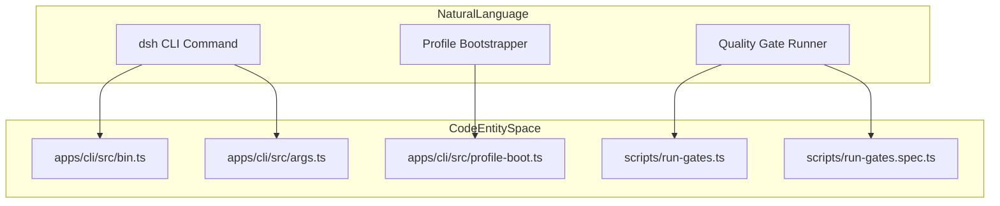
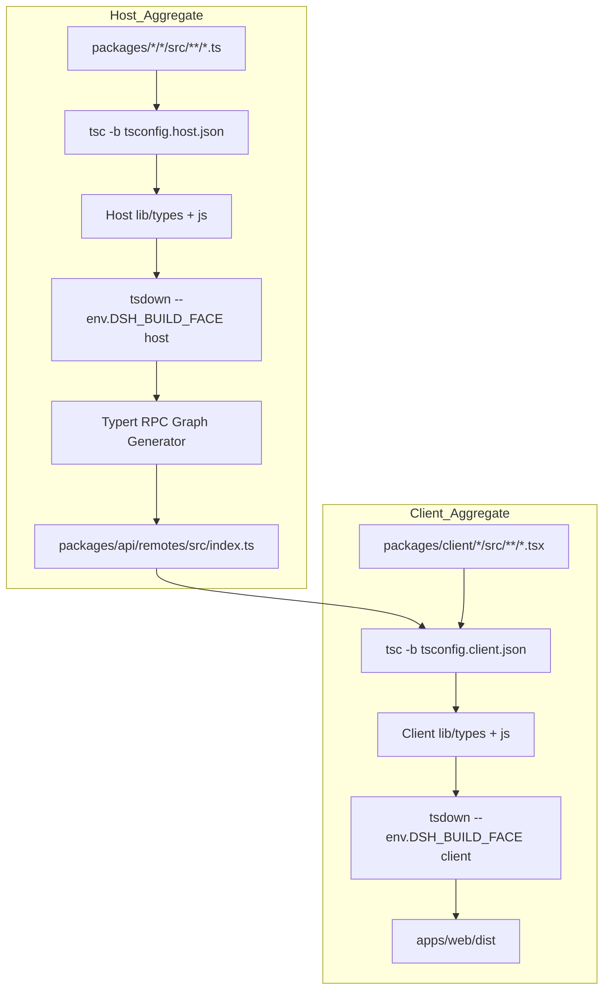
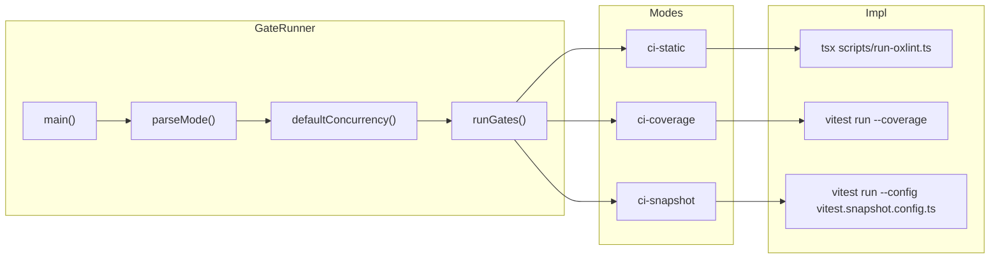

<!-- source: DeepWiki mcp.deepwiki.com · repo deepseek-ai/deepseek-harness · page 1.1 Getting Started & Development Setup · fetched 2026-10-27 -->

# Getting Started & Development Setup

<details>
<summary>Relevant source files</summary>

The following files were used as context for generating this wiki page:

- [.agents/notes/implemented/architecture/2026-09-09-consumer-owned-startup-strictness.i18n.yaml](.agents/notes/implemented/architecture/2026-09-09-consumer-owned-startup-strictness.i18n.yaml)
- [.agents/notes/implemented/architecture/2026-09-09-consumer-owned-startup-strictness.md](.agents/notes/implemented/architecture/2026-09-09-consumer-owned-startup-strictness.md)
- [.agents/notes/implemented/architecture/2026-09-09-consumer-owned-startup-strictness.zh.md](.agents/notes/implemented/architecture/2026-09-09-consumer-owned-startup-strictness.zh.md)
- [.agents/notes/implemented/architecture/2026-09-09-profile-resolution-generations.i18n.yaml](.agents/notes/implemented/architecture/2026-09-09-profile-resolution-generations.i18n.yaml)
- [.agents/notes/implemented/architecture/2026-09-09-profile-resolution-generations.md](.agents/notes/implemented/architecture/2026-09-09-profile-resolution-generations.md)
- [.agents/notes/implemented/architecture/2026-09-09-profile-resolution-generations.zh.md](.agents/notes/implemented/architecture/2026-09-09-profile-resolution-generations.zh.md)
- [.agents/notes/implemented/architecture/2026-09-19-profile-resolution-lookup-order.i18n.yaml](.agents/notes/implemented/architecture/2026-09-19-profile-resolution-lookup-order.i18n.yaml)
- [.agents/notes/implemented/architecture/2026-09-19-profile-resolution-lookup-order.md](.agents/notes/implemented/architecture/2026-09-19-profile-resolution-lookup-order.md)
- [.agents/notes/implemented/architecture/2026-09-19-profile-resolution-lookup-order.zh.md](.agents/notes/implemented/architecture/2026-09-19-profile-resolution-lookup-order.zh.md)
- [.agents/notes/implemented/process/2026-07-21-serial-cross-platform-ci-reference.i18n.yaml](.agents/notes/implemented/process/2026-07-21-serial-cross-platform-ci-reference.i18n.yaml)
- [.agents/notes/implemented/process/2026-07-21-serial-cross-platform-ci-reference.md](.agents/notes/implemented/process/2026-07-21-serial-cross-platform-ci-reference.md)
- [.agents/notes/implemented/process/2026-07-21-serial-cross-platform-ci-reference.zh.md](.agents/notes/implemented/process/2026-07-21-serial-cross-platform-ci-reference.zh.md)
- [.agents/notes/implemented/process/2026-07-26-ci-failover-runbook.i18n.yaml](.agents/notes/implemented/process/2026-07-26-ci-failover-runbook.i18n.yaml)
- [.agents/notes/implemented/process/2026-07-26-ci-failover-runbook.md](.agents/notes/implemented/process/2026-07-26-ci-failover-runbook.md)
- [.agents/notes/implemented/process/2026-07-26-ci-failover-runbook.zh.md](.agents/notes/implemented/process/2026-07-26-ci-failover-runbook.zh.md)
- [.agents/notes/implemented/process/2026-08-08-native-windows-pull-request-ci.i18n.yaml](.agents/notes/implemented/process/2026-08-08-native-windows-pull-request-ci.i18n.yaml)
- [.agents/notes/implemented/process/2026-08-08-native-windows-pull-request-ci.md](.agents/notes/implemented/process/2026-08-08-native-windows-pull-request-ci.md)
- [.agents/notes/implemented/process/2026-08-08-native-windows-pull-request-ci.zh.md](.agents/notes/implemented/process/2026-08-08-native-windows-pull-request-ci.zh.md)
- [.github/AGENTS.md](.github/AGENTS.md)
- [.github/workflows/build-exe-for-python-sdk.yml](.github/workflows/build-exe-for-python-sdk.yml)
- [.github/workflows/ci-master.yml](.github/workflows/ci-master.yml)
- [.github/workflows/ci.yml](.github/workflows/ci.yml)
- [.github/workflows/docs-pages.yml](.github/workflows/docs-pages.yml)
- [.github/workflows/e2e.yml](.github/workflows/e2e.yml)
- [.github/workflows/pi-ai-provider-e2e.yml](.github/workflows/pi-ai-provider-e2e.yml)
- [.github/workflows/sandbox.yml](.github/workflows/sandbox.yml)
- [.gitlab-ci.yml](.gitlab-ci.yml)
- [AGENTS.md](AGENTS.md)
- [apps/cli/README.i18n.yaml](apps/cli/README.i18n.yaml)
- [apps/cli/README.md](apps/cli/README.md)
- [apps/cli/README.zh.md](apps/cli/README.zh.md)
- [apps/cli/reference/README.i18n.yaml](apps/cli/reference/README.i18n.yaml)
- [apps/cli/reference/README.md](apps/cli/reference/README.md)
- [apps/cli/reference/README.zh.md](apps/cli/reference/README.zh.md)
- [apps/cli/src/args.ts](apps/cli/src/args.ts)
- [apps/cli/src/bin.ts](apps/cli/src/bin.ts)
- [apps/cli/src/profile-boot.ts](apps/cli/src/profile-boot.ts)
- [apps/cli/tests/args.spec.ts](apps/cli/tests/args.spec.ts)
- [apps/cli/tests/built-bin.e2e.ts](apps/cli/tests/built-bin.e2e.ts)
- [apps/cli/tests/profiles/headless/tests/profile-resolution.ts](apps/cli/tests/profiles/headless/tests/profile-resolution.ts)
- [apps/cli/tests/profiles/web/tests/web-best-effort-startup.expected.e2e.ts](apps/cli/tests/profiles/web/tests/web-best-effort-startup.expected.e2e.ts)
- [apps/cli/tests/profiles/web/tests/web-failure-matrix.expected.e2e.ts](apps/cli/tests/profiles/web/tests/web-failure-matrix.expected.e2e.ts)
- [apps/cli/tests/web-agent-presets.e2e.ts](apps/cli/tests/web-agent-presets.e2e.ts)
- [docs/development.i18n.yaml](docs/development.i18n.yaml)
- [docs/development.md](docs/development.md)
- [docs/development.zh.md](docs/development.zh.md)
- [docs/user/develop/basic/publish.i18n.yaml](docs/user/develop/basic/publish.i18n.yaml)
- [docs/user/develop/basic/publish.md](docs/user/develop/basic/publish.md)
- [docs/user/develop/basic/publish.zh.md](docs/user/develop/basic/publish.zh.md)
- [package.json](package.json)
- [packages/README.i18n.yaml](packages/README.i18n.yaml)
- [packages/README.md](packages/README.md)
- [packages/README.zh.md](packages/README.zh.md)
- [packages/boot/app-boot/README.i18n.yaml](packages/boot/app-boot/README.i18n.yaml)
- [packages/boot/app-boot/README.md](packages/boot/app-boot/README.md)
- [packages/boot/app-boot/README.zh.md](packages/boot/app-boot/README.zh.md)
- [packages/boot/app-boot/src/index.ts](packages/boot/app-boot/src/index.ts)
- [packages/boot/app-boot/src/profile-resolution/legacy-links.ts](packages/boot/app-boot/src/profile-resolution/legacy-links.ts)
- [packages/boot/app-boot/src/profile-resolution/resolver.ts](packages/boot/app-boot/src/profile-resolution/resolver.ts)
- [packages/boot/app-boot/src/profile-resolution/service.ts](packages/boot/app-boot/src/profile-resolution/service.ts)
- [packages/boot/app-boot/src/profile-resolution/worker-bootstrap.ts](packages/boot/app-boot/src/profile-resolution/worker-bootstrap.ts)
- [packages/boot/app-boot/src/profile.ts](packages/boot/app-boot/src/profile.ts)
- [packages/boot/app-boot/tests/app-boot.spec.ts](packages/boot/app-boot/tests/app-boot.spec.ts)
- [packages/boot/app-boot/tests/profile-resolution-service.spec.ts](packages/boot/app-boot/tests/profile-resolution-service.spec.ts)
- [packages/boot/app-boot/tests/profile-resolution-worker-bootstrap.spec.ts](packages/boot/app-boot/tests/profile-resolution-worker-bootstrap.spec.ts)
- [packages/boot/app-boot/tests/profile-resolution.spec.ts](packages/boot/app-boot/tests/profile-resolution.spec.ts)
- [packages/boot/app-boot/tests/profile.spec.ts](packages/boot/app-boot/tests/profile.spec.ts)
- [packages/boot/app-boot/tests/user-patches.spec.ts](packages/boot/app-boot/tests/user-patches.spec.ts)
- [packages/llm/llm-pi-ai/tests/provider-apis.e2e.ts](packages/llm/llm-pi-ai/tests/provider-apis.e2e.ts)
- [packages/sandbox/sandbox-local/tests/packed-install.e2e.ts](packages/sandbox/sandbox-local/tests/packed-install.e2e.ts)
- [packages/subagent/subagent-claude-code/package.json](packages/subagent/subagent-claude-code/package.json)
- [packages/subagent/subagent-codex/package.json](packages/subagent/subagent-codex/package.json)
- [scripts/AGENTS.md](scripts/AGENTS.md)
- [scripts/ci-compatible-selfhosted.spec.ts](scripts/ci-compatible-selfhosted.spec.ts)
- [scripts/ci-workflow.spec.ts](scripts/ci-workflow.spec.ts)
- [scripts/run-gates.spec.ts](scripts/run-gates.spec.ts)
- [scripts/run-gates.ts](scripts/run-gates.ts)
- [tsconfig.json](tsconfig.json)
- [vitest.config.ts](vitest.config.ts)

</details>


This page provides the technical foundation for setting up, building, and developing DeepSeek Harness (`dsh`) locally. It covers monorepo prerequisites, pnpm workspace rules, the `dsh` CLI and profile booting system, the isolated Host vs. Client TypeScript aggregate architecture, and the bounded quality gate runner.

---

## 1. Environment Prerequisites

The repository relies on strict runtime versions and workspace layout rules to manage its plugin-based architecture and native modules.

- **Node.js**: Supports versions `^22.19.0` or `>=24.0.0`. Continuous Integration validates compatibility across Node versions 22.19, 24, and 26 `[package.json:8-10]`, `[docs/development.md:11]`.
- **pnpm**: Version `11.28.5` is pinned via `package.json`. If `pnpm --version` does not resolve, enable Corepack using `corepack enable` `[package.json:7]`, `[docs/development.md:13]`.
- **Git**: Version 2.26 or newer is required to support worktree-specific configuration extensions `[docs/development.md:14]`.
- **API Key**: A `DEEPSEEK_API_KEY` stored in a root `.env` file is required for live model integration tests, headless demos, and end-to-end scenarios `[docs/development.md:15]`.

Sources: `[package.json:7-10]()`, `[docs/development.md:9-16]()`

---

## 2. Installation & Initial Setup

To clone the repository and install workspace dependencies:

```bash
git clone https://github.com/deepseek-ai/deepseek-harness.git
cd deepseek-harness
pnpm install
```

### Monorepo Workspaces and Git Hooks

- The root `package.json` defines workspaces across `vendor/*`, `packages/*/*`, `native/system`, `native/system/packages/*`, `apps/*`, and `website` `[package.json:11-18]`.
- `pnpm install` triggers repository setup scripts that configure worktree-local Lefthook hooks through `scripts/install-lefthook.mjs` `[docs/development.md:32-35]`.
- A custom translation-pairing Git merge driver is installed for `.i18n.yaml` sidecar files to maintain synchronization between documentation pairs `[docs/development.i18n.yaml:1-5]`.

If hooks are missing because dependencies were restored from cache or `postinstall` was skipped, install them manually:

```bash
node scripts/install-lefthook.mjs
```

Sources: `[package.json:11-18]`, `[docs/development.md:25-44]()`

---

## Diagram: Natural Language Space to Code Entity Space (Boot & Execution)

The following diagram bridges natural language concepts of booting and test execution to their concrete code entities in the repository.



Sources: `[apps/cli/src/bin.ts:1-1]`, `[apps/cli/src/args.ts:1-1]`, `[apps/cli/src/profile-boot.ts:1-1]`, `[scripts/run-gates.ts:1-10]()`

---

## 3. The dsh CLI & Profile Booting

The primary command-line entry point is managed through `apps/cli/src/bin.ts`, parsing arguments via `apps/cli/src/args.ts`.

### Profile Booting Implementation

The profile boot process (`apps/cli/src/profile-boot.ts`) is responsible for:
- Resolving configuration layers and environment variables.
- Assembling ordered patch files and active plugin bundles.
- Bootstrapping the Cordis service container and context tree.

| Command                                   | Purpose                                                        |
|-------------------------------------------|----------------------------------------------------------------|
| `pnpm dsh web`                            | Launches the Web UI server and client runtime.                 |
| `pnpm dsh --profile headless "<task>"`    | Runs a single task headlessly and exits.                       |
| `pnpm run demo:ptc -- "<task>"`            | Runs plaintext chat (PTC) headless demo.                       |

Sources: `[AGENTS.md:101-105]`, `[apps/cli/src/profile-boot.ts:1-10]()`

---

## 4. TypeScript Aggregates: Host vs. Client Build System

Because both Host (Node.js) and Client (Browser) codebases declaration-merge the Cordis `Context` interface under identical keys with different service definitions, combining them into a single `ts.Program` causes type collisions. DeepSeek Harness maintains two isolated TypeScript aggregates `[docs/development.md:57-73]`:

- **Host Aggregate (`tsconfig.host.json`)**: Covers Node.js runtime code, agent logic, tool execution, and server-side API remotes `[docs/development.md:64]`.
- **Client Aggregate (`tsconfig.client.json`)**: Covers browser UI components, client runtime, and remote stubs `[docs/development.md:65]`.

### Build Pipeline & Data Flow



Sources: `[package.json:23-26]`, `[docs/development.md:57-96]()`

---

## 5. Quality Gate System & Execution Runner

Quality gates, static analysis, unit tests, and coverage checks are orchestrated by `scripts/run-gates.ts` and validated via bounded worker scheduling.

### Gate Modes and Concurrency

- **Modes**: Named aggregates such as `ci-primary`, `ci-static`, `ci-coverage`, `ci-unit`, `ci-snapshot`, and `check-all` control which suites run `[scripts/run-gates.ts:18-37]`.
- **Concurrency**: Default worker allocations are computed based on available system CPUs or overridden via `DSH_GATE_CONCURRENCY` `[scripts/run-gates.ts:104-110]`.
- **Fail Fast**: Enabled via `DSH_GATE_FAIL_FAST=1` to abort remaining gates upon the first blocking failure `[scripts/run-gates.ts:111-118]`.

### Diagram: Quality Gate Execution Flow



Sources: `[scripts/run-gates.ts:1-187]()`, `[scripts/run-gates.spec.ts:1-50]()`

---

## 6. Local Development Workflow & Best Practices

- **Typecheck Verification**: Run `pnpm run typecheck` to validate the complete Host aggregate and client contracts `[package.json:51-52]`.
- **Test Coverage**: Run `pnpm run test:coverage` to execute Vitest suites under the per-file 100% coverage gate `[package.json:59]`.
- **Bilingual Documentation Sync**: After updating `.i18n.yaml` translation files, synchronize pairs using:
  ```bash
  pnpm run verify-translation-pairing --write <target>
  ```
- **Cleanup**: To safely purge build artifacts and workspace residue, run `pnpm run clean` `[package.json:49]`, `[AGENTS.md:85]`.

Sources: `[package.json:49-65]`, `[AGENTS.md:83-105]()`

---

