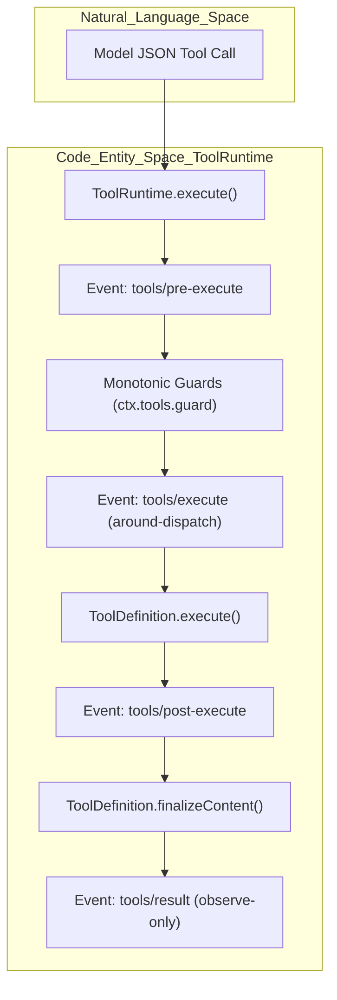
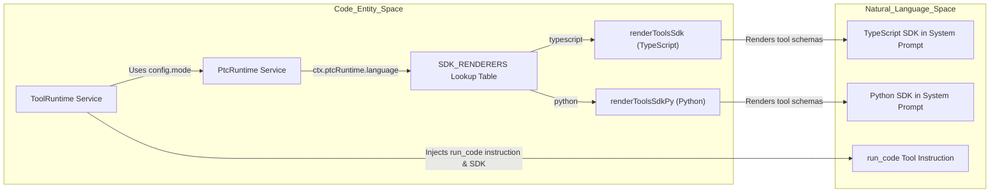

<!-- source: DeepWiki mcp.deepwiki.com · repo deepseek-ai/deepseek-harness · page 3.2 Tool Registry & Execution Pipeline · fetched 2026-10-27 -->

# Tool Registry & Execution Pipeline

<details>
<summary>Relevant source files</summary>

The following files were used as context for generating this wiki page:

- [apps/cli/tests/profiles/headless/tests/ptc.e2e.ts](apps/cli/tests/profiles/headless/tests/ptc.e2e.ts)
- [docs/subsystems/ptc-runtime.i18n.yaml](docs/subsystems/ptc-runtime.i18n.yaml)
- [docs/subsystems/ptc-runtime.md](docs/subsystems/ptc-runtime.md)
- [docs/subsystems/ptc-runtime.zh.md](docs/subsystems/ptc-runtime.zh.md)
- [docs/tool-catalog.i18n.yaml](docs/tool-catalog.i18n.yaml)
- [docs/tool-catalog.md](docs/tool-catalog.md)
- [docs/tool-catalog.zh.md](docs/tool-catalog.zh.md)
- [packages/core/tools/README.i18n.yaml](packages/core/tools/README.i18n.yaml)
- [packages/core/tools/README.md](packages/core/tools/README.md)
- [packages/core/tools/README.zh.md](packages/core/tools/README.zh.md)
- [packages/core/tools/src/index.ts](packages/core/tools/src/index.ts)
- [packages/core/tools/src/presentation.ts](packages/core/tools/src/presentation.ts)
- [packages/core/tools/src/ptc.ts](packages/core/tools/src/ptc.ts)
- [packages/core/tools/src/py-types.ts](packages/core/tools/src/py-types.ts)
- [packages/core/tools/src/schema.ts](packages/core/tools/src/schema.ts)
- [packages/core/tools/src/ts-types.ts](packages/core/tools/src/ts-types.ts)
- [packages/core/tools/tests/gen-tool-catalog.spec.ts](packages/core/tools/tests/gen-tool-catalog.spec.ts)
- [packages/core/tools/tests/ptc-calls.spec.ts](packages/core/tools/tests/ptc-calls.spec.ts)
- [packages/core/tools/tests/ptc.spec.ts](packages/core/tools/tests/ptc.spec.ts)
- [packages/core/tools/tests/py-types.spec.ts](packages/core/tools/tests/py-types.spec.ts)
- [packages/core/tools/tests/tools.spec.ts](packages/core/tools/tests/tools.spec.ts)
- [packages/core/tools/tests/ts-types.spec.ts](packages/core/tools/tests/ts-types.spec.ts)
- [packages/ptc-runtime/ptc-runtime-node/README.i18n.yaml](packages/ptc-runtime/ptc-runtime-node/README.i18n.yaml)
- [packages/ptc-runtime/ptc-runtime-node/README.md](packages/ptc-runtime/ptc-runtime-node/README.md)
- [packages/ptc-runtime/ptc-runtime-node/README.zh.md](packages/ptc-runtime/ptc-runtime-node/README.zh.md)
- [packages/ptc-runtime/ptc-runtime-node/src/bootstrap.ts](packages/ptc-runtime/ptc-runtime-node/src/bootstrap.ts)
- [packages/ptc-runtime/ptc-runtime-node/src/config.ts](packages/ptc-runtime/ptc-runtime-node/src/config.ts)
- [packages/ptc-runtime/ptc-runtime-node/src/index.ts](packages/ptc-runtime/ptc-runtime-node/src/index.ts)
- [packages/ptc-runtime/ptc-runtime-node/src/persistent-process.ts](packages/ptc-runtime/ptc-runtime-node/src/persistent-process.ts)
- [packages/ptc-runtime/ptc-runtime-node/src/persistent.ts](packages/ptc-runtime/ptc-runtime-node/src/persistent.ts)
- [packages/ptc-runtime/ptc-runtime-node/src/policy-processes.ts](packages/ptc-runtime/ptc-runtime-node/src/policy-processes.ts)
- [packages/ptc-runtime/ptc-runtime-node/tests/host-failures.spec.ts](packages/ptc-runtime/ptc-runtime-node/tests/host-failures.spec.ts)
- [packages/ptc-runtime/ptc-runtime-node/tests/persistent-built.e2e.ts](packages/ptc-runtime/ptc-runtime-node/tests/persistent-built.e2e.ts)
- [packages/ptc-runtime/ptc-runtime-node/tests/persistent-host.spec.ts](packages/ptc-runtime/ptc-runtime-node/tests/persistent-host.spec.ts)
- [packages/ptc-runtime/ptc-runtime-node/tests/persistent-process.spec.ts](packages/ptc-runtime/ptc-runtime-node/tests/persistent-process.spec.ts)
- [packages/ptc-runtime/ptc-runtime-node/tests/persistent-sandbox.spec.ts](packages/ptc-runtime/ptc-runtime-node/tests/persistent-sandbox.spec.ts)
- [packages/ptc-runtime/ptc-runtime-node/tests/persistent.spec.ts](packages/ptc-runtime/ptc-runtime-node/tests/persistent.spec.ts)
- [packages/ptc-runtime/ptc-runtime-node/tests/policy-processes.spec.ts](packages/ptc-runtime/ptc-runtime-node/tests/policy-processes.spec.ts)
- [packages/ptc-runtime/ptc-runtime-node/tsdown.config.ts](packages/ptc-runtime/ptc-runtime-node/tsdown.config.ts)
- [packages/ptc-runtime/ptc-runtime/src/index.ts](packages/ptc-runtime/ptc-runtime/src/index.ts)
- [packages/shell/shell/README.i18n.yaml](packages/shell/shell/README.i18n.yaml)
- [packages/shell/shell/README.md](packages/shell/shell/README.md)
- [packages/shell/shell/README.zh.md](packages/shell/shell/README.zh.md)
- [packages/shell/shell/src/render.ts](packages/shell/shell/src/render.ts)
- [packages/shell/shell/tests/render.spec.ts](packages/shell/shell/tests/render.spec.ts)
- [packages/shell/tool-bash/tests/tools.spec.ts](packages/shell/tool-bash/tests/tools.spec.ts)
- [packages/shell/tool-pwsh/tests/tools.spec.ts](packages/shell/tool-pwsh/tests/tools.spec.ts)
- [packages/workflow/workflow-ptc/src/host.ts](packages/workflow/workflow-ptc/src/host.ts)
- [packages/workflow/workflow-ptc/tests/workflow-ptc.spec.ts](packages/workflow/workflow-ptc/tests/workflow-ptc.spec.ts)
- [scripts/gen-config-catalog.spec.ts](scripts/gen-config-catalog.spec.ts)
- [scripts/gen-tool-catalog.ts](scripts/gen-tool-catalog.ts)
- [snapshots/session/computer-use-cua-driver-mcp/system-prompt.expected.md](snapshots/session/computer-use-cua-driver-mcp/system-prompt.expected.md)
- [snapshots/session/mcp-resources-ptc/system-prompt.expected.md](snapshots/session/mcp-resources-ptc/system-prompt.expected.md)
- [snapshots/session/mcp-resources/system-prompt.expected.md](snapshots/session/mcp-resources/system-prompt.expected.md)
- [snapshots/session/mcp-resources/tool-schemas.expected.json](snapshots/session/mcp-resources/tool-schemas.expected.json)
- [snapshots/session/ptc-node-read-only/system-prompt.expected.md](snapshots/session/ptc-node-read-only/system-prompt.expected.md)
- [snapshots/session/ptc-node-workspace/system-prompt.expected.md](snapshots/session/ptc-node-workspace/system-prompt.expected.md)
- [snapshots/session/ptc-persistent/cordis.snapshot.yml](snapshots/session/ptc-persistent/cordis.snapshot.yml)
- [snapshots/session/ptc-persistent/cordis.yml](snapshots/session/ptc-persistent/cordis.yml)
- [snapshots/session/ptc-persistent/replay.override.json](snapshots/session/ptc-persistent/replay.override.json)
- [snapshots/session/ptc-persistent/session.v4.jsonl](snapshots/session/ptc-persistent/session.v4.jsonl)
- [snapshots/session/ptc-persistent/snapshot.yml](snapshots/session/ptc-persistent/snapshot.yml)
- [snapshots/session/ptc-persistent/system-prompt.expected.md](snapshots/session/ptc-persistent/system-prompt.expected.md)
- [snapshots/session/ptc-persistent/tool-schemas.expected.json](snapshots/session/ptc-persistent/tool-schemas.expected.json)
- [snapshots/session/ptc-persistent/workspace.expected/persistent-count.txt](snapshots/session/ptc-persistent/workspace.expected/persistent-count.txt)
- [snapshots/session/ptc-python-turn/system-prompt.expected.md](snapshots/session/ptc-python-turn/system-prompt.expected.md)
- [snapshots/session/ptc-read-image/system-prompt.expected.md](snapshots/session/ptc-read-image/system-prompt.expected.md)
- [snapshots/session/ptc-turn/system-prompt.expected.md](snapshots/session/ptc-turn/system-prompt.expected.md)
- [snapshots/web/cordis-tool-round/tool-schemas.expected.json](snapshots/web/cordis-tool-round/tool-schemas.expected.json)
- [snapshots/web/fresh-round-trip/tool-schemas.expected.json](snapshots/web/fresh-round-trip/tool-schemas.expected.json)
- [snapshots/web/ptc-round/system-prompt.expected.md](snapshots/web/ptc-round/system-prompt.expected.md)

</details>


The `ToolRuntime` service (registered under the Cordis context key `tools`) is the centralized subsystem in DeepSeek Harness responsible for managing the lifecycle of tools: their registration, discovery, policy enforcement, and execution. It coordinates how tools are presented to the model (either via native Function Calling schemas or through Code Mode with SDK generation), enforces concurrent execution limits and cancellation, and exposes tool schemas into the system prompt assembly for model consumption.

This page provides a comprehensive technical overview of the `ToolRuntime` implementation, the execution pipeline’s structured waterfall events, Code Mode orchestration, scheduling with cooperative cancellation, and the generated tool catalog which documents all shipped tools.

Sources: [packages/core/tools/src/index.ts:1-133](), [packages/core/tools/README.md:7-92]()

---

## 1. Tool Registration & Discovery

Tools are primarily registered as `ToolDefinition` objects that specify:

- A model-visible tool `name` and `description`.
- JSON Schema definitions for the tool parameters.
- The declared output shape and optional renderers.
- An asynchronous `execute` function implementing the tool’s core logic.
- Optional lifecycle hooks (e.g. `finalizeContent`, `projectContent`) and concurrency hints.

### Registration Architecture

- **Scoped Layers:** Tools are registered in _scoped layers_ using `@deepseek-ai/dsh-scope` (`ScopedLayers`, `scopeOf`, `scopeTarget`), enabling global, per-agent, or other context-sensitive overrides. An agent-local tool registration shadows global definitions of the same name. [packages/core/tools/src/index.ts:10-10]()
- **Visibility Filtering:** Using `ctx.tools.restrict(filter)` per-agent allow/deny masks can be applied dynamically, intersecting and respecting scoped registrations, thus limiting which tools an agent can see and call. [packages/core/tools/README.md:83-87]()
- **Schema Projection:** The registry projects registered `ToolDefinition`s into wire-visible `ToolSchema` objects that expose only the necessary properties (`name`, `description`, `parameters`). Host-only callbacks like `execute` or `presentCall` do not leak to the model. [packages/core/tools/README.md:83-87]()
- **Schema Validation:** Tools' JSON Schemas are validated against a subset spec during registration with functions like `assertSupportedJsonSchema` and `validateJsonSchemaValue` to ensure correctness and compatibility. [packages/core/tools/src/index.ts:24-25]()
- **Runtime Registration:** Most tools are registered at runtime during plugin boot in the `ToolRuntime` service, enabling dynamic schema features such as runtime-enum expansions. [docs/tool-catalog.md:8-10]()

### Usage Example

```ts
import { readFile } from 'node:fs/promises'
import type { Context } from '@deepseek-ai/cordis'
import { defineTool } from '@deepseek-ai/dsh-tools'

declare const ctx: Context

ctx.tools.register(defineTool({
  name: 'read_file',
  description: 'Read a file from disk.',
  parameters: {
    path: { type: 'string', required: true, description: 'Absolute file path' },
    offset: { type: 'number' },
    limit: { type: 'number' },
  },
  output: {
    schema: { type: 'string' },
    render: (_args, value) => [{ type: 'text', text: value }],
  },
  async execute(args, exec) {
    return readFile(args.path, { encoding: 'utf8', signal: exec.signal })
  },
}))
```

This example demonstrates defining a typed tool with parameters and output using `defineTool`, which automatically becomes visible to the model unless restricted.

Sources: [packages/core/tools/src/index.ts:7-82](), [packages/core/tools/README.md:28-84](), [docs/tool-catalog.md:8-10]()

---

## 2. Execution Pipeline Waterfall

The tool execution pipeline is a rigorously structured waterfall sequence of asynchronous events and synchronous guards that manage the flow of a tool call from initial model invocation through policy decisions and result finalization.

### Pipeline Stages

1. **`tools/pre-execute`** (asynchronous waterfall event)  
   - Listeners decide whether to `allow`, `deny`, or `ask` for approval before execution via `PreToolDecision`.  
   - Supports cancellation observation (`exec.signal`); events are scope-filtered via `@deepseek-ai/dsh-scope`. [packages/core/tools/src/index.ts:138-154]()
2. **Monotonic Guards**  
   - Synchronously registered via `ctx.tools.guard()` after `pre-execute`; only allow rejection reasons and cannot be overridden back to allow later. [packages/core/tools/README.md:88-89]()
3. **`tools/execute`** (around-dispatch waterfall)  
   - Wraps the actual call dispatch, supporting retries, timeout enforcement, or instrumentation. Call identity (`name`, `callId`) is fixed; only the cancellation signal may be replaced temporarily. [packages/core/tools/src/index.ts:155-171]()
4. **Tool Body Dispatch**  
   - Calls the registered tool’s `execute` method with validated args and given cancellation signal. [packages/core/tools/README.md:109-110]()
5. **`tools/post-execute`** (asynchronous waterfall)  
   - Allows inspection or replacement of results and attaching contextual metadata after execution. [packages/core/tools/README.md:109-110]()
6. **`finalizeContent`**  
   - The tool's optional final content normalization step producing the canonical presentation content. [packages/core/tools/README.md:90-91]()
7. **`tools/result`** (observe-only event)  
   - Publishes the frozen final result for observers without any capability to modify it. [packages/core/tools/README.md:109-110]()

### Pipeline Data Flow Diagram

Title: Tool Execution Pipeline Flow



This flow ensures precise control over tool calls, error handling, content projection, and policy enforcement at every stage.

Sources: [packages/core/tools/src/index.ts:137-190](), [packages/core/tools/README.md:83-87]()

---

## 3. Code Mode (run_code + SDK Generation)

DeepSeek Harness supports an advanced Code Mode where the LLM produces programs (code) that invoke tools indirectly, adding expressiveness beyond flat JSON tool calls.

### Core Components

- **`run_code` Tool**  
  - A reserved tool with the name `RUN_CODE_NAME` (defined internally as `'run_code'`) via `createRunCodeTool()` serves as a program execution host within the tool pipeline. [packages/core/tools/src/index.ts:26-26](), [packages/core/tools/src/ptc.ts:1-20]()
  - It accepts a program text and dispatches nested calls inside the harness asynchronously.  
  - Nested calls are scheduled respecting concurrency limits (`maxParallelSubCalls`), allowing multiple overlapping sub-calls belonging to the same program invocation. [packages/core/tools/README.md:76-80]()
  - Calls inside program execution must go through this route; direct calls to other tools in `ptc` mode are disallowed by `PTC_ONLY_INSTRUCTION`. [packages/core/tools/src/index.ts:55-60]()

- **SDK Generation**  
  - Depending on the runtime language (`ctx.ptcRuntime.language`), the registry looks up `SDK_RENDERERS` to generate a strongly typed SDK for the model that describes available tools and signatures. [packages/core/tools/src/index.ts:40-54]()
  - SDKs are injected into the system prompt as a `tools:sdk` section, enabling model-written programs to call these tools with type safety guarantees. [packages/core/tools/README.md:66-82]()
  - Supported languages and associated SDK renderers currently include:  
    - **TypeScript:** via `renderToolsSdk()` in `ts-types.ts`. [packages/core/tools/src/index.ts:28-28]()
    - **Python:** via `renderToolsSdkPy()` in `py-types.ts`. [packages/core/tools/src/index.ts:30-30]()

### SDK Renderer Dispatch Table

| Language   | SDK Renderer Function          | File Reference                     |
|------------|-------------------------------|----------------------------------|
| `typescript` | `renderToolsSdk`              | `packages/core/tools/src/ts-types.ts` |
| `python`    | `renderToolsSdkPy`            | `packages/core/tools/src/py-types.ts` |

The Python SDK generator (`py-types.ts`) emits tools as Python `TypedDict` classes preserving JSON Schema details, with Unicode-aware identifier validation via `isBareIdentifier()` to ensure generated names are compatible with CPython’s rules. [packages/core/tools/src/py-types.ts:1-100]()

### Code Mode Logical Pipeline Diagram

Title: Code Mode SDK Generation and Dispatch Pipeline



This design enforces execution through the `run_code` tool for programmatic calls in `ptc` mode and communicates the tool API via SDK injected into the prompt.

Sources: [packages/core/tools/src/index.ts:24-65](), [packages/core/tools/src/py-types.ts:1-101](), [packages/core/tools/README.md:66-79]()

---

## 4. Scheduling & Cooperative Cancellation

### Concurrency Control

- The configuration `maxParallelSubCalls` (default 10) sets the concurrency cap for overlapping sub-calls spawned by a `run_code` program. [packages/core/tools/README.md:76-80]()
- Tools can mark concurrency safety hints to declare if they can be safely called in parallel without side-effect corruption. [packages/core/tools/README.md:108-110]()

### Cancellation Protocol

- Every tool execution receives an `AbortSignal` (`exec.signal`) which tool bodies must observe for cooperative cancellation. [packages/core/tools/README.md:124-127]()
- Early cancellation (before actual dispatch) results in the special outcome code `TOOL_ABORTED_BEFORE_DISPATCH`. [packages/core/tools/tests/tools.spec.ts:10-15]()
- Cancellation during execution produces a `TOOL_ABORTED` result if possible, replacing any successful outcome. [packages/core/tools/tests/tools.spec.ts:10-15]()
- Wrappers in the pipeline and concurrency schedulers consistently propagate and respect cancellation signals, ensuring clean shutdown and no stray tasks. [packages/core/tools/src/index.ts:149-163]()

This coordination enables reliable interruption and resource cleanup across nested and native tool executions.

Sources: [packages/core/tools/src/index.ts:149-163](), [packages/core/tools/README.md:53-56](), [packages/core/tools/tests/tools.spec.ts:10-15]()

---

## 5. Generated Tool Catalog Overview

The `docs/tool-catalog.md` file is an important generated artifact documenting every model-visible tool schema delivered by shipped plugins.

### Generation Process

- The generation script (`scripts/gen-tool-catalog.ts`) boots all declared `tool-*` plugin packages in a real Cordis context, loading them with default configuration to harvest their runtime-assembled tool schemas. [docs/tool-catalog.md:8-10](), [scripts/gen-tool-catalog.ts:1-128]()
- This runtime approach captures dynamic constructs such as runtime-expanded enums, configuration-driven names, and raw JSON Schema tools originating from MCP. [docs/tool-catalog.md:8-10]()
- Completeness is enforced by cross-referencing the on-disk tool packages with a manifest, preventing undocumented or orphaned tools. [docs/tool-catalog.md:8-10]()

### Catalog Contents

- The catalog contains a mapping from a model-facing tool name to its registering package and service seams. [docs/tool-catalog.md:12-16]()
- Each tool entry includes its `name`, `description`, and canonical JSON Schema `parameters` available to the model. [docs/tool-catalog.md:4-6]()
- Optional deployment and alias notes are recorded. [docs/tool-catalog.md:10-10]()

### Catalog Usage & Maintenance

- The tool catalog informs documentation, testing, and system prompt assembly for model tool capabilities. [docs/tool-catalog.md:6-8]()
- It is rebuilt via `pnpm run gen-tool-catalog` and validated in CI via `pnpm run verify-tool-catalog`. [docs/tool-catalog.md:1-8]()
- It serves as the definitive source listing all tools available to models. [docs/tool-catalog.md:6-10]()

Sources: [docs/tool-catalog.md:1-40](), [scripts/gen-tool-catalog.ts:1-128](), [packages/core/tools/tests/gen-tool-catalog.spec.ts:25-96]()

---

# Summary

The `ToolRuntime` is the backbone of the DeepSeek Harness tool subsystem. It encapsulates:

- Typed tool registration with scoped and restricted visibility.
- An extensible, robust execution pipeline with pre/post policy events, monotonic guards, and cooperative cancellation.
- Advanced Code Mode support with program execution via the `run_code` tool and multi-language SDK generation for controlled and typed tool APIs.
- Scheduling mechanisms that enforce concurrency caps and cancellation propagation.
- Automated catalog generation to verify and document all delivered tools for models.

This design supports a flexible, scalable, and safe platform for agent tool integration, exposing rich capabilities to LLMs with strong consistency between the tooling environment and model interface.

---

# References and Sources

- Tool Runtime core and events: [packages/core/tools/src/index.ts:1-190]()
- Tool authoring and pipeline overview: [packages/core/tools/README.md:26-92]()
- Code Mode and SDK rendering: [packages/core/tools/src/index.ts:24-57](), [packages/core/tools/src/py-types.ts:1-101]()
- Tool catalog generation and verification: [docs/tool-catalog.md:1-40](), [scripts/gen-tool-catalog.ts:1-128]()
- Execution and cancellation tests: [packages/core/tools/tests/tools.spec.ts:1-141]()

---

