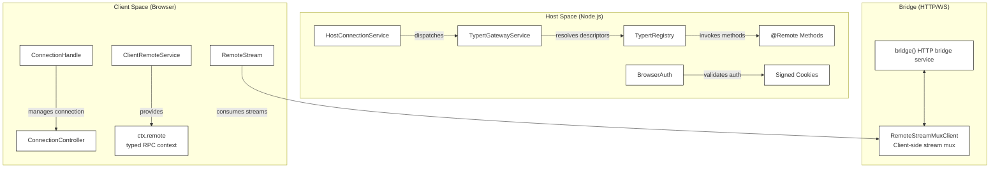
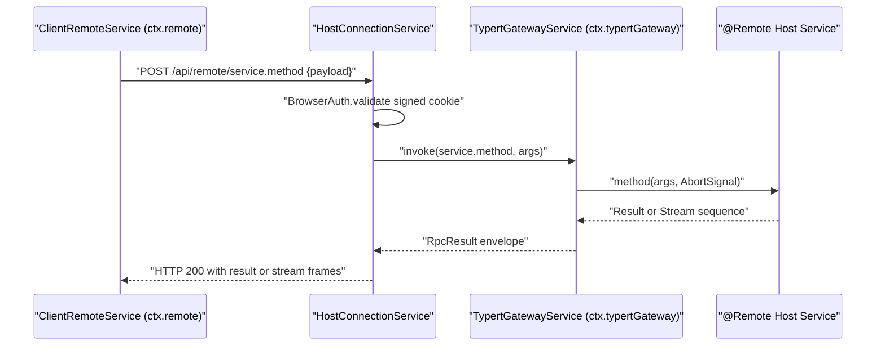

<!-- source: DeepWiki mcp.deepwiki.com · repo deepseek-ai/deepseek-harness · page 5 API Layer & Host-Client Bridge · fetched 2026-10-27 -->

# API Layer & Host-Client Bridge

Relevant source files

The following files were used as context for generating this wiki page:

- [.agents/notes/implemented/architecture/2026-10-12-peer-principal-and-remote-access.i18n.yaml](.agents/notes/implemented/architecture/2026-10-12-peer-principal-and-remote-access.i18n.yaml)
- [.agents/notes/implemented/architecture/2026-10-12-peer-principal-and-remote-access.md](.agents/notes/implemented/architecture/2026-10-12-peer-principal-and-remote-access.md)
- [.agents/notes/implemented/architecture/2026-10-12-peer-principal-and-remote-access.zh.md](.agents/notes/implemented/architecture/2026-10-12-peer-principal-and-remote-access.zh.md)
- [packages/api/gateway/README.i18n.yaml](packages/api/gateway/README.i18n.yaml)
- [packages/api/gateway/README.md](packages/api/gateway/README.md)
- [packages/api/gateway/README.zh.md](packages/api/gateway/README.zh.md)
- [packages/api/gateway/package.json](packages/api/gateway/package.json)
- [packages/api/gateway/src/client/index.ts](packages/api/gateway/src/client/index.ts)
- [packages/api/gateway/src/client/stream-client.ts](packages/api/gateway/src/client/stream-client.ts)
- [packages/api/gateway/src/index.ts](packages/api/gateway/src/index.ts)
- [packages/api/gateway/src/stream-server.ts](packages/api/gateway/src/stream-server.ts)
- [packages/api/gateway/src/types.ts](packages/api/gateway/src/types.ts)
- [packages/api/gateway/tests/gateway-access.host.spec.ts](packages/api/gateway/tests/gateway-access.host.spec.ts)
- [packages/api/gateway/tests/gateway-stream.host.spec.ts](packages/api/gateway/tests/gateway-stream.host.spec.ts)
- [packages/api/gateway/tests/gateway.client.spec.ts](packages/api/gateway/tests/gateway.client.spec.ts)
- [packages/api/gateway/tests/gateway.host.spec.ts](packages/api/gateway/tests/gateway.host.spec.ts)
- [packages/api/gateway/tests/stream-server.host.spec.ts](packages/api/gateway/tests/stream-server.host.spec.ts)
- [packages/api/remote-access/README.i18n.yaml](packages/api/remote-access/README.i18n.yaml)
- [packages/api/remote-access/README.md](packages/api/remote-access/README.md)
- [packages/api/remote-access/README.zh.md](packages/api/remote-access/README.zh.md)
- [packages/api/session-controller/tests/remote-access.host.spec.ts](packages/api/session-controller/tests/remote-access.host.spec.ts)
- [packages/typert/protocol/src/types.ts](packages/typert/protocol/src/types.ts)

The **API Layer & Host-Client Bridge** constitutes the central infrastructure enabling communication between the Node.js Host environment and the browser Client UI in DeepSeek Harness (`dsh`). It exposes services on the Host as secure, typed remote procedure calls (RPCs) and multiplexed streaming endpoints consumable by the browser client through HTTP and WebSocket protocols.

This layer abstracts:
- Carrier-neutral RPC transport.
- Authentication and trust enforcement using signed browser cookies and strict Host/Origin validation [packages/client/connection/src/index.ts:124-161]().
- Multiplexed logical streams over WebSockets with reconnect and backoff [packages/api/gateway/src/index.ts:1-70]().
- Type-safe remote invocation built on the Typert system with generated contracts [packages/api/gateway/src/client/index.ts:1-36]().
- Efficient multipart handling extending JSON with byte attachments [packages/api/gateway/src/index.ts:105-115]().

This page provides a high-level overview of the main components and their integration. Detailed technical documentation is available in dedicated child pages for each major subsystem:
- [API Proxy & RPC Protocol](#5.1)
- [Typert: Type-Safe RPC Generation](#5.2)
- [Client Runtime & Session Management](#5.3)

---

## System Entity Map: Host to Client

The following diagram maps core system entities by their code identities and shows their connections across the bridge layer, illustrating host services, transport carriers, and client runtime components.

### Diagram: Host-Client Bridge Entity Topology

Sources:  
- [packages/client/connection/src/index.ts:124-161]()  
- [packages/api/gateway/src/client/index.ts:140-183]()  

---

## 5.1 API Proxy & RPC Protocol

The **API Proxy & RPC Protocol** forms the transport and gateway abstraction exposed to browser clients. This subsystem is primarily implemented in the `client-connection` package and the Host-side `TypertGatewayService` [packages/api/gateway/src/index.ts:1-70]().

Key responsibilities include:

- **HostConnectionService**: Creates and manages connection generations linking browser requests to Host state. It performs browser session authentication using `BrowserAuth`, which manages signed cookies with authority-bound signatures to securely authenticate the browser client [packages/client/connection/src/index.ts:124-157]().
- **HTTP Bridge**: The `/api` prefix routes incoming HTTP requests exactly to handlers registered on the Host. The `bridge()` function manages body parsing, trust checks, authentication, and dispatch to either the API Gateway or registered fetch handlers [packages/client/connection/README.md:10-48]().
- **Trust Boundary Enforcement**: Incoming requests must originate from loopback or enumerated trusted hosts and have matching `Origin` headers. Cross-site or DNS-rebinding attempts are rejected at this layer, preventing forged browser calls [packages/api/gateway/README.md:31-33]().
- **RPC Wire Protocol**: Supports unary JSON calls optionally carrying separated byte attachments encoded as multipart, which extend beyond simple JSON for richer payloads [packages/api/gateway/README.md:29-31]().
- **Connection Generation**: Manages connection lifecycle with retries and backoff. A generation becomes ready only when its source signals so, ensuring client-side cache consistency and event ordering [packages/client/connection/src/index.ts:13-16]().

For in-depth protocol details including SSE streaming, request trust validation, retry policy, and fetch handler internals, see [API Proxy & RPC Protocol](#5.1).

Sources:  
- [packages/client/connection/src/index.ts:124-157]()  
- [packages/client/connection/README.md:10-48]()  
- [packages/api/gateway/README.md:31-33]()  

---

## 5.2 Typert: Type-Safe RPC Generation

The **Typert** subsystem enables end-to-end type safety for remote procedure calls between Host and Client using generated code declarations.

Highlights:

- **Host Declaration**: Host services declare Remote methods with `@Remote` and `@RemoteScope` decorators. This marks methods for generation of invocation descriptors encoding parameter codecs, cancellation signals (via `AbortSignal`), and return types [packages/api/gateway/README.md:27-29]().
- **Invocation Descriptors**: Generated method descriptors provide strict validation of argument shapes on the Host side and type-safe contracts in Client runtime [packages/api/gateway/README.md:29-31]().
- **TypertRegistry**: Maintains all registered remote endpoints and performs invocation dispatching by resolving descriptors at runtime [packages/api/gateway/src/index.ts:28-36]().
- **Gateway Service**: The `TypertGatewayService` acts as the Host-side gateway, validating incoming JSON payloads, performing identity URI lookups, and invoking the underlying Host business methods [packages/api/gateway/README.md:27-31]().
- **Streaming Support**: Remote streaming methods annotated with `@Remote({ mode: 'stream' })` return iterable or async iterable sequences that the Gateway multiplexes over a shared `/api/remote.mux` WebSocket [packages/api/gateway/README.zh.md:39-44]().
- **Error Handling**: Typed failures and protocol violations are wrapped as `RemoteError` with standardized error codes recognizable across the wire [packages/api/gateway/src/index.ts:173-194]().

For full technical details on decorators, type analysis, build pipeline, and generated contracts, see [Typert: Type-Safe RPC Generation](#5.2).

Sources:  
- [packages/api/gateway/README.md:27-38]()  
- [packages/api/gateway/src/index.ts:1-198]()  
- [packages/api/gateway/src/client/index.ts:1-143]()  

---

## 5.3 Client Runtime & Session Management

On the browser side, the **Client Runtime** offers a rich Cordis service that exposes typed remote method namespaces and multiplexed streaming atop the connection transport [packages/api/gateway/src/client/index.ts:140-183]().

Highlights:

- **ClientRemoteService**: Installs as `ctx.remote` into the Cordis context, composed of contributions loaded via the Typert-generated descriptors [packages/api/gateway/src/client/index.ts:127-143]().
- **ConnectionHandle**: Manages connection state, retries, and loopback detection. It wraps the underlying transport layer and exposes generic RPC facilities [packages/client/connection/client.ts:1-20]().
- **RemoteStreamMuxClient**: Implements multiplexing of many logical Remote streams concurrently over a single WebSocket connection. It manages stream lifecycle, reconnection, and dispatch [packages/api/gateway/src/client/stream-client.ts:1-35]().
- **Typed Namespaces**: Generated namespaces under `ctx.remote.<namespace>` expose type-safe methods that marshal calls into the connection RPC layer with codec validation [packages/api/gateway/src/client/index.ts:103-132]().
- **Host Facts**: The service exposes fixed Host facts (e.g., home directory path, loopback status) via `ctx.remote.$host`, which clients can read reactively [packages/api/gateway/src/client/index.ts:116-125]().
- **Cancellation & AbortSignal**: Methods accept optional `AbortSignal` parameters supporting cooperative cancellation [packages/api/gateway/tests/gateway.client.spec.ts:95-104]().
- **Session & History Management**: The client runtime mediates session lifecycles, conversation assembly, and workspace loading, supporting HMR and client-side module runtime.

For thorough coverage of session management, multiplexed dispatch, history paging, and runtime extensibility, see [Client Runtime & Session Management](#5.3).

Sources:  
- [packages/api/gateway/src/client/index.ts:140-201]()  
- [packages/api/gateway/tests/gateway.client.spec.ts:95-104]()  

---

## Communication Flow Diagram

The following sequence demonstrates the life cycle of a typical typed API call from browser to Host and back, mapping runtime calls directly to code methods and services.

### Diagram: RPC Invocation and Stream Dispatch Sequence

Sources:  
- [packages/client/connection/src/index.ts:124-157]()  
- [packages/api/gateway/src/client/index.ts:140-183]()  

---

# Summary

The **API Layer & Host-Client Bridge** orchestrates the exposure of Node.js Host services as type-safe, authenticated RPC endpoints for consumption by the browser client.

Key constituents are:

- **Client-Connection Package**: Provides a carrier-neutral HTTP and WebSocket bridge equipped with browser authentication, request body limits, and retry-aware connection generation [packages/client/connection/src/index.ts:124-161]().
- **Typert Gateway Service**: Hosts the typed invocation dispatch and Remote streaming protocol atop the connection layer, enforcing argument validation and cancellation [packages/api/gateway/README.md:27-38]().
- **Client Runtime**: Implements the browser client proxies for typed Remote method calls and multiplexed streams integrated into Cordis service contexts [packages/api/gateway/src/client/index.ts:103-143]().

Together these layers compose a secure, extensible, and robust communication infrastructure crucial to DeepSeek Harness's plugin-based architecture.

---

For detailed technical working within each subsystem, please proceed to the following child pages:

- [API Proxy & RPC Protocol](#5.1)  
- [Typert: Type-Safe RPC Generation](#5.2)  
- [Client Runtime & Session Management](#5.3)

---

